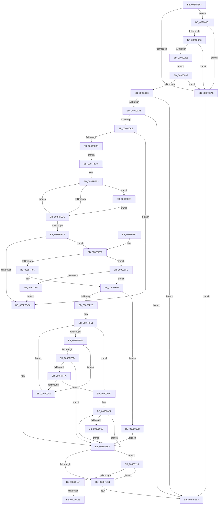

# IopConnectLineBasedInterrupt

- RVA: `0x008FFE64`–`0x00900137` (길이 `723` bytes)
- VA: `0x00000001408FFE64`
- 실행 섹션: `PAGE`
- PDB 이름 있음: `예`; PDB Function 태그: `예`
- unwind 정보 RVA: `0x00088448`
- 디코드: `185`개 명령, `723/723` bytes 표시
- 미해석 바이트: `0` (있으면 어셈블리에 `.byte`로 보존)

> 이 문서는 커널 이미지의 기계어와 PDB 기호를 분석해 생성했습니다. 4번과 5번은 함수 원형과 자료형을 바이너리 사용 방식에서 추정한 C 해석이며 원본 소스 복구 결과는 아닙니다.

## 1. Dependencies

- 직접 호출 지점: **5**; 고유 호출 대상: **5**
- 직접 호출자로 확인된 함수: **1**
- RIP 상대 이미지 참조: **0**

### Outgoing calls
- `0x008FFED4` → [ExFreePoolWithTag](../../poolcode/B8/ExFreePoolWithTag_function_00B82870.md) (function, `0x00B82870`)
- `0x008FFF1A` → [ExAllocatePool2](../../poolcode/B8/ExAllocatePool2_function_00B820F0.md) (function, `0x00B820F0`)
- `0x008FFF42` → [memset](../../text/6C/memset_function_006C6C40.md) (function, `0x006C6C40`)
- `0x008FFFEB` → [IopConnectInterrupt](../90/IopConnectInterrupt_function_00900B40.md) (function, `0x00900B40`)
- `0x00900092` → [IopGetInterruptConnectionData](../90/IopGetInterruptConnectionData_function_009004E4.md) (function, `0x009004E4`)

### Direct callers
- [IoConnectInterruptEx](../90/IoConnectInterruptEx_function_009001F0.md) at `0x009002C8`
- [IoConnectInterruptEx](../90/IoConnectInterruptEx_function_009001F0.md) at `0x009004AB`

### Static image references
- 디코드된 RIP-relative 메모리 참조가 없습니다.

## 2. Other-region calls and transfers

- 다른 실행 섹션으로 향하는 call: **3**
  - `0x008FFED4` → [ExFreePoolWithTag](../../poolcode/B8/ExFreePoolWithTag_function_00B82870.md) (`PAGE` → `POOLCODE`)
  - `0x008FFF1A` → [ExAllocatePool2](../../poolcode/B8/ExAllocatePool2_function_00B820F0.md) (`PAGE` → `POOLCODE`)
  - `0x008FFF42` → [memset](../../text/6C/memset_function_006C6C40.md) (`PAGE` → `.text`)
- call이 아닌 외부 분기/꼬리 이동: **2**
  - `0x00900122` → [sub_00B1FFC6 + 0x16](../B1/Unknown_function_00B1FFC6.md) (`tail-transfer`)
  - `0x00900132` → [sub_00B1FFC6](../B1/Unknown_function_00B1FFC6.md) (`tail-transfer`)

## 3. Assembly (complete function range)

```asm
008FFE64  48 8B C4                        mov rax, rsp
008FFE67  4C 89 48 20                     mov qword ptr [rax + 0x20], r9
008FFE6B  4C 89 40 18                     mov qword ptr [rax + 0x18], r8
008FFE6F  48 89 50 10                     mov qword ptr [rax + 0x10], rdx
008FFE73  48 89 48 08                     mov qword ptr [rax + 8], rcx
008FFE77  55                              push rbp
008FFE78  53                              push rbx
008FFE79  56                              push rsi
008FFE7A  57                              push rdi
008FFE7B  41 54                           push r12
008FFE7D  41 55                           push r13
008FFE7F  41 56                           push r14
008FFE81  41 57                           push r15
008FFE83  48 8D 68 B9                     lea rbp, [rax - 0x47]
008FFE87  48 81 EC D8 00 00 00            sub rsp, 0xd8
008FFE8E  48 83 65 8F 00                  and qword ptr [rbp - 0x71], 0
008FFE93  33 FF                           xor edi, edi
008FFE95  48 83 22 00                     and qword ptr [rdx], 0
008FFE99  45 33 FF                        xor r15d, r15d
008FFE9C  48 85 C9                        test rcx, rcx
008FFE9F  0F 85 1D 02 00 00               jne 0x1409000c2
008FFEA5  B8 0D 00 00 C0                  mov eax, 0xc000000d
008FFEAA  EB 37                           jmp 0x1408ffee3
008FFEAC  4D 8D 46 08                     lea r8, [r14 + 8]
008FFEB0  4C 8B C8                        mov r9, rax
008FFEB3  41 39 38                        cmp dword ptr [r8], edi
008FFEB6  0F 84 2C 02 00 00               je 0x1409000e8
008FFEBC  49 83 C0 58                     add r8, 0x58
008FFEC0  49 83 E9 01                     sub r9, 1
008FFEC4  75 ED                           jne 0x1408ffeb3
008FFEC6  85 F6                           test esi, esi
008FFEC8  75 2E                           jne 0x1408ffef8
008FFECA  BB 0D 00 00 C0                  mov ebx, 0xc000000d
008FFECF  33 D2                           xor edx, edx
008FFED1  49 8B CE                        mov rcx, r14
008FFED4  E8 97 29 28 00                  call 0x140b82870
008FFED9  85 DB                           test ebx, ebx
008FFEDB  0F 88 35 02 00 00               js 0x140900116
008FFEE1  8B C3                           mov eax, ebx
008FFEE3  48 81 C4 D8 00 00 00            add rsp, 0xd8
008FFEEA  41 5F                           pop r15
008FFEEC  41 5E                           pop r14
008FFEEE  41 5D                           pop r13
008FFEF0  41 5C                           pop r12
008FFEF2  5F                              pop rdi
008FFEF3  5E                              pop rsi
008FFEF4  5B                              pop rbx
008FFEF5  5D                              pop rbp
008FFEF6  C3                              ret
008FFEF7  CC                              int3
008FFEF8  44 8A 65 77                     mov r12b, byte ptr [rbp + 0x77]
008FFEFC  45 84 E4                        test r12b, r12b
008FFEFF  0F 85 F9 01 00 00               jne 0x1409000fe
008FFF05  44 8A E2                        mov r12b, dl
008FFF08  8D 14 F5 28 01 00 00            lea edx, [rsi*8 + 0x128]
008FFF0F  B9 40 00 00 00                  mov ecx, 0x40
008FFF14  41 B8 49 6F 69 6E               mov r8d, 0x6e696f49
008FFF1A  E8 D1 21 28 00                  call 0x140b820f0
008FFF1F  48 8B F8                        mov rdi, rax
008FFF22  48 85 C0                        test rax, rax
008FFF25  0F 84 E1 01 00 00               je 0x14090010c
008FFF2B  33 D2                           xor edx, edx
008FFF2D  44 88 A0 20 01 00 00            mov byte ptr [rax + 0x120], r12b
008FFF34  48 8D 4D A3                     lea rcx, [rbp - 0x5d]
008FFF38  89 B0 24 01 00 00               mov dword ptr [rax + 0x124], esi
008FFF3E  44 8D 42 5C                     lea r8d, [rdx + 0x5c]
008FFF42  E8 F9 6C DC FF                  call 0x1406c6c40
008FFF47  45 33 ED                        xor r13d, r13d
008FFF4A  C7 45 9F 01 00 00 00            mov dword ptr [rbp - 0x61], 1
008FFF51  45 3B 2E                        cmp r13d, dword ptr [r14]
008FFF54  0F 83 B0 00 00 00               jae 0x14090000a
008FFF5A  41 8B C5                        mov eax, r13d
008FFF5D  48 6B C8 58                     imul rcx, rax, 0x58
008FFF61  42 83 7C 31 08 00               cmp dword ptr [rcx + r14 + 8], 0
008FFF67  0F 85 95 00 00 00               jne 0x140900002
008FFF6D  42 0F 10 44 31 08               movups xmm0, xmmword ptr [rcx + r14 + 8]
008FFF73  4C 8B 45 5F                     mov r8, qword ptr [rbp + 0x5f]
008FFF77  45 33 C9                        xor r9d, r9d
008FFF7A  42 0F 10 4C 31 18               movups xmm1, xmmword ptr [rcx + r14 + 0x18]
008FFF80  48 8B 55 4F                     mov rdx, qword ptr [rbp + 0x4f]
008FFF84  0F 11 45 A7                     movups xmmword ptr [rbp - 0x59], xmm0
008FFF88  41 8B C7                        mov eax, r15d
008FFF8B  42 0F 10 44 31 28               movups xmm0, xmmword ptr [rcx + r14 + 0x28]
008FFF91  48 83 C0 25                     add rax, 0x25
008FFF95  0F 11 4D B7                     movups xmmword ptr [rbp - 0x49], xmm1
008FFF99  42 0F 10 4C 31 38               movups xmm1, xmmword ptr [rcx + r14 + 0x38]
008FFF9F  0F 11 45 C7                     movups xmmword ptr [rbp - 0x39], xmm0
008FFFA3  42 0F 10 44 31 48               movups xmm0, xmmword ptr [rcx + r14 + 0x48]
008FFFA9  0F 11 4D D7                     movups xmmword ptr [rbp - 0x29], xmm1
008FFFAD  F2 42 0F 10 4C 31 58            movsd xmm1, qword ptr [rcx + r14 + 0x58]
008FFFB4  48 8D 0C C7                     lea rcx, [rdi + rax*8]
008FFFB8  48 8D 45 9F                     lea rax, [rbp - 0x61]
008FFFBC  F2 0F 11 4D F7                  movsd qword ptr [rbp - 9], xmm1
008FFFC1  48 89 44 24 50                  mov qword ptr [rsp + 0x50], rax
008FFFC6  48 8B 45 6F                     mov rax, qword ptr [rbp + 0x6f]
008FFFCA  C6 44 24 40 01                  mov byte ptr [rsp + 0x40], 1
008FFFCF  44 88 64 24 38                  mov byte ptr [rsp + 0x38], r12b
008FFFD4  48 89 44 24 30                  mov qword ptr [rsp + 0x30], rax
008FFFD9  48 8B 45 67                     mov rax, qword ptr [rbp + 0x67]
008FFFDD  83 64 24 28 00                  and dword ptr [rsp + 0x28], 0
008FFFE2  48 89 44 24 20                  mov qword ptr [rsp + 0x20], rax
008FFFE7  0F 11 45 E7                     movups xmmword ptr [rbp - 0x19], xmm0
008FFFEB  E8 50 0B 00 00                  call 0x140900b40
008FFFF0  8B D8                           mov ebx, eax
008FFFF2  85 C0                           test eax, eax
008FFFF4  0F 88 D5 FE FF FF               js 0x1408ffecf
008FFFFA  41 FF C7                        inc r15d
008FFFFD  44 3B FE                        cmp r15d, esi
00900000  73 08                           jae 0x14090000a
00900002  41 FF C5                        inc r13d
00900005  E9 47 FF FF FF                  jmp 0x1408fff51
0090000A  48 8B 87 28 01 00 00            mov rax, qword ptr [rdi + 0x128]
00900011  BA 02 00 00 00                  mov edx, 2
00900016  48 8B CF                        mov rcx, rdi
00900019  48 83 C0 70                     add rax, 0x70
0090001D  44 8D 42 7E                     lea r8d, [rdx + 0x7e]
00900021  0F 10 00                        movups xmm0, xmmword ptr [rax]
00900024  0F 11 01                        movups xmmword ptr [rcx], xmm0
00900027  0F 10 48 10                     movups xmm1, xmmword ptr [rax + 0x10]
0090002B  0F 11 49 10                     movups xmmword ptr [rcx + 0x10], xmm1
0090002F  0F 10 40 20                     movups xmm0, xmmword ptr [rax + 0x20]
00900033  0F 11 41 20                     movups xmmword ptr [rcx + 0x20], xmm0
00900037  0F 10 48 30                     movups xmm1, xmmword ptr [rax + 0x30]
0090003B  0F 11 49 30                     movups xmmword ptr [rcx + 0x30], xmm1
0090003F  0F 10 40 40                     movups xmm0, xmmword ptr [rax + 0x40]
00900043  0F 11 41 40                     movups xmmword ptr [rcx + 0x40], xmm0
00900047  0F 10 48 50                     movups xmm1, xmmword ptr [rax + 0x50]
0090004B  0F 11 49 50                     movups xmmword ptr [rcx + 0x50], xmm1
0090004F  0F 10 40 60                     movups xmm0, xmmword ptr [rax + 0x60]
00900053  0F 11 41 60                     movups xmmword ptr [rcx + 0x60], xmm0
00900057  49 03 C8                        add rcx, r8
0090005A  0F 10 48 70                     movups xmm1, xmmword ptr [rax + 0x70]
0090005E  49 03 C0                        add rax, r8
00900061  0F 11 49 F0                     movups xmmword ptr [rcx - 0x10], xmm1
00900065  48 83 EA 01                     sub rdx, 1
00900069  75 B6                           jne 0x140900021
0090006B  0F 10 00                        movups xmm0, xmmword ptr [rax]
0090006E  0F 11 01                        movups xmmword ptr [rcx], xmm0
00900071  0F 10 48 10                     movups xmm1, xmmword ptr [rax + 0x10]
00900075  48 8B 45 57                     mov rax, qword ptr [rbp + 0x57]
00900079  0F 11 49 10                     movups xmmword ptr [rcx + 0x10], xmm1
0090007D  48 89 38                        mov qword ptr [rax], rdi
00900080  E9 4A FE FF FF                  jmp 0x1408ffecf
00900085  4D 85 C0                        test r8, r8
00900088  0F 84 17 FE FF FF               je 0x1408ffea5
0090008E  48 8D 55 8F                     lea rdx, [rbp - 0x71]
00900092  E8 4D 04 00 00                  call 0x1409004e4
00900097  8B D8                           mov ebx, eax
00900099  85 C0                           test eax, eax
0090009B  0F 88 42 FE FF FF               js 0x1408ffee3
009000A1  4C 8B 75 8F                     mov r14, qword ptr [rbp - 0x71]
009000A5  4D 85 F6                        test r14, r14
009000A8  0F 84 35 FE FF FF               je 0x1408ffee3
009000AE  41 8B 06                        mov eax, dword ptr [r14]
009000B1  33 F6                           xor esi, esi
009000B3  32 D2                           xor dl, dl
009000B5  85 C0                           test eax, eax
009000B7  0F 84 0D FE FF FF               je 0x1408ffeca
009000BD  E9 EA FD FF FF                  jmp 0x1408ffeac
009000C2  48 8B 81 38 01 00 00            mov rax, qword ptr [rcx + 0x138]
009000C9  48 8B 40 28                     mov rax, qword ptr [rax + 0x28]
009000CD  48 85 C0                        test rax, rax
009000D0  0F 84 CF FD FF FF               je 0x1408ffea5
009000D6  F7 80 8C 01 00 00 00 00 02 00   test dword ptr [rax + 0x18c], 0x20000
009000E0  0F 85 BF FD FF FF               jne 0x1408ffea5
009000E6  EB 9D                           jmp 0x140900085
009000E8  41 0F B6 48 08                  movzx ecx, byte ptr [r8 + 8]
009000ED  FF C6                           inc esi
009000EF  3A D1                           cmp dl, cl
009000F1  0F B6 C2                        movzx eax, dl
009000F4  0F 42 C1                        cmovb eax, ecx
009000F7  8A D0                           mov dl, al
009000F9  E9 BE FD FF FF                  jmp 0x1408ffebc
009000FE  44 3A E2                        cmp r12b, dl
00900101  0F 83 01 FE FF FF               jae 0x1408fff08
00900107  E9 BE FD FF FF                  jmp 0x1408ffeca
0090010C  BB 9A 00 00 C0                  mov ebx, 0xc000009a
00900111  E9 B9 FD FF FF                  jmp 0x1408ffecf
00900116  48 85 FF                        test rdi, rdi
00900119  0F 84 C2 FD FF FF               je 0x1408ffee1
0090011F  45 85 FF                        test r15d, r15d
00900122  0F 84 B4 FE 21 00               je 0x140b1ffdc
00900128  48 8D B7 28 01 00 00            lea rsi, [rdi + 0x128]
0090012F  45 8B F7                        mov r14d, r15d
00900132  E9 8F FE 21 00                  jmp 0x140b1ffc6
```

## 4. C-style interpretation (structured pseudocode)

```c
__int64 __fastcall IopConnectLineBasedInterrupt(__int64 a1, __int64 a2, __int64 a3, __int64 a4)
{
    __int64 result;
    __int64 v_r13;
    __int64 v_r15;
    __int64 v_rdi;
    __int64 v_rsi;
    __int64 v_rsp;
    unsigned __int64 v_stack_p20;
    unsigned int v_stack_p28;
    unsigned __int64 v_stack_p30;
    unsigned __int8 v_stack_p38;
    unsigned __int8 v_stack_p40;
    unsigned __int64 v_stack_p50;

    *(unsigned __int64 *)(v_rsp + 32) = a4;
    *(unsigned __int64 *)(v_rsp + 24) = a3;
    *(unsigned __int64 *)(v_rsp + 16) = a2;
    *(unsigned __int64 *)(v_rsp + 8) = a1;
    v_rsp = (v_rsp) - (216);
    v_rdi = 0;
    v_r15 = 0;
    if (a1 != 0) goto loc_009000C2;
loc_008FFEA5:
    goto loc_008FFEE3;
loc_008FFEAC:
loc_008FFEB3:
    if ((*(unsigned int *)(v_r14 + 8)) == 0) goto loc_009000E8;
loc_008FFEBC:
    a3 = (v_r14 + 8) + (88);
    a4 = ((unsigned int)(0xC000000DULL)) - (1);
    if (condition_is_not_equal) goto loc_008FFEB3;
    if ((unsigned int)(v_rsi) != 0) goto loc_008FFEF8;
loc_008FFECA:
loc_008FFECF:
    a2 = 0;
    result = ExFreePoolWithTag(v_r14, a2, a3, a4);
    if (sign_flag) goto loc_00900116;
loc_008FFEE1:
loc_008FFEE3:
    v_rsp = (v_rsp) + (216);
    return (unsigned int)((unsigned int)((unsigned int)(0xC000000DULL)));
loc_008FFEF8:
    if ((unsigned __int8)(*(unsigned __int8 *)(v_rsp - 71 + 119)) != 0) goto loc_009000FE;
loc_008FFF08:
    result = ExAllocatePool2(64, v_rsi * 8 + 296, (unsigned int)(0x6E696F49ULL), a4);
    if (result == 0) goto loc_0090010C;
    a2 = 0;
    *(unsigned __int8 *)(result + 288) = 0;
    *(unsigned int *)(result + 292) = (unsigned int)(v_rsi);
    result = memset(v_rsp - 71 - 93, a2, a2 + 92, a4);
    v_r13 = 0;
    *(unsigned int *)(v_rsp - 71 - 97) = 1;
loc_008FFF51:
    if (0 >= (*(unsigned int *)(v_r14))) goto loc_0090000A;
    a1 = (v_rsp - 71 - 93) * (0);
    if ((*(unsigned int *)(a1 + v_r14 * 1 + 8)) != 0) goto loc_00900002;
    a4 = 0;
    *(unsigned __int64 *)(v_rsp - 71 - 89) = v_xmm0;
    result = (0) + (37);
    *(unsigned __int64 *)(v_rsp - 71 - 73) = v_xmm1;
    *(unsigned __int64 *)(v_rsp - 71 - 57) = v_xmm0;
    *(unsigned __int64 *)(v_rsp - 71 - 41) = v_xmm1;
    *(unsigned __int64 *)(v_rsp - 71 - 9) = v_xmm1;
    v_stack_p50 = v_rsp - 71 - 97;
    v_stack_p40 = 1;
    v_stack_p38 = 0;
    v_stack_p30 = *(unsigned __int64 *)(v_rsp - 71 + 111);
    v_stack_p20 = *(unsigned __int64 *)(v_rsp - 71 + 103);
    *(unsigned __int64 *)(v_rsp - 71 - 25) = v_xmm0;
    result = IopConnectInterrupt(result + result * 8, *(unsigned __int64 *)(v_rsp - 71 + 79), *(unsigned __int64 *)(v_rsp - 71 + 95), a4);
    if (sign_flag) goto loc_008FFECF;
    v_r15 = (unsigned int)((v_r15) + 1);
    if (((unsigned int)(v_r15)) >= ((unsigned int)(v_rsi))) goto loc_0090000A;
loc_00900002:
    v_r13 = (unsigned int)((v_r13) + 1);
    goto loc_008FFF51;
loc_0090000A:
    result = (*(unsigned __int64 *)(result + 296)) + (112);
loc_00900021:
    *(unsigned __int64 *)(result) = v_xmm0;
    *(unsigned __int64 *)(result + 16) = v_xmm1;
    *(unsigned __int64 *)(result + 32) = v_xmm0;
    *(unsigned __int64 *)(result + 48) = v_xmm1;
    *(unsigned __int64 *)(result + 64) = v_xmm0;
    *(unsigned __int64 *)(result + 80) = v_xmm1;
    *(unsigned __int64 *)(result + 96) = v_xmm0;
    a1 = (result) + (2 + 126);
    result = (result) + (2 + 126);
    *(unsigned __int64 *)(a1 - 16) = v_xmm1;
    a2 = (2) - (1);
    if (condition_is_not_equal) goto loc_00900021;
    *(unsigned __int64 *)(a1) = v_xmm0;
    *(unsigned __int64 *)(a1 + 16) = v_xmm1;
    *(unsigned __int64 *)(*(unsigned __int64 *)(v_rsp - 71 + 87)) = result;
    goto loc_008FFECF;
loc_00900085:
    if (2 + 126 == 0) goto loc_008FFEA5;
    result = IopGetInterruptConnectionData(a1, v_rsp - 71 - 113, 2 + 126, a4);
    if (sign_flag) goto loc_008FFEE3;
    if (*(unsigned __int64 *)(v_rsp - 71 - 113) == 0) goto loc_008FFEE3;
    v_rsi = 0;
    a2 = 0;
    if ((unsigned int)((unsigned int)(*(unsigned int *)(*(unsigned __int64 *)(v_rsp - 71 - 113)))) == 0) goto loc_008FFECA;
    goto loc_008FFEAC;
loc_009000C2:
    if (*(unsigned __int64 *)(*(unsigned __int64 *)(a1 + 312) + 40) == 0) goto loc_008FFEA5;
    if (((*(unsigned int *)(*(unsigned __int64 *)(*(unsigned __int64 *)(a1 + 312) + 40) + 396)) & (0x20000ULL)) != 0) goto loc_008FFEA5;
    goto loc_00900085;
loc_009000E8:
    v_rsi = (unsigned int)((v_rsi) + 1);
    result = 0;
    if (0 < ((unsigned __int8)(*(unsigned __int8 *)(2 + 126 + 8)))) { result = (unsigned int)(*(unsigned __int8 *)(2 + 126 + 8)); }
    goto loc_008FFEBC;
loc_009000FE:
    if (0 >= ((unsigned __int8)((unsigned __int8)(result)))) goto loc_008FFF08;
    goto loc_008FFECA;
loc_0090010C:
    goto loc_008FFECF;
loc_00900116:
    if (result == 0) goto loc_008FFEE1;
}
```

## 5. (Beta) C Style

```c
int64_t IopConnectLineBasedInterrupt(int64_t Arg1, void *Arg2, int64_t Arg3, int64_t Arg4)
{
    uint8_t *arg2 = (uint8_t *)Arg2;

    int64_t result;
    int64_t local_r13;
    int64_t local_r15;
    int64_t local_rdi;
    int64_t local_rsi;
    int64_t local_rsp;
    uint64_t v_stack_p20;
    uint32_t v_stack_p28;
    uint64_t v_stack_p30;
    uint8_t v_stack_p38;
    uint8_t v_stack_p40;
    uint64_t v_stack_p50;

    *(uint64_t *)(local_rsp + 0x20) = Arg4;
    *(uint64_t *)(local_rsp + 0x18) = Arg3;
    *(void **)(local_rsp + 0x10) = Arg2;
    *(uint64_t *)(local_rsp + 0x8) = Arg1;
    local_rsp = (local_rsp) - (216);
    local_rdi = 0;
    local_r15 = 0;
    if (Arg1 != 0) goto loc_009000C2;
loc_008FFEA5:
    goto loc_008FFEE3;
loc_008FFEAC:
loc_008FFEB3:
    if ((*(uint32_t *)(local_r14 + 0x8)) == 0) goto loc_009000E8;
loc_008FFEBC:
    Arg3 = (local_r14 + 8) + (88);
    Arg4 = ((uint32_t)(0xC000000DULL)) - (1);
    if (condition_is_not_equal) goto loc_008FFEB3;
    if ((uint32_t)(local_rsi) != 0) goto loc_008FFEF8;
loc_008FFECA:
loc_008FFECF:
    Arg2 = 0;
    result = ExFreePoolWithTag(local_r14, Arg2, Arg3, Arg4);
    if (sign_flag) goto loc_00900116;
loc_008FFEE1:
loc_008FFEE3:
    local_rsp = (local_rsp) + (216);
    return (uint32_t)((uint32_t)((uint32_t)(0xC000000DULL)));
loc_008FFEF8:
    if ((uint8_t)(*(uint8_t *)(local_rsp - 0x47 + 0x77)) != 0) goto loc_009000FE;
loc_008FFF08:
    result = ExAllocatePool2(64, local_rsi * 8 + 296, (uint32_t)(0x6E696F49ULL), Arg4);
    if (result == 0) goto loc_0090010C;
    Arg2 = 0;
    *(uint8_t *)(result + 0x120) = 0;
    *(uint32_t *)(result + 0x124) = (uint32_t)(local_rsi);
    result = memset(local_rsp - 71 - 93, Arg2, Arg2 + 92, Arg4);
    local_r13 = 0;
    *(uint32_t *)(local_rsp - 0x47 - 0x61) = 1;
loc_008FFF51:
    if (0 >= (*(uint32_t *)(local_r14))) goto loc_0090000A;
    Arg1 = (local_rsp - 71 - 93) * (0);
    if ((*(uint32_t *)(Arg1 + local_r14 * 1 + 0x8)) != 0) goto loc_00900002;
    Arg4 = 0;
    *(uint64_t *)(local_rsp - 0x47 - 0x59) = v_xmm0;
    result = (0) + (37);
    *(uint64_t *)(local_rsp - 0x47 - 0x49) = v_xmm1;
    *(uint64_t *)(local_rsp - 0x47 - 0x39) = v_xmm0;
    *(uint64_t *)(local_rsp - 0x47 - 0x29) = v_xmm1;
    *(uint64_t *)(local_rsp - 0x47 - 0x9) = v_xmm1;
    v_stack_p50 = local_rsp - 71 - 97;
    v_stack_p40 = 1;
    v_stack_p38 = 0;
    v_stack_p30 = *(uint64_t *)(local_rsp - 0x47 + 0x6F);
    v_stack_p20 = *(uint64_t *)(local_rsp - 0x47 + 0x67);
    *(uint64_t *)(local_rsp - 0x47 - 0x19) = v_xmm0;
    result = IopConnectInterrupt(result + result * 8, *(uint64_t *)(local_rsp - 0x47 + 0x4F), *(uint64_t *)(local_rsp - 0x47 + 0x5F), Arg4);
    if (sign_flag) goto loc_008FFECF;
    local_r15 = (uint32_t)((local_r15) + 1);
    if (((uint32_t)(local_r15)) >= ((uint32_t)(local_rsi))) goto loc_0090000A;
loc_00900002:
    local_r13 = (uint32_t)((local_r13) + 1);
    goto loc_008FFF51;
loc_0090000A:
    result = (*(uint64_t *)(result + 0x128)) + (112);
loc_00900021:
    *(uint64_t *)(result) = v_xmm0;
    *(uint64_t *)(result + 0x10) = v_xmm1;
    *(uint64_t *)(result + 0x20) = v_xmm0;
    *(uint64_t *)(result + 0x30) = v_xmm1;
    *(uint64_t *)(result + 0x40) = v_xmm0;
    *(uint64_t *)(result + 0x50) = v_xmm1;
    *(uint64_t *)(result + 0x60) = v_xmm0;
    Arg1 = (result) + (2 + 126);
    result = (result) + (2 + 126);
    *(uint64_t *)(Arg1 - 0x10) = v_xmm1;
    Arg2 = (2) - (1);
    if (condition_is_not_equal) goto loc_00900021;
    *(uint64_t *)(Arg1) = v_xmm0;
    *(uint64_t *)(Arg1 + 0x10) = v_xmm1;
    *(uint64_t *)(*(uint64_t *)(local_rsp - 0x47 + 0x57)) = result;
    goto loc_008FFECF;
loc_00900085:
    if (2 + 126 == 0) goto loc_008FFEA5;
    result = IopGetInterruptConnectionData(Arg1, local_rsp - 71 - 113, 2 + 126, Arg4);
    if (sign_flag) goto loc_008FFEE3;
    if (*(uint64_t *)(local_rsp - 0x47 - 0x71) == 0) goto loc_008FFEE3;
    local_rsi = 0;
    Arg2 = 0;
    if ((uint32_t)((uint32_t)(*(uint32_t *)(*(uint64_t *)(local_rsp - 0x47 - 0x71)))) == 0) goto loc_008FFECA;
    goto loc_008FFEAC;
loc_009000C2:
    if (*(uint64_t *)(*(uint64_t *)(Arg1 + 0x138) + 0x28) == 0) goto loc_008FFEA5;
    if (((*(uint32_t *)(*(uint64_t *)(*(uint64_t *)(Arg1 + 0x138) + 0x28) + 0x18C)) & (0x20000ULL)) != 0) goto loc_008FFEA5;
    goto loc_00900085;
loc_009000E8:
    local_rsi = (uint32_t)((local_rsi) + 1);
    result = 0;
    if (0 < ((uint8_t)(*(uint8_t *)(2 + 0x7E + 0x8)))) { result = (uint32_t)(*(uint8_t *)(2 + 0x7E + 0x8)); }
    goto loc_008FFEBC;
loc_009000FE:
    if (0 >= ((uint8_t)((uint8_t)(result)))) goto loc_008FFF08;
    goto loc_008FFECA;
loc_0090010C:
    goto loc_008FFECF;
loc_00900116:
    if (result == 0) goto loc_008FFEE1;
}
```

### 관측된 메모리 오프셋

구조체 형식이 확인되지 않은 접근은 인자 기준의 오프셋으로만 기록했습니다.

| 기준 인자 | 오프셋 표현 | 폭 (bit) | 접근 |
|---|---:|---:|---|
| `Arg2` | `+ 0x0` | `64` | `R/W` |

## 6. Execution-region graph

[열기: 2D/3D 그래프와 함수 탐색 컨트롤 패널](../../../control-panel.html?section=page&rva=0x008FFE64&view=graph)

- 2D 그래프는 위에서 아래로 흐르고, 3D 그래프는 빈 공간을 드래그해 회전합니다. Shift+드래그는 이동, 휠은 확대·축소, 함수 노드 선택은 대상 보고서 이동입니다.

### Static fallback


