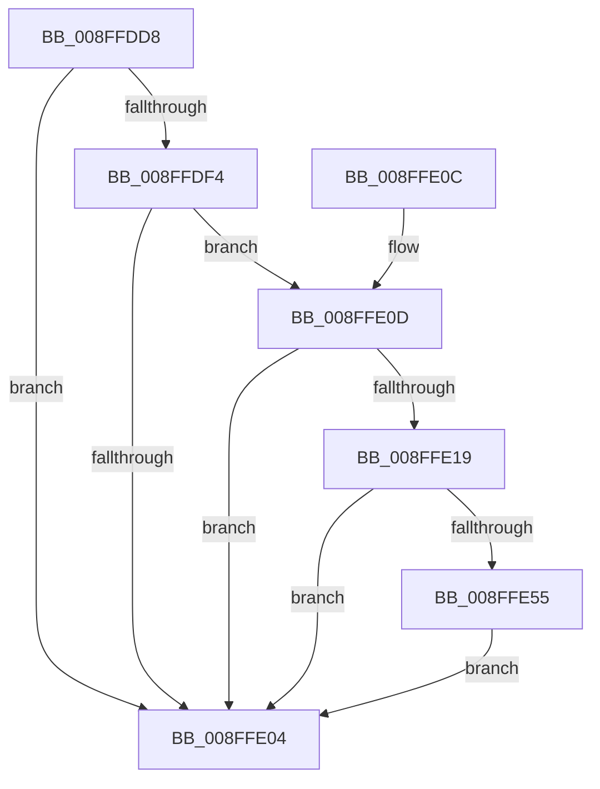

# IopGetSessionIdFromPDO

- RVA: `0x008FFDD8`–`0x008FFE5B` (길이 `131` bytes)
- VA: `0x00000001408FFDD8`
- 실행 섹션: `PAGE`
- PDB 이름 있음: `예`; PDB Function 태그: `아니요`
- unwind 정보 RVA: `0x0008843C`
- 디코드: `34`개 명령, `131/131` bytes 표시
- 미해석 바이트: `0` (있으면 어셈블리에 `.byte`로 보존)

> 이 문서는 커널 이미지의 기계어와 PDB 기호를 분석해 생성했습니다. 4번과 5번은 함수 원형과 자료형을 바이너리 사용 방식에서 추정한 C 해석이며 원본 소스 복구 결과는 아닙니다.

## 1. Dependencies

- 직접 호출 지점: **1**; 고유 호출 대상: **1**
- 직접 호출자로 확인된 함수: **8**
- RIP 상대 이미지 참조: **1**

### Outgoing calls
- `0x008FFE4C` → [IoGetDevicePropertyData](../90/IoGetDevicePropertyData_function_009005E0.md) (function, `0x009005E0`)

### Direct callers
- [IopCheckSessionDeviceAccess](../../text/22/IopCheckSessionDeviceAccess_function_002233D4.md) at `0x0022341C`
- [IopGetSessionIdFromSymbolicName](../70/IopGetSessionIdFromSymbolicName_function_00702084.md) at `0x007020BD`
- [IoRegisterContainerNotification](../71/IoRegisterContainerNotification_function_0071E700.md) at `0x0071E900`
- [PnpNotifyTargetDeviceChangeNotifyEntry](../72/PnpNotifyTargetDeviceChangeNotifyEntry_function_00729D54.md) at `0x00729D92`
- [PnpStartDeviceNode](PnpStartDeviceNode_function_008FE38C.md) at `0x008FE57E`
- [PnpNotifyTargetDeviceChange](../95/PnpNotifyTargetDeviceChange_function_00954790.md) at `0x009549BF`
- [PnpInitializeSessionId](../A9/PnpInitializeSessionId_function_00A949E4.md) at `0x00A94ABD`
- [sub_00B26560](../B2/Unknown_function_00B26560.md) at `0x00B265B2`

### Static image references
- `0x008FFE26` → RVA `0x00011460` (`.rdata`; read)

## 2. Other-region calls and transfers

- 다른 실행 섹션으로 향하는 call: **0**
- 별도 외부 분기/꼬리 이동을 확인하지 못했습니다.

## 3. Assembly (complete function range)

```asm
008FFDD8  40 53                           push rbx
008FFDDA  48 83 EC 40                     sub rsp, 0x40
008FFDDE  83 64 24 60 00                  and dword ptr [rsp + 0x60], 0
008FFDE3  83 CB FF                        or ebx, 0xffffffff
008FFDE6  83 64 24 58 00                  and dword ptr [rsp + 0x58], 0
008FFDEB  89 5C 24 50                     mov dword ptr [rsp + 0x50], ebx
008FFDEF  48 85 C9                        test rcx, rcx
008FFDF2  74 10                           je 0x1408ffe04
008FFDF4  48 8B 81 38 01 00 00            mov rax, qword ptr [rcx + 0x138]
008FFDFB  48 8B 40 28                     mov rax, qword ptr [rax + 0x28]
008FFDFF  48 85 C0                        test rax, rax
008FFE02  75 09                           jne 0x1408ffe0d
008FFE04  8B C3                           mov eax, ebx
008FFE06  48 83 C4 40                     add rsp, 0x40
008FFE0A  5B                              pop rbx
008FFE0B  C3                              ret
008FFE0C  CC                              int3
008FFE0D  F7 80 8C 01 00 00 00 00 02 00   test dword ptr [rax + 0x18c], 0x20000
008FFE17  75 EB                           jne 0x1408ffe04
008FFE19  48 8D 44 24 58                  lea rax, [rsp + 0x58]
008FFE1E  45 33 C9                        xor r9d, r9d
008FFE21  48 89 44 24 38                  mov qword ptr [rsp + 0x38], rax
008FFE26  48 8D 15 33 16 71 FF            lea rdx, [rip - 0x8ee9cd]
008FFE2D  48 8D 44 24 60                  lea rax, [rsp + 0x60]
008FFE32  45 33 C0                        xor r8d, r8d
008FFE35  48 89 44 24 30                  mov qword ptr [rsp + 0x30], rax
008FFE3A  48 8D 44 24 50                  lea rax, [rsp + 0x50]
008FFE3F  48 89 44 24 28                  mov qword ptr [rsp + 0x28], rax
008FFE44  C7 44 24 20 04 00 00 00         mov dword ptr [rsp + 0x20], 4
008FFE4C  E8 8F 07 00 00                  call 0x1409005e0
008FFE51  85 C0                           test eax, eax
008FFE53  78 AF                           js 0x1408ffe04
008FFE55  8B 5C 24 50                     mov ebx, dword ptr [rsp + 0x50]
008FFE59  EB A9                           jmp 0x1408ffe04
```

## 4. C-style interpretation (structured pseudocode)

```c
__int64 __fastcall IopGetSessionIdFromPDO(__int64 a1, __int64 a2, int a3, int a4)
{
    __int64 result;
    __int64 v_rbx;
    __int64 v_rsp;
    unsigned int v_stack_p10;
    unsigned int v_stack_p18;
    unsigned int v_stack_p20;
    unsigned __int64 v_stack_p28;
    unsigned __int64 v_stack_p30;
    unsigned __int64 v_stack_p38;
    unsigned __int64 v_stack_p50;
    unsigned __int64 v_stack_p58;
    unsigned __int64 v_stack_p60;
    unsigned int v_stack_p8;

    v_rsp = (v_rsp) - (64);
    v_rbx = (unsigned int)((v_rbx) | (0xFFFFFFFFULL));
    v_stack_p8 = (unsigned int)(v_rbx);
    if (a1 == 0) goto loc_008FFE04;
    if (*(unsigned __int64 *)(*(unsigned __int64 *)(a1 + 312) + 40) != 0) goto loc_008FFE0D;
loc_008FFE04:
    v_rsp = (v_rsp) + (64);
    return (unsigned int)((unsigned int)(v_rbx));
loc_008FFE0D:
    if (((*(unsigned int *)((unsigned int)((unsigned int)(v_rbx)) + 396)) & (0x20000ULL)) != 0) goto loc_008FFE04;
    a4 = 0;
    v_stack_p38 = v_stack_p58;
    a3 = 0;
    v_stack_p30 = v_stack_p60;
    v_stack_p28 = v_stack_p50;
    v_stack_p20 = 4;
    result = IoGetDevicePropertyData(a1, v_rip - 9365965, a3, a4);
    if (sign_flag) goto loc_008FFE04;
    goto loc_008FFE04;
}
```

## 5. (Beta) C Style

```c
int64_t IopGetSessionIdFromPDO(int64_t Arg1, int64_t Arg2, int32_t Arg3, int32_t Arg4)
{
    int64_t result;
    int64_t local_rbx;
    int64_t local_rsp;
    uint32_t v_stack_p10;
    uint32_t v_stack_p18;
    uint32_t v_stack_p20;
    uint64_t v_stack_p28;
    uint64_t v_stack_p30;
    uint64_t v_stack_p38;
    uint64_t v_stack_p50;
    uint64_t v_stack_p58;
    uint64_t v_stack_p60;
    uint32_t v_stack_p8;

    local_rsp = (local_rsp) - (64);
    local_rbx = (uint32_t)((local_rbx) | (0xFFFFFFFFULL));
    v_stack_p8 = (uint32_t)(local_rbx);
    if (Arg1 == 0) goto loc_008FFE04;
    if (*(uint64_t *)(*(uint64_t *)(Arg1 + 0x138) + 0x28) != 0) goto loc_008FFE0D;
loc_008FFE04:
    local_rsp = (local_rsp) + (64);
    return (uint32_t)((uint32_t)(local_rbx));
loc_008FFE0D:
    if (((*(uint32_t *)((uint32_t)((uint32_t)(local_rbx)) + 0x18C)) & (0x20000ULL)) != 0) goto loc_008FFE04;
    Arg4 = 0;
    v_stack_p38 = v_stack_p58;
    Arg3 = 0;
    v_stack_p30 = v_stack_p60;
    v_stack_p28 = v_stack_p50;
    v_stack_p20 = 4;
    result = IoGetDevicePropertyData(Arg1, v_rip - 9365965, Arg3, Arg4);
    if (sign_flag) goto loc_008FFE04;
    goto loc_008FFE04;
}
```

## 6. Execution-region graph

[열기: 2D/3D 그래프와 함수 탐색 컨트롤 패널](../../../control-panel.html?section=page&rva=0x008FFDD8&view=graph)

- 2D 그래프는 위에서 아래로 흐르고, 3D 그래프는 빈 공간을 드래그해 회전합니다. Shift+드래그는 이동, 휠은 확대·축소, 함수 노드 선택은 대상 보고서 이동입니다.

### Static fallback


