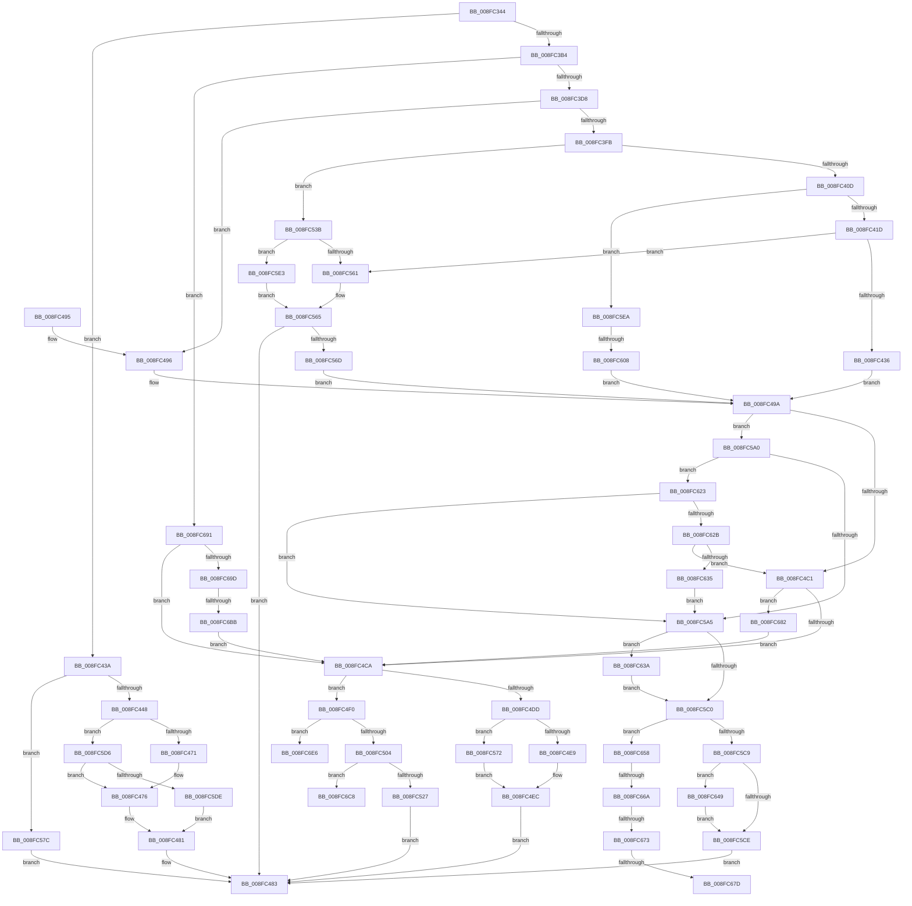

# IopQueryDeviceResources

- RVA: `0x008FC344`–`0x008FC6F1` (길이 `941` bytes)
- VA: `0x00000001408FC344`
- 실행 섹션: `PAGE`
- PDB 이름 있음: `예`; PDB Function 태그: `예`
- unwind 정보 RVA: `0x00087F98`
- 디코드: `253`개 명령, `941/941` bytes 표시
- 미해석 바이트: `0` (있으면 어셈블리에 `.byte`로 보존)

> 이 문서는 커널 이미지의 기계어와 PDB 기호를 분석해 생성했습니다. 4번과 5번은 함수 원형과 자료형을 바이너리 사용 방식에서 추정한 C 해석이며 원본 소스 복구 결과는 아닙니다.

## 1. Dependencies

- 직접 호출 지점: **22**; 고유 호출 대상: **11**
- 직접 호출자로 확인된 함수: **3**
- RIP 상대 이미지 참조: **0**

### Outgoing calls
- `0x008FC395` → [memset](../../text/6C/memset_function_006C6C40.md) (function, `0x006C6C40`)
- `0x008FC3C6` → [PnpGetDeviceResourcesFromRegistry](../A7/PnpGetDeviceResourcesFromRegistry_function_00A74344.md) (function, `0x00A74344`)
- `0x008FC3EE` → [PnpGetDeviceResourcesFromRegistry](../A7/PnpGetDeviceResourcesFromRegistry_function_00A74344.md) (function, `0x00A74344`)
- `0x008FC424` → [PpIrpQueryResourceRequirements](PpIrpQueryResourceRequirements_function_008FC784.md) (function, `0x008FC784`)
- `0x008FC462` → [IopSynchronousCall](IopSynchronousCall_function_008FB018.md) (function, `0x008FB018`)
- `0x008FC479` → [PnpDetermineResourceListSize](PnpDetermineResourceListSize_function_008FC6F8.md) (function, `0x008FC6F8`)
- `0x008FC4B0` → [PnpGetDeviceResourcesFromRegistry](../A7/PnpGetDeviceResourcesFromRegistry_function_00A74344.md) (function, `0x00A74344`)
- `0x008FC4D4` → [IopFilterResourceRequirementsCall](../A9/IopFilterResourceRequirementsCall_function_00A92388.md) (function, `0x00A92388`)
- `0x008FC516` → [ExAllocatePool2](../../poolcode/B8/ExAllocatePool2_function_00B820F0.md) (function, `0x00B820F0`)
- `0x008FC52C` → [ExFreePoolWithTag](../../poolcode/B8/ExFreePoolWithTag_function_00B82870.md) (function, `0x00B82870`)
- `0x008FC554` → [PnpGetDeviceResourcesFromRegistry](../A7/PnpGetDeviceResourcesFromRegistry_function_00A74344.md) (function, `0x00A74344`)
- `0x008FC58A` → [PnpGetDeviceResourcesFromRegistry](../A7/PnpGetDeviceResourcesFromRegistry_function_00A74344.md) (function, `0x00A74344`)
- `0x008FC5B3` → [PnpFilterResourceRequirementsList](../AD/PnpFilterResourceRequirementsList_function_00AD0D7C.md) (function, `0x00AD0D7C`)
- `0x008FC5F7` → [ExAllocatePool2](../../poolcode/B8/ExAllocatePool2_function_00B820F0.md) (function, `0x00B820F0`)
- `0x008FC619` → [memcpy](../../text/6C/memcpy_function_006C6840.md) (function, `0x006C6840`)
- `0x008FC63F` → [ExFreePoolWithTag](../../poolcode/B8/ExFreePoolWithTag_function_00B82870.md) (function, `0x00B82870`)
- `0x008FC64E` → [ExFreePoolWithTag](../../poolcode/B8/ExFreePoolWithTag_function_00B82870.md) (function, `0x00B82870`)
- `0x008FC687` → [ExFreePoolWithTag](../../poolcode/B8/ExFreePoolWithTag_function_00B82870.md) (function, `0x00B82870`)
- `0x008FC6A0` → [PnpCmResourcesToIoResources](../73/PnpCmResourcesToIoResources_function_0073D584.md) (function, `0x0073D584`)
- `0x008FC6AD` → [ExFreePoolWithTag](../../poolcode/B8/ExFreePoolWithTag_function_00B82870.md) (function, `0x00B82870`)
- `0x008FC6D1` → [memcpy](../../text/6C/memcpy_function_006C6840.md) (function, `0x006C6840`)
- `0x008FC6DB` → [ExFreePoolWithTag](../../poolcode/B8/ExFreePoolWithTag_function_00B82870.md) (function, `0x00B82870`)

### Direct callers
- [PiQueryAndAllocateBootResources](PiQueryAndAllocateBootResources_function_008FDB10.md) at `0x008FDB58`
- [IopReleaseDeviceResources](../A0/IopReleaseDeviceResources_function_00A0867C.md) at `0x00A086DC`
- [PnpGetResourceRequirementsForAssignTable](../A2/PnpGetResourceRequirementsForAssignTable_function_00A2ADBC.md) at `0x00A2AE73`

### Static image references
- 디코드된 RIP-relative 메모리 참조가 없습니다.

## 2. Other-region calls and transfers

- 다른 실행 섹션으로 향하는 call: **11**
  - `0x008FC395` → [memset](../../text/6C/memset_function_006C6C40.md) (`PAGE` → `.text`)
  - `0x008FC516` → [ExAllocatePool2](../../poolcode/B8/ExAllocatePool2_function_00B820F0.md) (`PAGE` → `POOLCODE`)
  - `0x008FC52C` → [ExFreePoolWithTag](../../poolcode/B8/ExFreePoolWithTag_function_00B82870.md) (`PAGE` → `POOLCODE`)
  - `0x008FC5F7` → [ExAllocatePool2](../../poolcode/B8/ExAllocatePool2_function_00B820F0.md) (`PAGE` → `POOLCODE`)
  - `0x008FC619` → [memcpy](../../text/6C/memcpy_function_006C6840.md) (`PAGE` → `.text`)
  - `0x008FC63F` → [ExFreePoolWithTag](../../poolcode/B8/ExFreePoolWithTag_function_00B82870.md) (`PAGE` → `POOLCODE`)
  - `0x008FC64E` → [ExFreePoolWithTag](../../poolcode/B8/ExFreePoolWithTag_function_00B82870.md) (`PAGE` → `POOLCODE`)
  - `0x008FC687` → [ExFreePoolWithTag](../../poolcode/B8/ExFreePoolWithTag_function_00B82870.md) (`PAGE` → `POOLCODE`)
  - `0x008FC6AD` → [ExFreePoolWithTag](../../poolcode/B8/ExFreePoolWithTag_function_00B82870.md) (`PAGE` → `POOLCODE`)
  - `0x008FC6D1` → [memcpy](../../text/6C/memcpy_function_006C6840.md) (`PAGE` → `.text`)
  - `0x008FC6DB` → [ExFreePoolWithTag](../../poolcode/B8/ExFreePoolWithTag_function_00B82870.md) (`PAGE` → `POOLCODE`)
- call이 아닌 외부 분기/꼬리 이동: **8**
  - `0x008FC602` → [sub_00B1FB42](../B1/Unknown_function_00B1FB42.md) (`tail-transfer`)
  - `0x008FC664` → [sub_00B1FB42 + 0x64](../B1/Unknown_function_00B1FB42.md) (`tail-transfer`)
  - `0x008FC66D` → [sub_00B1FB42 + 0xA](../B1/Unknown_function_00B1FB42.md) (`tail-transfer`)
  - `0x008FC677` → [sub_00B1FB42 + 0xA](../B1/Unknown_function_00B1FB42.md) (`tail-transfer`)
  - `0x008FC67D` → [sub_00B1FB42 + 0x64](../B1/Unknown_function_00B1FB42.md) (`tail-transfer`)
  - `0x008FC6B5` → [sub_00B1FB42 + 0x6B](../B1/Unknown_function_00B1FB42.md) (`tail-transfer`)
  - `0x008FC6E1` → [sub_00B1FB42 + 0x76](../B1/Unknown_function_00B1FB42.md) (`tail-transfer`)
  - `0x008FC6EC` → [sub_00B1FB42 + 0x76](../B1/Unknown_function_00B1FB42.md) (`tail-transfer`)

## 3. Assembly (complete function range)

```asm
008FC344  48 89 4C 24 08                  mov qword ptr [rsp + 8], rcx
008FC349  55                              push rbp
008FC34A  53                              push rbx
008FC34B  56                              push rsi
008FC34C  57                              push rdi
008FC34D  41 55                           push r13
008FC34F  41 56                           push r14
008FC351  41 57                           push r15
008FC353  48 8D 6C 24 D9                  lea rbp, [rsp - 0x27]
008FC358  48 81 EC C0 00 00 00            sub rsp, 0xc0
008FC35F  33 FF                           xor edi, edi
008FC361  4D 8B F0                        mov r14, r8
008FC364  49 89 38                        mov qword ptr [r8], rdi
008FC367  8B DA                           mov ebx, edx
008FC369  4C 8B E9                        mov r13, rcx
008FC36C  48 89 7D 7F                     mov qword ptr [rbp + 0x7f], rdi
008FC370  33 D2                           xor edx, edx
008FC372  48 89 7D CF                     mov qword ptr [rbp - 0x31], rdi
008FC376  44 8D 47 48                     lea r8d, [rdi + 0x48]
008FC37A  48 89 7D C7                     mov qword ptr [rbp - 0x39], rdi
008FC37E  48 8D 4D D7                     lea rcx, [rbp - 0x29]
008FC382  48 89 7D A7                     mov qword ptr [rbp - 0x59], rdi
008FC386  4D 8B F9                        mov r15, r9
008FC389  48 89 7D B7                     mov qword ptr [rbp - 0x49], rdi
008FC38D  8B F7                           mov esi, edi
008FC38F  89 7D 77                        mov dword ptr [rbp + 0x77], edi
008FC392  41 89 39                        mov dword ptr [r9], edi
008FC395  E8 A6 A8 DC FF                  call 0x1406c6c40
008FC39A  49 8B 85 38 01 00 00            mov rax, qword ptr [r13 + 0x138]
008FC3A1  49 8B CD                        mov rcx, r13
008FC3A4  48 8B 40 28                     mov rax, qword ptr [rax + 0x28]
008FC3A8  48 89 45 AF                     mov qword ptr [rbp - 0x51], rax
008FC3AC  85 DB                           test ebx, ebx
008FC3AE  0F 84 86 00 00 00               je 0x1408fc43a
008FC3B4  48 8D 45 6F                     lea rax, [rbp + 0x6f]
008FC3B8  4D 8B CE                        mov r9, r14
008FC3BB  33 D2                           xor edx, edx
008FC3BD  48 89 44 24 20                  mov qword ptr [rsp + 0x20], rax
008FC3C2  44 8D 47 02                     lea r8d, [rdi + 2]
008FC3C6  E8 79 7F 17 00                  call 0x140a74344
008FC3CB  BB 34 00 00 C0                  mov ebx, 0xc0000034
008FC3D0  3B C3                           cmp eax, ebx
008FC3D2  0F 85 B9 02 00 00               jne 0x1408fc691
008FC3D8  8D 57 01                        lea edx, [rdi + 1]
008FC3DB  49 8B CD                        mov rcx, r13
008FC3DE  48 8D 45 6F                     lea rax, [rbp + 0x6f]
008FC3E2  44 8B C2                        mov r8d, edx
008FC3E5  4C 8D 4D 7F                     lea r9, [rbp + 0x7f]
008FC3E9  48 89 44 24 20                  mov qword ptr [rsp + 0x20], rax
008FC3EE  E8 51 7F 17 00                  call 0x140a74344
008FC3F3  3B C3                           cmp eax, ebx
008FC3F5  0F 85 9B 00 00 00               jne 0x1408fc496
008FC3FB  48 8B 4D AF                     mov rcx, qword ptr [rbp - 0x51]
008FC3FF  8B 81 8C 01 00 00               mov eax, dword ptr [rcx + 0x18c]
008FC405  A8 01                           test al, 1
008FC407  0F 85 2E 01 00 00               jne 0x1408fc53b
008FC40D  48 8B 81 B8 01 00 00            mov rax, qword ptr [rcx + 0x1b8]
008FC414  48 85 C0                        test rax, rax
008FC417  0F 85 CD 01 00 00               jne 0x1408fc5ea
008FC41D  48 8D 55 7F                     lea rdx, [rbp + 0x7f]
008FC421  49 8B CD                        mov rcx, r13
008FC424  E8 5B 03 00 00                  call 0x1408fc784
008FC429  BE BB 00 00 C0                  mov esi, 0xc00000bb
008FC42E  3B C6                           cmp eax, esi
008FC430  0F 85 2B 01 00 00               jne 0x1408fc561
008FC436  8B F7                           mov esi, edi
008FC438  EB 60                           jmp 0x1408fc49a
008FC43A  8B 80 8C 01 00 00               mov eax, dword ptr [rax + 0x18c]
008FC440  A8 01                           test al, 1
008FC442  0F 85 34 01 00 00               jne 0x1408fc57c
008FC448  BE BB 00 00 C0                  mov esi, 0xc00000bb
008FC44D  66 C7 45 D7 1B 0A               mov word ptr [rbp - 0x29], 0xa1b
008FC453  44 8B C6                        mov r8d, esi
008FC456  4C 89 74 24 20                  mov qword ptr [rsp + 0x20], r14
008FC45B  45 33 C9                        xor r9d, r9d
008FC45E  48 8D 55 D7                     lea rdx, [rbp - 0x29]
008FC462  E8 B1 EB FF FF                  call 0x1408fb018
008FC467  8B D8                           mov ebx, eax
008FC469  3B C6                           cmp eax, esi
008FC46B  0F 85 65 01 00 00               jne 0x1408fc5d6
008FC471  49 89 3E                        mov qword ptr [r14], rdi
008FC474  8B DF                           mov ebx, edi
008FC476  49 8B 0E                        mov rcx, qword ptr [r14]
008FC479  E8 7A 02 00 00                  call 0x1408fc6f8
008FC47E  41 89 07                        mov dword ptr [r15], eax
008FC481  8B C3                           mov eax, ebx
008FC483  48 81 C4 C0 00 00 00            add rsp, 0xc0
008FC48A  41 5F                           pop r15
008FC48C  41 5E                           pop r14
008FC48E  41 5D                           pop r13
008FC490  5F                              pop rdi
008FC491  5E                              pop rsi
008FC492  5B                              pop rbx
008FC493  5D                              pop rbp
008FC494  C3                              ret
008FC495  CC                              int3
008FC496  48 8B 75 7F                     mov rsi, qword ptr [rbp + 0x7f]
008FC49A  33 D2                           xor edx, edx
008FC49C  48 8D 45 6F                     lea rax, [rbp + 0x6f]
008FC4A0  4C 8D 4D C7                     lea r9, [rbp - 0x39]
008FC4A4  48 89 44 24 20                  mov qword ptr [rsp + 0x20], rax
008FC4A9  49 8B CD                        mov rcx, r13
008FC4AC  44 8D 42 04                     lea r8d, [rdx + 4]
008FC4B0  E8 8F 7E 17 00                  call 0x140a74344
008FC4B5  48 8B 5D C7                     mov rbx, qword ptr [rbp - 0x39]
008FC4B9  85 C0                           test eax, eax
008FC4BB  0F 89 DF 00 00 00               jns 0x1408fc5a0
008FC4C1  48 85 DB                        test rbx, rbx
008FC4C4  0F 85 B8 01 00 00               jne 0x1408fc682
008FC4CA  4C 8D 45 CF                     lea r8, [rbp - 0x31]
008FC4CE  48 8B D6                        mov rdx, rsi
008FC4D1  49 8B CD                        mov rcx, r13
008FC4D4  E8 AF 5E 19 00                  call 0x140a92388
008FC4D9  85 C0                           test eax, eax
008FC4DB  79 13                           jns 0x1408fc4f0
008FC4DD  49 89 36                        mov qword ptr [r14], rsi
008FC4E0  48 85 F6                        test rsi, rsi
008FC4E3  0F 85 89 00 00 00               jne 0x1408fc572
008FC4E9  41 89 3F                        mov dword ptr [r15], edi
008FC4EC  33 C0                           xor eax, eax
008FC4EE  EB 93                           jmp 0x1408fc483
008FC4F0  48 8B 5D CF                     mov rbx, qword ptr [rbp - 0x31]
008FC4F4  89 7D BB                        mov dword ptr [rbp - 0x45], edi
008FC4F7  48 89 7D 67                     mov qword ptr [rbp + 0x67], rdi
008FC4FB  48 85 DB                        test rbx, rbx
008FC4FE  0F 84 E2 01 00 00               je 0x1408fc6e6
008FC504  8B 03                           mov eax, dword ptr [rbx]
008FC506  B9 00 01 00 00                  mov ecx, 0x100
008FC50B  8B D0                           mov edx, eax
008FC50D  41 89 07                        mov dword ptr [r15], eax
008FC510  41 B8 50 70 20 20               mov r8d, 0x20207050
008FC516  E8 D5 5B 28 00                  call 0x140b820f0
008FC51B  49 89 06                        mov qword ptr [r14], rax
008FC51E  48 85 C0                        test rax, rax
008FC521  0F 85 A1 01 00 00               jne 0x1408fc6c8
008FC527  33 D2                           xor edx, edx
008FC529  48 8B CB                        mov rcx, rbx
008FC52C  E8 3F 63 28 00                  call 0x140b82870
008FC531  B8 9A 00 00 C0                  mov eax, 0xc000009a
008FC536  E9 48 FF FF FF                  jmp 0x1408fc483
008FC53B  BA 01 00 00 00                  mov edx, 1
008FC540  48 8D 45 6F                     lea rax, [rbp + 0x6f]
008FC544  4C 8D 4D 7F                     lea r9, [rbp + 0x7f]
008FC548  48 89 44 24 20                  mov qword ptr [rsp + 0x20], rax
008FC54D  49 8B CD                        mov rcx, r13
008FC550  44 8D 42 01                     lea r8d, [rdx + 1]
008FC554  E8 EB 7D 17 00                  call 0x140a74344
008FC559  3B C3                           cmp eax, ebx
008FC55B  0F 84 82 00 00 00               je 0x1408fc5e3
008FC561  48 8B 75 7F                     mov rsi, qword ptr [rbp + 0x7f]
008FC565  85 C0                           test eax, eax
008FC567  0F 88 16 FF FF FF               js 0x1408fc483
008FC56D  E9 28 FF FF FF                  jmp 0x1408fc49a
008FC572  8B 06                           mov eax, dword ptr [rsi]
008FC574  41 89 07                        mov dword ptr [r15], eax
008FC577  E9 70 FF FF FF                  jmp 0x1408fc4ec
008FC57C  33 D2                           xor edx, edx
008FC57E  4C 89 7C 24 20                  mov qword ptr [rsp + 0x20], r15
008FC583  4D 8B CE                        mov r9, r14
008FC586  44 8D 42 07                     lea r8d, [rdx + 7]
008FC58A  E8 B5 7D 17 00                  call 0x140a74344
008FC58F  BB 34 00 00 C0                  mov ebx, 0xc0000034
008FC594  3B C3                           cmp eax, ebx
008FC596  0F 45 F8                        cmovne edi, eax
008FC599  8B C7                           mov eax, edi
008FC59B  E9 E3 FE FF FF                  jmp 0x1408fc483
008FC5A0  48 85 DB                        test rbx, rbx
008FC5A3  75 7E                           jne 0x1408fc623
008FC5A5  4C 8D 4D 77                     lea r9, [rbp + 0x77]
008FC5A9  48 8B D3                        mov rdx, rbx
008FC5AC  4C 8D 45 A7                     lea r8, [rbp - 0x59]
008FC5B0  48 8B CE                        mov rcx, rsi
008FC5B3  E8 C4 47 1D 00                  call 0x140ad0d7c
008FC5B8  44 8B E8                        mov r13d, eax
008FC5BB  48 85 DB                        test rbx, rbx
008FC5BE  75 7A                           jne 0x1408fc63a
008FC5C0  45 85 ED                        test r13d, r13d
008FC5C3  0F 89 8F 00 00 00               jns 0x1408fc658
008FC5C9  48 85 F6                        test rsi, rsi
008FC5CC  75 7B                           jne 0x1408fc649
008FC5CE  41 8B C5                        mov eax, r13d
008FC5D1  E9 AD FE FF FF                  jmp 0x1408fc483
008FC5D6  85 C0                           test eax, eax
008FC5D8  0F 89 98 FE FF FF               jns 0x1408fc476
008FC5DE  E9 9E FE FF FF                  jmp 0x1408fc481
008FC5E3  8B C7                           mov eax, edi
008FC5E5  E9 7B FF FF FF                  jmp 0x1408fc565
008FC5EA  8B 10                           mov edx, dword ptr [rax]
008FC5EC  B9 00 01 00 00                  mov ecx, 0x100
008FC5F1  41 B8 50 70 20 20               mov r8d, 0x20207050
008FC5F7  E8 F4 5A 28 00                  call 0x140b820f0
008FC5FC  48 8B F0                        mov rsi, rax
008FC5FF  48 85 C0                        test rax, rax
008FC602  0F 84 3A 35 22 00               je 0x140b1fb42
008FC608  48 8B 55 AF                     mov rdx, qword ptr [rbp - 0x51]
008FC60C  48 8B C8                        mov rcx, rax
008FC60F  48 8B 92 B8 01 00 00            mov rdx, qword ptr [rdx + 0x1b8]
008FC616  44 8B 02                        mov r8d, dword ptr [rdx]
008FC619  E8 22 A2 DC FF                  call 0x1406c6840
008FC61E  E9 77 FE FF FF                  jmp 0x1408fc49a
008FC623  39 3B                           cmp dword ptr [rbx], edi
008FC625  0F 84 7A FF FF FF               je 0x1408fc5a5
008FC62B  83 7B 04 05                     cmp dword ptr [rbx + 4], 5
008FC62F  0F 84 8C FE FF FF               je 0x1408fc4c1
008FC635  E9 6B FF FF FF                  jmp 0x1408fc5a5
008FC63A  33 D2                           xor edx, edx
008FC63C  48 8B CB                        mov rcx, rbx
008FC63F  E8 2C 62 28 00                  call 0x140b82870
008FC644  E9 77 FF FF FF                  jmp 0x1408fc5c0
008FC649  33 D2                           xor edx, edx
008FC64B  48 8B CE                        mov rcx, rsi
008FC64E  E8 1D 62 28 00                  call 0x140b82870
008FC653  E9 76 FF FF FF                  jmp 0x1408fc5ce
008FC658  48 8B 45 AF                     mov rax, qword ptr [rbp - 0x51]
008FC65C  8B 80 8C 01 00 00               mov eax, dword ptr [rax + 0x18c]
008FC662  A8 01                           test al, 1
008FC664  0F 85 3C 35 22 00               jne 0x140b1fba6
008FC66A  39 7D 77                        cmp dword ptr [rbp + 0x77], edi
008FC66D  0F 84 D9 34 22 00               je 0x140b1fb4c
008FC673  83 7E 1C 01                     cmp dword ptr [rsi + 0x1c], 1
008FC677  0F 87 CF 34 22 00               ja 0x140b1fb4c
008FC67D  E9 24 35 22 00                  jmp 0x140b1fba6
008FC682  33 D2                           xor edx, edx
008FC684  48 8B CB                        mov rcx, rbx
008FC687  E8 E4 61 28 00                  call 0x140b82870
008FC68C  E9 39 FE FF FF                  jmp 0x1408fc4ca
008FC691  49 8B 16                        mov rdx, qword ptr [r14]
008FC694  48 85 D2                        test rdx, rdx
008FC697  0F 84 2D FE FF FF               je 0x1408fc4ca
008FC69D  45 33 C0                        xor r8d, r8d
008FC6A0  E8 DF 0E E4 FF                  call 0x14073d584
008FC6A5  49 8B 0E                        mov rcx, qword ptr [r14]
008FC6A8  33 D2                           xor edx, edx
008FC6AA  48 8B F0                        mov rsi, rax
008FC6AD  E8 BE 61 28 00                  call 0x140b82870
008FC6B2  48 85 F6                        test rsi, rsi
008FC6B5  0F 84 F2 34 22 00               je 0x140b1fbad
008FC6BB  49 89 36                        mov qword ptr [r14], rsi
008FC6BE  8B 06                           mov eax, dword ptr [rsi]
008FC6C0  41 89 07                        mov dword ptr [r15], eax
008FC6C3  E9 02 FE FF FF                  jmp 0x1408fc4ca
008FC6C8  45 8B 07                        mov r8d, dword ptr [r15]
008FC6CB  48 8B D3                        mov rdx, rbx
008FC6CE  48 8B C8                        mov rcx, rax
008FC6D1  E8 6A A1 DC FF                  call 0x1406c6840
008FC6D6  33 D2                           xor edx, edx
008FC6D8  48 8B CB                        mov rcx, rbx
008FC6DB  E8 90 61 28 00                  call 0x140b82870
008FC6E0  90                              nop
008FC6E1  E9 D2 34 22 00                  jmp 0x140b1fbb8
008FC6E6  41 89 3F                        mov dword ptr [r15], edi
008FC6E9  49 89 3E                        mov qword ptr [r14], rdi
008FC6EC  E9 C7 34 22 00                  jmp 0x140b1fbb8
```

## 4. C-style interpretation (structured pseudocode)

```c
__int64 __fastcall IopQueryDeviceResources(__int64 a1, int a2, __int64 a3, __int64 a4)
{
    __int64 result;
    __int64 v_rdi;
    __int64 v_rsp;
    unsigned __int64 v_stack_m5F;
    unsigned __int64 v_stack_m88;
    unsigned __int64 v_stack_m90;
    unsigned __int64 v_stack_m98;
    unsigned int v_stack_mA4;
    unsigned __int64 v_stack_mA8;
    unsigned __int64 v_stack_mB0;
    unsigned __int64 v_stack_mB8;
    unsigned __int64 v_stack_mD8;
    unsigned __int64 v_stack_p10;
    unsigned int v_stack_p18;
    unsigned __int64 v_stack_p20;
    unsigned __int64 v_stack_p8;

    v_stack_p8 = a1;
    v_rsp = (v_rsp) - (192);
    v_rdi = 0;
    *(unsigned __int64 *)(a3) = 0;
    v_stack_p20 = 0;
    a2 = 0;
    v_stack_m90 = 0;
    v_stack_m98 = 0;
    v_stack_mB8 = 0;
    v_stack_mA8 = 0;
    v_stack_p18 = 0;
    *(unsigned int *)(a4) = 0;
    result = memset(v_stack_m88, a2, v_rdi + 72, a4);
    v_stack_mB0 = *(unsigned __int64 *)(*(unsigned __int64 *)(a1 + 312) + 40);
    if ((unsigned int)((unsigned int)(a2)) == 0) goto loc_008FC43A;
    a2 = 0;
    v_stack_mD8 = v_stack_p10;
    result = PnpGetDeviceResourcesFromRegistry(a1, a2, v_rdi + 2, a3);
    if (((unsigned int)(result)) != ((unsigned int)((unsigned int)(0xC0000034ULL)))) goto loc_008FC691;
    v_stack_mD8 = v_stack_p10;
    result = PnpGetDeviceResourcesFromRegistry(a1, v_rdi + 1, (unsigned int)((unsigned int)(v_rdi + 1)), v_stack_p20);
    if (((unsigned int)(result)) != ((unsigned int)((unsigned int)(0xC0000034ULL)))) goto loc_008FC496;
    if ((((unsigned __int8)((unsigned int)(*(unsigned int *)(v_stack_mB0 + 396)))) & (1)) != 0) goto loc_008FC53B;
    if (*(unsigned __int64 *)(v_stack_mB0 + 440) != 0) goto loc_008FC5EA;
    result = PpIrpQueryResourceRequirements(a1, v_stack_p20, (unsigned int)((unsigned int)(v_rdi + 1)), v_stack_p20);
    if (((unsigned int)(result)) != ((unsigned int)((unsigned int)(0xC00000BBULL)))) goto loc_008FC561;
    goto loc_008FC49A;
loc_008FC43A:
    if ((((unsigned __int8)((unsigned int)(*(unsigned int *)(result + 396)))) & (1)) != 0) goto loc_008FC57C;
    v_stack_m88 = 0xA1BULL;
    v_stack_mD8 = a3;
    a4 = 0;
    result = IopSynchronousCall(a1, v_stack_m88, (unsigned int)((unsigned int)((unsigned int)(0xC00000BBULL))), a4);
    if (((unsigned int)(result)) != ((unsigned int)((unsigned int)(0xC00000BBULL)))) goto loc_008FC5D6;
    *(unsigned __int64 *)(a3) = 0;
loc_008FC476:
    result = PnpDetermineResourceListSize(*(unsigned __int64 *)(a3), v_stack_m88, (unsigned int)((unsigned int)((unsigned int)(0xC00000BBULL))), a4);
    *(unsigned int *)(a4) = (unsigned int)(result);
loc_008FC481:
loc_008FC483:
    v_rsp = (v_rsp) + (192);
    return 0;
loc_008FC496:
loc_008FC49A:
    a2 = 0;
    v_stack_p20 = v_stack_p10;
    result = PnpGetDeviceResourcesFromRegistry(a1, a2, a2 + 4, v_stack_m98);
    if (!sign_flag) goto loc_008FC5A0;
loc_008FC4C1:
    if (v_stack_m98 != 0) goto loc_008FC682;
loc_008FC4CA:
    result = IopFilterResourceRequirementsCall(a1, v_stack_p20, v_stack_m90, v_stack_m98);
    if (!sign_flag) goto loc_008FC4F0;
    *(unsigned __int64 *)(a3) = v_stack_p20;
    if (v_stack_p20 != 0) goto loc_008FC572;
    *(unsigned int *)(a4) = 0;
loc_008FC4EC:
    result = 0;
    goto loc_008FC483;
loc_008FC4F0:
    v_stack_mA4 = 0;
    v_stack_p8 = 0;
    if (v_stack_m90 == 0) goto loc_008FC6E6;
    *(unsigned int *)(a4) = (unsigned int)((unsigned int)(*(unsigned int *)(v_stack_m90)));
    result = ExAllocatePool2(256, (unsigned int)((unsigned int)((unsigned int)(*(unsigned int *)(v_stack_m90)))), (unsigned int)(0x20207050ULL), v_stack_m98);
    *(unsigned __int64 *)(a3) = result;
    if (result != 0) goto loc_008FC6C8;
    a2 = 0;
    result = ExFreePoolWithTag(v_stack_m90, a2, (unsigned int)(0x20207050ULL), v_stack_m98);
    goto loc_008FC483;
loc_008FC53B:
    v_stack_p20 = v_stack_p10;
    result = PnpGetDeviceResourcesFromRegistry(a1, 1, 1 + 1, v_stack_p20);
    if (((unsigned int)(result)) == ((unsigned int)(v_stack_m90))) goto loc_008FC5E3;
loc_008FC561:
loc_008FC565:
    if (sign_flag) goto loc_008FC483;
    goto loc_008FC49A;
loc_008FC572:
    *(unsigned int *)(a4) = (unsigned int)((unsigned int)(*(unsigned int *)(v_stack_p20)));
    goto loc_008FC4EC;
loc_008FC57C:
    a2 = 0;
    v_stack_p20 = 0;
    result = PnpGetDeviceResourcesFromRegistry(a1, a2, a2 + 7, a3);
    if (((unsigned int)(result)) != ((unsigned int)((unsigned int)(0xC0000034ULL)))) { v_rdi = (unsigned int)(result); }
    goto loc_008FC483;
loc_008FC5A0:
    if ((unsigned int)(0xC0000034ULL) != 0) goto loc_008FC623;
loc_008FC5A5:
    result = PnpFilterResourceRequirementsList(v_stack_p20, (unsigned int)(0xC0000034ULL), v_stack_mB8, v_stack_p18);
    if ((unsigned int)(0xC0000034ULL) != 0) goto loc_008FC63A;
loc_008FC5C0:
    if (!sign_flag) goto loc_008FC658;
    if (v_stack_p20 != 0) goto loc_008FC649;
loc_008FC5CE:
    goto loc_008FC483;
loc_008FC5D6:
    if (!sign_flag) goto loc_008FC476;
    goto loc_008FC481;
loc_008FC5E3:
    goto loc_008FC565;
loc_008FC5EA:
    result = ExAllocatePool2(256, (unsigned int)(*(unsigned int *)((unsigned int)((unsigned int)(v_rdi)))), (unsigned int)(0x20207050ULL), v_stack_p18);
    result = memcpy(result, *(unsigned __int64 *)(v_stack_mB0 + 440), (unsigned int)(*(unsigned int *)(*(unsigned __int64 *)(v_stack_mB0 + 440))), v_stack_p18);
    goto loc_008FC49A;
loc_008FC623:
    if ((*(unsigned int *)((unsigned int)(0xC0000034ULL))) == ((unsigned int)(v_rdi))) goto loc_008FC5A5;
    if ((*(unsigned int *)((unsigned int)(0xC0000034ULL) + 4)) == 5) goto loc_008FC4C1;
    goto loc_008FC5A5;
loc_008FC63A:
    a2 = 0;
    result = ExFreePoolWithTag((unsigned int)(0xC0000034ULL), a2, (unsigned int)(*(unsigned int *)(*(unsigned __int64 *)(v_stack_mB0 + 440))), v_stack_p18);
    goto loc_008FC5C0;
loc_008FC649:
    a2 = 0;
    result = ExFreePoolWithTag(result, a2, (unsigned int)(*(unsigned int *)(*(unsigned __int64 *)(v_stack_mB0 + 440))), v_stack_p18);
    goto loc_008FC5CE;
loc_008FC658:
loc_008FC682:
    a2 = 0;
    result = ExFreePoolWithTag((unsigned int)(0xC0000034ULL), a2, (unsigned int)(*(unsigned int *)(*(unsigned __int64 *)(v_stack_mB0 + 440))), v_stack_p18);
    goto loc_008FC4CA;
loc_008FC691:
    if (*(unsigned __int64 *)(a3) == 0) goto loc_008FC4CA;
    a3 = 0;
    result = PnpCmResourcesToIoResources((unsigned int)(0xC0000034ULL), *(unsigned __int64 *)(a3), a3, v_stack_p18);
    a2 = 0;
    result = ExFreePoolWithTag(*(unsigned __int64 *)(a3), a2, a3, v_stack_p18);
    *(unsigned __int64 *)(a3) = result;
    *(unsigned int *)(a4) = (unsigned int)((unsigned int)(*(unsigned int *)(result)));
    goto loc_008FC4CA;
loc_008FC6C8:
    result = memcpy((unsigned int)(*(unsigned int *)(result)), (unsigned int)(0xC0000034ULL), (unsigned int)(*(unsigned int *)(a4)), v_stack_p18);
    a2 = 0;
    result = ExFreePoolWithTag((unsigned int)(0xC0000034ULL), a2, (unsigned int)(*(unsigned int *)(a4)), v_stack_p18);
loc_008FC6E6:
    *(unsigned int *)(a4) = (unsigned int)(v_rdi);
    *(unsigned __int64 *)(a3) = v_rdi;
}
```

## 5. (Beta) C Style

```c
int64_t IopQueryDeviceResources(void *Arg1, int32_t Arg2, void *Arg3, void *Arg4)
{
    uint8_t *arg1 = (uint8_t *)Arg1;
    uint8_t *arg3 = (uint8_t *)Arg3;
    uint8_t *arg4 = (uint8_t *)Arg4;

    int64_t result;
    int64_t local_rdi;
    int64_t local_rsp;
    uint64_t v_stack_m5F;
    uint64_t v_stack_m88;
    uint64_t v_stack_m90;
    uint64_t v_stack_m98;
    uint32_t v_stack_mA4;
    uint64_t v_stack_mA8;
    uint64_t v_stack_mB0;
    uint64_t v_stack_mB8;
    uint64_t v_stack_mD8;
    uint64_t v_stack_p10;
    uint32_t v_stack_p18;
    uint64_t v_stack_p20;
    uint64_t v_stack_p8;

    v_stack_p8 = Arg1;
    local_rsp = (local_rsp) - (192);
    local_rdi = 0;
    *(uint64_t *)(arg3) = 0;
    v_stack_p20 = 0;
    Arg2 = 0;
    v_stack_m90 = 0;
    v_stack_m98 = 0;
    v_stack_mB8 = 0;
    v_stack_mA8 = 0;
    v_stack_p18 = 0;
    *(uint32_t *)(arg4) = 0;
    result = memset(v_stack_m88, Arg2, local_rdi + 72, Arg4);
    v_stack_mB0 = *(uint64_t *)(*(uint64_t *)(arg1 + 0x138) + 0x28);
    if ((uint32_t)((uint32_t)(Arg2)) == 0) goto loc_008FC43A;
    Arg2 = 0;
    v_stack_mD8 = v_stack_p10;
    result = PnpGetDeviceResourcesFromRegistry(Arg1, Arg2, local_rdi + 2, Arg3);
    if (((uint32_t)(result)) != ((uint32_t)((uint32_t)(0xC0000034ULL)))) goto loc_008FC691;
    v_stack_mD8 = v_stack_p10;
    result = PnpGetDeviceResourcesFromRegistry(Arg1, local_rdi + 1, (uint32_t)((uint32_t)(local_rdi + 1)), v_stack_p20);
    if (((uint32_t)(result)) != ((uint32_t)((uint32_t)(0xC0000034ULL)))) goto loc_008FC496;
    if ((((uint8_t)((uint32_t)(*(uint32_t *)(v_stack_mB0 + 0x18C)))) & (1)) != 0) goto loc_008FC53B;
    if (*(uint64_t *)(v_stack_mB0 + 0x1B8) != 0) goto loc_008FC5EA;
    result = PpIrpQueryResourceRequirements(Arg1, v_stack_p20, (uint32_t)((uint32_t)(local_rdi + 1)), v_stack_p20);
    if (((uint32_t)(result)) != ((uint32_t)((uint32_t)(0xC00000BBULL)))) goto loc_008FC561;
    goto loc_008FC49A;
loc_008FC43A:
    if ((((uint8_t)((uint32_t)(*(uint32_t *)(result + 0x18C)))) & (1)) != 0) goto loc_008FC57C;
    v_stack_m88 = 0xA1BULL;
    v_stack_mD8 = Arg3;
    Arg4 = 0;
    result = IopSynchronousCall(Arg1, v_stack_m88, (uint32_t)((uint32_t)((uint32_t)(0xC00000BBULL))), Arg4);
    if (((uint32_t)(result)) != ((uint32_t)((uint32_t)(0xC00000BBULL)))) goto loc_008FC5D6;
    *(uint64_t *)(arg3) = 0;
loc_008FC476:
    result = PnpDetermineResourceListSize(*(uint64_t *)(arg3), v_stack_m88, (uint32_t)((uint32_t)((uint32_t)(0xC00000BBULL))), Arg4);
    *(uint32_t *)(arg4) = (uint32_t)(result);
loc_008FC481:
loc_008FC483:
    local_rsp = (local_rsp) + (192);
    return 0;
loc_008FC496:
loc_008FC49A:
    Arg2 = 0;
    v_stack_p20 = v_stack_p10;
    result = PnpGetDeviceResourcesFromRegistry(Arg1, Arg2, Arg2 + 4, v_stack_m98);
    if (!sign_flag) goto loc_008FC5A0;
loc_008FC4C1:
    if (v_stack_m98 != 0) goto loc_008FC682;
loc_008FC4CA:
    result = IopFilterResourceRequirementsCall(Arg1, v_stack_p20, v_stack_m90, v_stack_m98);
    if (!sign_flag) goto loc_008FC4F0;
    *(uint64_t *)(arg3) = v_stack_p20;
    if (v_stack_p20 != 0) goto loc_008FC572;
    *(uint32_t *)(arg4) = 0;
loc_008FC4EC:
    result = 0;
    goto loc_008FC483;
loc_008FC4F0:
    v_stack_mA4 = 0;
    v_stack_p8 = 0;
    if (v_stack_m90 == 0) goto loc_008FC6E6;
    *(uint32_t *)(arg4) = (uint32_t)((uint32_t)(*(uint32_t *)(v_stack_m90)));
    result = ExAllocatePool2(256, (uint32_t)((uint32_t)((uint32_t)(*(uint32_t *)(v_stack_m90)))), (uint32_t)(0x20207050ULL), v_stack_m98);
    *(uint64_t *)(arg3) = result;
    if (result != 0) goto loc_008FC6C8;
    Arg2 = 0;
    result = ExFreePoolWithTag(v_stack_m90, Arg2, (uint32_t)(0x20207050ULL), v_stack_m98);
    goto loc_008FC483;
loc_008FC53B:
    v_stack_p20 = v_stack_p10;
    result = PnpGetDeviceResourcesFromRegistry(Arg1, 1, 1 + 1, v_stack_p20);
    if (((uint32_t)(result)) == ((uint32_t)(v_stack_m90))) goto loc_008FC5E3;
loc_008FC561:
loc_008FC565:
    if (sign_flag) goto loc_008FC483;
    goto loc_008FC49A;
loc_008FC572:
    *(uint32_t *)(arg4) = (uint32_t)((uint32_t)(*(uint32_t *)(v_stack_p20)));
    goto loc_008FC4EC;
loc_008FC57C:
    Arg2 = 0;
    v_stack_p20 = 0;
    result = PnpGetDeviceResourcesFromRegistry(Arg1, Arg2, Arg2 + 7, Arg3);
    if (((uint32_t)(result)) != ((uint32_t)((uint32_t)(0xC0000034ULL)))) { local_rdi = (uint32_t)(result); }
    goto loc_008FC483;
loc_008FC5A0:
    if ((uint32_t)(0xC0000034ULL) != 0) goto loc_008FC623;
loc_008FC5A5:
    result = PnpFilterResourceRequirementsList(v_stack_p20, (uint32_t)(0xC0000034ULL), v_stack_mB8, v_stack_p18);
    if ((uint32_t)(0xC0000034ULL) != 0) goto loc_008FC63A;
loc_008FC5C0:
    if (!sign_flag) goto loc_008FC658;
    if (v_stack_p20 != 0) goto loc_008FC649;
loc_008FC5CE:
    goto loc_008FC483;
loc_008FC5D6:
    if (!sign_flag) goto loc_008FC476;
    goto loc_008FC481;
loc_008FC5E3:
    goto loc_008FC565;
loc_008FC5EA:
    result = ExAllocatePool2(256, (uint32_t)(*(uint32_t *)((uint32_t)((uint32_t)(local_rdi)))), (uint32_t)(0x20207050ULL), v_stack_p18);
    result = memcpy(result, *(uint64_t *)(v_stack_mB0 + 0x1B8), (uint32_t)(*(uint32_t *)(*(uint64_t *)(v_stack_mB0 + 0x1B8))), v_stack_p18);
    goto loc_008FC49A;
loc_008FC623:
    if ((*(uint32_t *)((uint32_t)(0xC0000034ULL))) == ((uint32_t)(local_rdi))) goto loc_008FC5A5;
    if ((*(uint32_t *)((uint32_t)(0xC0000034ULL) + 0x4)) == 5) goto loc_008FC4C1;
    goto loc_008FC5A5;
loc_008FC63A:
    Arg2 = 0;
    result = ExFreePoolWithTag((uint32_t)(0xC0000034ULL), Arg2, (uint32_t)(*(uint32_t *)(*(uint64_t *)(v_stack_mB0 + 0x1B8))), v_stack_p18);
    goto loc_008FC5C0;
loc_008FC649:
    Arg2 = 0;
    result = ExFreePoolWithTag(result, Arg2, (uint32_t)(*(uint32_t *)(*(uint64_t *)(v_stack_mB0 + 0x1B8))), v_stack_p18);
    goto loc_008FC5CE;
loc_008FC658:
loc_008FC682:
    Arg2 = 0;
    result = ExFreePoolWithTag((uint32_t)(0xC0000034ULL), Arg2, (uint32_t)(*(uint32_t *)(*(uint64_t *)(v_stack_mB0 + 0x1B8))), v_stack_p18);
    goto loc_008FC4CA;
loc_008FC691:
    if (*(uint64_t *)(arg3) == 0) goto loc_008FC4CA;
    Arg3 = 0;
    result = PnpCmResourcesToIoResources((uint32_t)(0xC0000034ULL), *(uint64_t *)(arg3), Arg3, v_stack_p18);
    Arg2 = 0;
    result = ExFreePoolWithTag(*(uint64_t *)(arg3), Arg2, Arg3, v_stack_p18);
    *(uint64_t *)(arg3) = result;
    *(uint32_t *)(arg4) = (uint32_t)((uint32_t)(*(uint32_t *)(result)));
    goto loc_008FC4CA;
loc_008FC6C8:
    result = memcpy((uint32_t)(*(uint32_t *)(result)), (uint32_t)(0xC0000034ULL), (uint32_t)(*(uint32_t *)(arg4)), v_stack_p18);
    Arg2 = 0;
    result = ExFreePoolWithTag((uint32_t)(0xC0000034ULL), Arg2, (uint32_t)(*(uint32_t *)(arg4)), v_stack_p18);
loc_008FC6E6:
    *(uint32_t *)(arg4) = (uint32_t)(local_rdi);
    *(uint64_t *)(arg3) = local_rdi;
}
```

### 관측된 메모리 오프셋

구조체 형식이 확인되지 않은 접근은 인자 기준의 오프셋으로만 기록했습니다.

| 기준 인자 | 오프셋 표현 | 폭 (bit) | 접근 |
|---|---:|---:|---|
| `Arg1` | `+ 0x138` | `64` | `R` |
| `Arg3` | `+ 0x0` | `64` | `R` |
| `Arg3` | `+ 0x0` | `64` | `W` |
| `Arg4` | `+ 0x0` | `32` | `R` |
| `Arg4` | `+ 0x0` | `32` | `W` |

## 6. Execution-region graph

[열기: 2D/3D 그래프와 함수 탐색 컨트롤 패널](../../../control-panel.html?section=page&rva=0x008FC344&view=graph)

- 2D 그래프는 위에서 아래로 흐르고, 3D 그래프는 빈 공간을 드래그해 회전합니다. Shift+드래그는 이동, 휠은 확대·축소, 함수 노드 선택은 대상 보고서 이동입니다.

### Static fallback


