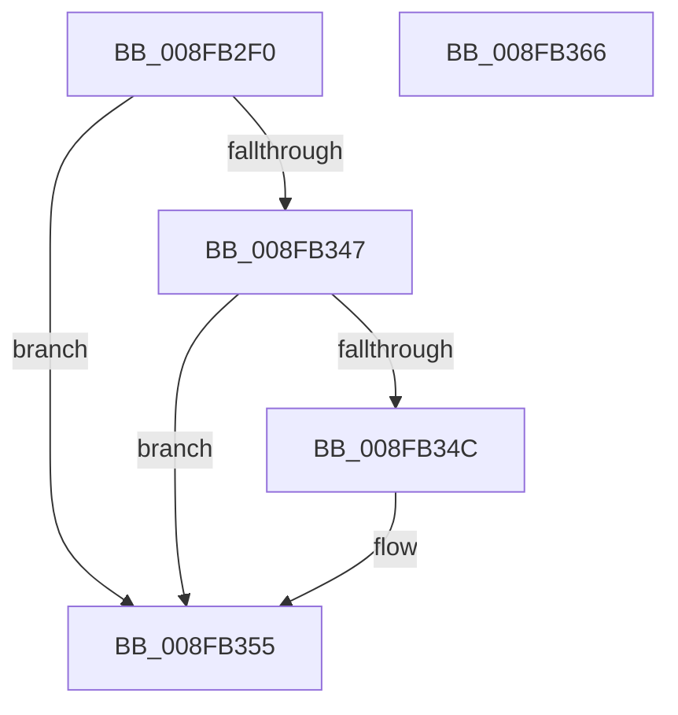

# IopQueryDeviceState

- RVA: `0x008FB2F0`–`0x008FB367` (길이 `119` bytes)
- VA: `0x00000001408FB2F0`
- 실행 섹션: `PAGE`
- PDB 이름 있음: `예`; PDB Function 태그: `아니요`
- unwind 정보 RVA: `0x00087DE4`
- 디코드: `30`개 명령, `119/119` bytes 표시
- 미해석 바이트: `0` (있으면 어셈블리에 `.byte`로 보존)

> 이 문서는 커널 이미지의 기계어와 PDB 기호를 분석해 생성했습니다. 4번과 5번은 함수 원형과 자료형을 바이너리 사용 방식에서 추정한 C 해석이며 원본 소스 복구 결과는 아닙니다.

## 1. Dependencies

- 직접 호출 지점: **2**; 고유 호출 대상: **2**
- 직접 호출자로 확인된 함수: **1**
- RIP 상대 이미지 참조: **0**

### Outgoing calls
- `0x008FB314` → [memset](../../text/6C/memset_function_006C6C40.md) (function, `0x006C6C40`)
- `0x008FB33E` → [IopSynchronousCall](IopSynchronousCall_function_008FB018.md) (function, `0x008FB018`)

### Direct callers
- [IopMarkDeviceToBeReset](../72/IopMarkDeviceToBeReset_function_0072A9A0.md) at `0x0072A9EA`

### Static image references
- 디코드된 RIP-relative 메모리 참조가 없습니다.

## 2. Other-region calls and transfers

- 다른 실행 섹션으로 향하는 call: **1**
  - `0x008FB314` → [memset](../../text/6C/memset_function_006C6C40.md) (`PAGE` → `.text`)
- 별도 외부 분기/꼬리 이동을 확인하지 못했습니다.

## 3. Assembly (complete function range)

```asm
008FB2F0  48 8B C4                        mov rax, rsp
008FB2F3  48 89 58 08                     mov qword ptr [rax + 8], rbx
008FB2F7  57                              push rdi
008FB2F8  48 81 EC 80 00 00 00            sub rsp, 0x80
008FB2FF  48 83 60 18 00                  and qword ptr [rax + 0x18], 0
008FB304  48 8B FA                        mov rdi, rdx
008FB307  33 D2                           xor edx, edx
008FB309  48 8B D9                        mov rbx, rcx
008FB30C  48 8D 48 A8                     lea rcx, [rax - 0x58]
008FB310  44 8D 42 48                     lea r8d, [rdx + 0x48]
008FB314  E8 27 B9 DC FF                  call 0x1406c6c40
008FB319  48 8D 84 24 A0 00 00 00         lea rax, [rsp + 0xa0]
008FB321  66 C7 44 24 30 1B 14            mov word ptr [rsp + 0x30], 0x141b
008FB328  45 33 C9                        xor r9d, r9d
008FB32B  48 89 44 24 20                  mov qword ptr [rsp + 0x20], rax
008FB330  41 B8 BB 00 00 C0               mov r8d, 0xc00000bb
008FB336  48 8D 54 24 30                  lea rdx, [rsp + 0x30]
008FB33B  48 8B CB                        mov rcx, rbx
008FB33E  E8 D5 FC FF FF                  call 0x1408fb018
008FB343  85 C0                           test eax, eax
008FB345  78 0E                           js 0x1408fb355
008FB347  48 85 FF                        test rdi, rdi
008FB34A  74 09                           je 0x1408fb355
008FB34C  8B 8C 24 A0 00 00 00            mov ecx, dword ptr [rsp + 0xa0]
008FB353  89 0F                           mov dword ptr [rdi], ecx
008FB355  48 8B 9C 24 90 00 00 00         mov rbx, qword ptr [rsp + 0x90]
008FB35D  48 81 C4 80 00 00 00            add rsp, 0x80
008FB364  5F                              pop rdi
008FB365  C3                              ret
008FB366  CC                              int3
```

## 4. C-style interpretation (structured pseudocode)

```c
__int64 __fastcall IopQueryDeviceState(__int64 a1, __int64 a2, __int64 a3, int a4)
{
    __int64 result;
    __int64 v_rsp;
    unsigned __int16 v_stack_m58;
    unsigned __int64 v_stack_m68;
    unsigned __int64 v_stack_p18;
    unsigned __int64 v_stack_p8;

    *(unsigned __int64 *)(v_rsp + 8) = v_rbx;
    v_rsp = (v_rsp) - (128);
    a2 = 0;
    result = memset(v_rsp - 88, a2, a2 + 72, a4);
    v_stack_m58 = 0x141BULL;
    a4 = 0;
    v_stack_m68 = v_stack_p18;
    result = IopSynchronousCall(a1, v_stack_m58, (unsigned int)(0xC00000BBULL), a4);
    if (sign_flag) goto loc_008FB355;
    if (0 != 0) {
        a1 = v_stack_p18;
        *(unsigned int *)(a2) = (unsigned int)(a1);
    }
    v_rsp = (v_rsp) + (128);
    return result;
}
```

## 5. (Beta) C Style

```c
int64_t IopQueryDeviceState(int64_t Arg1, int64_t Arg2, int64_t Arg3, int32_t Arg4)
{
    int64_t result;
    int64_t local_rsp;
    uint16_t v_stack_m58;
    uint64_t v_stack_m68;
    uint64_t v_stack_p18;
    uint64_t v_stack_p8;

    *(uint64_t *)(local_rsp + 0x8) = local_rbx;
    local_rsp = (local_rsp) - (128);
    Arg2 = 0;
    result = memset(local_rsp - 88, Arg2, Arg2 + 72, Arg4);
    v_stack_m58 = 0x141BULL;
    Arg4 = 0;
    v_stack_m68 = v_stack_p18;
    result = IopSynchronousCall(Arg1, v_stack_m58, (uint32_t)(0xC00000BBULL), Arg4);
    if (sign_flag) goto loc_008FB355;
    if (0 != 0) {
        Arg1 = v_stack_p18;
        *(uint32_t *)(Arg2) = (uint32_t)(Arg1);
    }
    local_rsp = (local_rsp) + (128);
    return result;
}
```

## 6. Execution-region graph

[열기: 2D/3D 그래프와 함수 탐색 컨트롤 패널](../../../control-panel.html?section=page&rva=0x008FB2F0&view=graph)

- 2D 그래프는 위에서 아래로 흐르고, 3D 그래프는 빈 공간을 드래그해 회전합니다. Shift+드래그는 이동, 휠은 확대·축소, 함수 노드 선택은 대상 보고서 이동입니다.

### Static fallback


