# IopRemoveDevice

- RVA: `0x008FC7FC`–`0x008FCA62` (길이 `614` bytes)
- VA: `0x00000001408FC7FC`
- 실행 섹션: `PAGE`
- PDB 이름 있음: `예`; PDB Function 태그: `아니요`
- unwind 정보 RVA: `0x00087FD4`
- 디코드: `147`개 명령, `614/614` bytes 표시
- 미해석 바이트: `0` (있으면 어셈블리에 `.byte`로 보존)

> 이 문서는 커널 이미지의 기계어와 PDB 기호를 분석해 생성했습니다. 4번과 5번은 함수 원형과 자료형을 바이너리 사용 방식에서 추정한 C 해석이며 원본 소스 복구 결과는 아닙니다.

## 1. Dependencies

- 직접 호출 지점: **21**; 고유 호출 대상: **18**
- 직접 호출자로 확인된 함수: **6**
- RIP 상대 이미지 참조: **0**

### Outgoing calls
- `0x008FC84A` → [PiPnpRtlBeginOperation](../8E/PiPnpRtlBeginOperation_function_008E033C.md) (function, `0x008E033C`)
- `0x008FC85A` → [IopUncacheInterfaceInformation](IopUncacheInterfaceInformation_function_008FCC28.md) (function, `0x008FCC28`)
- `0x008FC86A` → [memset](../../text/6C/memset_function_006C6C40.md) (function, `0x006C6C40`)
- `0x008FC87B` → [PnpFindMountableDevice](../../text/4B/PnpFindMountableDevice_function_004B1418.md) (function, `0x004B1418`)
- `0x008FC8B0` → [PiSwProcessParentRemoveIrp](PiSwProcessParentRemoveIrp_function_008FCD6C.md) (function, `0x008FCD6C`)
- `0x008FC8BD` → [PiSwStopDestroy](PiSwStopDestroy_function_008FCA68.md) (function, `0x008FCA68`)
- `0x008FC8D9` → [IopSynchronousCall](IopSynchronousCall_function_008FB018.md) (function, `0x008FB018`)
- `0x008FC93A` → [PnpLockMountableDevice](../../text/4C/PnpLockMountableDevice_function_004CFFAC.md) (function, `0x004CFFAC`)
- `0x008FC94A` → [PnpMarkDeviceForRemove](../../text/4C/PnpMarkDeviceForRemove_function_004C9DA8.md) (function, `0x004C9DA8`)
- `0x008FC955` → [PnpUnlockMountableDevice](../../text/4C/PnpUnlockMountableDevice_function_004CDD2C.md) (function, `0x004CDD2C`)
- `0x008FC962` → [PnpLockMountableDevice](../../text/4C/PnpLockMountableDevice_function_004CFFAC.md) (function, `0x004CFFAC`)
- `0x008FC984` → [PnpUnlockMountableDevice](../../text/4C/PnpUnlockMountableDevice_function_004CDD2C.md) (function, `0x004CDD2C`)
- `0x008FC99E` → [IopInvalidateVolumesForDevice](../9A/IopInvalidateVolumesForDevice_function_009A5E74.md) (function, `0x009A5E74`)
- `0x008FC9AE` → [PoFxAbandonDevice](../A8/PoFxAbandonDevice_function_00A8AB64.md) (function, `0x00A8AB64`)
- `0x008FC9CB` → [PipClearDevNodeFlags](PipClearDevNodeFlags_function_008F9F54.md) (function, `0x008F9F54`)
- `0x008FC9FE` → [PiPnpRtlEndOperation](../8E/PiPnpRtlEndOperation_function_008E0518.md) (function, `0x008E0518`)
- `0x008FCA19` → [PipClearDevNodeUserFlags](../A2/PipClearDevNodeUserFlags_function_00A2ABC4.md) (function, `0x00A2ABC4`)
- `0x008FCA21` → [IopDecDisableableDepends](../73/IopDecDisableableDepends_function_0073DC3C.md) (function, `0x0073DC3C`)
- `0x008FCA35` → [PnpMarkDeviceForRemove](../../text/4C/PnpMarkDeviceForRemove_function_004C9DA8.md) (function, `0x004C9DA8`)
- `0x008FCA42` → [IopDecrementDeviceObjectHandleCount](../../text/59/IopDecrementDeviceObjectHandleCount_function_00596FE4.md) (function, `0x00596FE4`)
- `0x008FCA4A` → [ObfDereferenceObject](../../text/2F/ObfDereferenceObject_function_002F9350.md) (function, `0x002F9350`)

### Direct callers
- [PnpRemoveLockedDeviceNode](../../text/47/PnpRemoveLockedDeviceNode_function_004702AC.md) at `0x004704DB`
- [sub_006F3B38](../../text/6F/Unknown_function_006F3B38.md) at `0x006F3B61`
- [PnpDisableDevice](../72/PnpDisableDevice_function_0072C6FC.md) at `0x0072C755`
- [PnpDisableDevice](../72/PnpDisableDevice_function_0072C6FC.md) at `0x0072C765`
- [PnpCancelRemoveLockedDeviceNode](../72/PnpCancelRemoveLockedDeviceNode_function_0072CFE0.md) at `0x0072D008`
- [PnpQueryRemoveLockedDeviceNode](../72/PnpQueryRemoveLockedDeviceNode_function_0072D210.md) at `0x0072D2A2`
- [PnpSurpriseRemoveLockedDeviceNode](../A0/PnpSurpriseRemoveLockedDeviceNode_function_00A08370.md) at `0x00A08446`

### Static image references
- 디코드된 RIP-relative 메모리 참조가 없습니다.

## 2. Other-region calls and transfers

- 다른 실행 섹션으로 향하는 call: **10**
  - `0x008FC86A` → [memset](../../text/6C/memset_function_006C6C40.md) (`PAGE` → `.text`)
  - `0x008FC87B` → [PnpFindMountableDevice](../../text/4B/PnpFindMountableDevice_function_004B1418.md) (`PAGE` → `.text`)
  - `0x008FC93A` → [PnpLockMountableDevice](../../text/4C/PnpLockMountableDevice_function_004CFFAC.md) (`PAGE` → `.text`)
  - `0x008FC94A` → [PnpMarkDeviceForRemove](../../text/4C/PnpMarkDeviceForRemove_function_004C9DA8.md) (`PAGE` → `.text`)
  - `0x008FC955` → [PnpUnlockMountableDevice](../../text/4C/PnpUnlockMountableDevice_function_004CDD2C.md) (`PAGE` → `.text`)
  - `0x008FC962` → [PnpLockMountableDevice](../../text/4C/PnpLockMountableDevice_function_004CFFAC.md) (`PAGE` → `.text`)
  - `0x008FC984` → [PnpUnlockMountableDevice](../../text/4C/PnpUnlockMountableDevice_function_004CDD2C.md) (`PAGE` → `.text`)
  - `0x008FCA35` → [PnpMarkDeviceForRemove](../../text/4C/PnpMarkDeviceForRemove_function_004C9DA8.md) (`PAGE` → `.text`)
  - `0x008FCA42` → [IopDecrementDeviceObjectHandleCount](../../text/59/IopDecrementDeviceObjectHandleCount_function_00596FE4.md) (`PAGE` → `.text`)
  - `0x008FCA4A` → [ObfDereferenceObject](../../text/2F/ObfDereferenceObject_function_002F9350.md) (`PAGE` → `.text`)
- 별도 외부 분기/꼬리 이동을 확인하지 못했습니다.

## 3. Assembly (complete function range)

```asm
008FC7FC  48 8B C4                        mov rax, rsp
008FC7FF  48 89 58 10                     mov qword ptr [rax + 0x10], rbx
008FC803  48 89 68 18                     mov qword ptr [rax + 0x18], rbp
008FC807  48 89 70 20                     mov qword ptr [rax + 0x20], rsi
008FC80B  57                              push rdi
008FC80C  41 56                           push r14
008FC80E  41 57                           push r15
008FC810  48 81 EC 90 00 00 00            sub rsp, 0x90
008FC817  45 33 FF                        xor r15d, r15d
008FC81A  0F 57 C0                        xorps xmm0, xmm0
008FC81D  8B DA                           mov ebx, edx
008FC81F  48 8B F9                        mov rdi, rcx
008FC822  0F 11 40 88                     movups xmmword ptr [rax - 0x78], xmm0
008FC826  48 85 C9                        test rcx, rcx
008FC829  0F 84 FB 00 00 00               je 0x1408fc92a
008FC82F  48 8B 81 38 01 00 00            mov rax, qword ptr [rcx + 0x138]
008FC836  48 8B 70 28                     mov rsi, qword ptr [rax + 0x28]
008FC83A  4C 21 BC 24 B0 00 00 00         and qword ptr [rsp + 0xb0], r15
008FC842  48 8D 8C 24 B0 00 00 00         lea rcx, [rsp + 0xb0]
008FC84A  E8 ED 3A FE FF                  call 0x1408e033c
008FC84F  83 FB 02                        cmp ebx, 2
008FC852  75 0B                           jne 0x1408fc85f
008FC854  8D 53 FF                        lea edx, [rbx - 1]
008FC857  48 8B CF                        mov rcx, rdi
008FC85A  E8 C9 03 00 00                  call 0x1408fcc28
008FC85F  33 D2                           xor edx, edx
008FC861  48 8D 4C 24 40                  lea rcx, [rsp + 0x40]
008FC866  44 8D 42 48                     lea r8d, [rdx + 0x48]
008FC86A  E8 D1 A3 DC FF                  call 0x1406c6c40
008FC86F  48 8B CF                        mov rcx, rdi
008FC872  C6 44 24 40 1B                  mov byte ptr [rsp + 0x40], 0x1b
008FC877  88 5C 24 41                     mov byte ptr [rsp + 0x41], bl
008FC87B  E8 98 4B BB FF                  call 0x1404b1418
008FC880  48 85 C0                        test rax, rax
008FC883  0F 85 A8 00 00 00               jne 0x1408fc931
008FC889  48 8B EF                        mov rbp, rdi
008FC88C  83 FB 02                        cmp ebx, 2
008FC88F  0F 85 73 01 00 00               jne 0x1408fca08
008FC895  8B 86 90 01 00 00               mov eax, dword ptr [rsi + 0x190]
008FC89B  BA 08 00 00 00                  mov edx, 8
008FC8A0  84 C2                           test dl, al
008FC8A2  0F 85 6E 01 00 00               jne 0x1408fca16
008FC8A8  83 FB 02                        cmp ebx, 2
008FC8AB  75 15                           jne 0x1408fc8c2
008FC8AD  48 8B CF                        mov rcx, rdi
008FC8B0  E8 B7 04 00 00                  call 0x1408fcd6c
008FC8B5  4C 8B 46 20                     mov r8, qword ptr [rsi + 0x20]
008FC8B9  48 8B 56 30                     mov rdx, qword ptr [rsi + 0x30]
008FC8BD  E8 A6 01 00 00                  call 0x1408fca68
008FC8C2  48 83 64 24 20 00               and qword ptr [rsp + 0x20], 0
008FC8C8  48 8D 54 24 40                  lea rdx, [rsp + 0x40]
008FC8CD  45 33 C9                        xor r9d, r9d
008FC8D0  41 B8 BB 00 00 C0               mov r8d, 0xc00000bb
008FC8D6  48 8B CD                        mov rcx, rbp
008FC8D9  E8 3A E7 FF FF                  call 0x1408fb018
008FC8DE  44 8B F0                        mov r14d, eax
008FC8E1  45 85 FF                        test r15d, r15d
008FC8E4  75 79                           jne 0x1408fc95f
008FC8E6  83 FB 17                        cmp ebx, 0x17
008FC8E9  0F 84 BC 00 00 00               je 0x1408fc9ab
008FC8EF  83 FB 02                        cmp ebx, 2
008FC8F2  0F 84 B3 00 00 00               je 0x1408fc9ab
008FC8F8  48 8B 8C 24 B0 00 00 00         mov rcx, qword ptr [rsp + 0xb0]
008FC900  48 85 C9                        test rcx, rcx
008FC903  0F 85 F5 00 00 00               jne 0x1408fc9fe
008FC909  4C 8D 9C 24 90 00 00 00         lea r11, [rsp + 0x90]
008FC911  41 8B C6                        mov eax, r14d
008FC914  49 8B 5B 28                     mov rbx, qword ptr [r11 + 0x28]
008FC918  49 8B 6B 30                     mov rbp, qword ptr [r11 + 0x30]
008FC91C  49 8B 73 38                     mov rsi, qword ptr [r11 + 0x38]
008FC920  49 8B E3                        mov rsp, r11
008FC923  41 5F                           pop r15
008FC925  41 5E                           pop r14
008FC927  5F                              pop rdi
008FC928  C3                              ret
008FC929  CC                              int3
008FC92A  33 F6                           xor esi, esi
008FC92C  E9 09 FF FF FF                  jmp 0x1408fc83a
008FC931  48 8B CF                        mov rcx, rdi
008FC934  41 BF 01 00 00 00               mov r15d, 1
008FC93A  E8 6D 36 BD FF                  call 0x1404cffac
008FC93F  4C 8D 44 24 30                  lea r8, [rsp + 0x30]
008FC944  41 8B D7                        mov edx, r15d
008FC947  48 8B CF                        mov rcx, rdi
008FC94A  E8 59 D4 BC FF                  call 0x1404c9da8
008FC94F  48 8B CF                        mov rcx, rdi
008FC952  48 8B E8                        mov rbp, rax
008FC955  E8 D2 13 BD FF                  call 0x1404cdd2c
008FC95A  E9 2D FF FF FF                  jmp 0x1408fc88c
008FC95F  48 8B CF                        mov rcx, rdi
008FC962  E8 45 36 BD FF                  call 0x1404cffac
008FC967  8D 4B FE                        lea ecx, [rbx - 2]
008FC96A  83 F9 01                        cmp ecx, 1
008FC96D  0F 86 B8 00 00 00               jbe 0x1408fca2b
008FC973  48 8B 6C 24 38                  mov rbp, qword ptr [rsp + 0x38]
008FC978  48 85 ED                        test rbp, rbp
008FC97B  0F 85 BE 00 00 00               jne 0x1408fca3f
008FC981  48 8B CF                        mov rcx, rdi
008FC984  E8 A3 13 BD FF                  call 0x1404cdd2c
008FC989  83 FB 01                        cmp ebx, 1
008FC98C  0F 85 C2 00 00 00               jne 0x1408fca54
008FC992  45 85 F6                        test r14d, r14d
008FC995  0F 88 B9 00 00 00               js 0x1408fca54
008FC99B  48 8B CF                        mov rcx, rdi
008FC99E  E8 D1 94 0A 00                  call 0x1409a5e74
008FC9A3  44 8B F0                        mov r14d, eax
008FC9A6  E9 3B FF FF FF                  jmp 0x1408fc8e6
008FC9AB  48 8B CE                        mov rcx, rsi
008FC9AE  E8 B1 E1 18 00                  call 0x140a8ab64
008FC9B3  83 A6 9C 00 00 00 00            and dword ptr [rsi + 0x9c], 0
008FC9BA  83 FB 02                        cmp ebx, 2
008FC9BD  0F 85 35 FF FF FF               jne 0x1408fc8f8
008FC9C3  BA 08 10 00 00                  mov edx, 0x1008
008FC9C8  48 8B CE                        mov rcx, rsi
008FC9CB  E8 84 D5 FF FF                  call 0x1408f9f54
008FC9D0  48 8B 86 88 02 00 00            mov rax, qword ptr [rsi + 0x288]
008FC9D7  48 85 C0                        test rax, rax
008FC9DA  0F 84 18 FF FF FF               je 0x1408fc8f8
008FC9E0  A8 01                           test al, 1
008FC9E2  0F 84 10 FF FF FF               je 0x1408fc8f8
008FC9E8  48 83 E0 FE                     and rax, 0xfffffffffffffffe
008FC9EC  48 89 86 88 02 00 00            mov qword ptr [rsi + 0x288], rax
008FC9F3  FF 88 90 02 00 00               dec dword ptr [rax + 0x290]
008FC9F9  E9 FA FE FF FF                  jmp 0x1408fc8f8
008FC9FE  E8 15 3B FE FF                  call 0x1408e0518
008FCA03  E9 01 FF FF FF                  jmp 0x1408fc909
008FCA08  83 FB 17                        cmp ebx, 0x17
008FCA0B  0F 84 84 FE FF FF               je 0x1408fc895
008FCA11  E9 AC FE FF FF                  jmp 0x1408fc8c2
008FCA16  48 8B CE                        mov rcx, rsi
008FCA19  E8 A6 E1 12 00                  call 0x140a2abc4
008FCA1E  48 8B CE                        mov rcx, rsi
008FCA21  E8 16 12 E4 FF                  call 0x14073dc3c
008FCA26  E9 7D FE FF FF                  jmp 0x1408fc8a8
008FCA2B  4C 8D 44 24 30                  lea r8, [rsp + 0x30]
008FCA30  33 D2                           xor edx, edx
008FCA32  48 8B CF                        mov rcx, rdi
008FCA35  E8 6E D3 BC FF                  call 0x1404c9da8
008FCA3A  E9 34 FF FF FF                  jmp 0x1408fc973
008FCA3F  48 8B CD                        mov rcx, rbp
008FCA42  E8 9D A5 C9 FF                  call 0x140596fe4
008FCA47  48 8B CD                        mov rcx, rbp
008FCA4A  E8 01 C9 9F FF                  call 0x1402f9350
008FCA4F  E9 2D FF FF FF                  jmp 0x1408fc981
008FCA54  83 FB 17                        cmp ebx, 0x17
008FCA57  0F 85 92 FE FF FF               jne 0x1408fc8ef
008FCA5D  E9 39 FF FF FF                  jmp 0x1408fc99b
```

## 4. C-style interpretation (structured pseudocode)

```c
__int64 __fastcall IopRemoveDevice(__int64 a1, int a2, __int64 a3, int a4)
{
    __int64 result;
    __int64 v_r15;
    __int64 v_rsi;
    __int64 v_rsp;
    unsigned __int64 v_stack_m18;
    unsigned __int64 v_stack_m58;
    unsigned __int64 v_stack_m60;
    unsigned __int8 v_stack_m67;
    unsigned __int64 v_stack_m68;
    unsigned __int64 v_stack_m88;
    unsigned __int64 v_stack_p8;

    *(unsigned __int64 *)(v_rsp + 16) = v_rbx;
    *(unsigned __int64 *)(v_rsp + 24) = v_rbp;
    *(unsigned __int64 *)(v_rsp + 32) = v_rsi;
    v_rsp = (v_rsp) - (144);
    v_r15 = 0;
    *(unsigned __int64 *)(v_rsp - 120) = v_xmm0;
    if (a1 == 0) goto loc_008FC92A;
loc_008FC83A:
    result = PiPnpRtlBeginOperation(v_stack_p8, a2, a3, a4);
    if (((unsigned int)((unsigned int)(a2))) == 2) {
        a2 = (unsigned int)(a2) - 1;
        a1 = a1;
        result = IopUncacheInterfaceInformation(a1, a2, a3, a4);
    }
    a2 = 0;
    result = memset(v_stack_m68, a2, a2 + 72, a4);
    v_stack_m68 = 27;
    v_stack_m67 = (unsigned __int8)((unsigned int)(a2));
    result = PnpFindMountableDevice(a1, a2, a2 + 72, a4);
    if (result != 0) goto loc_008FC931;
loc_008FC88C:
    if (((unsigned int)((unsigned int)(a2))) != 2) goto loc_008FCA08;
loc_008FC895:
    if (((8) & ((unsigned __int8)((unsigned int)(*(unsigned int *)(*(unsigned __int64 *)(*(unsigned __int64 *)(a1 + 312) + 40) + 400))))) != 0) goto loc_008FCA16;
loc_008FC8A8:
    result = (unsigned int)(*(unsigned int *)(*(unsigned __int64 *)(*(unsigned __int64 *)(a1 + 312) + 40) + 400));
    if (((unsigned int)((unsigned int)(a2))) == 2) {
        a1 = a1;
        result = PiSwProcessParentRemoveIrp(a1, 8, a2 + 72, a4);
        a3 = *(unsigned __int64 *)(*(unsigned __int64 *)(*(unsigned __int64 *)(a1 + 312) + 40) + 32);
        a2 = *(unsigned __int64 *)(*(unsigned __int64 *)(*(unsigned __int64 *)(a1 + 312) + 40) + 48);
        result = PiSwStopDestroy(a1, a2, a3, a4);
    }
    a4 = 0;
    result = IopSynchronousCall(a1, v_stack_m68, (unsigned int)(0xC00000BBULL), a4);
    if (0 != 0) goto loc_008FC95F;
loc_008FC8E6:
    if (((unsigned int)((unsigned int)(a2))) == 23) goto loc_008FC9AB;
loc_008FC8EF:
    if (((unsigned int)((unsigned int)(a2))) == 2) goto loc_008FC9AB;
loc_008FC8F8:
    if (v_stack_p8 != 0) goto loc_008FC9FE;
loc_008FC909:
    return (unsigned int)((unsigned int)((unsigned int)((unsigned int)(result))));
loc_008FC92A:
    v_rsi = 0;
    goto loc_008FC83A;
loc_008FC931:
    result = PnpLockMountableDevice(a1, v_stack_m68, (unsigned int)(0xC00000BBULL), a4);
    result = PnpMarkDeviceForRemove(a1, 1, v_stack_m60, a4);
    result = PnpUnlockMountableDevice(a1, 1, v_stack_m60, a4);
    goto loc_008FC88C;
loc_008FC95F:
    result = PnpLockMountableDevice(a1, 1, v_stack_m60, a4);
    if (((unsigned int)(*(unsigned __int64 *)(v_stack_m18 + 40) - 2)) <= 1) goto loc_008FCA2B;
loc_008FC973:
    if (v_stack_m58 != 0) goto loc_008FCA3F;
loc_008FC981:
    result = PnpUnlockMountableDevice(a1, 1, v_stack_m60, a4);
    if (((unsigned int)(*(unsigned __int64 *)(v_stack_m18 + 40))) != 1) goto loc_008FCA54;
    if (sign_flag) goto loc_008FCA54;
loc_008FC99B:
    result = IopInvalidateVolumesForDevice(a1, 1, v_stack_m60, a4);
    goto loc_008FC8E6;
loc_008FC9AB:
    result = PoFxAbandonDevice(0, 1, v_stack_m60, a4);
    if (((unsigned int)(*(unsigned __int64 *)(v_stack_m18 + 40))) != 2) goto loc_008FC8F8;
    result = PipClearDevNodeFlags(0, (unsigned int)(0x1008ULL), v_stack_m60, a4);
    if (*(unsigned __int64 *)(v_rsi + 648) == 0) goto loc_008FC8F8;
    if ((((unsigned __int8)(*(unsigned __int64 *)(v_rsi + 648))) & (1)) == 0) goto loc_008FC8F8;
    result = (*(unsigned __int64 *)(v_rsi + 648)) & (-2);
    *(unsigned __int64 *)(v_rsi + 648) = result;
    goto loc_008FC8F8;
loc_008FC9FE:
    result = PiPnpRtlEndOperation(0, (unsigned int)(0x1008ULL), v_stack_m60, a4);
    goto loc_008FC909;
loc_008FCA08:
    if (((unsigned int)(*(unsigned __int64 *)(v_stack_m18 + 40))) == 23) goto loc_008FC895;
    goto loc_008FC8C2;
loc_008FCA16:
    result = PipClearDevNodeUserFlags(0, (unsigned int)(0x1008ULL), v_stack_m60, a4);
    result = IopDecDisableableDepends(0, (unsigned int)(0x1008ULL), v_stack_m60, a4);
    goto loc_008FC8A8;
loc_008FCA2B:
    a2 = 0;
    result = PnpMarkDeviceForRemove(a1, a2, v_stack_m60, a4);
    goto loc_008FC973;
loc_008FCA3F:
    result = IopDecrementDeviceObjectHandleCount(v_stack_m58, a2, v_stack_m60, a4);
    result = ObfDereferenceObject(v_stack_m58, a2, v_stack_m60, a4);
    goto loc_008FC981;
loc_008FCA54:
    if (((unsigned int)(*(unsigned __int64 *)(v_stack_m18 + 40))) != 23) goto loc_008FC8EF;
    goto loc_008FC99B;
}
```

## 5. (Beta) C Style

```c
int64_t IopRemoveDevice(int64_t Arg1, int32_t Arg2, int64_t Arg3, int32_t Arg4)
{
    int64_t result;
    int64_t local_r15;
    int64_t local_rsi;
    int64_t local_rsp;
    uint64_t v_stack_m18;
    uint64_t v_stack_m58;
    uint64_t v_stack_m60;
    uint8_t v_stack_m67;
    uint64_t v_stack_m68;
    uint64_t v_stack_m88;
    uint64_t v_stack_p8;

    *(uint64_t *)(local_rsp + 0x10) = local_rbx;
    *(uint64_t *)(local_rsp + 0x18) = local_rbp;
    *(uint64_t *)(local_rsp + 0x20) = local_rsi;
    local_rsp = (local_rsp) - (144);
    local_r15 = 0;
    *(uint64_t *)(local_rsp - 0x78) = v_xmm0;
    if (Arg1 == 0) goto loc_008FC92A;
loc_008FC83A:
    result = PiPnpRtlBeginOperation(v_stack_p8, Arg2, Arg3, Arg4);
    if (((uint32_t)((uint32_t)(Arg2))) == 2) {
        Arg2 = (uint32_t)(Arg2) - 1;
        Arg1 = Arg1;
        result = IopUncacheInterfaceInformation(Arg1, Arg2, Arg3, Arg4);
    }
    Arg2 = 0;
    result = memset(v_stack_m68, Arg2, Arg2 + 72, Arg4);
    v_stack_m68 = 27;
    v_stack_m67 = (uint8_t)((uint32_t)(Arg2));
    result = PnpFindMountableDevice(Arg1, Arg2, Arg2 + 72, Arg4);
    if (result != 0) goto loc_008FC931;
loc_008FC88C:
    if (((uint32_t)((uint32_t)(Arg2))) != 2) goto loc_008FCA08;
loc_008FC895:
    if (((8) & ((uint8_t)((uint32_t)(*(uint32_t *)(*(uint64_t *)(*(uint64_t *)(Arg1 + 0x138) + 0x28) + 0x190))))) != 0) goto loc_008FCA16;
loc_008FC8A8:
    result = (uint32_t)(*(uint32_t *)(*(uint64_t *)(*(uint64_t *)(Arg1 + 0x138) + 0x28) + 0x190));
    if (((uint32_t)((uint32_t)(Arg2))) == 2) {
        Arg1 = Arg1;
        result = PiSwProcessParentRemoveIrp(Arg1, 8, Arg2 + 72, Arg4);
        Arg3 = *(uint64_t *)(*(uint64_t *)(*(uint64_t *)(Arg1 + 0x138) + 0x28) + 0x20);
        Arg2 = *(uint64_t *)(*(uint64_t *)(*(uint64_t *)(Arg1 + 0x138) + 0x28) + 0x30);
        result = PiSwStopDestroy(Arg1, Arg2, Arg3, Arg4);
    }
    Arg4 = 0;
    result = IopSynchronousCall(Arg1, v_stack_m68, (uint32_t)(0xC00000BBULL), Arg4);
    if (0 != 0) goto loc_008FC95F;
loc_008FC8E6:
    if (((uint32_t)((uint32_t)(Arg2))) == 23) goto loc_008FC9AB;
loc_008FC8EF:
    if (((uint32_t)((uint32_t)(Arg2))) == 2) goto loc_008FC9AB;
loc_008FC8F8:
    if (v_stack_p8 != 0) goto loc_008FC9FE;
loc_008FC909:
    return (uint32_t)((uint32_t)((uint32_t)((uint32_t)(result))));
loc_008FC92A:
    local_rsi = 0;
    goto loc_008FC83A;
loc_008FC931:
    result = PnpLockMountableDevice(Arg1, v_stack_m68, (uint32_t)(0xC00000BBULL), Arg4);
    result = PnpMarkDeviceForRemove(Arg1, 1, v_stack_m60, Arg4);
    result = PnpUnlockMountableDevice(Arg1, 1, v_stack_m60, Arg4);
    goto loc_008FC88C;
loc_008FC95F:
    result = PnpLockMountableDevice(Arg1, 1, v_stack_m60, Arg4);
    if (((uint32_t)(*(uint64_t *)(v_stack_m18 + 0x28) - 2)) <= 1) goto loc_008FCA2B;
loc_008FC973:
    if (v_stack_m58 != 0) goto loc_008FCA3F;
loc_008FC981:
    result = PnpUnlockMountableDevice(Arg1, 1, v_stack_m60, Arg4);
    if (((uint32_t)(*(uint64_t *)(v_stack_m18 + 0x28))) != 1) goto loc_008FCA54;
    if (sign_flag) goto loc_008FCA54;
loc_008FC99B:
    result = IopInvalidateVolumesForDevice(Arg1, 1, v_stack_m60, Arg4);
    goto loc_008FC8E6;
loc_008FC9AB:
    result = PoFxAbandonDevice(0, 1, v_stack_m60, Arg4);
    if (((uint32_t)(*(uint64_t *)(v_stack_m18 + 0x28))) != 2) goto loc_008FC8F8;
    result = PipClearDevNodeFlags(0, (uint32_t)(0x1008ULL), v_stack_m60, Arg4);
    if (*(uint64_t *)(local_rsi + 0x288) == 0) goto loc_008FC8F8;
    if ((((uint8_t)(*(uint64_t *)(local_rsi + 0x288))) & (1)) == 0) goto loc_008FC8F8;
    result = (*(uint64_t *)(local_rsi + 0x288)) & (-2);
    *(uint64_t *)(local_rsi + 0x288) = result;
    goto loc_008FC8F8;
loc_008FC9FE:
    result = PiPnpRtlEndOperation(0, (uint32_t)(0x1008ULL), v_stack_m60, Arg4);
    goto loc_008FC909;
loc_008FCA08:
    if (((uint32_t)(*(uint64_t *)(v_stack_m18 + 0x28))) == 23) goto loc_008FC895;
    goto loc_008FC8C2;
loc_008FCA16:
    result = PipClearDevNodeUserFlags(0, (uint32_t)(0x1008ULL), v_stack_m60, Arg4);
    result = IopDecDisableableDepends(0, (uint32_t)(0x1008ULL), v_stack_m60, Arg4);
    goto loc_008FC8A8;
loc_008FCA2B:
    Arg2 = 0;
    result = PnpMarkDeviceForRemove(Arg1, Arg2, v_stack_m60, Arg4);
    goto loc_008FC973;
loc_008FCA3F:
    result = IopDecrementDeviceObjectHandleCount(v_stack_m58, Arg2, v_stack_m60, Arg4);
    result = ObfDereferenceObject(v_stack_m58, Arg2, v_stack_m60, Arg4);
    goto loc_008FC981;
loc_008FCA54:
    if (((uint32_t)(*(uint64_t *)(v_stack_m18 + 0x28))) != 23) goto loc_008FC8EF;
    goto loc_008FC99B;
}
```

## 6. Execution-region graph

[열기: 2D/3D 그래프와 함수 탐색 컨트롤 패널](../../../control-panel.html?section=page&rva=0x008FC7FC&view=graph)

- 2D 그래프는 위에서 아래로 흐르고, 3D 그래프는 빈 공간을 드래그해 회전합니다. Shift+드래그는 이동, 휠은 확대·축소, 함수 노드 선택은 대상 보고서 이동입니다.

### Static fallback

```mermaid
flowchart TD
  bb_008FC7FC[BB_008FC7FC]
  bb_008FC82F[BB_008FC82F]
  bb_008FC83A[BB_008FC83A]
  bb_008FC854[BB_008FC854]
  bb_008FC85F[BB_008FC85F]
  bb_008FC889[BB_008FC889]
  bb_008FC88C[BB_008FC88C]
  bb_008FC895[BB_008FC895]
  bb_008FC8A8[BB_008FC8A8]
  bb_008FC8AD[BB_008FC8AD]
  bb_008FC8C2[BB_008FC8C2]
  bb_008FC8E6[BB_008FC8E6]
  bb_008FC8EF[BB_008FC8EF]
  bb_008FC8F8[BB_008FC8F8]
  bb_008FC909[BB_008FC909]
  bb_008FC929[BB_008FC929]
  bb_008FC92A[BB_008FC92A]
  bb_008FC931[BB_008FC931]
  bb_008FC95F[BB_008FC95F]
  bb_008FC973[BB_008FC973]
  bb_008FC981[BB_008FC981]
  bb_008FC992[BB_008FC992]
  bb_008FC99B[BB_008FC99B]
  bb_008FC9AB[BB_008FC9AB]
  bb_008FC9C3[BB_008FC9C3]
  bb_008FC9E0[BB_008FC9E0]
  bb_008FC9E8[BB_008FC9E8]
  bb_008FC9FE[BB_008FC9FE]
  bb_008FCA08[BB_008FCA08]
  bb_008FCA11[BB_008FCA11]
  bb_008FCA16[BB_008FCA16]
  bb_008FCA2B[BB_008FCA2B]
  bb_008FCA3F[BB_008FCA3F]
  bb_008FCA54[BB_008FCA54]
  bb_008FCA5D[BB_008FCA5D]
  bb_008FC7FC -->|branch| bb_008FC92A
  bb_008FC7FC -->|fallthrough| bb_008FC82F
  bb_008FC82F -->|flow| bb_008FC83A
  bb_008FC83A -->|branch| bb_008FC85F
  bb_008FC83A -->|fallthrough| bb_008FC854
  bb_008FC854 -->|flow| bb_008FC85F
  bb_008FC85F -->|branch| bb_008FC931
  bb_008FC85F -->|fallthrough| bb_008FC889
  bb_008FC889 -->|flow| bb_008FC88C
  bb_008FC88C -->|branch| bb_008FCA08
  bb_008FC88C -->|fallthrough| bb_008FC895
  bb_008FC895 -->|branch| bb_008FCA16
  bb_008FC895 -->|fallthrough| bb_008FC8A8
  bb_008FC8A8 -->|branch| bb_008FC8C2
  bb_008FC8A8 -->|fallthrough| bb_008FC8AD
  bb_008FC8AD -->|flow| bb_008FC8C2
  bb_008FC8C2 -->|branch| bb_008FC95F
  bb_008FC8C2 -->|fallthrough| bb_008FC8E6
  bb_008FC8E6 -->|branch| bb_008FC9AB
  bb_008FC8E6 -->|fallthrough| bb_008FC8EF
  bb_008FC8EF -->|branch| bb_008FC9AB
  bb_008FC8EF -->|fallthrough| bb_008FC8F8
  bb_008FC8F8 -->|branch| bb_008FC9FE
  bb_008FC8F8 -->|fallthrough| bb_008FC909
  bb_008FC929 -->|flow| bb_008FC92A
  bb_008FC92A -->|branch| bb_008FC83A
  bb_008FC931 -->|branch| bb_008FC88C
  bb_008FC95F -->|branch| bb_008FCA2B
  bb_008FC95F -->|fallthrough| bb_008FC973
  bb_008FC973 -->|branch| bb_008FCA3F
  bb_008FC973 -->|fallthrough| bb_008FC981
  bb_008FC981 -->|branch| bb_008FCA54
  bb_008FC981 -->|fallthrough| bb_008FC992
  bb_008FC992 -->|branch| bb_008FCA54
  bb_008FC992 -->|fallthrough| bb_008FC99B
  bb_008FC99B -->|branch| bb_008FC8E6
  bb_008FC9AB -->|branch| bb_008FC8F8
  bb_008FC9AB -->|fallthrough| bb_008FC9C3
  bb_008FC9C3 -->|branch| bb_008FC8F8
  bb_008FC9C3 -->|fallthrough| bb_008FC9E0
  bb_008FC9E0 -->|branch| bb_008FC8F8
  bb_008FC9E0 -->|fallthrough| bb_008FC9E8
  bb_008FC9E8 -->|branch| bb_008FC8F8
  bb_008FC9FE -->|branch| bb_008FC909
  bb_008FCA08 -->|branch| bb_008FC895
  bb_008FCA08 -->|fallthrough| bb_008FCA11
  bb_008FCA11 -->|branch| bb_008FC8C2
  bb_008FCA16 -->|branch| bb_008FC8A8
  bb_008FCA2B -->|branch| bb_008FC973
  bb_008FCA3F -->|branch| bb_008FC981
  bb_008FCA54 -->|branch| bb_008FC8EF
  bb_008FCA54 -->|fallthrough| bb_008FCA5D
  bb_008FCA5D -->|branch| bb_008FC99B
```


