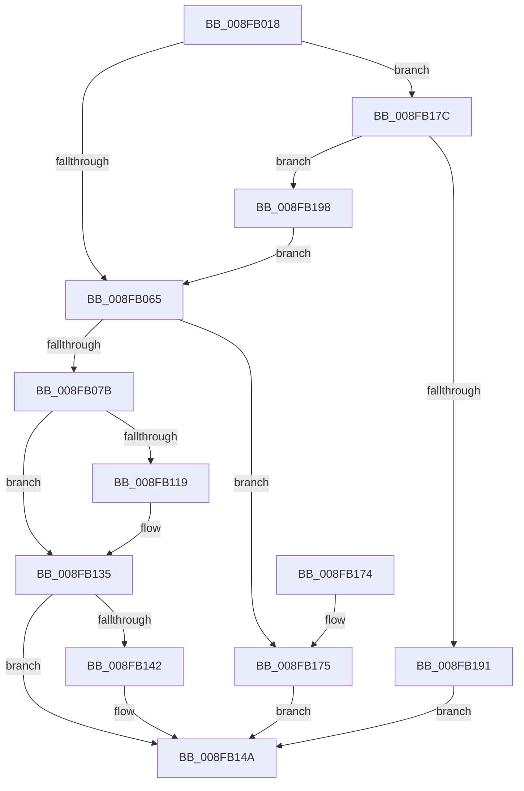

# IopSynchronousCall

- RVA: `0x008FB018`–`0x008FB1AD` (길이 `405` bytes)
- VA: `0x00000001408FB018`
- 실행 섹션: `PAGE`
- PDB 이름 있음: `예`; PDB Function 태그: `아니요`
- unwind 정보 RVA: `0x00087DB0`
- 디코드: `103`개 명령, `405/405` bytes 표시
- 미해석 바이트: `0` (있으면 어셈블리에 `.byte`로 보존)

> 이 문서는 커널 이미지의 기계어와 PDB 기호를 분석해 생성했습니다. 4번과 5번은 함수 원형과 자료형을 바이너리 사용 방식에서 추정한 C 해석이며 원본 소스 복구 결과는 아닙니다.

## 1. Dependencies

- 직접 호출 지점: **10**; 고유 호출 대상: **9**
- 직접 호출자로 확인된 함수: **16**
- RIP 상대 이미지 참조: **0**

### Outgoing calls
- `0x008FB052` → [IoGetAttachedDeviceReferenceWithTag](../../text/27/IoGetAttachedDeviceReferenceWithTag_function_00273B84.md) (function, `0x00273B84`)
- `0x008FB06A` → [IoAllocateIrp](../../text/20/IoAllocateIrp_function_002065D0.md) (function, `0x002065D0`)
- `0x008FB083` → [IovUtilWatermarkIrp](../../text/48/IovUtilWatermarkIrp_function_0048E1A4.md) (function, `0x0048E1A4`)
- `0x008FB0A6` → [KeInitializeEvent](../../text/40/KeInitializeEvent_function_0040DD10.md) (function, `0x0040DD10`)
- `0x008FB0D0` → [IopQueueThreadIrp](../../text/20/IopQueueThreadIrp_function_002075C0.md) (function, `0x002075C0`)
- `0x008FB10B` → [IofCallDriver](../../text/29/IofCallDriver_function_0029B4B0.md) (function, `0x0029B4B0`)
- `0x008FB12C` → [KeWaitForSingleObject](../../text/20/KeWaitForSingleObject_function_0020E6B0.md) (function, `0x0020E6B0`)
- `0x008FB152` → [ObfDereferenceObjectWithTag](../../text/2F/ObfDereferenceObjectWithTag_function_002F78E0.md) (function, `0x002F78E0`)
- `0x008FB184` → [IoGetLowerDeviceObjectWithTag](../../text/27/IoGetLowerDeviceObjectWithTag_function_00272660.md) (function, `0x00272660`)
- `0x008FB1A0` → [ObfDereferenceObjectWithTag](../../text/2F/ObfDereferenceObjectWithTag_function_002F78E0.md) (function, `0x002F78E0`)

### Direct callers
- [PnpSendIrp](../../text/27/PnpSendIrp_function_00271DF4.md) at `0x00271E53`
- [PnpGetRelatedTargetDevice](../../text/27/PnpGetRelatedTargetDevice_function_00271F54.md) at `0x00272009`
- [PnpIrpDeviceEnumerated](../../text/4B/PnpIrpDeviceEnumerated_function_004B77D0.md) at `0x004B780A`
- [IopQueryDockRemovalInterface](../73/IopQueryDockRemovalInterface_function_0073DED0.md) at `0x0073DF82`
- [IopQueryReconfiguration](../73/IopQueryReconfiguration_function_0073DFD0.md) at `0x0073E045`
- [PiProcessQueryDeviceState](PiProcessQueryDeviceState_function_008FA0F8.md) at `0x008FA175`
- [PpIrpQueryCapabilities](PpIrpQueryCapabilities_function_008FAF8C.md) at `0x008FAFF4`
- [IopQueryDeviceState](IopQueryDeviceState_function_008FB2F0.md) at `0x008FB33E`
- [PnpIrpQueryID](PnpIrpQueryID_function_008FB714.md) at `0x008FB765`
- [IopQueryDeviceResources](IopQueryDeviceResources_function_008FC344.md) at `0x008FC462`
- [PpIrpQueryResourceRequirements](PpIrpQueryResourceRequirements_function_008FC784.md) at `0x008FC7C8`
- [IopRemoveDevice](IopRemoveDevice_function_008FC7FC.md) at `0x008FC8D9`
- [PnpQueryDeviceText](../99/PnpQueryDeviceText_function_0099B150.md) at `0x0099B1BA`
- [IopQueryLegacyBusInformation](../A2/IopQueryLegacyBusInformation_function_00A28078.md) at `0x00A280D5`
- [PpIrpQueryBusInformation](../A2/PpIrpQueryBusInformation_function_00A2B01C.md) at `0x00A2B060`
- [sub_00B43D12](../B4/Unknown_function_00B43D12.md) at `0x00B43D7F`

### Static image references
- 디코드된 RIP-relative 메모리 참조가 없습니다.

## 2. Other-region calls and transfers

- 다른 실행 섹션으로 향하는 call: **10**
  - `0x008FB052` → [IoGetAttachedDeviceReferenceWithTag](../../text/27/IoGetAttachedDeviceReferenceWithTag_function_00273B84.md) (`PAGE` → `.text`)
  - `0x008FB06A` → [IoAllocateIrp](../../text/20/IoAllocateIrp_function_002065D0.md) (`PAGE` → `.text`)
  - `0x008FB083` → [IovUtilWatermarkIrp](../../text/48/IovUtilWatermarkIrp_function_0048E1A4.md) (`PAGE` → `.text`)
  - `0x008FB0A6` → [KeInitializeEvent](../../text/40/KeInitializeEvent_function_0040DD10.md) (`PAGE` → `.text`)
  - `0x008FB0D0` → [IopQueueThreadIrp](../../text/20/IopQueueThreadIrp_function_002075C0.md) (`PAGE` → `.text`)
  - `0x008FB10B` → [IofCallDriver](../../text/29/IofCallDriver_function_0029B4B0.md) (`PAGE` → `.text`)
  - `0x008FB12C` → [KeWaitForSingleObject](../../text/20/KeWaitForSingleObject_function_0020E6B0.md) (`PAGE` → `.text`)
  - `0x008FB152` → [ObfDereferenceObjectWithTag](../../text/2F/ObfDereferenceObjectWithTag_function_002F78E0.md) (`PAGE` → `.text`)
  - `0x008FB184` → [IoGetLowerDeviceObjectWithTag](../../text/27/IoGetLowerDeviceObjectWithTag_function_00272660.md) (`PAGE` → `.text`)
  - `0x008FB1A0` → [ObfDereferenceObjectWithTag](../../text/2F/ObfDereferenceObjectWithTag_function_002F78E0.md) (`PAGE` → `.text`)
- 별도 외부 분기/꼬리 이동을 확인하지 못했습니다.

## 3. Assembly (complete function range)

```asm
008FB018  4C 8B DC                        mov r11, rsp
008FB01B  49 89 5B 08                     mov qword ptr [r11 + 8], rbx
008FB01F  49 89 6B 10                     mov qword ptr [r11 + 0x10], rbp
008FB023  49 89 73 18                     mov qword ptr [r11 + 0x18], rsi
008FB027  49 89 7B 20                     mov qword ptr [r11 + 0x20], rdi
008FB02B  41 56                           push r14
008FB02D  48 83 EC 60                     sub rsp, 0x60
008FB031  0F 57 C0                        xorps xmm0, xmm0
008FB034  48 8B F2                        mov rsi, rdx
008FB037  33 C0                           xor eax, eax
008FB039  BA 50 6E 70 69                  mov edx, 0x69706e50
008FB03E  0F 11 44 24 40                  movups xmmword ptr [rsp + 0x40], xmm0
008FB043  49 89 43 E8                     mov qword ptr [r11 - 0x18], rax
008FB047  49 8B E9                        mov rbp, r9
008FB04A  45 8B F0                        mov r14d, r8d
008FB04D  0F 11 44 24 30                  movups xmmword ptr [rsp + 0x30], xmm0
008FB052  E8 2D 8B 97 FF                  call 0x140273b84
008FB057  48 8B D8                        mov rbx, rax
008FB05A  8B 48 30                        mov ecx, dword ptr [rax + 0x30]
008FB05D  84 C9                           test cl, cl
008FB05F  0F 88 17 01 00 00               js 0x1408fb17c
008FB065  8A 4B 4C                        mov cl, byte ptr [rbx + 0x4c]
008FB068  33 D2                           xor edx, edx
008FB06A  E8 61 B5 90 FF                  call 0x1402065d0
008FB06F  48 8B F8                        mov rdi, rax
008FB072  48 85 C0                        test rax, rax
008FB075  0F 84 FA 00 00 00               je 0x1408fb175
008FB07B  BA 01 00 00 00                  mov edx, 1
008FB080  48 8B C8                        mov rcx, rax
008FB083  E8 1C 31 B9 FF                  call 0x14048e1a4
008FB088  44 89 74 24 30                  mov dword ptr [rsp + 0x30], r14d
008FB08D  48 8D 4C 24 40                  lea rcx, [rsp + 0x40]
008FB092  45 33 C0                        xor r8d, r8d
008FB095  44 89 77 30                     mov dword ptr [rdi + 0x30], r14d
008FB099  48 89 6C 24 38                  mov qword ptr [rsp + 0x38], rbp
008FB09E  48 89 6F 38                     mov qword ptr [rdi + 0x38], rbp
008FB0A2  41 8D 50 01                     lea edx, [r8 + 1]
008FB0A6  E8 65 2C B1 FF                  call 0x14040dd10
008FB0AB  48 8D 44 24 30                  lea rax, [rsp + 0x30]
008FB0B0  48 8B CF                        mov rcx, rdi
008FB0B3  48 89 47 48                     mov qword ptr [rdi + 0x48], rax
008FB0B7  48 8D 44 24 40                  lea rax, [rsp + 0x40]
008FB0BC  48 89 47 50                     mov qword ptr [rdi + 0x50], rax
008FB0C0  65 48 8B 04 25 88 01 00 00      mov rax, qword ptr gs:[0x188]
008FB0C9  48 89 87 98 00 00 00            mov qword ptr [rdi + 0x98], rax
008FB0D0  E8 EB C4 90 FF                  call 0x1402075c0
008FB0D5  48 8B 87 B8 00 00 00            mov rax, qword ptr [rdi + 0xb8]
008FB0DC  48 8B D7                        mov rdx, rdi
008FB0DF  0F 10 06                        movups xmm0, xmmword ptr [rsi]
008FB0E2  48 8B CB                        mov rcx, rbx
008FB0E5  0F 10 4E 10                     movups xmm1, xmmword ptr [rsi + 0x10]
008FB0E9  0F 11 40 B8                     movups xmmword ptr [rax - 0x48], xmm0
008FB0ED  0F 10 46 20                     movups xmm0, xmmword ptr [rsi + 0x20]
008FB0F1  0F 11 48 C8                     movups xmmword ptr [rax - 0x38], xmm1
008FB0F5  0F 10 4E 30                     movups xmm1, xmmword ptr [rsi + 0x30]
008FB0F9  0F 11 40 D8                     movups xmmword ptr [rax - 0x28], xmm0
008FB0FD  F2 0F 10 46 40                  movsd xmm0, qword ptr [rsi + 0x40]
008FB102  0F 11 48 E8                     movups xmmword ptr [rax - 0x18], xmm1
008FB106  F2 0F 11 40 F8                  movsd qword ptr [rax - 8], xmm0
008FB10B  E8 A0 03 9A FF                  call 0x14029b4b0
008FB110  8B F8                           mov edi, eax
008FB112  3D 03 01 00 00                  cmp eax, 0x103
008FB117  75 1C                           jne 0x1408fb135
008FB119  48 83 64 24 20 00               and qword ptr [rsp + 0x20], 0
008FB11F  48 8D 4C 24 40                  lea rcx, [rsp + 0x40]
008FB124  45 33 C9                        xor r9d, r9d
008FB127  45 33 C0                        xor r8d, r8d
008FB12A  33 D2                           xor edx, edx
008FB12C  E8 7F 35 91 FF                  call 0x14020e6b0
008FB131  8B 7C 24 30                     mov edi, dword ptr [rsp + 0x30]
008FB135  48 8B 8C 24 90 00 00 00         mov rcx, qword ptr [rsp + 0x90]
008FB13D  48 85 C9                        test rcx, rcx
008FB140  74 08                           je 0x1408fb14a
008FB142  48 8B 44 24 38                  mov rax, qword ptr [rsp + 0x38]
008FB147  48 89 01                        mov qword ptr [rcx], rax
008FB14A  BA 50 6E 70 69                  mov edx, 0x69706e50
008FB14F  48 8B CB                        mov rcx, rbx
008FB152  E8 89 C7 9F FF                  call 0x1402f78e0
008FB157  4C 8D 5C 24 60                  lea r11, [rsp + 0x60]
008FB15C  8B C7                           mov eax, edi
008FB15E  49 8B 5B 10                     mov rbx, qword ptr [r11 + 0x10]
008FB162  49 8B 6B 18                     mov rbp, qword ptr [r11 + 0x18]
008FB166  49 8B 73 20                     mov rsi, qword ptr [r11 + 0x20]
008FB16A  49 8B 7B 28                     mov rdi, qword ptr [r11 + 0x28]
008FB16E  49 8B E3                        mov rsp, r11
008FB171  41 5E                           pop r14
008FB173  C3                              ret
008FB174  CC                              int3
008FB175  BF 9A 00 00 C0                  mov edi, 0xc000009a
008FB17A  EB CE                           jmp 0x1408fb14a
008FB17C  BA 50 6E 70 69                  mov edx, 0x69706e50
008FB181  48 8B CB                        mov rcx, rbx
008FB184  E8 D7 74 97 FF                  call 0x140272660
008FB189  48 8B F8                        mov rdi, rax
008FB18C  48 85 C0                        test rax, rax
008FB18F  75 07                           jne 0x1408fb198
008FB191  BF 84 01 00 C0                  mov edi, 0xc0000184
008FB196  EB B2                           jmp 0x1408fb14a
008FB198  BA 50 6E 70 69                  mov edx, 0x69706e50
008FB19D  48 8B CB                        mov rcx, rbx
008FB1A0  E8 3B C7 9F FF                  call 0x1402f78e0
008FB1A5  48 8B DF                        mov rbx, rdi
008FB1A8  E9 B8 FE FF FF                  jmp 0x1408fb065
```

## 4. C-style interpretation (structured pseudocode)

```c
__int64 __fastcall IopSynchronousCall(__int64 a1, __int64 a2, int a3, __int64 a4, __int64 a5)
{
    __int64 result;
    __int64 v_rdi;
    __int64 v_rsp;
    unsigned __int64 v_stack_m28;
    unsigned __int64 v_stack_m30;
    unsigned __int64 v_stack_m38;
    unsigned __int64 v_stack_m48;
    unsigned __int64 v_stack_m8;

    *(unsigned __int64 *)(v_rsp + 8) = v_rbx;
    *(unsigned __int64 *)(v_rsp + 16) = v_rbp;
    *(unsigned __int64 *)(v_rsp + 24) = v_rsi;
    *(unsigned __int64 *)(v_rsp + 32) = v_rdi;
    v_rsp = (v_rsp) - (96);
    result = 0;
    v_stack_m28 = v_xmm0;
    *(unsigned __int64 *)(v_rsp - 24) = 0;
    v_stack_m38 = v_xmm0;
    result = IoGetAttachedDeviceReferenceWithTag(a1, (unsigned int)(0x69706E50ULL), a3, a4);
    if (sign_flag) goto loc_008FB17C;
loc_008FB065:
    a2 = 0;
    result = IoAllocateIrp(*(unsigned __int8 *)(result + 76), a2, a3, a4);
    if (result == 0) goto loc_008FB175;
    result = IovUtilWatermarkIrp(result, 1, a3, a4);
    v_stack_m38 = (unsigned int)((unsigned int)(a3));
    a3 = 0;
    *(unsigned int *)(result + 48) = (unsigned int)((unsigned int)(a3));
    v_stack_m30 = a4;
    *(unsigned __int64 *)(result + 56) = a4;
    result = KeInitializeEvent(v_stack_m28, a3 + 1, a3, a4);
    *(unsigned __int64 *)(result + 72) = v_stack_m38;
    *(unsigned __int64 *)(result + 80) = v_stack_m28;
    *(unsigned __int64 *)(result + 152) = *(unsigned __int64 *)(gs_base + (0 + 392));
    result = IopQueueThreadIrp(result, a3 + 1, a3, a4);
    *(unsigned __int64 *)(*(unsigned __int64 *)(result + 184) - 72) = v_xmm0;
    *(unsigned __int64 *)(*(unsigned __int64 *)(result + 184) - 56) = v_xmm1;
    *(unsigned __int64 *)(*(unsigned __int64 *)(result + 184) - 40) = v_xmm0;
    *(unsigned __int64 *)(*(unsigned __int64 *)(result + 184) - 24) = v_xmm1;
    *(unsigned __int64 *)(*(unsigned __int64 *)(result + 184) - 8) = v_xmm0;
    result = IofCallDriver(result, result, a3, a4);
    v_rdi = (unsigned int)((unsigned int)(result));
    if (((unsigned int)(result)) == 259) {
        a1 = v_stack_m28;
        a4 = 0;
        a3 = 0;
        a2 = 0;
        result = KeWaitForSingleObject(a1, a2, a3, a4);
        v_rdi = v_stack_m38;
    }
    if (a5 != 0) {
        result = v_stack_m30;
        *(unsigned __int64 *)(a5) = result;
    }
    result = ObfDereferenceObjectWithTag(result, (unsigned int)(0x69706E50ULL), a3, a4);
    return (unsigned int)((unsigned int)(v_rdi));
loc_008FB175:
    goto loc_008FB14A;
loc_008FB17C:
    result = IoGetLowerDeviceObjectWithTag(*(unsigned __int64 *)(v_stack_m8 + 16), (unsigned int)(0x69706E50ULL), a3, a4);
    if (result != 0) goto loc_008FB198;
    goto loc_008FB14A;
loc_008FB198:
    result = ObfDereferenceObjectWithTag(*(unsigned __int64 *)(v_stack_m8 + 16), (unsigned int)(0x69706E50ULL), a3, a4);
    goto loc_008FB065;
}
```

## 5. (Beta) C Style

```c
int64_t IopSynchronousCall(int64_t Arg1, void *Arg2, int32_t Arg3, int64_t Arg4, int64_t Arg5)
{
    uint8_t *arg2 = (uint8_t *)Arg2;

    int64_t result;
    int64_t local_rdi;
    int64_t local_rsp;
    uint64_t v_stack_m28;
    uint64_t v_stack_m30;
    uint64_t v_stack_m38;
    uint64_t v_stack_m48;
    uint64_t v_stack_m8;

    *(uint64_t *)(local_rsp + 0x8) = local_rbx;
    *(uint64_t *)(local_rsp + 0x10) = local_rbp;
    *(uint64_t *)(local_rsp + 0x18) = local_rsi;
    *(uint64_t *)(local_rsp + 0x20) = local_rdi;
    local_rsp = (local_rsp) - (96);
    result = 0;
    v_stack_m28 = v_xmm0;
    *(uint64_t *)(local_rsp - 0x18) = 0;
    v_stack_m38 = v_xmm0;
    result = IoGetAttachedDeviceReferenceWithTag(Arg1, (uint32_t)(0x69706E50ULL), Arg3, Arg4);
    if (sign_flag) goto loc_008FB17C;
loc_008FB065:
    Arg2 = 0;
    result = IoAllocateIrp(*(uint8_t *)(result + 0x4C), Arg2, Arg3, Arg4);
    if (result == 0) goto loc_008FB175;
    result = IovUtilWatermarkIrp(result, 1, Arg3, Arg4);
    v_stack_m38 = (uint32_t)((uint32_t)(Arg3));
    Arg3 = 0;
    *(uint32_t *)(result + 0x30) = (uint32_t)((uint32_t)(Arg3));
    v_stack_m30 = Arg4;
    *(uint64_t *)(result + 0x38) = Arg4;
    result = KeInitializeEvent(v_stack_m28, Arg3 + 1, Arg3, Arg4);
    *(uint64_t *)(result + 0x48) = v_stack_m38;
    *(uint64_t *)(result + 0x50) = v_stack_m28;
    *(uint64_t *)(result + 0x98) = *(uint64_t *)(gs_base + (0 + 0x188));
    result = IopQueueThreadIrp(result, Arg3 + 1, Arg3, Arg4);
    *(uint64_t *)(*(uint64_t *)(result + 0xB8) - 0x48) = v_xmm0;
    *(uint64_t *)(*(uint64_t *)(result + 0xB8) - 0x38) = v_xmm1;
    *(uint64_t *)(*(uint64_t *)(result + 0xB8) - 0x28) = v_xmm0;
    *(uint64_t *)(*(uint64_t *)(result + 0xB8) - 0x18) = v_xmm1;
    *(uint64_t *)(*(uint64_t *)(result + 0xB8) - 0x8) = v_xmm0;
    result = IofCallDriver(result, result, Arg3, Arg4);
    local_rdi = (uint32_t)((uint32_t)(result));
    if (((uint32_t)(result)) == 259) {
        Arg1 = v_stack_m28;
        Arg4 = 0;
        Arg3 = 0;
        Arg2 = 0;
        result = KeWaitForSingleObject(Arg1, Arg2, Arg3, Arg4);
        local_rdi = v_stack_m38;
    }
    if (Arg5 != 0) {
        result = v_stack_m30;
        *(uint64_t *)(Arg5) = result;
    }
    result = ObfDereferenceObjectWithTag(result, (uint32_t)(0x69706E50ULL), Arg3, Arg4);
    return (uint32_t)((uint32_t)(local_rdi));
loc_008FB175:
    goto loc_008FB14A;
loc_008FB17C:
    result = IoGetLowerDeviceObjectWithTag(*(uint64_t *)(v_stack_m8 + 0x10), (uint32_t)(0x69706E50ULL), Arg3, Arg4);
    if (result != 0) goto loc_008FB198;
    goto loc_008FB14A;
loc_008FB198:
    result = ObfDereferenceObjectWithTag(*(uint64_t *)(v_stack_m8 + 0x10), (uint32_t)(0x69706E50ULL), Arg3, Arg4);
    goto loc_008FB065;
}
```

### 관측된 메모리 오프셋

구조체 형식이 확인되지 않은 접근은 인자 기준의 오프셋으로만 기록했습니다.

| 기준 인자 | 오프셋 표현 | 폭 (bit) | 접근 |
|---|---:|---:|---|
| `Arg2` | `+ 0x0` | `128` | `R` |
| `Arg2` | `+ 0x10` | `128` | `R` |
| `Arg2` | `+ 0x20` | `128` | `R` |
| `Arg2` | `+ 0x30` | `128` | `R` |
| `Arg2` | `+ 0x40` | `64` | `R` |

## 6. Execution-region graph

[열기: 2D/3D 그래프와 함수 탐색 컨트롤 패널](../../../control-panel.html?section=page&rva=0x008FB018&view=graph)

- 2D 그래프는 위에서 아래로 흐르고, 3D 그래프는 빈 공간을 드래그해 회전합니다. Shift+드래그는 이동, 휠은 확대·축소, 함수 노드 선택은 대상 보고서 이동입니다.

### Static fallback


