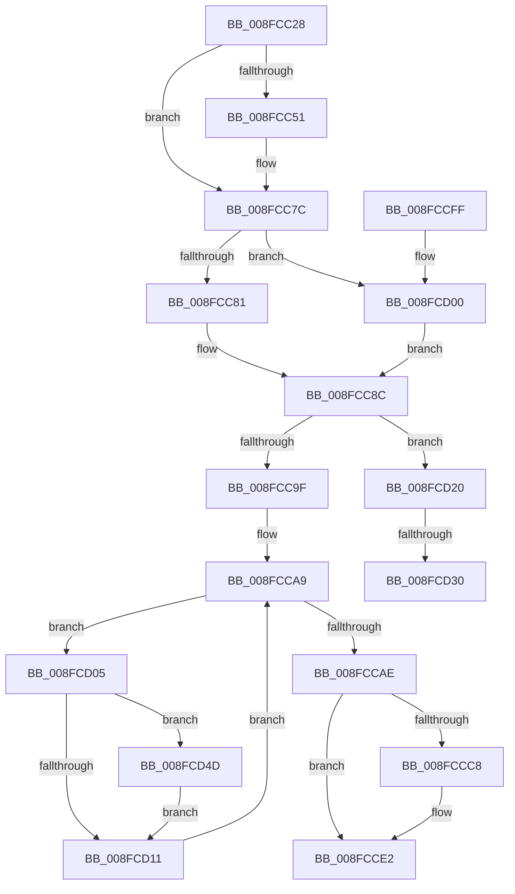

# IopUncacheInterfaceInformation

- RVA: `0x008FCC28`–`0x008FCD66` (길이 `318` bytes)
- VA: `0x00000001408FCC28`
- 실행 섹션: `PAGE`
- PDB 이름 있음: `예`; PDB Function 태그: `예`
- unwind 정보 RVA: `0x00088010`
- 디코드: `90`개 명령, `318/318` bytes 표시
- 미해석 바이트: `0` (있으면 어셈블리에 `.byte`로 보존)

> 이 문서는 커널 이미지의 기계어와 PDB 기호를 분석해 생성했습니다. 4번과 5번은 함수 원형과 자료형을 바이너리 사용 방식에서 추정한 C 해석이며 원본 소스 복구 결과는 아닙니다.

## 1. Dependencies

- 직접 호출 지점: **8**; 고유 호출 대상: **5**
- 직접 호출자로 확인된 함수: **3**
- RIP 상대 이미지 참조: **1**

### Outgoing calls
- `0x008FCC77` → [KeWaitForSingleObject](../../text/20/KeWaitForSingleObject_function_0020E6B0.md) (function, `0x0020E6B0`)
- `0x008FCCD8` → [KeReleaseSemaphore](../../text/39/KeReleaseSemaphore_function_00397080.md) (function, `0x00397080`)
- `0x008FCCDD` → [KeLeaveCriticalRegion](../../text/25/KeLeaveCriticalRegion_function_0025D8B0.md) (function, `0x0025D8B0`)
- `0x008FCD19` → [ExFreePoolWithTag](../../poolcode/B8/ExFreePoolWithTag_function_00B82870.md) (function, `0x00B82870`)
- `0x008FCD38` → [guard_dispatch_icall](../../text/6B/guard_dispatch_icall_function_006BAAD0.md) (function, `0x006BAAD0`)
- `0x008FCD42` → [ExFreePoolWithTag](../../poolcode/B8/ExFreePoolWithTag_function_00B82870.md) (function, `0x00B82870`)
- `0x008FCD55` → [guard_dispatch_icall](../../text/6B/guard_dispatch_icall_function_006BAAD0.md) (function, `0x006BAAD0`)
- `0x008FCD5F` → [ExFreePoolWithTag](../../poolcode/B8/ExFreePoolWithTag_function_00B82870.md) (function, `0x00B82870`)

### Direct callers
- [IopRemoveDevice](IopRemoveDevice_function_008FC7FC.md) at `0x008FC85A`
- [PipProcessStartPhase1](PipProcessStartPhase1_function_008FE1F8.md) at `0x008FE22E`
- [IopDestroyDeviceNode](../A0/IopDestroyDeviceNode_function_00A06A3C.md) at `0x00A06B0B`

### Static image references
- `0x008FCC68` → RVA `0x00F8C360` (`.data`; read)

## 2. Other-region calls and transfers

- 다른 실행 섹션으로 향하는 call: **8**
  - `0x008FCC77` → [KeWaitForSingleObject](../../text/20/KeWaitForSingleObject_function_0020E6B0.md) (`PAGE` → `.text`)
  - `0x008FCCD8` → [KeReleaseSemaphore](../../text/39/KeReleaseSemaphore_function_00397080.md) (`PAGE` → `.text`)
  - `0x008FCCDD` → [KeLeaveCriticalRegion](../../text/25/KeLeaveCriticalRegion_function_0025D8B0.md) (`PAGE` → `.text`)
  - `0x008FCD19` → [ExFreePoolWithTag](../../poolcode/B8/ExFreePoolWithTag_function_00B82870.md) (`PAGE` → `POOLCODE`)
  - `0x008FCD38` → [guard_dispatch_icall](../../text/6B/guard_dispatch_icall_function_006BAAD0.md) (`PAGE` → `.text`)
  - `0x008FCD42` → [ExFreePoolWithTag](../../poolcode/B8/ExFreePoolWithTag_function_00B82870.md) (`PAGE` → `POOLCODE`)
  - `0x008FCD55` → [guard_dispatch_icall](../../text/6B/guard_dispatch_icall_function_006BAAD0.md) (`PAGE` → `.text`)
  - `0x008FCD5F` → [ExFreePoolWithTag](../../poolcode/B8/ExFreePoolWithTag_function_00B82870.md) (`PAGE` → `POOLCODE`)
- call이 아닌 외부 분기/꼬리 이동: **2**
  - `0x008FCD2A` → [sub_00B1FC7C](../B1/Unknown_function_00B1FC7C.md) (`tail-transfer`)
  - `0x008FCD48` → [sub_00B1FC7C](../B1/Unknown_function_00B1FC7C.md) (`tail-transfer`)

## 3. Assembly (complete function range)

```asm
008FCC28  4C 8B DC                        mov r11, rsp
008FCC2B  49 89 5B 08                     mov qword ptr [r11 + 8], rbx
008FCC2F  49 89 6B 10                     mov qword ptr [r11 + 0x10], rbp
008FCC33  49 89 73 18                     mov qword ptr [r11 + 0x18], rsi
008FCC37  57                              push rdi
008FCC38  41 54                           push r12
008FCC3A  41 55                           push r13
008FCC3C  41 56                           push r14
008FCC3E  41 57                           push r15
008FCC40  48 83 EC 30                     sub rsp, 0x30
008FCC44  45 33 ED                        xor r13d, r13d
008FCC47  44 8B FA                        mov r15d, edx
008FCC4A  48 8B D9                        mov rbx, rcx
008FCC4D  85 D2                           test edx, edx
008FCC4F  74 2B                           je 0x1408fcc7c
008FCC51  65 48 8B 04 25 88 01 00 00      mov rax, qword ptr gs:[0x188]
008FCC5A  41 8D 55 04                     lea edx, [r13 + 4]
008FCC5E  45 33 C9                        xor r9d, r9d
008FCC61  4D 89 6B C8                     mov qword ptr [r11 - 0x38], r13
008FCC65  45 33 C0                        xor r8d, r8d
008FCC68  48 8D 0D F1 F6 68 00            lea rcx, [rip + 0x68f6f1]
008FCC6F  66 FF 88 E4 01 00 00            dec word ptr [rax + 0x1e4]
008FCC76  90                              nop
008FCC77  E8 34 1A 91 FF                  call 0x14020e6b0
008FCC7C  48 85 DB                        test rbx, rbx
008FCC7F  74 7F                           je 0x1408fcd00
008FCC81  48 8B 83 38 01 00 00            mov rax, qword ptr [rbx + 0x138]
008FCC88  48 8B 78 28                     mov rdi, qword ptr [rax + 0x28]
008FCC8C  4C 8D B7 E8 01 00 00            lea r14, [rdi + 0x1e8]
008FCC93  49 8B 1E                        mov rbx, qword ptr [r14]
008FCC96  49 3B DE                        cmp rbx, r14
008FCC99  0F 85 81 00 00 00               jne 0x1408fcd20
008FCC9F  48 8D 9F F8 01 00 00            lea rbx, [rdi + 0x1f8]
008FCCA6  48 8B 33                        mov rsi, qword ptr [rbx]
008FCCA9  48 3B F3                        cmp rsi, rbx
008FCCAC  75 57                           jne 0x1408fcd05
008FCCAE  4D 89 76 08                     mov qword ptr [r14 + 8], r14
008FCCB2  4D 89 36                        mov qword ptr [r14], r14
008FCCB5  48 89 5B 08                     mov qword ptr [rbx + 8], rbx
008FCCB9  48 89 1B                        mov qword ptr [rbx], rbx
008FCCBC  4C 89 AF 08 02 00 00            mov qword ptr [rdi + 0x208], r13
008FCCC3  45 85 FF                        test r15d, r15d
008FCCC6  74 1A                           je 0x1408fcce2
008FCCC8  45 33 C9                        xor r9d, r9d
008FCCCB  48 8D 0D 8E F6 68 00            lea rcx, [rip + 0x68f68e]
008FCCD2  33 D2                           xor edx, edx
008FCCD4  45 8D 41 01                     lea r8d, [r9 + 1]
008FCCD8  E8 A3 A3 A9 FF                  call 0x140397080
008FCCDD  E8 CE 0B 96 FF                  call 0x14025d8b0
008FCCE2  48 8B 5C 24 60                  mov rbx, qword ptr [rsp + 0x60]
008FCCE7  48 8B 6C 24 68                  mov rbp, qword ptr [rsp + 0x68]
008FCCEC  48 8B 74 24 70                  mov rsi, qword ptr [rsp + 0x70]
008FCCF1  48 83 C4 30                     add rsp, 0x30
008FCCF5  41 5F                           pop r15
008FCCF7  41 5E                           pop r14
008FCCF9  41 5D                           pop r13
008FCCFB  41 5C                           pop r12
008FCCFD  5F                              pop rdi
008FCCFE  C3                              ret
008FCCFF  CC                              int3
008FCD00  49 8B FD                        mov rdi, r13
008FCD03  EB 87                           jmp 0x1408fcc8c
008FCD05  48 8B 6E 18                     mov rbp, qword ptr [rsi + 0x18]
008FCD09  4C 8B E6                        mov r12, rsi
008FCD0C  48 85 ED                        test rbp, rbp
008FCD0F  75 3C                           jne 0x1408fcd4d
008FCD11  48 8B 36                        mov rsi, qword ptr [rsi]
008FCD14  33 D2                           xor edx, edx
008FCD16  49 8B CC                        mov rcx, r12
008FCD19  E8 52 5B 28 00                  call 0x140b82870
008FCD1E  EB 89                           jmp 0x1408fcca9
008FCD20  48 8B 73 18                     mov rsi, qword ptr [rbx + 0x18]
008FCD24  48 8B EB                        mov rbp, rbx
008FCD27  48 85 F6                        test rsi, rsi
008FCD2A  0F 84 4C 2F 22 00               je 0x140b1fc7c
008FCD30  48 8B 46 18                     mov rax, qword ptr [rsi + 0x18]
008FCD34  48 8B 4E 08                     mov rcx, qword ptr [rsi + 8]
008FCD38  E8 93 DD DB FF                  call 0x1406baad0
008FCD3D  33 D2                           xor edx, edx
008FCD3F  48 8B CE                        mov rcx, rsi
008FCD42  E8 29 5B 28 00                  call 0x140b82870
008FCD47  90                              nop
008FCD48  E9 2F 2F 22 00                  jmp 0x140b1fc7c
008FCD4D  48 8B 45 18                     mov rax, qword ptr [rbp + 0x18]
008FCD51  48 8B 4D 08                     mov rcx, qword ptr [rbp + 8]
008FCD55  E8 76 DD DB FF                  call 0x1406baad0
008FCD5A  33 D2                           xor edx, edx
008FCD5C  48 8B CD                        mov rcx, rbp
008FCD5F  E8 0C 5B 28 00                  call 0x140b82870
008FCD64  EB AB                           jmp 0x1408fcd11
```

## 4. C-style interpretation (structured pseudocode)

```c
__int64 __fastcall IopUncacheInterfaceInformation(__int64 a1, int a2, int a3, int a4)
{
    __int64 result;
    __int64 v_r13;
    __int64 v_rsp;
    unsigned __int64 v_stack_p10;
    unsigned __int64 v_stack_p18;
    unsigned __int64 v_stack_p8;

    *(unsigned __int64 *)(v_rsp + 8) = v_rbx;
    *(unsigned __int64 *)(v_rsp + 16) = v_rbp;
    *(unsigned __int64 *)(v_rsp + 24) = v_rsi;
    v_rsp = (v_rsp) - (48);
    v_r13 = 0;
    if (a2 != 0) {
        result = *(unsigned __int64 *)(gs_base + (0 + 392));
        a2 = v_r13 + 4;
        a4 = 0;
        *(unsigned __int64 *)(v_rsp - 56) = 0;
        a3 = 0;
        a1 = v_rip + 6878961;
        result = KeWaitForSingleObject(a1, a2, a3, a4);
    }
    if (a1 == 0) goto loc_008FCD00;
loc_008FCC8C:
    if ((*(unsigned __int64 *)(*(unsigned __int64 *)(*(unsigned __int64 *)(a1 + 312) + 40) + 488)) != (*(unsigned __int64 *)(*(unsigned __int64 *)(a1 + 312) + 40) + 488)) goto loc_008FCD20;
loc_008FCCA9:
    if ((*(unsigned __int64 *)(*(unsigned __int64 *)(*(unsigned __int64 *)(a1 + 312) + 40) + 504)) != (*(unsigned __int64 *)(*(unsigned __int64 *)(a1 + 312) + 40) + 504)) goto loc_008FCD05;
    *(unsigned __int64 *)(*(unsigned __int64 *)(*(unsigned __int64 *)(a1 + 312) + 40) + 488 + 8) = *(unsigned __int64 *)(*(unsigned __int64 *)(a1 + 312) + 40) + 488;
    *(unsigned __int64 *)(*(unsigned __int64 *)(*(unsigned __int64 *)(a1 + 312) + 40) + 488) = *(unsigned __int64 *)(*(unsigned __int64 *)(a1 + 312) + 40) + 488;
    *(unsigned __int64 *)(*(unsigned __int64 *)(*(unsigned __int64 *)(a1 + 312) + 40) + 504 + 8) = *(unsigned __int64 *)(*(unsigned __int64 *)(a1 + 312) + 40) + 504;
    *(unsigned __int64 *)(*(unsigned __int64 *)(*(unsigned __int64 *)(a1 + 312) + 40) + 504) = *(unsigned __int64 *)(*(unsigned __int64 *)(a1 + 312) + 40) + 504;
    *(unsigned __int64 *)(*(unsigned __int64 *)(*(unsigned __int64 *)(a1 + 312) + 40) + 520) = 0;
    result = *(unsigned __int64 *)(a1 + 312);
    if ((unsigned int)((unsigned int)(a2)) != 0) {
        a4 = 0;
        a1 = v_rip + 6878862;
        a2 = 0;
        a3 = a4 + 1;
        result = KeReleaseSemaphore(a1, a2, a3, a4);
        result = KeLeaveCriticalRegion(a1, a2, a3, a4);
    }
    v_rsp = (v_rsp) + (48);
    return result;
loc_008FCD00:
    goto loc_008FCC8C;
loc_008FCD05:
    if (*(unsigned __int64 *)(v_stack_p18 + 24) != 0) goto loc_008FCD4D;
loc_008FCD11:
    a2 = 0;
    result = ExFreePoolWithTag(v_stack_p18, a2, a3, a4);
    goto loc_008FCCA9;
loc_008FCD20:
    result = guard_dispatch_icall(*(unsigned __int64 *)(*(unsigned __int64 *)(v_stack_p8 + 24) + 8), a2, a3, a4);
    a2 = 0;
    result = ExFreePoolWithTag(*(unsigned __int64 *)(v_stack_p8 + 24), a2, a3, a4);
loc_008FCD4D:
    result = guard_dispatch_icall(*(unsigned __int64 *)(v_stack_p8 + 8), a2, a3, a4);
    a2 = 0;
    result = ExFreePoolWithTag(v_stack_p8, a2, a3, a4);
    goto loc_008FCD11;
}
```

## 5. (Beta) C Style

```c
int64_t IopUncacheInterfaceInformation(int64_t Arg1, int32_t Arg2, int32_t Arg3, int32_t Arg4)
{
    int64_t result;
    int64_t local_r13;
    int64_t local_rsp;
    uint64_t v_stack_p10;
    uint64_t v_stack_p18;
    uint64_t v_stack_p8;

    *(uint64_t *)(local_rsp + 0x8) = local_rbx;
    *(uint64_t *)(local_rsp + 0x10) = local_rbp;
    *(uint64_t *)(local_rsp + 0x18) = local_rsi;
    local_rsp = (local_rsp) - (48);
    local_r13 = 0;
    if (Arg2 != 0) {
        result = *(uint64_t *)(gs_base + (0 + 0x188));
        Arg2 = local_r13 + 4;
        Arg4 = 0;
        *(uint64_t *)(local_rsp - 0x38) = 0;
        Arg3 = 0;
        Arg1 = v_rip + 6878961;
        result = KeWaitForSingleObject(Arg1, Arg2, Arg3, Arg4);
    }
    if (Arg1 == 0) goto loc_008FCD00;
loc_008FCC8C:
    if ((*(uint64_t *)(*(uint64_t *)(*(uint64_t *)(Arg1 + 0x138) + 0x28) + 0x1E8)) != (*(uint64_t *)(*(uint64_t *)(Arg1 + 0x138) + 0x28) + 488)) goto loc_008FCD20;
loc_008FCCA9:
    if ((*(uint64_t *)(*(uint64_t *)(*(uint64_t *)(Arg1 + 0x138) + 0x28) + 0x1F8)) != (*(uint64_t *)(*(uint64_t *)(Arg1 + 0x138) + 0x28) + 504)) goto loc_008FCD05;
    *(uint64_t *)(*(uint64_t *)(*(uint64_t *)(Arg1 + 0x138) + 0x28) + 0x1E8 + 0x8) = *(uint64_t *)(*(uint64_t *)(Arg1 + 0x138) + 0x28) + 488;
    *(uint64_t *)(*(uint64_t *)(*(uint64_t *)(Arg1 + 0x138) + 0x28) + 0x1E8) = *(uint64_t *)(*(uint64_t *)(Arg1 + 0x138) + 0x28) + 488;
    *(uint64_t *)(*(uint64_t *)(*(uint64_t *)(Arg1 + 0x138) + 0x28) + 0x1F8 + 0x8) = *(uint64_t *)(*(uint64_t *)(Arg1 + 0x138) + 0x28) + 504;
    *(uint64_t *)(*(uint64_t *)(*(uint64_t *)(Arg1 + 0x138) + 0x28) + 0x1F8) = *(uint64_t *)(*(uint64_t *)(Arg1 + 0x138) + 0x28) + 504;
    *(uint64_t *)(*(uint64_t *)(*(uint64_t *)(Arg1 + 0x138) + 0x28) + 0x208) = 0;
    result = *(uint64_t *)(Arg1 + 0x138);
    if ((uint32_t)((uint32_t)(Arg2)) != 0) {
        Arg4 = 0;
        Arg1 = v_rip + 6878862;
        Arg2 = 0;
        Arg3 = Arg4 + 1;
        result = KeReleaseSemaphore(Arg1, Arg2, Arg3, Arg4);
        result = KeLeaveCriticalRegion(Arg1, Arg2, Arg3, Arg4);
    }
    local_rsp = (local_rsp) + (48);
    return result;
loc_008FCD00:
    goto loc_008FCC8C;
loc_008FCD05:
    if (*(uint64_t *)(v_stack_p18 + 0x18) != 0) goto loc_008FCD4D;
loc_008FCD11:
    Arg2 = 0;
    result = ExFreePoolWithTag(v_stack_p18, Arg2, Arg3, Arg4);
    goto loc_008FCCA9;
loc_008FCD20:
    result = guard_dispatch_icall(*(uint64_t *)(*(uint64_t *)(v_stack_p8 + 0x18) + 0x8), Arg2, Arg3, Arg4);
    Arg2 = 0;
    result = ExFreePoolWithTag(*(uint64_t *)(v_stack_p8 + 0x18), Arg2, Arg3, Arg4);
loc_008FCD4D:
    result = guard_dispatch_icall(*(uint64_t *)(v_stack_p8 + 0x8), Arg2, Arg3, Arg4);
    Arg2 = 0;
    result = ExFreePoolWithTag(v_stack_p8, Arg2, Arg3, Arg4);
    goto loc_008FCD11;
}
```

## 6. Execution-region graph

[열기: 2D/3D 그래프와 함수 탐색 컨트롤 패널](../../../control-panel.html?section=page&rva=0x008FCC28&view=graph)

- 2D 그래프는 위에서 아래로 흐르고, 3D 그래프는 빈 공간을 드래그해 회전합니다. Shift+드래그는 이동, 휠은 확대·축소, 함수 노드 선택은 대상 보고서 이동입니다.

### Static fallback


