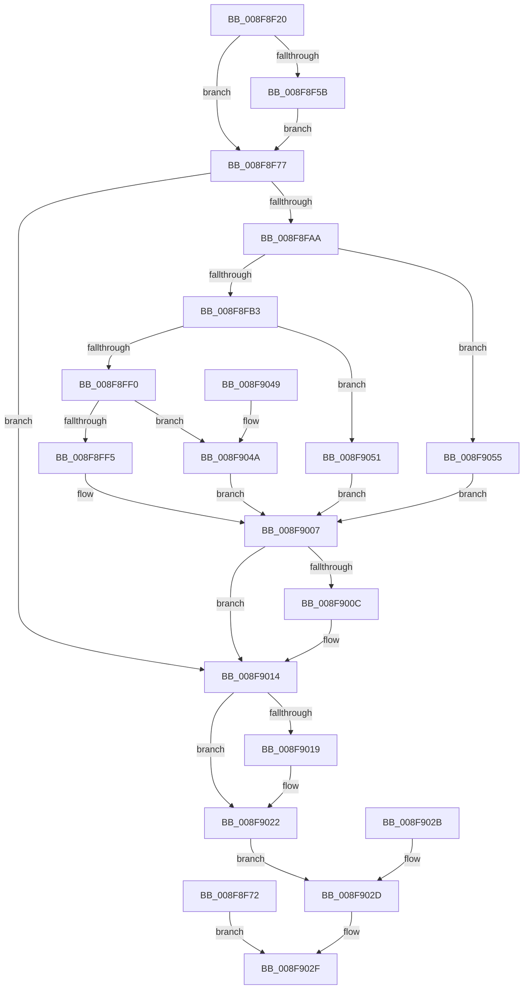

# NtCompareTokens

- RVA: `0x008F8F20`–`0x008F9061` (길이 `321` bytes)
- VA: `0x00000001408F8F20`
- 실행 섹션: `PAGE`
- PDB 이름 있음: `예`; PDB Function 태그: `아니요`
- unwind 정보 RVA: `0x00087BE8`
- 디코드: `89`개 명령, `321/321` bytes 표시
- 미해석 바이트: `0` (있으면 어셈블리에 `.byte`로 보존)

> 이 문서는 커널 이미지의 기계어와 PDB 기호를 분석해 생성했습니다. 4번과 5번은 함수 원형과 자료형을 바이너리 사용 방식에서 추정한 C 해석이며 원본 소스 복구 결과는 아닙니다.

## 1. Dependencies

- 직접 호출 지점: **5**; 고유 호출 대상: **3**
- 직접 호출자로 확인된 함수: **0**
- RIP 상대 이미지 참조: **1**

### Outgoing calls
- `0x008F8F9F` → [ObReferenceObjectByHandle](../86/ObReferenceObjectByHandle_function_00868DB0.md) (function, `0x00868DB0`)
- `0x008F8FDB` → [ObReferenceObjectByHandle](../86/ObReferenceObjectByHandle_function_00868DB0.md) (function, `0x00868DB0`)
- `0x008F9000` → [SeCompareTokens](SeCompareTokens_function_008F6F40.md) (function, `0x008F6F40`)
- `0x008F900F` → [ObfDereferenceObject](../../text/2F/ObfDereferenceObject_function_002F9350.md) (function, `0x002F9350`)
- `0x008F901C` → [ObfDereferenceObject](../../text/2F/ObfDereferenceObject_function_002F9350.md) (function, `0x002F9350`)

### Direct callers
- 이 함수 시작 RVA로 연결되는 직접 call은 확인되지 않았습니다. 간접 호출은 완전히 역산할 수 없습니다.

### Static image references
- `0x008F8F77` → RVA `0x00FD8020` (`PAGEDATA`; read)

## 2. Other-region calls and transfers

- 다른 실행 섹션으로 향하는 call: **2**
  - `0x008F900F` → [ObfDereferenceObject](../../text/2F/ObfDereferenceObject_function_002F9350.md) (`PAGE` → `.text`)
  - `0x008F901C` → [ObfDereferenceObject](../../text/2F/ObfDereferenceObject_function_002F9350.md) (`PAGE` → `.text`)
- 별도 외부 분기/꼬리 이동을 확인하지 못했습니다.

## 3. Assembly (complete function range)

```asm
008F8F20  48 8B C4                        mov rax, rsp
008F8F23  48 89 58 08                     mov qword ptr [rax + 8], rbx
008F8F27  48 89 70 10                     mov qword ptr [rax + 0x10], rsi
008F8F2B  48 89 78 18                     mov qword ptr [rax + 0x18], rdi
008F8F2F  41 54                           push r12
008F8F31  41 56                           push r14
008F8F33  41 57                           push r15
008F8F35  48 83 EC 40                     sub rsp, 0x40
008F8F39  4D 8B F0                        mov r14, r8
008F8F3C  4C 8B E2                        mov r12, rdx
008F8F3F  4C 8B F9                        mov r15, rcx
008F8F42  33 FF                           xor edi, edi
008F8F44  40 88 78 20                     mov byte ptr [rax + 0x20], dil
008F8F48  65 48 8B 04 25 88 01 00 00      mov rax, qword ptr gs:[0x188]
008F8F51  8A 98 32 02 00 00               mov bl, byte ptr [rax + 0x232]
008F8F57  84 DB                           test bl, bl
008F8F59  74 1C                           je 0x1408f8f77
008F8F5B  48 B9 00 00 FF FF FF 7F 00 00   movabs rcx, 0x7fffffff0000
008F8F65  4C 3B C1                        cmp r8, rcx
008F8F68  49 0F 42 C8                     cmovb rcx, r8
008F8F6C  8A 01                           mov al, byte ptr [rcx]
008F8F6E  88 01                           mov byte ptr [rcx], al
008F8F70  EB 05                           jmp 0x1408f8f77
008F8F72  E9 B8 00 00 00                  jmp 0x1408f902f
008F8F77  4C 8B 05 A2 F0 6D 00            mov r8, qword ptr [rip + 0x6df0a2]
008F8F7E  48 83 64 24 30 00               and qword ptr [rsp + 0x30], 0
008F8F84  48 83 64 24 28 00               and qword ptr [rsp + 0x28], 0
008F8F8A  48 8D 44 24 30                  lea rax, [rsp + 0x30]
008F8F8F  48 89 44 24 20                  mov qword ptr [rsp + 0x20], rax
008F8F94  44 8A CB                        mov r9b, bl
008F8F97  BA 08 00 00 00                  mov edx, 8
008F8F9C  49 8B CF                        mov rcx, r15
008F8F9F  E8 0C FE F6 FF                  call 0x140868db0
008F8FA4  8B F0                           mov esi, eax
008F8FA6  85 C0                           test eax, eax
008F8FA8  78 6A                           js 0x1408f9014
008F8FAA  4D 3B FC                        cmp r15, r12
008F8FAD  0F 84 A2 00 00 00               je 0x1408f9055
008F8FB3  4C 8B 05 66 F0 6D 00            mov r8, qword ptr [rip + 0x6df066]
008F8FBA  48 83 64 24 38 00               and qword ptr [rsp + 0x38], 0
008F8FC0  48 83 64 24 28 00               and qword ptr [rsp + 0x28], 0
008F8FC6  48 8D 44 24 38                  lea rax, [rsp + 0x38]
008F8FCB  48 89 44 24 20                  mov qword ptr [rsp + 0x20], rax
008F8FD0  44 8A CB                        mov r9b, bl
008F8FD3  BA 08 00 00 00                  mov edx, 8
008F8FD8  49 8B CC                        mov rcx, r12
008F8FDB  E8 D0 FD F6 FF                  call 0x140868db0
008F8FE0  8B F0                           mov esi, eax
008F8FE2  48 8B 7C 24 38                  mov rdi, qword ptr [rsp + 0x38]
008F8FE7  48 8B 5C 24 30                  mov rbx, qword ptr [rsp + 0x30]
008F8FEC  85 C0                           test eax, eax
008F8FEE  78 61                           js 0x1408f9051
008F8FF0  48 3B DF                        cmp rbx, rdi
008F8FF3  74 55                           je 0x1408f904a
008F8FF5  4C 8D 44 24 78                  lea r8, [rsp + 0x78]
008F8FFA  48 8B D7                        mov rdx, rdi
008F8FFD  48 8B CB                        mov rcx, rbx
008F9000  E8 3B DF FF FF                  call 0x1408f6f40
008F9005  8B F0                           mov esi, eax
008F9007  48 85 DB                        test rbx, rbx
008F900A  74 08                           je 0x1408f9014
008F900C  48 8B CB                        mov rcx, rbx
008F900F  E8 3C 03 A0 FF                  call 0x1402f9350
008F9014  48 85 FF                        test rdi, rdi
008F9017  74 09                           je 0x1408f9022
008F9019  48 8B CF                        mov rcx, rdi
008F901C  E8 2F 03 A0 FF                  call 0x1402f9350
008F9021  90                              nop
008F9022  8A 44 24 78                     mov al, byte ptr [rsp + 0x78]
008F9026  41 88 06                        mov byte ptr [r14], al
008F9029  EB 02                           jmp 0x1408f902d
008F902B  8B F0                           mov esi, eax
008F902D  8B C6                           mov eax, esi
008F902F  48 8B 5C 24 60                  mov rbx, qword ptr [rsp + 0x60]
008F9034  48 8B 74 24 68                  mov rsi, qword ptr [rsp + 0x68]
008F9039  48 8B 7C 24 70                  mov rdi, qword ptr [rsp + 0x70]
008F903E  48 83 C4 40                     add rsp, 0x40
008F9042  41 5F                           pop r15
008F9044  41 5E                           pop r14
008F9046  41 5C                           pop r12
008F9048  C3                              ret
008F9049  CC                              int3
008F904A  C6 44 24 78 01                  mov byte ptr [rsp + 0x78], 1
008F904F  EB B6                           jmp 0x1408f9007
008F9051  33 FF                           xor edi, edi
008F9053  EB B2                           jmp 0x1408f9007
008F9055  C6 44 24 78 01                  mov byte ptr [rsp + 0x78], 1
008F905A  48 8B 5C 24 30                  mov rbx, qword ptr [rsp + 0x30]
008F905F  EB A6                           jmp 0x1408f9007
```

## 4. C-style interpretation (structured pseudocode)

```c
__int64 __fastcall NtCompareTokens(__int64 a1, __int64 a2, __int64 a3)
{
    __int64 result;
    __int64 v_rdi;
    __int64 v_rsp;
    unsigned __int64 v_stack_m20;
    unsigned __int64 v_stack_m28;
    unsigned __int64 v_stack_m30;
    unsigned __int64 v_stack_m38;
    unsigned __int64 v_stack_p10;
    unsigned __int64 v_stack_p18;
    unsigned __int64 v_stack_p20;
    unsigned __int64 v_stack_p30;
    unsigned __int8 v_stack_p78;
    unsigned __int64 v_stack_p8;

    *(unsigned __int64 *)(v_rsp + 8) = v_rbx;
    *(unsigned __int64 *)(v_rsp + 16) = v_rsi;
    *(unsigned __int64 *)(v_rsp + 24) = v_rdi;
    v_rsp = (v_rsp) - (64);
    v_rdi = 0;
    *(unsigned __int8 *)(v_rsp + 32) = 0;
    if ((unsigned __int8)(*(unsigned __int8 *)(*(unsigned __int64 *)(gs_base + (0 + 392)) + 562)) == 0) goto loc_008F8F77;
    if (a3 < a1) { a1 = a3; }
    *(unsigned __int8 *)(a1) = (unsigned __int8)(*(unsigned __int8 *)(a1));
    goto loc_008F8F77;
loc_008F8F77:
    v_stack_m38 = v_stack_m28;
    result = ObReferenceObjectByHandle(a1, 8, *(unsigned __int64 *)(v_rip + 7205026), (unsigned __int8)(*(unsigned __int8 *)(*(unsigned __int64 *)(gs_base + (0 + 392)) + 562)));
    if (sign_flag) goto loc_008F9014;
    if (a1 == a2) goto loc_008F9055;
    v_stack_m38 = v_stack_m20;
    result = ObReferenceObjectByHandle(a2, 8, *(unsigned __int64 *)(v_rip + 7204966), (unsigned __int8)(*(unsigned __int8 *)(*(unsigned __int64 *)(gs_base + (0 + 392)) + 562)));
    if (sign_flag) goto loc_008F9051;
    if (v_stack_m28 == v_stack_m20) goto loc_008F904A;
    result = SeCompareTokens(v_stack_m28, v_stack_m20, v_stack_p20, (unsigned __int8)(*(unsigned __int8 *)(*(unsigned __int64 *)(gs_base + (0 + 392)) + 562)));
loc_008F9007:
    if (v_stack_m28 != 0) {
        a1 = v_stack_m28;
        result = ObfDereferenceObject(a1, v_stack_m20, v_stack_p20, (unsigned __int8)(*(unsigned __int8 *)(*(unsigned __int64 *)(gs_base + (0 + 392)) + 562)));
    }
    if (v_stack_m20 != 0) {
        a1 = v_stack_m20;
        result = ObfDereferenceObject(a1, v_stack_m20, v_stack_p20, (unsigned __int8)(*(unsigned __int8 *)(*(unsigned __int64 *)(gs_base + (0 + 392)) + 562)));
    }
    *(unsigned __int8 *)(a3) = (unsigned __int8)(v_stack_p20);
    goto loc_008F902D;
loc_008F902D:
loc_008F902F:
    v_rsp = (v_rsp) + (64);
    return (unsigned int)((unsigned int)((unsigned int)((unsigned int)(result))));
loc_008F904A:
    v_stack_p78 = 1;
    goto loc_008F9007;
loc_008F9051:
    v_rdi = 0;
    goto loc_008F9007;
loc_008F9055:
    v_stack_p78 = 1;
    goto loc_008F9007;
}
```

## 5. (Beta) C Style

```c
int64_t NtCompareTokens(int64_t Arg1, int64_t Arg2, void *Arg3)
{
    uint8_t *arg3 = (uint8_t *)Arg3;

    int64_t result;
    int64_t local_rdi;
    int64_t local_rsp;
    uint64_t v_stack_m20;
    uint64_t v_stack_m28;
    uint64_t v_stack_m30;
    uint64_t v_stack_m38;
    uint64_t v_stack_p10;
    uint64_t v_stack_p18;
    uint64_t v_stack_p20;
    uint64_t v_stack_p30;
    uint8_t v_stack_p78;
    uint64_t v_stack_p8;

    *(uint64_t *)(local_rsp + 0x8) = local_rbx;
    *(uint64_t *)(local_rsp + 0x10) = local_rsi;
    *(uint64_t *)(local_rsp + 0x18) = local_rdi;
    local_rsp = (local_rsp) - (64);
    local_rdi = 0;
    *(uint8_t *)(local_rsp + 0x20) = 0;
    if ((uint8_t)(*(uint8_t *)(*(uint64_t *)(gs_base + (0 + 0x188)) + 0x232)) == 0) goto loc_008F8F77;
    if (Arg3 < Arg1) { Arg1 = Arg3; }
    *(uint8_t *)(Arg1) = (uint8_t)(*(uint8_t *)(Arg1));
    goto loc_008F8F77;
loc_008F8F77:
    v_stack_m38 = v_stack_m28;
    result = ObReferenceObjectByHandle(Arg1, 8, *(uint64_t *)(v_rip + 0x6DF0A2), (uint8_t)(*(uint8_t *)(*(uint64_t *)(gs_base + (0 + 0x188)) + 0x232)));
    if (sign_flag) goto loc_008F9014;
    if (Arg1 == Arg2) goto loc_008F9055;
    v_stack_m38 = v_stack_m20;
    result = ObReferenceObjectByHandle(Arg2, 8, *(uint64_t *)(v_rip + 0x6DF066), (uint8_t)(*(uint8_t *)(*(uint64_t *)(gs_base + (0 + 0x188)) + 0x232)));
    if (sign_flag) goto loc_008F9051;
    if (v_stack_m28 == v_stack_m20) goto loc_008F904A;
    result = SeCompareTokens(v_stack_m28, v_stack_m20, v_stack_p20, (uint8_t)(*(uint8_t *)(*(uint64_t *)(gs_base + (0 + 0x188)) + 0x232)));
loc_008F9007:
    if (v_stack_m28 != 0) {
        Arg1 = v_stack_m28;
        result = ObfDereferenceObject(Arg1, v_stack_m20, v_stack_p20, (uint8_t)(*(uint8_t *)(*(uint64_t *)(gs_base + (0 + 0x188)) + 0x232)));
    }
    if (v_stack_m20 != 0) {
        Arg1 = v_stack_m20;
        result = ObfDereferenceObject(Arg1, v_stack_m20, v_stack_p20, (uint8_t)(*(uint8_t *)(*(uint64_t *)(gs_base + (0 + 0x188)) + 0x232)));
    }
    *(uint8_t *)(arg3) = (uint8_t)(v_stack_p20);
    goto loc_008F902D;
loc_008F902D:
loc_008F902F:
    local_rsp = (local_rsp) + (64);
    return (uint32_t)((uint32_t)((uint32_t)((uint32_t)(result))));
loc_008F904A:
    v_stack_p78 = 1;
    goto loc_008F9007;
loc_008F9051:
    local_rdi = 0;
    goto loc_008F9007;
loc_008F9055:
    v_stack_p78 = 1;
    goto loc_008F9007;
}
```

### 관측된 메모리 오프셋

구조체 형식이 확인되지 않은 접근은 인자 기준의 오프셋으로만 기록했습니다.

| 기준 인자 | 오프셋 표현 | 폭 (bit) | 접근 |
|---|---:|---:|---|
| `Arg3` | `+ 0x0` | `8` | `W` |

## 6. Execution-region graph

[열기: 2D/3D 그래프와 함수 탐색 컨트롤 패널](../../../control-panel.html?section=page&rva=0x008F8F20&view=graph)

- 2D 그래프는 위에서 아래로 흐르고, 3D 그래프는 빈 공간을 드래그해 회전합니다. Shift+드래그는 이동, 휠은 확대·축소, 함수 노드 선택은 대상 보고서 이동입니다.

### Static fallback


