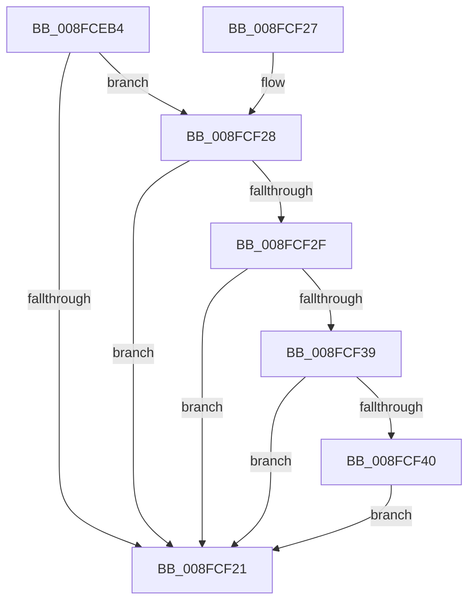

# PiAuditDeviceStart

- RVA: `0x008FCEB4`–`0x008FCF4F` (길이 `155` bytes)
- VA: `0x00000001408FCEB4`
- 실행 섹션: `PAGE`
- PDB 이름 있음: `예`; PDB Function 태그: `아니요`
- unwind 정보 RVA: `0x00088070`
- 디코드: `40`개 명령, `155/155` bytes 표시
- 미해석 바이트: `0` (있으면 어셈블리에 `.byte`로 보존)

> 이 문서는 커널 이미지의 기계어와 PDB 기호를 분석해 생성했습니다. 4번과 5번은 함수 원형과 자료형을 바이너리 사용 방식에서 추정한 C 해석이며 원본 소스 복구 결과는 아닙니다.

## 1. Dependencies

- 직접 호출 지점: **2**; 고유 호출 대상: **2**
- 직접 호출자로 확인된 함수: **1**
- RIP 상대 이미지 참조: **2**

### Outgoing calls
- `0x008FCF18` → [PnpGetObjectProperty](../8E/PnpGetObjectProperty_function_008E2180.md) (function, `0x008E2180`)
- `0x008FCF48` → [PiAuditDeviceOperation](../A8/PiAuditDeviceOperation_function_00A864DC.md) (function, `0x00A864DC`)

### Direct callers
- [PipProcessStartPhase3](PipProcessStartPhase3_function_008FBAF8.md) at `0x008FBC01`

### Static image references
- `0x008FCED4` → RVA `0x00E66398` (`.data`; read)
- `0x008FCEFB` → RVA `0x000140F8` (`.rdata`; read)

## 2. Other-region calls and transfers

- 다른 실행 섹션으로 향하는 call: **0**
- 별도 외부 분기/꼬리 이동을 확인하지 못했습니다.

## 3. Assembly (complete function range)

```asm
008FCEB4  4C 8B DC                        mov r11, rsp
008FCEB7  53                              push rbx
008FCEB8  48 83 EC 60                     sub rsp, 0x60
008FCEBC  83 64 24 50 00                  and dword ptr [rsp + 0x50], 0
008FCEC1  49 8D 43 18                     lea rax, [r11 + 0x18]
008FCEC5  48 8B 51 08                     mov rdx, qword ptr [rcx + 8]
008FCEC9  45 33 C9                        xor r9d, r9d
008FCECC  83 64 24 78 00                  and dword ptr [rsp + 0x78], 0
008FCED1  48 8B D9                        mov rbx, rcx
008FCED4  48 8B 0D BD 94 56 00            mov rcx, qword ptr [rip + 0x5694bd]
008FCEDB  49 89 43 E0                     mov qword ptr [r11 - 0x20], rax
008FCEDF  49 8D 43 08                     lea rax, [r11 + 8]
008FCEE3  C7 44 24 40 01 00 00 00         mov dword ptr [rsp + 0x40], 1
008FCEEB  45 8D 41 01                     lea r8d, [r9 + 1]
008FCEEF  49 89 43 D0                     mov qword ptr [r11 - 0x30], rax
008FCEF3  49 8D 43 10                     lea rax, [r11 + 0x10]
008FCEF7  49 89 43 C8                     mov qword ptr [r11 - 0x38], rax
008FCEFB  48 8D 05 F6 71 71 FF            lea rax, [rip - 0x8e8e0a]
008FCF02  49 89 43 C0                     mov qword ptr [r11 - 0x40], rax
008FCF06  49 83 63 B8 00                  and qword ptr [r11 - 0x48], 0
008FCF0B  C6 44 24 70 00                  mov byte ptr [rsp + 0x70], 0
008FCF10  41 C7 43 18 01 00 00 00         mov dword ptr [r11 + 0x18], 1
008FCF18  E8 63 52 FE FF                  call 0x1408e2180
008FCF1D  85 C0                           test eax, eax
008FCF1F  79 07                           jns 0x1408fcf28
008FCF21  48 83 C4 60                     add rsp, 0x60
008FCF25  5B                              pop rbx
008FCF26  C3                              ret
008FCF27  CC                              int3
008FCF28  83 7C 24 78 11                  cmp dword ptr [rsp + 0x78], 0x11
008FCF2D  75 F2                           jne 0x1408fcf21
008FCF2F  83 BC 24 80 00 00 00 01         cmp dword ptr [rsp + 0x80], 1
008FCF37  75 E8                           jne 0x1408fcf21
008FCF39  80 7C 24 70 FF                  cmp byte ptr [rsp + 0x70], 0xff
008FCF3E  74 E1                           je 0x1408fcf21
008FCF40  41 B0 01                        mov r8b, 1
008FCF43  33 D2                           xor edx, edx
008FCF45  48 8B CB                        mov rcx, rbx
008FCF48  E8 8F 95 18 00                  call 0x140a864dc
008FCF4D  EB D2                           jmp 0x1408fcf21
```

## 4. C-style interpretation (structured pseudocode)

```c
__int64 __fastcall PiAuditDeviceStart(__int64 a1, __int64 a2, __int64 a3, int a4)
{
    __int64 result;
    __int64 v_rsp;
    unsigned int v_stack_m18;
    unsigned int v_stack_m28;
    unsigned int v_stack_p10;
    unsigned __int8 v_stack_p70;
    unsigned int v_stack_p78;
    unsigned __int8 v_stack_p8;
    unsigned int v_stack_p80;

    v_rsp = (v_rsp) - (96);
    a4 = 0;
    *(unsigned __int64 *)(v_rsp - 32) = v_rsp + 24;
    v_stack_m28 = 1;
    *(unsigned __int64 *)(v_rsp - 48) = v_rsp + 8;
    *(unsigned __int64 *)(v_rsp - 56) = v_rsp + 16;
    *(unsigned __int64 *)(v_rsp - 64) = v_rip - 9342474;
    v_stack_p8 = 0;
    *(unsigned int *)(v_rsp + 24) = 1;
    result = PnpGetObjectProperty(*(unsigned __int64 *)(v_rip + 5674173), *(unsigned __int64 *)(a1 + 8), a4 + 1, a4);
    if (!sign_flag) goto loc_008FCF28;
loc_008FCF21:
    v_rsp = (v_rsp) + (96);
    return result;
loc_008FCF28:
    if (v_stack_p78 != 17) goto loc_008FCF21;
    if (v_stack_p80 != 1) goto loc_008FCF21;
    if (v_stack_p70 == 255) goto loc_008FCF21;
    a2 = 0;
    result = PiAuditDeviceOperation(a1, a2, 1, a4);
    goto loc_008FCF21;
}
```

## 5. (Beta) C Style

```c
int64_t PiAuditDeviceStart(void *Arg1, int64_t Arg2, int64_t Arg3, int32_t Arg4)
{
    uint8_t *arg1 = (uint8_t *)Arg1;

    int64_t result;
    int64_t local_rsp;
    uint32_t v_stack_m18;
    uint32_t v_stack_m28;
    uint32_t v_stack_p10;
    uint8_t v_stack_p70;
    uint32_t v_stack_p78;
    uint8_t v_stack_p8;
    uint32_t v_stack_p80;

    local_rsp = (local_rsp) - (96);
    Arg4 = 0;
    *(uint64_t *)(local_rsp - 0x20) = local_rsp + 24;
    v_stack_m28 = 1;
    *(uint64_t *)(local_rsp - 0x30) = local_rsp + 8;
    *(uint64_t *)(local_rsp - 0x38) = local_rsp + 16;
    *(uint64_t *)(local_rsp - 0x40) = v_rip - 9342474;
    v_stack_p8 = 0;
    *(uint32_t *)(local_rsp + 0x18) = 1;
    result = PnpGetObjectProperty(*(uint64_t *)(v_rip + 0x5694BD), *(uint64_t *)(arg1 + 0x8), Arg4 + 1, Arg4);
    if (!sign_flag) goto loc_008FCF28;
loc_008FCF21:
    local_rsp = (local_rsp) + (96);
    return result;
loc_008FCF28:
    if (v_stack_p78 != 17) goto loc_008FCF21;
    if (v_stack_p80 != 1) goto loc_008FCF21;
    if (v_stack_p70 == 255) goto loc_008FCF21;
    Arg2 = 0;
    result = PiAuditDeviceOperation(Arg1, Arg2, 1, Arg4);
    goto loc_008FCF21;
}
```

### 관측된 메모리 오프셋

구조체 형식이 확인되지 않은 접근은 인자 기준의 오프셋으로만 기록했습니다.

| 기준 인자 | 오프셋 표현 | 폭 (bit) | 접근 |
|---|---:|---:|---|
| `Arg1` | `+ 0x8` | `64` | `R` |

## 6. Execution-region graph

[열기: 2D/3D 그래프와 함수 탐색 컨트롤 패널](../../../control-panel.html?section=page&rva=0x008FCEB4&view=graph)

- 2D 그래프는 위에서 아래로 흐르고, 3D 그래프는 빈 공간을 드래그해 회전합니다. Shift+드래그는 이동, 휠은 확대·축소, 함수 노드 선택은 대상 보고서 이동입니다.

### Static fallback


