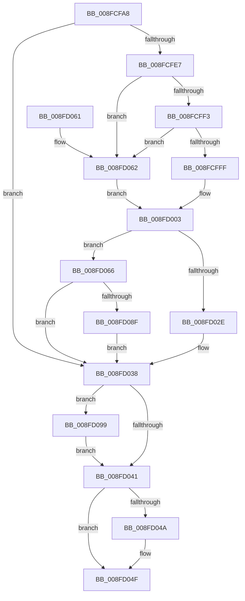

# PiCreateDriverSwDevices

- RVA: `0x008FCFA8`–`0x008FD0A0` (길이 `248` bytes)
- VA: `0x00000001408FCFA8`
- 실행 섹션: `PAGE`
- PDB 이름 있음: `예`; PDB Function 태그: `아니요`
- unwind 정보 RVA: `0x0008807C`
- 디코드: `69`개 명령, `248/248` bytes 표시
- 미해석 바이트: `0` (있으면 어셈블리에 `.byte`로 보존)

> 이 문서는 커널 이미지의 기계어와 PDB 기호를 분석해 생성했습니다. 4번과 5번은 함수 원형과 자료형을 바이너리 사용 방식에서 추정한 C 해석이며 원본 소스 복구 결과는 아닙니다.

## 1. Dependencies

- 직접 호출 지점: **5**; 고유 호출 대상: **4**
- 직접 호출자로 확인된 함수: **1**
- RIP 상대 이미지 참조: **3**

### Outgoing calls
- `0x008FCFDC` → [PnpDeviceObjectToDeviceInstance](PnpDeviceObjectToDeviceInstance_function_008FD630.md) (function, `0x008FD630`)
- `0x008FD025` → [_RegRtlOpenKeyTransacted](../8E/_RegRtlOpenKeyTransacted_function_008EF810.md) (function, `0x008EF810`)
- `0x008FD04A` → [ZwClose](../../text/6A/ZwClose_function_006AD2B0.md) (function, `0x006AD2B0`)
- `0x008FD084` → [PnpCtxRegEnumKeyWithCallback](../AA/PnpCtxRegEnumKeyWithCallback_function_00AA146C.md) (function, `0x00AA146C`)
- `0x008FD099` → [ZwClose](../../text/6A/ZwClose_function_006AD2B0.md) (function, `0x006AD2B0`)

### Direct callers
- [PipProcessStartPhase3](PipProcessStartPhase3_function_008FBAF8.md) at `0x008FBBDC`

### Static image references
- `0x008FCFE7` → RVA `0x00E66398` (`.data`; read)
- `0x008FD007` → RVA `0x00AFD740` (` ?? ::NNGAKEGL::`string'`; read)
- `0x008FD075` → RVA `0x00ABB420` (`PiCreateDriverSwDeviceCallback`; read)

## 2. Other-region calls and transfers

- 다른 실행 섹션으로 향하는 call: **2**
  - `0x008FD04A` → [ZwClose](../../text/6A/ZwClose_function_006AD2B0.md) (`PAGE` → `.text`)
  - `0x008FD099` → [ZwClose](../../text/6A/ZwClose_function_006AD2B0.md) (`PAGE` → `.text`)
- 별도 외부 분기/꼬리 이동을 확인하지 못했습니다.

## 3. Assembly (complete function range)

```asm
008FCFA8  48 89 5C 24 18                  mov qword ptr [rsp + 0x18], rbx
008FCFAD  48 89 7C 24 20                  mov qword ptr [rsp + 0x20], rdi
008FCFB2  55                              push rbp
008FCFB3  48 8B EC                        mov rbp, rsp
008FCFB6  48 83 EC 40                     sub rsp, 0x40
008FCFBA  48 83 65 18 00                  and qword ptr [rbp + 0x18], 0
008FCFBF  48 8D 55 18                     lea rdx, [rbp + 0x18]
008FCFC3  48 83 65 10 00                  and qword ptr [rbp + 0x10], 0
008FCFC8  48 8B F9                        mov rdi, rcx
008FCFCB  48 8B 49 20                     mov rcx, qword ptr [rcx + 0x20]
008FCFCF  0F 57 C0                        xorps xmm0, xmm0
008FCFD2  41 B8 19 00 02 00               mov r8d, 0x20019
008FCFD8  0F 11 45 F0                     movups xmmword ptr [rbp - 0x10], xmm0
008FCFDC  E8 4F 06 00 00                  call 0x1408fd630
008FCFE1  8B D8                           mov ebx, eax
008FCFE3  85 C0                           test eax, eax
008FCFE5  78 51                           js 0x1408fd038
008FCFE7  48 8B 05 AA 93 56 00            mov rax, qword ptr [rip + 0x5693aa]
008FCFEE  48 85 C0                        test rax, rax
008FCFF1  74 6F                           je 0x1408fd062
008FCFF3  48 8B 88 E0 00 00 00            mov rcx, qword ptr [rax + 0xe0]
008FCFFA  48 85 C9                        test rcx, rcx
008FCFFD  74 63                           je 0x1408fd062
008FCFFF  48 8B 41 08                     mov rax, qword ptr [rcx + 8]
008FD003  48 8B 4D 18                     mov rcx, qword ptr [rbp + 0x18]
008FD007  48 8D 15 32 07 20 00            lea rdx, [rip + 0x200732]
008FD00E  48 89 44 24 28                  mov qword ptr [rsp + 0x28], rax
008FD013  41 B9 19 00 02 00               mov r9d, 0x20019
008FD019  48 8D 45 10                     lea rax, [rbp + 0x10]
008FD01D  45 33 C0                        xor r8d, r8d
008FD020  48 89 44 24 20                  mov qword ptr [rsp + 0x20], rax
008FD025  E8 E6 27 FF FF                  call 0x1408ef810
008FD02A  85 C0                           test eax, eax
008FD02C  79 38                           jns 0x1408fd066
008FD02E  33 DB                           xor ebx, ebx
008FD030  3D 34 00 00 C0                  cmp eax, 0xc0000034
008FD035  0F 45 D8                        cmovne ebx, eax
008FD038  48 8B 4D 10                     mov rcx, qword ptr [rbp + 0x10]
008FD03C  48 85 C9                        test rcx, rcx
008FD03F  75 58                           jne 0x1408fd099
008FD041  48 8B 4D 18                     mov rcx, qword ptr [rbp + 0x18]
008FD045  48 85 C9                        test rcx, rcx
008FD048  74 05                           je 0x1408fd04f
008FD04A  E8 61 02 DB FF                  call 0x1406ad2b0
008FD04F  48 8B 7C 24 68                  mov rdi, qword ptr [rsp + 0x68]
008FD054  8B C3                           mov eax, ebx
008FD056  48 8B 5C 24 60                  mov rbx, qword ptr [rsp + 0x60]
008FD05B  48 83 C4 40                     add rsp, 0x40
008FD05F  5D                              pop rbp
008FD060  C3                              ret
008FD061  CC                              int3
008FD062  33 C0                           xor eax, eax
008FD064  EB 9D                           jmp 0x1408fd003
008FD066  48 8B 55 10                     mov rdx, qword ptr [rbp + 0x10]
008FD06A  4C 8D 4D F0                     lea r9, [rbp - 0x10]
008FD06E  48 8B 0D 23 93 56 00            mov rcx, qword ptr [rip + 0x569323]
008FD075  4C 8D 05 A4 E3 1B 00            lea r8, [rip + 0x1be3a4]
008FD07C  83 65 F8 00                     and dword ptr [rbp - 8], 0
008FD080  48 89 7D F0                     mov qword ptr [rbp - 0x10], rdi
008FD084  E8 E3 43 1A 00                  call 0x140aa146c
008FD089  8B D8                           mov ebx, eax
008FD08B  85 C0                           test eax, eax
008FD08D  78 A9                           js 0x1408fd038
008FD08F  8B 45 F8                        mov eax, dword ptr [rbp - 8]
008FD092  85 C0                           test eax, eax
008FD094  0F 48 D8                        cmovs ebx, eax
008FD097  EB 9F                           jmp 0x1408fd038
008FD099  E8 12 02 DB FF                  call 0x1406ad2b0
008FD09E  EB A1                           jmp 0x1408fd041
```

## 4. C-style interpretation (structured pseudocode)

```c
__int64 __fastcall PiCreateDriverSwDevices(__int64 a1)
{
    __int64 result;
    __int64 v_rbx;
    __int64 v_rsp;
    unsigned int v_stack_m10;
    unsigned __int64 v_stack_m18;
    unsigned __int64 v_stack_m20;
    unsigned __int64 v_stack_m28;
    unsigned __int64 v_stack_p10;
    unsigned __int64 v_stack_p18;
    unsigned __int64 v_stack_p20;
    unsigned __int64 v_stack_p8;

    v_stack_p18 = v_rbx;
    v_stack_p20 = v_rdi;
    v_rsp = (v_rsp) - (64);
    v_stack_m18 = v_xmm0;
    result = PnpDeviceObjectToDeviceInstance(*(unsigned __int64 *)(a1 + 32), v_stack_p10, (unsigned int)(0x20019ULL), a4);
    if (sign_flag) goto loc_008FD038;
    if (*(unsigned __int64 *)(v_rip + 5673898) == 0) goto loc_008FD062;
    if (*(unsigned __int64 *)(*(unsigned __int64 *)(v_rip + 5673898) + 224) == 0) goto loc_008FD062;
loc_008FD003:
    v_stack_m20 = *(unsigned __int64 *)(*(unsigned __int64 *)(*(unsigned __int64 *)(v_rip + 5673898) + 224) + 8);
    a3 = 0;
    v_stack_m28 = v_stack_p8;
    result = _RegRtlOpenKeyTransacted(v_stack_p10, v_rip + 2098994, a3, (unsigned int)(0x20019ULL));
    if (!sign_flag) goto loc_008FD066;
    v_rbx = 0;
    if (((unsigned int)(result)) != 0xC0000034ULL) { v_rbx = (unsigned int)(result); }
loc_008FD038:
    if (v_stack_p8 != 0) goto loc_008FD099;
loc_008FD041:
    if (v_stack_p10 != 0) {
        result = ZwClose(v_stack_p10, v_rip + 2098994, a3, (unsigned int)(0x20019ULL));
    }
    v_rsp = (v_rsp) + (64);
    return (unsigned int)((unsigned int)(v_rbx));
loc_008FD062:
    result = 0;
    goto loc_008FD003;
loc_008FD066:
    v_stack_m18 = v_stack_p20;
    result = PnpCtxRegEnumKeyWithCallback(*(unsigned __int64 *)(v_rip + 5673763), v_stack_p8, v_rip + 1827748, v_stack_m18);
    if (sign_flag) goto loc_008FD038;
    v_rbx = (unsigned int)((unsigned int)(result));
    if (sign_flag) { v_rbx = (unsigned int)((unsigned int)(v_stack_m10)); }
    goto loc_008FD038;
loc_008FD099:
    result = ZwClose(*(unsigned __int64 *)(v_rip + 5673763), v_stack_p8, v_rip + 1827748, v_stack_m18);
    goto loc_008FD041;
}
```

## 5. (Beta) C Style

```c
int64_t PiCreateDriverSwDevices(void *Arg1)
{
    uint8_t *arg1 = (uint8_t *)Arg1;

    int64_t result;
    int64_t local_rbx;
    int64_t local_rsp;
    uint32_t v_stack_m10;
    uint64_t v_stack_m18;
    uint64_t v_stack_m20;
    uint64_t v_stack_m28;
    uint64_t v_stack_p10;
    uint64_t v_stack_p18;
    uint64_t v_stack_p20;
    uint64_t v_stack_p8;

    v_stack_p18 = local_rbx;
    v_stack_p20 = local_rdi;
    local_rsp = (local_rsp) - (64);
    v_stack_m18 = v_xmm0;
    result = PnpDeviceObjectToDeviceInstance(*(uint64_t *)(arg1 + 0x20), v_stack_p10, (uint32_t)(0x20019ULL), a4);
    if (sign_flag) goto loc_008FD038;
    if (*(uint64_t *)(v_rip + 0x5693AA) == 0) goto loc_008FD062;
    if (*(uint64_t *)(*(uint64_t *)(v_rip + 0x5693AA) + 0xE0) == 0) goto loc_008FD062;
loc_008FD003:
    v_stack_m20 = *(uint64_t *)(*(uint64_t *)(*(uint64_t *)(v_rip + 0x5693AA) + 0xE0) + 0x8);
    a3 = 0;
    v_stack_m28 = v_stack_p8;
    result = _RegRtlOpenKeyTransacted(v_stack_p10, v_rip + 2098994, a3, (uint32_t)(0x20019ULL));
    if (!sign_flag) goto loc_008FD066;
    local_rbx = 0;
    if (((uint32_t)(result)) != 0xC0000034ULL) { local_rbx = (uint32_t)(result); }
loc_008FD038:
    if (v_stack_p8 != 0) goto loc_008FD099;
loc_008FD041:
    if (v_stack_p10 != 0) {
        result = ZwClose(v_stack_p10, v_rip + 2098994, a3, (uint32_t)(0x20019ULL));
    }
    local_rsp = (local_rsp) + (64);
    return (uint32_t)((uint32_t)(local_rbx));
loc_008FD062:
    result = 0;
    goto loc_008FD003;
loc_008FD066:
    v_stack_m18 = v_stack_p20;
    result = PnpCtxRegEnumKeyWithCallback(*(uint64_t *)(v_rip + 0x569323), v_stack_p8, v_rip + 1827748, v_stack_m18);
    if (sign_flag) goto loc_008FD038;
    local_rbx = (uint32_t)((uint32_t)(result));
    if (sign_flag) { local_rbx = (uint32_t)((uint32_t)(v_stack_m10)); }
    goto loc_008FD038;
loc_008FD099:
    result = ZwClose(*(uint64_t *)(v_rip + 0x569323), v_stack_p8, v_rip + 1827748, v_stack_m18);
    goto loc_008FD041;
}
```

### 관측된 메모리 오프셋

구조체 형식이 확인되지 않은 접근은 인자 기준의 오프셋으로만 기록했습니다.

| 기준 인자 | 오프셋 표현 | 폭 (bit) | 접근 |
|---|---:|---:|---|
| `Arg1` | `+ 0x20` | `64` | `R` |

## 6. Execution-region graph

[열기: 2D/3D 그래프와 함수 탐색 컨트롤 패널](../../../control-panel.html?section=page&rva=0x008FCFA8&view=graph)

- 2D 그래프는 위에서 아래로 흐르고, 3D 그래프는 빈 공간을 드래그해 회전합니다. Shift+드래그는 이동, 휠은 확대·축소, 함수 노드 선택은 대상 보고서 이동입니다.

### Static fallback


