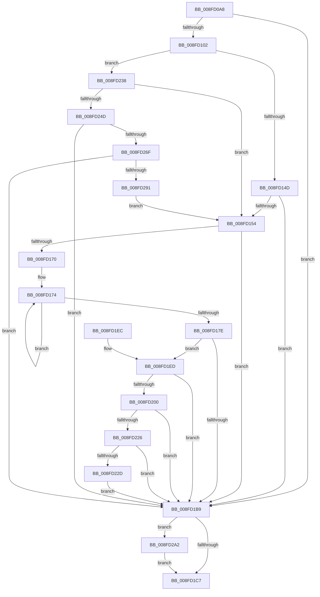

# PiDcUpdateDeviceContainerMembership

- RVA: `0x008FD0A8`–`0x008FD2AC` (길이 `516` bytes)
- VA: `0x00000001408FD0A8`
- 실행 섹션: `PAGE`
- PDB 이름 있음: `예`; PDB Function 태그: `아니요`
- unwind 정보 RVA: `0x00088090`
- 디코드: `130`개 명령, `516/516` bytes 표시
- 미해석 바이트: `0` (있으면 어셈블리에 `.byte`로 보존)

> 이 문서는 커널 이미지의 기계어와 PDB 기호를 분석해 생성했습니다. 4번과 5번은 함수 원형과 자료형을 바이너리 사용 방식에서 추정한 C 해석이며 원본 소스 복구 결과는 아닙니다.

## 1. Dependencies

- 직접 호출 지점: **13**; 고유 호출 대상: **12**
- 직접 호출자로 확인된 함수: **2**
- RIP 상대 이미지 참조: **3**

### Outgoing calls
- `0x008FD0F3` → [PiPnpRtlBeginOperation](../8E/PiPnpRtlBeginOperation_function_008E033C.md) (function, `0x008E033C`)
- `0x008FD13E` → [CmGetDeviceRegProp](../8E/CmGetDeviceRegProp_function_008ED870.md) (function, `0x008ED870`)
- `0x008FD165` → [_CmGetDeviceContainerIdFromBase](_CmGetDeviceContainerIdFromBase_function_008FD2B4.md) (function, `0x008FD2B4`)
- `0x008FD1AE` → [CmSetDeviceRegProp](CmSetDeviceRegProp_function_008FD68C.md) (function, `0x008FD68C`)
- `0x008FD1D0` → [_security_check_cookie](../../text/6A/_security_check_cookie_function_006AC640.md) (function, `0x006AC640`)
- `0x008FD1F7` → [wcscmp](../../text/50/wcscmp_function_00501AF0.md) (function, `0x00501AF0`)
- `0x008FD21B` → [CmAddDeviceToContainer](CmAddDeviceToContainer_function_008FF190.md) (function, `0x008FF190`)
- `0x008FD231` → [PiDcContainerRequiresConfiguration](../AB/PiDcContainerRequiresConfiguration_function_00AB6004.md) (function, `0x00AB6004`)
- `0x008FD240` → [wcsicmp](../../text/50/wcsicmp_function_00500080.md) (function, `0x00500080`)
- `0x008FD260` → [_CmGetDeviceContainerIdFromBase](_CmGetDeviceContainerIdFromBase_function_008FD2B4.md) (function, `0x008FD2B4`)
- `0x008FD282` → [CmRemoveDeviceFromContainer](../82/CmRemoveDeviceFromContainer_function_0082BF40.md) (function, `0x0082BF40`)
- `0x008FD298` → [PiDcResetChildDeviceContainers](../73/PiDcResetChildDeviceContainers_function_00731030.md) (function, `0x00731030`)
- `0x008FD2A2` → [PiPnpRtlEndOperation](../8E/PiPnpRtlEndOperation_function_008E0518.md) (function, `0x008E0518`)

### Direct callers
- [PiProcessNewDeviceNode](../A2/PiProcessNewDeviceNode_function_00A28F20.md) at `0x00A29E36`
- [sub_00B1F622](../B1/Unknown_function_00B1F622.md) at `0x00B1F946`

### Static image references
- `0x008FD0C0` → RVA `0x00E0A740` (`.data`; read)
- `0x008FD102` → RVA `0x00E66398` (`.data`; read)
- `0x008FD1F0` → RVA `0x00AFDCF0` (` ?? ::NNGAKEGL::`string'`; read)

## 2. Other-region calls and transfers

- 다른 실행 섹션으로 향하는 call: **3**
  - `0x008FD1D0` → [_security_check_cookie](../../text/6A/_security_check_cookie_function_006AC640.md) (`PAGE` → `.text`)
  - `0x008FD1F7` → [wcscmp](../../text/50/wcscmp_function_00501AF0.md) (`PAGE` → `.text`)
  - `0x008FD240` → [wcsicmp](../../text/50/wcsicmp_function_00500080.md) (`PAGE` → `.text`)
- 별도 외부 분기/꼬리 이동을 확인하지 못했습니다.

## 3. Assembly (complete function range)

```asm
008FD0A8  48 89 5C 24 20                  mov qword ptr [rsp + 0x20], rbx
008FD0AD  55                              push rbp
008FD0AE  56                              push rsi
008FD0AF  57                              push rdi
008FD0B0  41 56                           push r14
008FD0B2  41 57                           push r15
008FD0B4  48 8D 6C 24 A0                  lea rbp, [rsp - 0x60]
008FD0B9  48 81 EC 60 01 00 00            sub rsp, 0x160
008FD0C0  48 8B 05 79 D6 50 00            mov rax, qword ptr [rip + 0x50d679]
008FD0C7  48 33 C4                        xor rax, rsp
008FD0CA  48 89 45 50                     mov qword ptr [rbp + 0x50], rax
008FD0CE  45 33 FF                        xor r15d, r15d
008FD0D1  48 8B F9                        mov rdi, rcx
008FD0D4  48 8D 4C 24 50                  lea rcx, [rsp + 0x50]
008FD0D9  44 88 7C 24 40                  mov byte ptr [rsp + 0x40], r15b
008FD0DE  4C 89 7C 24 50                  mov qword ptr [rsp + 0x50], r15
008FD0E3  49 8B F0                        mov rsi, r8
008FD0E6  44 89 7C 24 48                  mov dword ptr [rsp + 0x48], r15d
008FD0EB  4C 8B F2                        mov r14, rdx
008FD0EE  44 89 7C 24 44                  mov dword ptr [rsp + 0x44], r15d
008FD0F3  E8 44 32 FE FF                  call 0x1408e033c
008FD0F8  8B D8                           mov ebx, eax
008FD0FA  85 C0                           test eax, eax
008FD0FC  0F 88 B7 00 00 00               js 0x1408fd1b9
008FD102  48 8B 0D 8F 92 56 00            mov rcx, qword ptr [rip + 0x56928f]
008FD109  48 8D 44 24 44                  lea rax, [rsp + 0x44]
008FD10E  44 89 7C 24 38                  mov dword ptr [rsp + 0x38], r15d
008FD113  45 8D 4F 25                     lea r9d, [r15 + 0x25]
008FD117  48 89 44 24 30                  mov qword ptr [rsp + 0x30], rax
008FD11C  4D 8B C6                        mov r8, r14
008FD11F  48 8D 44 24 60                  lea rax, [rsp + 0x60]
008FD124  C7 44 24 44 4E 00 00 00         mov dword ptr [rsp + 0x44], 0x4e
008FD12C  48 89 44 24 28                  mov qword ptr [rsp + 0x28], rax
008FD131  48 8B D7                        mov rdx, rdi
008FD134  48 8D 44 24 48                  lea rax, [rsp + 0x48]
008FD139  48 89 44 24 20                  mov qword ptr [rsp + 0x20], rax
008FD13E  E8 2D 07 FF FF                  call 0x1408ed870
008FD143  8B D8                           mov ebx, eax
008FD145  85 C0                           test eax, eax
008FD147  0F 89 EB 00 00 00               jns 0x1408fd238
008FD14D  3D 25 02 00 C0                  cmp eax, 0xc0000225
008FD152  75 65                           jne 0x1408fd1b9
008FD154  48 8B 0D 3D 92 56 00            mov rcx, qword ptr [rip + 0x56923d]
008FD15B  4C 8D 4D 00                     lea r9, [rbp]
008FD15F  4C 8B C6                        mov r8, rsi
008FD162  48 8B D7                        mov rdx, rdi
008FD165  E8 4A 01 00 00                  call 0x1408fd2b4
008FD16A  8B D8                           mov ebx, eax
008FD16C  85 C0                           test eax, eax
008FD16E  78 49                           js 0x1408fd1b9
008FD170  48 83 C8 FF                     or rax, 0xffffffffffffffff
008FD174  48 FF C0                        inc rax
008FD177  66 44 39 3C 46                  cmp word ptr [rsi + rax*2], r15w
008FD17C  75 F6                           jne 0x1408fd174
008FD17E  48 8B 0D 13 92 56 00            mov rcx, qword ptr [rip + 0x569213]
008FD185  8D 04 45 02 00 00 00            lea eax, [rax*2 + 2]
008FD18C  44 89 7C 24 38                  mov dword ptr [rsp + 0x38], r15d
008FD191  41 B9 25 00 00 00               mov r9d, 0x25
008FD197  89 44 24 30                     mov dword ptr [rsp + 0x30], eax
008FD19B  4D 8B C6                        mov r8, r14
008FD19E  48 89 74 24 28                  mov qword ptr [rsp + 0x28], rsi
008FD1A3  48 8B D7                        mov rdx, rdi
008FD1A6  C7 44 24 20 01 00 00 00         mov dword ptr [rsp + 0x20], 1
008FD1AE  E8 D9 04 00 00                  call 0x1408fd68c
008FD1B3  8B D8                           mov ebx, eax
008FD1B5  85 C0                           test eax, eax
008FD1B7  79 34                           jns 0x1408fd1ed
008FD1B9  48 8B 4C 24 50                  mov rcx, qword ptr [rsp + 0x50]
008FD1BE  48 85 C9                        test rcx, rcx
008FD1C1  0F 85 DB 00 00 00               jne 0x1408fd2a2
008FD1C7  8B C3                           mov eax, ebx
008FD1C9  48 8B 4D 50                     mov rcx, qword ptr [rbp + 0x50]
008FD1CD  48 33 CC                        xor rcx, rsp
008FD1D0  E8 6B F4 DA FF                  call 0x1406ac640
008FD1D5  48 8B 9C 24 A8 01 00 00         mov rbx, qword ptr [rsp + 0x1a8]
008FD1DD  48 81 C4 60 01 00 00            add rsp, 0x160
008FD1E4  41 5F                           pop r15
008FD1E6  41 5E                           pop r14
008FD1E8  5F                              pop rdi
008FD1E9  5E                              pop rsi
008FD1EA  5D                              pop rbp
008FD1EB  C3                              ret
008FD1EC  CC                              int3
008FD1ED  48 8B D6                        mov rdx, rsi
008FD1F0  48 8D 0D F9 0A 20 00            lea rcx, [rip + 0x200af9]
008FD1F7  E8 F4 48 C0 FF                  call 0x140501af0
008FD1FC  85 C0                           test eax, eax
008FD1FE  74 B9                           je 0x1408fd1b9
008FD200  48 8B 0D 91 91 56 00            mov rcx, qword ptr [rip + 0x569191]
008FD207  48 8D 44 24 40                  lea rax, [rsp + 0x40]
008FD20C  4C 8B CF                        mov r9, rdi
008FD20F  48 89 44 24 20                  mov qword ptr [rsp + 0x20], rax
008FD214  4C 8B C6                        mov r8, rsi
008FD217  48 8D 55 00                     lea rdx, [rbp]
008FD21B  E8 70 1F 00 00                  call 0x1408ff190
008FD220  8B D8                           mov ebx, eax
008FD222  85 C0                           test eax, eax
008FD224  78 93                           js 0x1408fd1b9
008FD226  44 38 7C 24 40                  cmp byte ptr [rsp + 0x40], r15b
008FD22B  75 8C                           jne 0x1408fd1b9
008FD22D  48 8D 4D 00                     lea rcx, [rbp]
008FD231  E8 CE 8D 1B 00                  call 0x140ab6004
008FD236  EB 81                           jmp 0x1408fd1b9
008FD238  48 8D 54 24 60                  lea rdx, [rsp + 0x60]
008FD23D  48 8B CE                        mov rcx, rsi
008FD240  E8 3B 2E C0 FF                  call 0x140500080
008FD245  85 C0                           test eax, eax
008FD247  0F 84 07 FF FF FF               je 0x1408fd154
008FD24D  48 8B 0D 44 91 56 00            mov rcx, qword ptr [rip + 0x569144]
008FD254  4C 8D 4D B0                     lea r9, [rbp - 0x50]
008FD258  4C 8D 44 24 60                  lea r8, [rsp + 0x60]
008FD25D  48 8B D7                        mov rdx, rdi
008FD260  E8 4F 00 00 00                  call 0x1408fd2b4
008FD265  8B D8                           mov ebx, eax
008FD267  85 C0                           test eax, eax
008FD269  0F 88 4A FF FF FF               js 0x1408fd1b9
008FD26F  48 8B 0D 22 91 56 00            mov rcx, qword ptr [rip + 0x569122]
008FD276  4C 8D 44 24 60                  lea r8, [rsp + 0x60]
008FD27B  4C 8B CF                        mov r9, rdi
008FD27E  48 8D 55 B0                     lea rdx, [rbp - 0x50]
008FD282  E8 B9 EC F2 FF                  call 0x14082bf40
008FD287  8B D8                           mov ebx, eax
008FD289  85 C0                           test eax, eax
008FD28B  0F 88 28 FF FF FF               js 0x1408fd1b9
008FD291  48 8D 55 B0                     lea rdx, [rbp - 0x50]
008FD295  48 8B CF                        mov rcx, rdi
008FD298  E8 93 3D E3 FF                  call 0x140731030
008FD29D  E9 B2 FE FF FF                  jmp 0x1408fd154
008FD2A2  E8 71 32 FE FF                  call 0x1408e0518
008FD2A7  E9 1B FF FF FF                  jmp 0x1408fd1c7
```

## 4. C-style interpretation (structured pseudocode)

```c
__int64 __fastcall PiDcUpdateDeviceContainerMembership(__int64 a1, __int64 a2, __int64 a3)
{
    __int64 result;
    __int64 v_r15;
    __int64 v_rsp;
    unsigned __int64 v_stack_m128;
    unsigned __int64 v_stack_m138;
    unsigned int v_stack_m140;
    unsigned int v_stack_m144;
    unsigned __int8 v_stack_m148;
    unsigned int v_stack_m150;
    unsigned __int64 v_stack_m158;
    unsigned __int64 v_stack_m160;
    unsigned __int64 v_stack_m168;
    unsigned __int64 v_stack_m38;
    unsigned __int64 v_stack_m88;
    unsigned __int64 v_stack_mD8;
    unsigned __int64 v_stack_p20;
    unsigned __int64 v_stack_p40;
    unsigned __int64 v_stack_p60;

    v_stack_p20 = v_rbx;
    v_rsp = (v_rsp) - (352);
    result = (*(unsigned __int64 *)(v_rip + 5297785)) ^ (v_rsp);
    v_stack_m38 = result;
    v_r15 = 0;
    v_stack_m148 = 0;
    v_stack_m138 = 0;
    v_stack_m140 = 0;
    v_stack_m144 = 0;
    result = PiPnpRtlBeginOperation(v_stack_m138, a2, a3, a4);
    if (sign_flag) goto loc_008FD1B9;
    v_stack_m150 = 0;
    v_stack_m158 = v_stack_m144;
    v_stack_m144 = 78;
    v_stack_m160 = v_stack_m128;
    v_stack_m168 = v_stack_m140;
    result = CmGetDeviceRegProp(*(unsigned __int64 *)(v_rip + 5673615), a1, a2, v_r15 + 37);
    if (!sign_flag) goto loc_008FD238;
    if (((unsigned int)(result)) != 0xC0000225ULL) goto loc_008FD1B9;
loc_008FD154:
    result = _CmGetDeviceContainerIdFromBase(*(unsigned __int64 *)(v_rip + 5673533), a1, a3, v_stack_m88);
    if (sign_flag) goto loc_008FD1B9;
    result = (result) | (-1);
loc_008FD174:
    result = (result) + 1;
    if ((*(unsigned __int16 *)(a3 + result * 2)) != 0) goto loc_008FD174;
    v_stack_m150 = 0;
    v_stack_m158 = (unsigned int)(result * 2 + 2);
    v_stack_m160 = a3;
    v_stack_m168 = 1;
    result = CmSetDeviceRegProp(*(unsigned __int64 *)(v_rip + 5673491), a1, a2, 37);
    if (!sign_flag) goto loc_008FD1ED;
loc_008FD1B9:
    if (v_stack_m138 != 0) goto loc_008FD2A2;
loc_008FD1C7:
    a1 = (v_stack_m38) ^ (v_rsp);
    result = _security_check_cookie(a1, a1, a2, 37);
    v_rsp = (v_rsp) + (352);
    return result;
loc_008FD1ED:
    result = wcscmp(v_rip + 2099961, a3, a2, 37);
    if ((unsigned int)(result) == 0) goto loc_008FD1B9;
    v_stack_p20 = v_stack_p40;
    result = CmAddDeviceToContainer(*(unsigned __int64 *)(v_rip + 5673361), v_stack_m88, a3, a1);
    if (sign_flag) goto loc_008FD1B9;
    if (v_stack_p40 != 0) goto loc_008FD1B9;
    result = PiDcContainerRequiresConfiguration(v_stack_m88, v_stack_m88, a3, a1);
    goto loc_008FD1B9;
loc_008FD238:
    result = wcsicmp(a3, v_stack_p60, a3, a1);
    if ((unsigned int)(result) == 0) goto loc_008FD154;
    result = _CmGetDeviceContainerIdFromBase(*(unsigned __int64 *)(v_rip + 5673284), a1, v_stack_p60, v_stack_mD8);
    if (sign_flag) goto loc_008FD1B9;
    result = CmRemoveDeviceFromContainer(*(unsigned __int64 *)(v_rip + 5673250), v_stack_mD8, v_stack_p60, a1);
    if (sign_flag) goto loc_008FD1B9;
    result = PiDcResetChildDeviceContainers(a1, v_stack_mD8, v_stack_p60, a1);
    goto loc_008FD154;
loc_008FD2A2:
    result = PiPnpRtlEndOperation(a1, v_stack_mD8, v_stack_p60, a1);
    goto loc_008FD1C7;
}
```

## 5. (Beta) C Style

```c
int64_t PiDcUpdateDeviceContainerMembership(int64_t Arg1, int64_t Arg2, void *Arg3)
{
    uint8_t *arg3 = (uint8_t *)Arg3;

    int64_t result;
    int64_t local_r15;
    int64_t local_rsp;
    uint64_t v_stack_m128;
    uint64_t v_stack_m138;
    uint32_t v_stack_m140;
    uint32_t v_stack_m144;
    uint8_t v_stack_m148;
    uint32_t v_stack_m150;
    uint64_t v_stack_m158;
    uint64_t v_stack_m160;
    uint64_t v_stack_m168;
    uint64_t v_stack_m38;
    uint64_t v_stack_m88;
    uint64_t v_stack_mD8;
    uint64_t v_stack_p20;
    uint64_t v_stack_p40;
    uint64_t v_stack_p60;

    v_stack_p20 = local_rbx;
    local_rsp = (local_rsp) - (352);
    result = (*(uint64_t *)(v_rip + 0x50D679)) ^ (local_rsp);
    v_stack_m38 = result;
    local_r15 = 0;
    v_stack_m148 = 0;
    v_stack_m138 = 0;
    v_stack_m140 = 0;
    v_stack_m144 = 0;
    result = PiPnpRtlBeginOperation(v_stack_m138, Arg2, Arg3, a4);
    if (sign_flag) goto loc_008FD1B9;
    v_stack_m150 = 0;
    v_stack_m158 = v_stack_m144;
    v_stack_m144 = 78;
    v_stack_m160 = v_stack_m128;
    v_stack_m168 = v_stack_m140;
    result = CmGetDeviceRegProp(*(uint64_t *)(v_rip + 0x56928F), Arg1, Arg2, local_r15 + 37);
    if (!sign_flag) goto loc_008FD238;
    if (((uint32_t)(result)) != 0xC0000225ULL) goto loc_008FD1B9;
loc_008FD154:
    result = _CmGetDeviceContainerIdFromBase(*(uint64_t *)(v_rip + 0x56923D), Arg1, Arg3, v_stack_m88);
    if (sign_flag) goto loc_008FD1B9;
    result = (result) | (-1);
loc_008FD174:
    result = (result) + 1;
    if ((*(uint16_t *)(arg3 + result * 2)) != 0) goto loc_008FD174;
    v_stack_m150 = 0;
    v_stack_m158 = (uint32_t)(result * 2 + 2);
    v_stack_m160 = Arg3;
    v_stack_m168 = 1;
    result = CmSetDeviceRegProp(*(uint64_t *)(v_rip + 0x569213), Arg1, Arg2, 37);
    if (!sign_flag) goto loc_008FD1ED;
loc_008FD1B9:
    if (v_stack_m138 != 0) goto loc_008FD2A2;
loc_008FD1C7:
    Arg1 = (v_stack_m38) ^ (local_rsp);
    result = _security_check_cookie(Arg1, Arg1, Arg2, 37);
    local_rsp = (local_rsp) + (352);
    return result;
loc_008FD1ED:
    result = wcscmp(v_rip + 2099961, Arg3, Arg2, 37);
    if ((uint32_t)(result) == 0) goto loc_008FD1B9;
    v_stack_p20 = v_stack_p40;
    result = CmAddDeviceToContainer(*(uint64_t *)(v_rip + 0x569191), v_stack_m88, Arg3, Arg1);
    if (sign_flag) goto loc_008FD1B9;
    if (v_stack_p40 != 0) goto loc_008FD1B9;
    result = PiDcContainerRequiresConfiguration(v_stack_m88, v_stack_m88, Arg3, Arg1);
    goto loc_008FD1B9;
loc_008FD238:
    result = wcsicmp(Arg3, v_stack_p60, Arg3, Arg1);
    if ((uint32_t)(result) == 0) goto loc_008FD154;
    result = _CmGetDeviceContainerIdFromBase(*(uint64_t *)(v_rip + 0x569144), Arg1, v_stack_p60, v_stack_mD8);
    if (sign_flag) goto loc_008FD1B9;
    result = CmRemoveDeviceFromContainer(*(uint64_t *)(v_rip + 0x569122), v_stack_mD8, v_stack_p60, Arg1);
    if (sign_flag) goto loc_008FD1B9;
    result = PiDcResetChildDeviceContainers(Arg1, v_stack_mD8, v_stack_p60, Arg1);
    goto loc_008FD154;
loc_008FD2A2:
    result = PiPnpRtlEndOperation(Arg1, v_stack_mD8, v_stack_p60, Arg1);
    goto loc_008FD1C7;
}
```

### 관측된 메모리 오프셋

구조체 형식이 확인되지 않은 접근은 인자 기준의 오프셋으로만 기록했습니다.

| 기준 인자 | 오프셋 표현 | 폭 (bit) | 접근 |
|---|---:|---:|---|
| `Arg3` | `+ 0x0 + rax*2` | `16` | `R` |

## 6. Execution-region graph

[열기: 2D/3D 그래프와 함수 탐색 컨트롤 패널](../../../control-panel.html?section=page&rva=0x008FD0A8&view=graph)

- 2D 그래프는 위에서 아래로 흐르고, 3D 그래프는 빈 공간을 드래그해 회전합니다. Shift+드래그는 이동, 휠은 확대·축소, 함수 노드 선택은 대상 보고서 이동입니다.

### Static fallback


