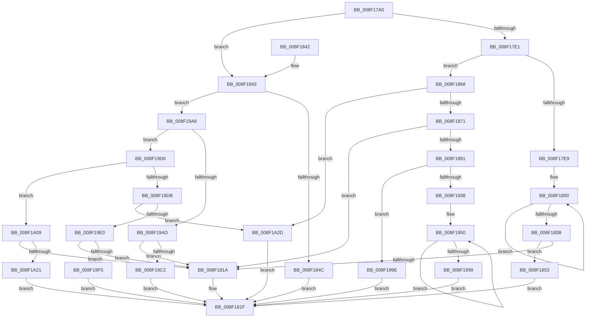

# PiDmCacheDataDecode

- RVA: `0x008F17A0`–`0x008F1A37` (길이 `663` bytes)
- VA: `0x00000001408F17A0`
- 실행 섹션: `PAGE`
- PDB 이름 있음: `예`; PDB Function 태그: `아니요`
- unwind 정보 RVA: `0x00087270`
- 디코드: `156`개 명령, `663/663` bytes 표시
- 미해석 바이트: `0` (있으면 어셈블리에 `.byte`로 보존)

> 이 문서는 커널 이미지의 기계어와 PDB 기호를 분석해 생성했습니다. 4번과 5번은 함수 원형과 자료형을 바이너리 사용 방식에서 추정한 C 해석이며 원본 소스 복구 결과는 아닙니다.

## 1. Dependencies

- 직접 호출 지점: **6**; 고유 호출 대상: **4**
- 직접 호출자로 확인된 함수: **2**
- RIP 상대 이미지 참조: **2**

### Outgoing calls
- `0x008F182C` → [_security_check_cookie](../../text/6A/_security_check_cookie_function_006AC640.md) (function, `0x006AC640`)
- `0x008F1861` → [memcpy](../../text/6C/memcpy_function_006C6840.md) (function, `0x006C6840`)
- `0x008F188E` → [RtlInitUnicodeString](../../text/42/RtlInitUnicodeString_function_0042A780.md) (function, `0x0042A780`)
- `0x008F192E` → [ScanHexFormat](ScanHexFormat_function_008F29C0.md) (function, `0x008F29C0`)
- `0x008F19CC` → [memcpy](../../text/6C/memcpy_function_006C6840.md) (function, `0x006C6840`)
- `0x008F19FF` → [memcpy](../../text/6C/memcpy_function_006C6840.md) (function, `0x006C6840`)

### Direct callers
- [PiDmObjectProcessPropertyChange](PiDmObjectProcessPropertyChange_function_008F8A48.md) at `0x008F8D1E`
- [PiDmObjectProcessPropertyChange](PiDmObjectProcessPropertyChange_function_008F8A48.md) at `0x008F8D7B`
- [PiDmListUpdateAggregationCountWorker](../A8/PiDmListUpdateAggregationCountWorker_function_00A88848.md) at `0x00A88934`

### Static image references
- `0x008F17AD` → RVA `0x00E0A740` (`.data`; read)
- `0x008F1910` → RVA `0x00B4D0B0` (`GuidFormat`; read)

## 2. Other-region calls and transfers

- 다른 실행 섹션으로 향하는 call: **5**
  - `0x008F182C` → [_security_check_cookie](../../text/6A/_security_check_cookie_function_006AC640.md) (`PAGE` → `.text`)
  - `0x008F1861` → [memcpy](../../text/6C/memcpy_function_006C6840.md) (`PAGE` → `.text`)
  - `0x008F188E` → [RtlInitUnicodeString](../../text/42/RtlInitUnicodeString_function_0042A780.md) (`PAGE` → `.text`)
  - `0x008F19CC` → [memcpy](../../text/6C/memcpy_function_006C6840.md) (`PAGE` → `.text`)
  - `0x008F19FF` → [memcpy](../../text/6C/memcpy_function_006C6840.md) (`PAGE` → `.text`)
- 별도 외부 분기/꼬리 이동을 확인하지 못했습니다.

## 3. Assembly (complete function range)

```asm
008F17A0  48 89 5C 24 20                  mov qword ptr [rsp + 0x20], rbx
008F17A5  57                              push rdi
008F17A6  48 81 EC A0 00 00 00            sub rsp, 0xa0
008F17AD  48 8B 05 8C 8F 51 00            mov rax, qword ptr [rip + 0x518f8c]
008F17B4  48 33 C4                        xor rax, rsp
008F17B7  48 89 84 24 90 00 00 00         mov qword ptr [rsp + 0x90], rax
008F17BF  4C 8B 94 24 D0 00 00 00         mov r10, qword ptr [rsp + 0xd0]
008F17C7  49 8B F8                        mov rdi, r8
008F17CA  4C 8B C2                        mov r8, rdx
008F17CD  33 DB                           xor ebx, ebx
008F17CF  48 8B D1                        mov rdx, rcx
008F17D2  0F 57 C0                        xorps xmm0, xmm0
008F17D5  8B 09                           mov ecx, dword ptr [rcx]
008F17D7  0F 11 44 24 70                  movups xmmword ptr [rsp + 0x70], xmm0
008F17DC  83 F9 06                        cmp ecx, 6
008F17DF  75 62                           jne 0x1408f1843
008F17E1  8B 42 08                        mov eax, dword ptr [rdx + 8]
008F17E4  83 F8 12                        cmp eax, 0x12
008F17E7  75 7F                           jne 0x1408f1868
008F17E9  41 89 00                        mov dword ptr [r8], eax
008F17EC  48 8B 42 10                     mov rax, qword ptr [rdx + 0x10]
008F17F0  48 8B 48 10                     mov rcx, qword ptr [rax + 0x10]
008F17F4  48 C7 C0 FF FF FF FF            mov rax, 0xffffffffffffffff
008F17FB  0F 1F 44 00 00                  nop dword ptr [rax + rax]
008F1800  66 39 5C 41 02                  cmp word ptr [rcx + rax*2 + 2], bx
008F1805  48 8D 40 01                     lea rax, [rax + 1]
008F1809  75 F5                           jne 0x1408f1800
008F180B  8D 04 45 02 00 00 00            lea eax, [rax*2 + 2]
008F1812  41 89 02                        mov dword ptr [r10], eax
008F1815  44 3B C8                        cmp r9d, eax
008F1818  73 39                           jae 0x1408f1853
008F181A  BB 23 00 00 C0                  mov ebx, 0xc0000023
008F181F  8B C3                           mov eax, ebx
008F1821  48 8B 8C 24 90 00 00 00         mov rcx, qword ptr [rsp + 0x90]
008F1829  48 33 CC                        xor rcx, rsp
008F182C  E8 0F AE DB FF                  call 0x1406ac640
008F1831  48 8B 9C 24 C8 00 00 00         mov rbx, qword ptr [rsp + 0xc8]
008F1839  48 81 C4 A0 00 00 00            add rsp, 0xa0
008F1840  5F                              pop rdi
008F1841  C3                              ret
008F1842  CC                              int3
008F1843  83 E9 02                        sub ecx, 2
008F1846  0F 85 5C 01 00 00               jne 0x1408f19a8
008F184C  BB 25 02 00 C0                  mov ebx, 0xc0000225
008F1851  EB CC                           jmp 0x1408f181f
008F1853  48 8B 52 10                     mov rdx, qword ptr [rdx + 0x10]
008F1857  48 8B CF                        mov rcx, rdi
008F185A  44 8B C0                        mov r8d, eax
008F185D  48 8B 52 10                     mov rdx, qword ptr [rdx + 0x10]
008F1861  E8 DA 4F DD FF                  call 0x1406c6840
008F1866  EB B7                           jmp 0x1408f181f
008F1868  83 F8 0D                        cmp eax, 0xd
008F186B  0F 85 BC 01 00 00               jne 0x1408f1a2d
008F1871  41 89 00                        mov dword ptr [r8], eax
008F1874  41 C7 02 10 00 00 00            mov dword ptr [r10], 0x10
008F187B  41 83 F9 10                     cmp r9d, 0x10
008F187F  72 99                           jb 0x1408f181a
008F1881  48 8B 52 10                     mov rdx, qword ptr [rdx + 0x10]
008F1885  48 8D 4C 24 70                  lea rcx, [rsp + 0x70]
008F188A  48 8B 52 10                     mov rdx, qword ptr [rdx + 0x10]
008F188E  E8 ED 8E B3 FF                  call 0x14042a780
008F1893  0F B7 54 24 70                  movzx edx, word ptr [rsp + 0x70]
008F1898  4C 8D 84 24 8E 00 00 00         lea r8, [rsp + 0x8e]
008F18A0  4C 89 44 24 68                  mov qword ptr [rsp + 0x68], r8
008F18A5  48 8D 47 06                     lea rax, [rdi + 6]
008F18A9  4C 8D 84 24 8C 00 00 00         lea r8, [rsp + 0x8c]
008F18B1  D1 EA                           shr edx, 1
008F18B3  4C 89 44 24 60                  mov qword ptr [rsp + 0x60], r8
008F18B8  48 8D 4F 04                     lea rcx, [rdi + 4]
008F18BC  4C 8D 84 24 8A 00 00 00         lea r8, [rsp + 0x8a]
008F18C4  0F 57 C0                        xorps xmm0, xmm0
008F18C7  4C 89 44 24 58                  mov qword ptr [rsp + 0x58], r8
008F18CC  4C 8B CF                        mov r9, rdi
008F18CF  4C 8D 84 24 88 00 00 00         lea r8, [rsp + 0x88]
008F18D7  4C 89 44 24 50                  mov qword ptr [rsp + 0x50], r8
008F18DC  4C 8D 84 24 86 00 00 00         lea r8, [rsp + 0x86]
008F18E4  4C 89 44 24 48                  mov qword ptr [rsp + 0x48], r8
008F18E9  4C 8D 84 24 84 00 00 00         lea r8, [rsp + 0x84]
008F18F1  4C 89 44 24 40                  mov qword ptr [rsp + 0x40], r8
008F18F6  4C 8D 84 24 82 00 00 00         lea r8, [rsp + 0x82]
008F18FE  4C 89 44 24 38                  mov qword ptr [rsp + 0x38], r8
008F1903  4C 8D 84 24 80 00 00 00         lea r8, [rsp + 0x80]
008F190B  4C 89 44 24 30                  mov qword ptr [rsp + 0x30], r8
008F1910  4C 8D 05 99 B7 25 00            lea r8, [rip + 0x25b799]
008F1917  48 89 44 24 28                  mov qword ptr [rsp + 0x28], rax
008F191C  48 89 4C 24 20                  mov qword ptr [rsp + 0x20], rcx
008F1921  48 8B 4C 24 78                  mov rcx, qword ptr [rsp + 0x78]
008F1926  0F 11 84 24 80 00 00 00         movups xmmword ptr [rsp + 0x80], xmm0
008F192E  E8 8D 10 00 00                  call 0x1408f29c0
008F1933  83 F8 FF                        cmp eax, -1
008F1936  74 66                           je 0x1408f199e
008F1938  44 8B C3                        mov r8d, ebx
008F193B  48 8D 4F 09                     lea rcx, [rdi + 9]
008F193F  48 8D 94 24 82 00 00 00         lea rdx, [rsp + 0x82]
008F1947  66 0F 1F 84 00 00 00 00 00      nop word ptr [rax + rax]
008F1950  0F B6 42 FE                     movzx eax, byte ptr [rdx - 2]
008F1954  41 83 C0 08                     add r8d, 8
008F1958  88 41 FF                        mov byte ptr [rcx - 1], al
008F195B  48 8D 49 08                     lea rcx, [rcx + 8]
008F195F  0F B6 02                        movzx eax, byte ptr [rdx]
008F1962  48 8D 52 10                     lea rdx, [rdx + 0x10]
008F1966  88 41 F8                        mov byte ptr [rcx - 8], al
008F1969  0F B6 42 F2                     movzx eax, byte ptr [rdx - 0xe]
008F196D  88 41 F9                        mov byte ptr [rcx - 7], al
008F1970  0F B6 42 F4                     movzx eax, byte ptr [rdx - 0xc]
008F1974  88 41 FA                        mov byte ptr [rcx - 6], al
008F1977  0F B6 42 F6                     movzx eax, byte ptr [rdx - 0xa]
008F197B  88 41 FB                        mov byte ptr [rcx - 5], al
008F197E  0F B6 42 F8                     movzx eax, byte ptr [rdx - 8]
008F1982  88 41 FC                        mov byte ptr [rcx - 4], al
008F1985  0F B6 42 FA                     movzx eax, byte ptr [rdx - 6]
008F1989  88 41 FD                        mov byte ptr [rcx - 3], al
008F198C  0F B6 42 FC                     movzx eax, byte ptr [rdx - 4]
008F1990  88 41 FE                        mov byte ptr [rcx - 2], al
008F1993  41 83 F8 08                     cmp r8d, 8
008F1997  72 B7                           jb 0x1408f1950
008F1999  E9 81 FE FF FF                  jmp 0x1408f181f
008F199E  BB 0D 00 00 C0                  mov ebx, 0xc000000d
008F19A3  E9 77 FE FF FF                  jmp 0x1408f181f
008F19A8  83 E9 01                        sub ecx, 1
008F19AB  75 29                           jne 0x1408f19d6
008F19AD  8B 42 08                        mov eax, dword ptr [rdx + 8]
008F19B0  41 89 00                        mov dword ptr [r8], eax
008F19B3  8B 42 0C                        mov eax, dword ptr [rdx + 0xc]
008F19B6  41 89 02                        mov dword ptr [r10], eax
008F19B9  44 3B C8                        cmp r9d, eax
008F19BC  0F 82 58 FE FF FF               jb 0x1408f181a
008F19C2  44 8B C0                        mov r8d, eax
008F19C5  48 83 C2 10                     add rdx, 0x10
008F19C9  48 8B CF                        mov rcx, rdi
008F19CC  E8 6F 4E DD FF                  call 0x1406c6840
008F19D1  E9 49 FE FF FF                  jmp 0x1408f181f
008F19D6  83 E9 01                        sub ecx, 1
008F19D9  74 2E                           je 0x1408f1a09
008F19DB  83 F9 01                        cmp ecx, 1
008F19DE  75 4D                           jne 0x1408f1a2d
008F19E0  8B 42 08                        mov eax, dword ptr [rdx + 8]
008F19E3  41 89 00                        mov dword ptr [r8], eax
008F19E6  8B 42 0C                        mov eax, dword ptr [rdx + 0xc]
008F19E9  41 89 02                        mov dword ptr [r10], eax
008F19EC  44 3B C8                        cmp r9d, eax
008F19EF  0F 82 25 FE FF FF               jb 0x1408f181a
008F19F5  48 8B 52 10                     mov rdx, qword ptr [rdx + 0x10]
008F19F9  44 8B C0                        mov r8d, eax
008F19FC  48 8B CF                        mov rcx, rdi
008F19FF  E8 3C 4E DD FF                  call 0x1406c6840
008F1A04  E9 16 FE FF FF                  jmp 0x1408f181f
008F1A09  41 C7 00 0D 00 00 00            mov dword ptr [r8], 0xd
008F1A10  41 C7 02 10 00 00 00            mov dword ptr [r10], 0x10
008F1A17  41 83 F9 10                     cmp r9d, 0x10
008F1A1B  0F 82 F9 FD FF FF               jb 0x1408f181a
008F1A21  0F 10 42 08                     movups xmm0, xmmword ptr [rdx + 8]
008F1A25  0F 11 07                        movups xmmword ptr [rdi], xmm0
008F1A28  E9 F2 FD FF FF                  jmp 0x1408f181f
008F1A2D  BB E5 00 00 C0                  mov ebx, 0xc00000e5
008F1A32  E9 E8 FD FF FF                  jmp 0x1408f181f
```

## 4. C-style interpretation (structured pseudocode)

```c
__int64 __fastcall PiDmCacheDataDecode(__int64 a1, __int64 a2, __int64 a3, int a4, __int64 a5)
{
    __int64 result;
    __int64 v_rbx;
    __int64 v_rsp;
    unsigned __int64 v_stack_m18;
    unsigned __int64 v_stack_m38;
    unsigned __int64 v_stack_p20;
    unsigned __int64 v_stack_p28;
    unsigned __int64 v_stack_p30;
    unsigned __int64 v_stack_p38;
    unsigned __int64 v_stack_p40;
    unsigned __int64 v_stack_p48;
    unsigned __int64 v_stack_p50;
    unsigned __int64 v_stack_p58;
    unsigned __int64 v_stack_p60;
    unsigned __int64 v_stack_p68;
    unsigned __int64 v_stack_p70;
    unsigned __int64 v_stack_p78;
    unsigned __int64 v_stack_p80;
    unsigned __int64 v_stack_p82;
    unsigned __int64 v_stack_p84;
    unsigned __int64 v_stack_p86;
    unsigned __int64 v_stack_p88;
    unsigned __int64 v_stack_p8A;
    unsigned __int64 v_stack_p8C;
    unsigned __int64 v_stack_p8E;

    v_stack_p20 = v_rbx;
    v_rsp = (v_rsp) - (160);
    result = (*(unsigned __int64 *)(v_rip + 5345164)) ^ (v_rsp);
    v_stack_m18 = result;
    v_rbx = 0;
    v_stack_m38 = v_xmm0;
    if (((unsigned int)((unsigned int)(*(unsigned int *)(a1)))) != 6) goto loc_008F1843;
    if (((unsigned int)((unsigned int)(*(unsigned int *)(a1 + 8)))) != 18) goto loc_008F1868;
    *(unsigned int *)(a2) = (unsigned int)((unsigned int)(*(unsigned int *)(a1 + 8)));
loc_008F1800:
    if ((*(unsigned __int16 *)(*(unsigned __int64 *)(*(unsigned __int64 *)(a1 + 16) + 16) + -1 * 2 + 2)) != 0) goto loc_008F1800;
    *(unsigned int *)(a5) = (unsigned int)(-1 + 1 * 2 + 2);
    if (a4 >= ((unsigned int)(-1 + 1 * 2 + 2))) goto loc_008F1853;
loc_008F181A:
loc_008F181F:
    a1 = (v_stack_m18) ^ (v_rsp);
    result = _security_check_cookie(a1, a1, a2, a4);
    v_rsp = (v_rsp) + (160);
    return result;
loc_008F1843:
    a1 = (unsigned int)((a1) - (2));
    if (condition_is_not_equal) goto loc_008F19A8;
    goto loc_008F181F;
loc_008F1853:
    result = memcpy(a3, *(unsigned __int64 *)(*(unsigned __int64 *)(a1 + 16) + 16), (unsigned int)((unsigned int)(result)), a4);
    goto loc_008F181F;
loc_008F1868:
    if (((unsigned int)(result)) != 13) goto loc_008F1A2D;
    *(unsigned int *)((unsigned int)((unsigned int)(result))) = (unsigned int)(result);
    *(unsigned int *)(a5) = 16;
    if (a4 < 16) goto loc_008F181A;
    result = RtlInitUnicodeString(v_stack_p70, *(unsigned __int64 *)(*(unsigned __int64 *)(*(unsigned __int64 *)(*(unsigned __int64 *)(a1 + 16) + 16) + 16) + 16), (unsigned int)((unsigned int)(result)), a4);
    v_stack_p68 = v_stack_p8E;
    a2 = (unsigned int)((v_stack_p70) >> (1));
    v_stack_p60 = v_stack_p8C;
    v_stack_p58 = v_stack_p8A;
    v_stack_p50 = v_stack_p88;
    v_stack_p48 = v_stack_p86;
    v_stack_p40 = v_stack_p84;
    v_stack_p38 = v_stack_p82;
    v_stack_p30 = v_stack_p80;
    v_stack_p28 = a3 + 6;
    v_stack_p20 = a3 + 4;
    v_stack_p80 = v_xmm0;
    result = ScanHexFormat(v_stack_p78, a2, v_rip + 2471833, a3);
    if (((unsigned int)(result)) == -1) goto loc_008F199E;
loc_008F1950:
    a3 = (unsigned int)(((unsigned int)((unsigned int)((unsigned int)(0xC0000225ULL)))) + (8));
    *(unsigned __int8 *)(a3 + 9 - 1) = (unsigned __int8)(*(unsigned __int8 *)(v_stack_p82 - 2));
    *(unsigned __int8 *)(a3 + 9 + 8 - 8) = (unsigned __int8)(*(unsigned __int8 *)(v_stack_p82));
    *(unsigned __int8 *)(a3 + 9 + 8 - 7) = (unsigned __int8)(*(unsigned __int8 *)(v_stack_p82 + 16 - 14));
    *(unsigned __int8 *)(a3 + 9 + 8 - 6) = (unsigned __int8)(*(unsigned __int8 *)(v_stack_p82 + 16 - 12));
    *(unsigned __int8 *)(a3 + 9 + 8 - 5) = (unsigned __int8)(*(unsigned __int8 *)(v_stack_p82 + 16 - 10));
    *(unsigned __int8 *)(a3 + 9 + 8 - 4) = (unsigned __int8)(*(unsigned __int8 *)(v_stack_p82 + 16 - 8));
    *(unsigned __int8 *)(a3 + 9 + 8 - 3) = (unsigned __int8)(*(unsigned __int8 *)(v_stack_p82 + 16 - 6));
    *(unsigned __int8 *)(a3 + 9 + 8 - 2) = (unsigned __int8)(*(unsigned __int8 *)(v_stack_p82 + 16 - 4));
    if (((unsigned int)(a3)) < 8) goto loc_008F1950;
    goto loc_008F181F;
loc_008F199E:
    goto loc_008F181F;
loc_008F19A8:
    a1 = (unsigned int)((a3 + 9 + 8) - (1));
    if (condition_is_not_equal) goto loc_008F19D6;
    *(unsigned int *)(a3) = (unsigned int)((unsigned int)(*(unsigned int *)(v_stack_p82 + 16 + 8)));
    *(unsigned int *)(a5) = (unsigned int)((unsigned int)(*(unsigned int *)(v_stack_p82 + 16 + 12)));
    if (((unsigned int)(a3)) < ((unsigned int)((unsigned int)(*(unsigned int *)(v_stack_p82 + 16 + 12))))) goto loc_008F181A;
    a2 = (v_stack_p82 + 16) + (16);
    result = memcpy(a3, a2, (unsigned int)((unsigned int)((unsigned int)(*(unsigned int *)(v_stack_p82 + 16 + 12)))), a3);
    goto loc_008F181F;
loc_008F19D6:
    a1 = (unsigned int)((a3) - (1));
    if (condition_is_equal) goto loc_008F1A09;
    if (((unsigned int)(a1)) != 1) goto loc_008F1A2D;
    *(unsigned int *)((unsigned int)((unsigned int)((unsigned int)(*(unsigned int *)(v_stack_p82 + 16 + 12))))) = (unsigned int)((unsigned int)(*(unsigned int *)(a2 + 8)));
    *(unsigned int *)(a5) = (unsigned int)((unsigned int)(*(unsigned int *)(a2 + 12)));
    if (((unsigned int)(a3)) < ((unsigned int)((unsigned int)(*(unsigned int *)(a2 + 12))))) goto loc_008F181A;
    result = memcpy(a3, *(unsigned __int64 *)(a2 + 16), (unsigned int)((unsigned int)((unsigned int)(*(unsigned int *)(a2 + 12)))), a3);
    goto loc_008F181F;
loc_008F1A09:
    *(unsigned int *)((unsigned int)((unsigned int)((unsigned int)(*(unsigned int *)(a2 + 12))))) = 13;
    *(unsigned int *)(a5) = 16;
    if (((unsigned int)(a3)) < 16) goto loc_008F181A;
    *(unsigned __int64 *)(a3) = v_xmm0;
    goto loc_008F181F;
loc_008F1A2D:
    goto loc_008F181F;
}
```

## 5. (Beta) C Style

```c
int64_t PiDmCacheDataDecode(void *Arg1, void *Arg2, void *Arg3, int32_t Arg4, void *Arg5)
{
    uint8_t *arg1 = (uint8_t *)Arg1;
    uint8_t *arg2 = (uint8_t *)Arg2;
    uint8_t *arg3 = (uint8_t *)Arg3;
    uint8_t *arg5 = (uint8_t *)Arg5;

    int64_t result;
    int64_t local_rbx;
    int64_t local_rsp;
    uint64_t v_stack_m18;
    uint64_t v_stack_m38;
    uint64_t v_stack_p20;
    uint64_t v_stack_p28;
    uint64_t v_stack_p30;
    uint64_t v_stack_p38;
    uint64_t v_stack_p40;
    uint64_t v_stack_p48;
    uint64_t v_stack_p50;
    uint64_t v_stack_p58;
    uint64_t v_stack_p60;
    uint64_t v_stack_p68;
    uint64_t v_stack_p70;
    uint64_t v_stack_p78;
    uint64_t v_stack_p80;
    uint64_t v_stack_p82;
    uint64_t v_stack_p84;
    uint64_t v_stack_p86;
    uint64_t v_stack_p88;
    uint64_t v_stack_p8A;
    uint64_t v_stack_p8C;
    uint64_t v_stack_p8E;

    v_stack_p20 = local_rbx;
    local_rsp = (local_rsp) - (160);
    result = (*(uint64_t *)(v_rip + 0x518F8C)) ^ (local_rsp);
    v_stack_m18 = result;
    local_rbx = 0;
    v_stack_m38 = v_xmm0;
    if (((uint32_t)((uint32_t)(*(uint32_t *)(arg1)))) != 6) goto loc_008F1843;
    if (((uint32_t)((uint32_t)(*(uint32_t *)(arg1 + 0x8)))) != 18) goto loc_008F1868;
    *(uint32_t *)(arg2) = (uint32_t)((uint32_t)(*(uint32_t *)(arg1 + 0x8)));
loc_008F1800:
    if ((*(uint16_t *)(*(uint64_t *)(*(uint64_t *)(arg1 + 0x10) + 0x10) + - 0x1 * 2 + 0x2)) != 0) goto loc_008F1800;
    *(uint32_t *)(arg5) = (uint32_t)(-1 + 1 * 2 + 2);
    if (Arg4 >= ((uint32_t)(-1 + 1 * 2 + 2))) goto loc_008F1853;
loc_008F181A:
loc_008F181F:
    Arg1 = (v_stack_m18) ^ (local_rsp);
    result = _security_check_cookie(Arg1, Arg1, Arg2, Arg4);
    local_rsp = (local_rsp) + (160);
    return result;
loc_008F1843:
    Arg1 = (uint32_t)((Arg1) - (2));
    if (condition_is_not_equal) goto loc_008F19A8;
    goto loc_008F181F;
loc_008F1853:
    result = memcpy(Arg3, *(uint64_t *)(*(uint64_t *)(arg1 + 0x10) + 0x10), (uint32_t)((uint32_t)(result)), Arg4);
    goto loc_008F181F;
loc_008F1868:
    if (((uint32_t)(result)) != 13) goto loc_008F1A2D;
    *(uint32_t *)((uint32_t)((uint32_t)(result))) = (uint32_t)(result);
    *(uint32_t *)(arg5) = 16;
    if (Arg4 < 16) goto loc_008F181A;
    result = RtlInitUnicodeString(v_stack_p70, *(uint64_t *)(*(uint64_t *)(*(uint64_t *)(*(uint64_t *)(arg1 + 0x10) + 0x10) + 0x10) + 0x10), (uint32_t)((uint32_t)(result)), Arg4);
    v_stack_p68 = v_stack_p8E;
    Arg2 = (uint32_t)((v_stack_p70) >> (1));
    v_stack_p60 = v_stack_p8C;
    v_stack_p58 = v_stack_p8A;
    v_stack_p50 = v_stack_p88;
    v_stack_p48 = v_stack_p86;
    v_stack_p40 = v_stack_p84;
    v_stack_p38 = v_stack_p82;
    v_stack_p30 = v_stack_p80;
    v_stack_p28 = Arg3 + 6;
    v_stack_p20 = Arg3 + 4;
    v_stack_p80 = v_xmm0;
    result = ScanHexFormat(v_stack_p78, Arg2, v_rip + 2471833, Arg3);
    if (((uint32_t)(result)) == -1) goto loc_008F199E;
loc_008F1950:
    Arg3 = (uint32_t)(((uint32_t)((uint32_t)((uint32_t)(0xC0000225ULL)))) + (8));
    *(uint8_t *)(arg3 + 0x9 - 0x1) = (uint8_t)(*(uint8_t *)(v_stack_p82 - 0x2));
    *(uint8_t *)(arg3 + 0x9 + 0x8 - 0x8) = (uint8_t)(*(uint8_t *)(v_stack_p82));
    *(uint8_t *)(arg3 + 0x9 + 0x8 - 0x7) = (uint8_t)(*(uint8_t *)(v_stack_p82 + 0x10 - 0xE));
    *(uint8_t *)(arg3 + 0x9 + 0x8 - 0x6) = (uint8_t)(*(uint8_t *)(v_stack_p82 + 0x10 - 0xC));
    *(uint8_t *)(arg3 + 0x9 + 0x8 - 0x5) = (uint8_t)(*(uint8_t *)(v_stack_p82 + 0x10 - 0xA));
    *(uint8_t *)(arg3 + 0x9 + 0x8 - 0x4) = (uint8_t)(*(uint8_t *)(v_stack_p82 + 0x10 - 0x8));
    *(uint8_t *)(arg3 + 0x9 + 0x8 - 0x3) = (uint8_t)(*(uint8_t *)(v_stack_p82 + 0x10 - 0x6));
    *(uint8_t *)(arg3 + 0x9 + 0x8 - 0x2) = (uint8_t)(*(uint8_t *)(v_stack_p82 + 0x10 - 0x4));
    if (((uint32_t)(Arg3)) < 8) goto loc_008F1950;
    goto loc_008F181F;
loc_008F199E:
    goto loc_008F181F;
loc_008F19A8:
    Arg1 = (uint32_t)((Arg3 + 9 + 8) - (1));
    if (condition_is_not_equal) goto loc_008F19D6;
    *(uint32_t *)(arg3) = (uint32_t)((uint32_t)(*(uint32_t *)(v_stack_p82 + 0x10 + 0x8)));
    *(uint32_t *)(arg5) = (uint32_t)((uint32_t)(*(uint32_t *)(v_stack_p82 + 0x10 + 0xC)));
    if (((uint32_t)(Arg3)) < ((uint32_t)((uint32_t)(*(uint32_t *)(v_stack_p82 + 0x10 + 0xC))))) goto loc_008F181A;
    Arg2 = (v_stack_p82 + 16) + (16);
    result = memcpy(Arg3, Arg2, (uint32_t)((uint32_t)((uint32_t)(*(uint32_t *)(v_stack_p82 + 0x10 + 0xC)))), Arg3);
    goto loc_008F181F;
loc_008F19D6:
    Arg1 = (uint32_t)((Arg3) - (1));
    if (condition_is_equal) goto loc_008F1A09;
    if (((uint32_t)(Arg1)) != 1) goto loc_008F1A2D;
    *(uint32_t *)((uint32_t)((uint32_t)((uint32_t)(*(uint32_t *)(v_stack_p82 + 0x10 + 0xC))))) = (uint32_t)((uint32_t)(*(uint32_t *)(arg2 + 0x8)));
    *(uint32_t *)(arg5) = (uint32_t)((uint32_t)(*(uint32_t *)(arg2 + 0xC)));
    if (((uint32_t)(Arg3)) < ((uint32_t)((uint32_t)(*(uint32_t *)(arg2 + 0xC))))) goto loc_008F181A;
    result = memcpy(Arg3, *(uint64_t *)(arg2 + 0x10), (uint32_t)((uint32_t)((uint32_t)(*(uint32_t *)(arg2 + 0xC)))), Arg3);
    goto loc_008F181F;
loc_008F1A09:
    *(uint32_t *)((uint32_t)((uint32_t)((uint32_t)(*(uint32_t *)(arg2 + 0xC))))) = 13;
    *(uint32_t *)(arg5) = 16;
    if (((uint32_t)(Arg3)) < 16) goto loc_008F181A;
    *(uint64_t *)(arg3) = v_xmm0;
    goto loc_008F181F;
loc_008F1A2D:
    goto loc_008F181F;
}
```

### 관측된 메모리 오프셋

구조체 형식이 확인되지 않은 접근은 인자 기준의 오프셋으로만 기록했습니다.

| 기준 인자 | 오프셋 표현 | 폭 (bit) | 접근 |
|---|---:|---:|---|
| `Arg1` | `+ 0x0` | `32` | `R` |
| `Arg1` | `+ 0x8` | `32` | `R` |
| `Arg1` | `+ 0x8` | `128` | `R` |
| `Arg1` | `+ 0xC` | `32` | `R` |
| `Arg1` | `+ 0x10` | `64` | `R` |
| `Arg2` | `+ 0x0` | `32` | `W` |
| `Arg3` | `- 0x8` | `8` | `W` |
| `Arg3` | `- 0x7` | `8` | `W` |
| `Arg3` | `- 0x6` | `8` | `W` |
| `Arg3` | `- 0x5` | `8` | `W` |
| `Arg3` | `- 0x4` | `8` | `W` |
| `Arg3` | `- 0x3` | `8` | `W` |
| `Arg3` | `- 0x2` | `8` | `W` |
| `Arg3` | `- 0x1` | `8` | `W` |
| `Arg3` | `+ 0x0` | `128` | `R` |
| `Arg3` | `+ 0x4` | `64` | `R` |
| `Arg3` | `+ 0x6` | `64` | `R` |
| `Arg3` | `+ 0x8` | `64` | `R` |
| `Arg3` | `+ 0x9` | `64` | `R` |
| `Arg5` | `+ 0x0` | `32` | `W` |

## 6. Execution-region graph

[열기: 2D/3D 그래프와 함수 탐색 컨트롤 패널](../../../control-panel.html?section=page&rva=0x008F17A0&view=graph)

- 2D 그래프는 위에서 아래로 흐르고, 3D 그래프는 빈 공간을 드래그해 회전합니다. Shift+드래그는 이동, 휠은 확대·축소, 함수 노드 선택은 대상 보고서 이동입니다.

### Static fallback


