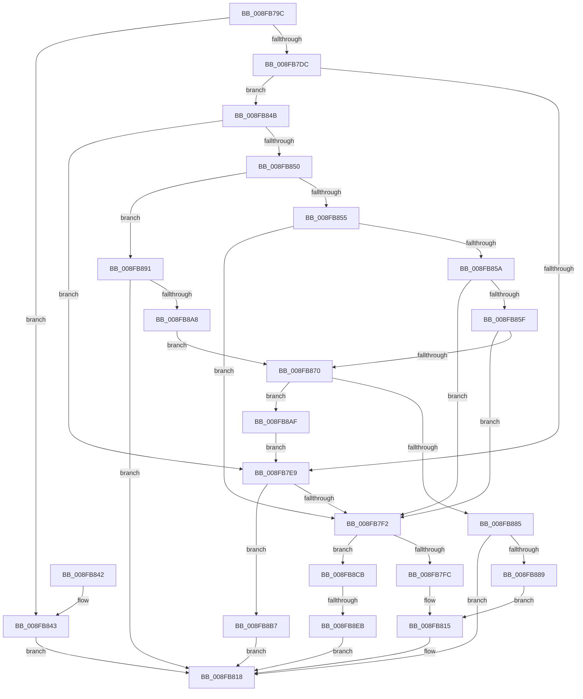

# PiDmCacheDataEncode

- RVA: `0x008FB79C`–`0x008FB8F5` (길이 `345` bytes)
- VA: `0x00000001408FB79C`
- 실행 섹션: `PAGE`
- PDB 이름 있음: `예`; PDB Function 태그: `예`
- unwind 정보 RVA: `0x00087E48`
- 디코드: `97`개 명령, `345/345` bytes 표시
- 미해석 바이트: `0` (있으면 어셈블리에 `.byte`로 보존)

> 이 문서는 커널 이미지의 기계어와 PDB 기호를 분석해 생성했습니다. 4번과 5번은 함수 원형과 자료형을 바이너리 사용 방식에서 추정한 C 해석이며 원본 소스 복구 결과는 아닙니다.

## 1. Dependencies

- 직접 호출 지점: **5**; 고유 호출 대상: **5**
- 직접 호출자로 확인된 함수: **4**
- RIP 상대 이미지 참조: **1**

### Outgoing calls
- `0x008FB806` → [memcpy](../../text/6C/memcpy_function_006C6840.md) (function, `0x006C6840`)
- `0x008FB822` → [_security_check_cookie](../../text/6A/_security_check_cookie_function_006AC640.md) (function, `0x006AC640`)
- `0x008FB877` → [PiDmGetObject](../8D/PiDmGetObject_function_008DFAE0.md) (function, `0x008DFAE0`)
- `0x008FB899` → [PnpStringFromGuid](PnpStringFromGuid_function_008F5A2C.md) (function, `0x008F5A2C`)
- `0x008FB8D9` → [ExAllocatePool2](../../poolcode/B8/ExAllocatePool2_function_00B820F0.md) (function, `0x00B820F0`)

### Direct callers
- [sub_008E314B](../8E/Unknown_function_008E314B.md) at `0x008E31C3`
- [PiDmObjectProcessPropertyChange](PiDmObjectProcessPropertyChange_function_008F8A48.md) at `0x008F8E10`
- [PiDmObjectUpdateCachedObjectProperty](PiDmObjectUpdateCachedObjectProperty_function_008F9C94.md) at `0x008F9DA2`
- [PiDmObjectCreate](../94/PiDmObjectCreate_function_0094F5CC.md) at `0x0094F833`

### Static image references
- `0x008FB7B3` → RVA `0x00E0A740` (`.data`; read)

## 2. Other-region calls and transfers

- 다른 실행 섹션으로 향하는 call: **3**
  - `0x008FB806` → [memcpy](../../text/6C/memcpy_function_006C6840.md) (`PAGE` → `.text`)
  - `0x008FB822` → [_security_check_cookie](../../text/6A/_security_check_cookie_function_006AC640.md) (`PAGE` → `.text`)
  - `0x008FB8D9` → [ExAllocatePool2](../../poolcode/B8/ExAllocatePool2_function_00B820F0.md) (`PAGE` → `POOLCODE`)
- call이 아닌 외부 분기/꼬리 이동: **1**
  - `0x008FB8E5` → [sub_00B1F608](../B1/Unknown_function_00B1F608.md) (`tail-transfer`)

## 3. Assembly (complete function range)

```asm
008FB79C  48 89 5C 24 08                  mov qword ptr [rsp + 8], rbx
008FB7A1  55                              push rbp
008FB7A2  56                              push rsi
008FB7A3  57                              push rdi
008FB7A4  41 54                           push r12
008FB7A6  41 55                           push r13
008FB7A8  41 56                           push r14
008FB7AA  41 57                           push r15
008FB7AC  48 81 EC 80 00 00 00            sub rsp, 0x80
008FB7B3  48 8B 05 86 EF 50 00            mov rax, qword ptr [rip + 0x50ef86]
008FB7BA  48 33 C4                        xor rax, rsp
008FB7BD  48 89 44 24 70                  mov qword ptr [rsp + 0x70], rax
008FB7C2  48 8B 9C 24 E8 00 00 00         mov rbx, qword ptr [rsp + 0xe8]
008FB7CA  45 33 ED                        xor r13d, r13d
008FB7CD  45 8B F8                        mov r15d, r8d
008FB7D0  48 8B EA                        mov rbp, rdx
008FB7D3  8B F1                           mov esi, ecx
008FB7D5  41 8B FD                        mov edi, r13d
008FB7D8  85 C9                           test ecx, ecx
008FB7DA  74 67                           je 0x1408fb843
008FB7DC  44 8B B4 24 E0 00 00 00         mov r14d, dword ptr [rsp + 0xe0]
008FB7E4  45 85 F6                        test r14d, r14d
008FB7E7  75 62                           jne 0x1408fb84b
008FB7E9  83 FE 0D                        cmp esi, 0xd
008FB7EC  0F 84 C5 00 00 00               je 0x1408fb8b7
008FB7F2  41 83 FF 08                     cmp r15d, 8
008FB7F6  0F 87 CF 00 00 00               ja 0x1408fb8cb
008FB7FC  4D 8B C7                        mov r8, r15
008FB7FF  48 8D 4B 10                     lea rcx, [rbx + 0x10]
008FB803  48 8B D5                        mov rdx, rbp
008FB806  E8 35 B0 DC FF                  call 0x1406c6840
008FB80B  C7 03 03 00 00 00               mov dword ptr [rbx], 3
008FB811  44 89 7B 0C                     mov dword ptr [rbx + 0xc], r15d
008FB815  89 73 08                        mov dword ptr [rbx + 8], esi
008FB818  8B C7                           mov eax, edi
008FB81A  48 8B 4C 24 70                  mov rcx, qword ptr [rsp + 0x70]
008FB81F  48 33 CC                        xor rcx, rsp
008FB822  E8 19 0E DB FF                  call 0x1406ac640
008FB827  48 8B 9C 24 C0 00 00 00         mov rbx, qword ptr [rsp + 0xc0]
008FB82F  48 81 C4 80 00 00 00            add rsp, 0x80
008FB836  41 5F                           pop r15
008FB838  41 5E                           pop r14
008FB83A  41 5D                           pop r13
008FB83C  41 5C                           pop r12
008FB83E  5F                              pop rdi
008FB83F  5E                              pop rsi
008FB840  5D                              pop rbp
008FB841  C3                              ret
008FB842  CC                              int3
008FB843  C7 03 02 00 00 00               mov dword ptr [rbx], 2
008FB849  EB CD                           jmp 0x1408fb818
008FB84B  41 3B F1                        cmp esi, r9d
008FB84E  75 99                           jne 0x1408fb7e9
008FB850  83 FE 0D                        cmp esi, 0xd
008FB853  74 3C                           je 0x1408fb891
008FB855  83 FE 12                        cmp esi, 0x12
008FB858  75 98                           jne 0x1408fb7f2
008FB85A  48 85 ED                        test rbp, rbp
008FB85D  74 93                           je 0x1408fb7f2
008FB85F  49 8B C7                        mov rax, r15
008FB862  48 D1 E8                        shr rax, 1
008FB865  66 44 89 6C 42 FE               mov word ptr [rdx + rax*2 - 2], r13w
008FB86B  48 85 ED                        test rbp, rbp
008FB86E  74 82                           je 0x1408fb7f2
008FB870  4C 8D 43 10                     lea r8, [rbx + 0x10]
008FB874  41 8B CE                        mov ecx, r14d
008FB877  E8 64 42 FE FF                  call 0x1408dfae0
008FB87C  8B F8                           mov edi, eax
008FB87E  3D 34 00 00 C0                  cmp eax, 0xc0000034
008FB883  74 2A                           je 0x1408fb8af
008FB885  85 C0                           test eax, eax
008FB887  78 8F                           js 0x1408fb818
008FB889  C7 03 06 00 00 00               mov dword ptr [rbx], 6
008FB88F  EB 84                           jmp 0x1408fb815
008FB891  48 8D 54 24 20                  lea rdx, [rsp + 0x20]
008FB896  48 8B CD                        mov rcx, rbp
008FB899  E8 8E A1 FF FF                  call 0x1408f5a2c
008FB89E  8B F8                           mov edi, eax
008FB8A0  85 C0                           test eax, eax
008FB8A2  0F 88 70 FF FF FF               js 0x1408fb818
008FB8A8  48 8D 54 24 20                  lea rdx, [rsp + 0x20]
008FB8AD  EB C1                           jmp 0x1408fb870
008FB8AF  41 8B FD                        mov edi, r13d
008FB8B2  E9 32 FF FF FF                  jmp 0x1408fb7e9
008FB8B7  0F 10 45 00                     movups xmm0, xmmword ptr [rbp]
008FB8BB  C7 03 04 00 00 00               mov dword ptr [rbx], 4
008FB8C1  F3 0F 7F 43 08                  movdqu xmmword ptr [rbx + 8], xmm0
008FB8C6  E9 4D FF FF FF                  jmp 0x1408fb818
008FB8CB  41 B8 50 6E 70 5A               mov r8d, 0x5a706e50
008FB8D1  49 8B D7                        mov rdx, r15
008FB8D4  B9 00 01 00 00                  mov ecx, 0x100
008FB8D9  E8 12 68 28 00                  call 0x140b820f0
008FB8DE  48 89 43 10                     mov qword ptr [rbx + 0x10], rax
008FB8E2  48 85 C0                        test rax, rax
008FB8E5  0F 85 1D 3D 22 00               jne 0x140b1f608
008FB8EB  BF 9A 00 00 C0                  mov edi, 0xc000009a
008FB8F0  E9 23 FF FF FF                  jmp 0x1408fb818
```

## 4. C-style interpretation (structured pseudocode)

```c
__int64 __fastcall PiDmCacheDataEncode(int a1, __int64 a2, int a3, int a4, unsigned int a5, __int64 a6)
{
    __int64 result;
    __int64 v_r13;
    __int64 v_rsp;
    unsigned __int64 v_stack_m48;
    unsigned __int64 v_stack_p20;
    unsigned __int64 v_stack_p8;

    v_stack_p8 = v_rbx;
    v_rsp = (v_rsp) - (128);
    result = (*(unsigned __int64 *)(v_rip + 5304198)) ^ (v_rsp);
    v_stack_m48 = result;
    v_r13 = 0;
    if (a1 == 0) goto loc_008FB843;
    if ((unsigned int)((unsigned int)(a5)) != 0) goto loc_008FB84B;
loc_008FB7E9:
    if (((unsigned int)((unsigned int)(a1))) == 13) goto loc_008FB8B7;
loc_008FB7F2:
    if (((unsigned int)((unsigned int)(a3))) > 8) goto loc_008FB8CB;
    result = memcpy(a6 + 16, a2, (unsigned int)(a3), a4);
    *(unsigned int *)(a6) = 3;
    *(unsigned int *)(a6 + 12) = (unsigned int)((unsigned int)(a3));
loc_008FB815:
    *(unsigned int *)(a6 + 8) = (unsigned int)((unsigned int)(a1));
loc_008FB818:
    a1 = (v_stack_m48) ^ (v_rsp);
    result = _security_check_cookie(a1, a2, (unsigned int)(a3), a4);
    v_rsp = (v_rsp) + (128);
    return result;
loc_008FB843:
    *(unsigned int *)(v_stack_p8) = 2;
    goto loc_008FB818;
loc_008FB84B:
    if (((unsigned int)((unsigned int)(a1))) != a4) goto loc_008FB7E9;
    if (((unsigned int)((unsigned int)(a1))) == 13) goto loc_008FB891;
    if (((unsigned int)((unsigned int)(a1))) != 18) goto loc_008FB7F2;
    if (a2 == 0) goto loc_008FB7F2;
    result = ((unsigned int)(a3)) >> (1);
    *(unsigned __int16 *)(a2 + result * 2 - 2) = 0;
    if (a2 == 0) goto loc_008FB7F2;
loc_008FB870:
    result = PiDmGetObject((unsigned int)((unsigned int)((unsigned int)(a5))), a2, v_stack_p8 + 16, a4);
    if (((unsigned int)(result)) == 0xC0000034ULL) goto loc_008FB8AF;
    if (sign_flag) goto loc_008FB818;
    *(unsigned int *)(v_stack_p8) = 6;
    goto loc_008FB815;
loc_008FB891:
    result = PnpStringFromGuid(a2, v_stack_p20, v_stack_p8 + 16, a4);
    if (sign_flag) goto loc_008FB818;
    goto loc_008FB870;
loc_008FB8AF:
    goto loc_008FB7E9;
loc_008FB8B7:
    *(unsigned int *)(v_stack_p8) = 4;
    *(unsigned __int64 *)(v_stack_p8 + 8) = v_xmm0;
    goto loc_008FB818;
loc_008FB8CB:
    result = ExAllocatePool2(256, (unsigned int)(a3), (unsigned int)(0x5A706E50ULL), a4);
    *(unsigned __int64 *)(v_stack_p8 + 16) = result;
    goto loc_008FB818;
}
```

## 5. (Beta) C Style

```c
int64_t PiDmCacheDataEncode(int32_t Arg1, void *Arg2, int32_t Arg3, int32_t Arg4, uint32_t Arg5, void *Arg6)
{
    uint8_t *arg2 = (uint8_t *)Arg2;
    uint8_t *arg6 = (uint8_t *)Arg6;

    int64_t result;
    int64_t local_r13;
    int64_t local_rsp;
    uint64_t v_stack_m48;
    uint64_t v_stack_p20;
    uint64_t v_stack_p8;

    v_stack_p8 = local_rbx;
    local_rsp = (local_rsp) - (128);
    result = (*(uint64_t *)(v_rip + 0x50EF86)) ^ (local_rsp);
    v_stack_m48 = result;
    local_r13 = 0;
    if (Arg1 == 0) goto loc_008FB843;
    if ((uint32_t)((uint32_t)(Arg5)) != 0) goto loc_008FB84B;
loc_008FB7E9:
    if (((uint32_t)((uint32_t)(Arg1))) == 13) goto loc_008FB8B7;
loc_008FB7F2:
    if (((uint32_t)((uint32_t)(Arg3))) > 8) goto loc_008FB8CB;
    result = memcpy(Arg6 + 16, Arg2, (uint32_t)(Arg3), Arg4);
    *(uint32_t *)(arg6) = 3;
    *(uint32_t *)(arg6 + 0xC) = (uint32_t)((uint32_t)(Arg3));
loc_008FB815:
    *(uint32_t *)(arg6 + 0x8) = (uint32_t)((uint32_t)(Arg1));
loc_008FB818:
    Arg1 = (v_stack_m48) ^ (local_rsp);
    result = _security_check_cookie(Arg1, Arg2, (uint32_t)(Arg3), Arg4);
    local_rsp = (local_rsp) + (128);
    return result;
loc_008FB843:
    *(uint32_t *)(v_stack_p8) = 2;
    goto loc_008FB818;
loc_008FB84B:
    if (((uint32_t)((uint32_t)(Arg1))) != Arg4) goto loc_008FB7E9;
    if (((uint32_t)((uint32_t)(Arg1))) == 13) goto loc_008FB891;
    if (((uint32_t)((uint32_t)(Arg1))) != 18) goto loc_008FB7F2;
    if (Arg2 == NULL) goto loc_008FB7F2;
    result = ((uint32_t)(Arg3)) >> (1);
    *(uint16_t *)(arg2 + result * 2 - 0x2) = 0;
    if (Arg2 == NULL) goto loc_008FB7F2;
loc_008FB870:
    result = PiDmGetObject((uint32_t)((uint32_t)((uint32_t)(Arg5))), Arg2, v_stack_p8 + 16, Arg4);
    if (((uint32_t)(result)) == 0xC0000034ULL) goto loc_008FB8AF;
    if (sign_flag) goto loc_008FB818;
    *(uint32_t *)(v_stack_p8) = 6;
    goto loc_008FB815;
loc_008FB891:
    result = PnpStringFromGuid(Arg2, v_stack_p20, v_stack_p8 + 16, Arg4);
    if (sign_flag) goto loc_008FB818;
    goto loc_008FB870;
loc_008FB8AF:
    goto loc_008FB7E9;
loc_008FB8B7:
    *(uint32_t *)(v_stack_p8) = 4;
    *(uint64_t *)(v_stack_p8 + 0x8) = v_xmm0;
    goto loc_008FB818;
loc_008FB8CB:
    result = ExAllocatePool2(256, (uint32_t)(Arg3), (uint32_t)(0x5A706E50ULL), Arg4);
    *(uint64_t *)(v_stack_p8 + 0x10) = result;
    goto loc_008FB818;
}
```

### 관측된 메모리 오프셋

구조체 형식이 확인되지 않은 접근은 인자 기준의 오프셋으로만 기록했습니다.

| 기준 인자 | 오프셋 표현 | 폭 (bit) | 접근 |
|---|---:|---:|---|
| `Arg2` | `- 0x2 + rax*2` | `16` | `W` |
| `Arg6` | `+ 0x0` | `32` | `W` |
| `Arg6` | `+ 0x8` | `32` | `W` |
| `Arg6` | `+ 0x8` | `128` | `W` |
| `Arg6` | `+ 0xC` | `32` | `W` |
| `Arg6` | `+ 0x10` | `64` | `R` |
| `Arg6` | `+ 0x10` | `64` | `W` |

## 6. Execution-region graph

[열기: 2D/3D 그래프와 함수 탐색 컨트롤 패널](../../../control-panel.html?section=page&rva=0x008FB79C&view=graph)

- 2D 그래프는 위에서 아래로 흐르고, 3D 그래프는 빈 공간을 드래그해 회전합니다. Shift+드래그는 이동, 휠은 확대·축소, 함수 노드 선택은 대상 보고서 이동입니다.

### Static fallback


