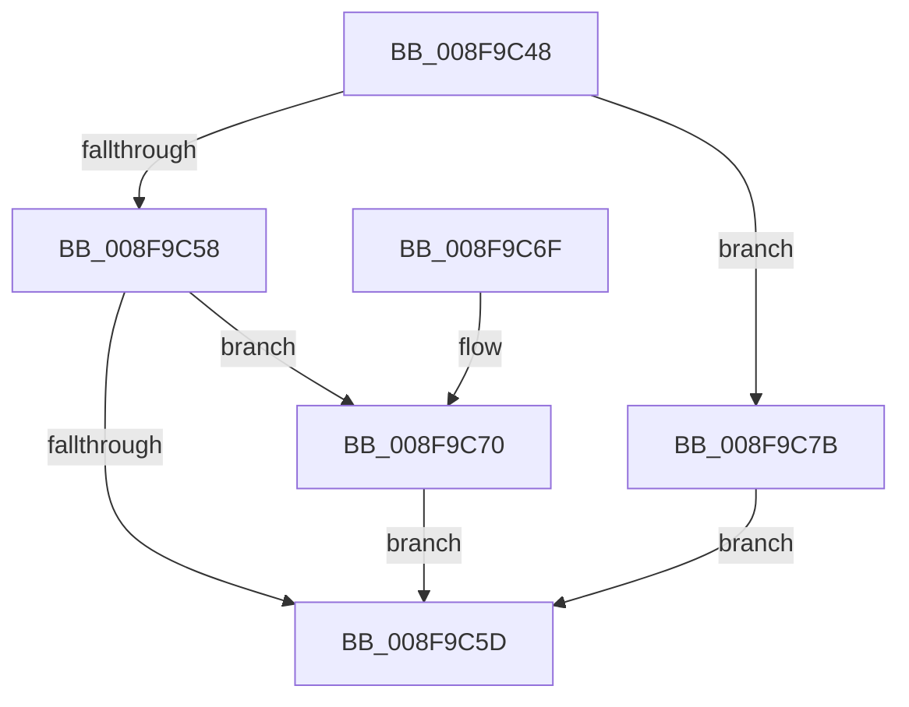

# PiDmCacheDataFree

- RVA: `0x008F9C48`–`0x008F9C8B` (길이 `67` bytes)
- VA: `0x00000001408F9C48`
- 실행 섹션: `PAGE`
- PDB 이름 있음: `예`; PDB Function 태그: `아니요`
- unwind 정보 RVA: `0x00087C88`
- 디코드: `23`개 명령, `67/67` bytes 표시
- 미해석 바이트: `0` (있으면 어셈블리에 `.byte`로 보존)

> 이 문서는 커널 이미지의 기계어와 PDB 기호를 분석해 생성했습니다. 4번과 5번은 함수 원형과 자료형을 바이너리 사용 방식에서 추정한 C 해석이며 원본 소스 복구 결과는 아닙니다.

## 1. Dependencies

- 직접 호출 지점: **2**; 고유 호출 대상: **2**
- 직접 호출자로 확인된 함수: **5**
- RIP 상대 이미지 참조: **0**

### Outgoing calls
- `0x008F9C74` → [PiDmObjectRelease](../8E/PiDmObjectRelease_function_008E4F70.md) (function, `0x008E4F70`)
- `0x008F9C84` → [ExFreePoolWithTag](../../poolcode/B8/ExFreePoolWithTag_function_00B82870.md) (function, `0x00B82870`)

### Direct callers
- [sub_008E2EB2](../8E/Unknown_function_008E2EB2.md) at `0x008E30D0`
- [sub_008E314B](../8E/Unknown_function_008E314B.md) at `0x008E33A2`
- [PiDmObjectProcessPropertyChange](PiDmObjectProcessPropertyChange_function_008F8A48.md) at `0x008F8DDE`
- [PiDmObjectUpdateCachedObjectProperty](PiDmObjectUpdateCachedObjectProperty_function_008F9C94.md) at `0x008F9E63`
- [sub_00B1D21A](../B1/Unknown_function_00B1D21A.md) at `0x00B1D226`

### Static image references
- 디코드된 RIP-relative 메모리 참조가 없습니다.

## 2. Other-region calls and transfers

- 다른 실행 섹션으로 향하는 call: **1**
  - `0x008F9C84` → [ExFreePoolWithTag](../../poolcode/B8/ExFreePoolWithTag_function_00B82870.md) (`PAGE` → `POOLCODE`)
- 별도 외부 분기/꼬리 이동을 확인하지 못했습니다.

## 3. Assembly (complete function range)

```asm
008F9C48  40 53                           push rbx
008F9C4A  48 83 EC 20                     sub rsp, 0x20
008F9C4E  48 8B D9                        mov rbx, rcx
008F9C51  8B 09                           mov ecx, dword ptr [rcx]
008F9C53  83 E9 05                        sub ecx, 5
008F9C56  74 23                           je 0x1408f9c7b
008F9C58  83 F9 01                        cmp ecx, 1
008F9C5B  74 13                           je 0x1408f9c70
008F9C5D  0F 57 C0                        xorps xmm0, xmm0
008F9C60  33 C0                           xor eax, eax
008F9C62  0F 11 03                        movups xmmword ptr [rbx], xmm0
008F9C65  48 89 43 10                     mov qword ptr [rbx + 0x10], rax
008F9C69  48 83 C4 20                     add rsp, 0x20
008F9C6D  5B                              pop rbx
008F9C6E  C3                              ret
008F9C6F  CC                              int3
008F9C70  48 8B 4B 10                     mov rcx, qword ptr [rbx + 0x10]
008F9C74  E8 F7 B2 FE FF                  call 0x1408e4f70
008F9C79  EB E2                           jmp 0x1408f9c5d
008F9C7B  48 8B 4B 10                     mov rcx, qword ptr [rbx + 0x10]
008F9C7F  BA 50 6E 70 5A                  mov edx, 0x5a706e50
008F9C84  E8 E7 8B 28 00                  call 0x140b82870
008F9C89  EB D2                           jmp 0x1408f9c5d
```

## 4. C-style interpretation (structured pseudocode)

```c
__int64 __fastcall PiDmCacheDataFree(__int64 a1)
{
    __int64 result;
    __int64 v_rsp;

    v_rsp = (v_rsp) - (32);
    a1 = (unsigned int)(((unsigned int)(*(unsigned int *)(a1))) - (5));
    if (condition_is_equal) goto loc_008F9C7B;
    if (((unsigned int)(a1)) == 1) goto loc_008F9C70;
loc_008F9C5D:
    result = 0;
    *(unsigned __int64 *)(a1) = v_xmm0;
    *(unsigned __int64 *)(a1 + 16) = 0;
    v_rsp = (v_rsp) + (32);
    return result;
loc_008F9C70:
    result = PiDmObjectRelease(*(unsigned __int64 *)(a1 + 16), a2, a3, a4);
    goto loc_008F9C5D;
loc_008F9C7B:
    result = ExFreePoolWithTag(*(unsigned __int64 *)(a1 + 16), (unsigned int)(0x5A706E50ULL), a3, a4);
    goto loc_008F9C5D;
}
```

## 5. (Beta) C Style

```c
int64_t PiDmCacheDataFree(void *Arg1)
{
    uint8_t *arg1 = (uint8_t *)Arg1;

    int64_t result;
    int64_t local_rsp;

    local_rsp = (local_rsp) - (32);
    Arg1 = (uint32_t)(((uint32_t)(*(uint32_t *)(arg1))) - (5));
    if (condition_is_equal) goto loc_008F9C7B;
    if (((uint32_t)(Arg1)) == 1) goto loc_008F9C70;
loc_008F9C5D:
    result = 0;
    *(uint64_t *)(arg1) = v_xmm0;
    *(uint64_t *)(arg1 + 0x10) = 0;
    local_rsp = (local_rsp) + (32);
    return result;
loc_008F9C70:
    result = PiDmObjectRelease(*(uint64_t *)(arg1 + 0x10), a2, a3, a4);
    goto loc_008F9C5D;
loc_008F9C7B:
    result = ExFreePoolWithTag(*(uint64_t *)(arg1 + 0x10), (uint32_t)(0x5A706E50ULL), a3, a4);
    goto loc_008F9C5D;
}
```

### 관측된 메모리 오프셋

구조체 형식이 확인되지 않은 접근은 인자 기준의 오프셋으로만 기록했습니다.

| 기준 인자 | 오프셋 표현 | 폭 (bit) | 접근 |
|---|---:|---:|---|
| `Arg1` | `+ 0x0` | `32` | `R` |
| `Arg1` | `+ 0x0` | `128` | `R` |
| `Arg1` | `+ 0x10` | `64` | `R` |
| `Arg1` | `+ 0x10` | `64` | `W` |

## 6. Execution-region graph

[열기: 2D/3D 그래프와 함수 탐색 컨트롤 패널](../../../control-panel.html?section=page&rva=0x008F9C48&view=graph)

- 2D 그래프는 위에서 아래로 흐르고, 3D 그래프는 빈 공간을 드래그해 회전합니다. Shift+드래그는 이동, 휠은 확대·축소, 함수 노드 선택은 대상 보고서 이동입니다.

### Static fallback


