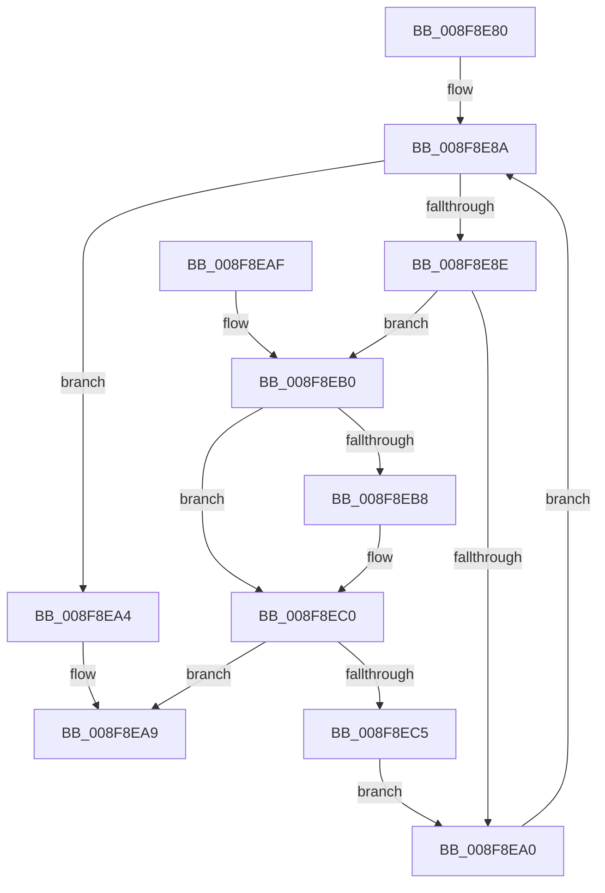

# PiDmGetCachedKeyIndex

- RVA: `0x008F8E80`–`0x008F8EC7` (길이 `71` bytes)
- VA: `0x00000001408F8E80`
- 실행 섹션: `PAGE`
- PDB 이름 있음: `예`; PDB Function 태그: `아니요`
- unwind 정보 RVA: `0x00087BDC`
- 디코드: `24`개 명령, `71/71` bytes 표시
- 미해석 바이트: `0` (있으면 어셈블리에 `.byte`로 보존)

> 이 문서는 커널 이미지의 기계어와 PDB 기호를 분석해 생성했습니다. 4번과 5번은 함수 원형과 자료형을 바이너리 사용 방식에서 추정한 C 해석이며 원본 소스 복구 결과는 아닙니다.

## 1. Dependencies

- 직접 호출 지점: **0**; 고유 호출 대상: **0**
- 직접 호출자로 확인된 함수: **4**
- RIP 상대 이미지 참조: **0**

### Outgoing calls
- 직접 디코드된 call 명령이 없습니다.

### Direct callers
- [PiDmObjectGetCachedObjectReference](PiDmObjectGetCachedObjectReference_function_008F7FB0.md) at `0x008F7FF7`
- [PiDmObjectProcessPropertyChange](PiDmObjectProcessPropertyChange_function_008F8A48.md) at `0x008F8ABB`
- [PiDmObjectCreate](../94/PiDmObjectCreate_function_0094F5CC.md) at `0x0094F7FA`
- [PiDmListUpdateAggregationCountWorker](../A8/PiDmListUpdateAggregationCountWorker_function_00A88848.md) at `0x00A888D7`

### Static image references
- 디코드된 RIP-relative 메모리 참조가 없습니다.

## 2. Other-region calls and transfers

- 다른 실행 섹션으로 향하는 call: **0**
- 별도 외부 분기/꼬리 이동을 확인하지 못했습니다.

## 3. Assembly (complete function range)

```asm
008F8E80  48 89 5C 24 08                  mov qword ptr [rsp + 8], rbx
008F8E85  4D 8B D8                        mov r11, r8
008F8E88  33 C0                           xor eax, eax
008F8E8A  3B C2                           cmp eax, edx
008F8E8C  73 16                           jae 0x1408f8ea4
008F8E8E  4C 8D 14 40                     lea r10, [rax + rax*2]
008F8E92  4E 8B 0C D1                     mov r9, qword ptr [rcx + r10*8]
008F8E96  45 8B 41 10                     mov r8d, dword ptr [r9 + 0x10]
008F8E9A  45 39 43 10                     cmp dword ptr [r11 + 0x10], r8d
008F8E9E  74 10                           je 0x1408f8eb0
008F8EA0  FF C0                           inc eax
008F8EA2  EB E6                           jmp 0x1408f8e8a
008F8EA4  B8 FF FF FF FF                  mov eax, 0xffffffff
008F8EA9  48 8B 5C 24 08                  mov rbx, qword ptr [rsp + 8]
008F8EAE  C3                              ret
008F8EAF  CC                              int3
008F8EB0  4D 8B 03                        mov r8, qword ptr [r11]
008F8EB3  4D 2B 01                        sub r8, qword ptr [r9]
008F8EB6  75 08                           jne 0x1408f8ec0
008F8EB8  4D 8B 43 08                     mov r8, qword ptr [r11 + 8]
008F8EBC  4D 2B 41 08                     sub r8, qword ptr [r9 + 8]
008F8EC0  4D 85 C0                        test r8, r8
008F8EC3  74 E4                           je 0x1408f8ea9
008F8EC5  EB D9                           jmp 0x1408f8ea0
```

## 4. C-style interpretation (structured pseudocode)

```c
__int64 __fastcall PiDmGetCachedKeyIndex(__int64 a1, int a2, __int64 a3)
{
    __int64 result;
    unsigned __int64 v_stack_p8;

    v_stack_p8 = v_rbx;
    result = 0;
loc_008F8E8A:
    if (0 >= a2) goto loc_008F8EA4;
    if ((*(unsigned int *)(a3 + 16)) == ((unsigned int)((unsigned int)(*(unsigned int *)(*(unsigned __int64 *)(a1 + result + result * 2 * 8) + 16))))) goto loc_008F8EB0;
loc_008F8EA0:
    result = (unsigned int)((result) + 1);
    goto loc_008F8E8A;
loc_008F8EA4:
loc_008F8EA9:
    return (unsigned int)(0xFFFFFFFFULL);
loc_008F8EB0:
    a3 = (*(unsigned __int64 *)(a3)) - (*(unsigned __int64 *)(*(unsigned __int64 *)(a1 + result + result * 2 * 8)));
    if (!(condition_is_not_equal)) {
        a3 = *(unsigned __int64 *)(a3 + 8);
        a3 = (a3) - (*(unsigned __int64 *)(*(unsigned __int64 *)(a1 + result + result * 2 * 8) + 8));
    }
    if (a3 == 0) goto loc_008F8EA9;
    goto loc_008F8EA0;
}
```

## 5. (Beta) C Style

```c
int64_t PiDmGetCachedKeyIndex(void *Arg1, int32_t Arg2, void *Arg3)
{
    uint8_t *arg1 = (uint8_t *)Arg1;
    uint8_t *arg3 = (uint8_t *)Arg3;

    int64_t result;
    uint64_t v_stack_p8;

    v_stack_p8 = local_rbx;
    result = 0;
loc_008F8E8A:
    if (0 >= Arg2) goto loc_008F8EA4;
    if ((*(uint32_t *)(arg3 + 0x10)) == ((uint32_t)((uint32_t)(*(uint32_t *)(*(uint64_t *)(arg1 + result + result * 2 * 8) + 0x10))))) goto loc_008F8EB0;
loc_008F8EA0:
    result = (uint32_t)((result) + 1);
    goto loc_008F8E8A;
loc_008F8EA4:
loc_008F8EA9:
    return (uint32_t)(0xFFFFFFFFULL);
loc_008F8EB0:
    Arg3 = (*(uint64_t *)(arg3)) - (*(uint64_t *)(*(uint64_t *)(arg1 + result + result * 2 * 8)));
    if (!(condition_is_not_equal)) {
        Arg3 = *(uint64_t *)(arg3 + 0x8);
        Arg3 = (Arg3) - (*(uint64_t *)(*(uint64_t *)(arg1 + result + result * 2 * 8) + 0x8));
    }
    if (Arg3 == NULL) goto loc_008F8EA9;
    goto loc_008F8EA0;
}
```

### 관측된 메모리 오프셋

구조체 형식이 확인되지 않은 접근은 인자 기준의 오프셋으로만 기록했습니다.

| 기준 인자 | 오프셋 표현 | 폭 (bit) | 접근 |
|---|---:|---:|---|
| `Arg1` | `+ 0x0 + r10*8` | `64` | `R` |
| `Arg3` | `+ 0x0` | `64` | `R` |
| `Arg3` | `+ 0x8` | `64` | `R` |
| `Arg3` | `+ 0x10` | `32` | `R` |

## 6. Execution-region graph

[열기: 2D/3D 그래프와 함수 탐색 컨트롤 패널](../../../control-panel.html?section=page&rva=0x008F8E80&view=graph)

- 2D 그래프는 위에서 아래로 흐르고, 3D 그래프는 빈 공간을 드래그해 회전합니다. Shift+드래그는 이동, 휠은 확대·축소, 함수 노드 선택은 대상 보고서 이동입니다.

### Static fallback


