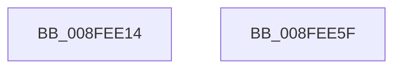

# PiDmGetCmObjectListFromCache

- RVA: `0x008FEE14`–`0x008FEE60` (길이 `76` bytes)
- VA: `0x00000001408FEE14`
- 실행 섹션: `PAGE`
- PDB 이름 있음: `예`; PDB Function 태그: `아니요`
- unwind 정보 RVA: `0x0005CC98`
- 디코드: `18`개 명령, `76/76` bytes 표시
- 미해석 바이트: `0` (있으면 어셈블리에 `.byte`로 보존)

> 이 문서는 커널 이미지의 기계어와 PDB 기호를 분석해 생성했습니다. 4번과 5번은 함수 원형과 자료형을 바이너리 사용 방식에서 추정한 C 해석이며 원본 소스 복구 결과는 아닙니다.

## 1. Dependencies

- 직접 호출 지점: **2**; 고유 호출 대상: **2**
- 직접 호출자로 확인된 함수: **2**
- RIP 상대 이미지 참조: **1**

### Outgoing calls
- `0x008FEE2A` → [_CmMapCmObjectTypeToPnpObjectType](_CmMapCmObjectTypeToPnpObjectType_function_008FF060.md) (function, `0x008FF060`)
- `0x008FEE55` → [PiDmGetObjectList](PiDmGetObjectList_function_008FF0A0.md) (function, `0x008FF0A0`)

### Direct callers
- [PiPnpRtlGetFilteredDeviceInterfaceList](../8D/PiPnpRtlGetFilteredDeviceInterfaceList_function_008DE9D0.md) at `0x008DEB23`
- [PiPnpRtlCmActionCallback](../8E/PiPnpRtlCmActionCallback_function_008EF110.md) at `0x008EF6F9`

### Static image references
- `0x008FEE3E` → RVA `0x008E3E80` (`PiDmCmObjectMatchCallback`; read)

## 2. Other-region calls and transfers

- 다른 실행 섹션으로 향하는 call: **0**
- 별도 외부 분기/꼬리 이동을 확인하지 못했습니다.

## 3. Assembly (complete function range)

```asm
008FEE14  48 8B C4                        mov rax, rsp
008FEE17  48 83 EC 58                     sub rsp, 0x58
008FEE1B  83 60 EC 00                     and dword ptr [rax - 0x14], 0
008FEE1F  48 89 50 D8                     mov qword ptr [rax - 0x28], rdx
008FEE23  4C 89 40 E0                     mov qword ptr [rax - 0x20], r8
008FEE27  89 48 E8                        mov dword ptr [rax - 0x18], ecx
008FEE2A  E8 31 02 00 00                  call 0x1408ff060
008FEE2F  8B C8                           mov ecx, eax
008FEE31  4C 8D 44 24 30                  lea r8, [rsp + 0x30]
008FEE36  48 8B 84 24 88 00 00 00         mov rax, qword ptr [rsp + 0x88]
008FEE3E  48 8D 15 3B 50 FE FF            lea rdx, [rip - 0x1afc5]
008FEE45  48 89 44 24 28                  mov qword ptr [rsp + 0x28], rax
008FEE4A  8B 84 24 80 00 00 00            mov eax, dword ptr [rsp + 0x80]
008FEE51  89 44 24 20                     mov dword ptr [rsp + 0x20], eax
008FEE55  E8 46 02 00 00                  call 0x1408ff0a0
008FEE5A  48 83 C4 58                     add rsp, 0x58
008FEE5E  C3                              ret
008FEE5F  CC                              int3
```

## 4. C-style interpretation (structured pseudocode)

```c
__int64 __fastcall PiDmGetCmObjectListFromCache(int a1, __int64 a2, __int64 a3, __int64 a4, unsigned int a5, __int64 a6)
{
    __int64 result;
    __int64 v_rsp;
    unsigned __int64 v_stack_m28;
    unsigned __int64 v_stack_m30;
    unsigned int v_stack_m38;

    v_rsp = (v_rsp) - (88);
    *(unsigned __int64 *)(v_rsp - 40) = a2;
    *(unsigned __int64 *)(v_rsp - 32) = a3;
    *(unsigned int *)(v_rsp - 24) = a1;
    result = _CmMapCmObjectTypeToPnpObjectType(a1, a2, a3, a4);
    v_stack_m30 = a6;
    v_stack_m38 = (unsigned int)((unsigned int)(a5));
    result = PiDmGetObjectList((unsigned int)((unsigned int)(result)), v_rip - 110533, v_stack_m28, a4);
    v_rsp = (v_rsp) + (88);
    return result;
}
```

## 5. (Beta) C Style

```c
int64_t PiDmGetCmObjectListFromCache(int32_t Arg1, int64_t Arg2, int64_t Arg3, int64_t Arg4, uint32_t Arg5, int64_t Arg6)
{
    int64_t result;
    int64_t local_rsp;
    uint64_t v_stack_m28;
    uint64_t v_stack_m30;
    uint32_t v_stack_m38;

    local_rsp = (local_rsp) - (88);
    *(uint64_t *)(local_rsp - 0x28) = Arg2;
    *(uint64_t *)(local_rsp - 0x20) = Arg3;
    *(uint32_t *)(local_rsp - 0x18) = Arg1;
    result = _CmMapCmObjectTypeToPnpObjectType(Arg1, Arg2, Arg3, Arg4);
    v_stack_m30 = Arg6;
    v_stack_m38 = (uint32_t)((uint32_t)(Arg5));
    result = PiDmGetObjectList((uint32_t)((uint32_t)(result)), v_rip - 110533, v_stack_m28, Arg4);
    local_rsp = (local_rsp) + (88);
    return result;
}
```

## 6. Execution-region graph

[열기: 2D/3D 그래프와 함수 탐색 컨트롤 패널](../../../control-panel.html?section=page&rva=0x008FEE14&view=graph)

- 2D 그래프는 위에서 아래로 흐르고, 3D 그래프는 빈 공간을 드래그해 회전합니다. Shift+드래그는 이동, 휠은 확대·축소, 함수 노드 선택은 대상 보고서 이동입니다.

### Static fallback


