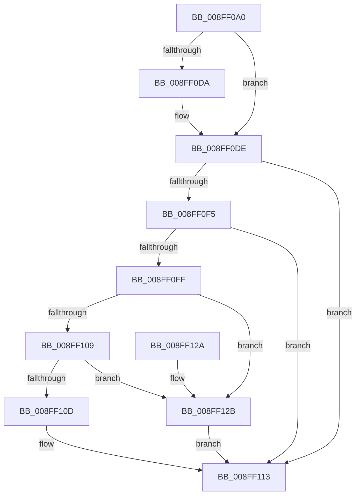

# PiDmGetObjectList

- RVA: `0x008FF0A0`–`0x008FF132` (길이 `146` bytes)
- VA: `0x00000001408FF0A0`
- 실행 섹션: `PAGE`
- PDB 이름 있음: `예`; PDB Function 태그: `아니요`
- unwind 정보 RVA: `0x00073820`
- 디코드: `47`개 명령, `146/146` bytes 표시
- 미해석 바이트: `0` (있으면 어셈블리에 `.byte`로 보존)

> 이 문서는 커널 이미지의 기계어와 PDB 기호를 분석해 생성했습니다. 4번과 5번은 함수 원형과 자료형을 바이너리 사용 방식에서 추정한 C 해석이며 원본 소스 복구 결과는 아닙니다.

## 1. Dependencies

- 직접 호출 지점: **1**; 고유 호출 대상: **1**
- 직접 호출자로 확인된 함수: **3**
- RIP 상대 이미지 참조: **1**

### Outgoing calls
- `0x008FF0EA` → [PiDmEnumObjectsWithCallback](../8E/PiDmEnumObjectsWithCallback_function_008E3920.md) (function, `0x008E3920`)

### Direct callers
- [sub_008E372B](../8E/Unknown_function_008E372B.md) at `0x008E3752`
- [PiPnpRtlGetFilteredDeviceList](PiPnpRtlGetFilteredDeviceList_function_008FE9F8.md) at `0x008FEB5D`
- [PiPnpRtlGetFilteredDeviceList](PiPnpRtlGetFilteredDeviceList_function_008FE9F8.md) at `0x008FECE7`
- [PiPnpRtlGetFilteredDeviceList](PiPnpRtlGetFilteredDeviceList_function_008FE9F8.md) at `0x008FED92`
- [PiDmGetCmObjectListFromCache](PiDmGetCmObjectListFromCache_function_008FEE14.md) at `0x008FEE55`

### Static image references
- `0x008FF0E3` → RVA `0x008E3D30` (`PiDmGetObjectListCallback`; read)

## 2. Other-region calls and transfers

- 다른 실행 섹션으로 향하는 call: **0**
- 별도 외부 분기/꼬리 이동을 확인하지 못했습니다.

## 3. Assembly (complete function range)

```asm
008FF0A0  48 8B C4                        mov rax, rsp
008FF0A3  48 89 58 08                     mov qword ptr [rax + 8], rbx
008FF0A7  48 89 68 10                     mov qword ptr [rax + 0x10], rbp
008FF0AB  48 89 70 18                     mov qword ptr [rax + 0x18], rsi
008FF0AF  57                              push rdi
008FF0B0  48 83 EC 40                     sub rsp, 0x40
008FF0B4  8B 74 24 70                     mov esi, dword ptr [rsp + 0x70]
008FF0B8  33 ED                           xor ebp, ebp
008FF0BA  48 8B 7C 24 78                  mov rdi, qword ptr [rsp + 0x78]
008FF0BF  49 8B D9                        mov rbx, r9
008FF0C2  48 89 50 D8                     mov qword ptr [rax - 0x28], rdx
008FF0C6  4C 89 40 E0                     mov qword ptr [rax - 0x20], r8
008FF0CA  48 89 58 E8                     mov qword ptr [rax - 0x18], rbx
008FF0CE  89 2F                           mov dword ptr [rdi], ebp
008FF0D0  89 70 F0                        mov dword ptr [rax - 0x10], esi
008FF0D3  89 68 F4                        mov dword ptr [rax - 0xc], ebp
008FF0D6  85 F6                           test esi, esi
008FF0D8  74 04                           je 0x1408ff0de
008FF0DA  66 41 89 29                     mov word ptr [r9], bp
008FF0DE  4C 8D 44 24 20                  lea r8, [rsp + 0x20]
008FF0E3  48 8D 15 46 4C FE FF            lea rdx, [rip - 0x1b3ba]
008FF0EA  E8 31 48 FE FF                  call 0x1408e3920
008FF0EF  8B D0                           mov edx, eax
008FF0F1  85 C0                           test eax, eax
008FF0F3  78 1E                           js 0x1408ff113
008FF0F5  8B 4C 24 3C                     mov ecx, dword ptr [rsp + 0x3c]
008FF0F9  89 0F                           mov dword ptr [rdi], ecx
008FF0FB  85 C9                           test ecx, ecx
008FF0FD  74 14                           je 0x1408ff113
008FF0FF  8D 41 01                        lea eax, [rcx + 1]
008FF102  89 07                           mov dword ptr [rdi], eax
008FF104  48 85 DB                        test rbx, rbx
008FF107  74 22                           je 0x1408ff12b
008FF109  3B F0                           cmp esi, eax
008FF10B  72 1E                           jb 0x1408ff12b
008FF10D  FF C8                           dec eax
008FF10F  66 89 2C 43                     mov word ptr [rbx + rax*2], bp
008FF113  48 8B 5C 24 50                  mov rbx, qword ptr [rsp + 0x50]
008FF118  8B C2                           mov eax, edx
008FF11A  48 8B 6C 24 58                  mov rbp, qword ptr [rsp + 0x58]
008FF11F  48 8B 74 24 60                  mov rsi, qword ptr [rsp + 0x60]
008FF124  48 83 C4 40                     add rsp, 0x40
008FF128  5F                              pop rdi
008FF129  C3                              ret
008FF12A  CC                              int3
008FF12B  BA 23 00 00 C0                  mov edx, 0xc0000023
008FF130  EB E1                           jmp 0x1408ff113
```

## 4. C-style interpretation (structured pseudocode)

```c
__int64 __fastcall PiDmGetObjectList(__int64 a1, __int64 a2, __int64 a3, __int64 a4, unsigned int a5, __int64 a6)
{
    __int64 result;
    __int64 v_rbp;
    __int64 v_rsp;
    unsigned __int64 v_stack_m28;
    unsigned int v_stack_mC;
    unsigned __int64 v_stack_p10;
    unsigned __int64 v_stack_p18;
    unsigned __int64 v_stack_p8;

    *(unsigned __int64 *)(v_rsp + 8) = v_rbx;
    *(unsigned __int64 *)(v_rsp + 16) = v_rbp;
    *(unsigned __int64 *)(v_rsp + 24) = v_rsi;
    v_rsp = (v_rsp) - (64);
    v_rbp = 0;
    *(unsigned __int64 *)(v_rsp - 40) = a2;
    *(unsigned __int64 *)(v_rsp - 32) = a3;
    *(unsigned __int64 *)(v_rsp - 24) = a4;
    *(unsigned int *)(a6) = 0;
    *(unsigned int *)(v_rsp - 16) = (unsigned int)((unsigned int)(a5));
    *(unsigned int *)(v_rsp - 12) = 0;
    if ((unsigned int)((unsigned int)(a5)) != 0) {
        *(unsigned __int16 *)(a4) = 0;
    }
    result = PiDmEnumObjectsWithCallback(a1, v_rip - 111546, v_stack_m28, a4);
    if (sign_flag) goto loc_008FF113;
    *(unsigned int *)(a6) = (unsigned int)((unsigned int)(v_stack_mC));
    if ((unsigned int)((unsigned int)(v_stack_mC)) == 0) goto loc_008FF113;
    *(unsigned int *)(a6) = (unsigned int)((unsigned int)(v_stack_mC) + 1);
    if (a4 == 0) goto loc_008FF12B;
    if (((unsigned int)((unsigned int)(a5))) < ((unsigned int)((unsigned int)(v_stack_mC) + 1))) goto loc_008FF12B;
    result = (unsigned int)(((unsigned int)(v_stack_mC) + 1) - 1);
    *(unsigned __int16 *)(a4 + result * 2) = 0;
loc_008FF113:
    v_rsp = (v_rsp) + (64);
    return (unsigned int)((unsigned int)((unsigned int)((unsigned int)(result))));
loc_008FF12B:
    goto loc_008FF113;
}
```

## 5. (Beta) C Style

```c
int64_t PiDmGetObjectList(int64_t Arg1, int64_t Arg2, int64_t Arg3, void *Arg4, uint32_t Arg5, void *Arg6)
{
    uint8_t *arg4 = (uint8_t *)Arg4;
    uint8_t *arg6 = (uint8_t *)Arg6;

    int64_t result;
    int64_t local_rbp;
    int64_t local_rsp;
    uint64_t v_stack_m28;
    uint32_t v_stack_mC;
    uint64_t v_stack_p10;
    uint64_t v_stack_p18;
    uint64_t v_stack_p8;

    *(uint64_t *)(local_rsp + 0x8) = local_rbx;
    *(uint64_t *)(local_rsp + 0x10) = local_rbp;
    *(uint64_t *)(local_rsp + 0x18) = local_rsi;
    local_rsp = (local_rsp) - (64);
    local_rbp = 0;
    *(uint64_t *)(local_rsp - 0x28) = Arg2;
    *(uint64_t *)(local_rsp - 0x20) = Arg3;
    *(void **)(local_rsp - 0x18) = Arg4;
    *(uint32_t *)(arg6) = 0;
    *(uint32_t *)(local_rsp - 0x10) = (uint32_t)((uint32_t)(Arg5));
    *(uint32_t *)(local_rsp - 0xC) = 0;
    if ((uint32_t)((uint32_t)(Arg5)) != 0) {
        *(uint16_t *)(arg4) = 0;
    }
    result = PiDmEnumObjectsWithCallback(Arg1, v_rip - 111546, v_stack_m28, Arg4);
    if (sign_flag) goto loc_008FF113;
    *(uint32_t *)(arg6) = (uint32_t)((uint32_t)(v_stack_mC));
    if ((uint32_t)((uint32_t)(v_stack_mC)) == 0) goto loc_008FF113;
    *(uint32_t *)(arg6) = (uint32_t)((uint32_t)(v_stack_mC) + 1);
    if (Arg4 == NULL) goto loc_008FF12B;
    if (((uint32_t)((uint32_t)(Arg5))) < ((uint32_t)((uint32_t)(v_stack_mC) + 1))) goto loc_008FF12B;
    result = (uint32_t)(((uint32_t)(v_stack_mC) + 1) - 1);
    *(uint16_t *)(arg4 + result * 2) = 0;
loc_008FF113:
    local_rsp = (local_rsp) + (64);
    return (uint32_t)((uint32_t)((uint32_t)((uint32_t)(result))));
loc_008FF12B:
    goto loc_008FF113;
}
```

### 관측된 메모리 오프셋

구조체 형식이 확인되지 않은 접근은 인자 기준의 오프셋으로만 기록했습니다.

| 기준 인자 | 오프셋 표현 | 폭 (bit) | 접근 |
|---|---:|---:|---|
| `Arg4` | `+ 0x0` | `16` | `W` |
| `Arg6` | `+ 0x0` | `32` | `W` |

## 6. Execution-region graph

[열기: 2D/3D 그래프와 함수 탐색 컨트롤 패널](../../../control-panel.html?section=page&rva=0x008FF0A0&view=graph)

- 2D 그래프는 위에서 아래로 흐르고, 3D 그래프는 빈 공간을 드래그해 회전합니다. Shift+드래그는 이동, 휠은 확대·축소, 함수 노드 선택은 대상 보고서 이동입니다.

### Static fallback


