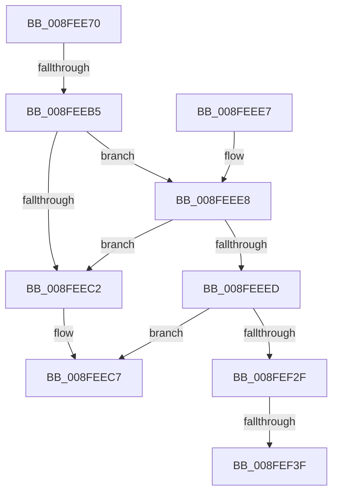

# PiDmObjectGetCachedCmProperty

- RVA: `0x008FEE70`–`0x008FEF97` (길이 `295` bytes)
- VA: `0x00000001408FEE70`
- 실행 섹션: `PAGE`
- PDB 이름 있음: `예`; PDB Function 태그: `아니요`
- unwind 정보 RVA: `0x000882CC`
- 디코드: `74`개 명령, `295/295` bytes 표시
- 미해석 바이트: `0` (있으면 어셈블리에 `.byte`로 보존)

> 이 문서는 커널 이미지의 기계어와 PDB 기호를 분석해 생성했습니다. 4번과 5번은 함수 원형과 자료형을 바이너리 사용 방식에서 추정한 C 해석이며 원본 소스 복구 결과는 아닙니다.

## 1. Dependencies

- 직접 호출 지점: **3**; 고유 호출 대상: **3**
- 직접 호출자로 확인된 함수: **1**
- RIP 상대 이미지 참조: **2**

### Outgoing calls
- `0x008FEECE` → [_security_check_cookie](../../text/6A/_security_check_cookie_function_006AC640.md) (function, `0x006AC640`)
- `0x008FEEED` → [_CmMapCmObjectTypeToPnpObjectType](_CmMapCmObjectTypeToPnpObjectType_function_008FF060.md) (function, `0x008FF060`)
- `0x008FEF26` → [PiDmObjectGetCachedObjectProperty](../8E/PiDmObjectGetCachedObjectProperty_function_008E4830.md) (function, `0x008E4830`)

### Direct callers
- [PiPnpRtlCmActionCallback](../8E/PiPnpRtlCmActionCallback_function_008EF110.md) at `0x008EF1C3`

### Static image references
- `0x008FEE83` → RVA `0x00E0A740` (`.data`; read)
- `0x008FEF1A` → RVA `0x00011688` (`.rdata`; read)

## 2. Other-region calls and transfers

- 다른 실행 섹션으로 향하는 call: **1**
  - `0x008FEECE` → [_security_check_cookie](../../text/6A/_security_check_cookie_function_006AC640.md) (`PAGE` → `.text`)
- call이 아닌 외부 분기/꼬리 이동: **2**
  - `0x008FEEAF` → [sub_008FEFF4 + 0x45](Unknown_function_008FEFF4.md) (`tail-transfer`)
  - `0x008FEF39` → [sub_008FEFF4 + 0x4D](Unknown_function_008FEFF4.md) (`tail-transfer`)

## 3. Assembly (complete function range)

```asm
008FEE70  48 89 5C 24 20                  mov qword ptr [rsp + 0x20], rbx
008FEE75  55                              push rbp
008FEE76  57                              push rdi
008FEE77  41 57                           push r15
008FEE79  48 8B EC                        mov rbp, rsp
008FEE7C  48 81 EC 10 01 00 00            sub rsp, 0x110
008FEE83  48 8B 05 B6 B8 50 00            mov rax, qword ptr [rip + 0x50b8b6]
008FEE8A  48 33 C4                        xor rax, rsp
008FEE8D  48 89 45 F0                     mov qword ptr [rbp - 0x10], rax
008FEE91  48 8B 5D 48                     mov rbx, qword ptr [rbp + 0x48]
008FEE95  33 C0                           xor eax, eax
008FEE97  48 8B 7D 40                     mov rdi, qword ptr [rbp + 0x40]
008FEE9B  0F 57 C0                        xorps xmm0, xmm0
008FEE9E  4C 8B 7D 50                     mov r15, qword ptr [rbp + 0x50]
008FEEA2  89 45 84                        mov dword ptr [rbp - 0x7c], eax
008FEEA5  89 45 80                        mov dword ptr [rbp - 0x80], eax
008FEEA8  0F 11 45 88                     movups xmmword ptr [rbp - 0x78], xmm0
008FEEAC  48 85 DB                        test rbx, rbx
008FEEAF  0F 84 84 01 00 00               je 0x1408ff039
008FEEB5  41 39 07                        cmp dword ptr [r15], eax
008FEEB8  48 0F 44 D8                     cmove rbx, rax
008FEEBC  41 83 F9 09                     cmp r9d, 9
008FEEC0  74 26                           je 0x1408feee8
008FEEC2  B8 16 00 00 C0                  mov eax, 0xc0000016
008FEEC7  48 8B 4D F0                     mov rcx, qword ptr [rbp - 0x10]
008FEECB  48 33 CC                        xor rcx, rsp
008FEECE  E8 6D D7 DA FF                  call 0x1406ac640
008FEED3  48 8B 9C 24 48 01 00 00         mov rbx, qword ptr [rsp + 0x148]
008FEEDB  48 81 C4 10 01 00 00            add rsp, 0x110
008FEEE2  41 5F                           pop r15
008FEEE4  5F                              pop rdi
008FEEE5  5D                              pop rbp
008FEEE6  C3                              ret
008FEEE7  CC                              int3
008FEEE8  83 F9 01                        cmp ecx, 1
008FEEEB  75 D5                           jne 0x1408feec2
008FEEED  E8 6E 01 00 00                  call 0x1408ff060
008FEEF2  8B C8                           mov ecx, eax
008FEEF4  45 33 C9                        xor r9d, r9d
008FEEF7  48 8D 45 80                     lea rax, [rbp - 0x80]
008FEEFB  48 89 44 24 40                  mov qword ptr [rsp + 0x40], rax
008FEF00  48 8D 45 88                     lea rax, [rbp - 0x78]
008FEF04  C7 44 24 38 10 00 00 00         mov dword ptr [rsp + 0x38], 0x10
008FEF0C  48 89 44 24 30                  mov qword ptr [rsp + 0x30], rax
008FEF11  48 8D 45 84                     lea rax, [rbp - 0x7c]
008FEF15  48 89 44 24 28                  mov qword ptr [rsp + 0x28], rax
008FEF1A  48 8D 05 67 27 71 FF            lea rax, [rip - 0x8ed899]
008FEF21  48 89 44 24 20                  mov qword ptr [rsp + 0x20], rax
008FEF26  E8 05 59 FE FF                  call 0x1408e4830
008FEF2B  85 C0                           test eax, eax
008FEF2D  78 98                           js 0x1408feec7
008FEF2F  C7 07 01 00 00 00               mov dword ptr [rdi], 1
008FEF35  41 83 3F 4E                     cmp dword ptr [r15], 0x4e
008FEF39  0F 82 02 01 00 00               jb 0x1408ff041
008FEF3F  0F B6 45 97                     movzx eax, byte ptr [rbp - 0x69]
008FEF43  0F B6 4D 96                     movzx ecx, byte ptr [rbp - 0x6a]
008FEF47  0F B6 55 95                     movzx edx, byte ptr [rbp - 0x6b]
008FEF4B  44 0F B6 45 94                  movzx r8d, byte ptr [rbp - 0x6c]
008FEF50  44 0F B6 4D 93                  movzx r9d, byte ptr [rbp - 0x6d]
008FEF55  44 0F B6 55 92                  movzx r10d, byte ptr [rbp - 0x6e]
008FEF5A  44 0F B6 5D 91                  movzx r11d, byte ptr [rbp - 0x6f]
008FEF5F  0F B6 7D 90                     movzx edi, byte ptr [rbp - 0x70]
008FEF63  89 84 24 80 00 00 00            mov dword ptr [rsp + 0x80], eax
008FEF6A  8B 45 88                        mov eax, dword ptr [rbp - 0x78]
008FEF6D  89 4C 24 78                     mov dword ptr [rsp + 0x78], ecx
008FEF71  48 8D 4D A0                     lea rcx, [rbp - 0x60]
008FEF75  89 54 24 70                     mov dword ptr [rsp + 0x70], edx
008FEF79  44 89 44 24 68                  mov dword ptr [rsp + 0x68], r8d
008FEF7E  45 33 C0                        xor r8d, r8d
008FEF81  44 89 4C 24 60                  mov dword ptr [rsp + 0x60], r9d
008FEF86  45 33 C9                        xor r9d, r9d
008FEF89  44 89 54 24 58                  mov dword ptr [rsp + 0x58], r10d
008FEF8E  44 89 5C 24 50                  mov dword ptr [rsp + 0x50], r11d
008FEF93  89 7C 24 48                     mov dword ptr [rsp + 0x48], edi
```

## 4. C-style interpretation (structured pseudocode)

```c
__int64 __fastcall PiDmObjectGetCachedCmProperty(__int64 a1, __int64 a2, __int64 a3, int a4, __int64 a5, __int64 a6, __int64 a7)
{
    __int64 result;
    __int64 v_rsp;
    unsigned __int64 v_stack_m28;
    unsigned __int64 v_stack_m78;
    unsigned __int8 v_stack_m81;
    unsigned __int8 v_stack_m82;
    unsigned __int8 v_stack_m83;
    unsigned __int8 v_stack_m84;
    unsigned __int8 v_stack_m85;
    unsigned __int8 v_stack_m86;
    unsigned __int8 v_stack_m87;
    unsigned __int8 v_stack_m88;
    unsigned __int64 v_stack_m90;
    unsigned int v_stack_m94;
    unsigned int v_stack_m98;
    unsigned __int64 v_stack_p20;
    unsigned __int64 v_stack_p28;
    unsigned __int64 v_stack_p30;
    unsigned int v_stack_p38;
    unsigned __int64 v_stack_p40;
    unsigned int v_stack_p48;
    unsigned int v_stack_p50;
    unsigned int v_stack_p58;
    unsigned int v_stack_p60;
    unsigned int v_stack_p68;
    unsigned int v_stack_p70;
    unsigned int v_stack_p78;
    unsigned int v_stack_p80;

    v_stack_p20 = v_rbx;
    v_rsp = (v_rsp) - (272);
    result = (*(unsigned __int64 *)(v_rip + 5290166)) ^ (v_rsp);
    v_stack_m28 = result;
    result = 0;
    v_stack_m94 = 0;
    v_stack_m98 = 0;
    v_stack_m90 = v_xmm0;
    if ((*(unsigned int *)(a7)) == 0) { a6 = 0; }
    if (a4 == 9) goto loc_008FEEE8;
loc_008FEEC2:
loc_008FEEC7:
    a1 = (v_stack_m28) ^ (v_rsp);
    result = _security_check_cookie(a1, a2, a3, a4);
    v_rsp = (v_rsp) + (272);
    return result;
loc_008FEEE8:
    if (((unsigned int)(a1)) != 1) goto loc_008FEEC2;
    result = _CmMapCmObjectTypeToPnpObjectType(a1, a2, a3, a4);
    a4 = 0;
    v_stack_p40 = v_stack_m98;
    v_stack_p38 = 16;
    v_stack_p30 = v_stack_m90;
    v_stack_p28 = v_stack_m94;
    v_stack_p20 = v_rip - 9361561;
    result = PiDmObjectGetCachedObjectProperty((unsigned int)((unsigned int)(result)), a2, a3, a4);
    if (sign_flag) goto loc_008FEEC7;
    *(unsigned int *)(a5) = 1;
    v_stack_p80 = (unsigned int)(v_stack_m81);
    v_stack_p78 = (unsigned int)(v_stack_m82);
    v_stack_p70 = (unsigned int)(v_stack_m83);
    v_stack_p68 = (unsigned int)(v_stack_m84);
    a3 = 0;
    v_stack_p60 = (unsigned int)(v_stack_m85);
    a4 = 0;
    v_stack_p58 = (unsigned int)(v_stack_m86);
    v_stack_p50 = (unsigned int)(v_stack_m87);
    v_stack_p48 = (unsigned int)(v_stack_m88);
    return (unsigned int)(v_stack_m90);
}
```

## 5. (Beta) C Style

```c
int64_t PiDmObjectGetCachedCmProperty(int64_t Arg1, int64_t Arg2, int64_t Arg3, int32_t Arg4, void *Arg5, int64_t Arg6, void *Arg7)
{
    uint8_t *arg5 = (uint8_t *)Arg5;
    uint8_t *arg7 = (uint8_t *)Arg7;

    int64_t result;
    int64_t local_rsp;
    uint64_t v_stack_m28;
    uint64_t v_stack_m78;
    uint8_t v_stack_m81;
    uint8_t v_stack_m82;
    uint8_t v_stack_m83;
    uint8_t v_stack_m84;
    uint8_t v_stack_m85;
    uint8_t v_stack_m86;
    uint8_t v_stack_m87;
    uint8_t v_stack_m88;
    uint64_t v_stack_m90;
    uint32_t v_stack_m94;
    uint32_t v_stack_m98;
    uint64_t v_stack_p20;
    uint64_t v_stack_p28;
    uint64_t v_stack_p30;
    uint32_t v_stack_p38;
    uint64_t v_stack_p40;
    uint32_t v_stack_p48;
    uint32_t v_stack_p50;
    uint32_t v_stack_p58;
    uint32_t v_stack_p60;
    uint32_t v_stack_p68;
    uint32_t v_stack_p70;
    uint32_t v_stack_p78;
    uint32_t v_stack_p80;

    v_stack_p20 = local_rbx;
    local_rsp = (local_rsp) - (272);
    result = (*(uint64_t *)(v_rip + 0x50B8B6)) ^ (local_rsp);
    v_stack_m28 = result;
    result = 0;
    v_stack_m94 = 0;
    v_stack_m98 = 0;
    v_stack_m90 = v_xmm0;
    if ((*(uint32_t *)(arg7)) == 0) { Arg6 = 0; }
    if (Arg4 == 9) goto loc_008FEEE8;
loc_008FEEC2:
loc_008FEEC7:
    Arg1 = (v_stack_m28) ^ (local_rsp);
    result = _security_check_cookie(Arg1, Arg2, Arg3, Arg4);
    local_rsp = (local_rsp) + (272);
    return result;
loc_008FEEE8:
    if (((uint32_t)(Arg1)) != 1) goto loc_008FEEC2;
    result = _CmMapCmObjectTypeToPnpObjectType(Arg1, Arg2, Arg3, Arg4);
    Arg4 = 0;
    v_stack_p40 = v_stack_m98;
    v_stack_p38 = 16;
    v_stack_p30 = v_stack_m90;
    v_stack_p28 = v_stack_m94;
    v_stack_p20 = v_rip - 9361561;
    result = PiDmObjectGetCachedObjectProperty((uint32_t)((uint32_t)(result)), Arg2, Arg3, Arg4);
    if (sign_flag) goto loc_008FEEC7;
    *(uint32_t *)(arg5) = 1;
    v_stack_p80 = (uint32_t)(v_stack_m81);
    v_stack_p78 = (uint32_t)(v_stack_m82);
    v_stack_p70 = (uint32_t)(v_stack_m83);
    v_stack_p68 = (uint32_t)(v_stack_m84);
    Arg3 = 0;
    v_stack_p60 = (uint32_t)(v_stack_m85);
    Arg4 = 0;
    v_stack_p58 = (uint32_t)(v_stack_m86);
    v_stack_p50 = (uint32_t)(v_stack_m87);
    v_stack_p48 = (uint32_t)(v_stack_m88);
    return (uint32_t)(v_stack_m90);
}
```

### 관측된 메모리 오프셋

구조체 형식이 확인되지 않은 접근은 인자 기준의 오프셋으로만 기록했습니다.

| 기준 인자 | 오프셋 표현 | 폭 (bit) | 접근 |
|---|---:|---:|---|
| `Arg5` | `+ 0x0` | `32` | `W` |
| `Arg7` | `+ 0x0` | `32` | `R` |

## 6. Execution-region graph

[열기: 2D/3D 그래프와 함수 탐색 컨트롤 패널](../../../control-panel.html?section=page&rva=0x008FEE70&view=graph)

- 2D 그래프는 위에서 아래로 흐르고, 3D 그래프는 빈 공간을 드래그해 회전합니다. Shift+드래그는 이동, 휠은 확대·축소, 함수 노드 선택은 대상 보고서 이동입니다.

### Static fallback


