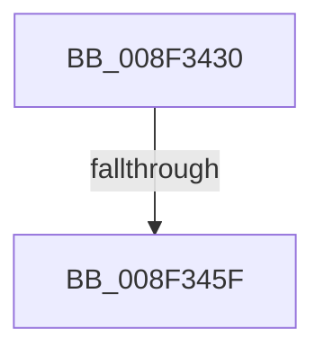

# PiDmObjectGetCachedObjectPropertyData

- RVA: `0x008F3430`–`0x008F346A` (길이 `58` bytes)
- VA: `0x00000001408F3430`
- 실행 섹션: `PAGE`
- PDB 이름 있음: `예`; PDB Function 태그: `아니요`
- unwind 정보 RVA: `0x00087600`
- 디코드: `16`개 명령, `58/58` bytes 표시
- 미해석 바이트: `0` (있으면 어셈블리에 `.byte`로 보존)

> 이 문서는 커널 이미지의 기계어와 PDB 기호를 분석해 생성했습니다. 4번과 5번은 함수 원형과 자료형을 바이너리 사용 방식에서 추정한 C 해석이며 원본 소스 복구 결과는 아닙니다.

## 1. Dependencies

- 직접 호출 지점: **0**; 고유 호출 대상: **0**
- 직접 호출자로 확인된 함수: **2**
- RIP 상대 이미지 참조: **1**

### Outgoing calls
- 직접 디코드된 call 명령이 없습니다.

### Direct callers
- [sub_008E2EB2](../8E/Unknown_function_008E2EB2.md) at `0x008E3045`
- [sub_008E4C9A](../8E/Unknown_function_008E4C9A.md) at `0x008E4D1D`

### Static image references
- `0x008F345F` → RVA `0x00001A70` (`.rdata`; read)

## 2. Other-region calls and transfers

- 다른 실행 섹션으로 향하는 call: **0**
- call이 아닌 외부 분기/꼬리 이동: **1**
  - `0x008F3459` → [sub_008F3604 + 0x1](Unknown_function_008F3604.md) (`tail-transfer`)

## 3. Assembly (complete function range)

```asm
008F3430  4C 89 44 24 18                  mov qword ptr [rsp + 0x18], r8
008F3435  53                              push rbx
008F3436  55                              push rbp
008F3437  56                              push rsi
008F3438  41 56                           push r14
008F343A  41 57                           push r15
008F343C  48 83 EC 40                     sub rsp, 0x40
008F3440  4C 8B BC 24 98 00 00 00         mov r15, qword ptr [rsp + 0x98]
008F3448  45 32 F6                        xor r14b, r14b
008F344B  48 8B EA                        mov rbp, rdx
008F344E  44 8B D1                        mov r10d, ecx
008F3451  BE 16 00 00 C0                  mov esi, 0xc0000016
008F3456  83 F9 01                        cmp ecx, 1
008F3459  0F 85 A6 01 00 00               jne 0x1408f3605
008F345F  48 8D 1D 0A E6 70 FF            lea rbx, [rip - 0x8f19f6]
008F3466  44 8D 59 09                     lea r11d, [rcx + 9]
```

## 4. C-style interpretation (structured pseudocode)

```c
void __fastcall PiDmObjectGetCachedObjectPropertyData(__int64 a1, __int64 a2, __int64 a3, __int64 a4, __int64 a5, __int64 a6)
{
    __int64 v_r14;
    __int64 v_rsp;
    unsigned __int64 v_stack_p18;

    v_stack_p18 = a3;
    v_rsp = (v_rsp) - (64);
    v_r14 = 0;
    return;
}
```

## 5. (Beta) C Style

```c
void PiDmObjectGetCachedObjectPropertyData(int64_t Arg1, int64_t Arg2, int64_t Arg3, int64_t Arg4, uint64_t Arg5, int64_t Arg6)
{
    int64_t local_r14;
    int64_t local_rsp;
    uint64_t v_stack_p18;

    v_stack_p18 = Arg3;
    local_rsp = (local_rsp) - (64);
    local_r14 = 0;
    return;
}
```

## 6. Execution-region graph

[열기: 2D/3D 그래프와 함수 탐색 컨트롤 패널](../../../control-panel.html?section=page&rva=0x008F3430&view=graph)

- 2D 그래프는 위에서 아래로 흐르고, 3D 그래프는 빈 공간을 드래그해 회전합니다. Shift+드래그는 이동, 휠은 확대·축소, 함수 노드 선택은 대상 보고서 이동입니다.

### Static fallback


