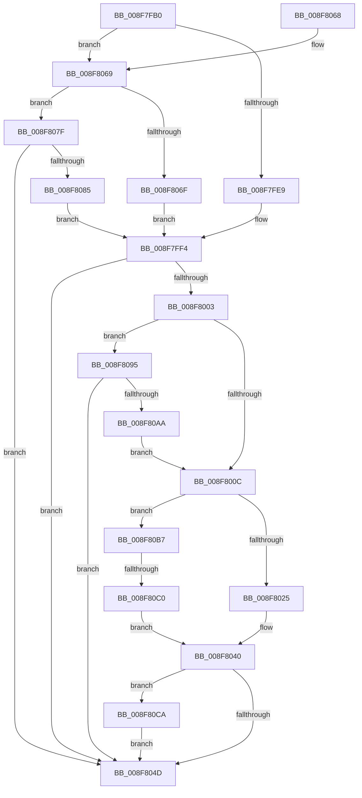

# PiDmObjectGetCachedObjectReference

- RVA: `0x008F7FB0`–`0x008F80D7` (길이 `295` bytes)
- VA: `0x00000001408F7FB0`
- 실행 섹션: `PAGE`
- PDB 이름 있음: `예`; PDB Function 태그: `예`
- unwind 정보 RVA: `0x00087B3C`
- 디코드: `79`개 명령, `295/295` bytes 표시
- 미해석 바이트: `0` (있으면 어셈블리에 `.byte`로 보존)

> 이 문서는 커널 이미지의 기계어와 PDB 기호를 분석해 생성했습니다. 4번과 5번은 함수 원형과 자료형을 바이너리 사용 방식에서 추정한 C 해석이며 원본 소스 복구 결과는 아닙니다.

## 1. Dependencies

- 직접 호출 지점: **5**; 고유 호출 대상: **5**
- 직접 호출자로 확인된 함수: **3**
- RIP 상대 이미지 참조: **3**

### Outgoing calls
- `0x008F7FF7` → [PiDmGetCachedKeyIndex](PiDmGetCachedKeyIndex_function_008F8E80.md) (function, `0x008F8E80`)
- `0x008F800F` → [PiDmObjectAcquireSharedLock](../8E/PiDmObjectAcquireSharedLock_function_008E38B8.md) (function, `0x008E38B8`)
- `0x008F8043` → [PiDmObjectReleaseLock](../8E/PiDmObjectReleaseLock_function_008E5584.md) (function, `0x008E5584`)
- `0x008F809F` → [PiDmGetObject](../8D/PiDmGetObject_function_008DFAE0.md) (function, `0x008DFAE0`)
- `0x008F80CD` → [PiDmObjectRelease](../8E/PiDmObjectRelease_function_008E4F70.md) (function, `0x008E4F70`)

### Direct callers
- [sub_008E2EB2](../8E/Unknown_function_008E2EB2.md) at `0x008E300A`
- [sub_008E4C9A](../8E/Unknown_function_008E4C9A.md) at `0x008E4CDE`
- [PiDmGetReferencedObjectFromProperty](../A7/PiDmGetReferencedObjectFromProperty_function_00A776F0.md) at `0x00A7773C`

### Static image references
- `0x008F7FE9` → RVA `0x00001A70` (`.rdata`; read)
- `0x008F806F` → RVA `0x00001B60` (`.rdata`; read)
- `0x008F8085` → RVA `0x00001B90` (`.rdata`; read)

## 2. Other-region calls and transfers

- 다른 실행 섹션으로 향하는 call: **0**
- call이 아닌 외부 분기/꼬리 이동: **1**
  - `0x008F80BA` → [sub_00B1F14A](../B1/Unknown_function_00B1F14A.md) (`tail-transfer`)

## 3. Assembly (complete function range)

```asm
008F7FB0  48 8B C4                        mov rax, rsp
008F7FB3  48 89 58 08                     mov qword ptr [rax + 8], rbx
008F7FB7  48 89 68 10                     mov qword ptr [rax + 0x10], rbp
008F7FBB  48 89 70 20                     mov qword ptr [rax + 0x20], rsi
008F7FBF  4C 89 40 18                     mov qword ptr [rax + 0x18], r8
008F7FC3  57                              push rdi
008F7FC4  41 56                           push r14
008F7FC6  41 57                           push r15
008F7FC8  48 83 EC 20                     sub rsp, 0x20
008F7FCC  49 8B D8                        mov rbx, r8
008F7FCF  40 32 F6                        xor sil, sil
008F7FD2  44 8B C1                        mov r8d, ecx
008F7FD5  4C 8B FA                        mov r15, rdx
008F7FD8  8B E9                           mov ebp, ecx
008F7FDA  BF 16 00 00 C0                  mov edi, 0xc0000016
008F7FDF  41 83 E8 01                     sub r8d, 1
008F7FE3  0F 85 80 00 00 00               jne 0x1408f8069
008F7FE9  48 8D 0D 80 9A 70 FF            lea rcx, [rip - 0x8f6580]
008F7FF0  41 8D 50 0A                     lea edx, [r8 + 0xa]
008F7FF4  4D 8B C1                        mov r8, r9
008F7FF7  E8 84 0E 00 00                  call 0x1408f8e80
008F7FFC  44 8B F0                        mov r14d, eax
008F7FFF  3B C2                           cmp eax, edx
008F8001  73 4A                           jae 0x1408f804d
008F8003  48 85 DB                        test rbx, rbx
008F8006  0F 84 89 00 00 00               je 0x1408f8095
008F800C  48 8B CB                        mov rcx, rbx
008F800F  E8 A4 B8 FE FF                  call 0x1408e38b8
008F8014  4B 8D 0C 76                     lea rcx, [r14 + r14*2]
008F8018  8B 44 CB 70                     mov eax, dword ptr [rbx + rcx*8 + 0x70]
008F801C  83 F8 06                        cmp eax, 6
008F801F  0F 85 92 00 00 00               jne 0x1408f80b7
008F8025  48 8B 44 24 60                  mov rax, qword ptr [rsp + 0x60]
008F802A  48 8B 8C CB 80 00 00 00         mov rcx, qword ptr [rbx + rcx*8 + 0x80]
008F8032  48 89 08                        mov qword ptr [rax], rcx
008F8035  F0 FF 41 08                     lock inc dword ptr [rcx + 8]
008F8039  48 8B 5C 24 50                  mov rbx, qword ptr [rsp + 0x50]
008F803E  33 FF                           xor edi, edi
008F8040  48 8B CB                        mov rcx, rbx
008F8043  E8 3C D5 FE FF                  call 0x1408e5584
008F8048  40 84 F6                        test sil, sil
008F804B  75 7D                           jne 0x1408f80ca
008F804D  48 8B 5C 24 40                  mov rbx, qword ptr [rsp + 0x40]
008F8052  8B C7                           mov eax, edi
008F8054  48 8B 6C 24 48                  mov rbp, qword ptr [rsp + 0x48]
008F8059  48 8B 74 24 58                  mov rsi, qword ptr [rsp + 0x58]
008F805E  48 83 C4 20                     add rsp, 0x20
008F8062  41 5F                           pop r15
008F8064  41 5E                           pop r14
008F8066  5F                              pop rdi
008F8067  C3                              ret
008F8068  CC                              int3
008F8069  41 83 E8 02                     sub r8d, 2
008F806D  75 10                           jne 0x1408f807f
008F806F  48 8D 0D EA 9A 70 FF            lea rcx, [rip - 0x8f6516]
008F8076  41 8D 50 01                     lea edx, [r8 + 1]
008F807A  E9 75 FF FF FF                  jmp 0x1408f7ff4
008F807F  41 83 F8 02                     cmp r8d, 2
008F8083  75 C8                           jne 0x1408f804d
008F8085  48 8D 0D 04 9B 70 FF            lea rcx, [rip - 0x8f64fc]
008F808C  41 8D 50 01                     lea edx, [r8 + 1]
008F8090  E9 5F FF FF FF                  jmp 0x1408f7ff4
008F8095  4C 8D 44 24 50                  lea r8, [rsp + 0x50]
008F809A  49 8B D7                        mov rdx, r15
008F809D  8B CD                           mov ecx, ebp
008F809F  E8 3C 7A FE FF                  call 0x1408dfae0
008F80A4  8B F8                           mov edi, eax
008F80A6  85 C0                           test eax, eax
008F80A8  78 A3                           js 0x1408f804d
008F80AA  48 8B 5C 24 50                  mov rbx, qword ptr [rsp + 0x50]
008F80AF  40 B6 01                        mov sil, 1
008F80B2  E9 55 FF FF FF                  jmp 0x1408f800c
008F80B7  83 F8 02                        cmp eax, 2
008F80BA  0F 84 8A 70 22 00               je 0x140b1f14a
008F80C0  BF 16 00 00 C0                  mov edi, 0xc0000016
008F80C5  E9 76 FF FF FF                  jmp 0x1408f8040
008F80CA  48 8B CB                        mov rcx, rbx
008F80CD  E8 9E CE FE FF                  call 0x1408e4f70
008F80D2  E9 76 FF FF FF                  jmp 0x1408f804d
```

## 4. C-style interpretation (structured pseudocode)

```c
__int64 __fastcall PiDmObjectGetCachedObjectReference(int a1, __int64 a2, __int64 a3, __int64 a4, __int64 a5)
{
    __int64 result;
    __int64 v_rdi;
    __int64 v_rsi;
    __int64 v_rsp;
    unsigned __int64 v_stack_p10;
    unsigned __int64 v_stack_p18;
    unsigned __int64 v_stack_p20;
    unsigned __int64 v_stack_p50;
    unsigned __int64 v_stack_p8;

    *(unsigned __int64 *)(v_rsp + 8) = v_rbx;
    *(unsigned __int64 *)(v_rsp + 16) = v_rbp;
    *(unsigned __int64 *)(v_rsp + 32) = v_rsi;
    *(unsigned __int64 *)(v_rsp + 24) = a3;
    v_rsp = (v_rsp) - (32);
    v_rsi = 0;
    a3 = (unsigned int)(((unsigned int)(a1)) - (1));
    if (condition_is_not_equal) goto loc_008F8069;
loc_008F7FF4:
    result = PiDmGetCachedKeyIndex(v_rip - 9397632, a3 + 10, a4, a4);
    if (((unsigned int)(result)) >= ((unsigned int)(a3 + 10))) goto loc_008F804D;
    if (a3 == 0) goto loc_008F8095;
loc_008F800C:
    result = PiDmObjectAcquireSharedLock(a3, a3 + 10, a4, a4);
    if (((unsigned int)((unsigned int)(*(unsigned int *)(a3 + (unsigned int)((unsigned int)(result)) + (unsigned int)((unsigned int)(result)) * 2 * 8 + 112)))) != 6) goto loc_008F80B7;
    *(unsigned __int64 *)(a5) = *(unsigned __int64 *)(a3 + (unsigned int)((unsigned int)(result)) + (unsigned int)((unsigned int)(result)) * 2 * 8 + 128);
    v_rdi = 0;
loc_008F8040:
    result = PiDmObjectReleaseLock(v_stack_p18, a3 + 10, a4, a4);
    if (0 != 0) goto loc_008F80CA;
loc_008F804D:
    v_rsp = (v_rsp) + (32);
    return 0;
loc_008F8069:
    a3 = (unsigned int)((a4) - (2));
    if (condition_is_not_equal) goto loc_008F807F;
    goto loc_008F7FF4;
loc_008F807F:
    if (((unsigned int)(a3)) != 2) goto loc_008F804D;
    goto loc_008F7FF4;
loc_008F8095:
    result = PiDmGetObject((unsigned int)((unsigned int)(v_stack_p10)), a2, v_stack_p50, a4);
    if (sign_flag) goto loc_008F804D;
    goto loc_008F800C;
loc_008F80B7:
    goto loc_008F8040;
loc_008F80CA:
    result = PiDmObjectRelease(v_stack_p50, a2, v_stack_p50, a4);
    goto loc_008F804D;
}
```

## 5. (Beta) C Style

```c
int64_t PiDmObjectGetCachedObjectReference(void *Arg1, int64_t Arg2, int64_t Arg3, int64_t Arg4, void *Arg5)
{
    uint8_t *arg1 = (uint8_t *)Arg1;
    uint8_t *arg5 = (uint8_t *)Arg5;

    int64_t result;
    int64_t local_rdi;
    int64_t local_rsi;
    int64_t local_rsp;
    uint64_t v_stack_p10;
    uint64_t v_stack_p18;
    uint64_t v_stack_p20;
    uint64_t v_stack_p50;
    uint64_t v_stack_p8;

    *(uint64_t *)(local_rsp + 0x8) = local_rbx;
    *(uint64_t *)(local_rsp + 0x10) = local_rbp;
    *(uint64_t *)(local_rsp + 0x20) = local_rsi;
    *(uint64_t *)(local_rsp + 0x18) = Arg3;
    local_rsp = (local_rsp) - (32);
    local_rsi = 0;
    Arg3 = (uint32_t)(((uint32_t)(Arg1)) - (1));
    if (condition_is_not_equal) goto loc_008F8069;
loc_008F7FF4:
    result = PiDmGetCachedKeyIndex(v_rip - 9397632, Arg3 + 10, Arg4, Arg4);
    if (((uint32_t)(result)) >= ((uint32_t)(Arg3 + 10))) goto loc_008F804D;
    if (Arg3 == 0) goto loc_008F8095;
loc_008F800C:
    result = PiDmObjectAcquireSharedLock(Arg3, Arg3 + 10, Arg4, Arg4);
    if (((uint32_t)((uint32_t)(*(uint32_t *)(Arg3 + (uint32_t)((uint32_t)(result)) + (uint32_t)((uint32_t)(result)) * 2 * 8 + 0x70)))) != 6) goto loc_008F80B7;
    *(uint64_t *)(arg5) = *(uint64_t *)(Arg3 + (uint32_t)((uint32_t)(result)) + (uint32_t)((uint32_t)(result)) * 2 * 8 + 0x80);
    local_rdi = 0;
loc_008F8040:
    result = PiDmObjectReleaseLock(v_stack_p18, Arg3 + 10, Arg4, Arg4);
    if (0 != 0) goto loc_008F80CA;
loc_008F804D:
    local_rsp = (local_rsp) + (32);
    return 0;
loc_008F8069:
    Arg3 = (uint32_t)((Arg4) - (2));
    if (condition_is_not_equal) goto loc_008F807F;
    goto loc_008F7FF4;
loc_008F807F:
    if (((uint32_t)(Arg3)) != 2) goto loc_008F804D;
    goto loc_008F7FF4;
loc_008F8095:
    result = PiDmGetObject((uint32_t)((uint32_t)(v_stack_p10)), Arg2, v_stack_p50, Arg4);
    if (sign_flag) goto loc_008F804D;
    goto loc_008F800C;
loc_008F80B7:
    goto loc_008F8040;
loc_008F80CA:
    result = PiDmObjectRelease(v_stack_p50, Arg2, v_stack_p50, Arg4);
    goto loc_008F804D;
}
```

### 관측된 메모리 오프셋

구조체 형식이 확인되지 않은 접근은 인자 기준의 오프셋으로만 기록했습니다.

| 기준 인자 | 오프셋 표현 | 폭 (bit) | 접근 |
|---|---:|---:|---|
| `Arg1` | `+ 0x1` | `32` | `R` |
| `Arg1` | `+ 0xA` | `32` | `R` |
| `Arg5` | `+ 0x0` | `64` | `W` |

## 6. Execution-region graph

[열기: 2D/3D 그래프와 함수 탐색 컨트롤 패널](../../../control-panel.html?section=page&rva=0x008F7FB0&view=graph)

- 2D 그래프는 위에서 아래로 흐르고, 3D 그래프는 빈 공간을 드래그해 회전합니다. Shift+드래그는 이동, 휠은 확대·축소, 함수 노드 선택은 대상 보고서 이동입니다.

### Static fallback


