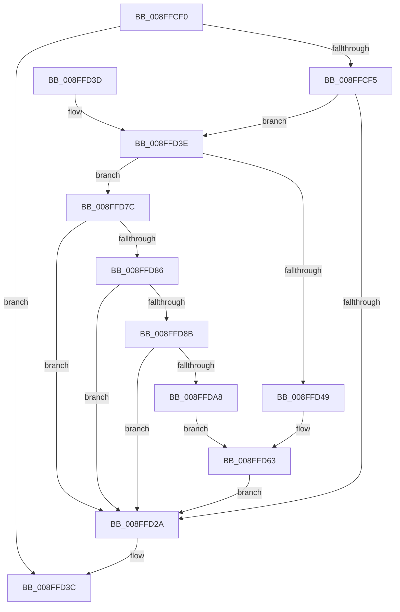

# PiDmObjectUpdateCachedCmProperty

- RVA: `0x008FFCF0`–`0x008FFDD0` (길이 `224` bytes)
- VA: `0x00000001408FFCF0`
- 실행 섹션: `PAGE`
- PDB 이름 있음: `예`; PDB Function 태그: `아니요`
- unwind 정보 RVA: `0x00088428`
- 디코드: `56`개 명령, `224/224` bytes 표시
- 미해석 바이트: `0` (있으면 어셈블리에 `.byte`로 보존)

> 이 문서는 커널 이미지의 기계어와 PDB 기호를 분석해 생성했습니다. 4번과 5번은 함수 원형과 자료형을 바이너리 사용 방식에서 추정한 C 해석이며 원본 소스 복구 결과는 아닙니다.

## 1. Dependencies

- 직접 호출 지점: **6**; 고유 호출 대상: **5**
- 직접 호출자로 확인된 함수: **1**
- RIP 상대 이미지 참조: **2**

### Outgoing calls
- `0x008FFD32` → [_security_check_cookie](../../text/6A/_security_check_cookie_function_006AC640.md) (function, `0x006AC640`)
- `0x008FFD4C` → [_CmMapCmObjectTypeToPnpObjectType](_CmMapCmObjectTypeToPnpObjectType_function_008FF060.md) (function, `0x008FF060`)
- `0x008FFD75` → [PiDmObjectUpdateCachedObjectProperty](PiDmObjectUpdateCachedObjectProperty_function_008F9C94.md) (function, `0x008F9C94`)
- `0x008FFD90` → [RtlInitUnicodeString](../../text/42/RtlInitUnicodeString_function_0042A780.md) (function, `0x0042A780`)
- `0x008FFD9F` → [RtlGUIDFromString](RtlGUIDFromString_function_008F1EF0.md) (function, `0x008F1EF0`)
- `0x008FFDAD` → [_CmMapCmObjectTypeToPnpObjectType](_CmMapCmObjectTypeToPnpObjectType_function_008FF060.md) (function, `0x008FF060`)

### Direct callers
- [PiPnpRtlCmActionCallback](../8E/PiPnpRtlCmActionCallback_function_008EF110.md) at `0x008EF248`
- [PiPnpRtlCmActionCallback](../8E/PiPnpRtlCmActionCallback_function_008EF110.md) at `0x008EF61C`

### Static image references
- `0x008FFCFA` → RVA `0x00E0A740` (`.data`; read)
- `0x008FFD63` → RVA `0x00011688` (`.rdata`; read)

## 2. Other-region calls and transfers

- 다른 실행 섹션으로 향하는 call: **2**
  - `0x008FFD32` → [_security_check_cookie](../../text/6A/_security_check_cookie_function_006AC640.md) (`PAGE` → `.text`)
  - `0x008FFD90` → [RtlInitUnicodeString](../../text/42/RtlInitUnicodeString_function_0042A780.md) (`PAGE` → `.text`)
- 별도 외부 분기/꼬리 이동을 확인하지 못했습니다.

## 3. Assembly (complete function range)

```asm
008FFCF0  83 F9 01                        cmp ecx, 1
008FFCF3  75 47                           jne 0x1408ffd3c
008FFCF5  53                              push rbx
008FFCF6  48 83 EC 70                     sub rsp, 0x70
008FFCFA  48 8B 05 3F AA 50 00            mov rax, qword ptr [rip + 0x50aa3f]
008FFD01  48 33 C4                        xor rax, rsp
008FFD04  48 89 44 24 60                  mov qword ptr [rsp + 0x60], rax
008FFD09  0F 57 C0                        xorps xmm0, xmm0
008FFD0C  0F 57 C9                        xorps xmm1, xmm1
008FFD0F  48 8B DA                        mov rbx, rdx
008FFD12  48 8B 94 24 A8 00 00 00         mov rdx, qword ptr [rsp + 0xa8]
008FFD1A  0F 11 44 24 50                  movups xmmword ptr [rsp + 0x50], xmm0
008FFD1F  0F 11 4C 24 40                  movups xmmword ptr [rsp + 0x40], xmm1
008FFD24  41 83 F9 09                     cmp r9d, 9
008FFD28  74 14                           je 0x1408ffd3e
008FFD2A  48 8B 4C 24 60                  mov rcx, qword ptr [rsp + 0x60]
008FFD2F  48 33 CC                        xor rcx, rsp
008FFD32  E8 09 C9 DA FF                  call 0x1406ac640
008FFD37  48 83 C4 70                     add rsp, 0x70
008FFD3B  5B                              pop rbx
008FFD3C  C3                              ret
008FFD3D  CC                              int3
008FFD3E  8B 84 24 B0 00 00 00            mov eax, dword ptr [rsp + 0xb0]
008FFD45  85 C0                           test eax, eax
008FFD47  75 33                           jne 0x1408ffd7c
008FFD49  8D 48 01                        lea ecx, [rax + 1]
008FFD4C  E8 0F F3 FF FF                  call 0x1408ff060
008FFD51  83 64 24 38 00                  and dword ptr [rsp + 0x38], 0
008FFD56  8B C8                           mov ecx, eax
008FFD58  48 83 64 24 30 00               and qword ptr [rsp + 0x30], 0
008FFD5E  83 64 24 28 00                  and dword ptr [rsp + 0x28], 0
008FFD63  48 8D 05 1E 19 71 FF            lea rax, [rip - 0x8ee6e2]
008FFD6A  45 33 C9                        xor r9d, r9d
008FFD6D  48 8B D3                        mov rdx, rbx
008FFD70  48 89 44 24 20                  mov qword ptr [rsp + 0x20], rax
008FFD75  E8 1A 9F FF FF                  call 0x1408f9c94
008FFD7A  EB AE                           jmp 0x1408ffd2a
008FFD7C  83 BC 24 A0 00 00 00 01         cmp dword ptr [rsp + 0xa0], 1
008FFD84  75 A4                           jne 0x1408ffd2a
008FFD86  83 F8 02                        cmp eax, 2
008FFD89  72 9F                           jb 0x1408ffd2a
008FFD8B  48 8D 4C 24 40                  lea rcx, [rsp + 0x40]
008FFD90  E8 EB A9 B2 FF                  call 0x14042a780
008FFD95  48 8D 54 24 50                  lea rdx, [rsp + 0x50]
008FFD9A  48 8D 4C 24 40                  lea rcx, [rsp + 0x40]
008FFD9F  E8 4C 21 FF FF                  call 0x1408f1ef0
008FFDA4  85 C0                           test eax, eax
008FFDA6  78 82                           js 0x1408ffd2a
008FFDA8  B9 01 00 00 00                  mov ecx, 1
008FFDAD  E8 AE F2 FF FF                  call 0x1408ff060
008FFDB2  C7 44 24 38 10 00 00 00         mov dword ptr [rsp + 0x38], 0x10
008FFDBA  8B C8                           mov ecx, eax
008FFDBC  48 8D 44 24 50                  lea rax, [rsp + 0x50]
008FFDC1  48 89 44 24 30                  mov qword ptr [rsp + 0x30], rax
008FFDC6  C7 44 24 28 0D 00 00 00         mov dword ptr [rsp + 0x28], 0xd
008FFDCE  EB 93                           jmp 0x1408ffd63
```

## 4. C-style interpretation (structured pseudocode)

```c
__int64 __fastcall PiDmObjectUpdateCachedCmProperty(int a1, __int64 a2, __int64 a3, int a4, unsigned int a5, __int64 a6, unsigned int a7)
{
    __int64 result;
    __int64 v_rsp;
    unsigned __int64 v_stack_m18;
    unsigned __int64 v_stack_m28;
    unsigned __int64 v_stack_m38;
    unsigned __int64 v_stack_p20;
    unsigned int v_stack_p28;
    unsigned __int64 v_stack_p30;
    unsigned int v_stack_p38;
    unsigned __int64 v_stack_p40;
    unsigned __int64 v_stack_p50;

    if (a1 != 1) goto loc_008FFD3C;
    v_rsp = (v_rsp) - (112);
    result = (*(unsigned __int64 *)(v_rip + 5286463)) ^ (v_rsp);
    v_stack_m18 = result;
    v_stack_m28 = v_xmm0;
    v_stack_m38 = v_xmm1;
    if (a4 == 9) goto loc_008FFD3E;
loc_008FFD2A:
    a1 = (v_stack_m18) ^ (v_rsp);
    result = _security_check_cookie(a1, a6, a3, a4);
    v_rsp = (v_rsp) + (112);
loc_008FFD3C:
    return result;
loc_008FFD3E:
    if ((unsigned int)((unsigned int)(a7)) != 0) goto loc_008FFD7C;
    result = _CmMapCmObjectTypeToPnpObjectType((unsigned int)(a7) + 1, a6, a3, a4);
loc_008FFD63:
    a4 = 0;
    v_stack_p20 = v_rip - 9365218;
    result = PiDmObjectUpdateCachedObjectProperty((unsigned int)((unsigned int)(result)), a2, a3, a4);
    goto loc_008FFD2A;
loc_008FFD7C:
    if (a5 != 1) goto loc_008FFD2A;
    if (((unsigned int)(result)) < 2) goto loc_008FFD2A;
    result = RtlInitUnicodeString(v_stack_p40, a2, a3, a4);
    result = RtlGUIDFromString(v_stack_p40, v_stack_p50, a3, a4);
    if (sign_flag) goto loc_008FFD2A;
    result = _CmMapCmObjectTypeToPnpObjectType(1, v_stack_p50, a3, a4);
    v_stack_p38 = 16;
    v_stack_p30 = v_stack_p50;
    v_stack_p28 = 13;
    goto loc_008FFD63;
}
```

## 5. (Beta) C Style

```c
int64_t PiDmObjectUpdateCachedCmProperty(int32_t Arg1, int64_t Arg2, int64_t Arg3, int32_t Arg4, uint32_t Arg5, int64_t Arg6, uint32_t Arg7)
{
    int64_t result;
    int64_t local_rsp;
    uint64_t v_stack_m18;
    uint64_t v_stack_m28;
    uint64_t v_stack_m38;
    uint64_t v_stack_p20;
    uint32_t v_stack_p28;
    uint64_t v_stack_p30;
    uint32_t v_stack_p38;
    uint64_t v_stack_p40;
    uint64_t v_stack_p50;

    if (Arg1 != 1) goto loc_008FFD3C;
    local_rsp = (local_rsp) - (112);
    result = (*(uint64_t *)(v_rip + 0x50AA3F)) ^ (local_rsp);
    v_stack_m18 = result;
    v_stack_m28 = v_xmm0;
    v_stack_m38 = v_xmm1;
    if (Arg4 == 9) goto loc_008FFD3E;
loc_008FFD2A:
    Arg1 = (v_stack_m18) ^ (local_rsp);
    result = _security_check_cookie(Arg1, Arg6, Arg3, Arg4);
    local_rsp = (local_rsp) + (112);
loc_008FFD3C:
    return result;
loc_008FFD3E:
    if ((uint32_t)((uint32_t)(Arg7)) != 0) goto loc_008FFD7C;
    result = _CmMapCmObjectTypeToPnpObjectType((uint32_t)(Arg7) + 1, Arg6, Arg3, Arg4);
loc_008FFD63:
    Arg4 = 0;
    v_stack_p20 = v_rip - 9365218;
    result = PiDmObjectUpdateCachedObjectProperty((uint32_t)((uint32_t)(result)), Arg2, Arg3, Arg4);
    goto loc_008FFD2A;
loc_008FFD7C:
    if (Arg5 != 1) goto loc_008FFD2A;
    if (((uint32_t)(result)) < 2) goto loc_008FFD2A;
    result = RtlInitUnicodeString(v_stack_p40, Arg2, Arg3, Arg4);
    result = RtlGUIDFromString(v_stack_p40, v_stack_p50, Arg3, Arg4);
    if (sign_flag) goto loc_008FFD2A;
    result = _CmMapCmObjectTypeToPnpObjectType(1, v_stack_p50, Arg3, Arg4);
    v_stack_p38 = 16;
    v_stack_p30 = v_stack_p50;
    v_stack_p28 = 13;
    goto loc_008FFD63;
}
```

## 6. Execution-region graph

[열기: 2D/3D 그래프와 함수 탐색 컨트롤 패널](../../../control-panel.html?section=page&rva=0x008FFCF0&view=graph)

- 2D 그래프는 위에서 아래로 흐르고, 3D 그래프는 빈 공간을 드래그해 회전합니다. Shift+드래그는 이동, 휠은 확대·축소, 함수 노드 선택은 대상 보고서 이동입니다.

### Static fallback


