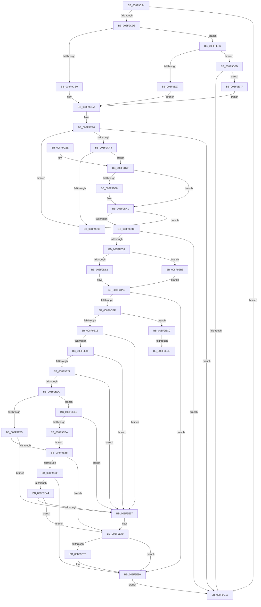

# PiDmObjectUpdateCachedObjectProperty

- RVA: `0x008F9C94`–`0x008F9EEF` (길이 `603` bytes)
- VA: `0x00000001408F9C94`
- 실행 섹션: `PAGE`
- PDB 이름 있음: `예`; PDB Function 태그: `예`
- unwind 정보 RVA: `0x00087C94`
- 디코드: `163`개 명령, `603/603` bytes 표시
- 미해석 바이트: `0` (있으면 어셈블리에 `.byte`로 보존)

> 이 문서는 커널 이미지의 기계어와 PDB 기호를 분석해 생성했습니다. 4번과 5번은 함수 원형과 자료형을 바이너리 사용 방식에서 추정한 C 해석이며 원본 소스 복구 결과는 아닙니다.

## 1. Dependencies

- 직접 호출 지점: **12**; 고유 호출 대상: **9**
- 직접 호출자로 확인된 함수: **2**
- RIP 상대 이미지 참조: **3**

### Outgoing calls
- `0x008F9D50` → [PiDmGetObject](../8D/PiDmGetObject_function_008DFAE0.md) (function, `0x008DFAE0`)
- `0x008F9D60` → [CmpLockSiloKeyLockTrackerExclusive](CmpLockSiloKeyLockTrackerExclusive_function_008F9EF8.md) (function, `0x008F9EF8`)
- `0x008F9DA2` → [PiDmCacheDataEncode](PiDmCacheDataEncode_function_008FB79C.md) (function, `0x008FB79C`)
- `0x008F9DB0` → [PiDmObjectReleaseLock](../8E/PiDmObjectReleaseLock_function_008E5584.md) (function, `0x008E5584`)
- `0x008F9E07` → [PnpGetObjectProperty](../8E/PnpGetObjectProperty_function_008E1110.md) (function, `0x008E1110`)
- `0x008F9E4E` → [memcmp](../../text/6C/memcmp_function_006C6B10.md) (function, `0x006C6B10`)
- `0x008F9E5A` → [CmpLockSiloKeyLockTrackerExclusive](CmpLockSiloKeyLockTrackerExclusive_function_008F9EF8.md) (function, `0x008F9EF8`)
- `0x008F9E63` → [PiDmCacheDataFree](PiDmCacheDataFree_function_008F9C48.md) (function, `0x008F9C48`)
- `0x008F9E6B` → [PiDmObjectReleaseLock](../8E/PiDmObjectReleaseLock_function_008E5584.md) (function, `0x008E5584`)
- `0x008F9E7B` → [ExFreePoolWithTag](../../poolcode/B8/ExFreePoolWithTag_function_00B82870.md) (function, `0x00B82870`)
- `0x008F9E83` → [PiDmObjectRelease](../8E/PiDmObjectRelease_function_008E4F70.md) (function, `0x008E4F70`)
- `0x008F9ED3` → [ExFreePoolWithTag](../../poolcode/B8/ExFreePoolWithTag_function_00B82870.md) (function, `0x00B82870`)

### Direct callers
- [sub_008E3562](../8E/Unknown_function_008E3562.md) at `0x008E3592`
- [PiDmObjectUpdateCachedCmProperty](PiDmObjectUpdateCachedCmProperty_function_008FFCF0.md) at `0x008FFD75`

### Static image references
- `0x008F9CE0` → RVA `0x00001A70` (`.rdata`; read)
- `0x008F9E97` → RVA `0x00001B60` (`.rdata`; read)
- `0x008F9EA7` → RVA `0x00001B90` (`.rdata`; read)

## 2. Other-region calls and transfers

- 다른 실행 섹션으로 향하는 call: **3**
  - `0x008F9E4E` → [memcmp](../../text/6C/memcmp_function_006C6B10.md) (`PAGE` → `.text`)
  - `0x008F9E7B` → [ExFreePoolWithTag](../../poolcode/B8/ExFreePoolWithTag_function_00B82870.md) (`PAGE` → `POOLCODE`)
  - `0x008F9ED3` → [ExFreePoolWithTag](../../poolcode/B8/ExFreePoolWithTag_function_00B82870.md) (`PAGE` → `POOLCODE`)
- call이 아닌 외부 분기/꼬리 이동: **2**
  - `0x008F9EC7` → [sub_00B1F21A](../B1/Unknown_function_00B1F21A.md) (`tail-transfer`)
  - `0x008F9EDB` → [sub_00B1F21A](../B1/Unknown_function_00B1F21A.md) (`tail-transfer`)

## 3. Assembly (complete function range)

```asm
008F9C94  48 89 5C 24 08                  mov qword ptr [rsp + 8], rbx
008F9C99  4C 89 44 24 18                  mov qword ptr [rsp + 0x18], r8
008F9C9E  48 89 54 24 10                  mov qword ptr [rsp + 0x10], rdx
008F9CA3  55                              push rbp
008F9CA4  56                              push rsi
008F9CA5  57                              push rdi
008F9CA6  41 54                           push r12
008F9CA8  41 56                           push r14
008F9CAA  48 8B EC                        mov rbp, rsp
008F9CAD  48 81 EC 80 00 00 00            sub rsp, 0x80
008F9CB4  33 FF                           xor edi, edi
008F9CB6  4C 8B D2                        mov r10, rdx
008F9CB9  48 89 7D F0                     mov qword ptr [rbp - 0x10], rdi
008F9CBD  44 8B F1                        mov r14d, ecx
008F9CC0  89 7D 48                        mov dword ptr [rbp + 0x48], edi
008F9CC3  48 89 7D E8                     mov qword ptr [rbp - 0x18], rdi
008F9CC7  89 7D E0                        mov dword ptr [rbp - 0x20], edi
008F9CCA  40 88 7D 40                     mov byte ptr [rbp + 0x40], dil
008F9CCE  4D 85 C9                        test r9, r9
008F9CD1  75 44                           jne 0x1408f9d17
008F9CD3  44 8B C1                        mov r8d, ecx
008F9CD6  41 83 E8 01                     sub r8d, 1
008F9CDA  0F 85 AD 01 00 00               jne 0x1408f9e8d
008F9CE0  48 8D 35 89 7D 70 FF            lea rsi, [rip - 0x8f8277]
008F9CE7  8D 57 0A                        lea edx, [rdi + 0xa]
008F9CEA  4C 8B 65 50                     mov r12, qword ptr [rbp + 0x50]
008F9CEE  8B DF                           mov ebx, edi
008F9CF0  3B DA                           cmp ebx, edx
008F9CF2  73 23                           jae 0x1408f9d17
008F9CF4  8B C3                           mov eax, ebx
008F9CF6  48 8D 0C 40                     lea rcx, [rax + rax*2]
008F9CFA  4C 8B 04 CE                     mov r8, qword ptr [rsi + rcx*8]
008F9CFE  41 8B 40 10                     mov eax, dword ptr [r8 + 0x10]
008F9D02  41 39 44 24 10                  cmp dword ptr [r12 + 0x10], eax
008F9D07  74 26                           je 0x1408f9d2f
008F9D09  FF C3                           inc ebx
008F9D0B  EB E3                           jmp 0x1408f9cf0
008F9D0D  41 83 F8 02                     cmp r8d, 2
008F9D11  0F 84 90 01 00 00               je 0x1408f9ea7
008F9D17  48 8B 9C 24 B0 00 00 00         mov rbx, qword ptr [rsp + 0xb0]
008F9D1F  48 81 C4 80 00 00 00            add rsp, 0x80
008F9D26  41 5E                           pop r14
008F9D28  41 5C                           pop r12
008F9D2A  5F                              pop rdi
008F9D2B  5E                              pop rsi
008F9D2C  5D                              pop rbp
008F9D2D  C3                              ret
008F9D2E  CC                              int3
008F9D2F  49 8B 0C 24                     mov rcx, qword ptr [r12]
008F9D33  49 2B 08                        sub rcx, qword ptr [r8]
008F9D36  75 09                           jne 0x1408f9d41
008F9D38  49 8B 4C 24 08                  mov rcx, qword ptr [r12 + 8]
008F9D3D  49 2B 48 08                     sub rcx, qword ptr [r8 + 8]
008F9D41  48 85 C9                        test rcx, rcx
008F9D44  75 C3                           jne 0x1408f9d09
008F9D46  4C 8D 45 F0                     lea r8, [rbp - 0x10]
008F9D4A  49 8B D2                        mov rdx, r10
008F9D4D  41 8B CE                        mov ecx, r14d
008F9D50  E8 8B 5D FE FF                  call 0x1408dfae0
008F9D55  85 C0                           test eax, eax
008F9D57  78 BE                           js 0x1408f9d17
008F9D59  48 8B 7D F0                     mov rdi, qword ptr [rbp - 0x10]
008F9D5D  48 8B CF                        mov rcx, rdi
008F9D60  E8 93 01 00 00                  call 0x1408f9ef8
008F9D65  8B C3                           mov eax, ebx
008F9D67  4C 8D 0C 40                     lea r9, [rax + rax*2]
008F9D6B  48 8D 47 70                     lea rax, [rdi + 0x70]
008F9D6F  4A 8D 04 C8                     lea rax, [rax + r9*8]
008F9D73  8B 18                           mov ebx, dword ptr [rax]
008F9D75  48 89 45 F8                     mov qword ptr [rbp - 8], rax
008F9D79  83 FB 01                        cmp ebx, 1
008F9D7C  0F 87 36 01 00 00               ja 0x1408f9eb8
008F9D82  44 8B 45 68                     mov r8d, dword ptr [rbp + 0x68]
008F9D86  48 8B 55 60                     mov rdx, qword ptr [rbp + 0x60]
008F9D8A  48 89 44 24 28                  mov qword ptr [rsp + 0x28], rax
008F9D8F  42 8B 44 CE 0C                  mov eax, dword ptr [rsi + r9*8 + 0xc]
008F9D94  46 8B 4C CE 08                  mov r9d, dword ptr [rsi + r9*8 + 8]
008F9D99  8B 75 58                        mov esi, dword ptr [rbp + 0x58]
008F9D9C  8B CE                           mov ecx, esi
008F9D9E  89 44 24 20                     mov dword ptr [rsp + 0x20], eax
008F9DA2  E8 F5 19 00 00                  call 0x1408fb79c
008F9DA7  85 DB                           test ebx, ebx
008F9DA9  0F 94 45 40                     sete byte ptr [rbp + 0x40]
008F9DAD  48 8B CF                        mov rcx, rdi
008F9DB0  E8 CF B7 FE FF                  call 0x1408e5584
008F9DB5  80 7D 40 00                     cmp byte ptr [rbp + 0x40], 0
008F9DB9  0F 84 C1 00 00 00               je 0x1408f9e80
008F9DBF  4C 8B 45 38                     mov r8, qword ptr [rbp + 0x38]
008F9DC3  48 8D 45 E0                     lea rax, [rbp - 0x20]
008F9DC7  8B 55 68                        mov edx, dword ptr [rbp + 0x68]
008F9DCA  45 8B CE                        mov r9d, r14d
008F9DCD  C7 44 24 50 00 00 01 00         mov dword ptr [rsp + 0x50], 0x10000
008F9DD5  41 BE 50 6E 70 5A               mov r14d, 0x5a706e50
008F9DDB  48 89 44 24 48                  mov qword ptr [rsp + 0x48], rax
008F9DE0  41 8B CE                        mov ecx, r14d
008F9DE3  48 8D 45 E8                     lea rax, [rbp - 0x18]
008F9DE7  48 89 44 24 40                  mov qword ptr [rsp + 0x40], rax
008F9DEC  48 8D 45 48                     lea rax, [rbp + 0x48]
008F9DF0  48 89 44 24 38                  mov qword ptr [rsp + 0x38], rax
008F9DF5  4C 89 64 24 30                  mov qword ptr [rsp + 0x30], r12
008F9DFA  45 33 E4                        xor r12d, r12d
008F9DFD  4C 89 64 24 28                  mov qword ptr [rsp + 0x28], r12
008F9E02  4C 89 64 24 20                  mov qword ptr [rsp + 0x20], r12
008F9E07  E8 04 73 FE FF                  call 0x1408e1110
008F9E0C  48 8B 5D E8                     mov rbx, qword ptr [rbp - 0x18]
008F9E10  3D 25 02 00 C0                  cmp eax, 0xc0000225
008F9E15  0F 84 A5 00 00 00               je 0x1408f9ec0
008F9E1B  85 C0                           test eax, eax
008F9E1D  78 38                           js 0x1408f9e57
008F9E1F  8B 45 E0                        mov eax, dword ptr [rbp - 0x20]
008F9E22  3B 45 68                        cmp eax, dword ptr [rbp + 0x68]
008F9E25  75 30                           jne 0x1408f9e57
008F9E27  39 75 48                        cmp dword ptr [rbp + 0x48], esi
008F9E2A  75 2B                           jne 0x1408f9e57
008F9E2C  48 85 DB                        test rbx, rbx
008F9E2F  0F 84 AB 00 00 00               je 0x1408f9ee0
008F9E35  4C 39 65 60                     cmp qword ptr [rbp + 0x60], r12
008F9E39  74 1C                           je 0x1408f9e57
008F9E3B  85 C0                           test eax, eax
008F9E3D  74 31                           je 0x1408f9e70
008F9E3F  48 85 DB                        test rbx, rbx
008F9E42  74 3C                           je 0x1408f9e80
008F9E44  48 8B 55 60                     mov rdx, qword ptr [rbp + 0x60]
008F9E48  48 8B CB                        mov rcx, rbx
008F9E4B  44 8B C0                        mov r8d, eax
008F9E4E  E8 BD CC DC FF                  call 0x1406c6b10
008F9E53  85 C0                           test eax, eax
008F9E55  74 19                           je 0x1408f9e70
008F9E57  48 8B CF                        mov rcx, rdi
008F9E5A  E8 99 00 00 00                  call 0x1408f9ef8
008F9E5F  48 8B 4D F8                     mov rcx, qword ptr [rbp - 8]
008F9E63  E8 E0 FD FF FF                  call 0x1408f9c48
008F9E68  48 8B CF                        mov rcx, rdi
008F9E6B  E8 14 B7 FE FF                  call 0x1408e5584
008F9E70  48 85 DB                        test rbx, rbx
008F9E73  74 0B                           je 0x1408f9e80
008F9E75  41 8B D6                        mov edx, r14d
008F9E78  48 8B CB                        mov rcx, rbx
008F9E7B  E8 F0 89 28 00                  call 0x140b82870
008F9E80  48 8B CF                        mov rcx, rdi
008F9E83  E8 E8 B0 FE FF                  call 0x1408e4f70
008F9E88  E9 8A FE FF FF                  jmp 0x1408f9d17
008F9E8D  41 83 E8 02                     sub r8d, 2
008F9E91  0F 85 76 FE FF FF               jne 0x1408f9d0d
008F9E97  48 8D 35 C2 7C 70 FF            lea rsi, [rip - 0x8f833e]
008F9E9E  41 8D 50 01                     lea edx, [r8 + 1]
008F9EA2  E9 43 FE FF FF                  jmp 0x1408f9cea
008F9EA7  48 8D 35 E2 7C 70 FF            lea rsi, [rip - 0x8f831e]
008F9EAE  BA 03 00 00 00                  mov edx, 3
008F9EB3  E9 32 FE FF FF                  jmp 0x1408f9cea
008F9EB8  8B 75 58                        mov esi, dword ptr [rbp + 0x58]
008F9EBB  E9 ED FE FF FF                  jmp 0x1408f9dad
008F9EC0  44 89 65 48                     mov dword ptr [rbp + 0x48], r12d
008F9EC4  48 85 DB                        test rbx, rbx
008F9EC7  0F 84 4D 53 22 00               je 0x140b1f21a
008F9ECD  41 8B D6                        mov edx, r14d
008F9ED0  48 8B CB                        mov rcx, rbx
008F9ED3  E8 98 89 28 00                  call 0x140b82870
008F9ED8  49 8B DC                        mov rbx, r12
008F9EDB  E9 3A 53 22 00                  jmp 0x140b1f21a
008F9EE0  4C 39 65 60                     cmp qword ptr [rbp + 0x60], r12
008F9EE4  0F 85 6D FF FF FF               jne 0x1408f9e57
008F9EEA  E9 4C FF FF FF                  jmp 0x1408f9e3b
```

## 4. C-style interpretation (structured pseudocode)

```c
__int64 __fastcall PiDmObjectUpdateCachedObjectProperty(int a1, __int64 a2, __int64 a3, __int64 a4, __int64 a5, unsigned int a6, __int64 a7, unsigned int a8)
{
    __int64 result;
    __int64 v_r12;
    __int64 v_rbx;
    __int64 v_rdi;
    __int64 v_rsp;
    unsigned __int64 v_stack_m30;
    unsigned __int64 v_stack_m38;
    unsigned __int64 v_stack_m40;
    unsigned int v_stack_m48;
    unsigned __int64 v_stack_p10;
    unsigned __int64 v_stack_p18;
    unsigned int v_stack_p20;
    unsigned __int64 v_stack_p28;
    unsigned __int64 v_stack_p30;
    unsigned __int64 v_stack_p38;
    unsigned __int64 v_stack_p40;
    unsigned __int64 v_stack_p48;
    unsigned int v_stack_p50;
    unsigned __int64 v_stack_p8;

    v_stack_p8 = v_rbx;
    v_stack_p18 = a3;
    v_stack_p10 = a2;
    v_rsp = (v_rsp) - (128);
    v_rdi = 0;
    v_stack_m38 = 0;
    v_stack_p20 = 0;
    v_stack_m40 = 0;
    v_stack_m48 = 0;
    v_stack_p18 = 0;
    if (a4 != 0) goto loc_008F9D17;
    a3 = (unsigned int)(((unsigned int)(a1)) - (1));
    if (condition_is_not_equal) goto loc_008F9E8D;
loc_008F9CEA:
loc_008F9CF0:
    if (0 >= ((unsigned int)(v_rdi + 10))) goto loc_008F9D17;
    if ((*(unsigned int *)(a5 + 16)) == ((unsigned int)((unsigned int)(*(unsigned int *)(*(unsigned __int64 *)(v_rip - 9405047 + 0 + 0 * 2 * 8) + 16))))) goto loc_008F9D2F;
loc_008F9D09:
    v_rbx = (unsigned int)((0) + 1);
    goto loc_008F9CF0;
loc_008F9D0D:
    if (((unsigned int)(*(unsigned __int64 *)(v_rip - 9405047 + 0 + 0 * 2 * 8))) == 2) goto loc_008F9EA7;
loc_008F9D17:
    v_rsp = (v_rsp) + (128);
    return (unsigned int)(*(unsigned int *)(*(unsigned __int64 *)(v_rip - 9405047 + 0 + 0 * 2 * 8) + 16));
loc_008F9D2F:
    a1 = (*(unsigned __int64 *)(a5)) - (*(unsigned __int64 *)(*(unsigned __int64 *)(v_rip - 9405047 + 0 + 0 * 2 * 8)));
    if (!(condition_is_not_equal)) {
        a1 = *(unsigned __int64 *)(a5 + 8);
        a1 = (a1) - (*(unsigned __int64 *)(*(unsigned __int64 *)(v_rip - 9405047 + 0 + 0 * 2 * 8) + 8));
    }
    if (a1 != 0) goto loc_008F9D09;
    result = PiDmGetObject((unsigned int)((unsigned int)((unsigned int)(a1))), a2, v_stack_m38, a4);
    if (sign_flag) goto loc_008F9D17;
    result = CmpLockSiloKeyLockTrackerExclusive(v_stack_m38, a2, v_stack_m38, a4);
    v_stack_m30 = v_stack_m38 + 112 + (unsigned int)((unsigned int)(v_stack_p8)) + (unsigned int)((unsigned int)(v_stack_p8)) * 2 * 8;
    if (((unsigned int)((unsigned int)(*(unsigned int *)(v_stack_m38 + 112 + (unsigned int)((unsigned int)(v_stack_p8)) + (unsigned int)((unsigned int)(v_stack_p8)) * 2 * 8)))) > 1) goto loc_008F9EB8;
    v_stack_p28 = v_stack_m38 + 112 + (unsigned int)((unsigned int)(v_stack_p8)) + (unsigned int)((unsigned int)(v_stack_p8)) * 2 * 8;
    v_stack_p20 = (unsigned int)((unsigned int)(*(unsigned int *)(v_rip - 9405047 + (unsigned int)((unsigned int)(v_stack_p8)) + (unsigned int)((unsigned int)(v_stack_p8)) * 2 * 8 + 12)));
    result = PiDmCacheDataEncode((unsigned int)((unsigned int)((unsigned int)(a6))), a7, (unsigned int)(a8), (unsigned int)(*(unsigned int *)(v_rip - 9405047 + (unsigned int)((unsigned int)(v_stack_p8)) + (unsigned int)((unsigned int)(v_stack_p8)) * 2 * 8 + 8)));
loc_008F9DAD:
    result = PiDmObjectReleaseLock(v_stack_m38, a7, (unsigned int)(a8), (unsigned int)(*(unsigned int *)(v_rip - 9405047 + (unsigned int)((unsigned int)(v_stack_p8)) + (unsigned int)((unsigned int)(v_stack_p8)) * 2 * 8 + 8)));
    if (v_stack_p18 == 0) goto loc_008F9E80;
    v_stack_p50 = 0x10000ULL;
    v_stack_p48 = v_stack_m48;
    v_stack_p40 = v_stack_m40;
    v_stack_p38 = v_stack_p20;
    v_stack_p30 = a5;
    v_r12 = 0;
    v_stack_p28 = 0;
    v_stack_p20 = 0;
    result = PnpGetObjectProperty((unsigned int)((unsigned int)((unsigned int)(0x5A706E50ULL))), (unsigned int)(a8), v_stack_p10, (unsigned int)((unsigned int)((unsigned int)(a1))));
    if (((unsigned int)(result)) == 0xC0000225ULL) goto loc_008F9EC0;
    if (sign_flag) goto loc_008F9E57;
    if (((unsigned int)((unsigned int)(v_stack_m48))) != a8) goto loc_008F9E57;
    if (v_stack_p20 != ((unsigned int)((unsigned int)(a6)))) goto loc_008F9E57;
    if (v_stack_m40 == 0) goto loc_008F9EE0;
    if (a7 == 0) goto loc_008F9E57;
loc_008F9E3B:
    if ((unsigned int)((unsigned int)(v_stack_m48)) == 0) goto loc_008F9E70;
    if (v_stack_m40 == 0) goto loc_008F9E80;
    result = memcmp(v_stack_m40, a7, (unsigned int)((unsigned int)((unsigned int)(v_stack_m48))), (unsigned int)((unsigned int)((unsigned int)(a1))));
    if ((unsigned int)(result) != 0) {
        a1 = v_stack_m38;
        result = CmpLockSiloKeyLockTrackerExclusive(a1, a7, (unsigned int)((unsigned int)((unsigned int)(v_stack_m48))), (unsigned int)((unsigned int)((unsigned int)(a1))));
        a1 = v_stack_m30;
        result = PiDmCacheDataFree(a1, a7, (unsigned int)((unsigned int)((unsigned int)(v_stack_m48))), (unsigned int)((unsigned int)((unsigned int)(a1))));
        a1 = v_stack_m38;
        result = PiDmObjectReleaseLock(a1, a7, (unsigned int)((unsigned int)((unsigned int)(v_stack_m48))), (unsigned int)((unsigned int)((unsigned int)(a1))));
    }
    if (v_stack_m40 != 0) {
        a2 = (unsigned int)((unsigned int)(0x5A706E50ULL));
        a1 = v_stack_m40;
        result = ExFreePoolWithTag(a1, a2, (unsigned int)((unsigned int)((unsigned int)(v_stack_m48))), (unsigned int)((unsigned int)((unsigned int)(a1))));
    }
    result = PiDmObjectRelease(v_stack_m38, a2, (unsigned int)((unsigned int)((unsigned int)(v_stack_m48))), (unsigned int)((unsigned int)((unsigned int)(a1))));
    goto loc_008F9D17;
loc_008F9E8D:
    a3 = (unsigned int)(((unsigned int)((unsigned int)((unsigned int)(v_stack_m48)))) - (2));
    if (condition_is_not_equal) goto loc_008F9D0D;
    goto loc_008F9CEA;
loc_008F9EA7:
    goto loc_008F9CEA;
loc_008F9EB8:
    goto loc_008F9DAD;
loc_008F9EC0:
    v_stack_p20 = 0;
    result = ExFreePoolWithTag(v_stack_m40, (unsigned int)((unsigned int)((unsigned int)(0x5A706E50ULL))), a3, (unsigned int)((unsigned int)((unsigned int)(a1))));
loc_008F9EE0:
    if (a7 != 0) goto loc_008F9E57;
    goto loc_008F9E3B;
}
```

## 5. (Beta) C Style

```c
int64_t PiDmObjectUpdateCachedObjectProperty(void *Arg1, int64_t Arg2, int64_t Arg3, int64_t Arg4, void *Arg5, uint32_t Arg6, int64_t Arg7, uint32_t Arg8)
{
    uint8_t *arg1 = (uint8_t *)Arg1;
    uint8_t *arg5 = (uint8_t *)Arg5;

    int64_t result;
    int64_t local_r12;
    int64_t local_rbx;
    int64_t local_rdi;
    int64_t local_rsp;
    uint64_t v_stack_m30;
    uint64_t v_stack_m38;
    uint64_t v_stack_m40;
    uint32_t v_stack_m48;
    uint64_t v_stack_p10;
    uint64_t v_stack_p18;
    uint32_t v_stack_p20;
    uint64_t v_stack_p28;
    uint64_t v_stack_p30;
    uint64_t v_stack_p38;
    uint64_t v_stack_p40;
    uint64_t v_stack_p48;
    uint32_t v_stack_p50;
    uint64_t v_stack_p8;

    v_stack_p8 = local_rbx;
    v_stack_p18 = Arg3;
    v_stack_p10 = Arg2;
    local_rsp = (local_rsp) - (128);
    local_rdi = 0;
    v_stack_m38 = 0;
    v_stack_p20 = 0;
    v_stack_m40 = 0;
    v_stack_m48 = 0;
    v_stack_p18 = 0;
    if (Arg4 != 0) goto loc_008F9D17;
    Arg3 = (uint32_t)(((uint32_t)(Arg1)) - (1));
    if (condition_is_not_equal) goto loc_008F9E8D;
loc_008F9CEA:
loc_008F9CF0:
    if (0 >= ((uint32_t)(local_rdi + 10))) goto loc_008F9D17;
    if ((*(uint32_t *)(arg5 + 0x10)) == ((uint32_t)((uint32_t)(*(uint32_t *)(*(uint64_t *)(v_rip - 0x8F8277 + 0x0 + 0x0 * 2 * 8) + 0x10))))) goto loc_008F9D2F;
loc_008F9D09:
    local_rbx = (uint32_t)((0) + 1);
    goto loc_008F9CF0;
loc_008F9D0D:
    if (((uint32_t)(*(uint64_t *)(v_rip - 0x8F8277 + 0x0 + 0x0 * 2 * 8))) == 2) goto loc_008F9EA7;
loc_008F9D17:
    local_rsp = (local_rsp) + (128);
    return (uint32_t)(*(uint32_t *)(*(uint64_t *)(v_rip - 0x8F8277 + 0x0 + 0x0 * 2 * 8) + 0x10));
loc_008F9D2F:
    Arg1 = (*(uint64_t *)(arg5)) - (*(uint64_t *)(*(uint64_t *)(v_rip - 0x8F8277 + 0x0 + 0x0 * 2 * 8)));
    if (!(condition_is_not_equal)) {
        Arg1 = *(uint64_t *)(arg5 + 0x8);
        Arg1 = (Arg1) - (*(uint64_t *)(*(uint64_t *)(v_rip - 0x8F8277 + 0x0 + 0x0 * 2 * 8) + 0x8));
    }
    if (Arg1 != NULL) goto loc_008F9D09;
    result = PiDmGetObject((uint32_t)((uint32_t)((uint32_t)(Arg1))), Arg2, v_stack_m38, Arg4);
    if (sign_flag) goto loc_008F9D17;
    result = CmpLockSiloKeyLockTrackerExclusive(v_stack_m38, Arg2, v_stack_m38, Arg4);
    v_stack_m30 = v_stack_m38 + 112 + (uint32_t)((uint32_t)(v_stack_p8)) + (uint32_t)((uint32_t)(v_stack_p8)) * 2 * 8;
    if (((uint32_t)((uint32_t)(*(uint32_t *)(v_stack_m38 + 0x70 + (uint32_t)((uint32_t)(v_stack_p8)) + (uint32_t)((uint32_t)(v_stack_p8)) * 2 * 8)))) > 1) goto loc_008F9EB8;
    v_stack_p28 = v_stack_m38 + 112 + (uint32_t)((uint32_t)(v_stack_p8)) + (uint32_t)((uint32_t)(v_stack_p8)) * 2 * 8;
    v_stack_p20 = (uint32_t)((uint32_t)(*(uint32_t *)(v_rip - 0x8F8277 + (uint32_t)((uint32_t)(v_stack_p8)) + (uint32_t)((uint32_t)(v_stack_p8)) * 2 * 8 + 0xC)));
    result = PiDmCacheDataEncode((uint32_t)((uint32_t)((uint32_t)(Arg6))), Arg7, (uint32_t)(Arg8), (uint32_t)(*(uint32_t *)(v_rip - 0x8F8277 + (uint32_t)((uint32_t)(v_stack_p8)) + (uint32_t)((uint32_t)(v_stack_p8)) * 2 * 8 + 0x8)));
loc_008F9DAD:
    result = PiDmObjectReleaseLock(v_stack_m38, Arg7, (uint32_t)(Arg8), (uint32_t)(*(uint32_t *)(v_rip - 0x8F8277 + (uint32_t)((uint32_t)(v_stack_p8)) + (uint32_t)((uint32_t)(v_stack_p8)) * 2 * 8 + 0x8)));
    if (v_stack_p18 == 0) goto loc_008F9E80;
    v_stack_p50 = 0x10000ULL;
    v_stack_p48 = v_stack_m48;
    v_stack_p40 = v_stack_m40;
    v_stack_p38 = v_stack_p20;
    v_stack_p30 = Arg5;
    local_r12 = 0;
    v_stack_p28 = 0;
    v_stack_p20 = 0;
    result = PnpGetObjectProperty((uint32_t)((uint32_t)((uint32_t)(0x5A706E50ULL))), (uint32_t)(Arg8), v_stack_p10, (uint32_t)((uint32_t)((uint32_t)(Arg1))));
    if (((uint32_t)(result)) == 0xC0000225ULL) goto loc_008F9EC0;
    if (sign_flag) goto loc_008F9E57;
    if (((uint32_t)((uint32_t)(v_stack_m48))) != Arg8) goto loc_008F9E57;
    if (v_stack_p20 != ((uint32_t)((uint32_t)(Arg6)))) goto loc_008F9E57;
    if (v_stack_m40 == 0) goto loc_008F9EE0;
    if (Arg7 == 0) goto loc_008F9E57;
loc_008F9E3B:
    if ((uint32_t)((uint32_t)(v_stack_m48)) == 0) goto loc_008F9E70;
    if (v_stack_m40 == 0) goto loc_008F9E80;
    result = memcmp(v_stack_m40, Arg7, (uint32_t)((uint32_t)((uint32_t)(v_stack_m48))), (uint32_t)((uint32_t)((uint32_t)(Arg1))));
    if ((uint32_t)(result) != 0) {
        Arg1 = v_stack_m38;
        result = CmpLockSiloKeyLockTrackerExclusive(Arg1, Arg7, (uint32_t)((uint32_t)((uint32_t)(v_stack_m48))), (uint32_t)((uint32_t)((uint32_t)(Arg1))));
        Arg1 = v_stack_m30;
        result = PiDmCacheDataFree(Arg1, Arg7, (uint32_t)((uint32_t)((uint32_t)(v_stack_m48))), (uint32_t)((uint32_t)((uint32_t)(Arg1))));
        Arg1 = v_stack_m38;
        result = PiDmObjectReleaseLock(Arg1, Arg7, (uint32_t)((uint32_t)((uint32_t)(v_stack_m48))), (uint32_t)((uint32_t)((uint32_t)(Arg1))));
    }
    if (v_stack_m40 != 0) {
        Arg2 = (uint32_t)((uint32_t)(0x5A706E50ULL));
        Arg1 = v_stack_m40;
        result = ExFreePoolWithTag(Arg1, Arg2, (uint32_t)((uint32_t)((uint32_t)(v_stack_m48))), (uint32_t)((uint32_t)((uint32_t)(Arg1))));
    }
    result = PiDmObjectRelease(v_stack_m38, Arg2, (uint32_t)((uint32_t)((uint32_t)(v_stack_m48))), (uint32_t)((uint32_t)((uint32_t)(Arg1))));
    goto loc_008F9D17;
loc_008F9E8D:
    Arg3 = (uint32_t)(((uint32_t)((uint32_t)((uint32_t)(v_stack_m48)))) - (2));
    if (condition_is_not_equal) goto loc_008F9D0D;
    goto loc_008F9CEA;
loc_008F9EA7:
    goto loc_008F9CEA;
loc_008F9EB8:
    goto loc_008F9DAD;
loc_008F9EC0:
    v_stack_p20 = 0;
    result = ExFreePoolWithTag(v_stack_m40, (uint32_t)((uint32_t)((uint32_t)(0x5A706E50ULL))), Arg3, (uint32_t)((uint32_t)((uint32_t)(Arg1))));
loc_008F9EE0:
    if (Arg7 != 0) goto loc_008F9E57;
    goto loc_008F9E3B;
}
```

### 관측된 메모리 오프셋

구조체 형식이 확인되지 않은 접근은 인자 기준의 오프셋으로만 기록했습니다.

| 기준 인자 | 오프셋 표현 | 폭 (bit) | 접근 |
|---|---:|---:|---|
| `Arg1` | `+ 0x1` | `32` | `R` |
| `Arg5` | `+ 0x0` | `64` | `R` |
| `Arg5` | `+ 0x8` | `64` | `R` |
| `Arg5` | `+ 0x10` | `32` | `R` |

## 6. Execution-region graph

[열기: 2D/3D 그래프와 함수 탐색 컨트롤 패널](../../../control-panel.html?section=page&rva=0x008F9C94&view=graph)

- 2D 그래프는 위에서 아래로 흐르고, 3D 그래프는 빈 공간을 드래그해 회전합니다. Shift+드래그는 이동, 휠은 확대·축소, 함수 노드 선택은 대상 보고서 이동입니다.

### Static fallback


