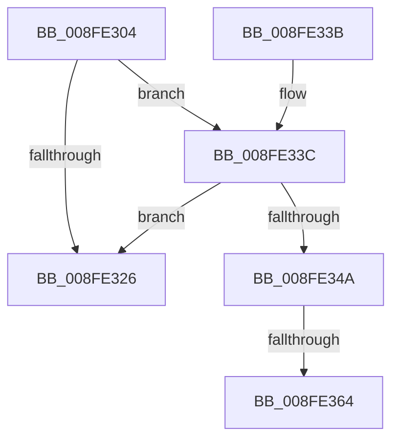

# PiDmaGuardProcessPreStart

- RVA: `0x008FE304`–`0x008FE383` (길이 `127` bytes)
- VA: `0x00000001408FE304`
- 실행 섹션: `PAGE`
- PDB 이름 있음: `예`; PDB Function 태그: `예`
- unwind 정보 RVA: `0x00088200`
- 디코드: `35`개 명령, `127/127` bytes 표시
- 미해석 바이트: `0` (있으면 어셈블리에 `.byte`로 보존)

> 이 문서는 커널 이미지의 기계어와 PDB 기호를 분석해 생성했습니다. 4번과 5번은 함수 원형과 자료형을 바이너리 사용 방식에서 추정한 C 해석이며 원본 소스 복구 결과는 아닙니다.

## 1. Dependencies

- 직접 호출 지점: **4**; 고유 호출 대상: **2**
- 직접 호출자로 확인된 함수: **1**
- RIP 상대 이미지 참조: **0**

### Outgoing calls
- `0x008FE33E` → [PiIommuUnblockDevice](../AA/PiIommuUnblockDevice_function_00AADEFC.md) (function, `0x00AADEFC`)
- `0x008FE356` → [IoAddTriageDumpDataBlock](../../text/42/IoAddTriageDumpDataBlock_function_00428374.md) (function, `0x00428374`)
- `0x008FE36C` → [IoAddTriageDumpDataBlock](../../text/42/IoAddTriageDumpDataBlock_function_00428374.md) (function, `0x00428374`)
- `0x008FE378` → [IoAddTriageDumpDataBlock](../../text/42/IoAddTriageDumpDataBlock_function_00428374.md) (function, `0x00428374`)

### Direct callers
- [PipProcessStartPhase1](PipProcessStartPhase1_function_008FE1F8.md) at `0x008FE243`

### Static image references
- 디코드된 RIP-relative 메모리 참조가 없습니다.

## 2. Other-region calls and transfers

- 다른 실행 섹션으로 향하는 call: **3**
  - `0x008FE356` → [IoAddTriageDumpDataBlock](../../text/42/IoAddTriageDumpDataBlock_function_00428374.md) (`PAGE` → `.text`)
  - `0x008FE36C` → [IoAddTriageDumpDataBlock](../../text/42/IoAddTriageDumpDataBlock_function_00428374.md) (`PAGE` → `.text`)
  - `0x008FE378` → [IoAddTriageDumpDataBlock](../../text/42/IoAddTriageDumpDataBlock_function_00428374.md) (`PAGE` → `.text`)
- call이 아닌 외부 분기/꼬리 이동: **2**
  - `0x008FE35E` → [sub_00B1FE52](../B1/Unknown_function_00B1FE52.md) (`tail-transfer`)
  - `0x008FE37E` → [sub_00B1FE52](../B1/Unknown_function_00B1FE52.md) (`tail-transfer`)

## 3. Assembly (complete function range)

```asm
008FE304  48 89 5C 24 08                  mov qword ptr [rsp + 8], rbx
008FE309  48 89 6C 24 10                  mov qword ptr [rsp + 0x10], rbp
008FE30E  48 89 74 24 18                  mov qword ptr [rsp + 0x18], rsi
008FE313  57                              push rdi
008FE314  48 83 EC 30                     sub rsp, 0x30
008FE318  33 ED                           xor ebp, ebp
008FE31A  48 8B D9                        mov rbx, rcx
008FE31D  48 39 A9 D0 02 00 00            cmp qword ptr [rcx + 0x2d0], rbp
008FE324  75 16                           jne 0x1408fe33c
008FE326  48 8B 5C 24 40                  mov rbx, qword ptr [rsp + 0x40]
008FE32B  48 8B 6C 24 48                  mov rbp, qword ptr [rsp + 0x48]
008FE330  48 8B 74 24 50                  mov rsi, qword ptr [rsp + 0x50]
008FE335  48 83 C4 30                     add rsp, 0x30
008FE339  5F                              pop rdi
008FE33A  C3                              ret
008FE33B  CC                              int3
008FE33C  33 D2                           xor edx, edx
008FE33E  E8 B9 FB 1A 00                  call 0x140aadefc
008FE343  48 63 F0                        movsxd rsi, eax
008FE346  85 C0                           test eax, eax
008FE348  79 DC                           jns 0x1408fe326
008FE34A  BA 88 03 00 00                  mov edx, 0x388
008FE34F  48 8D 7B 28                     lea rdi, [rbx + 0x28]
008FE353  48 8B CB                        mov rcx, rbx
008FE356  E8 19 A0 B2 FF                  call 0x140428374
008FE35B  66 39 2F                        cmp word ptr [rdi], bp
008FE35E  0F 84 EE 1A 22 00               je 0x140b1fe52
008FE364  BA 02 00 00 00                  mov edx, 2
008FE369  48 8B CF                        mov rcx, rdi
008FE36C  E8 03 A0 B2 FF                  call 0x140428374
008FE371  0F B7 17                        movzx edx, word ptr [rdi]
008FE374  48 8B 4F 08                     mov rcx, qword ptr [rdi + 8]
008FE378  E8 F7 9F B2 FF                  call 0x140428374
008FE37D  90                              nop
008FE37E  E9 CF 1A 22 00                  jmp 0x140b1fe52
```

## 4. C-style interpretation (structured pseudocode)

```c
__int64 __fastcall PiDmaGuardProcessPreStart(__int64 a1, int a2)
{
    __int64 result;
    __int64 v_rbp;
    __int64 v_rsp;
    unsigned __int64 v_stack_p10;
    unsigned __int64 v_stack_p18;
    unsigned __int64 v_stack_p8;

    v_stack_p8 = v_rbx;
    v_stack_p10 = v_rbp;
    v_stack_p18 = v_rsi;
    v_rsp = (v_rsp) - (48);
    v_rbp = 0;
    if ((*(unsigned __int64 *)(a1 + 720)) != 0) goto loc_008FE33C;
loc_008FE326:
    v_rsp = (v_rsp) + (48);
    return result;
loc_008FE33C:
    a2 = 0;
    result = PiIommuUnblockDevice(a1, a2, a3, a4);
    if (!sign_flag) goto loc_008FE326;
    result = IoAddTriageDumpDataBlock(v_stack_p8, 904, a3, a4);
    result = IoAddTriageDumpDataBlock(v_stack_p8 + 40, 2, a3, a4);
    result = IoAddTriageDumpDataBlock(*(unsigned __int64 *)(v_stack_p8 + 40 + 8), *(unsigned __int16 *)(v_stack_p8 + 40), a3, a4);
}
```

## 5. (Beta) C Style

```c
int64_t PiDmaGuardProcessPreStart(void *Arg1, int32_t Arg2)
{
    uint8_t *arg1 = (uint8_t *)Arg1;

    int64_t result;
    int64_t local_rbp;
    int64_t local_rsp;
    uint64_t v_stack_p10;
    uint64_t v_stack_p18;
    uint64_t v_stack_p8;

    v_stack_p8 = local_rbx;
    v_stack_p10 = local_rbp;
    v_stack_p18 = local_rsi;
    local_rsp = (local_rsp) - (48);
    local_rbp = 0;
    if ((*(uint64_t *)(arg1 + 0x2D0)) != 0) goto loc_008FE33C;
loc_008FE326:
    local_rsp = (local_rsp) + (48);
    return result;
loc_008FE33C:
    Arg2 = 0;
    result = PiIommuUnblockDevice(Arg1, Arg2, a3, a4);
    if (!sign_flag) goto loc_008FE326;
    result = IoAddTriageDumpDataBlock(v_stack_p8, 904, a3, a4);
    result = IoAddTriageDumpDataBlock(v_stack_p8 + 40, 2, a3, a4);
    result = IoAddTriageDumpDataBlock(*(uint64_t *)(v_stack_p8 + 0x28 + 0x8), *(uint16_t *)(v_stack_p8 + 0x28), a3, a4);
}
```

### 관측된 메모리 오프셋

구조체 형식이 확인되지 않은 접근은 인자 기준의 오프셋으로만 기록했습니다.

| 기준 인자 | 오프셋 표현 | 폭 (bit) | 접근 |
|---|---:|---:|---|
| `Arg1` | `+ 0x0` | `16` | `R` |
| `Arg1` | `+ 0x8` | `64` | `R` |
| `Arg1` | `+ 0x28` | `64` | `R` |
| `Arg1` | `+ 0x2D0` | `64` | `R` |

## 6. Execution-region graph

[열기: 2D/3D 그래프와 함수 탐색 컨트롤 패널](../../../control-panel.html?section=page&rva=0x008FE304&view=graph)

- 2D 그래프는 위에서 아래로 흐르고, 3D 그래프는 빈 공간을 드래그해 회전합니다. Shift+드래그는 이동, 휠은 확대·축소, 함수 노드 선택은 대상 보고서 이동입니다.

### Static fallback


