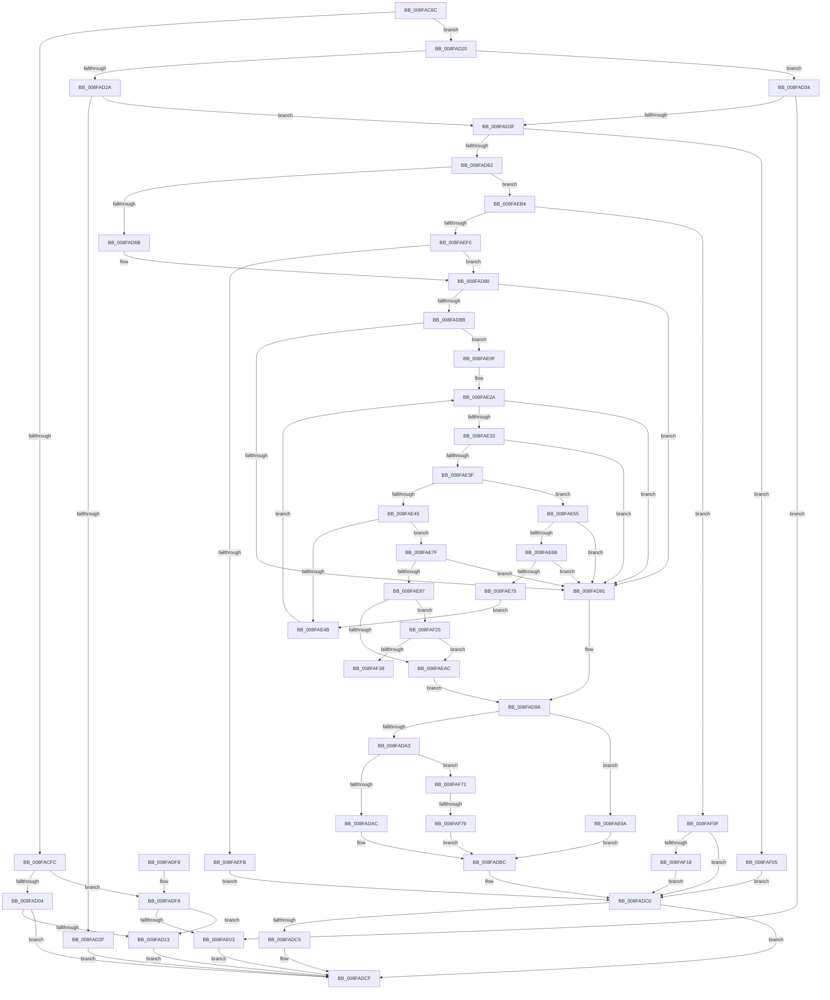

# PiGetDeviceRegProperty

- RVA: `0x008FAC6C`–`0x008FAF83` (길이 `791` bytes)
- VA: `0x00000001408FAC6C`
- 실행 섹션: `PAGE`
- PDB 이름 있음: `예`; PDB Function 태그: `예`
- unwind 정보 RVA: `0x00087D64`
- 디코드: `203`개 명령, `791/791` bytes 표시
- 미해석 바이트: `0` (있으면 어셈블리에 `.byte`로 보존)

> 이 문서는 커널 이미지의 기계어와 PDB 기호를 분석해 생성했습니다. 4번과 5번은 함수 원형과 자료형을 바이너리 사용 방식에서 추정한 C 해석이며 원본 소스 복구 결과는 아닙니다.

## 1. Dependencies

- 직접 호출 지점: **9**; 고유 호출 대상: **7**
- 직접 호출자로 확인된 함수: **2**
- RIP 상대 이미지 참조: **3**

### Outgoing calls
- `0x008FACF0` → [CmGetDeviceRegProp](../8E/CmGetDeviceRegProp_function_008ED870.md) (function, `0x008ED870`)
- `0x008FAD4E` → [ExAllocatePool2](../../poolcode/B8/ExAllocatePool2_function_00B820F0.md) (function, `0x00B820F0`)
- `0x008FAD78` → [memcpy](../../text/6C/memcpy_function_006C6840.md) (function, `0x006C6840`)
- `0x008FADB7` → [memcpy](../../text/6C/memcpy_function_006C6840.md) (function, `0x006C6840`)
- `0x008FADCA` → [ExFreePoolWithTag](../../poolcode/B8/ExFreePoolWithTag_function_00B82870.md) (function, `0x00B82870`)
- `0x008FADD8` → [_security_check_cookie](../../text/6A/_security_check_cookie_function_006AC640.md) (function, `0x006AC640`)
- `0x008FAE9C` → [wcsstr](../../text/50/wcsstr_function_00501F80.md) (function, `0x00501F80`)
- `0x008FAEE2` → [CmGetDeviceRegProp](../8E/CmGetDeviceRegProp_function_008ED870.md) (function, `0x008ED870`)
- `0x008FAF57` → [memset](../../text/6C/memset_function_006C6C40.md) (function, `0x006C6C40`)

### Direct callers
- [IoGetDeviceProperty](IoGetDeviceProperty_function_008FA720.md) at `0x008FA804`
- [sub_00B40828](../B4/Unknown_function_00B40828.md) at `0x00B40909`
- [sub_00B40828](../B4/Unknown_function_00B40828.md) at `0x00B4095C`
- [sub_00B40828](../B4/Unknown_function_00B40828.md) at `0x00B40AC7`
- [sub_00B40828](../B4/Unknown_function_00B40828.md) at `0x00B40B0D`

### Static image references
- `0x008FAC88` → RVA `0x00E0A740` (`.data`; read)
- `0x008FACE4` → RVA `0x00E66398` (`.data`; read)
- `0x008FAE8B` → RVA `0x00AFD5F0` (` ?? ::NNGAKEGL::`string'`; read)

## 2. Other-region calls and transfers

- 다른 실행 섹션으로 향하는 call: **7**
  - `0x008FAD4E` → [ExAllocatePool2](../../poolcode/B8/ExAllocatePool2_function_00B820F0.md) (`PAGE` → `POOLCODE`)
  - `0x008FAD78` → [memcpy](../../text/6C/memcpy_function_006C6840.md) (`PAGE` → `.text`)
  - `0x008FADB7` → [memcpy](../../text/6C/memcpy_function_006C6840.md) (`PAGE` → `.text`)
  - `0x008FADCA` → [ExFreePoolWithTag](../../poolcode/B8/ExFreePoolWithTag_function_00B82870.md) (`PAGE` → `POOLCODE`)
  - `0x008FADD8` → [_security_check_cookie](../../text/6A/_security_check_cookie_function_006AC640.md) (`PAGE` → `.text`)
  - `0x008FAE9C` → [wcsstr](../../text/50/wcsstr_function_00501F80.md) (`PAGE` → `.text`)
  - `0x008FAF57` → [memset](../../text/6C/memset_function_006C6C40.md) (`PAGE` → `.text`)
- call이 아닌 외부 분기/꼬리 이동: **2**
  - `0x008FAF6C` → [sub_00B1F532](../B1/Unknown_function_00B1F532.md) (`tail-transfer`)
  - `0x008FAF73` → [sub_00B1F532 + 0x46](../B1/Unknown_function_00B1F532.md) (`tail-transfer`)

## 3. Assembly (complete function range)

```asm
008FAC6C  48 89 5C 24 10                  mov qword ptr [rsp + 0x10], rbx
008FAC71  55                              push rbp
008FAC72  56                              push rsi
008FAC73  57                              push rdi
008FAC74  41 54                           push r12
008FAC76  41 55                           push r13
008FAC78  41 56                           push r14
008FAC7A  41 57                           push r15
008FAC7C  48 8D 6C 24 E0                  lea rbp, [rsp - 0x20]
008FAC81  48 81 EC 20 01 00 00            sub rsp, 0x120
008FAC88  48 8B 05 B1 FA 50 00            mov rax, qword ptr [rip + 0x50fab1]
008FAC8F  48 33 C4                        xor rax, rsp
008FAC92  48 89 45 10                     mov qword ptr [rbp + 0x10], rax
008FAC96  4C 8B A5 88 00 00 00            mov r12, qword ptr [rbp + 0x88]
008FAC9D  48 8B F1                        mov rsi, rcx
008FACA0  48 8B 8D 80 00 00 00            mov rcx, qword ptr [rbp + 0x80]
008FACA7  45 33 F6                        xor r14d, r14d
008FACAA  44 89 74 24 38                  mov dword ptr [rsp + 0x38], r14d
008FACAF  41 8B F8                        mov edi, r8d
008FACB2  48 89 4C 24 68                  mov qword ptr [rsp + 0x68], rcx
008FACB7  45 33 C0                        xor r8d, r8d
008FACBA  41 8B 04 24                     mov eax, dword ptr [r12]
008FACBE  48 8B D6                        mov rdx, rsi
008FACC1  89 44 24 54                     mov dword ptr [rsp + 0x54], eax
008FACC5  45 8B F9                        mov r15d, r9d
008FACC8  48 8D 44 24 54                  lea rax, [rsp + 0x54]
008FACCD  44 89 74 24 58                  mov dword ptr [rsp + 0x58], r14d
008FACD2  48 89 44 24 30                  mov qword ptr [rsp + 0x30], rax
008FACD7  45 8B EE                        mov r13d, r14d
008FACDA  48 89 4C 24 28                  mov qword ptr [rsp + 0x28], rcx
008FACDF  48 8D 44 24 58                  lea rax, [rsp + 0x58]
008FACE4  48 8B 0D AD B6 56 00            mov rcx, qword ptr [rip + 0x56b6ad]
008FACEB  48 89 44 24 20                  mov qword ptr [rsp + 0x20], rax
008FACF0  E8 7B 2B FF FF                  call 0x1408ed870
008FACF5  8B D8                           mov ebx, eax
008FACF7  83 FF 01                        cmp edi, 1
008FACFA  74 24                           je 0x1408fad20
008FACFC  85 C0                           test eax, eax
008FACFE  0F 89 F5 00 00 00               jns 0x1408fadf9
008FAD04  41 BE 23 00 00 C0               mov r14d, 0xc0000023
008FAD0A  41 3B C6                        cmp eax, r14d
008FAD0D  0F 85 BC 00 00 00               jne 0x1408fadcf
008FAD13  8B 44 24 54                     mov eax, dword ptr [rsp + 0x54]
008FAD17  41 89 04 24                     mov dword ptr [r12], eax
008FAD1B  E9 AF 00 00 00                  jmp 0x1408fadcf
008FAD20  41 BE 23 00 00 C0               mov r14d, 0xc0000023
008FAD26  85 DB                           test ebx, ebx
008FAD28  79 0A                           jns 0x1408fad34
008FAD2A  41 3B DE                        cmp ebx, r14d
008FAD2D  74 10                           je 0x1408fad3f
008FAD2F  E9 9B 00 00 00                  jmp 0x1408fadcf
008FAD34  83 7C 24 58 01                  cmp dword ptr [rsp + 0x58], 1
008FAD39  0F 85 C4 00 00 00               jne 0x1408fae03
008FAD3F  8B 54 24 54                     mov edx, dword ptr [rsp + 0x54]
008FAD43  B9 00 01 00 00                  mov ecx, 0x100
008FAD48  41 B8 50 70 69 6F               mov r8d, 0x6f697050
008FAD4E  E8 9D 73 28 00                  call 0x140b820f0
008FAD53  45 33 C9                        xor r9d, r9d
008FAD56  48 8B F8                        mov rdi, rax
008FAD59  48 85 C0                        test rax, rax
008FAD5C  0F 84 A3 01 00 00               je 0x1408faf05
008FAD62  41 3B DE                        cmp ebx, r14d
008FAD65  0F 84 49 01 00 00               je 0x1408faeb4
008FAD6B  44 8B 44 24 54                  mov r8d, dword ptr [rsp + 0x54]
008FAD70  48 8B C8                        mov rcx, rax
008FAD73  48 8B 54 24 68                  mov rdx, qword ptr [rsp + 0x68]
008FAD78  E8 C3 BA DC FF                  call 0x1406c6840
008FAD7D  45 33 C9                        xor r9d, r9d
008FAD80  44 8B 7C 24 54                  mov r15d, dword ptr [rsp + 0x54]
008FAD85  41 83 FF 02                     cmp r15d, 2
008FAD89  76 06                           jbe 0x1408fad91
008FAD8B  66 83 3F 40                     cmp word ptr [rdi], 0x40
008FAD8F  74 7E                           je 0x1408fae0f
008FAD91  48 8B F7                        mov rsi, rdi
008FAD94  41 8A CD                        mov cl, r13b
008FAD97  45 33 C0                        xor r8d, r8d
008FAD9A  41 8B 04 24                     mov eax, dword ptr [r12]
008FAD9E  41 3B C7                        cmp eax, r15d
008FADA1  72 67                           jb 0x1408fae0a
008FADA3  4D 85 ED                        test r13, r13
008FADA6  0F 85 C5 01 00 00               jne 0x1408faf71
008FADAC  48 8B 4C 24 68                  mov rcx, qword ptr [rsp + 0x68]
008FADB1  48 8B D6                        mov rdx, rsi
008FADB4  45 8B C7                        mov r8d, r15d
008FADB7  E8 84 BA DC FF                  call 0x1406c6840
008FADBC  45 89 3C 24                     mov dword ptr [r12], r15d
008FADC0  48 85 FF                        test rdi, rdi
008FADC3  74 0A                           je 0x1408fadcf
008FADC5  33 D2                           xor edx, edx
008FADC7  48 8B CF                        mov rcx, rdi
008FADCA  E8 A1 7A 28 00                  call 0x140b82870
008FADCF  8B C3                           mov eax, ebx
008FADD1  48 8B 4D 10                     mov rcx, qword ptr [rbp + 0x10]
008FADD5  48 33 CC                        xor rcx, rsp
008FADD8  E8 63 18 DB FF                  call 0x1406ac640
008FADDD  48 8B 9C 24 68 01 00 00         mov rbx, qword ptr [rsp + 0x168]
008FADE5  48 81 C4 20 01 00 00            add rsp, 0x120
008FADEC  41 5F                           pop r15
008FADEE  41 5E                           pop r14
008FADF0  41 5D                           pop r13
008FADF2  41 5C                           pop r12
008FADF4  5F                              pop rdi
008FADF5  5E                              pop rsi
008FADF6  5D                              pop rbp
008FADF7  C3                              ret
008FADF8  CC                              int3
008FADF9  39 7C 24 58                     cmp dword ptr [rsp + 0x58], edi
008FADFD  0F 84 10 FF FF FF               je 0x1408fad13
008FAE03  BB F0 00 00 C0                  mov ebx, 0xc00000f0
008FAE08  EB C5                           jmp 0x1408fadcf
008FAE0A  41 8B DE                        mov ebx, r14d
008FAE0D  EB AD                           jmp 0x1408fadbc
008FAE0F  49 8B C7                        mov rax, r15
008FAE12  48 8D 77 02                     lea rsi, [rdi + 2]
008FAE16  48 D1 E8                        shr rax, 1
008FAE19  48 8D 4E 02                     lea rcx, [rsi + 2]
008FAE1D  41 8B D1                        mov edx, r9d
008FAE20  41 BA 2C 00 00 00               mov r10d, 0x2c
008FAE26  4C 8D 04 47                     lea r8, [rdi + rax*2]
008FAE2A  49 3B C8                        cmp rcx, r8
008FAE2D  0F 83 5E FF FF FF               jae 0x1408fad91
008FAE33  0F B7 06                        movzx eax, word ptr [rsi]
008FAE36  66 85 C0                        test ax, ax
008FAE39  0F 84 52 FF FF FF               je 0x1408fad91
008FAE3F  66 41 3B C2                     cmp ax, r10w
008FAE43  74 10                           je 0x1408fae55
008FAE45  66 83 F8 3B                     cmp ax, 0x3b
008FAE49  74 34                           je 0x1408fae7f
008FAE4B  48 83 C6 02                     add rsi, 2
008FAE4F  48 83 C1 02                     add rcx, 2
008FAE53  EB D5                           jmp 0x1408fae2a
008FAE55  0F B7 11                        movzx edx, word ptr [rcx]
008FAE58  41 B9 F5 FF 00 00               mov r9d, 0xfff5
008FAE5E  8D 42 DD                        lea eax, [rdx - 0x23]
008FAE61  66 41 85 C1                     test r9w, ax
008FAE65  0F 85 26 FF FF FF               jne 0x1408fad91
008FAE6B  66 83 FA 2B                     cmp dx, 0x2b
008FAE6F  0F 84 1C FF FF FF               je 0x1408fad91
008FAE75  BA 01 00 00 00                  mov edx, 1
008FAE7A  45 33 C9                        xor r9d, r9d
008FAE7D  EB CC                           jmp 0x1408fae4b
008FAE7F  85 D2                           test edx, edx
008FAE81  0F 84 0A FF FF FF               je 0x1408fad91
008FAE87  48 83 C6 02                     add rsi, 2
008FAE8B  48 8D 15 5E 27 20 00            lea rdx, [rip + 0x20275e]
008FAE92  8B C7                           mov eax, edi
008FAE94  48 8B CE                        mov rcx, rsi
008FAE97  2B C6                           sub eax, esi
008FAE99  44 03 F8                        add r15d, eax
008FAE9C  E8 DF 70 C0 FF                  call 0x140501f80
008FAEA1  45 33 C0                        xor r8d, r8d
008FAEA4  4C 8B E8                        mov r13, rax
008FAEA7  48 85 C0                        test rax, rax
008FAEAA  75 79                           jne 0x1408faf25
008FAEAC  41 8A C8                        mov cl, r8b
008FAEAF  E9 E6 FE FF FF                  jmp 0x1408fad9a
008FAEB4  48 8B 0D DD B4 56 00            mov rcx, qword ptr [rip + 0x56b4dd]
008FAEBB  48 8D 44 24 54                  lea rax, [rsp + 0x54]
008FAEC0  44 89 4C 24 38                  mov dword ptr [rsp + 0x38], r9d
008FAEC5  45 33 C0                        xor r8d, r8d
008FAEC8  48 89 44 24 30                  mov qword ptr [rsp + 0x30], rax
008FAECD  45 8B CF                        mov r9d, r15d
008FAED0  48 8D 44 24 58                  lea rax, [rsp + 0x58]
008FAED5  48 89 7C 24 28                  mov qword ptr [rsp + 0x28], rdi
008FAEDA  48 8B D6                        mov rdx, rsi
008FAEDD  48 89 44 24 20                  mov qword ptr [rsp + 0x20], rax
008FAEE2  E8 89 29 FF FF                  call 0x1408ed870
008FAEE7  45 33 C9                        xor r9d, r9d
008FAEEA  8B D8                           mov ebx, eax
008FAEEC  85 C0                           test eax, eax
008FAEEE  78 1F                           js 0x1408faf0f
008FAEF0  83 7C 24 58 01                  cmp dword ptr [rsp + 0x58], 1
008FAEF5  0F 84 85 FE FF FF               je 0x1408fad80
008FAEFB  BB F0 00 00 C0                  mov ebx, 0xc00000f0
008FAF00  E9 BB FE FF FF                  jmp 0x1408fadc0
008FAF05  BB 9A 00 00 C0                  mov ebx, 0xc000009a
008FAF0A  E9 B1 FE FF FF                  jmp 0x1408fadc0
008FAF0F  41 3B C6                        cmp eax, r14d
008FAF12  0F 85 A8 FE FF FF               jne 0x1408fadc0
008FAF18  8B 44 24 54                     mov eax, dword ptr [rsp + 0x54]
008FAF1C  41 89 04 24                     mov dword ptr [r12], eax
008FAF20  E9 9B FE FF FF                  jmp 0x1408fadc0
008FAF25  41 8B CF                        mov ecx, r15d
008FAF28  D1 E9                           shr ecx, 1
008FAF2A  83 E9 02                        sub ecx, 2
008FAF2D  66 83 3C 4E 29                  cmp word ptr [rsi + rcx*2], 0x29
008FAF32  0F 85 74 FF FF FF               jne 0x1408faeac
008FAF38  66 44 89 00                     mov word ptr [rax], r8w
008FAF3C  49 83 C5 04                     add r13, 4
008FAF40  66 44 89 04 4E                  mov word ptr [rsi + rcx*2], r8w
008FAF45  33 D2                           xor edx, edx
008FAF47  41 B8 98 00 00 00               mov r8d, 0x98
008FAF4D  4C 89 6C 24 60                  mov qword ptr [rsp + 0x60], r13
008FAF52  48 8D 4C 24 78                  lea rcx, [rsp + 0x78]
008FAF57  E8 E4 BC DC FF                  call 0x1406c6c40
008FAF5C  48 8B 4C 24 60                  mov rcx, qword ptr [rsp + 0x60]
008FAF61  4C 89 6C 24 70                  mov qword ptr [rsp + 0x70], r13
008FAF66  41 BD 01 00 00 00               mov r13d, 1
008FAF6C  E9 C1 45 22 00                  jmp 0x140b1f532
008FAF71  84 C9                           test cl, cl
008FAF73  0F 84 FF 45 22 00               je 0x140b1f578
008FAF79  BB CD 00 00 C0                  mov ebx, 0xc00000cd
008FAF7E  E9 39 FE FF FF                  jmp 0x1408fadbc
```

## 4. C-style interpretation (structured pseudocode)

```c
__int64 __fastcall PiGetDeviceRegProperty(__int64 a1, __int64 a2, int a3, int a4, __int64 a5, __int64 a6)
{
    __int64 result;
    __int64 v_r13;
    __int64 v_r14;
    __int64 v_r15;
    __int64 v_rsi;
    __int64 v_rsp;
    unsigned int v_stack_m100;
    unsigned int v_stack_m104;
    unsigned int v_stack_m120;
    unsigned __int64 v_stack_m128;
    unsigned __int64 v_stack_m130;
    unsigned __int64 v_stack_m138;
    unsigned __int64 v_stack_m48;
    unsigned __int64 v_stack_m58;
    unsigned __int64 v_stack_mF0;
    unsigned __int64 v_stack_p10;
    unsigned __int64 v_stack_p20;
    unsigned __int64 v_stack_p28;
    unsigned __int64 v_stack_p30;
    unsigned int v_stack_p38;
    unsigned __int64 v_stack_p54;
    unsigned int v_stack_p58;
    unsigned __int64 v_stack_p60;
    unsigned __int64 v_stack_p70;
    unsigned __int64 v_stack_p78;

    v_stack_p10 = v_rbx;
    v_rsp = (v_rsp) - (288);
    result = (*(unsigned __int64 *)(v_rip + 5307057)) ^ (v_rsp);
    v_stack_m48 = result;
    v_r14 = 0;
    v_stack_m120 = 0;
    v_stack_mF0 = a5;
    a3 = 0;
    v_stack_m104 = (unsigned int)((unsigned int)(*(unsigned int *)(a6)));
    v_stack_m100 = 0;
    v_stack_m128 = v_stack_m104;
    v_stack_m130 = a5;
    v_stack_m138 = v_stack_m100;
    result = CmGetDeviceRegProp(*(unsigned __int64 *)(v_rip + 5682861), a1, a3, a4);
    if (((unsigned int)((unsigned int)(a3))) == 1) goto loc_008FAD20;
    if (!sign_flag) goto loc_008FADF9;
    if (((unsigned int)(result)) != ((unsigned int)((unsigned int)(0xC0000023ULL)))) goto loc_008FADCF;
loc_008FAD13:
    *(unsigned int *)(a6) = (unsigned int)((unsigned int)(v_stack_m104));
    goto loc_008FADCF;
loc_008FAD20:
    if (!sign_flag) goto loc_008FAD34;
    if (((unsigned int)((unsigned int)((unsigned int)(result)))) == ((unsigned int)((unsigned int)(0xC0000023ULL)))) goto loc_008FAD3F;
    goto loc_008FADCF;
loc_008FAD34:
    if (v_stack_m100 != 1) goto loc_008FAE03;
loc_008FAD3F:
    result = ExAllocatePool2(256, (unsigned int)(v_stack_m104), (unsigned int)(0x6F697050ULL), a4);
    a4 = 0;
    if (result == 0) goto loc_008FAF05;
    if (((unsigned int)((unsigned int)((unsigned int)(result)))) == ((unsigned int)((unsigned int)(0xC0000023ULL)))) goto loc_008FAEB4;
    result = memcpy(result, v_stack_mF0, (unsigned int)(v_stack_m104), a4);
    a4 = 0;
loc_008FAD80:
    if (((unsigned int)((unsigned int)(v_stack_m104))) <= 2) goto loc_008FAD91;
    if ((*(unsigned __int16 *)(result)) == 64) goto loc_008FAE0F;
loc_008FAD91:
    a3 = 0;
loc_008FAD9A:
    if (((unsigned int)((unsigned int)(*(unsigned int *)(a6)))) < ((unsigned int)((unsigned int)(v_stack_m104)))) goto loc_008FAE0A;
    if (0 != 0) goto loc_008FAF71;
    result = memcpy(v_stack_mF0, result, (unsigned int)((unsigned int)((unsigned int)(v_stack_m104))), a4);
loc_008FADBC:
    *(unsigned int *)(a6) = (unsigned int)((unsigned int)(v_stack_m104));
loc_008FADC0:
    if (result != 0) {
        a2 = 0;
        a1 = result;
        result = ExFreePoolWithTag(a1, a2, (unsigned int)((unsigned int)((unsigned int)(v_stack_m104))), a4);
    }
    a1 = (v_stack_m48) ^ (v_rsp);
    result = _security_check_cookie(a1, a2, (unsigned int)((unsigned int)((unsigned int)(v_stack_m104))), a4);
    v_rsp = (v_rsp) + (288);
    return result;
loc_008FADF9:
    if (v_stack_p58 == ((unsigned int)(result))) goto loc_008FAD13;
loc_008FAE03:
    goto loc_008FADCF;
loc_008FAE0A:
    goto loc_008FADBC;
loc_008FAE0F:
    result = ((unsigned int)(v_stack_m104)) >> (1);
loc_008FAE2A:
    if ((result + 2 + 2) >= (result + result * 2)) goto loc_008FAD91;
    if ((unsigned __int16)(*(unsigned __int16 *)(result + 2)) == 0) goto loc_008FAD91;
    if (((unsigned __int16)(*(unsigned __int16 *)(result + 2))) == 44) goto loc_008FAE55;
    if (((unsigned __int16)(*(unsigned __int16 *)(result + 2))) == 59) goto loc_008FAE7F;
loc_008FAE4B:
    v_rsi = (result + 2) + (2);
    a1 = (result + 2 + 2) + (2);
    goto loc_008FAE2A;
loc_008FAE55:
    if ((((unsigned __int16)((unsigned int)(0xFFF5ULL))) & ((unsigned __int16)(*(unsigned __int16 *)(a1) - 35))) != 0) goto loc_008FAD91;
    if (((unsigned __int16)(*(unsigned __int16 *)(a1))) == 43) goto loc_008FAD91;
    a4 = 0;
    goto loc_008FAE4B;
loc_008FAE7F:
    if (1 == 0) goto loc_008FAD91;
    v_rsi = (v_rsi) + (2);
    result = (unsigned int)(((unsigned int)((unsigned int)(result))) - ((unsigned int)(v_rsi)));
    v_r15 = (unsigned int)(((unsigned int)(v_stack_m104)) + ((unsigned int)(result)));
    result = wcsstr(v_rsi, v_rip + 2107230, result + result * 2, a4);
    a3 = 0;
    if (result != 0) goto loc_008FAF25;
loc_008FAEAC:
    goto loc_008FAD9A;
loc_008FAEB4:
    v_stack_p38 = 0;
    a3 = 0;
    v_stack_p30 = v_stack_p54;
    v_stack_p28 = result;
    v_stack_p20 = v_stack_p58;
    result = CmGetDeviceRegProp(*(unsigned __int64 *)(v_rip + 5682397), v_rsi, a3, (unsigned int)((unsigned int)(v_r15)));
    a4 = 0;
    if (sign_flag) goto loc_008FAF0F;
    if (v_stack_p58 == 1) goto loc_008FAD80;
    goto loc_008FADC0;
loc_008FAF05:
    goto loc_008FADC0;
loc_008FAF0F:
    if (((unsigned int)(result)) != ((unsigned int)((unsigned int)(0xC0000023ULL)))) goto loc_008FADC0;
    *(unsigned int *)(a6) = (unsigned int)((unsigned int)(v_stack_p54));
    goto loc_008FADC0;
loc_008FAF25:
    a1 = (unsigned int)(((unsigned int)((unsigned int)(v_r15))) >> (1));
    a1 = (unsigned int)((a1) - (2));
    if ((*(unsigned __int16 *)(v_rsi + a1 * 2)) != 41) goto loc_008FAEAC;
    *(unsigned __int16 *)((unsigned int)(v_stack_p54)) = 0;
    v_r13 = (result) + (4);
    *(unsigned __int16 *)(v_rsi + a1 * 2) = 0;
    a2 = 0;
    v_stack_p60 = v_r13;
    result = memset(v_stack_p78, a2, 152, a4);
    v_stack_p70 = v_r13;
loc_008FAF71:
    goto loc_008FADBC;
}
```

## 5. (Beta) C Style

```c
int64_t PiGetDeviceRegProperty(int64_t Arg1, int64_t Arg2, int32_t Arg3, int32_t Arg4, int64_t Arg5, void *Arg6)
{
    uint8_t *arg6 = (uint8_t *)Arg6;

    int64_t result;
    int64_t local_r13;
    int64_t local_r14;
    int64_t local_r15;
    int64_t local_rsi;
    int64_t local_rsp;
    uint32_t v_stack_m100;
    uint32_t v_stack_m104;
    uint32_t v_stack_m120;
    uint64_t v_stack_m128;
    uint64_t v_stack_m130;
    uint64_t v_stack_m138;
    uint64_t v_stack_m48;
    uint64_t v_stack_m58;
    uint64_t v_stack_mF0;
    uint64_t v_stack_p10;
    uint64_t v_stack_p20;
    uint64_t v_stack_p28;
    uint64_t v_stack_p30;
    uint32_t v_stack_p38;
    uint64_t v_stack_p54;
    uint32_t v_stack_p58;
    uint64_t v_stack_p60;
    uint64_t v_stack_p70;
    uint64_t v_stack_p78;

    v_stack_p10 = local_rbx;
    local_rsp = (local_rsp) - (288);
    result = (*(uint64_t *)(v_rip + 0x50FAB1)) ^ (local_rsp);
    v_stack_m48 = result;
    local_r14 = 0;
    v_stack_m120 = 0;
    v_stack_mF0 = Arg5;
    Arg3 = 0;
    v_stack_m104 = (uint32_t)((uint32_t)(*(uint32_t *)(arg6)));
    v_stack_m100 = 0;
    v_stack_m128 = v_stack_m104;
    v_stack_m130 = Arg5;
    v_stack_m138 = v_stack_m100;
    result = CmGetDeviceRegProp(*(uint64_t *)(v_rip + 0x56B6AD), Arg1, Arg3, Arg4);
    if (((uint32_t)((uint32_t)(Arg3))) == 1) goto loc_008FAD20;
    if (!sign_flag) goto loc_008FADF9;
    if (((uint32_t)(result)) != ((uint32_t)((uint32_t)(0xC0000023ULL)))) goto loc_008FADCF;
loc_008FAD13:
    *(uint32_t *)(arg6) = (uint32_t)((uint32_t)(v_stack_m104));
    goto loc_008FADCF;
loc_008FAD20:
    if (!sign_flag) goto loc_008FAD34;
    if (((uint32_t)((uint32_t)((uint32_t)(result)))) == ((uint32_t)((uint32_t)(0xC0000023ULL)))) goto loc_008FAD3F;
    goto loc_008FADCF;
loc_008FAD34:
    if (v_stack_m100 != 1) goto loc_008FAE03;
loc_008FAD3F:
    result = ExAllocatePool2(256, (uint32_t)(v_stack_m104), (uint32_t)(0x6F697050ULL), Arg4);
    Arg4 = 0;
    if (result == 0) goto loc_008FAF05;
    if (((uint32_t)((uint32_t)((uint32_t)(result)))) == ((uint32_t)((uint32_t)(0xC0000023ULL)))) goto loc_008FAEB4;
    result = memcpy(result, v_stack_mF0, (uint32_t)(v_stack_m104), Arg4);
    Arg4 = 0;
loc_008FAD80:
    if (((uint32_t)((uint32_t)(v_stack_m104))) <= 2) goto loc_008FAD91;
    if ((*(uint16_t *)(result)) == 64) goto loc_008FAE0F;
loc_008FAD91:
    Arg3 = 0;
loc_008FAD9A:
    if (((uint32_t)((uint32_t)(*(uint32_t *)(arg6)))) < ((uint32_t)((uint32_t)(v_stack_m104)))) goto loc_008FAE0A;
    if (0 != 0) goto loc_008FAF71;
    result = memcpy(v_stack_mF0, result, (uint32_t)((uint32_t)((uint32_t)(v_stack_m104))), Arg4);
loc_008FADBC:
    *(uint32_t *)(arg6) = (uint32_t)((uint32_t)(v_stack_m104));
loc_008FADC0:
    if (result != 0) {
        Arg2 = 0;
        Arg1 = result;
        result = ExFreePoolWithTag(Arg1, Arg2, (uint32_t)((uint32_t)((uint32_t)(v_stack_m104))), Arg4);
    }
    Arg1 = (v_stack_m48) ^ (local_rsp);
    result = _security_check_cookie(Arg1, Arg2, (uint32_t)((uint32_t)((uint32_t)(v_stack_m104))), Arg4);
    local_rsp = (local_rsp) + (288);
    return result;
loc_008FADF9:
    if (v_stack_p58 == ((uint32_t)(result))) goto loc_008FAD13;
loc_008FAE03:
    goto loc_008FADCF;
loc_008FAE0A:
    goto loc_008FADBC;
loc_008FAE0F:
    result = ((uint32_t)(v_stack_m104)) >> (1);
loc_008FAE2A:
    if ((result + 2 + 2) >= (result + result * 2)) goto loc_008FAD91;
    if ((uint16_t)(*(uint16_t *)(result + 0x2)) == 0) goto loc_008FAD91;
    if (((uint16_t)(*(uint16_t *)(result + 0x2))) == 44) goto loc_008FAE55;
    if (((uint16_t)(*(uint16_t *)(result + 0x2))) == 59) goto loc_008FAE7F;
loc_008FAE4B:
    local_rsi = (result + 2) + (2);
    Arg1 = (result + 2 + 2) + (2);
    goto loc_008FAE2A;
loc_008FAE55:
    if ((((uint16_t)((uint32_t)(0xFFF5ULL))) & ((uint16_t)(*(uint16_t *)(Arg1) - 35))) != 0) goto loc_008FAD91;
    if (((uint16_t)(*(uint16_t *)(Arg1))) == 43) goto loc_008FAD91;
    Arg4 = 0;
    goto loc_008FAE4B;
loc_008FAE7F:
    if (1 == 0) goto loc_008FAD91;
    local_rsi = (local_rsi) + (2);
    result = (uint32_t)(((uint32_t)((uint32_t)(result))) - ((uint32_t)(local_rsi)));
    local_r15 = (uint32_t)(((uint32_t)(v_stack_m104)) + ((uint32_t)(result)));
    result = wcsstr(local_rsi, v_rip + 2107230, result + result * 2, Arg4);
    Arg3 = 0;
    if (result != 0) goto loc_008FAF25;
loc_008FAEAC:
    goto loc_008FAD9A;
loc_008FAEB4:
    v_stack_p38 = 0;
    Arg3 = 0;
    v_stack_p30 = v_stack_p54;
    v_stack_p28 = result;
    v_stack_p20 = v_stack_p58;
    result = CmGetDeviceRegProp(*(uint64_t *)(v_rip + 0x56B4DD), local_rsi, Arg3, (uint32_t)((uint32_t)(local_r15)));
    Arg4 = 0;
    if (sign_flag) goto loc_008FAF0F;
    if (v_stack_p58 == 1) goto loc_008FAD80;
    goto loc_008FADC0;
loc_008FAF05:
    goto loc_008FADC0;
loc_008FAF0F:
    if (((uint32_t)(result)) != ((uint32_t)((uint32_t)(0xC0000023ULL)))) goto loc_008FADC0;
    *(uint32_t *)(arg6) = (uint32_t)((uint32_t)(v_stack_p54));
    goto loc_008FADC0;
loc_008FAF25:
    Arg1 = (uint32_t)(((uint32_t)((uint32_t)(local_r15))) >> (1));
    Arg1 = (uint32_t)((Arg1) - (2));
    if ((*(uint16_t *)(local_rsi + Arg1 * 2)) != 41) goto loc_008FAEAC;
    *(uint16_t *)((uint32_t)(v_stack_p54)) = 0;
    local_r13 = (result) + (4);
    *(uint16_t *)(local_rsi + Arg1 * 2) = 0;
    Arg2 = 0;
    v_stack_p60 = local_r13;
    result = memset(v_stack_p78, Arg2, 152, Arg4);
    v_stack_p70 = local_r13;
loc_008FAF71:
    goto loc_008FADBC;
}
```

### 관측된 메모리 오프셋

구조체 형식이 확인되지 않은 접근은 인자 기준의 오프셋으로만 기록했습니다.

| 기준 인자 | 오프셋 표현 | 폭 (bit) | 접근 |
|---|---:|---:|---|
| `Arg6` | `+ 0x0` | `32` | `R` |
| `Arg6` | `+ 0x0` | `32` | `W` |

## 6. Execution-region graph

[열기: 2D/3D 그래프와 함수 탐색 컨트롤 패널](../../../control-panel.html?section=page&rva=0x008FAC6C&view=graph)

- 2D 그래프는 위에서 아래로 흐르고, 3D 그래프는 빈 공간을 드래그해 회전합니다. Shift+드래그는 이동, 휠은 확대·축소, 함수 노드 선택은 대상 보고서 이동입니다.

### Static fallback


