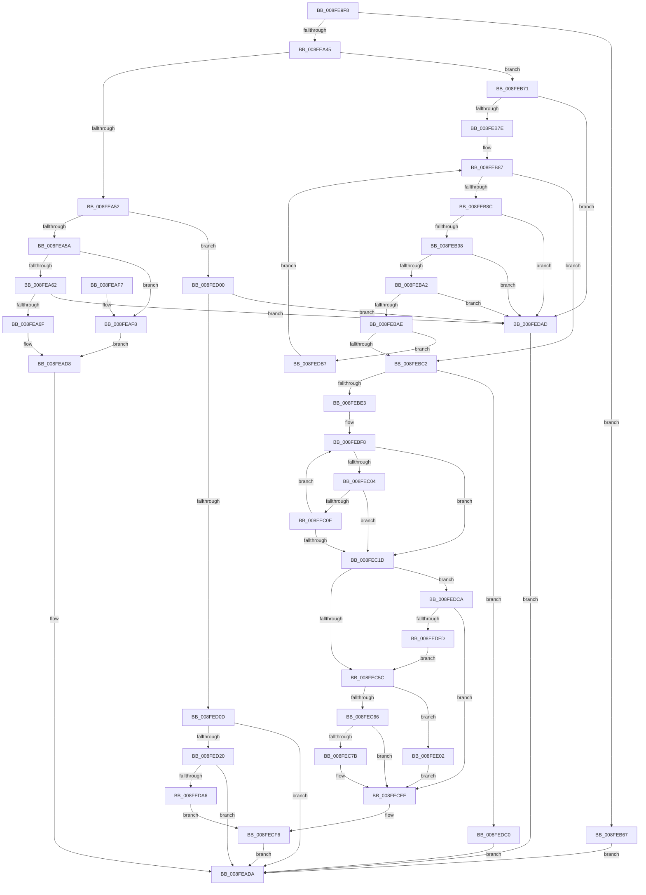

# PiPnpRtlGetFilteredDeviceList

- RVA: `0x008FE9F8`–`0x008FEE0C` (길이 `1,044` bytes)
- VA: `0x00000001408FE9F8`
- 실행 섹션: `PAGE`
- PDB 이름 있음: `예`; PDB Function 태그: `아니요`
- unwind 정보 RVA: `0x000882AC`
- 디코드: `264`개 명령, `1,044/1,044` bytes 표시
- 미해석 바이트: `0` (있으면 어셈블리에 `.byte`로 보존)

> 이 문서는 커널 이미지의 기계어와 PDB 기호를 분석해 생성했습니다. 4번과 5번은 함수 원형과 자료형을 바이너리 사용 방식에서 추정한 C 해석이며 원본 소스 복구 결과는 아닙니다.

## 1. Dependencies

- 직접 호출 지점: **10**; 고유 호출 대상: **7**
- 직접 호출자로 확인된 함수: **1**
- RIP 상대 이미지 참조: **3**

### Outgoing calls
- `0x008FEAD3` → [PiDmGetObjectConstraintList](../8D/PiDmGetObjectConstraintList_function_008DF2F4.md) (function, `0x008DF2F4`)
- `0x008FEB5D` → [PiDmGetObjectList](PiDmGetObjectList_function_008FF0A0.md) (function, `0x008FF0A0`)
- `0x008FEBB4` → [wcschr](../../text/50/wcschr_function_00501A60.md) (function, `0x00501A60`)
- `0x008FEBD2` → [ExAllocatePool2](../../poolcode/B8/ExAllocatePool2_function_00B820F0.md) (function, `0x00B820F0`)
- `0x008FEC70` → [RtlInitUnicodeStringEx](../../text/46/RtlInitUnicodeStringEx_function_00463960.md) (function, `0x00463960`)
- `0x008FECE7` → [PiDmGetObjectList](PiDmGetObjectList_function_008FF0A0.md) (function, `0x008FF0A0`)
- `0x008FECF6` → [ExFreePoolWithTag](../../poolcode/B8/ExFreePoolWithTag_function_00B82870.md) (function, `0x00B82870`)
- `0x008FED11` → [RtlInitUnicodeStringEx](../../text/46/RtlInitUnicodeStringEx_function_00463960.md) (function, `0x00463960`)
- `0x008FED92` → [PiDmGetObjectList](PiDmGetObjectList_function_008FF0A0.md) (function, `0x008FF0A0`)
- `0x008FEDE7` → [RtlStringExHandleOtherFlagsW](../../text/41/RtlStringExHandleOtherFlagsW_function_0041E3F0.md) (function, `0x0041E3F0`)

### Direct callers
- [PiPnpRtlCmActionCallback](../8E/PiPnpRtlCmActionCallback_function_008EF110.md) at `0x008EF37A`

### Static image references
- `0x008FEA83` → RVA `0x008E52F0` (`PiPnpRtlEnumeratorFilterCallback`; read)
- `0x008FEB26` → RVA `0x008E3E80` (`PiDmCmObjectMatchCallback`; read)
- `0x008FED2B` → RVA `0x00A0DB80` (`PiPnpRtlServiceFilterCallback`; read)

## 2. Other-region calls and transfers

- 다른 실행 섹션으로 향하는 call: **6**
  - `0x008FEBB4` → [wcschr](../../text/50/wcschr_function_00501A60.md) (`PAGE` → `.text`)
  - `0x008FEBD2` → [ExAllocatePool2](../../poolcode/B8/ExAllocatePool2_function_00B820F0.md) (`PAGE` → `POOLCODE`)
  - `0x008FEC70` → [RtlInitUnicodeStringEx](../../text/46/RtlInitUnicodeStringEx_function_00463960.md) (`PAGE` → `.text`)
  - `0x008FECF6` → [ExFreePoolWithTag](../../poolcode/B8/ExFreePoolWithTag_function_00B82870.md) (`PAGE` → `POOLCODE`)
  - `0x008FED11` → [RtlInitUnicodeStringEx](../../text/46/RtlInitUnicodeStringEx_function_00463960.md) (`PAGE` → `.text`)
  - `0x008FEDE7` → [RtlStringExHandleOtherFlagsW](../../text/41/RtlStringExHandleOtherFlagsW_function_0041E3F0.md) (`PAGE` → `.text`)
- 별도 외부 분기/꼬리 이동을 확인하지 못했습니다.

## 3. Assembly (complete function range)

```asm
008FE9F8  48 89 5C 24 18                  mov qword ptr [rsp + 0x18], rbx
008FE9FD  55                              push rbp
008FE9FE  56                              push rsi
008FE9FF  57                              push rdi
008FEA00  41 54                           push r12
008FEA02  41 55                           push r13
008FEA04  41 56                           push r14
008FEA06  41 57                           push r15
008FEA08  48 8D 6C 24 D9                  lea rbp, [rsp - 0x27]
008FEA0D  48 81 EC C0 00 00 00            sub rsp, 0xc0
008FEA14  8B 41 18                        mov eax, dword ptr [rcx + 0x18]
008FEA17  45 33 FF                        xor r15d, r15d
008FEA1A  44 89 7D F8                     mov dword ptr [rbp - 8], r15d
008FEA1E  0F 57 C0                        xorps xmm0, xmm0
008FEA21  66 44 89 7D FC                  mov word ptr [rbp - 4], r15w
008FEA26  48 8B F9                        mov rdi, rcx
008FEA29  44 88 7D FE                     mov byte ptr [rbp - 2], r15b
008FEA2D  44 89 7D 0B                     mov dword ptr [rbp + 0xb], r15d
008FEA31  0F 11 45 CF                     movups xmmword ptr [rbp - 0x31], xmm0
008FEA35  0F 11 45 DF                     movups xmmword ptr [rbp - 0x21], xmm0
008FEA39  0F 11 45 A7                     movups xmmword ptr [rbp - 0x59], xmm0
008FEA3D  A8 7C                           test al, 0x7c
008FEA3F  0F 85 22 01 00 00               jne 0x1408feb67
008FEA45  45 8D 67 01                     lea r12d, [r15 + 1]
008FEA49  41 84 C4                        test r12b, al
008FEA4C  0F 85 1F 01 00 00               jne 0x1408feb71
008FEA52  A8 02                           test al, 2
008FEA54  0F 85 A6 02 00 00               jne 0x1408fed00
008FEA5A  84 C0                           test al, al
008FEA5C  0F 89 96 00 00 00               jns 0x1408feaf8
008FEA62  48 8B 51 10                     mov rdx, qword ptr [rcx + 0x10]
008FEA66  48 85 D2                        test rdx, rdx
008FEA69  0F 84 3E 03 00 00               je 0x1408fedad
008FEA6F  4C 8B 47 30                     mov r8, qword ptr [rdi + 0x30]
008FEA73  4C 8D 4D CF                     lea r9, [rbp - 0x31]
008FEA77  0F BA E0 08                     bt eax, 8
008FEA7B  4C 89 4D BF                     mov qword ptr [rbp - 0x41], r9
008FEA7F  0F B6 45 D7                     movzx eax, byte ptr [rbp - 0x29]
008FEA83  4C 8D 15 66 68 FE FF            lea r10, [rip - 0x1979a]
008FEA8A  41 0F 42 C4                     cmovb eax, r12d
008FEA8E  44 89 7D D8                     mov dword ptr [rbp - 0x28], r15d
008FEA92  88 45 D7                        mov byte ptr [rbp - 0x29], al
008FEA95  4C 8D 4D B7                     lea r9, [rbp - 0x49]
008FEA99  48 8B 41 20                     mov rax, qword ptr [rcx + 0x20]
008FEA9D  48 89 45 DF                     mov qword ptr [rbp - 0x21], rax
008FEAA1  48 8B 41 28                     mov rax, qword ptr [rcx + 0x28]
008FEAA5  48 89 45 E7                     mov qword ptr [rbp - 0x19], rax
008FEAA9  48 8B 41 40                     mov rax, qword ptr [rcx + 0x40]
008FEAAD  8B 49 38                        mov ecx, dword ptr [rcx + 0x38]
008FEAB0  48 89 44 24 30                  mov qword ptr [rsp + 0x30], rax
008FEAB5  89 4C 24 28                     mov dword ptr [rsp + 0x28], ecx
008FEAB9  41 8D 4F 04                     lea ecx, [r15 + 4]
008FEABD  66 44 89 7D DC                  mov word ptr [rbp - 0x24], r15w
008FEAC2  44 88 7D DE                     mov byte ptr [rbp - 0x22], r15b
008FEAC6  4C 89 65 C7                     mov qword ptr [rbp - 0x39], r12
008FEACA  4C 89 55 B7                     mov qword ptr [rbp - 0x49], r10
008FEACE  4C 89 44 24 20                  mov qword ptr [rsp + 0x20], r8
008FEAD3  E8 1C 08 FE FF                  call 0x1408df2f4
008FEAD8  8B D8                           mov ebx, eax
008FEADA  8B C3                           mov eax, ebx
008FEADC  48 8B 9C 24 10 01 00 00         mov rbx, qword ptr [rsp + 0x110]
008FEAE4  48 81 C4 C0 00 00 00            add rsp, 0xc0
008FEAEB  41 5F                           pop r15
008FEAED  41 5E                           pop r14
008FEAEF  41 5D                           pop r13
008FEAF1  41 5C                           pop r12
008FEAF3  5F                              pop rdi
008FEAF4  5E                              pop rsi
008FEAF5  5D                              pop rbp
008FEAF6  C3                              ret
008FEAF7  CC                              int3
008FEAF8  4C 8B 4F 30                     mov r9, qword ptr [rdi + 0x30]
008FEAFC  48 8D 55 CF                     lea rdx, [rbp - 0x31]
008FEB00  0F BA E0 08                     bt eax, 8
008FEB04  48 89 55 BF                     mov qword ptr [rbp - 0x41], rdx
008FEB08  0F B6 45 D7                     movzx eax, byte ptr [rbp - 0x29]
008FEB0C  4C 8D 15 DD 67 FE FF            lea r10, [rip - 0x19823]
008FEB13  41 0F 42 C4                     cmovb eax, r12d
008FEB17  44 89 7D D8                     mov dword ptr [rbp - 0x28], r15d
008FEB1B  88 45 D7                        mov byte ptr [rbp - 0x29], al
008FEB1E  4C 8D 45 B7                     lea r8, [rbp - 0x49]
008FEB22  48 8B 41 20                     mov rax, qword ptr [rcx + 0x20]
008FEB26  48 8D 15 53 53 FE FF            lea rdx, [rip - 0x1acad]
008FEB2D  48 89 45 DF                     mov qword ptr [rbp - 0x21], rax
008FEB31  48 8B 41 28                     mov rax, qword ptr [rcx + 0x28]
008FEB35  48 89 45 E7                     mov qword ptr [rbp - 0x19], rax
008FEB39  48 8B 41 40                     mov rax, qword ptr [rcx + 0x40]
008FEB3D  8B 49 38                        mov ecx, dword ptr [rcx + 0x38]
008FEB40  48 89 44 24 28                  mov qword ptr [rsp + 0x28], rax
008FEB45  89 4C 24 20                     mov dword ptr [rsp + 0x20], ecx
008FEB49  41 8B CC                        mov ecx, r12d
008FEB4C  66 44 89 7D DC                  mov word ptr [rbp - 0x24], r15w
008FEB51  44 88 7D DE                     mov byte ptr [rbp - 0x22], r15b
008FEB55  4C 89 65 C7                     mov qword ptr [rbp - 0x39], r12
008FEB59  4C 89 55 B7                     mov qword ptr [rbp - 0x49], r10
008FEB5D  E8 3E 05 00 00                  call 0x1408ff0a0
008FEB62  E9 71 FF FF FF                  jmp 0x1408fead8
008FEB67  BB 16 00 00 C0                  mov ebx, 0xc0000016
008FEB6C  E9 69 FF FF FF                  jmp 0x1408feada
008FEB71  48 8B 41 10                     mov rax, qword ptr [rcx + 0x10]
008FEB75  48 85 C0                        test rax, rax
008FEB78  0F 84 2F 02 00 00               je 0x1408fedad
008FEB7E  41 8B DF                        mov ebx, r15d
008FEB81  41 BD 5C 00 00 00               mov r13d, 0x5c
008FEB87  48 85 C0                        test rax, rax
008FEB8A  74 36                           je 0x1408febc2
008FEB8C  0F B7 08                        movzx ecx, word ptr [rax]
008FEB8F  66 85 C9                        test cx, cx
008FEB92  0F 84 15 02 00 00               je 0x1408fedad
008FEB98  66 41 3B CD                     cmp cx, r13w
008FEB9C  0F 84 0B 02 00 00               je 0x1408fedad
008FEBA2  41 03 DC                        add ebx, r12d
008FEBA5  83 FB 02                        cmp ebx, 2
008FEBA8  0F 87 FF 01 00 00               ja 0x1408fedad
008FEBAE  41 8B D5                        mov edx, r13d
008FEBB1  48 8B C8                        mov rcx, rax
008FEBB4  E8 A7 2E C0 FF                  call 0x140501a60
008FEBB9  48 85 C0                        test rax, rax
008FEBBC  0F 85 F5 01 00 00               jne 0x1408fedb7
008FEBC2  BA 90 01 00 00                  mov edx, 0x190
008FEBC7  B9 00 01 00 00                  mov ecx, 0x100
008FEBCC  41 B8 50 6E 70 47               mov r8d, 0x47706e50
008FEBD2  E8 19 35 28 00                  call 0x140b820f0
008FEBD7  48 8B F0                        mov rsi, rax
008FEBDA  48 85 C0                        test rax, rax
008FEBDD  0F 84 DD 01 00 00               je 0x1408fedc0
008FEBE3  4C 8B 47 10                     mov r8, qword ptr [rdi + 0x10]
008FEBE7  BA C8 00 00 00                  mov edx, 0xc8
008FEBEC  44 8B F2                        mov r14d, edx
008FEBEF  4C 2B C0                        sub r8, rax
008FEBF2  48 8B C8                        mov rcx, rax
008FEBF5  4D 8B CF                        mov r9, r15
008FEBF8  49 8D 86 36 FF FF 7F            lea rax, [r14 + 0x7fffff36]
008FEBFF  48 85 C0                        test rax, rax
008FEC02  74 19                           je 0x1408fec1d
008FEC04  41 0F B7 04 08                  movzx eax, word ptr [r8 + rcx]
008FEC09  66 85 C0                        test ax, ax
008FEC0C  74 0F                           je 0x1408fec1d
008FEC0E  66 89 01                        mov word ptr [rcx], ax
008FEC11  4D 03 CC                        add r9, r12
008FEC14  48 83 C1 02                     add rcx, 2
008FEC18  4D 2B F4                        sub r14, r12
008FEC1B  75 DB                           jne 0x1408febf8
008FEC1D  4D 85 F6                        test r14, r14
008FEC20  48 8D 41 FE                     lea rax, [rcx - 2]
008FEC24  48 0F 45 C1                     cmovne rax, rcx
008FEC28  49 8D 49 FF                     lea rcx, [r9 - 1]
008FEC2C  49 0F 45 C9                     cmovne rcx, r9
008FEC30  66 44 89 38                     mov word ptr [rax], r15w
008FEC34  49 8B C6                        mov rax, r14
008FEC37  48 F7 D8                        neg rax
008FEC3A  48 8D 04 4E                     lea rax, [rsi + rcx*2]
008FEC3E  1B DB                           sbb ebx, ebx
008FEC40  48 89 45 67                     mov qword ptr [rbp + 0x67], rax
008FEC44  48 2B D1                        sub rdx, rcx
008FEC47  F7 D3                           not ebx
008FEC49  81 E3 05 00 00 80               and ebx, 0x80000005
008FEC4F  48 89 55 6F                     mov qword ptr [rbp + 0x6f], rdx
008FEC53  4D 85 F6                        test r14, r14
008FEC56  0F 84 6E 01 00 00               je 0x1408fedca
008FEC5C  48 83 FA 02                     cmp rdx, 2
008FEC60  0F 82 9C 01 00 00               jb 0x1408fee02
008FEC66  48 8B D6                        mov rdx, rsi
008FEC69  44 89 28                        mov dword ptr [rax], r13d
008FEC6C  48 8D 4D A7                     lea rcx, [rbp - 0x59]
008FEC70  E8 EB 4C B6 FF                  call 0x140463960
008FEC75  8B D8                           mov ebx, eax
008FEC77  85 C0                           test eax, eax
008FEC79  78 73                           js 0x1408fecee
008FEC7B  44 8B 47 38                     mov r8d, dword ptr [rdi + 0x38]
008FEC7F  48 8D 45 A7                     lea rax, [rbp - 0x59]
008FEC83  4C 8B 4F 30                     mov r9, qword ptr [rdi + 0x30]
008FEC87  4C 8D 15 62 66 FE FF            lea r10, [rip - 0x1999e]
008FEC8E  48 89 45 CF                     mov qword ptr [rbp - 0x31], rax
008FEC92  48 8D 15 E7 51 FE FF            lea rdx, [rip - 0x1ae19]
008FEC99  8B 47 18                        mov eax, dword ptr [rdi + 0x18]
008FEC9C  41 8B CC                        mov ecx, r12d
008FEC9F  C1 E8 08                        shr eax, 8
008FECA2  41 22 C4                        and al, r12b
008FECA5  4C 89 55 B7                     mov qword ptr [rbp - 0x49], r10
008FECA9  88 45 D7                        mov byte ptr [rbp - 0x29], al
008FECAC  4C 8D 55 CF                     lea r10, [rbp - 0x31]
008FECB0  48 8B 47 20                     mov rax, qword ptr [rdi + 0x20]
008FECB4  48 89 45 DF                     mov qword ptr [rbp - 0x21], rax
008FECB8  48 8B 47 28                     mov rax, qword ptr [rdi + 0x28]
008FECBC  48 89 45 E7                     mov qword ptr [rbp - 0x19], rax
008FECC0  48 8B 47 40                     mov rax, qword ptr [rdi + 0x40]
008FECC4  48 89 44 24 28                  mov qword ptr [rsp + 0x28], rax
008FECC9  44 89 44 24 20                  mov dword ptr [rsp + 0x20], r8d
008FECCE  4C 8D 45 B7                     lea r8, [rbp - 0x49]
008FECD2  44 89 7D D8                     mov dword ptr [rbp - 0x28], r15d
008FECD6  66 44 89 7D DC                  mov word ptr [rbp - 0x24], r15w
008FECDB  44 88 7D DE                     mov byte ptr [rbp - 0x22], r15b
008FECDF  4C 89 65 C7                     mov qword ptr [rbp - 0x39], r12
008FECE3  4C 89 55 BF                     mov qword ptr [rbp - 0x41], r10
008FECE7  E8 B4 03 00 00                  call 0x1408ff0a0
008FECEC  8B D8                           mov ebx, eax
008FECEE  BA 50 6E 70 47                  mov edx, 0x47706e50
008FECF3  48 8B CE                        mov rcx, rsi
008FECF6  E8 75 3B 28 00                  call 0x140b82870
008FECFB  E9 DA FD FF FF                  jmp 0x1408feada
008FED00  48 8B 51 10                     mov rdx, qword ptr [rcx + 0x10]
008FED04  48 85 D2                        test rdx, rdx
008FED07  0F 84 A0 00 00 00               je 0x1408fedad
008FED0D  48 8D 4D A7                     lea rcx, [rbp - 0x59]
008FED11  E8 4A 4C B6 FF                  call 0x140463960
008FED16  8B D8                           mov ebx, eax
008FED18  85 C0                           test eax, eax
008FED1A  0F 88 BA FD FF FF               js 0x1408feada
008FED20  8B 4F 38                        mov ecx, dword ptr [rdi + 0x38]
008FED23  48 8D 45 A7                     lea rax, [rbp - 0x59]
008FED27  4C 8B 4F 30                     mov r9, qword ptr [rdi + 0x30]
008FED2B  48 8D 15 4E EE 10 00            lea rdx, [rip + 0x10ee4e]
008FED32  48 89 45 EF                     mov qword ptr [rbp - 0x11], rax
008FED36  4C 8D 45 B7                     lea r8, [rbp - 0x49]
008FED3A  8B 47 18                        mov eax, dword ptr [rdi + 0x18]
008FED3D  C1 E8 08                        shr eax, 8
008FED40  41 22 C4                        and al, r12b
008FED43  48 89 55 B7                     mov qword ptr [rbp - 0x49], rdx
008FED47  88 45 F7                        mov byte ptr [rbp - 9], al
008FED4A  48 8D 55 EF                     lea rdx, [rbp - 0x11]
008FED4E  48 8B 47 20                     mov rax, qword ptr [rdi + 0x20]
008FED52  48 89 45 0F                     mov qword ptr [rbp + 0xf], rax
008FED56  48 8B 47 28                     mov rax, qword ptr [rdi + 0x28]
008FED5A  48 89 45 17                     mov qword ptr [rbp + 0x17], rax
008FED5E  48 8B 47 40                     mov rax, qword ptr [rdi + 0x40]
008FED62  48 89 44 24 28                  mov qword ptr [rsp + 0x28], rax
008FED67  89 4C 24 20                     mov dword ptr [rsp + 0x20], ecx
008FED6B  41 8B CC                        mov ecx, r12d
008FED6E  48 89 55 BF                     mov qword ptr [rbp - 0x41], rdx
008FED72  48 8D 15 07 51 FE FF            lea rdx, [rip - 0x1aef9]
008FED79  44 89 7D F8                     mov dword ptr [rbp - 8], r15d
008FED7D  66 44 89 7D FC                  mov word ptr [rbp - 4], r15w
008FED82  44 88 7D FE                     mov byte ptr [rbp - 2], r15b
008FED86  4C 89 7D 07                     mov qword ptr [rbp + 7], r15
008FED8A  4C 89 7D FF                     mov qword ptr [rbp - 1], r15
008FED8E  4C 89 65 C7                     mov qword ptr [rbp - 0x39], r12
008FED92  E8 09 03 00 00                  call 0x1408ff0a0
008FED97  48 8B 4D FF                     mov rcx, qword ptr [rbp - 1]
008FED9B  8B D8                           mov ebx, eax
008FED9D  48 85 C9                        test rcx, rcx
008FEDA0  0F 84 34 FD FF FF               je 0x1408feada
008FEDA6  33 D2                           xor edx, edx
008FEDA8  E9 49 FF FF FF                  jmp 0x1408fecf6
008FEDAD  BB 0D 00 00 C0                  mov ebx, 0xc000000d
008FEDB2  E9 23 FD FF FF                  jmp 0x1408feada
008FEDB7  48 83 C0 02                     add rax, 2
008FEDBB  E9 C7 FD FF FF                  jmp 0x1408feb87
008FEDC0  BB 9A 00 00 C0                  mov ebx, 0xc000009a
008FEDC5  E9 10 FD FF FF                  jmp 0x1408feada
008FEDCA  48 8D 45 6F                     lea rax, [rbp + 0x6f]
008FEDCE  C7 44 24 28 00 08 00 00         mov dword ptr [rsp + 0x28], 0x800
008FEDD6  4C 8D 4D 67                     lea r9, [rbp + 0x67]
008FEDDA  48 89 44 24 20                  mov qword ptr [rsp + 0x20], rax
008FEDDF  BA 90 01 00 00                  mov edx, 0x190
008FEDE4  48 8B CE                        mov rcx, rsi
008FEDE7  E8 04 F6 B1 FF                  call 0x14041e3f0
008FEDEC  48 8B 45 67                     mov rax, qword ptr [rbp + 0x67]
008FEDF0  48 8B 55 6F                     mov rdx, qword ptr [rbp + 0x6f]
008FEDF4  4D 85 F6                        test r14, r14
008FEDF7  0F 84 F1 FE FF FF               je 0x1408fecee
008FEDFD  E9 5A FE FF FF                  jmp 0x1408fec5c
008FEE02  BB 0D 00 00 C0                  mov ebx, 0xc000000d
008FEE07  E9 E2 FE FF FF                  jmp 0x1408fecee
```

## 4. C-style interpretation (structured pseudocode)

```c
__int64 __fastcall PiPnpRtlGetFilteredDeviceList(__int64 a1)
{
    __int64 result;
    __int64 v_r10;
    __int64 v_r14;
    __int64 v_r15;
    __int64 v_rbx;
    __int64 v_rsp;
    unsigned __int64 v_stack_m48;
    unsigned __int64 v_stack_m50;
    unsigned int v_stack_m54;
    unsigned __int64 v_stack_m58;
    unsigned __int64 v_stack_m5F;
    unsigned __int64 v_stack_m60;
    unsigned __int8 v_stack_m61;
    unsigned __int16 v_stack_m63;
    unsigned int v_stack_m67;
    unsigned __int8 v_stack_m68;
    unsigned __int64 v_stack_m70;
    unsigned __int64 v_stack_m78;
    unsigned __int64 v_stack_m80;
    unsigned __int8 v_stack_m81;
    unsigned __int16 v_stack_m83;
    unsigned int v_stack_m87;
    unsigned __int8 v_stack_m88;
    unsigned __int64 v_stack_m90;
    unsigned __int64 v_stack_m98;
    unsigned __int64 v_stack_mA0;
    unsigned __int64 v_stack_mA8;
    unsigned __int64 v_stack_mB8;
    unsigned __int64 v_stack_mC8;
    unsigned int v_stack_mD0;
    unsigned __int64 v_stack_mD8;
    unsigned __int64 v_stack_p10;
    unsigned __int64 v_stack_p18;
    unsigned int v_stack_p20;
    unsigned __int64 v_stack_p28;
    unsigned __int64 v_stack_p8;

    v_stack_p18 = v_rbx;
    v_rsp = (v_rsp) - (192);
    v_r15 = 0;
    v_stack_m67 = 0;
    v_stack_m63 = 0;
    v_stack_m61 = 0;
    v_stack_m54 = 0;
    v_stack_m90 = v_xmm0;
    v_stack_m80 = v_xmm0;
    v_stack_mB8 = v_xmm0;
    if ((((unsigned __int8)((unsigned int)(*(unsigned int *)(a1 + 24)))) & (124)) != 0) goto loc_008FEB67;
    if ((((unsigned __int8)(v_r15 + 1)) & ((unsigned __int8)((unsigned int)(*(unsigned int *)(a1 + 24))))) != 0) goto loc_008FEB71;
    if ((((unsigned __int8)((unsigned int)(*(unsigned int *)(a1 + 24)))) & (2)) != 0) goto loc_008FED00;
    if (!sign_flag) goto loc_008FEAF8;
    if (*(unsigned __int64 *)(a1 + 16) == 0) goto loc_008FEDAD;
    v_stack_mA0 = v_stack_m90;
    result = v_stack_m88;
    if (condition_is_below) { result = (unsigned int)(v_r15 + 1); }
    v_stack_m87 = 0;
    v_stack_m88 = (unsigned __int8)(result);
    v_stack_m80 = *(unsigned __int64 *)(a1 + 32);
    v_stack_m78 = *(unsigned __int64 *)(a1 + 40);
    v_stack_mC8 = *(unsigned __int64 *)(a1 + 64);
    v_stack_mD0 = (unsigned int)((unsigned int)(*(unsigned int *)(a1 + 56)));
    v_stack_m83 = 0;
    v_stack_m81 = 0;
    v_stack_m98 = v_r15 + 1;
    v_stack_mA8 = v_rip - 104346;
    v_stack_mD8 = *(unsigned __int64 *)(a1 + 48);
    result = PiDmGetObjectConstraintList(v_r15 + 4, *(unsigned __int64 *)(a1 + 16), *(unsigned __int64 *)(a1 + 48), v_stack_mA8);
loc_008FEAD8:
loc_008FEADA:
    v_rsp = (v_rsp) + (192);
    return (unsigned int)((unsigned int)((unsigned int)((unsigned int)(result))));
loc_008FEAF8:
    v_stack_mA0 = v_stack_m90;
    result = v_stack_m88;
    if (condition_is_below) { result = (unsigned int)(v_r15 + 1); }
    v_stack_m87 = 0;
    v_stack_m88 = (unsigned __int8)(result);
    v_stack_m80 = *(unsigned __int64 *)(v_r15 + 4 + 32);
    v_stack_m78 = *(unsigned __int64 *)(v_r15 + 4 + 40);
    v_stack_p28 = *(unsigned __int64 *)(v_r15 + 4 + 64);
    v_stack_p20 = (unsigned int)((unsigned int)(*(unsigned int *)(v_r15 + 4 + 56)));
    v_stack_m83 = 0;
    v_stack_m81 = 0;
    v_stack_m98 = v_r15 + 1;
    v_stack_mA8 = v_rip - 104483;
    result = PiDmGetObjectList((unsigned int)((unsigned int)(v_r15 + 1)), v_rip - 109741, v_stack_mA8, *(unsigned __int64 *)(a1 + 48));
    goto loc_008FEAD8;
loc_008FEB67:
    goto loc_008FEADA;
loc_008FEB71:
    if (*(unsigned __int64 *)((unsigned int)((unsigned int)(v_r15 + 1)) + 16) == 0) goto loc_008FEDAD;
loc_008FEB87:
    if (*(unsigned __int64 *)((unsigned int)((unsigned int)(v_r15 + 1)) + 16) == 0) goto loc_008FEBC2;
    if ((unsigned __int16)(*(unsigned __int16 *)(*(unsigned __int64 *)((unsigned int)((unsigned int)(v_r15 + 1)) + 16))) == 0) goto loc_008FEDAD;
    if (((unsigned __int16)(*(unsigned __int16 *)(*(unsigned __int64 *)((unsigned int)((unsigned int)(v_r15 + 1)) + 16)))) == 92) goto loc_008FEDAD;
    v_rbx = (unsigned int)((0) + ((unsigned int)(v_r15 + 1)));
    if (((unsigned int)(v_rbx)) > 2) goto loc_008FEDAD;
    result = wcschr(*(unsigned __int64 *)((unsigned int)((unsigned int)(v_r15 + 1)) + 16), 92, v_stack_mA8, *(unsigned __int64 *)(a1 + 48));
    if (result != 0) goto loc_008FEDB7;
loc_008FEBC2:
    result = ExAllocatePool2(256, 400, (unsigned int)(0x47706E50ULL), *(unsigned __int64 *)(a1 + 48));
    if (result == 0) goto loc_008FEDC0;
    a3 = (*(unsigned __int64 *)(a1 + 16)) - (result);
loc_008FEBF8:
    if (200 + 2147483446 == 0) goto loc_008FEC1D;
    if ((unsigned __int16)(*(unsigned __int16 *)(a3 + result * 1)) == 0) goto loc_008FEC1D;
    *(unsigned __int16 *)(result) = (unsigned __int16)(*(unsigned __int16 *)(a3 + result * 1));
    a4 = (0) + (v_r15 + 1);
    a1 = (result) + (2);
    v_r14 = (200) - (v_r15 + 1);
    if (condition_is_not_equal) goto loc_008FEBF8;
loc_008FEC1D:
    result = a1 - 2;
    if (v_r14 != 0) { result = a1; }
    a1 = a4 - 1;
    if (v_r14 != 0) { a1 = a4; }
    *(unsigned __int16 *)(result) = 0;
    result = -(v_r14);
    v_stack_p8 = result + a1 * 2;
    a2 = (200) - (a1);
    v_rbx = (unsigned int)(~(v_rbx));
    v_rbx = (unsigned int)((v_rbx) & (0x80000005ULL));
    v_stack_p10 = a2;
    if (v_r14 == 0) goto loc_008FEDCA;
loc_008FEC5C:
    if (a2 < 2) goto loc_008FEE02;
    *(unsigned int *)(result + a1 * 2) = 92;
    result = RtlInitUnicodeStringEx(v_stack_mB8, result, a3, a4);
    v_rbx = (unsigned int)((unsigned int)(result));
    v_r10 = v_rip - 104483;
    if (!(sign_flag)) {
        a3 = *(unsigned int *)(a1 + 56);
        result = v_stack_mB8;
        a4 = *(unsigned __int64 *)(a1 + 48);
        v_r10 = v_rip - 104862;
        v_stack_m90 = result;
        a2 = v_rip - 110105;
        result = *(unsigned int *)(a1 + 24);
        a1 = (unsigned int)(v_r15 + 1);
        result = (unsigned int)((result) >> (8));
        result = (unsigned __int8)((result) & ((unsigned __int8)(v_r15 + 1)));
        v_stack_mA8 = v_r10;
        v_stack_m88 = (unsigned __int8)(result);
        v_r10 = v_stack_m90;
        result = *(unsigned __int64 *)(a1 + 32);
        v_stack_m80 = result;
        result = *(unsigned __int64 *)(a1 + 40);
        v_stack_m78 = result;
        result = *(unsigned __int64 *)(a1 + 64);
        v_stack_p28 = result;
        v_stack_p20 = (unsigned int)(a3);
        a3 = v_stack_mA8;
        v_stack_m87 = 0;
        v_stack_m83 = 0;
        v_stack_m81 = 0;
        v_stack_m98 = v_r15 + 1;
        v_stack_mA0 = v_r10;
        result = PiDmGetObjectList(a1, a2, a3, a4);
        v_rbx = (unsigned int)(result);
    }
loc_008FECF6:
    result = ExFreePoolWithTag(result, (unsigned int)(0x47706E50ULL), a3, a4);
    goto loc_008FEADA;
loc_008FED00:
    if (*(unsigned __int64 *)(result + 16) == 0) goto loc_008FEDAD;
    result = RtlInitUnicodeStringEx(v_stack_mB8, *(unsigned __int64 *)(result + 16), a3, a4);
    if (sign_flag) goto loc_008FEADA;
    v_stack_m70 = v_stack_mB8;
    result = (unsigned int)(((unsigned int)(*(unsigned int *)(a1 + 24))) >> (8));
    result = (unsigned __int8)((result) & ((unsigned __int8)(v_r15 + 1)));
    v_stack_mA8 = v_rip + 1109582;
    v_stack_m68 = (unsigned __int8)(result);
    v_stack_m50 = *(unsigned __int64 *)(a1 + 32);
    v_stack_m48 = *(unsigned __int64 *)(a1 + 40);
    v_stack_p28 = *(unsigned __int64 *)(a1 + 64);
    v_stack_p20 = (unsigned int)((unsigned int)(*(unsigned int *)(a1 + 56)));
    v_stack_mA0 = v_stack_m70;
    v_stack_m67 = 0;
    v_stack_m63 = 0;
    v_stack_m61 = 0;
    v_stack_m58 = 0;
    v_stack_m60 = 0;
    v_stack_m98 = v_r15 + 1;
    result = PiDmGetObjectList((unsigned int)((unsigned int)(v_r15 + 1)), v_rip - 110329, v_stack_mA8, *(unsigned __int64 *)(a1 + 48));
    if (v_stack_m60 == 0) goto loc_008FEADA;
    a2 = 0;
    goto loc_008FECF6;
loc_008FEDAD:
    goto loc_008FEADA;
loc_008FEDB7:
    result = (result) + (2);
    goto loc_008FEB87;
loc_008FEDC0:
    goto loc_008FEADA;
loc_008FEDCA:
    v_stack_p28 = 0x800ULL;
    v_stack_p20 = v_stack_p10;
    result = RtlStringExHandleOtherFlagsW(result, 400, v_stack_mA8, v_stack_p8);
    if (v_r14 == 0) goto loc_008FECEE;
    goto loc_008FEC5C;
loc_008FEE02:
    goto loc_008FECEE;
}
```

## 5. (Beta) C Style

```c
int64_t PiPnpRtlGetFilteredDeviceList(void *Arg1)
{
    uint8_t *arg1 = (uint8_t *)Arg1;

    int64_t result;
    int64_t local_r10;
    int64_t local_r14;
    int64_t local_r15;
    int64_t local_rbx;
    int64_t local_rsp;
    uint64_t v_stack_m48;
    uint64_t v_stack_m50;
    uint32_t v_stack_m54;
    uint64_t v_stack_m58;
    uint64_t v_stack_m5F;
    uint64_t v_stack_m60;
    uint8_t v_stack_m61;
    uint16_t v_stack_m63;
    uint32_t v_stack_m67;
    uint8_t v_stack_m68;
    uint64_t v_stack_m70;
    uint64_t v_stack_m78;
    uint64_t v_stack_m80;
    uint8_t v_stack_m81;
    uint16_t v_stack_m83;
    uint32_t v_stack_m87;
    uint8_t v_stack_m88;
    uint64_t v_stack_m90;
    uint64_t v_stack_m98;
    uint64_t v_stack_mA0;
    uint64_t v_stack_mA8;
    uint64_t v_stack_mB8;
    uint64_t v_stack_mC8;
    uint32_t v_stack_mD0;
    uint64_t v_stack_mD8;
    uint64_t v_stack_p10;
    uint64_t v_stack_p18;
    uint32_t v_stack_p20;
    uint64_t v_stack_p28;
    uint64_t v_stack_p8;

    v_stack_p18 = local_rbx;
    local_rsp = (local_rsp) - (192);
    local_r15 = 0;
    v_stack_m67 = 0;
    v_stack_m63 = 0;
    v_stack_m61 = 0;
    v_stack_m54 = 0;
    v_stack_m90 = v_xmm0;
    v_stack_m80 = v_xmm0;
    v_stack_mB8 = v_xmm0;
    if ((((uint8_t)((uint32_t)(*(uint32_t *)(arg1 + 0x18)))) & (124)) != 0) goto loc_008FEB67;
    if ((((uint8_t)(local_r15 + 1)) & ((uint8_t)((uint32_t)(*(uint32_t *)(arg1 + 0x18))))) != 0) goto loc_008FEB71;
    if ((((uint8_t)((uint32_t)(*(uint32_t *)(arg1 + 0x18)))) & (2)) != 0) goto loc_008FED00;
    if (!sign_flag) goto loc_008FEAF8;
    if (*(uint64_t *)(arg1 + 0x10) == 0) goto loc_008FEDAD;
    v_stack_mA0 = v_stack_m90;
    result = v_stack_m88;
    if (condition_is_below) { result = (uint32_t)(local_r15 + 1); }
    v_stack_m87 = 0;
    v_stack_m88 = (uint8_t)(result);
    v_stack_m80 = *(uint64_t *)(arg1 + 0x20);
    v_stack_m78 = *(uint64_t *)(arg1 + 0x28);
    v_stack_mC8 = *(uint64_t *)(arg1 + 0x40);
    v_stack_mD0 = (uint32_t)((uint32_t)(*(uint32_t *)(arg1 + 0x38)));
    v_stack_m83 = 0;
    v_stack_m81 = 0;
    v_stack_m98 = local_r15 + 1;
    v_stack_mA8 = v_rip - 104346;
    v_stack_mD8 = *(uint64_t *)(arg1 + 0x30);
    result = PiDmGetObjectConstraintList(local_r15 + 4, *(uint64_t *)(arg1 + 0x10), *(uint64_t *)(arg1 + 0x30), v_stack_mA8);
loc_008FEAD8:
loc_008FEADA:
    local_rsp = (local_rsp) + (192);
    return (uint32_t)((uint32_t)((uint32_t)((uint32_t)(result))));
loc_008FEAF8:
    v_stack_mA0 = v_stack_m90;
    result = v_stack_m88;
    if (condition_is_below) { result = (uint32_t)(local_r15 + 1); }
    v_stack_m87 = 0;
    v_stack_m88 = (uint8_t)(result);
    v_stack_m80 = *(uint64_t *)(local_r15 + 0x4 + 0x20);
    v_stack_m78 = *(uint64_t *)(local_r15 + 0x4 + 0x28);
    v_stack_p28 = *(uint64_t *)(local_r15 + 0x4 + 0x40);
    v_stack_p20 = (uint32_t)((uint32_t)(*(uint32_t *)(local_r15 + 0x4 + 0x38)));
    v_stack_m83 = 0;
    v_stack_m81 = 0;
    v_stack_m98 = local_r15 + 1;
    v_stack_mA8 = v_rip - 104483;
    result = PiDmGetObjectList((uint32_t)((uint32_t)(local_r15 + 1)), v_rip - 109741, v_stack_mA8, *(uint64_t *)(arg1 + 0x30));
    goto loc_008FEAD8;
loc_008FEB67:
    goto loc_008FEADA;
loc_008FEB71:
    if (*(uint64_t *)((uint32_t)((uint32_t)(local_r15 + 0x1)) + 0x10) == 0) goto loc_008FEDAD;
loc_008FEB87:
    if (*(uint64_t *)((uint32_t)((uint32_t)(local_r15 + 0x1)) + 0x10) == 0) goto loc_008FEBC2;
    if ((uint16_t)(*(uint16_t *)(*(uint64_t *)((uint32_t)((uint32_t)(local_r15 + 0x1)) + 0x10))) == 0) goto loc_008FEDAD;
    if (((uint16_t)(*(uint16_t *)(*(uint64_t *)((uint32_t)((uint32_t)(local_r15 + 0x1)) + 0x10)))) == 92) goto loc_008FEDAD;
    local_rbx = (uint32_t)((0) + ((uint32_t)(local_r15 + 1)));
    if (((uint32_t)(local_rbx)) > 2) goto loc_008FEDAD;
    result = wcschr(*(uint64_t *)((uint32_t)((uint32_t)(local_r15 + 0x1)) + 0x10), 92, v_stack_mA8, *(uint64_t *)(arg1 + 0x30));
    if (result != 0) goto loc_008FEDB7;
loc_008FEBC2:
    result = ExAllocatePool2(256, 400, (uint32_t)(0x47706E50ULL), *(uint64_t *)(arg1 + 0x30));
    if (result == 0) goto loc_008FEDC0;
    a3 = (*(uint64_t *)(arg1 + 0x10)) - (result);
loc_008FEBF8:
    if (200 + 2147483446 == 0) goto loc_008FEC1D;
    if ((uint16_t)(*(uint16_t *)(a3 + result * 1)) == 0) goto loc_008FEC1D;
    *(uint16_t *)(result) = (uint16_t)(*(uint16_t *)(a3 + result * 1));
    a4 = (0) + (local_r15 + 1);
    Arg1 = (result) + (2);
    local_r14 = (200) - (local_r15 + 1);
    if (condition_is_not_equal) goto loc_008FEBF8;
loc_008FEC1D:
    result = Arg1 - 2;
    if (local_r14 != 0) { result = Arg1; }
    Arg1 = a4 - 1;
    if (local_r14 != 0) { Arg1 = a4; }
    *(uint16_t *)(result) = 0;
    result = -(local_r14);
    v_stack_p8 = result + Arg1 * 2;
    a2 = (200) - (Arg1);
    local_rbx = (uint32_t)(~(local_rbx));
    local_rbx = (uint32_t)((local_rbx) & (0x80000005ULL));
    v_stack_p10 = a2;
    if (local_r14 == 0) goto loc_008FEDCA;
loc_008FEC5C:
    if (a2 < 2) goto loc_008FEE02;
    *(uint32_t *)(result + arg1 * 2) = 92;
    result = RtlInitUnicodeStringEx(v_stack_mB8, result, a3, a4);
    local_rbx = (uint32_t)((uint32_t)(result));
    local_r10 = v_rip - 104483;
    if (!(sign_flag)) {
        a3 = *(uint32_t *)(arg1 + 0x38);
        result = v_stack_mB8;
        a4 = *(uint64_t *)(arg1 + 0x30);
        local_r10 = v_rip - 104862;
        v_stack_m90 = result;
        a2 = v_rip - 110105;
        result = *(uint32_t *)(arg1 + 0x18);
        Arg1 = (uint32_t)(local_r15 + 1);
        result = (uint32_t)((result) >> (8));
        result = (uint8_t)((result) & ((uint8_t)(local_r15 + 1)));
        v_stack_mA8 = local_r10;
        v_stack_m88 = (uint8_t)(result);
        local_r10 = v_stack_m90;
        result = *(uint64_t *)(arg1 + 0x20);
        v_stack_m80 = result;
        result = *(uint64_t *)(arg1 + 0x28);
        v_stack_m78 = result;
        result = *(uint64_t *)(arg1 + 0x40);
        v_stack_p28 = result;
        v_stack_p20 = (uint32_t)(a3);
        a3 = v_stack_mA8;
        v_stack_m87 = 0;
        v_stack_m83 = 0;
        v_stack_m81 = 0;
        v_stack_m98 = local_r15 + 1;
        v_stack_mA0 = local_r10;
        result = PiDmGetObjectList(Arg1, a2, a3, a4);
        local_rbx = (uint32_t)(result);
    }
loc_008FECF6:
    result = ExFreePoolWithTag(result, (uint32_t)(0x47706E50ULL), a3, a4);
    goto loc_008FEADA;
loc_008FED00:
    if (*(uint64_t *)(result + 0x10) == 0) goto loc_008FEDAD;
    result = RtlInitUnicodeStringEx(v_stack_mB8, *(uint64_t *)(result + 0x10), a3, a4);
    if (sign_flag) goto loc_008FEADA;
    v_stack_m70 = v_stack_mB8;
    result = (uint32_t)(((uint32_t)(*(uint32_t *)(arg1 + 0x18))) >> (8));
    result = (uint8_t)((result) & ((uint8_t)(local_r15 + 1)));
    v_stack_mA8 = v_rip + 1109582;
    v_stack_m68 = (uint8_t)(result);
    v_stack_m50 = *(uint64_t *)(arg1 + 0x20);
    v_stack_m48 = *(uint64_t *)(arg1 + 0x28);
    v_stack_p28 = *(uint64_t *)(arg1 + 0x40);
    v_stack_p20 = (uint32_t)((uint32_t)(*(uint32_t *)(arg1 + 0x38)));
    v_stack_mA0 = v_stack_m70;
    v_stack_m67 = 0;
    v_stack_m63 = 0;
    v_stack_m61 = 0;
    v_stack_m58 = 0;
    v_stack_m60 = 0;
    v_stack_m98 = local_r15 + 1;
    result = PiDmGetObjectList((uint32_t)((uint32_t)(local_r15 + 1)), v_rip - 110329, v_stack_mA8, *(uint64_t *)(arg1 + 0x30));
    if (v_stack_m60 == 0) goto loc_008FEADA;
    a2 = 0;
    goto loc_008FECF6;
loc_008FEDAD:
    goto loc_008FEADA;
loc_008FEDB7:
    result = (result) + (2);
    goto loc_008FEB87;
loc_008FEDC0:
    goto loc_008FEADA;
loc_008FEDCA:
    v_stack_p28 = 0x800ULL;
    v_stack_p20 = v_stack_p10;
    result = RtlStringExHandleOtherFlagsW(result, 400, v_stack_mA8, v_stack_p8);
    if (local_r14 == 0) goto loc_008FECEE;
    goto loc_008FEC5C;
loc_008FEE02:
    goto loc_008FECEE;
}
```

### 관측된 메모리 오프셋

구조체 형식이 확인되지 않은 접근은 인자 기준의 오프셋으로만 기록했습니다.

| 기준 인자 | 오프셋 표현 | 폭 (bit) | 접근 |
|---|---:|---:|---|
| `Arg1` | `+ 0x10` | `64` | `R` |
| `Arg1` | `+ 0x18` | `32` | `R` |
| `Arg1` | `+ 0x20` | `64` | `R` |
| `Arg1` | `+ 0x28` | `64` | `R` |
| `Arg1` | `+ 0x30` | `64` | `R` |
| `Arg1` | `+ 0x38` | `32` | `R` |
| `Arg1` | `+ 0x40` | `64` | `R` |

## 6. Execution-region graph

[열기: 2D/3D 그래프와 함수 탐색 컨트롤 패널](../../../control-panel.html?section=page&rva=0x008FE9F8&view=graph)

- 2D 그래프는 위에서 아래로 흐르고, 3D 그래프는 빈 공간을 드래그해 회전합니다. Shift+드래그는 이동, 휠은 확대·축소, 함수 노드 선택은 대상 보고서 이동입니다.

### Static fallback


