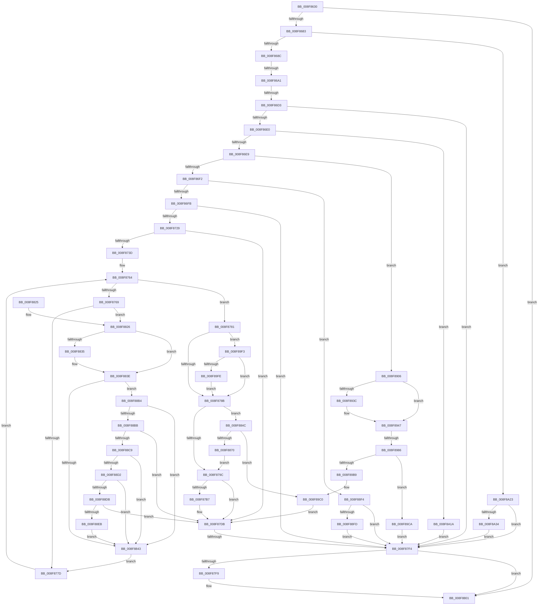

# PiPnpRtlObjectEventWorker

- RVA: `0x008F8630`–`0x008F8A41` (길이 `1,041` bytes)
- VA: `0x00000001408F8630`
- 실행 섹션: `PAGE`
- PDB 이름 있음: `예`; PDB Function 태그: `예`
- unwind 정보 RVA: `0x00087B8C`
- 디코드: `264`개 명령, `1,041/1,041` bytes 표시
- 미해석 바이트: `0` (있으면 어셈블리에 `.byte`로 보존)

> 이 문서는 커널 이미지의 기계어와 PDB 기호를 분석해 생성했습니다. 4번과 5번은 함수 원형과 자료형을 바이너리 사용 방식에서 추정한 C 해석이며 원본 소스 복구 결과는 아닙니다.

## 1. Dependencies

- 직접 호출 지점: **30**; 고유 호출 대상: **25**
- 직접 호출자로 확인된 함수: **2**
- RIP 상대 이미지 참조: **3**

### Outgoing calls
- `0x008F8690` → [PiPnpRtlBeginOperation](../8E/PiPnpRtlBeginOperation_function_008E033C.md) (function, `0x008E033C`)
- `0x008F86A1` → [PiPnpRtlDisableRemoveOperationDispatch](../8E/PiPnpRtlDisableRemoveOperationDispatch_function_008E0AAC.md) (function, `0x008E0AAC`)
- `0x008F86B3` → [PiPnpRtlObjectEventCreate](../8D/PiPnpRtlObjectEventCreate_function_008DF7E0.md) (function, `0x008DF7E0`)
- `0x008F86C1` → [ExReleaseResourceLite](../../text/25/ExReleaseResourceLite_function_0025FA10.md) (function, `0x0025FA10`)
- `0x008F86C6` → [KeLeaveCriticalRegion](../../text/25/KeLeaveCriticalRegion_function_0025D8B0.md) (function, `0x0025D8B0`)
- `0x008F871B` → [PiDmObjectProcessPropertyChange](PiDmObjectProcessPropertyChange_function_008F8A48.md) (function, `0x008F8A48`)
- `0x008F8729` → [PiPnpRtlDisableRemoveOperationDispatch](../8E/PiPnpRtlDisableRemoveOperationDispatch_function_008E0AAC.md) (function, `0x008E0AAC`)
- `0x008F87AC` → [PnpAllocatePWSTR](../8D/PnpAllocatePWSTR_function_008DE620.md) (function, `0x008DE620`)
- `0x008F87E2` → [ExReleaseResourceLite](../../text/25/ExReleaseResourceLite_function_0025FA10.md) (function, `0x0025FA10`)
- `0x008F87E7` → [KeLeaveCriticalRegion](../../text/25/KeLeaveCriticalRegion_function_0025D8B0.md) (function, `0x0025D8B0`)
- `0x008F87FC` → [PiPnpRtlEndOperation](../8E/PiPnpRtlEndOperation_function_008E0518.md) (function, `0x008E0518`)
- `0x008F8808` → [_security_check_cookie](../../text/6A/_security_check_cookie_function_006AC640.md) (function, `0x006AC640`)
- `0x008F885F` → [ExAllocatePool2](../../poolcode/B8/ExAllocatePool2_function_00B820F0.md) (function, `0x00B820F0`)
- `0x008F8883` → [memcpy](../../text/6C/memcpy_function_006C6840.md) (function, `0x006C6840`)
- `0x008F8898` → [RtlLookupElementGenericTableAvl](../../text/3F/RtlLookupElementGenericTableAvl_function_003FEFB0.md) (function, `0x003FEFB0`)
- `0x008F88A6` → [ExFreePoolWithTag](../../poolcode/B8/ExFreePoolWithTag_function_00B82870.md) (function, `0x00B82870`)
- `0x008F88DE` → [wcsicmp](../../text/50/wcsicmp_function_00500080.md) (function, `0x00500080`)
- `0x008F8912` → [CmpLockSiloKeyLockTrackerExclusive](CmpLockSiloKeyLockTrackerExclusive_function_008F9EF8.md) (function, `0x008F9EF8`)
- `0x008F8932` → [PiDmObjectReleaseLock](../8E/PiDmObjectReleaseLock_function_008E5584.md) (function, `0x008E5584`)
- `0x008F8942` → [PiDmRemoveCacheReferenceForObject](../95/PiDmRemoveCacheReferenceForObject_function_00950F24.md) (function, `0x00950F24`)
- `0x008F8961` → [ExAcquireResourceExclusiveLite](../../text/21/ExAcquireResourceExclusiveLite_function_00214E20.md) (function, `0x00214E20`)
- `0x008F8966` → [PiPnpRtlOperationListAcquireSharedLock](../A0/PiPnpRtlOperationListAcquireSharedLock_function_00A0FA68.md) (function, `0x00A0FA68`)
- `0x008F8986` → [PiPnpRtlOperationListReleaseLock](../8E/PiPnpRtlOperationListReleaseLock_function_008E0630.md) (function, `0x008E0630`)
- `0x008F898F` → [PiPnpRtlObjectEventDispatch](../8E/PiPnpRtlObjectEventDispatch_function_008E0D5C.md) (function, `0x008E0D5C`)
- `0x008F899C` → [RtlDeleteElementGenericTableAvl](../../text/3E/RtlDeleteElementGenericTableAvl_function_003EE750.md) (function, `0x003EE750`)
- `0x008F89DF` → [ExReleaseResourceLite](../../text/25/ExReleaseResourceLite_function_0025FA10.md) (function, `0x0025FA10`)
- `0x008F89E4` → [KeLeaveCriticalRegion](../../text/25/KeLeaveCriticalRegion_function_0025D8B0.md) (function, `0x0025D8B0`)
- `0x008F8A0C` → [SeCaptureSubjectContext](../86/SeCaptureSubjectContext_function_0086B820.md) (function, `0x0086B820`)
- `0x008F8A26` → [PiDqGetObjectManagerForPnpObjectType](../A4/PiDqGetObjectManagerForPnpObjectType_function_00A43FCC.md) (function, `0x00A43FCC`)
- `0x008F8A37` → [PiDqObjectManagerMakeInconsistent](../73/PiDqObjectManagerMakeInconsistent_function_00731A98.md) (function, `0x00731A98`)

### Direct callers
- [PiPnpRtlObjectEventCallback](PiPnpRtlObjectEventCallback_function_008F8600.md) at `0x008F861D`
- [sub_00B2812A](../B2/Unknown_function_00B2812A.md) at `0x00B2818F`

### Static image references
- `0x008F8647` → RVA `0x00E0A740` (`.data`; read)
- `0x008F86B8` → RVA `0x00F8B960` (`.data`; read)
- `0x008F896B` → RVA `0x00F8B9D0` (`.data`; read)

## 2. Other-region calls and transfers

- 다른 실행 섹션으로 향하는 call: **14**
  - `0x008F86C1` → [ExReleaseResourceLite](../../text/25/ExReleaseResourceLite_function_0025FA10.md) (`PAGE` → `.text`)
  - `0x008F86C6` → [KeLeaveCriticalRegion](../../text/25/KeLeaveCriticalRegion_function_0025D8B0.md) (`PAGE` → `.text`)
  - `0x008F87E2` → [ExReleaseResourceLite](../../text/25/ExReleaseResourceLite_function_0025FA10.md) (`PAGE` → `.text`)
  - `0x008F87E7` → [KeLeaveCriticalRegion](../../text/25/KeLeaveCriticalRegion_function_0025D8B0.md) (`PAGE` → `.text`)
  - `0x008F8808` → [_security_check_cookie](../../text/6A/_security_check_cookie_function_006AC640.md) (`PAGE` → `.text`)
  - `0x008F885F` → [ExAllocatePool2](../../poolcode/B8/ExAllocatePool2_function_00B820F0.md) (`PAGE` → `POOLCODE`)
  - `0x008F8883` → [memcpy](../../text/6C/memcpy_function_006C6840.md) (`PAGE` → `.text`)
  - `0x008F8898` → [RtlLookupElementGenericTableAvl](../../text/3F/RtlLookupElementGenericTableAvl_function_003FEFB0.md) (`PAGE` → `.text`)
  - `0x008F88A6` → [ExFreePoolWithTag](../../poolcode/B8/ExFreePoolWithTag_function_00B82870.md) (`PAGE` → `POOLCODE`)
  - `0x008F88DE` → [wcsicmp](../../text/50/wcsicmp_function_00500080.md) (`PAGE` → `.text`)
  - `0x008F8961` → [ExAcquireResourceExclusiveLite](../../text/21/ExAcquireResourceExclusiveLite_function_00214E20.md) (`PAGE` → `.text`)
  - `0x008F899C` → [RtlDeleteElementGenericTableAvl](../../text/3E/RtlDeleteElementGenericTableAvl_function_003EE750.md) (`PAGE` → `.text`)
  - `0x008F89DF` → [ExReleaseResourceLite](../../text/25/ExReleaseResourceLite_function_0025FA10.md) (`PAGE` → `.text`)
  - `0x008F89E4` → [KeLeaveCriticalRegion](../../text/25/KeLeaveCriticalRegion_function_0025D8B0.md) (`PAGE` → `.text`)
- call이 아닌 외부 분기/꼬리 이동: **4**
  - `0x008F869B` → [sub_00B1F154 + 0x54](../B1/Unknown_function_00B1F154.md) (`tail-transfer`)
  - `0x008F86CD` → [sub_00B1F154 + 0x54](../B1/Unknown_function_00B1F154.md) (`tail-transfer`)
  - `0x008F87EE` → [sub_00B1F154 + 0x54](../B1/Unknown_function_00B1F154.md) (`tail-transfer`)
  - `0x008F8980` → [sub_00B1F154](../B1/Unknown_function_00B1F154.md) (`tail-transfer`)

## 3. Assembly (complete function range)

```asm
008F8630  48 89 5C 24 18                  mov qword ptr [rsp + 0x18], rbx
008F8635  55                              push rbp
008F8636  56                              push rsi
008F8637  57                              push rdi
008F8638  41 54                           push r12
008F863A  41 55                           push r13
008F863C  41 56                           push r14
008F863E  41 57                           push r15
008F8640  48 8B EC                        mov rbp, rsp
008F8643  48 83 EC 70                     sub rsp, 0x70
008F8647  48 8B 05 F2 20 51 00            mov rax, qword ptr [rip + 0x5120f2]
008F864E  48 33 C4                        xor rax, rsp
008F8651  48 89 45 F8                     mov qword ptr [rbp - 8], rax
008F8655  33 FF                           xor edi, edi
008F8657  0F 57 C0                        xorps xmm0, xmm0
008F865A  48 21 7D C0                     and qword ptr [rbp - 0x40], rdi
008F865E  4D 8B E9                        mov r13, r9
008F8661  48 89 7D D0                     mov qword ptr [rbp - 0x30], rdi
008F8665  41 8B D8                        mov ebx, r8d
008F8668  40 88 7D C8                     mov byte ptr [rbp - 0x38], dil
008F866C  44 8B FA                        mov r15d, edx
008F866F  4C 8B F1                        mov r14, rcx
008F8672  0F 11 45 D8                     movups xmmword ptr [rbp - 0x28], xmm0
008F8676  0F 11 45 E8                     movups xmmword ptr [rbp - 0x18], xmm0
008F867A  83 FA 07                        cmp edx, 7
008F867D  0F 8D 7E 01 00 00               jge 0x1408f8801
008F8683  83 FB 01                        cmp ebx, 1
008F8686  0F 84 97 03 00 00               je 0x1408f8a23
008F868C  48 8D 4D D0                     lea rcx, [rbp - 0x30]
008F8690  E8 A7 7C FE FF                  call 0x1408e033c
008F8695  48 8B 7D D0                     mov rdi, qword ptr [rbp - 0x30]
008F8699  85 C0                           test eax, eax
008F869B  0F 88 07 6B 22 00               js 0x140b1f1a8
008F86A1  E8 06 84 FE FF                  call 0x1408e0aac
008F86A6  4C 8D 4D C0                     lea r9, [rbp - 0x40]
008F86AA  4C 8B C7                        mov r8, rdi
008F86AD  41 8B D7                        mov edx, r15d
008F86B0  49 8B CE                        mov rcx, r14
008F86B3  E8 28 71 FE FF                  call 0x1408df7e0
008F86B8  48 8D 0D A1 32 69 00            lea rcx, [rip + 0x6932a1]
008F86BF  8B F0                           mov esi, eax
008F86C1  E8 4A 73 96 FF                  call 0x14025fa10
008F86C6  E8 E5 51 96 FF                  call 0x14025d8b0
008F86CB  85 F6                           test esi, esi
008F86CD  0F 88 D5 6A 22 00               js 0x140b1f1a8
008F86D3  48 8B 55 C0                     mov rdx, qword ptr [rbp - 0x40]
008F86D7  48 85 D2                        test rdx, rdx
008F86DA  0F 84 14 01 00 00               je 0x1408f87f4
008F86E0  83 EB 02                        sub ebx, 2
008F86E3  0F 84 31 03 00 00               je 0x1408f8a1a
008F86E9  83 EB 01                        sub ebx, 1
008F86EC  0F 84 14 02 00 00               je 0x1408f8906
008F86F2  83 EB 01                        sub ebx, 1
008F86F5  0F 85 F9 01 00 00               jne 0x1408f88f4
008F86FB  4C 8B 42 08                     mov r8, qword ptr [rdx + 8]
008F86FF  48 8D 45 C8                     lea rax, [rbp - 0x38]
008F8703  4D 8B 4D 08                     mov r9, qword ptr [r13 + 8]
008F8707  49 8B D6                        mov rdx, r14
008F870A  48 89 44 24 28                  mov qword ptr [rsp + 0x28], rax
008F870F  41 8B CF                        mov ecx, r15d
008F8712  49 8B 45 10                     mov rax, qword ptr [r13 + 0x10]
008F8716  48 89 44 24 20                  mov qword ptr [rsp + 0x20], rax
008F871B  E8 28 03 00 00                  call 0x1408f8a48
008F8720  38 5D C8                        cmp byte ptr [rbp - 0x38], bl
008F8723  0F 85 CB 00 00 00               jne 0x1408f87f4
008F8729  E8 7E 83 FE FF                  call 0x1408e0aac
008F872E  48 8B 4D C0                     mov rcx, qword ptr [rbp - 0x40]
008F8732  48 83 79 38 00                  cmp qword ptr [rcx + 0x38], 0
008F8737  0F 85 9E 00 00 00               jne 0x1408f87db
008F873D  49 8B 45 10                     mov rax, qword ptr [r13 + 0x10]
008F8741  4D 8B 75 08                     mov r14, qword ptr [r13 + 8]
008F8745  44 8B 65 60                     mov r12d, dword ptr [rbp + 0x60]
008F8749  44 89 65 EC                     mov dword ptr [rbp - 0x14], r12d
008F874D  44 8B 40 10                     mov r8d, dword ptr [rax + 0x10]
008F8751  0F 10 00                        movups xmm0, xmmword ptr [rax]
008F8754  44 89 45 D0                     mov dword ptr [rbp - 0x30], r8d
008F8758  44 89 45 E8                     mov dword ptr [rbp - 0x18], r8d
008F875C  0F 11 45 D8                     movups xmmword ptr [rbp - 0x28], xmm0
008F8760  4C 89 75 F0                     mov qword ptr [rbp - 0x10], r14
008F8764  3B 59 4C                        cmp ebx, dword ptr [rcx + 0x4c]
008F8767  73 18                           jae 0x1408f8781
008F8769  48 8D 43 03                     lea rax, [rbx + 3]
008F876D  8B D3                           mov edx, ebx
008F876F  48 C1 E0 05                     shl rax, 5
008F8773  44 3B 04 08                     cmp r8d, dword ptr [rax + rcx]
008F8777  0F 84 A9 00 00 00               je 0x1408f8826
008F877D  FF C3                           inc ebx
008F877F  EB E3                           jmp 0x1408f8764
008F8781  41 83 FC 01                     cmp r12d, 1
008F8785  0F 84 68 02 00 00               je 0x1408f89f3
008F878B  8B 41 48                        mov eax, dword ptr [rcx + 0x48]
008F878E  BE 50 6E 70 41                  mov esi, 0x41706e50
008F8793  39 41 4C                        cmp dword ptr [rcx + 0x4c], eax
008F8796  0F 84 B0 00 00 00               je 0x1408f884c
008F879C  49 8B 4D 08                     mov rcx, qword ptr [r13 + 8]
008F87A0  4C 8D 4D F0                     lea r9, [rbp - 0x10]
008F87A4  44 8B C6                        mov r8d, esi
008F87A7  BA FF FF FF 7F                  mov edx, 0x7fffffff
008F87AC  E8 6F 5E FE FF                  call 0x1408de620
008F87B1  8B F0                           mov esi, eax
008F87B3  85 C0                           test eax, eax
008F87B5  78 24                           js 0x1408f87db
008F87B7  48 8B 4D C0                     mov rcx, qword ptr [rbp - 0x40]
008F87BB  0F 10 45 D8                     movups xmm0, xmmword ptr [rbp - 0x28]
008F87BF  0F 10 4D E8                     movups xmm1, xmmword ptr [rbp - 0x18]
008F87C3  8B 41 4C                        mov eax, dword ptr [rcx + 0x4c]
008F87C6  48 C1 E0 05                     shl rax, 5
008F87CA  0F 11 44 08 50                  movups xmmword ptr [rax + rcx + 0x50], xmm0
008F87CF  0F 11 4C 08 60                  movups xmmword ptr [rax + rcx + 0x60], xmm1
008F87D4  48 8B 45 C0                     mov rax, qword ptr [rbp - 0x40]
008F87D8  FF 40 4C                        inc dword ptr [rax + 0x4c]
008F87DB  48 8D 0D 7E 31 69 00            lea rcx, [rip + 0x69317e]
008F87E2  E8 29 72 96 FF                  call 0x14025fa10
008F87E7  E8 C4 50 96 FF                  call 0x14025d8b0
008F87EC  85 F6                           test esi, esi
008F87EE  0F 88 B4 69 22 00               js 0x140b1f1a8
008F87F4  48 85 FF                        test rdi, rdi
008F87F7  74 08                           je 0x1408f8801
008F87F9  48 8B CF                        mov rcx, rdi
008F87FC  E8 17 7D FE FF                  call 0x1408e0518
008F8801  48 8B 4D F8                     mov rcx, qword ptr [rbp - 8]
008F8805  48 33 CC                        xor rcx, rsp
008F8808  E8 33 3E DB FF                  call 0x1406ac640
008F880D  48 8B 9C 24 C0 00 00 00         mov rbx, qword ptr [rsp + 0xc0]
008F8815  48 83 C4 70                     add rsp, 0x70
008F8819  41 5F                           pop r15
008F881B  41 5E                           pop r14
008F881D  41 5D                           pop r13
008F881F  41 5C                           pop r12
008F8821  5F                              pop rdi
008F8822  5E                              pop rsi
008F8823  5D                              pop rbp
008F8824  C3                              ret
008F8825  CC                              int3
008F8826  4C 8B 45 D8                     mov r8, qword ptr [rbp - 0x28]
008F882A  48 C1 E2 05                     shl rdx, 5
008F882E  4C 2B 44 0A 50                  sub r8, qword ptr [rdx + rcx + 0x50]
008F8833  75 09                           jne 0x1408f883e
008F8835  4C 8B 45 E0                     mov r8, qword ptr [rbp - 0x20]
008F8839  4C 2B 44 0A 58                  sub r8, qword ptr [rdx + rcx + 0x58]
008F883E  4D 85 C0                        test r8, r8
008F8841  74 71                           je 0x1408f88b4
008F8843  44 8B 45 D0                     mov r8d, dword ptr [rbp - 0x30]
008F8847  E9 31 FF FF FF                  jmp 0x1408f877d
008F884C  8D 14 00                        lea edx, [rax + rax]
008F884F  44 8B C6                        mov r8d, esi
008F8852  48 C1 E2 05                     shl rdx, 5
008F8856  B9 00 01 00 00                  mov ecx, 0x100
008F885B  48 83 C2 50                     add rdx, 0x50
008F885F  E8 8C 98 28 00                  call 0x140b820f0
008F8864  48 8B D8                        mov rbx, rax
008F8867  48 85 C0                        test rax, rax
008F886A  0F 84 50 01 00 00               je 0x1408f89c0
008F8870  48 8B 55 C0                     mov rdx, qword ptr [rbp - 0x40]
008F8874  48 8B C8                        mov rcx, rax
008F8877  44 8B 42 4C                     mov r8d, dword ptr [rdx + 0x4c]
008F887B  49 C1 E0 05                     shl r8, 5
008F887F  49 83 C0 50                     add r8, 0x50
008F8883  E8 B8 DF DC FF                  call 0x1406c6840
008F8888  8B 43 48                        mov eax, dword ptr [rbx + 0x48]
008F888B  48 8D 4F 18                     lea rcx, [rdi + 0x18]
008F888F  03 C0                           add eax, eax
008F8891  48 8D 55 C0                     lea rdx, [rbp - 0x40]
008F8895  89 43 48                        mov dword ptr [rbx + 0x48], eax
008F8898  E8 13 67 B0 FF                  call 0x1403fefb0
008F889D  8B D6                           mov edx, esi
008F889F  48 89 18                        mov qword ptr [rax], rbx
008F88A2  48 8B 4D C0                     mov rcx, qword ptr [rbp - 0x40]
008F88A6  E8 C5 9F 28 00                  call 0x140b82870
008F88AB  48 89 5D C0                     mov qword ptr [rbp - 0x40], rbx
008F88AF  E9 E8 FE FF FF                  jmp 0x1408f879c
008F88B4  44 3B 64 0A 64                  cmp r12d, dword ptr [rdx + rcx + 0x64]
008F88B9  75 88                           jne 0x1408f8843
008F88BB  48 8B 54 0A 68                  mov rdx, qword ptr [rdx + rcx + 0x68]
008F88C0  4C 3B F2                        cmp r14, rdx
008F88C3  0F 84 12 FF FF FF               je 0x1408f87db
008F88C9  4D 85 F6                        test r14, r14
008F88CC  0F 84 71 FF FF FF               je 0x1408f8843
008F88D2  48 85 D2                        test rdx, rdx
008F88D5  0F 84 68 FF FF FF               je 0x1408f8843
008F88DB  49 8B CE                        mov rcx, r14
008F88DE  E8 9D 77 C0 FF                  call 0x140500080
008F88E3  85 C0                           test eax, eax
008F88E5  0F 84 F0 FE FF FF               je 0x1408f87db
008F88EB  48 8B 4D C0                     mov rcx, qword ptr [rbp - 0x40]
008F88EF  E9 4F FF FF FF                  jmp 0x1408f8843
008F88F4  83 FB 01                        cmp ebx, 1
008F88F7  0F 85 F7 FE FF FF               jne 0x1408f87f4
008F88FD  83 4A 04 08                     or dword ptr [rdx + 4], 8
008F8901  E9 EE FE FF FF                  jmp 0x1408f87f4
008F8906  83 4A 04 02                     or dword ptr [rdx + 4], 2
008F890A  48 8B 4D C0                     mov rcx, qword ptr [rbp - 0x40]
008F890E  48 8B 49 08                     mov rcx, qword ptr [rcx + 8]
008F8912  E8 E1 15 00 00                  call 0x1408f9ef8
008F8917  48 8B 45 C0                     mov rax, qword ptr [rbp - 0x40]
008F891B  48 8B 50 08                     mov rdx, qword ptr [rax + 8]
008F891F  8B 5A 20                        mov ebx, dword ptr [rdx + 0x20]
008F8922  8B C3                           mov eax, ebx
008F8924  83 E0 FE                        and eax, 0xfffffffe
008F8927  89 42 20                        mov dword ptr [rdx + 0x20], eax
008F892A  48 8B 4D C0                     mov rcx, qword ptr [rbp - 0x40]
008F892E  48 8B 49 08                     mov rcx, qword ptr [rcx + 8]
008F8932  E8 4D CC FE FF                  call 0x1408e5584
008F8937  F6 C3 01                        test bl, 1
008F893A  74 0B                           je 0x1408f8947
008F893C  49 8B D6                        mov rdx, r14
008F893F  41 8B CF                        mov ecx, r15d
008F8942  E8 DD 85 05 00                  call 0x140950f24
008F8947  65 48 8B 04 25 88 01 00 00      mov rax, qword ptr gs:[0x188]
008F8950  48 8D 0D 09 30 69 00            lea rcx, [rip + 0x693009]
008F8957  B2 01                           mov dl, 1
008F8959  66 FF 88 E4 01 00 00            dec word ptr [rax + 0x1e4]
008F8960  90                              nop
008F8961  E8 BA C4 91 FF                  call 0x140214e20
008F8966  E8 FD 70 11 00                  call 0x140a0fa68
008F896B  48 8B 35 5E 30 69 00            mov rsi, qword ptr [rip + 0x69305e]
008F8972  4C 8D 3D 57 30 69 00            lea r15, [rip + 0x693057]
008F8979  48 8B 7D D0                     mov rdi, qword ptr [rbp - 0x30]
008F897D  49 3B F7                        cmp rsi, r15
008F8980  0F 85 CE 67 22 00               jne 0x140b1f154
008F8986  E8 A5 7C FE FF                  call 0x1408e0630
008F898B  48 8B 4D C0                     mov rcx, qword ptr [rbp - 0x40]
008F898F  E8 C8 83 FE FF                  call 0x1408e0d5c
008F8994  48 8D 4F 18                     lea rcx, [rdi + 0x18]
008F8998  48 8D 55 C0                     lea rdx, [rbp - 0x40]
008F899C  E8 AF 5D AF FF                  call 0x1403ee750
008F89A1  48 8B 45 C0                     mov rax, qword ptr [rbp - 0x40]
008F89A5  48 8D 97 80 00 00 00            lea rdx, [rdi + 0x80]
008F89AC  4C 8B 42 08                     mov r8, qword ptr [rdx + 8]
008F89B0  48 83 C0 38                     add rax, 0x38
008F89B4  49 39 10                        cmp qword ptr [r8], rdx
008F89B7  74 11                           je 0x1408f89ca
008F89B9  B9 03 00 00 00                  mov ecx, 3
008F89BE  CD 29                           int 0x29
008F89C0  BE 9A 00 00 C0                  mov esi, 0xc000009a
008F89C5  E9 11 FE FF FF                  jmp 0x1408f87db
008F89CA  48 89 10                        mov qword ptr [rax], rdx
008F89CD  48 8D 0D 8C 2F 69 00            lea rcx, [rip + 0x692f8c]
008F89D4  4C 89 40 08                     mov qword ptr [rax + 8], r8
008F89D8  49 89 00                        mov qword ptr [r8], rax
008F89DB  48 89 42 08                     mov qword ptr [rdx + 8], rax
008F89DF  E8 2C 70 96 FF                  call 0x14025fa10
008F89E4  E8 C7 4E 96 FF                  call 0x14025d8b0
008F89E9  48 83 65 C0 00                  and qword ptr [rbp - 0x40], 0
008F89EE  E9 01 FE FF FF                  jmp 0x1408f87f4
008F89F3  8B 41 04                        mov eax, dword ptr [rcx + 4]
008F89F6  A8 04                           test al, 4
008F89F8  0F 85 8D FD FF FF               jne 0x1408f878b
008F89FE  83 C8 04                        or eax, 4
008F8A01  89 41 04                        mov dword ptr [rcx + 4], eax
008F8A04  48 8B 4D C0                     mov rcx, qword ptr [rbp - 0x40]
008F8A08  48 83 C1 18                     add rcx, 0x18
008F8A0C  E8 0F 2E F7 FF                  call 0x14086b820
008F8A11  48 8B 4D C0                     mov rcx, qword ptr [rbp - 0x40]
008F8A15  E9 71 FD FF FF                  jmp 0x1408f878b
008F8A1A  83 4A 04 01                     or dword ptr [rdx + 4], 1
008F8A1E  E9 D1 FD FF FF                  jmp 0x1408f87f4
008F8A23  41 8B CF                        mov ecx, r15d
008F8A26  E8 A1 B5 14 00                  call 0x140a43fcc
008F8A2B  48 85 C0                        test rax, rax
008F8A2E  0F 84 C0 FD FF FF               je 0x1408f87f4
008F8A34  48 8B C8                        mov rcx, rax
008F8A37  E8 5C 90 E3 FF                  call 0x140731a98
008F8A3C  E9 B3 FD FF FF                  jmp 0x1408f87f4
```

## 4. C-style interpretation (structured pseudocode)

```c
__int64 __fastcall PiPnpRtlObjectEventWorker(__int64 a1, int a2, int a3, __int64 a4, unsigned int a5)
{
    __int64 result;
    __int64 v_rbx;
    __int64 v_rdi;
    __int64 v_rsp;
    unsigned __int64 v_stack_m40;
    unsigned __int64 v_stack_m48;
    unsigned int v_stack_m4C;
    unsigned __int64 v_stack_m50;
    unsigned __int64 v_stack_m58;
    unsigned __int64 v_stack_m60;
    unsigned __int64 v_stack_m68;
    unsigned __int8 v_stack_m70;
    unsigned __int64 v_stack_m78;
    unsigned __int64 v_stack_m80;
    unsigned __int64 v_stack_m88;
    unsigned __int64 v_stack_p18;

    v_stack_p18 = v_rbx;
    v_rsp = (v_rsp) - (112);
    result = (*(unsigned __int64 *)(v_rip + 5316850)) ^ (v_rsp);
    v_stack_m40 = result;
    v_rdi = 0;
    v_stack_m68 = 0;
    v_stack_m70 = 0;
    v_stack_m60 = v_xmm0;
    v_stack_m50 = v_xmm0;
    if (a2 >= 7) goto loc_008F8801;
    if (((unsigned int)((unsigned int)(a3))) == 1) goto loc_008F8A23;
    result = PiPnpRtlBeginOperation(v_stack_m68, a2, a3, a4);
    result = PiPnpRtlDisableRemoveOperationDispatch(v_stack_m68, a2, a3, a4);
    result = PiPnpRtlObjectEventCreate(a1, (unsigned int)((unsigned int)((unsigned int)(a2))), v_stack_m68, v_stack_m78);
    result = ExReleaseResourceLite(v_rip + 6894241, (unsigned int)((unsigned int)((unsigned int)(a2))), v_stack_m68, v_stack_m78);
    result = KeLeaveCriticalRegion(v_rip + 6894241, (unsigned int)((unsigned int)((unsigned int)(a2))), v_stack_m68, v_stack_m78);
    if (v_stack_m78 == 0) goto loc_008F87F4;
    v_rbx = (unsigned int)(((unsigned int)(a3)) - (2));
    if (condition_is_equal) goto loc_008F8A1A;
    v_rbx = (unsigned int)((v_rbx) - (1));
    if (condition_is_equal) goto loc_008F8906;
    v_rbx = (unsigned int)((v_rbx) - (1));
    if (condition_is_not_equal) goto loc_008F88F4;
    v_stack_m80 = v_stack_m70;
    v_stack_m88 = *(unsigned __int64 *)(a4 + 16);
    result = PiDmObjectProcessPropertyChange((unsigned int)((unsigned int)((unsigned int)(a2))), a1, *(unsigned __int64 *)(v_stack_m78 + 8), *(unsigned __int64 *)(a4 + 8));
    if (v_stack_m70 != ((unsigned __int8)(v_rbx))) goto loc_008F87F4;
    result = PiPnpRtlDisableRemoveOperationDispatch((unsigned int)((unsigned int)((unsigned int)(a2))), a1, *(unsigned __int64 *)(v_stack_m78 + 8), *(unsigned __int64 *)(a4 + 8));
    if ((*(unsigned __int64 *)(v_stack_m78 + 56)) != 0) goto loc_008F87DB;
    v_stack_m4C = (unsigned int)((unsigned int)(a5));
    v_stack_m68 = (unsigned int)((unsigned int)(*(unsigned int *)(*(unsigned __int64 *)(a4 + 16) + 16)));
    v_stack_m50 = (unsigned int)((unsigned int)(*(unsigned int *)(*(unsigned __int64 *)(a4 + 16) + 16)));
    v_stack_m60 = v_xmm0;
    v_stack_m48 = *(unsigned __int64 *)(a4 + 8);
loc_008F8764:
    if (((unsigned int)(v_rbx)) >= (*(unsigned int *)(v_stack_m78 + 76))) goto loc_008F8781;
    result = (v_rbx + 3) << (5);
    if (((unsigned int)((unsigned int)(*(unsigned int *)(*(unsigned __int64 *)(a4 + 16) + 16)))) == (*(unsigned int *)(result + v_stack_m78 * 1))) goto loc_008F8826;
loc_008F877D:
    v_rbx = (unsigned int)((v_rbx) + 1);
    goto loc_008F8764;
loc_008F8781:
    if (((unsigned int)((unsigned int)(a5))) == 1) goto loc_008F89F3;
loc_008F878B:
    if ((*(unsigned int *)(v_stack_m78 + 76)) == ((unsigned int)((unsigned int)(*(unsigned int *)(v_stack_m78 + 72))))) goto loc_008F884C;
loc_008F879C:
    result = PnpAllocatePWSTR(*(unsigned __int64 *)(a4 + 8), (unsigned int)(0x7FFFFFFFULL), (unsigned int)((unsigned int)((unsigned int)(0x41706E50ULL))), v_stack_m48);
    if (!(sign_flag)) {
        a1 = v_stack_m78;
        result = *(unsigned int *)(a1 + 76);
        result = (result) << (5);
        *(unsigned __int64 *)(result + a1 * 1 + 80) = v_xmm0;
        *(unsigned __int64 *)(result + a1 * 1 + 96) = v_xmm1;
        result = v_stack_m78;
    }
    result = ExReleaseResourceLite(v_rip + 6893950, (unsigned int)(0x7FFFFFFFULL), (unsigned int)((unsigned int)((unsigned int)(0x41706E50ULL))), v_stack_m48);
    result = KeLeaveCriticalRegion(v_rip + 6893950, (unsigned int)(0x7FFFFFFFULL), (unsigned int)((unsigned int)((unsigned int)(0x41706E50ULL))), v_stack_m48);
loc_008F87F4:
    if (v_stack_m68 != 0) {
        a1 = v_stack_m68;
        result = PiPnpRtlEndOperation(a1, (unsigned int)(0x7FFFFFFFULL), (unsigned int)((unsigned int)((unsigned int)(0x41706E50ULL))), v_stack_m48);
    }
    a1 = (v_stack_m40) ^ (v_rsp);
    result = _security_check_cookie(a1, (unsigned int)(0x7FFFFFFFULL), (unsigned int)((unsigned int)((unsigned int)(0x41706E50ULL))), v_stack_m48);
    v_rsp = (v_rsp) + (112);
    return result;
loc_008F8826:
    a2 = ((unsigned int)(0x7FFFFFFFULL)) << (5);
    a3 = (v_stack_m60) - (*(unsigned __int64 *)(a2 + a1 * 1 + 80));
    if (!(condition_is_not_equal)) {
        a3 = v_stack_m58;
        a3 = (a3) - (*(unsigned __int64 *)(a2 + a1 * 1 + 88));
    }
    if (a3 == 0) goto loc_008F88B4;
loc_008F8843:
    goto loc_008F877D;
loc_008F884C:
    a2 = (result + result * 1) << (5);
    a2 = (a2) + (80);
    result = ExAllocatePool2(256, a2, (unsigned int)((unsigned int)((unsigned int)((unsigned int)(result)))), v_stack_m48);
    if (result == 0) goto loc_008F89C0;
    a3 = ((unsigned int)(*(unsigned int *)(v_stack_m78 + 76))) << (5);
    a3 = (a3) + (80);
    result = memcpy(result, v_stack_m78, a3, v_stack_m48);
    result = (unsigned int)(((unsigned int)(*(unsigned int *)(result + 72))) + ((unsigned int)((unsigned int)(*(unsigned int *)(result + 72)))));
    *(unsigned int *)(result + 72) = (unsigned int)(result);
    result = RtlLookupElementGenericTableAvl(v_stack_m68 + 24, v_stack_m78, a3, v_stack_m48);
    *(unsigned __int64 *)(result) = result;
    result = ExFreePoolWithTag(v_stack_m78, (unsigned int)((unsigned int)((unsigned int)((unsigned int)(result)))), a3, v_stack_m48);
    v_stack_m78 = result;
    goto loc_008F879C;
loc_008F88B4:
    if (((unsigned int)((unsigned int)(a5))) != (*(unsigned int *)((unsigned int)((unsigned int)((unsigned int)((unsigned int)(result)))) + v_stack_m78 * 1 + 100))) goto loc_008F8843;
    if ((*(unsigned __int64 *)(a4 + 8)) == (*(unsigned __int64 *)((unsigned int)((unsigned int)((unsigned int)((unsigned int)(result)))) + v_stack_m78 * 1 + 104))) goto loc_008F87DB;
    if (*(unsigned __int64 *)(a4 + 8) == 0) goto loc_008F8843;
    if (*(unsigned __int64 *)((unsigned int)((unsigned int)((unsigned int)((unsigned int)(result)))) + v_stack_m78 * 1 + 104) == 0) goto loc_008F8843;
    result = wcsicmp(*(unsigned __int64 *)(a4 + 8), *(unsigned __int64 *)((unsigned int)((unsigned int)((unsigned int)((unsigned int)(result)))) + v_stack_m78 * 1 + 104), a3, v_stack_m48);
    if ((unsigned int)(result) == 0) goto loc_008F87DB;
    goto loc_008F8843;
loc_008F88F4:
    if (((unsigned int)(result)) != 1) goto loc_008F87F4;
    goto loc_008F87F4;
loc_008F8906:
    result = CmpLockSiloKeyLockTrackerExclusive(*(unsigned __int64 *)(v_stack_m78 + 8), *(unsigned __int64 *)((unsigned int)((unsigned int)((unsigned int)((unsigned int)(result)))) + v_stack_m78 * 1 + 104), a3, v_stack_m48);
    result = (unsigned int)(((unsigned int)((unsigned int)((unsigned int)(*(unsigned int *)(*(unsigned __int64 *)(v_stack_m78 + 8) + 32))))) & (0xFFFFFFFEULL));
    *(unsigned int *)(*(unsigned __int64 *)(v_stack_m78 + 8) + 32) = (unsigned int)(result);
    result = PiDmObjectReleaseLock(*(unsigned __int64 *)(v_stack_m78 + 8), *(unsigned __int64 *)(v_stack_m78 + 8), a3, v_stack_m48);
    if ((((unsigned __int8)((unsigned int)(*(unsigned int *)(*(unsigned __int64 *)(v_stack_m78 + 8) + 32)))) & (1)) != 0) {
        a2 = *(unsigned __int64 *)(a4 + 8);
        a1 = (unsigned int)((unsigned int)(a2));
        result = PiDmRemoveCacheReferenceForObject(a1, a2, a3, v_stack_m48);
    }
    result = ExAcquireResourceExclusiveLite(v_rip + 6893577, 1, a3, v_stack_m48);
    result = PiPnpRtlOperationListAcquireSharedLock(v_rip + 6893577, 1, a3, v_stack_m48);
    result = PiPnpRtlOperationListReleaseLock(v_rip + 6893577, 1, a3, v_stack_m48);
    result = PiPnpRtlObjectEventDispatch(v_stack_m78, 1, a3, v_stack_m48);
    result = RtlDeleteElementGenericTableAvl(v_stack_m68 + 24, v_stack_m78, a3, v_stack_m48);
    result = (v_stack_m78) + (56);
    if ((*(unsigned __int64 *)(*(unsigned __int64 *)(v_stack_m68 + 128 + 8))) == (v_stack_m68 + 128)) goto loc_008F89CA;
loc_008F89C0:
    goto loc_008F87DB;
loc_008F89CA:
    *(unsigned __int64 *)(result) = v_stack_m68 + 128;
    *(unsigned __int64 *)(result + 8) = *(unsigned __int64 *)(v_stack_m68 + 128 + 8);
    *(unsigned __int64 *)(*(unsigned __int64 *)(v_stack_m68 + 128 + 8)) = result;
    *(unsigned __int64 *)(v_stack_m68 + 128 + 8) = result;
    result = ExReleaseResourceLite(v_rip + 6893452, v_stack_m68 + 128, *(unsigned __int64 *)(v_stack_m68 + 128 + 8), v_stack_m48);
    result = KeLeaveCriticalRegion(v_rip + 6893452, v_stack_m68 + 128, *(unsigned __int64 *)(v_stack_m68 + 128 + 8), v_stack_m48);
    goto loc_008F87F4;
loc_008F89F3:
    if ((((unsigned __int8)((unsigned int)(*(unsigned int *)(v_rip + 6893452 + 4)))) & (4)) != 0) goto loc_008F878B;
    result = (unsigned int)(((unsigned int)(*(unsigned int *)(v_rip + 6893452 + 4))) | (4));
    *(unsigned int *)(v_rip + 6893452 + 4) = (unsigned int)(result);
    a1 = (v_stack_m78) + (24);
    result = SeCaptureSubjectContext(a1, v_stack_m68 + 128, *(unsigned __int64 *)(v_stack_m68 + 128 + 8), v_stack_m48);
    goto loc_008F878B;
loc_008F8A1A:
    goto loc_008F87F4;
loc_008F8A23:
    result = PiDqGetObjectManagerForPnpObjectType((unsigned int)((unsigned int)(v_rip + 6893655)), v_stack_m68 + 128, *(unsigned __int64 *)(v_stack_m68 + 128 + 8), v_stack_m48);
    if (result == 0) goto loc_008F87F4;
    result = PiDqObjectManagerMakeInconsistent(result, v_stack_m68 + 128, *(unsigned __int64 *)(v_stack_m68 + 128 + 8), v_stack_m48);
    goto loc_008F87F4;
}
```

## 5. (Beta) C Style

```c
int64_t PiPnpRtlObjectEventWorker(int64_t Arg1, int32_t Arg2, int32_t Arg3, void *Arg4, uint32_t Arg5)
{
    uint8_t *arg4 = (uint8_t *)Arg4;

    int64_t result;
    int64_t local_rbx;
    int64_t local_rdi;
    int64_t local_rsp;
    uint64_t v_stack_m40;
    uint64_t v_stack_m48;
    uint32_t v_stack_m4C;
    uint64_t v_stack_m50;
    uint64_t v_stack_m58;
    uint64_t v_stack_m60;
    uint64_t v_stack_m68;
    uint8_t v_stack_m70;
    uint64_t v_stack_m78;
    uint64_t v_stack_m80;
    uint64_t v_stack_m88;
    uint64_t v_stack_p18;

    v_stack_p18 = local_rbx;
    local_rsp = (local_rsp) - (112);
    result = (*(uint64_t *)(v_rip + 0x5120F2)) ^ (local_rsp);
    v_stack_m40 = result;
    local_rdi = 0;
    v_stack_m68 = 0;
    v_stack_m70 = 0;
    v_stack_m60 = v_xmm0;
    v_stack_m50 = v_xmm0;
    if (Arg2 >= 7) goto loc_008F8801;
    if (((uint32_t)((uint32_t)(Arg3))) == 1) goto loc_008F8A23;
    result = PiPnpRtlBeginOperation(v_stack_m68, Arg2, Arg3, Arg4);
    result = PiPnpRtlDisableRemoveOperationDispatch(v_stack_m68, Arg2, Arg3, Arg4);
    result = PiPnpRtlObjectEventCreate(Arg1, (uint32_t)((uint32_t)((uint32_t)(Arg2))), v_stack_m68, v_stack_m78);
    result = ExReleaseResourceLite(v_rip + 6894241, (uint32_t)((uint32_t)((uint32_t)(Arg2))), v_stack_m68, v_stack_m78);
    result = KeLeaveCriticalRegion(v_rip + 6894241, (uint32_t)((uint32_t)((uint32_t)(Arg2))), v_stack_m68, v_stack_m78);
    if (v_stack_m78 == 0) goto loc_008F87F4;
    local_rbx = (uint32_t)(((uint32_t)(Arg3)) - (2));
    if (condition_is_equal) goto loc_008F8A1A;
    local_rbx = (uint32_t)((local_rbx) - (1));
    if (condition_is_equal) goto loc_008F8906;
    local_rbx = (uint32_t)((local_rbx) - (1));
    if (condition_is_not_equal) goto loc_008F88F4;
    v_stack_m80 = v_stack_m70;
    v_stack_m88 = *(uint64_t *)(arg4 + 0x10);
    result = PiDmObjectProcessPropertyChange((uint32_t)((uint32_t)((uint32_t)(Arg2))), Arg1, *(uint64_t *)(v_stack_m78 + 0x8), *(uint64_t *)(arg4 + 0x8));
    if (v_stack_m70 != ((uint8_t)(local_rbx))) goto loc_008F87F4;
    result = PiPnpRtlDisableRemoveOperationDispatch((uint32_t)((uint32_t)((uint32_t)(Arg2))), Arg1, *(uint64_t *)(v_stack_m78 + 0x8), *(uint64_t *)(arg4 + 0x8));
    if ((*(uint64_t *)(v_stack_m78 + 0x38)) != 0) goto loc_008F87DB;
    v_stack_m4C = (uint32_t)((uint32_t)(Arg5));
    v_stack_m68 = (uint32_t)((uint32_t)(*(uint32_t *)(*(uint64_t *)(arg4 + 0x10) + 0x10)));
    v_stack_m50 = (uint32_t)((uint32_t)(*(uint32_t *)(*(uint64_t *)(arg4 + 0x10) + 0x10)));
    v_stack_m60 = v_xmm0;
    v_stack_m48 = *(uint64_t *)(arg4 + 0x8);
loc_008F8764:
    if (((uint32_t)(local_rbx)) >= (*(uint32_t *)(v_stack_m78 + 0x4C))) goto loc_008F8781;
    result = (local_rbx + 3) << (5);
    if (((uint32_t)((uint32_t)(*(uint32_t *)(*(uint64_t *)(arg4 + 0x10) + 0x10)))) == (*(uint32_t *)(result + v_stack_m78 * 1))) goto loc_008F8826;
loc_008F877D:
    local_rbx = (uint32_t)((local_rbx) + 1);
    goto loc_008F8764;
loc_008F8781:
    if (((uint32_t)((uint32_t)(Arg5))) == 1) goto loc_008F89F3;
loc_008F878B:
    if ((*(uint32_t *)(v_stack_m78 + 0x4C)) == ((uint32_t)((uint32_t)(*(uint32_t *)(v_stack_m78 + 0x48))))) goto loc_008F884C;
loc_008F879C:
    result = PnpAllocatePWSTR(*(uint64_t *)(arg4 + 0x8), (uint32_t)(0x7FFFFFFFULL), (uint32_t)((uint32_t)((uint32_t)(0x41706E50ULL))), v_stack_m48);
    if (!(sign_flag)) {
        Arg1 = v_stack_m78;
        result = *(uint32_t *)(Arg1 + 0x4C);
        result = (result) << (5);
        *(uint64_t *)(result + Arg1 * 1 + 0x50) = v_xmm0;
        *(uint64_t *)(result + Arg1 * 1 + 0x60) = v_xmm1;
        result = v_stack_m78;
    }
    result = ExReleaseResourceLite(v_rip + 6893950, (uint32_t)(0x7FFFFFFFULL), (uint32_t)((uint32_t)((uint32_t)(0x41706E50ULL))), v_stack_m48);
    result = KeLeaveCriticalRegion(v_rip + 6893950, (uint32_t)(0x7FFFFFFFULL), (uint32_t)((uint32_t)((uint32_t)(0x41706E50ULL))), v_stack_m48);
loc_008F87F4:
    if (v_stack_m68 != 0) {
        Arg1 = v_stack_m68;
        result = PiPnpRtlEndOperation(Arg1, (uint32_t)(0x7FFFFFFFULL), (uint32_t)((uint32_t)((uint32_t)(0x41706E50ULL))), v_stack_m48);
    }
    Arg1 = (v_stack_m40) ^ (local_rsp);
    result = _security_check_cookie(Arg1, (uint32_t)(0x7FFFFFFFULL), (uint32_t)((uint32_t)((uint32_t)(0x41706E50ULL))), v_stack_m48);
    local_rsp = (local_rsp) + (112);
    return result;
loc_008F8826:
    Arg2 = ((uint32_t)(0x7FFFFFFFULL)) << (5);
    Arg3 = (v_stack_m60) - (*(uint64_t *)(Arg2 + Arg1 * 1 + 0x50));
    if (!(condition_is_not_equal)) {
        Arg3 = v_stack_m58;
        Arg3 = (Arg3) - (*(uint64_t *)(Arg2 + Arg1 * 1 + 0x58));
    }
    if (Arg3 == 0) goto loc_008F88B4;
loc_008F8843:
    goto loc_008F877D;
loc_008F884C:
    Arg2 = (result + result * 1) << (5);
    Arg2 = (Arg2) + (80);
    result = ExAllocatePool2(256, Arg2, (uint32_t)((uint32_t)((uint32_t)((uint32_t)(result)))), v_stack_m48);
    if (result == 0) goto loc_008F89C0;
    Arg3 = ((uint32_t)(*(uint32_t *)(v_stack_m78 + 0x4C))) << (5);
    Arg3 = (Arg3) + (80);
    result = memcpy(result, v_stack_m78, Arg3, v_stack_m48);
    result = (uint32_t)(((uint32_t)(*(uint32_t *)(result + 0x48))) + ((uint32_t)((uint32_t)(*(uint32_t *)(result + 0x48)))));
    *(uint32_t *)(result + 0x48) = (uint32_t)(result);
    result = RtlLookupElementGenericTableAvl(v_stack_m68 + 24, v_stack_m78, Arg3, v_stack_m48);
    *(uint64_t *)(result) = result;
    result = ExFreePoolWithTag(v_stack_m78, (uint32_t)((uint32_t)((uint32_t)((uint32_t)(result)))), Arg3, v_stack_m48);
    v_stack_m78 = result;
    goto loc_008F879C;
loc_008F88B4:
    if (((uint32_t)((uint32_t)(Arg5))) != (*(uint32_t *)((uint32_t)((uint32_t)((uint32_t)((uint32_t)(result)))) + v_stack_m78 * 1 + 0x64))) goto loc_008F8843;
    if ((*(uint64_t *)(arg4 + 0x8)) == (*(uint64_t *)((uint32_t)((uint32_t)((uint32_t)((uint32_t)(result)))) + v_stack_m78 * 1 + 0x68))) goto loc_008F87DB;
    if (*(uint64_t *)(arg4 + 0x8) == 0) goto loc_008F8843;
    if (*(uint64_t *)((uint32_t)((uint32_t)((uint32_t)((uint32_t)(result)))) + v_stack_m78 * 1 + 0x68) == 0) goto loc_008F8843;
    result = wcsicmp(*(uint64_t *)(arg4 + 0x8), *(uint64_t *)((uint32_t)((uint32_t)((uint32_t)((uint32_t)(result)))) + v_stack_m78 * 1 + 0x68), Arg3, v_stack_m48);
    if ((uint32_t)(result) == 0) goto loc_008F87DB;
    goto loc_008F8843;
loc_008F88F4:
    if (((uint32_t)(result)) != 1) goto loc_008F87F4;
    goto loc_008F87F4;
loc_008F8906:
    result = CmpLockSiloKeyLockTrackerExclusive(*(uint64_t *)(v_stack_m78 + 0x8), *(uint64_t *)((uint32_t)((uint32_t)((uint32_t)((uint32_t)(result)))) + v_stack_m78 * 1 + 0x68), Arg3, v_stack_m48);
    result = (uint32_t)(((uint32_t)((uint32_t)((uint32_t)(*(uint32_t *)(*(uint64_t *)(v_stack_m78 + 0x8) + 0x20))))) & (0xFFFFFFFEULL));
    *(uint32_t *)(*(uint64_t *)(v_stack_m78 + 0x8) + 0x20) = (uint32_t)(result);
    result = PiDmObjectReleaseLock(*(uint64_t *)(v_stack_m78 + 0x8), *(uint64_t *)(v_stack_m78 + 0x8), Arg3, v_stack_m48);
    if ((((uint8_t)((uint32_t)(*(uint32_t *)(*(uint64_t *)(v_stack_m78 + 0x8) + 0x20)))) & (1)) != 0) {
        Arg2 = *(uint64_t *)(arg4 + 0x8);
        Arg1 = (uint32_t)((uint32_t)(Arg2));
        result = PiDmRemoveCacheReferenceForObject(Arg1, Arg2, Arg3, v_stack_m48);
    }
    result = ExAcquireResourceExclusiveLite(v_rip + 6893577, 1, Arg3, v_stack_m48);
    result = PiPnpRtlOperationListAcquireSharedLock(v_rip + 6893577, 1, Arg3, v_stack_m48);
    result = PiPnpRtlOperationListReleaseLock(v_rip + 6893577, 1, Arg3, v_stack_m48);
    result = PiPnpRtlObjectEventDispatch(v_stack_m78, 1, Arg3, v_stack_m48);
    result = RtlDeleteElementGenericTableAvl(v_stack_m68 + 24, v_stack_m78, Arg3, v_stack_m48);
    result = (v_stack_m78) + (56);
    if ((*(uint64_t *)(*(uint64_t *)(v_stack_m68 + 0x80 + 0x8))) == (v_stack_m68 + 128)) goto loc_008F89CA;
loc_008F89C0:
    goto loc_008F87DB;
loc_008F89CA:
    *(uint64_t *)(result) = v_stack_m68 + 128;
    *(uint64_t *)(result + 0x8) = *(uint64_t *)(v_stack_m68 + 0x80 + 0x8);
    *(uint64_t *)(*(uint64_t *)(v_stack_m68 + 0x80 + 0x8)) = result;
    *(uint64_t *)(v_stack_m68 + 0x80 + 0x8) = result;
    result = ExReleaseResourceLite(v_rip + 6893452, v_stack_m68 + 128, *(uint64_t *)(v_stack_m68 + 0x80 + 0x8), v_stack_m48);
    result = KeLeaveCriticalRegion(v_rip + 6893452, v_stack_m68 + 128, *(uint64_t *)(v_stack_m68 + 0x80 + 0x8), v_stack_m48);
    goto loc_008F87F4;
loc_008F89F3:
    if ((((uint8_t)((uint32_t)(*(uint32_t *)(v_rip + 0x692F8C + 0x4)))) & (4)) != 0) goto loc_008F878B;
    result = (uint32_t)(((uint32_t)(*(uint32_t *)(v_rip + 0x692F8C + 0x4))) | (4));
    *(uint32_t *)(v_rip + 0x692F8C + 0x4) = (uint32_t)(result);
    Arg1 = (v_stack_m78) + (24);
    result = SeCaptureSubjectContext(Arg1, v_stack_m68 + 128, *(uint64_t *)(v_stack_m68 + 0x80 + 0x8), v_stack_m48);
    goto loc_008F878B;
loc_008F8A1A:
    goto loc_008F87F4;
loc_008F8A23:
    result = PiDqGetObjectManagerForPnpObjectType((uint32_t)((uint32_t)(v_rip + 6893655)), v_stack_m68 + 128, *(uint64_t *)(v_stack_m68 + 0x80 + 0x8), v_stack_m48);
    if (result == 0) goto loc_008F87F4;
    result = PiDqObjectManagerMakeInconsistent(result, v_stack_m68 + 128, *(uint64_t *)(v_stack_m68 + 0x80 + 0x8), v_stack_m48);
    goto loc_008F87F4;
}
```

### 관측된 메모리 오프셋

구조체 형식이 확인되지 않은 접근은 인자 기준의 오프셋으로만 기록했습니다.

| 기준 인자 | 오프셋 표현 | 폭 (bit) | 접근 |
|---|---:|---:|---|
| `Arg4` | `+ 0x8` | `64` | `R` |
| `Arg4` | `+ 0x10` | `64` | `R` |

## 6. Execution-region graph

[열기: 2D/3D 그래프와 함수 탐색 컨트롤 패널](../../../control-panel.html?section=page&rva=0x008F8630&view=graph)

- 2D 그래프는 위에서 아래로 흐르고, 3D 그래프는 빈 공간을 드래그해 회전합니다. Shift+드래그는 이동, 휠은 확대·축소, 함수 노드 선택은 대상 보고서 이동입니다.

### Static fallback


