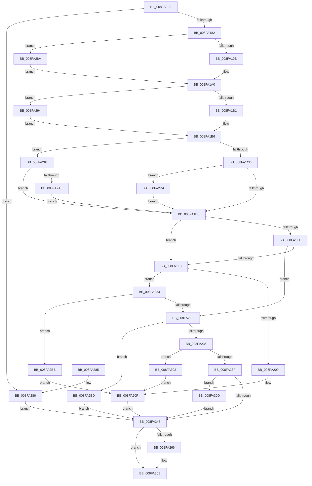

# PiProcessQueryDeviceState

- RVA: `0x008FA0F8`–`0x008FA31C` (길이 `548` bytes)
- VA: `0x00000001408FA0F8`
- 실행 섹션: `PAGE`
- PDB 이름 있음: `예`; PDB Function 태그: `아니요`
- unwind 정보 RVA: `0x00087CE4`
- 디코드: `137`개 명령, `548/548` bytes 표시
- 미해석 바이트: `0` (있으면 어셈블리에 `.byte`로 보존)

> 이 문서는 커널 이미지의 기계어와 PDB 기호를 분석해 생성했습니다. 4번과 5번은 함수 원형과 자료형을 바이너리 사용 방식에서 추정한 C 해석이며 원본 소스 복구 결과는 아닙니다.

## 1. Dependencies

- 직접 호출 지점: **19**; 고유 호출 대상: **15**
- 직접 호출자로 확인된 함수: **2**
- RIP 상대 이미지 참조: **0**

### Outgoing calls
- `0x008FA125` → [PiPnpRtlBeginOperation](../8E/PiPnpRtlBeginOperation_function_008E033C.md) (function, `0x008E033C`)
- `0x008FA132` → [PnpPoFxActivateDevice](PnpPoFxActivateDevice_function_008FB29C.md) (function, `0x008FB29C`)
- `0x008FA14B` → [memset](../../text/6C/memset_function_006C6C40.md) (function, `0x006C6C40`)
- `0x008FA175` → [IopSynchronousCall](IopSynchronousCall_function_008FB018.md) (function, `0x008FB018`)
- `0x008FA19B` → [PipSetDevNodeUserFlags](PipSetDevNodeUserFlags_function_008FB8FC.md) (function, `0x008FB8FC`)
- `0x008FA1B1` → [PipSetDevNodeUserFlags](PipSetDevNodeUserFlags_function_008FB8FC.md) (function, `0x008FB8FC`)
- `0x008FA1E0` → [PiUpdateGuestAssignedState](PiUpdateGuestAssignedState_function_008FB370.md) (function, `0x008FB370`)
- `0x008FA200` → [PnpCheckForActiveDependencies](../A0/PnpCheckForActiveDependencies_function_00A06DA4.md) (function, `0x00A06DA4`)
- `0x008FA217` → [PnpRequestDeviceRemoval](PnpRequestDeviceRemoval_function_008FC294.md) (function, `0x008FC294`)
- `0x008FA24C` → [PoFxIdleDevice](../../text/48/PoFxIdleDevice_function_00483EE8.md) (function, `0x00483EE8`)
- `0x008FA266` → [PiPnpRtlEndOperation](../8E/PiPnpRtlEndOperation_function_008E0518.md) (function, `0x008E0518`)
- `0x008FA28A` → [PipClearDevNodeUserFlags](../A2/PipClearDevNodeUserFlags_function_00A2ABC4.md) (function, `0x00A2ABC4`)
- `0x008FA294` → [PipClearDevNodeUserFlags](../A2/PipClearDevNodeUserFlags_function_00A2ABC4.md) (function, `0x00A2ABC4`)
- `0x008FA2AB` → [PipSetDevNodeUserFlags](PipSetDevNodeUserFlags_function_008FB8FC.md) (function, `0x008FB8FC`)
- `0x008FA2B3` → [IopIncDisableableDepends](../AA/IopIncDisableableDepends_function_00AA2144.md) (function, `0x00AA2144`)
- `0x008FA2CA` → [IopResourceRequirementsChanged](../AD/IopResourceRequirementsChanged_function_00ADB7D0.md) (function, `0x00ADB7D0`)
- `0x008FA2D7` → [IopDecDisableableDepends](../73/IopDecDisableableDepends_function_0073DC3C.md) (function, `0x0073DC3C`)
- `0x008FA2E1` → [PipClearDevNodeUserFlags](../A2/PipClearDevNodeUserFlags_function_00A2ABC4.md) (function, `0x00A2ABC4`)
- `0x008FA310` → [PiUpdateDeviceResourceLists](../74/PiUpdateDeviceResourceLists_function_007406BC.md) (function, `0x007406BC`)

### Direct callers
- [PiProcessRequeryDeviceState](PiProcessRequeryDeviceState_function_008FA054.md) at `0x008FA0B4`
- [PipProcessStartPhase3](PipProcessStartPhase3_function_008FBAF8.md) at `0x008FBB87`

### Static image references
- 디코드된 RIP-relative 메모리 참조가 없습니다.

## 2. Other-region calls and transfers

- 다른 실행 섹션으로 향하는 call: **2**
  - `0x008FA14B` → [memset](../../text/6C/memset_function_006C6C40.md) (`PAGE` → `.text`)
  - `0x008FA24C` → [PoFxIdleDevice](../../text/48/PoFxIdleDevice_function_00483EE8.md) (`PAGE` → `.text`)
- 별도 외부 분기/꼬리 이동을 확인하지 못했습니다.

## 3. Assembly (complete function range)

```asm
008FA0F8  4C 8B DC                        mov r11, rsp
008FA0FB  49 89 5B 18                     mov qword ptr [r11 + 0x18], rbx
008FA0FF  49 89 6B 20                     mov qword ptr [r11 + 0x20], rbp
008FA103  56                              push rsi
008FA104  57                              push rdi
008FA105  41 56                           push r14
008FA107  48 81 EC 80 00 00 00            sub rsp, 0x80
008FA10E  48 8B 81 38 01 00 00            mov rax, qword ptr [rcx + 0x138]
008FA115  4C 8B F1                        mov r14, rcx
008FA118  49 83 63 10 00                  and qword ptr [r11 + 0x10], 0
008FA11D  49 8D 4B 10                     lea rcx, [r11 + 0x10]
008FA121  48 8B 58 28                     mov rbx, qword ptr [rax + 0x28]
008FA125  E8 12 62 FE FF                  call 0x1408e033c
008FA12A  BA 00 01 00 00                  mov edx, 0x100
008FA12F  48 8B CB                        mov rcx, rbx
008FA132  E8 65 11 00 00                  call 0x1408fb29c
008FA137  48 83 A4 24 A0 00 00 00 00      and qword ptr [rsp + 0xa0], 0
008FA140  48 8D 4C 24 30                  lea rcx, [rsp + 0x30]
008FA145  33 D2                           xor edx, edx
008FA147  44 8D 42 48                     lea r8d, [rdx + 0x48]
008FA14B  E8 F0 CA DC FF                  call 0x1406c6c40
008FA150  48 8D 84 24 A0 00 00 00         lea rax, [rsp + 0xa0]
008FA158  66 C7 44 24 30 1B 14            mov word ptr [rsp + 0x30], 0x141b
008FA15F  45 33 C9                        xor r9d, r9d
008FA162  48 89 44 24 20                  mov qword ptr [rsp + 0x20], rax
008FA167  41 B8 BB 00 00 C0               mov r8d, 0xc00000bb
008FA16D  48 8D 54 24 30                  lea rdx, [rsp + 0x30]
008FA172  49 8B CE                        mov rcx, r14
008FA175  E8 9E 0E 00 00                  call 0x1408fb018
008FA17A  85 C0                           test eax, eax
008FA17C  0F 88 04 01 00 00               js 0x1408fa286
008FA182  48 8B BC 24 A0 00 00 00         mov rdi, qword ptr [rsp + 0xa0]
008FA18A  BA 02 00 00 00                  mov edx, 2
008FA18F  48 8B CB                        mov rcx, rbx
008FA192  40 84 FA                        test dl, dil
008FA195  0F 84 EF 00 00 00               je 0x1408fa28a
008FA19B  E8 5C 17 00 00                  call 0x1408fb8fc
008FA1A0  BA 40 00 00 00                  mov edx, 0x40
008FA1A5  48 8B CB                        mov rcx, rbx
008FA1A8  40 84 FA                        test dl, dil
008FA1AB  0F 84 E3 00 00 00               je 0x1408fa294
008FA1B1  E8 46 17 00 00                  call 0x1408fb8fc
008FA1B6  8B 83 90 01 00 00               mov eax, dword ptr [rbx + 0x190]
008FA1BC  BE 08 00 00 00                  mov esi, 8
008FA1C1  23 C6                           and eax, esi
008FA1C3  40 F6 C7 20                     test dil, 0x20
008FA1C7  0F 85 D1 00 00 00               jne 0x1408fa29e
008FA1CD  85 C0                           test eax, eax
008FA1CF  0F 85 FF 00 00 00               jne 0x1408fa2d4
008FA1D5  8B D7                           mov edx, edi
008FA1D7  48 8B CB                        mov rcx, rbx
008FA1DA  C1 EA 08                        shr edx, 8
008FA1DD  80 E2 01                        and dl, 1
008FA1E0  E8 8B 11 00 00                  call 0x1408fb370
008FA1E5  8B EF                           mov ebp, edi
008FA1E7  8B F0                           mov esi, eax
008FA1E9  83 E5 09                        and ebp, 9
008FA1EC  75 0A                           jne 0x1408fa1f8
008FA1EE  8B CF                           mov ecx, edi
008FA1F0  80 E1 14                        and cl, 0x14
008FA1F3  80 F9 04                        cmp cl, 4
008FA1F6  75 33                           jne 0x1408fa22b
008FA1F8  BA 03 00 00 00                  mov edx, 3
008FA1FD  48 8B CB                        mov rcx, rbx
008FA200  E8 9F CB 10 00                  call 0x140a06da4
008FA205  84 C0                           test al, al
008FA207  74 1A                           je 0x1408fa223
008FA209  41 B8 33 00 00 00               mov r8d, 0x33
008FA20F  45 33 C9                        xor r9d, r9d
008FA212  33 D2                           xor edx, edx
008FA214  48 8B CB                        mov rcx, rbx
008FA217  E8 78 20 00 00                  call 0x1408fc294
008FA21C  BE 01 00 00 C0                  mov esi, 0xc0000001
008FA221  EB 25                           jmp 0x1408fa248
008FA223  85 ED                           test ebp, ebp
008FA225  0F 85 C0 00 00 00               jne 0x1408fa2eb
008FA22B  40 F6 C7 10                     test dil, 0x10
008FA22F  0F 85 88 00 00 00               jne 0x1408fa2bd
008FA235  40 F6 C7 04                     test dil, 4
008FA239  0F 85 C3 00 00 00               jne 0x1408fa302
008FA23F  40 84 FF                        test dil, dil
008FA242  0F 88 C5 00 00 00               js 0x1408fa30d
008FA248  48 8B 4B 20                     mov rcx, qword ptr [rbx + 0x20]
008FA24C  E8 97 9C B8 FF                  call 0x140483ee8
008FA251  48 8B 8C 24 A8 00 00 00         mov rcx, qword ptr [rsp + 0xa8]
008FA259  0F BA B3 C0 02 00 00 08         btr dword ptr [rbx + 0x2c0], 8
008FA261  48 85 C9                        test rcx, rcx
008FA264  74 05                           je 0x1408fa26b
008FA266  E8 AD 62 FE FF                  call 0x1408e0518
008FA26B  4C 8D 9C 24 80 00 00 00         lea r11, [rsp + 0x80]
008FA273  8B C6                           mov eax, esi
008FA275  49 8B 5B 30                     mov rbx, qword ptr [r11 + 0x30]
008FA279  49 8B 6B 38                     mov rbp, qword ptr [r11 + 0x38]
008FA27D  49 8B E3                        mov rsp, r11
008FA280  41 5E                           pop r14
008FA282  5F                              pop rdi
008FA283  5E                              pop rsi
008FA284  C3                              ret
008FA285  CC                              int3
008FA286  33 F6                           xor esi, esi
008FA288  EB BE                           jmp 0x1408fa248
008FA28A  E8 35 09 13 00                  call 0x140a2abc4
008FA28F  E9 0C FF FF FF                  jmp 0x1408fa1a0
008FA294  E8 2B 09 13 00                  call 0x140a2abc4
008FA299  E9 18 FF FF FF                  jmp 0x1408fa1b6
008FA29E  85 C0                           test eax, eax
008FA2A0  0F 85 2F FF FF FF               jne 0x1408fa1d5
008FA2A6  8B D6                           mov edx, esi
008FA2A8  48 8B CB                        mov rcx, rbx
008FA2AB  E8 4C 16 00 00                  call 0x1408fb8fc
008FA2B0  48 8B CB                        mov rcx, rbx
008FA2B3  E8 8C 7E 1A 00                  call 0x140aa2144
008FA2B8  E9 18 FF FF FF                  jmp 0x1408fa1d5
008FA2BD  C1 EF 02                        shr edi, 2
008FA2C0  49 8B CE                        mov rcx, r14
008FA2C3  40 80 E7 01                     and dil, 1
008FA2C7  40 8A D7                        mov dl, dil
008FA2CA  E8 01 15 1E 00                  call 0x140adb7d0
008FA2CF  E9 74 FF FF FF                  jmp 0x1408fa248
008FA2D4  48 8B CB                        mov rcx, rbx
008FA2D7  E8 60 39 E4 FF                  call 0x14073dc3c
008FA2DC  8B D6                           mov edx, esi
008FA2DE  48 8B CB                        mov rcx, rbx
008FA2E1  E8 DE 08 13 00                  call 0x140a2abc4
008FA2E6  E9 EA FE FF FF                  jmp 0x1408fa1d5
008FA2EB  40 80 E7 01                     and dil, 1
008FA2EF  40 F6 DF                        neg dil
008FA2F2  45 1B C0                        sbb r8d, r8d
008FA2F5  41 83 E0 05                     and r8d, 5
008FA2F9  41 83 C0 18                     add r8d, 0x18
008FA2FD  E9 0D FF FF FF                  jmp 0x1408fa20f
008FA302  41 B8 2B 00 00 00               mov r8d, 0x2b
008FA308  E9 02 FF FF FF                  jmp 0x1408fa20f
008FA30D  48 8B CB                        mov rcx, rbx
008FA310  E8 A7 63 E4 FF                  call 0x1407406bc
008FA315  8B F0                           mov esi, eax
008FA317  E9 2C FF FF FF                  jmp 0x1408fa248
```

## 4. C-style interpretation (structured pseudocode)

```c
__int64 __fastcall PiProcessQueryDeviceState(__int64 a1, __int64 a2, __int64 a3, int a4)
{
    __int64 result;
    __int64 v_rbp;
    __int64 v_rdi;
    __int64 v_rsi;
    __int64 v_rsp;
    unsigned __int64 v_stack_m18;
    unsigned __int64 v_stack_m68;
    unsigned __int64 v_stack_m78;
    unsigned __int64 v_stack_p10;
    unsigned __int64 v_stack_p8;

    *(unsigned __int64 *)(v_rsp + 24) = v_rbx;
    *(unsigned __int64 *)(v_rsp + 32) = v_rbp;
    v_rsp = (v_rsp) - (128);
    result = PiPnpRtlBeginOperation(v_rsp + 16, a2, a3, a4);
    result = PnpPoFxActivateDevice(*(unsigned __int64 *)(*(unsigned __int64 *)(a1 + 312) + 40), 256, a3, a4);
    a2 = 0;
    result = memset(v_stack_m68, a2, a2 + 72, a4);
    v_stack_m68 = 0x141BULL;
    a4 = 0;
    v_stack_m78 = v_stack_p8;
    result = IopSynchronousCall(a1, v_stack_m68, (unsigned int)(0xC00000BBULL), a4);
    if (sign_flag) goto loc_008FA286;
    if (((2) & ((unsigned __int8)(v_stack_p8))) == 0) goto loc_008FA28A;
    result = PipSetDevNodeUserFlags(*(unsigned __int64 *)(*(unsigned __int64 *)(a1 + 312) + 40), 2, (unsigned int)(0xC00000BBULL), a4);
loc_008FA1A0:
    if (((64) & ((unsigned __int8)(v_stack_p8))) == 0) goto loc_008FA294;
    result = PipSetDevNodeUserFlags(*(unsigned __int64 *)(*(unsigned __int64 *)(a1 + 312) + 40), 64, (unsigned int)(0xC00000BBULL), a4);
loc_008FA1B6:
    result = (unsigned int)(((unsigned int)(*(unsigned int *)(*(unsigned __int64 *)(*(unsigned __int64 *)(a1 + 312) + 40) + 400))) & (8));
    if ((((unsigned __int8)(v_stack_p8)) & (32)) != 0) goto loc_008FA29E;
    if ((unsigned int)(result) != 0) goto loc_008FA2D4;
loc_008FA1D5:
    a2 = (unsigned int)(((unsigned int)((unsigned int)(v_stack_p8))) >> (8));
    a2 = (unsigned __int8)((a2) & (1));
    result = PiUpdateGuestAssignedState(*(unsigned __int64 *)(*(unsigned __int64 *)(a1 + 312) + 40), a2, (unsigned int)(0xC00000BBULL), a4);
    v_rbp = (unsigned int)(((unsigned int)((unsigned int)(v_stack_p8))) & (9));
    if (condition_is_not_equal) goto loc_008FA1F8;
    a1 = (unsigned __int8)(((unsigned int)((unsigned int)(v_stack_p8))) & (20));
    if (((unsigned __int8)(a1)) != 4) goto loc_008FA22B;
loc_008FA1F8:
    result = PnpCheckForActiveDependencies(*(unsigned __int64 *)(*(unsigned __int64 *)(a1 + 312) + 40), 3, (unsigned int)(0xC00000BBULL), a4);
    if ((unsigned __int8)(result) == 0) goto loc_008FA223;
loc_008FA20F:
    a4 = 0;
    a2 = 0;
    result = PnpRequestDeviceRemoval(*(unsigned __int64 *)(*(unsigned __int64 *)(a1 + 312) + 40), a2, 51, a4);
    goto loc_008FA248;
loc_008FA223:
    if ((unsigned int)(v_rbp) != 0) goto loc_008FA2EB;
loc_008FA22B:
    if ((((unsigned __int8)(v_stack_p8)) & (16)) != 0) goto loc_008FA2BD;
    if ((((unsigned __int8)(v_stack_p8)) & (4)) != 0) goto loc_008FA302;
    if (sign_flag) goto loc_008FA30D;
loc_008FA248:
    result = PoFxIdleDevice(*(unsigned __int64 *)(*(unsigned __int64 *)(*(unsigned __int64 *)(a1 + 312) + 40) + 32), a2, 51, a4);
    if (v_stack_p10 != 0) {
        result = PiPnpRtlEndOperation(v_stack_p10, a2, 51, a4);
    }
    return (unsigned int)((unsigned int)((unsigned int)(0xC0000001ULL)));
loc_008FA286:
    v_rsi = 0;
    goto loc_008FA248;
loc_008FA28A:
    result = PipClearDevNodeUserFlags(v_stack_p10, a2, 51, a4);
    goto loc_008FA1A0;
loc_008FA294:
    result = PipClearDevNodeUserFlags(v_stack_p10, a2, 51, a4);
    goto loc_008FA1B6;
loc_008FA29E:
    if ((unsigned int)(result) != 0) goto loc_008FA1D5;
    result = PipSetDevNodeUserFlags(*(unsigned __int64 *)(v_stack_m18 + 48), 0, 51, a4);
    result = IopIncDisableableDepends(*(unsigned __int64 *)(v_stack_m18 + 48), 0, 51, a4);
    goto loc_008FA1D5;
loc_008FA2BD:
    v_rdi = (unsigned int)((v_stack_p8) >> (2));
    v_rdi = (unsigned __int8)((v_rdi) & (1));
    result = IopResourceRequirementsChanged(a1, (unsigned __int8)(v_rdi), 51, a4);
    goto loc_008FA248;
loc_008FA2D4:
    result = IopDecDisableableDepends(*(unsigned __int64 *)(v_stack_m18 + 48), (unsigned __int8)(v_rdi), 51, a4);
    result = PipClearDevNodeUserFlags(*(unsigned __int64 *)(v_stack_m18 + 48), 0, 51, a4);
    goto loc_008FA1D5;
loc_008FA2EB:
    v_rdi = (unsigned __int8)((v_rdi) & (1));
    v_rdi = (unsigned __int8)(-(v_rdi));
    a3 = (unsigned int)((51) & (5));
    a3 = (unsigned int)((a3) + (24));
    goto loc_008FA20F;
loc_008FA302:
    goto loc_008FA20F;
loc_008FA30D:
    result = PiUpdateDeviceResourceLists(*(unsigned __int64 *)(v_stack_m18 + 48), 0, 43, a4);
    goto loc_008FA248;
}
```

## 5. (Beta) C Style

```c
int64_t PiProcessQueryDeviceState(void *Arg1, int64_t Arg2, int64_t Arg3, int32_t Arg4)
{
    uint8_t *arg1 = (uint8_t *)Arg1;

    int64_t result;
    int64_t local_rbp;
    int64_t local_rdi;
    int64_t local_rsi;
    int64_t local_rsp;
    uint64_t v_stack_m18;
    uint64_t v_stack_m68;
    uint64_t v_stack_m78;
    uint64_t v_stack_p10;
    uint64_t v_stack_p8;

    *(uint64_t *)(local_rsp + 0x18) = local_rbx;
    *(uint64_t *)(local_rsp + 0x20) = local_rbp;
    local_rsp = (local_rsp) - (128);
    result = PiPnpRtlBeginOperation(local_rsp + 16, Arg2, Arg3, Arg4);
    result = PnpPoFxActivateDevice(*(uint64_t *)(*(uint64_t *)(arg1 + 0x138) + 0x28), 256, Arg3, Arg4);
    Arg2 = 0;
    result = memset(v_stack_m68, Arg2, Arg2 + 72, Arg4);
    v_stack_m68 = 0x141BULL;
    Arg4 = 0;
    v_stack_m78 = v_stack_p8;
    result = IopSynchronousCall(Arg1, v_stack_m68, (uint32_t)(0xC00000BBULL), Arg4);
    if (sign_flag) goto loc_008FA286;
    if (((2) & ((uint8_t)(v_stack_p8))) == 0) goto loc_008FA28A;
    result = PipSetDevNodeUserFlags(*(uint64_t *)(*(uint64_t *)(arg1 + 0x138) + 0x28), 2, (uint32_t)(0xC00000BBULL), Arg4);
loc_008FA1A0:
    if (((64) & ((uint8_t)(v_stack_p8))) == 0) goto loc_008FA294;
    result = PipSetDevNodeUserFlags(*(uint64_t *)(*(uint64_t *)(arg1 + 0x138) + 0x28), 64, (uint32_t)(0xC00000BBULL), Arg4);
loc_008FA1B6:
    result = (uint32_t)(((uint32_t)(*(uint32_t *)(*(uint64_t *)(*(uint64_t *)(arg1 + 0x138) + 0x28) + 0x190))) & (8));
    if ((((uint8_t)(v_stack_p8)) & (32)) != 0) goto loc_008FA29E;
    if ((uint32_t)(result) != 0) goto loc_008FA2D4;
loc_008FA1D5:
    Arg2 = (uint32_t)(((uint32_t)((uint32_t)(v_stack_p8))) >> (8));
    Arg2 = (uint8_t)((Arg2) & (1));
    result = PiUpdateGuestAssignedState(*(uint64_t *)(*(uint64_t *)(arg1 + 0x138) + 0x28), Arg2, (uint32_t)(0xC00000BBULL), Arg4);
    local_rbp = (uint32_t)(((uint32_t)((uint32_t)(v_stack_p8))) & (9));
    if (condition_is_not_equal) goto loc_008FA1F8;
    Arg1 = (uint8_t)(((uint32_t)((uint32_t)(v_stack_p8))) & (20));
    if (((uint8_t)(Arg1)) != 4) goto loc_008FA22B;
loc_008FA1F8:
    result = PnpCheckForActiveDependencies(*(uint64_t *)(*(uint64_t *)(arg1 + 0x138) + 0x28), 3, (uint32_t)(0xC00000BBULL), Arg4);
    if ((uint8_t)(result) == 0) goto loc_008FA223;
loc_008FA20F:
    Arg4 = 0;
    Arg2 = 0;
    result = PnpRequestDeviceRemoval(*(uint64_t *)(*(uint64_t *)(arg1 + 0x138) + 0x28), Arg2, 51, Arg4);
    goto loc_008FA248;
loc_008FA223:
    if ((uint32_t)(local_rbp) != 0) goto loc_008FA2EB;
loc_008FA22B:
    if ((((uint8_t)(v_stack_p8)) & (16)) != 0) goto loc_008FA2BD;
    if ((((uint8_t)(v_stack_p8)) & (4)) != 0) goto loc_008FA302;
    if (sign_flag) goto loc_008FA30D;
loc_008FA248:
    result = PoFxIdleDevice(*(uint64_t *)(*(uint64_t *)(*(uint64_t *)(arg1 + 0x138) + 0x28) + 0x20), Arg2, 51, Arg4);
    if (v_stack_p10 != 0) {
        result = PiPnpRtlEndOperation(v_stack_p10, Arg2, 51, Arg4);
    }
    return (uint32_t)((uint32_t)((uint32_t)(0xC0000001ULL)));
loc_008FA286:
    local_rsi = 0;
    goto loc_008FA248;
loc_008FA28A:
    result = PipClearDevNodeUserFlags(v_stack_p10, Arg2, 51, Arg4);
    goto loc_008FA1A0;
loc_008FA294:
    result = PipClearDevNodeUserFlags(v_stack_p10, Arg2, 51, Arg4);
    goto loc_008FA1B6;
loc_008FA29E:
    if ((uint32_t)(result) != 0) goto loc_008FA1D5;
    result = PipSetDevNodeUserFlags(*(uint64_t *)(v_stack_m18 + 0x30), 0, 51, Arg4);
    result = IopIncDisableableDepends(*(uint64_t *)(v_stack_m18 + 0x30), 0, 51, Arg4);
    goto loc_008FA1D5;
loc_008FA2BD:
    local_rdi = (uint32_t)((v_stack_p8) >> (2));
    local_rdi = (uint8_t)((local_rdi) & (1));
    result = IopResourceRequirementsChanged(Arg1, (uint8_t)(local_rdi), 51, Arg4);
    goto loc_008FA248;
loc_008FA2D4:
    result = IopDecDisableableDepends(*(uint64_t *)(v_stack_m18 + 0x30), (uint8_t)(local_rdi), 51, Arg4);
    result = PipClearDevNodeUserFlags(*(uint64_t *)(v_stack_m18 + 0x30), 0, 51, Arg4);
    goto loc_008FA1D5;
loc_008FA2EB:
    local_rdi = (uint8_t)((local_rdi) & (1));
    local_rdi = (uint8_t)(-(local_rdi));
    Arg3 = (uint32_t)((51) & (5));
    Arg3 = (uint32_t)((Arg3) + (24));
    goto loc_008FA20F;
loc_008FA302:
    goto loc_008FA20F;
loc_008FA30D:
    result = PiUpdateDeviceResourceLists(*(uint64_t *)(v_stack_m18 + 0x30), 0, 43, Arg4);
    goto loc_008FA248;
}
```

### 관측된 메모리 오프셋

구조체 형식이 확인되지 않은 접근은 인자 기준의 오프셋으로만 기록했습니다.

| 기준 인자 | 오프셋 표현 | 폭 (bit) | 접근 |
|---|---:|---:|---|
| `Arg1` | `+ 0x138` | `64` | `R` |

## 6. Execution-region graph

[열기: 2D/3D 그래프와 함수 탐색 컨트롤 패널](../../../control-panel.html?section=page&rva=0x008FA0F8&view=graph)

- 2D 그래프는 위에서 아래로 흐르고, 3D 그래프는 빈 공간을 드래그해 회전합니다. Shift+드래그는 이동, 휠은 확대·축소, 함수 노드 선택은 대상 보고서 이동입니다.

### Static fallback


