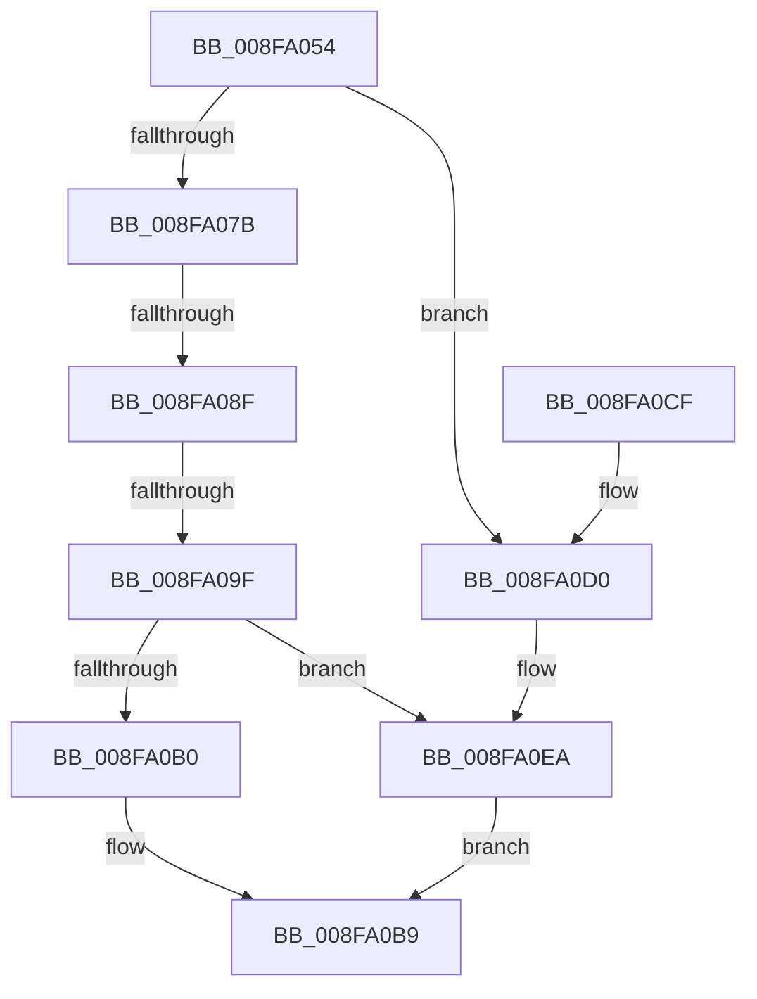

# PiProcessRequeryDeviceState

- RVA: `0x008FA054`–`0x008FA0F1` (길이 `157` bytes)
- VA: `0x00000001408FA054`
- 실행 섹션: `PAGE`
- PDB 이름 있음: `예`; PDB Function 태그: `예`
- unwind 정보 RVA: `0x00087CBC`
- 디코드: `38`개 명령, `157/157` bytes 표시
- 미해석 바이트: `0` (있으면 어셈블리에 `.byte`로 보존)

> 이 문서는 커널 이미지의 기계어와 PDB 기호를 분석해 생성했습니다. 4번과 5번은 함수 원형과 자료형을 바이너리 사용 방식에서 추정한 C 해석이며 원본 소스 복구 결과는 아닙니다.

## 1. Dependencies

- 직접 호출 지점: **3**; 고유 호출 대상: **3**
- 직접 호출자로 확인된 함수: **1**
- RIP 상대 이미지 참조: **0**

### Outgoing calls
- `0x008FA09F` → [Feature_IoInvalidateDeviceState_Unconditional__private_ReportDeviceUsage](../../text/47/Feature_IoInvalidateDeviceState_Unconditional__private_ReportDeviceUsage_function_00478C84.md) (function, `0x00478C84`)
- `0x008FA0B4` → [PiProcessQueryDeviceState](PiProcessQueryDeviceState_function_008FA0F8.md) (function, `0x008FA0F8`)
- `0x008FA0E4` → [KeBugCheckEx](../../text/4F/KeBugCheckEx_function_004FD660.md) (function, `0x004FD660`)

### Direct callers
- [PnpDeviceActionWorker](../../text/47/PnpDeviceActionWorker_function_00478400.md) at `0x00478909`

### Static image references
- 디코드된 RIP-relative 메모리 참조가 없습니다.

## 2. Other-region calls and transfers

- 다른 실행 섹션으로 향하는 call: **2**
  - `0x008FA09F` → [Feature_IoInvalidateDeviceState_Unconditional__private_ReportDeviceUsage](../../text/47/Feature_IoInvalidateDeviceState_Unconditional__private_ReportDeviceUsage_function_00478C84.md) (`PAGE` → `.text`)
  - `0x008FA0E4` → [KeBugCheckEx](../../text/4F/KeBugCheckEx_function_004FD660.md) (`PAGE` → `.text`)
- call이 아닌 외부 분기/꼬리 이동: **2**
  - `0x008FA089` → [sub_00B1F222](../B1/Unknown_function_00B1F222.md) (`tail-transfer`)
  - `0x008FA099` → [sub_00B1F222](../B1/Unknown_function_00B1F222.md) (`tail-transfer`)

## 3. Assembly (complete function range)

```asm
008FA054  48 89 5C 24 08                  mov qword ptr [rsp + 8], rbx
008FA059  48 89 74 24 10                  mov qword ptr [rsp + 0x10], rsi
008FA05E  48 89 7C 24 18                  mov qword ptr [rsp + 0x18], rdi
008FA063  41 56                           push r14
008FA065  48 83 EC 30                     sub rsp, 0x30
008FA069  33 F6                           xor esi, esi
008FA06B  48 8B D9                        mov rbx, rcx
008FA06E  48 8B 49 10                     mov rcx, qword ptr [rcx + 0x10]
008FA072  44 8D 76 02                     lea r14d, [rsi + 2]
008FA076  48 85 C9                        test rcx, rcx
008FA079  74 55                           je 0x1408fa0d0
008FA07B  48 8B 81 38 01 00 00            mov rax, qword ptr [rcx + 0x138]
008FA082  48 8B 78 28                     mov rdi, qword ptr [rax + 0x28]
008FA086  48 85 FF                        test rdi, rdi
008FA089  0F 84 93 51 22 00               je 0x140b1f222
008FA08F  F7 87 8C 01 00 00 00 00 02 00   test dword ptr [rdi + 0x18c], 0x20000
008FA099  0F 85 83 51 22 00               jne 0x140b1f222
008FA09F  E8 E0 EB B7 FF                  call 0x140478c84
008FA0A4  F7 87 C0 02 00 00 00 00 02 00   test dword ptr [rdi + 0x2c0], 0x20000
008FA0AE  74 3A                           je 0x1408fa0ea
008FA0B0  48 8B 4B 10                     mov rcx, qword ptr [rbx + 0x10]
008FA0B4  E8 3F 00 00 00                  call 0x1408fa0f8
008FA0B9  48 8B 5C 24 40                  mov rbx, qword ptr [rsp + 0x40]
008FA0BE  48 8B 74 24 48                  mov rsi, qword ptr [rsp + 0x48]
008FA0C3  48 8B 7C 24 50                  mov rdi, qword ptr [rsp + 0x50]
008FA0C8  48 83 C4 30                     add rsp, 0x30
008FA0CC  41 5E                           pop r14
008FA0CE  C3                              ret
008FA0CF  CC                              int3
008FA0D0  4C 8B 43 10                     mov r8, qword ptr [rbx + 0x10]
008FA0D4  45 33 C9                        xor r9d, r9d
008FA0D7  49 8B D6                        mov rdx, r14
008FA0DA  48 89 74 24 20                  mov qword ptr [rsp + 0x20], rsi
008FA0DF  B9 CA 00 00 00                  mov ecx, 0xca
008FA0E4  E8 77 35 C0 FF                  call 0x1404fd660
008FA0E9  CC                              int3
008FA0EA  B8 84 01 00 C0                  mov eax, 0xc0000184
008FA0EF  EB C8                           jmp 0x1408fa0b9
```

## 4. C-style interpretation (structured pseudocode)

```c
__int64 __fastcall PiProcessRequeryDeviceState(__int64 a1, __int64 a2, __int64 a3, int a4)
{
    __int64 result;
    __int64 v_rsi;
    __int64 v_rsp;
    unsigned __int64 v_stack_p10;
    unsigned __int64 v_stack_p18;
    unsigned __int64 v_stack_p20;
    unsigned __int64 v_stack_p8;

    v_stack_p8 = v_rbx;
    v_stack_p10 = v_rsi;
    v_stack_p18 = v_rdi;
    v_rsp = (v_rsp) - (48);
    v_rsi = 0;
    if (*(unsigned __int64 *)(a1 + 16) == 0) goto loc_008FA0D0;
    result = Feature_IoInvalidateDeviceState_Unconditional__private_ReportDeviceUsage(*(unsigned __int64 *)(a1 + 16), a2, a3, a4);
    if (((*(unsigned int *)(*(unsigned __int64 *)(*(unsigned __int64 *)(*(unsigned __int64 *)(a1 + 16) + 312) + 40) + 704)) & (0x20000ULL)) == 0) goto loc_008FA0EA;
    result = PiProcessQueryDeviceState(*(unsigned __int64 *)(a1 + 16), a2, a3, a4);
loc_008FA0B9:
    v_rsp = (v_rsp) + (48);
    return result;
loc_008FA0D0:
    a4 = 0;
    v_stack_p20 = v_stack_p10;
    result = KeBugCheckEx(202, v_rsi + 2, *(unsigned __int64 *)(v_stack_p8 + 16), a4);
loc_008FA0EA:
    goto loc_008FA0B9;
}
```

## 5. (Beta) C Style

```c
int64_t PiProcessRequeryDeviceState(void *Arg1, int64_t Arg2, int64_t Arg3, int32_t Arg4)
{
    uint8_t *arg1 = (uint8_t *)Arg1;

    int64_t result;
    int64_t local_rsi;
    int64_t local_rsp;
    uint64_t v_stack_p10;
    uint64_t v_stack_p18;
    uint64_t v_stack_p20;
    uint64_t v_stack_p8;

    v_stack_p8 = local_rbx;
    v_stack_p10 = local_rsi;
    v_stack_p18 = local_rdi;
    local_rsp = (local_rsp) - (48);
    local_rsi = 0;
    if (*(uint64_t *)(arg1 + 0x10) == 0) goto loc_008FA0D0;
    result = Feature_IoInvalidateDeviceState_Unconditional__private_ReportDeviceUsage(*(uint64_t *)(arg1 + 0x10), Arg2, Arg3, Arg4);
    if (((*(uint32_t *)(*(uint64_t *)(*(uint64_t *)(*(uint64_t *)(arg1 + 0x10) + 0x138) + 0x28) + 0x2C0)) & (0x20000ULL)) == 0) goto loc_008FA0EA;
    result = PiProcessQueryDeviceState(*(uint64_t *)(arg1 + 0x10), Arg2, Arg3, Arg4);
loc_008FA0B9:
    local_rsp = (local_rsp) + (48);
    return result;
loc_008FA0D0:
    Arg4 = 0;
    v_stack_p20 = v_stack_p10;
    result = KeBugCheckEx(202, local_rsi + 2, *(uint64_t *)(v_stack_p8 + 0x10), Arg4);
loc_008FA0EA:
    goto loc_008FA0B9;
}
```

### 관측된 메모리 오프셋

구조체 형식이 확인되지 않은 접근은 인자 기준의 오프셋으로만 기록했습니다.

| 기준 인자 | 오프셋 표현 | 폭 (bit) | 접근 |
|---|---:|---:|---|
| `Arg1` | `+ 0x10` | `64` | `R` |

## 6. Execution-region graph

[열기: 2D/3D 그래프와 함수 탐색 컨트롤 패널](../../../control-panel.html?section=page&rva=0x008FA054&view=graph)

- 2D 그래프는 위에서 아래로 흐르고, 3D 그래프는 빈 공간을 드래그해 회전합니다. Shift+드래그는 이동, 휠은 확대·축소, 함수 노드 선택은 대상 보고서 이동입니다.

### Static fallback


