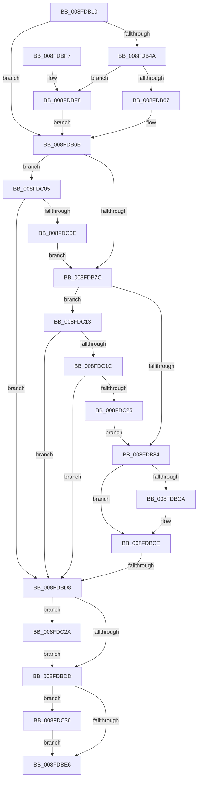

# PiQueryAndAllocateBootResources

- RVA: `0x008FDB10`–`0x008FDC3D` (길이 `301` bytes)
- VA: `0x00000001408FDB10`
- 실행 섹션: `PAGE`
- PDB 이름 있음: `예`; PDB Function 태그: `예`
- unwind 정보 RVA: `0x00088174`
- 디코드: `86`개 명령, `301/301` bytes 표시
- 미해석 바이트: `0` (있으면 어셈블리에 `.byte`로 보존)

> 이 문서는 커널 이미지의 기계어와 PDB 기호를 분석해 생성했습니다. 4번과 5번은 함수 원형과 자료형을 바이너리 사용 방식에서 추정한 C 해석이며 원본 소스 복구 결과는 아닙니다.

## 1. Dependencies

- 직접 호출 지점: **4**; 고유 호출 대상: **4**
- 직접 호출자로 확인된 함수: **1**
- RIP 상대 이미지 참조: **1**

### Outgoing calls
- `0x008FDB58` → [IopQueryDeviceResources](IopQueryDeviceResources_function_008FC344.md) (function, `0x008FC344`)
- `0x008FDBC1` → [_CmOpenDeviceRegKey](../8E/_CmOpenDeviceRegKey_function_008EE540.md) (function, `0x008EE540`)
- `0x008FDC2F` → [ExFreePoolWithTag](../../poolcode/B8/ExFreePoolWithTag_function_00B82870.md) (function, `0x00B82870`)
- `0x008FDC36` → [ZwClose](../../text/6A/ZwClose_function_006AD2B0.md) (function, `0x006AD2B0`)

### Direct callers
- [PiProcessNewDeviceNode](../A2/PiProcessNewDeviceNode_function_00A28F20.md) at `0x00A2A25B`

### Static image references
- `0x008FDB9F` → RVA `0x00E66398` (`.data`; read)

## 2. Other-region calls and transfers

- 다른 실행 섹션으로 향하는 call: **2**
  - `0x008FDC2F` → [ExFreePoolWithTag](../../poolcode/B8/ExFreePoolWithTag_function_00B82870.md) (`PAGE` → `POOLCODE`)
  - `0x008FDC36` → [ZwClose](../../text/6A/ZwClose_function_006AD2B0.md) (`PAGE` → `.text`)
- call이 아닌 외부 분기/꼬리 이동: **1**
  - `0x008FDBD2` → [sub_00B1FD92](../B1/Unknown_function_00B1FD92.md) (`tail-transfer`)

## 3. Assembly (complete function range)

```asm
008FDB10  40 55                           push rbp
008FDB12  53                              push rbx
008FDB13  56                              push rsi
008FDB14  57                              push rdi
008FDB15  41 54                           push r12
008FDB17  41 56                           push r14
008FDB19  41 57                           push r15
008FDB1B  48 8B EC                        mov rbp, rsp
008FDB1E  48 83 EC 50                     sub rsp, 0x50
008FDB22  45 33 F6                        xor r14d, r14d
008FDB25  0F 57 C0                        xorps xmm0, xmm0
008FDB28  41 8B DE                        mov ebx, r14d
008FDB2B  48 8B F9                        mov rdi, rcx
008FDB2E  41 8B F6                        mov esi, r14d
008FDB31  48 89 5D 50                     mov qword ptr [rbp + 0x50], rbx
008FDB35  0F 11 45 F0                     movups xmmword ptr [rbp - 0x10], xmm0
008FDB39  44 89 75 40                     mov dword ptr [rbp + 0x40], r14d
008FDB3D  4C 89 75 48                     mov qword ptr [rbp + 0x48], r14
008FDB41  4C 39 B1 20 02 00 00            cmp qword ptr [rcx + 0x220], r14
008FDB48  75 21                           jne 0x1408fdb6b
008FDB4A  48 8B 49 20                     mov rcx, qword ptr [rcx + 0x20]
008FDB4E  4C 8D 4D 40                     lea r9, [rbp + 0x40]
008FDB52  4C 8D 45 50                     lea r8, [rbp + 0x50]
008FDB56  33 D2                           xor edx, edx
008FDB58  E8 E7 E7 FF FF                  call 0x1408fc344
008FDB5D  8B F0                           mov esi, eax
008FDB5F  85 C0                           test eax, eax
008FDB61  0F 88 91 00 00 00               js 0x1408fdbf8
008FDB67  48 8B 5D 50                     mov rbx, qword ptr [rbp + 0x50]
008FDB6B  8B 87 8C 01 00 00               mov eax, dword ptr [rdi + 0x18c]
008FDB71  25 00 20 00 00                  and eax, 0x2000
008FDB76  0F 85 89 00 00 00               jne 0x1408fdc05
008FDB7C  85 C0                           test eax, eax
008FDB7E  0F 85 8F 00 00 00               jne 0x1408fdc13
008FDB84  48 8B 57 30                     mov rdx, qword ptr [rdi + 0x30]
008FDB88  48 8D 4D 48                     lea rcx, [rbp + 0x48]
008FDB8C  4C 89 74 24 38                  mov qword ptr [rsp + 0x38], r14
008FDB91  41 BF 01 00 00 00               mov r15d, 1
008FDB97  48 89 4C 24 30                  mov qword ptr [rsp + 0x30], rcx
008FDB9C  48 85 DB                        test rbx, rbx
008FDB9F  48 8B 0D F2 87 56 00            mov rcx, qword ptr [rip + 0x5687f2]
008FDBA6  41 0F B6 C6                     movzx eax, r14b
008FDBAA  41 0F 45 C7                     cmovne eax, r15d
008FDBAE  45 8D 47 13                     lea r8d, [r15 + 0x13]
008FDBB2  88 44 24 28                     mov byte ptr [rsp + 0x28], al
008FDBB6  45 33 C9                        xor r9d, r9d
008FDBB9  C7 44 24 20 3F 00 0F 00         mov dword ptr [rsp + 0x20], 0xf003f
008FDBC1  E8 7A 09 FF FF                  call 0x1408ee540
008FDBC6  85 C0                           test eax, eax
008FDBC8  79 04                           jns 0x1408fdbce
008FDBCA  4C 89 75 48                     mov qword ptr [rbp + 0x48], r14
008FDBCE  4C 39 75 48                     cmp qword ptr [rbp + 0x48], r14
008FDBD2  0F 85 BA 21 22 00               jne 0x140b1fd92
008FDBD8  48 85 DB                        test rbx, rbx
008FDBDB  75 4D                           jne 0x1408fdc2a
008FDBDD  48 8B 4D 48                     mov rcx, qword ptr [rbp + 0x48]
008FDBE1  48 85 C9                        test rcx, rcx
008FDBE4  75 50                           jne 0x1408fdc36
008FDBE6  8B C6                           mov eax, esi
008FDBE8  48 83 C4 50                     add rsp, 0x50
008FDBEC  41 5F                           pop r15
008FDBEE  41 5E                           pop r14
008FDBF0  41 5C                           pop r12
008FDBF2  5F                              pop rdi
008FDBF3  5E                              pop rsi
008FDBF4  5B                              pop rbx
008FDBF5  5D                              pop rbp
008FDBF6  C3                              ret
008FDBF7  CC                              int3
008FDBF8  48 89 5D 50                     mov qword ptr [rbp + 0x50], rbx
008FDBFC  44 89 75 40                     mov dword ptr [rbp + 0x40], r14d
008FDC00  E9 66 FF FF FF                  jmp 0x1408fdb6b
008FDC05  83 BF 94 01 00 00 09            cmp dword ptr [rdi + 0x194], 9
008FDC0C  74 CA                           je 0x1408fdbd8
008FDC0E  E9 69 FF FF FF                  jmp 0x1408fdb7c
008FDC13  83 BF 94 01 00 00 03            cmp dword ptr [rdi + 0x194], 3
008FDC1A  74 BC                           je 0x1408fdbd8
008FDC1C  83 BF 94 01 00 00 13            cmp dword ptr [rdi + 0x194], 0x13
008FDC23  74 B3                           je 0x1408fdbd8
008FDC25  E9 5A FF FF FF                  jmp 0x1408fdb84
008FDC2A  33 D2                           xor edx, edx
008FDC2C  48 8B CB                        mov rcx, rbx
008FDC2F  E8 3C 4C 28 00                  call 0x140b82870
008FDC34  EB A7                           jmp 0x1408fdbdd
008FDC36  E8 75 F6 DA FF                  call 0x1406ad2b0
008FDC3B  EB A9                           jmp 0x1408fdbe6
```

## 4. C-style interpretation (structured pseudocode)

```c
__int64 __fastcall PiQueryAndAllocateBootResources(__int64 a1, int a2)
{
    __int64 result;
    __int64 v_r14;
    __int64 v_rsp;
    unsigned __int64 v_stack_m48;
    unsigned __int64 v_stack_m50;
    unsigned __int64 v_stack_m58;
    unsigned __int8 v_stack_m60;
    unsigned int v_stack_m68;
    unsigned __int64 v_stack_p10;
    unsigned __int64 v_stack_p18;
    unsigned int v_stack_p8;

    v_rsp = (v_rsp) - (80);
    v_r14 = 0;
    v_stack_p18 = 0;
    v_stack_m48 = v_xmm0;
    v_stack_p8 = 0;
    v_stack_p10 = 0;
    if ((*(unsigned __int64 *)(a1 + 544)) != 0) goto loc_008FDB6B;
    a2 = 0;
    result = IopQueryDeviceResources(*(unsigned __int64 *)(a1 + 32), a2, v_stack_p18, v_stack_p8);
    if (sign_flag) goto loc_008FDBF8;
loc_008FDB6B:
    result = (unsigned int)(((unsigned int)(*(unsigned int *)(a1 + 396))) & (0x2000ULL));
    if (condition_is_not_equal) goto loc_008FDC05;
loc_008FDB7C:
    if ((unsigned int)(result) != 0) goto loc_008FDC13;
loc_008FDB84:
    v_stack_m50 = 0;
    v_stack_m58 = v_stack_p10;
    result = 0;
    if (v_stack_p18 != 0) { result = 1; }
    v_stack_m60 = (unsigned __int8)(result);
    a4 = 0;
    v_stack_m68 = 0xF003FULL;
    result = _CmOpenDeviceRegKey(*(unsigned __int64 *)(v_rip + 5670898), *(unsigned __int64 *)(a1 + 48), 1 + 19, a4);
    if (sign_flag) {
        v_stack_p10 = 0;
    }
loc_008FDBD8:
    if (v_stack_p18 != 0) goto loc_008FDC2A;
loc_008FDBDD:
    if (v_stack_p10 != 0) goto loc_008FDC36;
loc_008FDBE6:
    v_rsp = (v_rsp) + (80);
    return (unsigned int)((unsigned int)((unsigned int)((unsigned int)(result))));
loc_008FDBF8:
    v_stack_p18 = v_stack_p18;
    v_stack_p8 = 0;
    goto loc_008FDB6B;
loc_008FDC05:
    if ((*(unsigned int *)(a1 + 404)) == 9) goto loc_008FDBD8;
    goto loc_008FDB7C;
loc_008FDC13:
    if ((*(unsigned int *)(a1 + 404)) == 3) goto loc_008FDBD8;
    if ((*(unsigned int *)(a1 + 404)) == 19) goto loc_008FDBD8;
    goto loc_008FDB84;
loc_008FDC2A:
    a2 = 0;
    result = ExFreePoolWithTag(v_stack_p18, a2, 1 + 19, a4);
    goto loc_008FDBDD;
loc_008FDC36:
    result = ZwClose(v_stack_p18, a2, 1 + 19, a4);
    goto loc_008FDBE6;
}
```

## 5. (Beta) C Style

```c
int64_t PiQueryAndAllocateBootResources(void *Arg1, int32_t Arg2)
{
    uint8_t *arg1 = (uint8_t *)Arg1;

    int64_t result;
    int64_t local_r14;
    int64_t local_rsp;
    uint64_t v_stack_m48;
    uint64_t v_stack_m50;
    uint64_t v_stack_m58;
    uint8_t v_stack_m60;
    uint32_t v_stack_m68;
    uint64_t v_stack_p10;
    uint64_t v_stack_p18;
    uint32_t v_stack_p8;

    local_rsp = (local_rsp) - (80);
    local_r14 = 0;
    v_stack_p18 = 0;
    v_stack_m48 = v_xmm0;
    v_stack_p8 = 0;
    v_stack_p10 = 0;
    if ((*(uint64_t *)(arg1 + 0x220)) != 0) goto loc_008FDB6B;
    Arg2 = 0;
    result = IopQueryDeviceResources(*(uint64_t *)(arg1 + 0x20), Arg2, v_stack_p18, v_stack_p8);
    if (sign_flag) goto loc_008FDBF8;
loc_008FDB6B:
    result = (uint32_t)(((uint32_t)(*(uint32_t *)(arg1 + 0x18C))) & (0x2000ULL));
    if (condition_is_not_equal) goto loc_008FDC05;
loc_008FDB7C:
    if ((uint32_t)(result) != 0) goto loc_008FDC13;
loc_008FDB84:
    v_stack_m50 = 0;
    v_stack_m58 = v_stack_p10;
    result = 0;
    if (v_stack_p18 != 0) { result = 1; }
    v_stack_m60 = (uint8_t)(result);
    a4 = 0;
    v_stack_m68 = 0xF003FULL;
    result = _CmOpenDeviceRegKey(*(uint64_t *)(v_rip + 0x5687F2), *(uint64_t *)(arg1 + 0x30), 1 + 19, a4);
    if (sign_flag) {
        v_stack_p10 = 0;
    }
loc_008FDBD8:
    if (v_stack_p18 != 0) goto loc_008FDC2A;
loc_008FDBDD:
    if (v_stack_p10 != 0) goto loc_008FDC36;
loc_008FDBE6:
    local_rsp = (local_rsp) + (80);
    return (uint32_t)((uint32_t)((uint32_t)((uint32_t)(result))));
loc_008FDBF8:
    v_stack_p18 = v_stack_p18;
    v_stack_p8 = 0;
    goto loc_008FDB6B;
loc_008FDC05:
    if ((*(uint32_t *)(arg1 + 0x194)) == 9) goto loc_008FDBD8;
    goto loc_008FDB7C;
loc_008FDC13:
    if ((*(uint32_t *)(arg1 + 0x194)) == 3) goto loc_008FDBD8;
    if ((*(uint32_t *)(arg1 + 0x194)) == 19) goto loc_008FDBD8;
    goto loc_008FDB84;
loc_008FDC2A:
    Arg2 = 0;
    result = ExFreePoolWithTag(v_stack_p18, Arg2, 1 + 19, a4);
    goto loc_008FDBDD;
loc_008FDC36:
    result = ZwClose(v_stack_p18, Arg2, 1 + 19, a4);
    goto loc_008FDBE6;
}
```

### 관측된 메모리 오프셋

구조체 형식이 확인되지 않은 접근은 인자 기준의 오프셋으로만 기록했습니다.

| 기준 인자 | 오프셋 표현 | 폭 (bit) | 접근 |
|---|---:|---:|---|
| `Arg1` | `+ 0x20` | `64` | `R` |
| `Arg1` | `+ 0x30` | `64` | `R` |
| `Arg1` | `+ 0x18C` | `32` | `R` |
| `Arg1` | `+ 0x194` | `32` | `R` |
| `Arg1` | `+ 0x220` | `64` | `R` |

## 6. Execution-region graph

[열기: 2D/3D 그래프와 함수 탐색 컨트롤 패널](../../../control-panel.html?section=page&rva=0x008FDB10&view=graph)

- 2D 그래프는 위에서 아래로 흐르고, 3D 그래프는 빈 공간을 드래그해 회전합니다. Shift+드래그는 이동, 휠은 확대·축소, 함수 노드 선택은 대상 보고서 이동입니다.

### Static fallback


