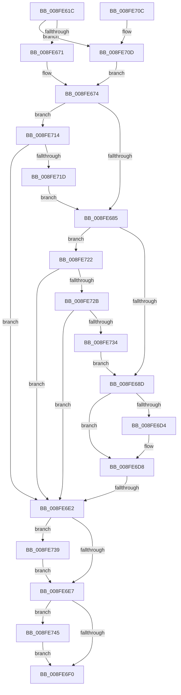

# PiQueryResourceRequirements

- RVA: `0x008FE61C`–`0x008FE74C` (길이 `304` bytes)
- VA: `0x00000001408FE61C`
- 실행 섹션: `PAGE`
- PDB 이름 있음: `예`; PDB Function 태그: `예`
- unwind 정보 RVA: `0x00088240`
- 디코드: `83`개 명령, `304/304` bytes 표시
- 미해석 바이트: `0` (있으면 어셈블리에 `.byte`로 보존)

> 이 문서는 커널 이미지의 기계어와 PDB 기호를 분석해 생성했습니다. 4번과 5번은 함수 원형과 자료형을 바이너리 사용 방식에서 추정한 C 해석이며 원본 소스 복구 결과는 아닙니다.

## 1. Dependencies

- 직접 호출 지점: **4**; 고유 호출 대상: **4**
- 직접 호출자로 확인된 함수: **1**
- RIP 상대 이미지 참조: **1**

### Outgoing calls
- `0x008FE652` → [PpIrpQueryResourceRequirements](PpIrpQueryResourceRequirements_function_008FC784.md) (function, `0x008FC784`)
- `0x008FE6CB` → [_CmOpenDeviceRegKey](../8E/_CmOpenDeviceRegKey_function_008EE540.md) (function, `0x008EE540`)
- `0x008FE73E` → [ExFreePoolWithTag](../../poolcode/B8/ExFreePoolWithTag_function_00B82870.md) (function, `0x00B82870`)
- `0x008FE745` → [ZwClose](../../text/6A/ZwClose_function_006AD2B0.md) (function, `0x006AD2B0`)

### Direct callers
- [PiProcessNewDeviceNode](../A2/PiProcessNewDeviceNode_function_00A28F20.md) at `0x00A2A1DC`

### Static image references
- `0x008FE6A8` → RVA `0x00E66398` (`.data`; read)

## 2. Other-region calls and transfers

- 다른 실행 섹션으로 향하는 call: **2**
  - `0x008FE73E` → [ExFreePoolWithTag](../../poolcode/B8/ExFreePoolWithTag_function_00B82870.md) (`PAGE` → `POOLCODE`)
  - `0x008FE745` → [ZwClose](../../text/6A/ZwClose_function_006AD2B0.md) (`PAGE` → `.text`)
- call이 아닌 외부 분기/꼬리 이동: **1**
  - `0x008FE6DC` → [sub_00B1FEC0](../B1/Unknown_function_00B1FEC0.md) (`tail-transfer`)

## 3. Assembly (complete function range)

```asm
008FE61C  48 89 5C 24 18                  mov qword ptr [rsp + 0x18], rbx
008FE621  48 89 74 24 20                  mov qword ptr [rsp + 0x20], rsi
008FE626  55                              push rbp
008FE627  57                              push rdi
008FE628  41 54                           push r12
008FE62A  41 56                           push r14
008FE62C  41 57                           push r15
008FE62E  48 8B EC                        mov rbp, rsp
008FE631  48 83 EC 50                     sub rsp, 0x50
008FE635  48 8B F9                        mov rdi, rcx
008FE638  48 8D 55 38                     lea rdx, [rbp + 0x38]
008FE63C  48 8B 49 20                     mov rcx, qword ptr [rcx + 0x20]
008FE640  45 33 FF                        xor r15d, r15d
008FE643  0F 57 C0                        xorps xmm0, xmm0
008FE646  4C 89 7D 38                     mov qword ptr [rbp + 0x38], r15
008FE64A  0F 11 45 F0                     movups xmmword ptr [rbp - 0x10], xmm0
008FE64E  4C 89 7D 30                     mov qword ptr [rbp + 0x30], r15
008FE652  E8 2D E1 FF FF                  call 0x1408fc784
008FE657  48 8B 5D 38                     mov rbx, qword ptr [rbp + 0x38]
008FE65B  85 C0                           test eax, eax
008FE65D  44 8B F0                        mov r14d, eax
008FE660  49 0F 48 DF                     cmovs rbx, r15
008FE664  48 89 5D 38                     mov qword ptr [rbp + 0x38], rbx
008FE668  48 85 DB                        test rbx, rbx
008FE66B  0F 85 9C 00 00 00               jne 0x1408fe70d
008FE671  41 8B F7                        mov esi, r15d
008FE674  8B 87 8C 01 00 00               mov eax, dword ptr [rdi + 0x18c]
008FE67A  25 00 20 00 00                  and eax, 0x2000
008FE67F  0F 85 8F 00 00 00               jne 0x1408fe714
008FE685  85 C0                           test eax, eax
008FE687  0F 85 95 00 00 00               jne 0x1408fe722
008FE68D  48 8B 57 30                     mov rdx, qword ptr [rdi + 0x30]
008FE691  48 8D 4D 30                     lea rcx, [rbp + 0x30]
008FE695  4C 89 7C 24 38                  mov qword ptr [rsp + 0x38], r15
008FE69A  41 BC 01 00 00 00               mov r12d, 1
008FE6A0  48 89 4C 24 30                  mov qword ptr [rsp + 0x30], rcx
008FE6A5  48 85 DB                        test rbx, rbx
008FE6A8  48 8B 0D E9 7C 56 00            mov rcx, qword ptr [rip + 0x567ce9]
008FE6AF  41 0F B6 C7                     movzx eax, r15b
008FE6B3  41 0F 45 C4                     cmovne eax, r12d
008FE6B7  45 8D 44 24 13                  lea r8d, [r12 + 0x13]
008FE6BC  88 44 24 28                     mov byte ptr [rsp + 0x28], al
008FE6C0  45 33 C9                        xor r9d, r9d
008FE6C3  C7 44 24 20 3F 00 0F 00         mov dword ptr [rsp + 0x20], 0xf003f
008FE6CB  E8 70 FE FE FF                  call 0x1408ee540
008FE6D0  85 C0                           test eax, eax
008FE6D2  79 04                           jns 0x1408fe6d8
008FE6D4  4C 89 7D 30                     mov qword ptr [rbp + 0x30], r15
008FE6D8  4C 39 7D 30                     cmp qword ptr [rbp + 0x30], r15
008FE6DC  0F 85 DE 17 22 00               jne 0x140b1fec0
008FE6E2  48 85 DB                        test rbx, rbx
008FE6E5  75 52                           jne 0x1408fe739
008FE6E7  48 8B 4D 30                     mov rcx, qword ptr [rbp + 0x30]
008FE6EB  48 85 C9                        test rcx, rcx
008FE6EE  75 55                           jne 0x1408fe745
008FE6F0  4C 8D 5C 24 50                  lea r11, [rsp + 0x50]
008FE6F5  41 8B C6                        mov eax, r14d
008FE6F8  49 8B 5B 40                     mov rbx, qword ptr [r11 + 0x40]
008FE6FC  49 8B 73 48                     mov rsi, qword ptr [r11 + 0x48]
008FE700  49 8B E3                        mov rsp, r11
008FE703  41 5F                           pop r15
008FE705  41 5E                           pop r14
008FE707  41 5C                           pop r12
008FE709  5F                              pop rdi
008FE70A  5D                              pop rbp
008FE70B  C3                              ret
008FE70C  CC                              int3
008FE70D  8B 33                           mov esi, dword ptr [rbx]
008FE70F  E9 60 FF FF FF                  jmp 0x1408fe674
008FE714  83 BF 94 01 00 00 09            cmp dword ptr [rdi + 0x194], 9
008FE71B  74 C5                           je 0x1408fe6e2
008FE71D  E9 63 FF FF FF                  jmp 0x1408fe685
008FE722  83 BF 94 01 00 00 03            cmp dword ptr [rdi + 0x194], 3
008FE729  74 B7                           je 0x1408fe6e2
008FE72B  83 BF 94 01 00 00 13            cmp dword ptr [rdi + 0x194], 0x13
008FE732  74 AE                           je 0x1408fe6e2
008FE734  E9 54 FF FF FF                  jmp 0x1408fe68d
008FE739  33 D2                           xor edx, edx
008FE73B  48 8B CB                        mov rcx, rbx
008FE73E  E8 2D 41 28 00                  call 0x140b82870
008FE743  EB A2                           jmp 0x1408fe6e7
008FE745  E8 66 EB DA FF                  call 0x1406ad2b0
008FE74A  EB A4                           jmp 0x1408fe6f0
```

## 4. C-style interpretation (structured pseudocode)

```c
__int64 __fastcall PiQueryResourceRequirements(__int64 a1, __int64 a2, __int64 a3, int a4)
{
    __int64 result;
    __int64 v_r15;
    __int64 v_rbx;
    __int64 v_rsp;
    unsigned __int64 v_stack_m28;
    unsigned __int64 v_stack_m38;
    unsigned __int64 v_stack_m40;
    unsigned __int64 v_stack_m48;
    unsigned __int8 v_stack_m50;
    unsigned int v_stack_m58;
    unsigned __int64 v_stack_p10;
    unsigned __int64 v_stack_p18;
    unsigned __int64 v_stack_p20;
    unsigned __int64 v_stack_p8;

    v_stack_p18 = v_rbx;
    v_stack_p20 = v_rsi;
    v_rsp = (v_rsp) - (80);
    v_r15 = 0;
    v_stack_p10 = 0;
    v_stack_m38 = v_xmm0;
    v_stack_p8 = 0;
    result = PpIrpQueryResourceRequirements(*(unsigned __int64 *)(a1 + 32), v_stack_p10, a3, a4);
    v_rbx = v_stack_p10;
    if (sign_flag) { v_rbx = 0; }
    v_stack_p10 = v_rbx;
    if (v_rbx != 0) goto loc_008FE70D;
loc_008FE674:
    result = (unsigned int)(((unsigned int)(*(unsigned int *)(a1 + 396))) & (0x2000ULL));
    if (condition_is_not_equal) goto loc_008FE714;
loc_008FE685:
    if ((unsigned int)(result) != 0) goto loc_008FE722;
loc_008FE68D:
    v_stack_m40 = 0;
    v_stack_m48 = v_stack_p8;
    result = 0;
    if (v_rbx != 0) { result = 1; }
    v_stack_m50 = (unsigned __int8)(result);
    a4 = 0;
    v_stack_m58 = 0xF003FULL;
    result = _CmOpenDeviceRegKey(*(unsigned __int64 *)(v_rip + 5668073), *(unsigned __int64 *)(a1 + 48), 1 + 19, a4);
    if (sign_flag) {
        v_stack_p8 = 0;
    }
loc_008FE6E2:
    if (v_rbx != 0) goto loc_008FE739;
loc_008FE6E7:
    if (v_stack_p8 != 0) goto loc_008FE745;
loc_008FE6F0:
    return (unsigned int)((unsigned int)((unsigned int)((unsigned int)(result))));
loc_008FE70D:
    goto loc_008FE674;
loc_008FE714:
    if ((*(unsigned int *)(a1 + 404)) == 9) goto loc_008FE6E2;
    goto loc_008FE685;
loc_008FE722:
    if ((*(unsigned int *)(a1 + 404)) == 3) goto loc_008FE6E2;
    if ((*(unsigned int *)(a1 + 404)) == 19) goto loc_008FE6E2;
    goto loc_008FE68D;
loc_008FE739:
    a2 = 0;
    result = ExFreePoolWithTag(*(unsigned __int64 *)(v_stack_m28 + 64), a2, 1 + 19, a4);
    goto loc_008FE6E7;
loc_008FE745:
    result = ZwClose(*(unsigned __int64 *)(v_stack_m28 + 64), a2, 1 + 19, a4);
    goto loc_008FE6F0;
}
```

## 5. (Beta) C Style

```c
int64_t PiQueryResourceRequirements(void *Arg1, int64_t Arg2, int64_t Arg3, int32_t Arg4)
{
    uint8_t *arg1 = (uint8_t *)Arg1;

    int64_t result;
    int64_t local_r15;
    int64_t local_rbx;
    int64_t local_rsp;
    uint64_t v_stack_m28;
    uint64_t v_stack_m38;
    uint64_t v_stack_m40;
    uint64_t v_stack_m48;
    uint8_t v_stack_m50;
    uint32_t v_stack_m58;
    uint64_t v_stack_p10;
    uint64_t v_stack_p18;
    uint64_t v_stack_p20;
    uint64_t v_stack_p8;

    v_stack_p18 = local_rbx;
    v_stack_p20 = local_rsi;
    local_rsp = (local_rsp) - (80);
    local_r15 = 0;
    v_stack_p10 = 0;
    v_stack_m38 = v_xmm0;
    v_stack_p8 = 0;
    result = PpIrpQueryResourceRequirements(*(uint64_t *)(arg1 + 0x20), v_stack_p10, Arg3, Arg4);
    local_rbx = v_stack_p10;
    if (sign_flag) { local_rbx = 0; }
    v_stack_p10 = local_rbx;
    if (local_rbx != 0) goto loc_008FE70D;
loc_008FE674:
    result = (uint32_t)(((uint32_t)(*(uint32_t *)(arg1 + 0x18C))) & (0x2000ULL));
    if (condition_is_not_equal) goto loc_008FE714;
loc_008FE685:
    if ((uint32_t)(result) != 0) goto loc_008FE722;
loc_008FE68D:
    v_stack_m40 = 0;
    v_stack_m48 = v_stack_p8;
    result = 0;
    if (local_rbx != 0) { result = 1; }
    v_stack_m50 = (uint8_t)(result);
    Arg4 = 0;
    v_stack_m58 = 0xF003FULL;
    result = _CmOpenDeviceRegKey(*(uint64_t *)(v_rip + 0x567CE9), *(uint64_t *)(arg1 + 0x30), 1 + 19, Arg4);
    if (sign_flag) {
        v_stack_p8 = 0;
    }
loc_008FE6E2:
    if (local_rbx != 0) goto loc_008FE739;
loc_008FE6E7:
    if (v_stack_p8 != 0) goto loc_008FE745;
loc_008FE6F0:
    return (uint32_t)((uint32_t)((uint32_t)((uint32_t)(result))));
loc_008FE70D:
    goto loc_008FE674;
loc_008FE714:
    if ((*(uint32_t *)(arg1 + 0x194)) == 9) goto loc_008FE6E2;
    goto loc_008FE685;
loc_008FE722:
    if ((*(uint32_t *)(arg1 + 0x194)) == 3) goto loc_008FE6E2;
    if ((*(uint32_t *)(arg1 + 0x194)) == 19) goto loc_008FE6E2;
    goto loc_008FE68D;
loc_008FE739:
    Arg2 = 0;
    result = ExFreePoolWithTag(*(uint64_t *)(v_stack_m28 + 0x40), Arg2, 1 + 19, Arg4);
    goto loc_008FE6E7;
loc_008FE745:
    result = ZwClose(*(uint64_t *)(v_stack_m28 + 0x40), Arg2, 1 + 19, Arg4);
    goto loc_008FE6F0;
}
```

### 관측된 메모리 오프셋

구조체 형식이 확인되지 않은 접근은 인자 기준의 오프셋으로만 기록했습니다.

| 기준 인자 | 오프셋 표현 | 폭 (bit) | 접근 |
|---|---:|---:|---|
| `Arg1` | `+ 0x20` | `64` | `R` |
| `Arg1` | `+ 0x30` | `64` | `R` |
| `Arg1` | `+ 0x18C` | `32` | `R` |
| `Arg1` | `+ 0x194` | `32` | `R` |

## 6. Execution-region graph

[열기: 2D/3D 그래프와 함수 탐색 컨트롤 패널](../../../control-panel.html?section=page&rva=0x008FE61C&view=graph)

- 2D 그래프는 위에서 아래로 흐르고, 3D 그래프는 빈 공간을 드래그해 회전합니다. Shift+드래그는 이동, 휠은 확대·축소, 함수 노드 선택은 대상 보고서 이동입니다.

### Static fallback


