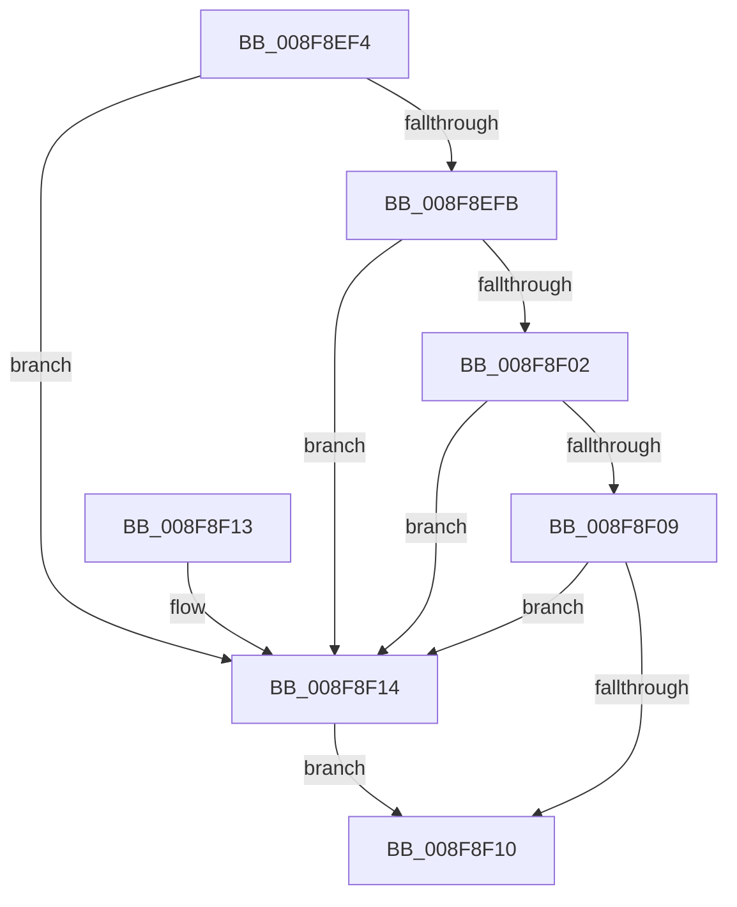

# PiSwDeviceOperationsAllowed

- RVA: `0x008F8EF4`–`0x008F8F18` (길이 `36` bytes)
- VA: `0x00000001408F8EF4`
- 실행 섹션: `PAGE`
- PDB 이름 있음: `예`; PDB Function 태그: `아니요`
- unwind 정보 RVA: `0x000DB714`
- 디코드: `15`개 명령, `36/36` bytes 표시
- 미해석 바이트: `0` (있으면 어셈블리에 `.byte`로 보존)

> 이 문서는 커널 이미지의 기계어와 PDB 기호를 분석해 생성했습니다. 4번과 5번은 함수 원형과 자료형을 바이너리 사용 방식에서 추정한 C 해석이며 원본 소스 복구 결과는 아닙니다.

## 1. Dependencies

- 직접 호출 지점: **0**; 고유 호출 대상: **0**
- 직접 호출자로 확인된 함수: **8**
- RIP 상대 이미지 참조: **0**

### Outgoing calls
- 직접 디코드된 call 명령이 없습니다.

### Direct callers
- [PiSwIrpGetAttributes](../73/PiSwIrpGetAttributes_function_0073AE04.md) at `0x0073AE46`
- [PiSwIrpGetLifetime](../73/PiSwIrpGetLifetime_function_0073AEA4.md) at `0x0073AEE6`
- [PiSwIrpSetAttributes](../73/PiSwIrpSetAttributes_function_0073AF44.md) at `0x0073AFB7`
- [PiSwIrpSetLifetime](../73/PiSwIrpSetLifetime_function_0073B080.md) at `0x0073B0EA`
- [PiSwIrpInterfacePropertySet](PiSwIrpInterfacePropertySet_function_008F7900.md) at `0x008F7A01`
- [PiSwIrpInterfaceSetState](../94/PiSwIrpInterfaceSetState_function_0094DC24.md) at `0x0094DCFB`
- [PiSwIrpPropertySet](../94/PiSwIrpPropertySet_function_0094E97C.md) at `0x0094EA7B`
- [PiSwIrpInterfaceRegister](../94/PiSwIrpInterfaceRegister_function_0094F01C.md) at `0x0094F168`

### Static image references
- 디코드된 RIP-relative 메모리 참조가 없습니다.

## 2. Other-region calls and transfers

- 다른 실행 섹션으로 향하는 call: **0**
- 별도 외부 분기/꼬리 이동을 확인하지 못했습니다.

## 3. Assembly (complete function range)

```asm
008F8EF4  B2 01                           mov dl, 1
008F8EF6  48 85 C9                        test rcx, rcx
008F8EF9  74 19                           je 0x1408f8f14
008F8EFB  48 83 79 50 00                  cmp qword ptr [rcx + 0x50], 0
008F8F00  74 12                           je 0x1408f8f14
008F8F02  8B 41 04                        mov eax, dword ptr [rcx + 4]
008F8F05  A8 04                           test al, 4
008F8F07  74 0B                           je 0x1408f8f14
008F8F09  48 83 79 58 00                  cmp qword ptr [rcx + 0x58], 0
008F8F0E  75 04                           jne 0x1408f8f14
008F8F10  8A C2                           mov al, dl
008F8F12  C3                              ret
008F8F13  CC                              int3
008F8F14  32 D2                           xor dl, dl
008F8F16  EB F8                           jmp 0x1408f8f10
```

## 4. C-style interpretation (structured pseudocode)

```c
__int64 __fastcall PiSwDeviceOperationsAllowed(__int64 a1)
{
    if (a1 == 0) goto loc_008F8F14;
    if ((*(unsigned __int64 *)(a1 + 80)) == 0) goto loc_008F8F14;
    if ((((unsigned __int8)((unsigned int)(*(unsigned int *)(a1 + 4)))) & (4)) == 0) goto loc_008F8F14;
    if ((*(unsigned __int64 *)(a1 + 88)) != 0) goto loc_008F8F14;
loc_008F8F10:
    return 1;
loc_008F8F14:
    a2 = 0;
    goto loc_008F8F10;
}
```

## 5. (Beta) C Style

```c
int64_t PiSwDeviceOperationsAllowed(int64_t Arg1)
{
    if (Arg1 == 0) goto loc_008F8F14;
    if ((*(uint64_t *)(Arg1 + 0x50)) == 0) goto loc_008F8F14;
    if ((((uint8_t)((uint32_t)(*(uint32_t *)(Arg1 + 0x4)))) & (4)) == 0) goto loc_008F8F14;
    if ((*(uint64_t *)(Arg1 + 0x58)) != 0) goto loc_008F8F14;
loc_008F8F10:
    return 1;
loc_008F8F14:
    a2 = 0;
    goto loc_008F8F10;
}
```

## 6. Execution-region graph

[열기: 2D/3D 그래프와 함수 탐색 컨트롤 패널](../../../control-panel.html?section=page&rva=0x008F8EF4&view=graph)

- 2D 그래프는 위에서 아래로 흐르고, 3D 그래프는 빈 공간을 드래그해 회전합니다. Shift+드래그는 이동, 휠은 확대·축소, 함수 노드 선택은 대상 보고서 이동입니다.

### Static fallback


