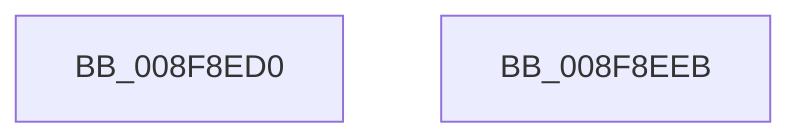

# PiSwFindChildren

- RVA: `0x008F8ED0`–`0x008F8EEC` (길이 `28` bytes)
- VA: `0x00000001408F8ED0`
- 실행 섹션: `PAGE`
- PDB 이름 있음: `예`; PDB Function 태그: `아니요`
- unwind 정보 RVA: `0x0005C788`
- 디코드: `9`개 명령, `28/28` bytes 표시
- 미해석 바이트: `0` (있으면 어셈블리에 `.byte`로 보존)

> 이 문서는 커널 이미지의 기계어와 PDB 기호를 분석해 생성했습니다. 4번과 5번은 함수 원형과 자료형을 바이너리 사용 방식에서 추정한 C 해석이며 원본 소스 복구 결과는 아닙니다.

## 1. Dependencies

- 직접 호출 지점: **1**; 고유 호출 대상: **1**
- 직접 호출자로 확인된 함수: **2**
- RIP 상대 이미지 참조: **0**

### Outgoing calls
- `0x008F8ED4` → [PiSwFindBusRelations](PiSwFindBusRelations_function_008F99A0.md) (function, `0x008F99A0`)

### Direct callers
- [PipEnumerateCompleted](PipEnumerateCompleted_function_008F7B1C.md) at `0x008F7B69`
- [PiSwProcessParentStartIrp](../A9/PiSwProcessParentStartIrp_function_00A97FC0.md) at `0x00A97FE6`

### Static image references
- 디코드된 RIP-relative 메모리 참조가 없습니다.

## 2. Other-region calls and transfers

- 다른 실행 섹션으로 향하는 call: **0**
- 별도 외부 분기/꼬리 이동을 확인하지 못했습니다.

## 3. Assembly (complete function range)

```asm
008F8ED0  48 83 EC 28                     sub rsp, 0x28
008F8ED4  E8 C7 0A 00 00                  call 0x1408f99a0
008F8ED9  48 8D 48 10                     lea rcx, [rax + 0x10]
008F8EDD  48 F7 D8                        neg rax
008F8EE0  48 1B C0                        sbb rax, rax
008F8EE3  48 23 C1                        and rax, rcx
008F8EE6  48 83 C4 28                     add rsp, 0x28
008F8EEA  C3                              ret
008F8EEB  CC                              int3
```

## 4. C-style interpretation (structured pseudocode)

```c
__int64 __fastcall PiSwFindChildren(void)
{
    __int64 result;
    __int64 v_rsp;

    v_rsp = (v_rsp) - (40);
    result = PiSwFindBusRelations(a1, a2, a3, a4);
    result = -(result);
    result = (result) & (result + 16);
    v_rsp = (v_rsp) + (40);
    return result;
}
```

## 5. (Beta) C Style

```c
void PiSwFindChildren(void)
{
    int64_t result;
    int64_t local_rsp;

    local_rsp = (local_rsp) - (40);
    result = PiSwFindBusRelations(a1, a2, a3, a4);
    result = -(result);
    result = (result) & (result + 16);
    local_rsp = (local_rsp) + (40);
    return result;
}
```

## 6. Execution-region graph

[열기: 2D/3D 그래프와 함수 탐색 컨트롤 패널](../../../control-panel.html?section=page&rva=0x008F8ED0&view=graph)

- 2D 그래프는 위에서 아래로 흐르고, 3D 그래프는 빈 공간을 드래그해 회전합니다. Shift+드래그는 이동, 휠은 확대·축소, 함수 노드 선택은 대상 보고서 이동입니다.

### Static fallback


