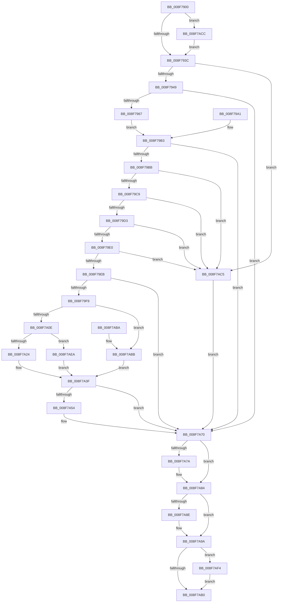

# PiSwIrpInterfacePropertySet

- RVA: `0x008F7900`–`0x008F7B13` (길이 `531` bytes)
- VA: `0x00000001408F7900`
- 실행 섹션: `PAGE`
- PDB 이름 있음: `예`; PDB Function 태그: `아니요`
- unwind 정보 RVA: `0x00087AAC`
- 디코드: `127`개 명령, `531/531` bytes 표시
- 미해석 바이트: `0` (있으면 어셈블리에 `.byte`로 보존)

> 이 문서는 커널 이미지의 기계어와 PDB 기호를 분석해 생성했습니다. 4번과 5번은 함수 원형과 자료형을 바이너리 사용 방식에서 추정한 C 해석이며 원본 소스 복구 결과는 아닙니다.

## 1. Dependencies

- 직접 호출 지점: **15**; 고유 호출 대상: **15**
- 직접 호출자로 확인된 함수: **1**
- RIP 상대 이미지 참조: **10**

### Outgoing calls
- `0x008F7951` → `msrpc.sys!MesDecodeBufferHandleCreate` (import, 간접 대상; import `msrpc.sys!MesDecodeBufferHandleCreate`)
- `0x008F7993` → `msrpc.sys!NdrMesTypeDecode3` (import, 간접 대상; import `msrpc.sys!NdrMesTypeDecode3`)
- `0x008F79EE` → [PiSwValidatePropertyArray](PiSwValidatePropertyArray_function_008F75F4.md) (function, `0x008F75F4`)
- `0x008F79F9` → [PiSwLock](PiSwLock_function_008F7D50.md) (function, `0x008F7D50`)
- `0x008F7A01` → [PiSwDeviceOperationsAllowed](PiSwDeviceOperationsAllowed_function_008F8EF4.md) (function, `0x008F8EF4`)
- `0x008F7A16` → [PiSwDeviceFindInterfaceEntry](../94/PiSwDeviceFindInterfaceEntry_function_0094F498.md) (function, `0x0094F498`)
- `0x008F7A38` → [PiSwUpdateArrayProperties](../94/PiSwUpdateArrayProperties_function_0094EBAC.md) (function, `0x0094EBAC`)
- `0x008F7A46` → [ExReleaseResourceLite](../../text/25/ExReleaseResourceLite_function_0025FA10.md) (function, `0x0025FA10`)
- `0x008F7A4B` → [KeLeaveCriticalRegion](../../text/25/KeLeaveCriticalRegion_function_0025D8B0.md) (function, `0x0025D8B0`)
- `0x008F7A69` → [PiSwPropertySet](PiSwPropertySet_function_008F5EEC.md) (function, `0x008F5EEC`)
- `0x008F7A7F` → [ExFreePoolWithTag](../../poolcode/B8/ExFreePoolWithTag_function_00B82870.md) (function, `0x00B82870`)
- `0x008F7A8E` → `msrpc.sys!MesHandleFree` (import, 간접 대상; import `msrpc.sys!MesHandleFree`)
- `0x008F7AA2` → [IofCompleteRequest](../../text/29/IofCompleteRequest_function_0029B5C0.md) (function, `0x0029B5C0`)
- `0x008F7AE0` → [McTemplateK0zz_EtwWriteTransfer](../../text/5A/McTemplateK0zz_EtwWriteTransfer_function_005A9408.md) (function, `0x005A9408`)
- `0x008F7B0C` → [McTemplateK0zzd_EtwWriteTransfer](../../text/42/McTemplateK0zzd_EtwWriteTransfer_function_00424414.md) (function, `0x00424414`)

### Direct callers
- [PiSwDispatch](../73/PiSwDispatch_function_0073AA90.md) at `0x0073AB52`

### Static image references
- `0x008F792F` → RVA `0x00EF012C` (`.data`; read)
- `0x008F7951` → RVA `0x00151700` (`msrpc.sys!MesDecodeBufferHandleCreate (IAT)`; read)
- `0x008F7979` → RVA `0x00E07010` (`.data`; read)
- `0x008F7980` → RVA `0x00B4B210` (`PAGE`; read)
- `0x008F7987` → RVA `0x00B4B1A0` (`PAGE`; read)
- `0x008F7993` → RVA `0x001516F8` (`msrpc.sys!NdrMesTypeDecode3 (IAT)`; read)
- `0x008F7A3F` → RVA `0x00F8AB20` (`.data`; read)
- `0x008F7A8E` → RVA `0x001516E0` (`msrpc.sys!MesHandleFree (IAT)`; read)
- `0x008F7AD9` → RVA `0x00026DD0` (`.rdata`; read)
- `0x008F7B05` → RVA `0x00026DB0` (`.rdata`; read)

## 2. Other-region calls and transfers

- 다른 실행 섹션으로 향하는 call: **6**
  - `0x008F7A46` → [ExReleaseResourceLite](../../text/25/ExReleaseResourceLite_function_0025FA10.md) (`PAGE` → `.text`)
  - `0x008F7A4B` → [KeLeaveCriticalRegion](../../text/25/KeLeaveCriticalRegion_function_0025D8B0.md) (`PAGE` → `.text`)
  - `0x008F7A7F` → [ExFreePoolWithTag](../../poolcode/B8/ExFreePoolWithTag_function_00B82870.md) (`PAGE` → `POOLCODE`)
  - `0x008F7AA2` → [IofCompleteRequest](../../text/29/IofCompleteRequest_function_0029B5C0.md) (`PAGE` → `.text`)
  - `0x008F7AE0` → [McTemplateK0zz_EtwWriteTransfer](../../text/5A/McTemplateK0zz_EtwWriteTransfer_function_005A9408.md) (`PAGE` → `.text`)
  - `0x008F7B0C` → [McTemplateK0zzd_EtwWriteTransfer](../../text/42/McTemplateK0zzd_EtwWriteTransfer_function_00424414.md) (`PAGE` → `.text`)
- 별도 외부 분기/꼬리 이동을 확인하지 못했습니다.

## 3. Assembly (complete function range)

```asm
008F7900  48 89 4C 24 08                  mov qword ptr [rsp + 8], rcx
008F7905  53                              push rbx
008F7906  56                              push rsi
008F7907  57                              push rdi
008F7908  48 83 EC 30                     sub rsp, 0x30
008F790C  48 8B F1                        mov rsi, rcx
008F790F  48 8B 99 B8 00 00 00            mov rbx, qword ptr [rcx + 0xb8]
008F7916  48 8B 43 30                     mov rax, qword ptr [rbx + 0x30]
008F791A  48 8B 78 20                     mov rdi, qword ptr [rax + 0x20]
008F791E  48 89 7C 24 68                  mov qword ptr [rsp + 0x68], rdi
008F7923  48 83 64 24 60 00               and qword ptr [rsp + 0x60], 0
008F7929  48 83 64 24 58 00               and qword ptr [rsp + 0x58], 0
008F792F  F6 05 F6 87 5F 00 40            test byte ptr [rip + 0x5f87f6], 0x40
008F7936  0F 85 90 01 00 00               jne 0x1408f7acc
008F793C  48 8B 4E 18                     mov rcx, qword ptr [rsi + 0x18]
008F7940  48 85 C9                        test rcx, rcx
008F7943  0F 84 7C 01 00 00               je 0x1408f7ac5
008F7949  4C 8D 44 24 60                  lea r8, [rsp + 0x60]
008F794E  8B 53 10                        mov edx, dword ptr [rbx + 0x10]
008F7951  48 FF 15 A8 9D 85 FF            call qword ptr [rip - 0x7a6258]
008F7958  0F 1F 44 00 00                  nop dword ptr [rax + rax]
008F795D  8B D8                           mov ebx, eax
008F795F  85 C0                           test eax, eax
008F7961  0F 88 09 01 00 00               js 0x1408f7a70
008F7967  48 8D 44 24 58                  lea rax, [rsp + 0x58]
008F796C  48 89 44 24 28                  mov qword ptr [rsp + 0x28], rax
008F7971  C7 44 24 20 04 00 00 00         mov dword ptr [rsp + 0x20], 4
008F7979  4C 8D 0D 90 F6 50 00            lea r9, [rip + 0x50f690]
008F7980  4C 8D 05 89 38 25 00            lea r8, [rip + 0x253889]
008F7987  48 8D 15 12 38 25 00            lea rdx, [rip + 0x253812]
008F798E  48 8B 4C 24 60                  mov rcx, qword ptr [rsp + 0x60]
008F7993  48 FF 15 5E 9D 85 FF            call qword ptr [rip - 0x7a62a2]
008F799A  0F 1F 44 00 00                  nop dword ptr [rax + rax]
008F799F  EB 12                           jmp 0x1408f79b3
008F79A1  8B D8                           mov ebx, eax
008F79A3  48 83 64 24 58 00               and qword ptr [rsp + 0x58], 0
008F79A9  48 8B 74 24 50                  mov rsi, qword ptr [rsp + 0x50]
008F79AE  48 8B 7C 24 68                  mov rdi, qword ptr [rsp + 0x68]
008F79B3  85 DB                           test ebx, ebx
008F79B5  0F 88 B5 00 00 00               js 0x1408f7a70
008F79BB  48 8B 4C 24 58                  mov rcx, qword ptr [rsp + 0x58]
008F79C0  48 85 C9                        test rcx, rcx
008F79C3  0F 84 FC 00 00 00               je 0x1408f7ac5
008F79C9  48 83 39 00                     cmp qword ptr [rcx], 0
008F79CD  0F 84 F2 00 00 00               je 0x1408f7ac5
008F79D3  48 8B 41 10                     mov rax, qword ptr [rcx + 0x10]
008F79D7  48 85 C0                        test rax, rax
008F79DA  0F 84 E5 00 00 00               je 0x1408f7ac5
008F79E0  8B 51 08                        mov edx, dword ptr [rcx + 8]
008F79E3  85 D2                           test edx, edx
008F79E5  0F 84 DA 00 00 00               je 0x1408f7ac5
008F79EB  48 8B C8                        mov rcx, rax
008F79EE  E8 01 FC FF FF                  call 0x1408f75f4
008F79F3  8B D8                           mov ebx, eax
008F79F5  85 C0                           test eax, eax
008F79F7  78 77                           js 0x1408f7a70
008F79F9  E8 52 03 00 00                  call 0x1408f7d50
008F79FE  48 8B CF                        mov rcx, rdi
008F7A01  E8 EE 14 00 00                  call 0x1408f8ef4
008F7A06  84 C0                           test al, al
008F7A08  0F 84 AD 00 00 00               je 0x1408f7abb
008F7A0E  48 8B 54 24 58                  mov rdx, qword ptr [rsp + 0x58]
008F7A13  48 8B 12                        mov rdx, qword ptr [rdx]
008F7A16  E8 7D 7A 05 00                  call 0x14094f498
008F7A1B  48 85 C0                        test rax, rax
008F7A1E  0F 84 C6 00 00 00               je 0x1408f7aea
008F7A24  4C 8B 44 24 58                  mov r8, qword ptr [rsp + 0x58]
008F7A29  45 8B 48 08                     mov r9d, dword ptr [r8 + 8]
008F7A2D  4D 8B 40 10                     mov r8, qword ptr [r8 + 0x10]
008F7A31  8B 50 20                        mov edx, dword ptr [rax + 0x20]
008F7A34  48 8B 48 18                     mov rcx, qword ptr [rax + 0x18]
008F7A38  E8 6F 71 05 00                  call 0x14094ebac
008F7A3D  8B D8                           mov ebx, eax
008F7A3F  48 8D 0D DA 30 69 00            lea rcx, [rip + 0x6930da]
008F7A46  E8 C5 7F 96 FF                  call 0x14025fa10
008F7A4B  E8 60 5E 96 FF                  call 0x14025d8b0
008F7A50  85 DB                           test ebx, ebx
008F7A52  78 1C                           js 0x1408f7a70
008F7A54  48 8B 4C 24 58                  mov rcx, qword ptr [rsp + 0x58]
008F7A59  44 8B 49 08                     mov r9d, dword ptr [rcx + 8]
008F7A5D  4C 8B 41 10                     mov r8, qword ptr [rcx + 0x10]
008F7A61  BA 03 00 00 00                  mov edx, 3
008F7A66  48 8B 09                        mov rcx, qword ptr [rcx]
008F7A69  E8 7E E4 FF FF                  call 0x1408f5eec
008F7A6E  8B D8                           mov ebx, eax
008F7A70  48 8B 4C 24 58                  mov rcx, qword ptr [rsp + 0x58]
008F7A75  48 85 C9                        test rcx, rcx
008F7A78  74 0A                           je 0x1408f7a84
008F7A7A  BA 6B 72 70 63                  mov edx, 0x6370726b
008F7A7F  E8 EC AD 28 00                  call 0x140b82870
008F7A84  48 8B 4C 24 60                  mov rcx, qword ptr [rsp + 0x60]
008F7A89  48 85 C9                        test rcx, rcx
008F7A8C  74 0C                           je 0x1408f7a9a
008F7A8E  48 FF 15 4B 9C 85 FF            call qword ptr [rip - 0x7a63b5]
008F7A95  0F 1F 44 00 00                  nop dword ptr [rax + rax]
008F7A9A  89 5E 30                        mov dword ptr [rsi + 0x30], ebx
008F7A9D  33 D2                           xor edx, edx
008F7A9F  48 8B CE                        mov rcx, rsi
008F7AA2  E8 19 3B 9A FF                  call 0x14029b5c0
008F7AA7  F6 05 7E 86 5F 00 40            test byte ptr [rip + 0x5f867e], 0x40
008F7AAE  75 44                           jne 0x1408f7af4
008F7AB0  8B C3                           mov eax, ebx
008F7AB2  48 83 C4 30                     add rsp, 0x30
008F7AB6  5F                              pop rdi
008F7AB7  5E                              pop rsi
008F7AB8  5B                              pop rbx
008F7AB9  C3                              ret
008F7ABA  CC                              int3
008F7ABB  BB BB 00 00 C0                  mov ebx, 0xc00000bb
008F7AC0  E9 7A FF FF FF                  jmp 0x1408f7a3f
008F7AC5  BB 0D 00 00 C0                  mov ebx, 0xc000000d
008F7ACA  EB A4                           jmp 0x1408f7a70
008F7ACC  48 8B 47 10                     mov rax, qword ptr [rdi + 0x10]
008F7AD0  48 89 44 24 20                  mov qword ptr [rsp + 0x20], rax
008F7AD5  4C 8B 4F 08                     mov r9, qword ptr [rdi + 8]
008F7AD9  48 8D 15 F0 F2 72 FF            lea rdx, [rip - 0x8d0d10]
008F7AE0  E8 23 19 CB FF                  call 0x1405a9408
008F7AE5  E9 52 FE FF FF                  jmp 0x1408f793c
008F7AEA  BB 25 02 00 C0                  mov ebx, 0xc0000225
008F7AEF  E9 4B FF FF FF                  jmp 0x1408f7a3f
008F7AF4  89 5C 24 28                     mov dword ptr [rsp + 0x28], ebx
008F7AF8  48 8B 47 10                     mov rax, qword ptr [rdi + 0x10]
008F7AFC  48 89 44 24 20                  mov qword ptr [rsp + 0x20], rax
008F7B01  4C 8B 4F 08                     mov r9, qword ptr [rdi + 8]
008F7B05  48 8D 15 A4 F2 72 FF            lea rdx, [rip - 0x8d0d5c]
008F7B0C  E8 03 C9 B2 FF                  call 0x140424414
008F7B11  EB 9D                           jmp 0x1408f7ab0
```

## 4. C-style interpretation (structured pseudocode)

```c
__int64 __fastcall PiSwIrpInterfacePropertySet(__int64 a1)
{
    __int64 result;
    __int64 v_rbx;
    __int64 v_rsp;
    unsigned __int64 v_stack_m20;
    unsigned int v_stack_m28;
    unsigned __int64 v_stack_p10;
    unsigned __int64 v_stack_p18;
    unsigned __int64 v_stack_p20;
    unsigned int v_stack_p28;
    unsigned __int64 v_stack_p8;

    v_stack_p8 = a1;
    v_rsp = (v_rsp) - (48);
    v_stack_p20 = *(unsigned __int64 *)(*(unsigned __int64 *)(*(unsigned __int64 *)(a1 + 184) + 48) + 32);
    if (((*(unsigned __int8 *)(v_rip + 6260726)) & (64)) != 0) goto loc_008F7ACC;
loc_008F793C:
    if (*(unsigned __int64 *)(a1 + 24) == 0) goto loc_008F7AC5;
    result = msrpc_sys_MesDecodeBufferHandleCreate(*(unsigned __int64 *)(a1 + 24), (unsigned int)(*(unsigned int *)(*(unsigned __int64 *)(a1 + 184) + 16)), v_stack_p18, a4);
    if (sign_flag) goto loc_008F7A70;
    v_stack_m20 = v_stack_p10;
    v_stack_m28 = 4;
    result = msrpc_sys_NdrMesTypeDecode3(v_stack_p18, v_rip + 2439186, v_rip + 2439305, v_rip + 5306000);
    goto loc_008F79B3;
loc_008F79B3:
    if (sign_flag) goto loc_008F7A70;
    if (v_stack_p10 == 0) goto loc_008F7AC5;
    if ((*(unsigned __int64 *)(v_stack_p10)) == 0) goto loc_008F7AC5;
    if (*(unsigned __int64 *)(v_stack_p10 + 16) == 0) goto loc_008F7AC5;
    if ((unsigned int)((unsigned int)(*(unsigned int *)(v_stack_p10 + 8))) == 0) goto loc_008F7AC5;
    result = PiSwValidatePropertyArray(*(unsigned __int64 *)(v_stack_p10 + 16), (unsigned int)(*(unsigned int *)(v_stack_p10 + 8)), v_rip + 2439305, v_rip + 5306000);
    if (sign_flag) goto loc_008F7A70;
    result = PiSwLock(*(unsigned __int64 *)(v_stack_p10 + 16), (unsigned int)(*(unsigned int *)(v_stack_p10 + 8)), v_rip + 2439305, v_rip + 5306000);
    result = PiSwDeviceOperationsAllowed(*(unsigned __int64 *)(*(unsigned __int64 *)(*(unsigned __int64 *)(a1 + 184) + 48) + 32), (unsigned int)(*(unsigned int *)(v_stack_p10 + 8)), v_rip + 2439305, v_rip + 5306000);
    if ((unsigned __int8)(result) == 0) goto loc_008F7ABB;
    result = PiSwDeviceFindInterfaceEntry(*(unsigned __int64 *)(*(unsigned __int64 *)(*(unsigned __int64 *)(a1 + 184) + 48) + 32), *(unsigned __int64 *)(v_stack_p10), v_rip + 2439305, v_rip + 5306000);
    if (result == 0) goto loc_008F7AEA;
    result = PiSwUpdateArrayProperties(*(unsigned __int64 *)(result + 24), (unsigned int)(*(unsigned int *)(result + 32)), *(unsigned __int64 *)(v_stack_p10 + 16), (unsigned int)(*(unsigned int *)(v_stack_p10 + 8)));
loc_008F7A3F:
    result = ExReleaseResourceLite(v_rip + 6893786, (unsigned int)(*(unsigned int *)(result + 32)), *(unsigned __int64 *)(v_stack_p10 + 16), (unsigned int)(*(unsigned int *)(v_stack_p10 + 8)));
    result = KeLeaveCriticalRegion(v_rip + 6893786, (unsigned int)(*(unsigned int *)(result + 32)), *(unsigned __int64 *)(v_stack_p10 + 16), (unsigned int)(*(unsigned int *)(v_stack_p10 + 8)));
    v_rbx = (unsigned int)((unsigned int)(result));
    if (!(sign_flag)) {
        a1 = v_stack_p10;
        a4 = *(unsigned int *)(a1 + 8);
        a3 = *(unsigned __int64 *)(a1 + 16);
        a2 = 3;
        a1 = *(unsigned __int64 *)(a1);
        result = PiSwPropertySet(a1, a2, a3, a4);
        v_rbx = (unsigned int)(result);
    }
    if (v_stack_p10 != 0) {
        a2 = 0x6370726BULL;
        result = ExFreePoolWithTag(v_stack_p10, a2, a3, a4);
    }
    if (v_stack_p18 != 0) {
        result = msrpc_sys_MesHandleFree(v_stack_p18, a2, a3, a4);
    }
    *(unsigned int *)(a1 + 48) = (unsigned int)(v_rbx);
    a2 = 0;
    result = IofCompleteRequest(a1, a2, a3, a4);
    if (((*(unsigned __int8 *)(v_rip + 6260350)) & (64)) != 0) goto loc_008F7AF4;
loc_008F7AB0:
    v_rsp = (v_rsp) + (48);
    return (unsigned int)((unsigned int)(v_rbx));
loc_008F7ABB:
    goto loc_008F7A3F;
loc_008F7AC5:
    goto loc_008F7A70;
loc_008F7ACC:
    v_stack_p20 = *(unsigned __int64 *)(*(unsigned __int64 *)(*(unsigned __int64 *)(*(unsigned __int64 *)(a1 + 184) + 48) + 32) + 16);
    result = McTemplateK0zz_EtwWriteTransfer(a1, v_rip - 9243920, a3, *(unsigned __int64 *)(*(unsigned __int64 *)(*(unsigned __int64 *)(*(unsigned __int64 *)(a1 + 184) + 48) + 32) + 8));
    goto loc_008F793C;
loc_008F7AEA:
    goto loc_008F7A3F;
loc_008F7AF4:
    v_stack_p28 = (unsigned int)((unsigned int)(0xC0000225ULL));
    v_stack_p20 = *(unsigned __int64 *)(*(unsigned __int64 *)(*(unsigned __int64 *)(*(unsigned __int64 *)(a1 + 184) + 48) + 32) + 16);
    result = McTemplateK0zzd_EtwWriteTransfer(a1, v_rip - 9243996, a3, *(unsigned __int64 *)(*(unsigned __int64 *)(*(unsigned __int64 *)(*(unsigned __int64 *)(a1 + 184) + 48) + 32) + 8));
    goto loc_008F7AB0;
}
```

## 5. (Beta) C Style

```c
int64_t PiSwIrpInterfacePropertySet(void *Arg1)
{
    uint8_t *arg1 = (uint8_t *)Arg1;

    int64_t result;
    int64_t local_rbx;
    int64_t local_rsp;
    uint64_t v_stack_m20;
    uint32_t v_stack_m28;
    uint64_t v_stack_p10;
    uint64_t v_stack_p18;
    uint64_t v_stack_p20;
    uint32_t v_stack_p28;
    uint64_t v_stack_p8;

    v_stack_p8 = Arg1;
    local_rsp = (local_rsp) - (48);
    v_stack_p20 = *(uint64_t *)(*(uint64_t *)(*(uint64_t *)(arg1 + 0xB8) + 0x30) + 0x20);
    if (((*(uint8_t *)(v_rip + 0x5F87F6)) & (64)) != 0) goto loc_008F7ACC;
loc_008F793C:
    if (*(uint64_t *)(arg1 + 0x18) == 0) goto loc_008F7AC5;
    result = kernel_indirect_call(*(uint64_t *)(arg1 + 0x18), (uint32_t)(*(uint32_t *)(*(uint64_t *)(arg1 + 0xB8) + 0x10)), v_stack_p18, a4);
    if (sign_flag) goto loc_008F7A70;
    v_stack_m20 = v_stack_p10;
    v_stack_m28 = 4;
    result = kernel_indirect_call(v_stack_p18, v_rip + 2439186, v_rip + 2439305, v_rip + 5306000);
    goto loc_008F79B3;
loc_008F79B3:
    if (sign_flag) goto loc_008F7A70;
    if (v_stack_p10 == 0) goto loc_008F7AC5;
    if ((*(uint64_t *)(v_stack_p10)) == 0) goto loc_008F7AC5;
    if (*(uint64_t *)(v_stack_p10 + 0x10) == 0) goto loc_008F7AC5;
    if ((uint32_t)((uint32_t)(*(uint32_t *)(v_stack_p10 + 0x8))) == 0) goto loc_008F7AC5;
    result = PiSwValidatePropertyArray(*(uint64_t *)(v_stack_p10 + 0x10), (uint32_t)(*(uint32_t *)(v_stack_p10 + 0x8)), v_rip + 2439305, v_rip + 5306000);
    if (sign_flag) goto loc_008F7A70;
    result = PiSwLock(*(uint64_t *)(v_stack_p10 + 0x10), (uint32_t)(*(uint32_t *)(v_stack_p10 + 0x8)), v_rip + 2439305, v_rip + 5306000);
    result = PiSwDeviceOperationsAllowed(*(uint64_t *)(*(uint64_t *)(*(uint64_t *)(arg1 + 0xB8) + 0x30) + 0x20), (uint32_t)(*(uint32_t *)(v_stack_p10 + 0x8)), v_rip + 2439305, v_rip + 5306000);
    if ((uint8_t)(result) == 0) goto loc_008F7ABB;
    result = PiSwDeviceFindInterfaceEntry(*(uint64_t *)(*(uint64_t *)(*(uint64_t *)(arg1 + 0xB8) + 0x30) + 0x20), *(uint64_t *)(v_stack_p10), v_rip + 2439305, v_rip + 5306000);
    if (result == 0) goto loc_008F7AEA;
    result = PiSwUpdateArrayProperties(*(uint64_t *)(result + 0x18), (uint32_t)(*(uint32_t *)(result + 0x20)), *(uint64_t *)(v_stack_p10 + 0x10), (uint32_t)(*(uint32_t *)(v_stack_p10 + 0x8)));
loc_008F7A3F:
    result = ExReleaseResourceLite(v_rip + 6893786, (uint32_t)(*(uint32_t *)(result + 0x20)), *(uint64_t *)(v_stack_p10 + 0x10), (uint32_t)(*(uint32_t *)(v_stack_p10 + 0x8)));
    result = KeLeaveCriticalRegion(v_rip + 6893786, (uint32_t)(*(uint32_t *)(result + 0x20)), *(uint64_t *)(v_stack_p10 + 0x10), (uint32_t)(*(uint32_t *)(v_stack_p10 + 0x8)));
    local_rbx = (uint32_t)((uint32_t)(result));
    if (!(sign_flag)) {
        Arg1 = v_stack_p10;
        a4 = *(uint32_t *)(arg1 + 0x8);
        a3 = *(uint64_t *)(arg1 + 0x10);
        a2 = 3;
        Arg1 = *(uint64_t *)(arg1);
        result = PiSwPropertySet(Arg1, a2, a3, a4);
        local_rbx = (uint32_t)(result);
    }
    if (v_stack_p10 != 0) {
        a2 = 0x6370726BULL;
        result = ExFreePoolWithTag(v_stack_p10, a2, a3, a4);
    }
    if (v_stack_p18 != 0) {
        result = kernel_indirect_call(v_stack_p18, a2, a3, a4);
    }
    *(uint32_t *)(arg1 + 0x30) = (uint32_t)(local_rbx);
    a2 = 0;
    result = IofCompleteRequest(Arg1, a2, a3, a4);
    if (((*(uint8_t *)(v_rip + 0x5F867E)) & (64)) != 0) goto loc_008F7AF4;
loc_008F7AB0:
    local_rsp = (local_rsp) + (48);
    return (uint32_t)((uint32_t)(local_rbx));
loc_008F7ABB:
    goto loc_008F7A3F;
loc_008F7AC5:
    goto loc_008F7A70;
loc_008F7ACC:
    v_stack_p20 = *(uint64_t *)(*(uint64_t *)(*(uint64_t *)(*(uint64_t *)(arg1 + 0xB8) + 0x30) + 0x20) + 0x10);
    result = McTemplateK0zz_EtwWriteTransfer(Arg1, v_rip - 9243920, a3, *(uint64_t *)(*(uint64_t *)(*(uint64_t *)(*(uint64_t *)(arg1 + 0xB8) + 0x30) + 0x20) + 0x8));
    goto loc_008F793C;
loc_008F7AEA:
    goto loc_008F7A3F;
loc_008F7AF4:
    v_stack_p28 = (uint32_t)((uint32_t)(0xC0000225ULL));
    v_stack_p20 = *(uint64_t *)(*(uint64_t *)(*(uint64_t *)(*(uint64_t *)(arg1 + 0xB8) + 0x30) + 0x20) + 0x10);
    result = McTemplateK0zzd_EtwWriteTransfer(Arg1, v_rip - 9243996, a3, *(uint64_t *)(*(uint64_t *)(*(uint64_t *)(*(uint64_t *)(arg1 + 0xB8) + 0x30) + 0x20) + 0x8));
    goto loc_008F7AB0;
}
```

### 관측된 메모리 오프셋

구조체 형식이 확인되지 않은 접근은 인자 기준의 오프셋으로만 기록했습니다.

| 기준 인자 | 오프셋 표현 | 폭 (bit) | 접근 |
|---|---:|---:|---|
| `Arg1` | `+ 0x18` | `64` | `R` |
| `Arg1` | `+ 0x30` | `32` | `W` |
| `Arg1` | `+ 0xB8` | `64` | `R` |

## 6. Execution-region graph

[열기: 2D/3D 그래프와 함수 탐색 컨트롤 패널](../../../control-panel.html?section=page&rva=0x008F7900&view=graph)

- 2D 그래프는 위에서 아래로 흐르고, 3D 그래프는 빈 공간을 드래그해 회전합니다. Shift+드래그는 이동, 휠은 확대·축소, 함수 노드 선택은 대상 보고서 이동입니다.

### Static fallback


