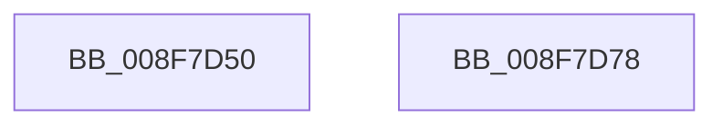

# PiSwLock

- RVA: `0x008F7D50`–`0x008F7D79` (길이 `41` bytes)
- VA: `0x00000001408F7D50`
- 실행 섹션: `PAGE`
- PDB 이름 있음: `예`; PDB Function 태그: `아니요`
- unwind 정보 RVA: `0x0005C788`
- 디코드: `10`개 명령, `41/41` bytes 표시
- 미해석 바이트: `0` (있으면 어셈블리에 `.byte`로 보존)

> 이 문서는 커널 이미지의 기계어와 PDB 기호를 분석해 생성했습니다. 4번과 5번은 함수 원형과 자료형을 바이너리 사용 방식에서 추정한 C 해석이며 원본 소스 복구 결과는 아닙니다.

## 1. Dependencies

- 직접 호출 지점: **1**; 고유 호출 대상: **1**
- 직접 호출자로 확인된 함수: **18**
- RIP 상대 이미지 참조: **1**

### Outgoing calls
- `0x008F7D6E` → [ExAcquireResourceExclusiveLite](../../text/21/ExAcquireResourceExclusiveLite_function_00214E20.md) (function, `0x00214E20`)

### Direct callers
- [PiSwIrpCancelStartCreate](../../text/5A/PiSwIrpCancelStartCreate_function_005A9E60.md) at `0x005A9E91`
- [PiSwIrpCleanup](../73/PiSwIrpCleanup_function_0073AC10.md) at `0x0073AC52`
- [PiSwIrpGetAttributes](../73/PiSwIrpGetAttributes_function_0073AE04.md) at `0x0073AE3E`
- [PiSwIrpGetLifetime](../73/PiSwIrpGetLifetime_function_0073AEA4.md) at `0x0073AEDE`
- [PiSwIrpSetAttributes](../73/PiSwIrpSetAttributes_function_0073AF44.md) at `0x0073AFAF`
- [PiSwIrpSetLifetime](../73/PiSwIrpSetLifetime_function_0073B080.md) at `0x0073B0E2`
- [PiSwFreePdoAssociationsList](../8D/PiSwFreePdoAssociationsList_function_008DA5B8.md) at `0x008DA5E3`
- [PiSwCompleteCreate](../8D/PiSwCompleteCreate_function_008DAB90.md) at `0x008DAC27`
- [PiSwIrpStartCreateWorker](../8D/PiSwIrpStartCreateWorker_function_008DB398.md) at `0x008DB3F4`
- [PiSwIrpInterfacePropertySet](PiSwIrpInterfacePropertySet_function_008F7900.md) at `0x008F79F9`
- [PipEnumerateCompleted](PipEnumerateCompleted_function_008F7B1C.md) at `0x008F7B60`
- [PiSwStopDestroy](PiSwStopDestroy_function_008FCA68.md) at `0x008FCA98`
- [PiSwProcessParentRemoveIrp](PiSwProcessParentRemoveIrp_function_008FCD6C.md) at `0x008FCDAF`
- [PiSwIrpInterfaceSetState](../94/PiSwIrpInterfaceSetState_function_0094DC24.md) at `0x0094DCF3`
- [PiSwPdoPnPDispatch](../94/PiSwPdoPnPDispatch_function_0094DDF0.md) at `0x0094DE43`
- [PiSwPdoPnPDispatch](../94/PiSwPdoPnPDispatch_function_0094DDF0.md) at `0x0094DF19`
- [PiSwPdoPnPDispatch](../94/PiSwPdoPnPDispatch_function_0094DDF0.md) at `0x0094DFB9`
- [PiSwPdoPnPDispatch](../94/PiSwPdoPnPDispatch_function_0094DDF0.md) at `0x0094DFEB`
- [PiSwPdoPnPDispatch](../94/PiSwPdoPnPDispatch_function_0094DDF0.md) at `0x0094E034`
- [PiSwPdoPnPDispatch](../94/PiSwPdoPnPDispatch_function_0094DDF0.md) at `0x0094E0EF`
- [PiSwPdoPnPDispatch](../94/PiSwPdoPnPDispatch_function_0094DDF0.md) at `0x0094E11E`
- [PiSwIrpPropertySet](../94/PiSwIrpPropertySet_function_0094E97C.md) at `0x0094EA73`
- [PiSwIrpInterfaceRegister](../94/PiSwIrpInterfaceRegister_function_0094F01C.md) at `0x0094F160`
- [PiSwIrpInterfaceRegister](../94/PiSwIrpInterfaceRegister_function_0094F01C.md) at `0x0094F317`
- [PiSwIrpInterfaceRegister](../94/PiSwIrpInterfaceRegister_function_0094F01C.md) at `0x0094F3F5`
- [PiSwProcessParentStartIrp](../A9/PiSwProcessParentStartIrp_function_00A97FC0.md) at `0x00A97FDD`

### Static image references
- `0x008F7D5D` → RVA `0x00F8AB20` (`.data`; read)

## 2. Other-region calls and transfers

- 다른 실행 섹션으로 향하는 call: **1**
  - `0x008F7D6E` → [ExAcquireResourceExclusiveLite](../../text/21/ExAcquireResourceExclusiveLite_function_00214E20.md) (`PAGE` → `.text`)
- 별도 외부 분기/꼬리 이동을 확인하지 못했습니다.

## 3. Assembly (complete function range)

```asm
008F7D50  48 83 EC 28                     sub rsp, 0x28
008F7D54  65 48 8B 04 25 88 01 00 00      mov rax, qword ptr gs:[0x188]
008F7D5D  48 8D 0D BC 2D 69 00            lea rcx, [rip + 0x692dbc]
008F7D64  B2 01                           mov dl, 1
008F7D66  66 FF 88 E4 01 00 00            dec word ptr [rax + 0x1e4]
008F7D6D  90                              nop
008F7D6E  E8 AD D0 91 FF                  call 0x140214e20
008F7D73  48 83 C4 28                     add rsp, 0x28
008F7D77  C3                              ret
008F7D78  CC                              int3
```

## 4. C-style interpretation (structured pseudocode)

```c
__int64 __fastcall PiSwLock(void)
{
    __int64 result;
    __int64 v_rsp;

    v_rsp = (v_rsp) - (40);
    result = ExAcquireResourceExclusiveLite(v_rip + 6892988, 1, a3, a4);
    v_rsp = (v_rsp) + (40);
    return result;
}
```

## 5. (Beta) C Style

```c
void PiSwLock(void)
{
    int64_t result;
    int64_t local_rsp;

    local_rsp = (local_rsp) - (40);
    result = ExAcquireResourceExclusiveLite(v_rip + 6892988, 1, a3, a4);
    local_rsp = (local_rsp) + (40);
    return result;
}
```

## 6. Execution-region graph

[열기: 2D/3D 그래프와 함수 탐색 컨트롤 패널](../../../control-panel.html?section=page&rva=0x008F7D50&view=graph)

- 2D 그래프는 위에서 아래로 흐르고, 3D 그래프는 빈 공간을 드래그해 회전합니다. Shift+드래그는 이동, 휠은 확대·축소, 함수 노드 선택은 대상 보고서 이동입니다.

### Static fallback


