# PiSwProcessParentRemoveIrp

- RVA: `0x008FCD6C`–`0x008FCEAB` (길이 `319` bytes)
- VA: `0x00000001408FCD6C`
- 실행 섹션: `PAGE`
- PDB 이름 있음: `예`; PDB Function 태그: `예`
- unwind 정보 RVA: `0x00088040`
- 디코드: `87`개 명령, `319/319` bytes 표시
- 미해석 바이트: `0` (있으면 어셈블리에 `.byte`로 보존)

> 이 문서는 커널 이미지의 기계어와 PDB 기호를 분석해 생성했습니다. 4번과 5번은 함수 원형과 자료형을 바이너리 사용 방식에서 추정한 C 해석이며 원본 소스 복구 결과는 아닙니다.

## 1. Dependencies

- 직접 호출 지점: **7**; 고유 호출 대상: **7**
- 직접 호출자로 확인된 함수: **1**
- RIP 상대 이미지 참조: **3**

### Outgoing calls
- `0x008FCDAF` → [PiSwLock](PiSwLock_function_008F7D50.md) (function, `0x008F7D50`)
- `0x008FCE01` → [PiSwDestroyDeviceObject](../94/PiSwDestroyDeviceObject_function_0094E384.md) (function, `0x0094E384`)
- `0x008FCE2A` → [PiSwFindSwDevice](../A9/PiSwFindSwDevice_function_00A9CA84.md) (function, `0x00A9CA84`)
- `0x008FCE46` → [ExReleaseResourceLite](../../text/25/ExReleaseResourceLite_function_0025FA10.md) (function, `0x0025FA10`)
- `0x008FCE4B` → [KeLeaveCriticalRegion](../../text/25/KeLeaveCriticalRegion_function_0025D8B0.md) (function, `0x0025D8B0`)
- `0x008FCE8E` → [PiSwProcessRemove](../94/PiSwProcessRemove_function_0094E3B8.md) (function, `0x0094E3B8`)
- `0x008FCEA4` → [PiSwCloseDescendants](../A9/PiSwCloseDescendants_function_00A9E564.md) (function, `0x00A9E564`)

### Direct callers
- [IopRemoveDevice](IopRemoveDevice_function_008FC7FC.md) at `0x008FC8B0`

### Static image references
- `0x008FCDB4` → RVA `0x00F8AB90` (`.data`; read)
- `0x008FCDE5` → RVA `0x00EF012C` (`.data`; read)
- `0x008FCE3F` → RVA `0x00F8AB20` (`.data`; read)

## 2. Other-region calls and transfers

- 다른 실행 섹션으로 향하는 call: **2**
  - `0x008FCE46` → [ExReleaseResourceLite](../../text/25/ExReleaseResourceLite_function_0025FA10.md) (`PAGE` → `.text`)
  - `0x008FCE4B` → [KeLeaveCriticalRegion](../../text/25/KeLeaveCriticalRegion_function_0025D8B0.md) (`PAGE` → `.text`)
- call이 아닌 외부 분기/꼬리 이동: **2**
  - `0x008FCE7A` → [sub_00B1FC90](../B1/Unknown_function_00B1FC90.md) (`tail-transfer`)
  - `0x008FCE84` → [sub_00B1FC90 + 0x3](../B1/Unknown_function_00B1FC90.md) (`tail-transfer`)

## 3. Assembly (complete function range)

```asm
008FCD6C  48 8B C4                        mov rax, rsp
008FCD6F  48 89 58 08                     mov qword ptr [rax + 8], rbx
008FCD73  48 89 68 10                     mov qword ptr [rax + 0x10], rbp
008FCD77  48 89 70 18                     mov qword ptr [rax + 0x18], rsi
008FCD7B  48 89 78 20                     mov qword ptr [rax + 0x20], rdi
008FCD7F  41 55                           push r13
008FCD81  41 56                           push r14
008FCD83  41 57                           push r15
008FCD85  48 83 EC 50                     sub rsp, 0x50
008FCD89  33 ED                           xor ebp, ebp
008FCD8B  48 8B F1                        mov rsi, rcx
008FCD8E  48 85 C9                        test rcx, rcx
008FCD91  0F 84 D9 00 00 00               je 0x1408fce70
008FCD97  48 8B 81 38 01 00 00            mov rax, qword ptr [rcx + 0x138]
008FCD9E  48 8B 50 28                     mov rdx, qword ptr [rax + 0x28]
008FCDA2  48 8D 42 28                     lea rax, [rdx + 0x28]
008FCDA6  48 F7 DA                        neg rdx
008FCDA9  48 1B DB                        sbb rbx, rbx
008FCDAC  48 23 D8                        and rbx, rax
008FCDAF  E8 9C AF FF FF                  call 0x1408f7d50
008FCDB4  48 8B 3D D5 DD 68 00            mov rdi, qword ptr [rip + 0x68ddd5]
008FCDBB  4C 8D 2D CE DD 68 00            lea r13, [rip + 0x68ddce]
008FCDC2  EB 42                           jmp 0x1408fce06
008FCDC4  4C 8B 70 18                     mov r14, qword ptr [rax + 0x18]
008FCDC8  49 8B 86 38 01 00 00            mov rax, qword ptr [r14 + 0x138]
008FCDCF  4D 8B 7E 40                     mov r15, qword ptr [r14 + 0x40]
008FCDD3  48 8B 48 28                     mov rcx, qword ptr [rax + 0x28]
008FCDD7  49 8B 17                        mov rdx, qword ptr [r15]
008FCDDA  48 85 C9                        test rcx, rcx
008FCDDD  48 8D 69 28                     lea rbp, [rcx + 0x28]
008FCDE1  49 0F 44 E8                     cmove rbp, r8
008FCDE5  F6 05 40 33 5F 00 40            test byte ptr [rip + 0x5f3340], 0x40
008FCDEC  0F 85 85 00 00 00               jne 0x1408fce77
008FCDF2  41 8B 47 08                     mov eax, dword ptr [r15 + 8]
008FCDF6  A8 20                           test al, 0x20
008FCDF8  0F 84 8B 00 00 00               je 0x1408fce89
008FCDFE  49 8B CE                        mov rcx, r14
008FCE01  E8 7E 15 05 00                  call 0x14094e384
008FCE06  49 3B FD                        cmp rdi, r13
008FCE09  74 11                           je 0x1408fce1c
008FCE0B  48 8D 07                        lea rax, [rdi]
008FCE0E  4C 8B C5                        mov r8, rbp
008FCE11  48 8B 3F                        mov rdi, qword ptr [rdi]
008FCE14  48 39 70 10                     cmp qword ptr [rax + 0x10], rsi
008FCE18  75 EC                           jne 0x1408fce06
008FCE1A  EB A8                           jmp 0x1408fcdc4
008FCE1C  48 85 DB                        test rbx, rbx
008FCE1F  74 1E                           je 0x1408fce3f
008FCE21  48 8B 4B 08                     mov rcx, qword ptr [rbx + 8]
008FCE25  48 85 C9                        test rcx, rcx
008FCE28  74 15                           je 0x1408fce3f
008FCE2A  E8 55 FC 19 00                  call 0x140a9ca84
008FCE2F  B2 01                           mov dl, 1
008FCE31  48 85 C0                        test rax, rax
008FCE34  74 6B                           je 0x1408fcea1
008FCE36  44 8B 40 04                     mov r8d, dword ptr [rax + 4]
008FCE3A  44 84 C2                        test dl, r8b
008FCE3D  74 59                           je 0x1408fce98
008FCE3F  48 8D 0D DA DC 68 00            lea rcx, [rip + 0x68dcda]
008FCE46  E8 C5 2B 96 FF                  call 0x14025fa10
008FCE4B  E8 60 0A 96 FF                  call 0x14025d8b0
008FCE50  4C 8D 5C 24 50                  lea r11, [rsp + 0x50]
008FCE55  49 8B 5B 20                     mov rbx, qword ptr [r11 + 0x20]
008FCE59  49 8B 6B 28                     mov rbp, qword ptr [r11 + 0x28]
008FCE5D  49 8B 73 30                     mov rsi, qword ptr [r11 + 0x30]
008FCE61  49 8B 7B 38                     mov rdi, qword ptr [r11 + 0x38]
008FCE65  49 8B E3                        mov rsp, r11
008FCE68  41 5F                           pop r15
008FCE6A  41 5E                           pop r14
008FCE6C  41 5D                           pop r13
008FCE6E  C3                              ret
008FCE6F  CC                              int3
008FCE70  33 D2                           xor edx, edx
008FCE72  E9 2B FF FF FF                  jmp 0x1408fcda2
008FCE77  48 85 D2                        test rdx, rdx
008FCE7A  0F 84 10 2E 22 00               je 0x140b1fc90
008FCE80  44 8B 5A 04                     mov r11d, dword ptr [rdx + 4]
008FCE84  E9 0A 2E 22 00                  jmp 0x140b1fc93
008FCE89  33 D2                           xor edx, edx
008FCE8B  49 8B CE                        mov rcx, r14
008FCE8E  E8 25 15 05 00                  call 0x14094e3b8
008FCE93  E9 66 FF FF FF                  jmp 0x1408fcdfe
008FCE98  83 B8 B4 00 00 00 00            cmp dword ptr [rax + 0xb4], 0
008FCE9F  75 9E                           jne 0x1408fce3f
008FCEA1  48 8B CB                        mov rcx, rbx
008FCEA4  E8 BB 16 1A 00                  call 0x140a9e564
008FCEA9  EB 94                           jmp 0x1408fce3f
```

## 4. C-style interpretation (structured pseudocode)

```c
__int64 __fastcall PiSwProcessParentRemoveIrp(__int64 a1, __int64 a2, __int64 a3)
{
    __int64 result;
    __int64 v_rbp;
    __int64 v_rbx;
    __int64 v_rsp;
    unsigned __int64 v_stack_m18;

    *(unsigned __int64 *)(v_rsp + 8) = v_rbx;
    *(unsigned __int64 *)(v_rsp + 16) = v_rbp;
    *(unsigned __int64 *)(v_rsp + 24) = v_rsi;
    *(unsigned __int64 *)(v_rsp + 32) = v_rdi;
    v_rsp = (v_rsp) - (80);
    v_rbp = 0;
    if (a1 == 0) goto loc_008FCE70;
loc_008FCDA2:
    a2 = -(*(unsigned __int64 *)(*(unsigned __int64 *)(a1 + 312) + 40));
    v_rbx = (v_rbx) & (*(unsigned __int64 *)(*(unsigned __int64 *)(a1 + 312) + 40) + 40);
    result = PiSwLock(a1, a2, a3, a4);
    goto loc_008FCE06;
loc_008FCDC4:
    v_rbp = *(unsigned __int64 *)(*(unsigned __int64 *)(*(unsigned __int64 *)(result + 24) + 312) + 40) + 40;
    if (*(unsigned __int64 *)(*(unsigned __int64 *)(*(unsigned __int64 *)(result + 24) + 312) + 40) == 0) { v_rbp = a3; }
    if (((*(unsigned __int8 *)(v_rip + 6239040)) & (64)) != 0) goto loc_008FCE77;
    if ((((unsigned __int8)((unsigned int)(*(unsigned int *)(*(unsigned __int64 *)(*(unsigned __int64 *)(result + 24) + 64) + 8)))) & (32)) == 0) goto loc_008FCE89;
loc_008FCDFE:
    result = PiSwDestroyDeviceObject(*(unsigned __int64 *)(result + 24), *(unsigned __int64 *)(*(unsigned __int64 *)(*(unsigned __int64 *)(result + 24) + 64)), a3, a4);
loc_008FCE06:
    if ((*(unsigned __int64 *)(v_rip + 6872533)) == (v_rip + 6872526)) goto loc_008FCE1C;
    if ((*(unsigned __int64 *)(*(unsigned __int64 *)(v_rip + 6872533) + 16)) != a1) goto loc_008FCE06;
    goto loc_008FCDC4;
loc_008FCE1C:
    if (v_rbx == 0) goto loc_008FCE3F;
    if (*(unsigned __int64 *)(v_rbx + 8) == 0) goto loc_008FCE3F;
    result = PiSwFindSwDevice(*(unsigned __int64 *)(v_rbx + 8), *(unsigned __int64 *)(*(unsigned __int64 *)(*(unsigned __int64 *)(result + 24) + 64)), v_rbp, a4);
    if (result == 0) goto loc_008FCEA1;
    if (((1) & ((unsigned __int8)((unsigned int)(*(unsigned int *)(result + 4))))) == 0) goto loc_008FCE98;
loc_008FCE3F:
    result = ExReleaseResourceLite(v_rip + 6872282, 1, (unsigned int)(*(unsigned int *)(result + 4)), a4);
    result = KeLeaveCriticalRegion(v_rip + 6872282, 1, (unsigned int)(*(unsigned int *)(result + 4)), a4);
    return result;
loc_008FCE70:
    a2 = 0;
    goto loc_008FCDA2;
loc_008FCE77:
loc_008FCE89:
    a2 = 0;
    result = PiSwProcessRemove(*(unsigned __int64 *)(result + 24), a2, (unsigned int)(*(unsigned int *)(result + 4)), a4);
    goto loc_008FCDFE;
loc_008FCE98:
    if ((*(unsigned int *)(result + 180)) != 0) goto loc_008FCE3F;
loc_008FCEA1:
    result = PiSwCloseDescendants(*(unsigned __int64 *)(v_stack_m18 + 32), a2, (unsigned int)(*(unsigned int *)(result + 4)), a4);
    goto loc_008FCE3F;
}
```

## 5. (Beta) C Style

```c
int64_t PiSwProcessParentRemoveIrp(int64_t Arg1, int64_t Arg2, int64_t Arg3)
{
    int64_t result;
    int64_t local_rbp;
    int64_t local_rbx;
    int64_t local_rsp;
    uint64_t v_stack_m18;

    *(uint64_t *)(local_rsp + 0x8) = local_rbx;
    *(uint64_t *)(local_rsp + 0x10) = local_rbp;
    *(uint64_t *)(local_rsp + 0x18) = local_rsi;
    *(uint64_t *)(local_rsp + 0x20) = local_rdi;
    local_rsp = (local_rsp) - (80);
    local_rbp = 0;
    if (Arg1 == 0) goto loc_008FCE70;
loc_008FCDA2:
    Arg2 = -(*(uint64_t *)(*(uint64_t *)(Arg1 + 0x138) + 0x28));
    local_rbx = (local_rbx) & (*(uint64_t *)(*(uint64_t *)(Arg1 + 0x138) + 0x28) + 40);
    result = PiSwLock(Arg1, Arg2, Arg3, a4);
    goto loc_008FCE06;
loc_008FCDC4:
    local_rbp = *(uint64_t *)(*(uint64_t *)(*(uint64_t *)(result + 0x18) + 0x138) + 0x28) + 40;
    if (*(uint64_t *)(*(uint64_t *)(*(uint64_t *)(result + 0x18) + 0x138) + 0x28) == 0) { local_rbp = Arg3; }
    if (((*(uint8_t *)(v_rip + 0x5F3340)) & (64)) != 0) goto loc_008FCE77;
    if ((((uint8_t)((uint32_t)(*(uint32_t *)(*(uint64_t *)(*(uint64_t *)(result + 0x18) + 0x40) + 0x8)))) & (32)) == 0) goto loc_008FCE89;
loc_008FCDFE:
    result = PiSwDestroyDeviceObject(*(uint64_t *)(result + 0x18), *(uint64_t *)(*(uint64_t *)(*(uint64_t *)(result + 0x18) + 0x40)), Arg3, a4);
loc_008FCE06:
    if ((*(uint64_t *)(v_rip + 0x68DDD5)) == (v_rip + 6872526)) goto loc_008FCE1C;
    if ((*(uint64_t *)(*(uint64_t *)(v_rip + 0x68DDD5) + 0x10)) != Arg1) goto loc_008FCE06;
    goto loc_008FCDC4;
loc_008FCE1C:
    if (local_rbx == 0) goto loc_008FCE3F;
    if (*(uint64_t *)(local_rbx + 0x8) == 0) goto loc_008FCE3F;
    result = PiSwFindSwDevice(*(uint64_t *)(local_rbx + 0x8), *(uint64_t *)(*(uint64_t *)(*(uint64_t *)(result + 0x18) + 0x40)), local_rbp, a4);
    if (result == 0) goto loc_008FCEA1;
    if (((1) & ((uint8_t)((uint32_t)(*(uint32_t *)(result + 0x4))))) == 0) goto loc_008FCE98;
loc_008FCE3F:
    result = ExReleaseResourceLite(v_rip + 6872282, 1, (uint32_t)(*(uint32_t *)(result + 0x4)), a4);
    result = KeLeaveCriticalRegion(v_rip + 6872282, 1, (uint32_t)(*(uint32_t *)(result + 0x4)), a4);
    return result;
loc_008FCE70:
    Arg2 = 0;
    goto loc_008FCDA2;
loc_008FCE77:
loc_008FCE89:
    Arg2 = 0;
    result = PiSwProcessRemove(*(uint64_t *)(result + 0x18), Arg2, (uint32_t)(*(uint32_t *)(result + 0x4)), a4);
    goto loc_008FCDFE;
loc_008FCE98:
    if ((*(uint32_t *)(result + 0xB4)) != 0) goto loc_008FCE3F;
loc_008FCEA1:
    result = PiSwCloseDescendants(*(uint64_t *)(v_stack_m18 + 0x20), Arg2, (uint32_t)(*(uint32_t *)(result + 0x4)), a4);
    goto loc_008FCE3F;
}
```

## 6. Execution-region graph

[열기: 2D/3D 그래프와 함수 탐색 컨트롤 패널](../../../control-panel.html?section=page&rva=0x008FCD6C&view=graph)

- 2D 그래프는 위에서 아래로 흐르고, 3D 그래프는 빈 공간을 드래그해 회전합니다. Shift+드래그는 이동, 휠은 확대·축소, 함수 노드 선택은 대상 보고서 이동입니다.

### Static fallback

```mermaid
flowchart TD
  bb_008FCD6C[BB_008FCD6C]
  bb_008FCD97[BB_008FCD97]
  bb_008FCDA2[BB_008FCDA2]
  bb_008FCDC4[BB_008FCDC4]
  bb_008FCDF2[BB_008FCDF2]
  bb_008FCDFE[BB_008FCDFE]
  bb_008FCE06[BB_008FCE06]
  bb_008FCE0B[BB_008FCE0B]
  bb_008FCE1A[BB_008FCE1A]
  bb_008FCE1C[BB_008FCE1C]
  bb_008FCE21[BB_008FCE21]
  bb_008FCE2A[BB_008FCE2A]
  bb_008FCE36[BB_008FCE36]
  bb_008FCE3F[BB_008FCE3F]
  bb_008FCE6F[BB_008FCE6F]
  bb_008FCE70[BB_008FCE70]
  bb_008FCE77[BB_008FCE77]
  bb_008FCE80[BB_008FCE80]
  bb_008FCE89[BB_008FCE89]
  bb_008FCE98[BB_008FCE98]
  bb_008FCEA1[BB_008FCEA1]
  bb_008FCD6C -->|branch| bb_008FCE70
  bb_008FCD6C -->|fallthrough| bb_008FCD97
  bb_008FCD97 -->|flow| bb_008FCDA2
  bb_008FCDA2 -->|branch| bb_008FCE06
  bb_008FCDC4 -->|branch| bb_008FCE77
  bb_008FCDC4 -->|fallthrough| bb_008FCDF2
  bb_008FCDF2 -->|branch| bb_008FCE89
  bb_008FCDF2 -->|fallthrough| bb_008FCDFE
  bb_008FCDFE -->|flow| bb_008FCE06
  bb_008FCE06 -->|branch| bb_008FCE1C
  bb_008FCE06 -->|fallthrough| bb_008FCE0B
  bb_008FCE0B -->|branch| bb_008FCE06
  bb_008FCE0B -->|fallthrough| bb_008FCE1A
  bb_008FCE1A -->|branch| bb_008FCDC4
  bb_008FCE1C -->|branch| bb_008FCE3F
  bb_008FCE1C -->|fallthrough| bb_008FCE21
  bb_008FCE21 -->|branch| bb_008FCE3F
  bb_008FCE21 -->|fallthrough| bb_008FCE2A
  bb_008FCE2A -->|branch| bb_008FCEA1
  bb_008FCE2A -->|fallthrough| bb_008FCE36
  bb_008FCE36 -->|branch| bb_008FCE98
  bb_008FCE36 -->|fallthrough| bb_008FCE3F
  bb_008FCE6F -->|flow| bb_008FCE70
  bb_008FCE70 -->|branch| bb_008FCDA2
  bb_008FCE77 -->|fallthrough| bb_008FCE80
  bb_008FCE89 -->|branch| bb_008FCDFE
  bb_008FCE98 -->|branch| bb_008FCE3F
  bb_008FCE98 -->|fallthrough| bb_008FCEA1
  bb_008FCEA1 -->|branch| bb_008FCE3F
```


