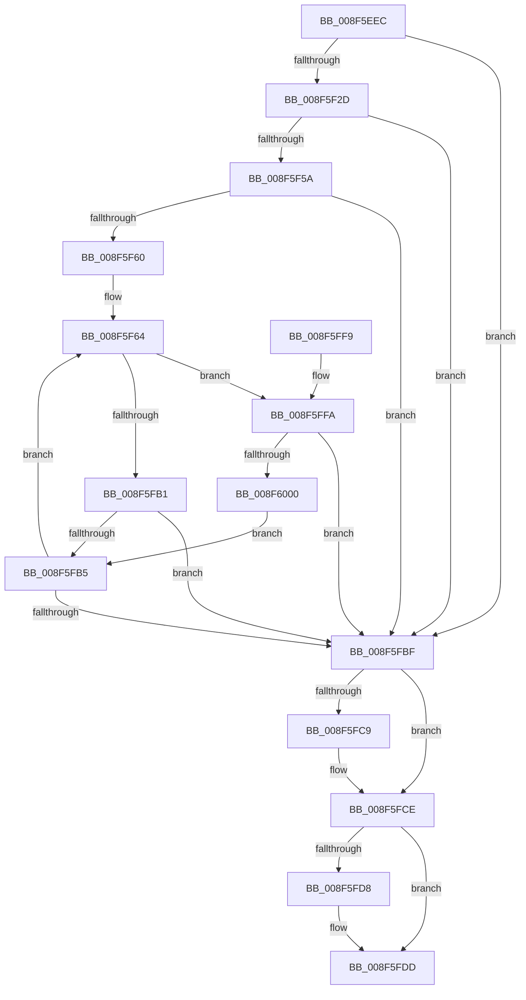

# PiSwPropertySet

- RVA: `0x008F5EEC`–`0x008F6004` (길이 `280` bytes)
- VA: `0x00000001408F5EEC`
- 실행 섹션: `PAGE`
- PDB 이름 있음: `예`; PDB Function 태그: `아니요`
- unwind 정보 RVA: `0x000878B4`
- 디코드: `82`개 명령, `280/280` bytes 표시
- 미해석 바이트: `0` (있으면 어셈블리에 `.byte`로 보존)

> 이 문서는 커널 이미지의 기계어와 PDB 기호를 분석해 생성했습니다. 4번과 5번은 함수 원형과 자료형을 바이너리 사용 방식에서 추정한 C 해석이며 원본 소스 복구 결과는 아닙니다.

## 1. Dependencies

- 직접 호출 지점: **5**; 고유 호출 대상: **5**
- 직접 호출자로 확인된 함수: **6**
- RIP 상대 이미지 참조: **1**

### Outgoing calls
- `0x008F5F1E` → [PiPnpRtlBeginOperation](../8E/PiPnpRtlBeginOperation_function_008E033C.md) (function, `0x008E033C`)
- `0x008F5F4F` → [PnpOpenObjectRegKey](../8E/PnpOpenObjectRegKey_function_008E15E8.md) (function, `0x008E15E8`)
- `0x008F5FA3` → [PiPnpRtlSetObjectProperty](PiPnpRtlSetObjectProperty_function_008F62A0.md) (function, `0x008F62A0`)
- `0x008F5FC9` → [ZwClose](../../text/6A/ZwClose_function_006AD2B0.md) (function, `0x006AD2B0`)
- `0x008F5FD8` → [PiPnpRtlEndOperation](../8E/PiPnpRtlEndOperation_function_008E0518.md) (function, `0x008E0518`)

### Direct callers
- [PiSwCompleteCreate](../8D/PiSwCompleteCreate_function_008DAB90.md) at `0x008DAE51`
- [PiSwCompleteCreate](../8D/PiSwCompleteCreate_function_008DAB90.md) at `0x008DAF84`
- [PiSwIrpStartCreateWorker](../8D/PiSwIrpStartCreateWorker_function_008DB398.md) at `0x008DB4D1`
- [PiSwIrpInterfacePropertySet](PiSwIrpInterfacePropertySet_function_008F7900.md) at `0x008F7A69`
- [PiSwIrpPropertySet](../94/PiSwIrpPropertySet_function_0094E97C.md) at `0x0094EAF2`
- [PiSwIrpInterfaceRegister](../94/PiSwIrpInterfaceRegister_function_0094F01C.md) at `0x0094F308`
- [sub_00B1C3F8](../B1/Unknown_function_00B1C3F8.md) at `0x00B1C488`

### Static image references
- `0x008F5F2D` → RVA `0x00E66398` (`.data`; read)

## 2. Other-region calls and transfers

- 다른 실행 섹션으로 향하는 call: **1**
  - `0x008F5FC9` → [ZwClose](../../text/6A/ZwClose_function_006AD2B0.md) (`PAGE` → `.text`)
- 별도 외부 분기/꼬리 이동을 확인하지 못했습니다.

## 3. Assembly (complete function range)

```asm
008F5EEC  48 8B C4                        mov rax, rsp
008F5EEF  48 89 58 08                     mov qword ptr [rax + 8], rbx
008F5EF3  48 89 68 10                     mov qword ptr [rax + 0x10], rbp
008F5EF7  48 89 70 18                     mov qword ptr [rax + 0x18], rsi
008F5EFB  57                              push rdi
008F5EFC  41 56                           push r14
008F5EFE  41 57                           push r15
008F5F00  48 83 EC 70                     sub rsp, 0x70
008F5F04  48 83 60 D8 00                  and qword ptr [rax - 0x28], 0
008F5F09  4C 8B F9                        mov r15, rcx
008F5F0C  48 83 60 D0 00                  and qword ptr [rax - 0x30], 0
008F5F11  48 8D 48 D8                     lea rcx, [rax - 0x28]
008F5F15  41 8B E9                        mov ebp, r9d
008F5F18  49 8B F8                        mov rdi, r8
008F5F1B  44 8B F2                        mov r14d, edx
008F5F1E  E8 19 A4 FE FF                  call 0x1408e033c
008F5F23  8B D8                           mov ebx, eax
008F5F25  85 C0                           test eax, eax
008F5F27  0F 88 92 00 00 00               js 0x1408f5fbf
008F5F2D  48 8B 0D 64 04 57 00            mov rcx, qword ptr [rip + 0x570464]
008F5F34  48 8D 44 24 58                  lea rax, [rsp + 0x58]
008F5F39  48 89 44 24 28                  mov qword ptr [rsp + 0x28], rax
008F5F3E  41 B9 07 00 00 00               mov r9d, 7
008F5F44  45 8B C6                        mov r8d, r14d
008F5F47  C6 44 24 20 00                  mov byte ptr [rsp + 0x20], 0
008F5F4C  49 8B D7                        mov rdx, r15
008F5F4F  E8 94 B6 FE FF                  call 0x1408e15e8
008F5F54  8B D8                           mov ebx, eax
008F5F56  85 C0                           test eax, eax
008F5F58  78 65                           js 0x1408f5fbf
008F5F5A  33 F6                           xor esi, esi
008F5F5C  85 ED                           test ebp, ebp
008F5F5E  74 5F                           je 0x1408f5fbf
008F5F60  48 83 C7 28                     add rdi, 0x28
008F5F64  83 64 24 48 00                  and dword ptr [rsp + 0x48], 0
008F5F69  48 8D 4F D8                     lea rcx, [rdi - 0x28]
008F5F6D  8B 47 FC                        mov eax, dword ptr [rdi - 4]
008F5F70  45 8B C6                        mov r8d, r14d
008F5F73  4C 8B 4C 24 58                  mov r9, qword ptr [rsp + 0x58]
008F5F78  49 8B D7                        mov rdx, r15
008F5F7B  89 44 24 40                     mov dword ptr [rsp + 0x40], eax
008F5F7F  48 8B 07                        mov rax, qword ptr [rdi]
008F5F82  48 89 44 24 38                  mov qword ptr [rsp + 0x38], rax
008F5F87  8B 47 F8                        mov eax, dword ptr [rdi - 8]
008F5F8A  89 44 24 30                     mov dword ptr [rsp + 0x30], eax
008F5F8E  48 8B 47 F0                     mov rax, qword ptr [rdi - 0x10]
008F5F92  48 89 4C 24 28                  mov qword ptr [rsp + 0x28], rcx
008F5F97  48 8B 0D FA 03 57 00            mov rcx, qword ptr [rip + 0x5703fa]
008F5F9E  48 89 44 24 20                  mov qword ptr [rsp + 0x20], rax
008F5FA3  E8 F8 02 00 00                  call 0x1408f62a0
008F5FA8  8B D8                           mov ebx, eax
008F5FAA  3D 25 02 00 C0                  cmp eax, 0xc0000225
008F5FAF  74 49                           je 0x1408f5ffa
008F5FB1  85 C0                           test eax, eax
008F5FB3  78 0A                           js 0x1408f5fbf
008F5FB5  FF C6                           inc esi
008F5FB7  48 83 C7 30                     add rdi, 0x30
008F5FBB  3B F5                           cmp esi, ebp
008F5FBD  72 A5                           jb 0x1408f5f64
008F5FBF  48 8B 4C 24 58                  mov rcx, qword ptr [rsp + 0x58]
008F5FC4  48 85 C9                        test rcx, rcx
008F5FC7  74 05                           je 0x1408f5fce
008F5FC9  E8 E2 72 DB FF                  call 0x1406ad2b0
008F5FCE  48 8B 4C 24 60                  mov rcx, qword ptr [rsp + 0x60]
008F5FD3  48 85 C9                        test rcx, rcx
008F5FD6  74 05                           je 0x1408f5fdd
008F5FD8  E8 3B A5 FE FF                  call 0x1408e0518
008F5FDD  4C 8D 5C 24 70                  lea r11, [rsp + 0x70]
008F5FE2  8B C3                           mov eax, ebx
008F5FE4  49 8B 5B 20                     mov rbx, qword ptr [r11 + 0x20]
008F5FE8  49 8B 6B 28                     mov rbp, qword ptr [r11 + 0x28]
008F5FEC  49 8B 73 30                     mov rsi, qword ptr [r11 + 0x30]
008F5FF0  49 8B E3                        mov rsp, r11
008F5FF3  41 5F                           pop r15
008F5FF5  41 5E                           pop r14
008F5FF7  5F                              pop rdi
008F5FF8  C3                              ret
008F5FF9  CC                              int3
008F5FFA  83 7F F8 00                     cmp dword ptr [rdi - 8], 0
008F5FFE  75 BF                           jne 0x1408f5fbf
008F6000  33 DB                           xor ebx, ebx
008F6002  EB B1                           jmp 0x1408f5fb5
```

## 4. C-style interpretation (structured pseudocode)

```c
__int64 __fastcall PiSwPropertySet(__int64 a1, int a2, __int64 a3, int a4)
{
    __int64 result;
    __int64 v_rbx;
    __int64 v_rdi;
    __int64 v_rsi;
    __int64 v_rsp;
    unsigned __int64 v_stack_m18;
    unsigned __int64 v_stack_m28;
    unsigned __int64 v_stack_m30;
    unsigned int v_stack_m40;
    unsigned int v_stack_m48;
    unsigned __int64 v_stack_m50;
    unsigned int v_stack_m58;
    unsigned __int64 v_stack_m60;
    unsigned __int8 v_stack_m68;

    *(unsigned __int64 *)(v_rsp + 8) = v_rbx;
    *(unsigned __int64 *)(v_rsp + 16) = v_rbp;
    *(unsigned __int64 *)(v_rsp + 24) = v_rsi;
    v_rsp = (v_rsp) - (112);
    result = PiPnpRtlBeginOperation(v_rsp - 40, a2, a3, a4);
    if (sign_flag) goto loc_008F5FBF;
    v_stack_m60 = v_stack_m30;
    v_stack_m68 = 0;
    result = PnpOpenObjectRegKey(*(unsigned __int64 *)(v_rip + 5702756), a1, (unsigned int)((unsigned int)((unsigned int)(a2))), 7);
    if (sign_flag) goto loc_008F5FBF;
    v_rsi = 0;
    if ((unsigned int)((unsigned int)(a4)) == 0) goto loc_008F5FBF;
    v_rdi = (a3) + (40);
loc_008F5F64:
    v_stack_m48 = (unsigned int)((unsigned int)(*(unsigned int *)(v_rdi - 4)));
    v_stack_m50 = *(unsigned __int64 *)(v_rdi);
    v_stack_m58 = (unsigned int)((unsigned int)(*(unsigned int *)(v_rdi - 8)));
    v_stack_m60 = v_rdi - 40;
    v_stack_m68 = *(unsigned __int64 *)(v_rdi - 16);
    result = PiPnpRtlSetObjectProperty(*(unsigned __int64 *)(v_rip + 5702650), a1, (unsigned int)((unsigned int)((unsigned int)(a2))), v_stack_m30);
    if (((unsigned int)(result)) == 0xC0000225ULL) goto loc_008F5FFA;
    if (sign_flag) goto loc_008F5FBF;
loc_008F5FB5:
    v_rsi = (unsigned int)((v_rsi) + 1);
    v_rdi = (v_rdi) + (48);
    if (((unsigned int)(v_rsi)) < ((unsigned int)((unsigned int)(a4)))) goto loc_008F5F64;
loc_008F5FBF:
    if (v_stack_m30 != 0) {
        result = ZwClose(v_stack_m30, a1, (unsigned int)((unsigned int)((unsigned int)(a2))), v_stack_m30);
    }
    if (v_stack_m28 != 0) {
        result = PiPnpRtlEndOperation(v_stack_m28, a1, (unsigned int)((unsigned int)((unsigned int)(a2))), v_stack_m30);
    }
    return (unsigned int)((unsigned int)((unsigned int)((unsigned int)(result))));
loc_008F5FFA:
    if ((*(unsigned int *)(v_rdi - 8)) != 0) goto loc_008F5FBF;
    v_rbx = 0;
    goto loc_008F5FB5;
}
```

## 5. (Beta) C Style

```c
int64_t PiSwPropertySet(int64_t Arg1, int32_t Arg2, void *Arg3, int32_t Arg4)
{
    uint8_t *arg3 = (uint8_t *)Arg3;

    int64_t result;
    int64_t local_rbx;
    int64_t local_rdi;
    int64_t local_rsi;
    int64_t local_rsp;
    uint64_t v_stack_m18;
    uint64_t v_stack_m28;
    uint64_t v_stack_m30;
    uint32_t v_stack_m40;
    uint32_t v_stack_m48;
    uint64_t v_stack_m50;
    uint32_t v_stack_m58;
    uint64_t v_stack_m60;
    uint8_t v_stack_m68;

    *(uint64_t *)(local_rsp + 0x8) = local_rbx;
    *(uint64_t *)(local_rsp + 0x10) = local_rbp;
    *(uint64_t *)(local_rsp + 0x18) = local_rsi;
    local_rsp = (local_rsp) - (112);
    result = PiPnpRtlBeginOperation(local_rsp - 40, Arg2, Arg3, Arg4);
    if (sign_flag) goto loc_008F5FBF;
    v_stack_m60 = v_stack_m30;
    v_stack_m68 = 0;
    result = PnpOpenObjectRegKey(*(uint64_t *)(v_rip + 0x570464), Arg1, (uint32_t)((uint32_t)((uint32_t)(Arg2))), 7);
    if (sign_flag) goto loc_008F5FBF;
    local_rsi = 0;
    if ((uint32_t)((uint32_t)(Arg4)) == 0) goto loc_008F5FBF;
    local_rdi = (Arg3) + (40);
loc_008F5F64:
    v_stack_m48 = (uint32_t)((uint32_t)(*(uint32_t *)(local_rdi - 0x4)));
    v_stack_m50 = *(uint64_t *)(local_rdi);
    v_stack_m58 = (uint32_t)((uint32_t)(*(uint32_t *)(local_rdi - 0x8)));
    v_stack_m60 = local_rdi - 40;
    v_stack_m68 = *(uint64_t *)(local_rdi - 0x10);
    result = PiPnpRtlSetObjectProperty(*(uint64_t *)(v_rip + 0x5703FA), Arg1, (uint32_t)((uint32_t)((uint32_t)(Arg2))), v_stack_m30);
    if (((uint32_t)(result)) == 0xC0000225ULL) goto loc_008F5FFA;
    if (sign_flag) goto loc_008F5FBF;
loc_008F5FB5:
    local_rsi = (uint32_t)((local_rsi) + 1);
    local_rdi = (local_rdi) + (48);
    if (((uint32_t)(local_rsi)) < ((uint32_t)((uint32_t)(Arg4)))) goto loc_008F5F64;
loc_008F5FBF:
    if (v_stack_m30 != 0) {
        result = ZwClose(v_stack_m30, Arg1, (uint32_t)((uint32_t)((uint32_t)(Arg2))), v_stack_m30);
    }
    if (v_stack_m28 != 0) {
        result = PiPnpRtlEndOperation(v_stack_m28, Arg1, (uint32_t)((uint32_t)((uint32_t)(Arg2))), v_stack_m30);
    }
    return (uint32_t)((uint32_t)((uint32_t)((uint32_t)(result))));
loc_008F5FFA:
    if ((*(uint32_t *)(local_rdi - 0x8)) != 0) goto loc_008F5FBF;
    local_rbx = 0;
    goto loc_008F5FB5;
}
```

### 관측된 메모리 오프셋

구조체 형식이 확인되지 않은 접근은 인자 기준의 오프셋으로만 기록했습니다.

| 기준 인자 | 오프셋 표현 | 폭 (bit) | 접근 |
|---|---:|---:|---|
| `Arg3` | `- 0x28` | `64` | `R` |
| `Arg3` | `- 0x10` | `64` | `R` |
| `Arg3` | `- 0x8` | `32` | `R` |
| `Arg3` | `- 0x4` | `32` | `R` |
| `Arg3` | `+ 0x0` | `64` | `R` |

## 6. Execution-region graph

[열기: 2D/3D 그래프와 함수 탐색 컨트롤 패널](../../../control-panel.html?section=page&rva=0x008F5EEC&view=graph)

- 2D 그래프는 위에서 아래로 흐르고, 3D 그래프는 빈 공간을 드래그해 회전합니다. Shift+드래그는 이동, 휠은 확대·축소, 함수 노드 선택은 대상 보고서 이동입니다.

### Static fallback


