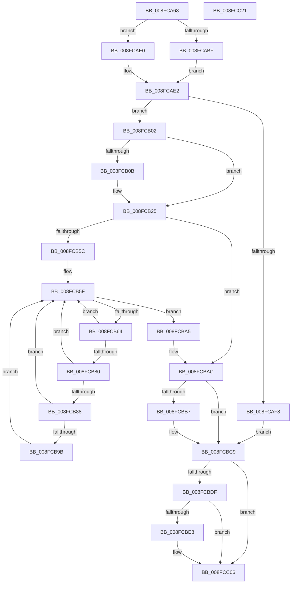

# PiSwStopDestroy

- RVA: `0x008FCA68`–`0x008FCC22` (길이 `442` bytes)
- VA: `0x00000001408FCA68`
- 실행 섹션: `PAGE`
- PDB 이름 있음: `예`; PDB Function 태그: `아니요`
- unwind 정보 RVA: `0x00087FF4`
- 디코드: `113`개 명령, `442/442` bytes 표시
- 미해석 바이트: `0` (있으면 어셈블리에 `.byte`로 보존)

> 이 문서는 커널 이미지의 기계어와 PDB 기호를 분석해 생성했습니다. 4번과 5번은 함수 원형과 자료형을 바이너리 사용 방식에서 추정한 C 해석이며 원본 소스 복구 결과는 아닙니다.

## 1. Dependencies

- 직접 호출 지점: **12**; 고유 호출 대상: **12**
- 직접 호출자로 확인된 함수: **1**
- RIP 상대 이미지 참조: **7**

### Outgoing calls
- `0x008FCA98` → [PiSwLock](PiSwLock_function_008F7D50.md) (function, `0x008F7D50`)
- `0x008FCAA5` → [RtlInitUnicodeString](../../text/42/RtlInitUnicodeString_function_0042A780.md) (function, `0x0042A780`)
- `0x008FCAD6` → [RtlLookupElementGenericTableAvl](../../text/3F/RtlLookupElementGenericTableAvl_function_003FEFB0.md) (function, `0x003FEFB0`)
- `0x008FCB20` → [McTemplateK0zzz_EtwWriteTransfer](../../text/5A/McTemplateK0zzz_EtwWriteTransfer_function_005A96BC.md) (function, `0x005A96BC`)
- `0x008FCB51` → [PnpConcatPWSTR](../99/PnpConcatPWSTR_function_00990A00.md) (function, `0x00990A00`)
- `0x008FCB77` → [wcsicmp](../../text/50/wcsicmp_function_00500080.md) (function, `0x00500080`)
- `0x008FCB91` → [PiSwFindPdoAssociation](../A9/PiSwFindPdoAssociation_function_00A90934.md) (function, `0x00A90934`)
- `0x008FCB9E` → [PiSwCloseDevice](../AA/PiSwCloseDevice_function_00AAB6F4.md) (function, `0x00AAB6F4`)
- `0x008FCBC4` → [ExFreePoolWithTag](../../poolcode/B8/ExFreePoolWithTag_function_00B82870.md) (function, `0x00B82870`)
- `0x008FCBD0` → [ExReleaseResourceLite](../../text/25/ExReleaseResourceLite_function_0025FA10.md) (function, `0x0025FA10`)
- `0x008FCBD5` → [KeLeaveCriticalRegion](../../text/25/KeLeaveCriticalRegion_function_0025D8B0.md) (function, `0x0025D8B0`)
- `0x008FCC01` → [McTemplateK0zzzd_EtwWriteTransfer](../../text/5A/McTemplateK0zzzd_EtwWriteTransfer_function_005A97D4.md) (function, `0x005A97D4`)

### Direct callers
- [IopRemoveDevice](IopRemoveDevice_function_008FC7FC.md) at `0x008FC8BD`

### Static image references
- `0x008FCAC9` → RVA `0x00F8ABA0` (`.data`; read)
- `0x008FCAE9` → RVA `0x00011750` (`.rdata`; read)
- `0x008FCB02` → RVA `0x00EF012C` (`.data`; read)
- `0x008FCB11` → RVA `0x00027530` (`.rdata`; read)
- `0x008FCB25` → RVA `0x0001C650` (`.rdata`; read)
- `0x008FCBC9` → RVA `0x00F8AB20` (`.data`; read)
- `0x008FCBEC` → RVA `0x00026CB0` (`.rdata`; read)

## 2. Other-region calls and transfers

- 다른 실행 섹션으로 향하는 call: **8**
  - `0x008FCAA5` → [RtlInitUnicodeString](../../text/42/RtlInitUnicodeString_function_0042A780.md) (`PAGE` → `.text`)
  - `0x008FCAD6` → [RtlLookupElementGenericTableAvl](../../text/3F/RtlLookupElementGenericTableAvl_function_003FEFB0.md) (`PAGE` → `.text`)
  - `0x008FCB20` → [McTemplateK0zzz_EtwWriteTransfer](../../text/5A/McTemplateK0zzz_EtwWriteTransfer_function_005A96BC.md) (`PAGE` → `.text`)
  - `0x008FCB77` → [wcsicmp](../../text/50/wcsicmp_function_00500080.md) (`PAGE` → `.text`)
  - `0x008FCBC4` → [ExFreePoolWithTag](../../poolcode/B8/ExFreePoolWithTag_function_00B82870.md) (`PAGE` → `POOLCODE`)
  - `0x008FCBD0` → [ExReleaseResourceLite](../../text/25/ExReleaseResourceLite_function_0025FA10.md) (`PAGE` → `.text`)
  - `0x008FCBD5` → [KeLeaveCriticalRegion](../../text/25/KeLeaveCriticalRegion_function_0025D8B0.md) (`PAGE` → `.text`)
  - `0x008FCC01` → [McTemplateK0zzzd_EtwWriteTransfer](../../text/5A/McTemplateK0zzzd_EtwWriteTransfer_function_005A97D4.md) (`PAGE` → `.text`)
- 별도 외부 분기/꼬리 이동을 확인하지 못했습니다.

## 3. Assembly (complete function range)

```asm
008FCA68  48 8B C4                        mov rax, rsp
008FCA6B  48 89 58 08                     mov qword ptr [rax + 8], rbx
008FCA6F  48 89 68 10                     mov qword ptr [rax + 0x10], rbp
008FCA73  4C 89 48 20                     mov qword ptr [rax + 0x20], r9
008FCA77  56                              push rsi
008FCA78  57                              push rdi
008FCA79  41 54                           push r12
008FCA7B  41 55                           push r13
008FCA7D  41 56                           push r14
008FCA7F  48 83 EC 70                     sub rsp, 0x70
008FCA83  48 83 60 20 00                  and qword ptr [rax + 0x20], 0
008FCA88  0F 57 C0                        xorps xmm0, xmm0
008FCA8B  0F 11 40 A8                     movups xmmword ptr [rax - 0x58], xmm0
008FCA8F  4D 8B E8                        mov r13, r8
008FCA92  4C 8B E2                        mov r12, rdx
008FCA95  45 32 F6                        xor r14b, r14b
008FCA98  E8 B3 B2 FF FF                  call 0x1408f7d50
008FCA9D  49 8B D4                        mov rdx, r12
008FCAA0  48 8D 4C 24 40                  lea rcx, [rsp + 0x40]
008FCAA5  E8 D6 DC B2 FF                  call 0x14042a780
008FCAAA  48 83 7C 24 48 00               cmp qword ptr [rsp + 0x48], 0
008FCAB0  0F 57 C0                        xorps xmm0, xmm0
008FCAB3  0F 11 44 24 50                  movups xmmword ptr [rsp + 0x50], xmm0
008FCAB8  0F 11 44 24 60                  movups xmmword ptr [rsp + 0x60], xmm0
008FCABD  74 21                           je 0x1408fcae0
008FCABF  0F 10 44 24 40                  movups xmm0, xmmword ptr [rsp + 0x40]
008FCAC4  48 8D 54 24 50                  lea rdx, [rsp + 0x50]
008FCAC9  48 8D 0D D0 E0 68 00            lea rcx, [rip + 0x68e0d0]
008FCAD0  F3 0F 7F 44 24 50               movdqu xmmword ptr [rsp + 0x50], xmm0
008FCAD6  E8 D5 24 B0 FF                  call 0x1403fefb0
008FCADB  48 8B C8                        mov rcx, rax
008FCADE  EB 02                           jmp 0x1408fcae2
008FCAE0  33 C9                           xor ecx, ecx
008FCAE2  48 8D 41 10                     lea rax, [rcx + 0x10]
008FCAE6  48 F7 D9                        neg rcx
008FCAE9  48 8D 35 60 4C 71 FF            lea rsi, [rip - 0x8eb3a0]
008FCAF0  48 1B DB                        sbb rbx, rbx
008FCAF3  48 23 D8                        and rbx, rax
008FCAF6  75 0A                           jne 0x1408fcb02
008FCAF8  BF 34 00 00 C0                  mov edi, 0xc0000034
008FCAFD  E9 C7 00 00 00                  jmp 0x1408fcbc9
008FCB02  F6 05 23 36 5F 00 40            test byte ptr [rip + 0x5f3623], 0x40
008FCB09  74 1A                           je 0x1408fcb25
008FCB0B  48 83 64 24 28 00               and qword ptr [rsp + 0x28], 0
008FCB11  48 8D 15 18 AA 72 FF            lea rdx, [rip - 0x8d55e8]
008FCB18  4D 8B CC                        mov r9, r12
008FCB1B  48 89 74 24 20                  mov qword ptr [rsp + 0x20], rsi
008FCB20  E8 97 CB CA FF                  call 0x1405a96bc
008FCB25  48 8D 05 24 FB 71 FF            lea rax, [rip - 0x8e04dc]
008FCB2C  48 89 74 24 28                  mov qword ptr [rsp + 0x28], rsi
008FCB31  41 B9 02 00 00 00               mov r9d, 2
008FCB37  48 89 44 24 20                  mov qword ptr [rsp + 0x20], rax
008FCB3C  4C 8D 84 24 B8 00 00 00         lea r8, [rsp + 0xb8]
008FCB44  BA 50 6E 70 57                  mov edx, 0x57706e50
008FCB49  B9 C8 00 00 00                  mov ecx, 0xc8
008FCB4E  41 B6 01                        mov r14b, 1
008FCB51  E8 AA 3E 09 00                  call 0x140990a00
008FCB56  8B F8                           mov edi, eax
008FCB58  85 C0                           test eax, eax
008FCB5A  78 50                           js 0x1408fcbac
008FCB5C  48 8B 33                        mov rsi, qword ptr [rbx]
008FCB5F  48 3B F3                        cmp rsi, rbx
008FCB62  74 41                           je 0x1408fcba5
008FCB64  48 8B 94 24 B8 00 00 00         mov rdx, qword ptr [rsp + 0xb8]
008FCB6C  48 8D 6E A0                     lea rbp, [rsi - 0x60]
008FCB70  48 8B 4D 08                     mov rcx, qword ptr [rbp + 8]
008FCB74  48 8B 36                        mov rsi, qword ptr [rsi]
008FCB77  E8 04 35 C0 FF                  call 0x140500080
008FCB7C  85 C0                           test eax, eax
008FCB7E  75 DF                           jne 0x1408fcb5f
008FCB80  8B 45 04                        mov eax, dword ptr [rbp + 4]
008FCB83  41 84 C6                        test r14b, al
008FCB86  75 D7                           jne 0x1408fcb5f
008FCB88  45 8A C6                        mov r8b, r14b
008FCB8B  49 8B D5                        mov rdx, r13
008FCB8E  48 8B CD                        mov rcx, rbp
008FCB91  E8 9E 3D 19 00                  call 0x140a90934
008FCB96  48 85 C0                        test rax, rax
008FCB99  74 C4                           je 0x1408fcb5f
008FCB9B  48 8B CD                        mov rcx, rbp
008FCB9E  E8 51 EB 1A 00                  call 0x140aab6f4
008FCBA3  EB BA                           jmp 0x1408fcb5f
008FCBA5  48 8D 35 A4 4B 71 FF            lea rsi, [rip - 0x8eb45c]
008FCBAC  48 83 BC 24 B8 00 00 00 00      cmp qword ptr [rsp + 0xb8], 0
008FCBB5  74 12                           je 0x1408fcbc9
008FCBB7  48 8B 8C 24 B8 00 00 00         mov rcx, qword ptr [rsp + 0xb8]
008FCBBF  BA 50 6E 70 57                  mov edx, 0x57706e50
008FCBC4  E8 A7 5C 28 00                  call 0x140b82870
008FCBC9  48 8D 0D 50 DF 68 00            lea rcx, [rip + 0x68df50]
008FCBD0  E8 3B 2E 96 FF                  call 0x14025fa10
008FCBD5  E8 D6 0C 96 FF                  call 0x14025d8b0
008FCBDA  45 84 F6                        test r14b, r14b
008FCBDD  74 27                           je 0x1408fcc06
008FCBDF  F6 05 46 35 5F 00 40            test byte ptr [rip + 0x5f3546], 0x40
008FCBE6  74 1E                           je 0x1408fcc06
008FCBE8  89 7C 24 30                     mov dword ptr [rsp + 0x30], edi
008FCBEC  48 8D 15 BD A0 72 FF            lea rdx, [rip - 0x8d5f43]
008FCBF3  48 83 64 24 28 00               and qword ptr [rsp + 0x28], 0
008FCBF9  4D 8B CC                        mov r9, r12
008FCBFC  48 89 74 24 20                  mov qword ptr [rsp + 0x20], rsi
008FCC01  E8 CE CB CA FF                  call 0x1405a97d4
008FCC06  4C 8D 5C 24 70                  lea r11, [rsp + 0x70]
008FCC0B  8B C7                           mov eax, edi
008FCC0D  49 8B 5B 30                     mov rbx, qword ptr [r11 + 0x30]
008FCC11  49 8B 6B 38                     mov rbp, qword ptr [r11 + 0x38]
008FCC15  49 8B E3                        mov rsp, r11
008FCC18  41 5E                           pop r14
008FCC1A  41 5D                           pop r13
008FCC1C  41 5C                           pop r12
008FCC1E  5F                              pop rdi
008FCC1F  5E                              pop rsi
008FCC20  C3                              ret
008FCC21  CC                              int3
```

## 4. C-style interpretation (structured pseudocode)

```c
__int64 __fastcall PiSwStopDestroy(__int64 a1, __int64 a2, __int64 a3, __int64 a4)
{
    __int64 result;
    __int64 v_r14;
    __int64 v_rbx;
    __int64 v_rsp;
    unsigned __int64 v_stack_m28;
    unsigned __int64 v_stack_m38;
    unsigned __int64 v_stack_m48;
    unsigned __int64 v_stack_m50;
    unsigned __int64 v_stack_m58;
    unsigned int v_stack_m68;
    unsigned __int64 v_stack_m70;
    unsigned __int64 v_stack_m78;
    unsigned __int64 v_stack_p20;

    *(unsigned __int64 *)(v_rsp + 8) = v_rbx;
    *(unsigned __int64 *)(v_rsp + 16) = v_rbp;
    *(unsigned __int64 *)(v_rsp + 32) = a4;
    v_rsp = (v_rsp) - (112);
    *(unsigned __int64 *)(v_rsp - 88) = v_xmm0;
    v_r14 = 0;
    result = PiSwLock(a1, a2, a3, a4);
    result = RtlInitUnicodeString(v_stack_m58, a2, a3, a4);
    v_stack_m48 = v_xmm0;
    v_stack_m38 = v_xmm0;
    if (v_stack_m50 == 0) goto loc_008FCAE0;
    v_stack_m48 = v_xmm0;
    result = RtlLookupElementGenericTableAvl(v_rip + 6873296, v_stack_m48, a3, a4);
    goto loc_008FCAE2;
loc_008FCAE0:
    a1 = 0;
loc_008FCAE2:
    a1 = -(a1);
    v_rbx = (v_rbx) & (a1 + 16);
    if (condition_is_not_equal) goto loc_008FCB02;
    goto loc_008FCBC9;
loc_008FCB02:
    result = a1 + 16;
    if (((*(unsigned __int8 *)(v_rip + 6239779)) & (64)) != 0) {
        a2 = v_rip - 9262568;
        a4 = a2;
        v_stack_m78 = v_rip - 9352096;
        result = McTemplateK0zzz_EtwWriteTransfer(a1, a2, a3, a4);
    }
    v_stack_m70 = v_rip - 9352096;
    v_stack_m78 = v_rip - 9307356;
    result = PnpConcatPWSTR(200, (unsigned int)(0x57706E50ULL), v_stack_p20, 2);
    if (sign_flag) goto loc_008FCBAC;
loc_008FCB5F:
    if ((*(unsigned __int64 *)(v_rbx)) == v_rbx) goto loc_008FCBA5;
    result = wcsicmp(*(unsigned __int64 *)(*(unsigned __int64 *)(v_rbx) - 96 + 8), v_stack_p20, v_stack_p20, 2);
    if ((unsigned int)(result) != 0) goto loc_008FCB5F;
    if (((1) & ((unsigned __int8)((unsigned int)(*(unsigned int *)(*(unsigned __int64 *)(v_rbx) - 96 + 4))))) != 0) goto loc_008FCB5F;
    result = PiSwFindPdoAssociation(*(unsigned __int64 *)(v_rbx) - 96, a3, 1, 2);
    if (result == 0) goto loc_008FCB5F;
    result = PiSwCloseDevice(*(unsigned __int64 *)(v_rbx) - 96, a3, 1, 2);
    goto loc_008FCB5F;
loc_008FCBA5:
loc_008FCBAC:
    if (v_stack_p20 != 0) {
        a1 = v_stack_p20;
        a2 = 0x57706E50ULL;
        result = ExFreePoolWithTag(a1, a2, 1, 2);
    }
    result = ExReleaseResourceLite(v_rip + 6872912, a2, 1, 2);
    result = KeLeaveCriticalRegion(v_rip + 6872912, a2, 1, 2);
    if (1 == 0) goto loc_008FCC06;
    if (((*(unsigned __int8 *)(v_rip + 6239558)) & (64)) != 0) {
        v_stack_m68 = (unsigned int)((unsigned int)((unsigned int)(result)));
        a2 = v_rip - 9264963;
        a4 = a2;
        v_stack_m78 = v_rip - 9352284;
        result = McTemplateK0zzzd_EtwWriteTransfer(v_rip + 6872912, a2, 1, a4);
    }
    return (unsigned int)((unsigned int)((unsigned int)((unsigned int)(result))));
}
```

## 5. (Beta) C Style

```c
int64_t PiSwStopDestroy(int64_t Arg1, int64_t Arg2, int64_t Arg3, int64_t Arg4)
{
    int64_t result;
    int64_t local_r14;
    int64_t local_rbx;
    int64_t local_rsp;
    uint64_t v_stack_m28;
    uint64_t v_stack_m38;
    uint64_t v_stack_m48;
    uint64_t v_stack_m50;
    uint64_t v_stack_m58;
    uint32_t v_stack_m68;
    uint64_t v_stack_m70;
    uint64_t v_stack_m78;
    uint64_t v_stack_p20;

    *(uint64_t *)(local_rsp + 0x8) = local_rbx;
    *(uint64_t *)(local_rsp + 0x10) = local_rbp;
    *(uint64_t *)(local_rsp + 0x20) = Arg4;
    local_rsp = (local_rsp) - (112);
    *(uint64_t *)(local_rsp - 0x58) = v_xmm0;
    local_r14 = 0;
    result = PiSwLock(Arg1, Arg2, Arg3, Arg4);
    result = RtlInitUnicodeString(v_stack_m58, Arg2, Arg3, Arg4);
    v_stack_m48 = v_xmm0;
    v_stack_m38 = v_xmm0;
    if (v_stack_m50 == 0) goto loc_008FCAE0;
    v_stack_m48 = v_xmm0;
    result = RtlLookupElementGenericTableAvl(v_rip + 6873296, v_stack_m48, Arg3, Arg4);
    goto loc_008FCAE2;
loc_008FCAE0:
    Arg1 = 0;
loc_008FCAE2:
    Arg1 = -(Arg1);
    local_rbx = (local_rbx) & (Arg1 + 16);
    if (condition_is_not_equal) goto loc_008FCB02;
    goto loc_008FCBC9;
loc_008FCB02:
    result = Arg1 + 16;
    if (((*(uint8_t *)(v_rip + 0x5F3623)) & (64)) != 0) {
        Arg2 = v_rip - 9262568;
        Arg4 = Arg2;
        v_stack_m78 = v_rip - 9352096;
        result = McTemplateK0zzz_EtwWriteTransfer(Arg1, Arg2, Arg3, Arg4);
    }
    v_stack_m70 = v_rip - 9352096;
    v_stack_m78 = v_rip - 9307356;
    result = PnpConcatPWSTR(200, (uint32_t)(0x57706E50ULL), v_stack_p20, 2);
    if (sign_flag) goto loc_008FCBAC;
loc_008FCB5F:
    if ((*(uint64_t *)(local_rbx)) == local_rbx) goto loc_008FCBA5;
    result = wcsicmp(*(uint64_t *)(*(uint64_t *)(local_rbx) - 0x60 + 0x8), v_stack_p20, v_stack_p20, 2);
    if ((uint32_t)(result) != 0) goto loc_008FCB5F;
    if (((1) & ((uint8_t)((uint32_t)(*(uint32_t *)(*(uint64_t *)(local_rbx) - 0x60 + 0x4))))) != 0) goto loc_008FCB5F;
    result = PiSwFindPdoAssociation(*(uint64_t *)(local_rbx) - 96, Arg3, 1, 2);
    if (result == 0) goto loc_008FCB5F;
    result = PiSwCloseDevice(*(uint64_t *)(local_rbx) - 96, Arg3, 1, 2);
    goto loc_008FCB5F;
loc_008FCBA5:
loc_008FCBAC:
    if (v_stack_p20 != 0) {
        Arg1 = v_stack_p20;
        Arg2 = 0x57706E50ULL;
        result = ExFreePoolWithTag(Arg1, Arg2, 1, 2);
    }
    result = ExReleaseResourceLite(v_rip + 6872912, Arg2, 1, 2);
    result = KeLeaveCriticalRegion(v_rip + 6872912, Arg2, 1, 2);
    if (1 == 0) goto loc_008FCC06;
    if (((*(uint8_t *)(v_rip + 0x5F3546)) & (64)) != 0) {
        v_stack_m68 = (uint32_t)((uint32_t)((uint32_t)(result)));
        Arg2 = v_rip - 9264963;
        Arg4 = Arg2;
        v_stack_m78 = v_rip - 9352284;
        result = McTemplateK0zzzd_EtwWriteTransfer(v_rip + 6872912, Arg2, 1, Arg4);
    }
    return (uint32_t)((uint32_t)((uint32_t)((uint32_t)(result))));
}
```

## 6. Execution-region graph

[열기: 2D/3D 그래프와 함수 탐색 컨트롤 패널](../../../control-panel.html?section=page&rva=0x008FCA68&view=graph)

- 2D 그래프는 위에서 아래로 흐르고, 3D 그래프는 빈 공간을 드래그해 회전합니다. Shift+드래그는 이동, 휠은 확대·축소, 함수 노드 선택은 대상 보고서 이동입니다.

### Static fallback


