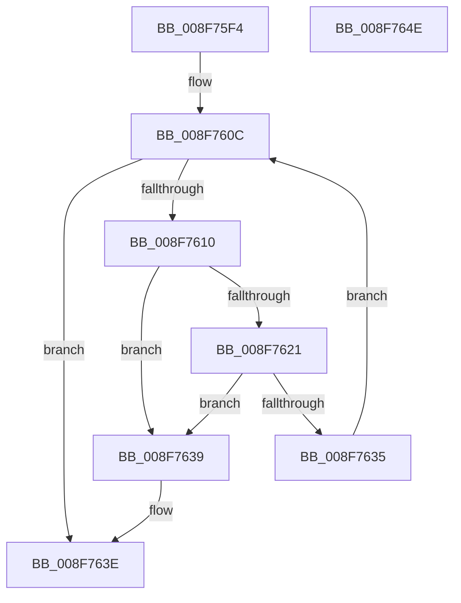

# PiSwValidatePropertyArray

- RVA: `0x008F75F4`–`0x008F764F` (길이 `91` bytes)
- VA: `0x00000001408F75F4`
- 실행 섹션: `PAGE`
- PDB 이름 있음: `예`; PDB Function 태그: `아니요`
- unwind 정보 RVA: `0x00060BC4`
- 디코드: `30`개 명령, `91/91` bytes 표시
- 미해석 바이트: `0` (있으면 어셈블리에 `.byte`로 보존)

> 이 문서는 커널 이미지의 기계어와 PDB 기호를 분석해 생성했습니다. 4번과 5번은 함수 원형과 자료형을 바이너리 사용 방식에서 추정한 C 해석이며 원본 소스 복구 결과는 아닙니다.

## 1. Dependencies

- 직접 호출 지점: **1**; 고유 호출 대상: **1**
- 직접 호출자로 확인된 함수: **4**
- RIP 상대 이미지 참조: **0**

### Outgoing calls
- `0x008F762C` → [PnpValidatePropertyData](PnpValidatePropertyData_function_008F7658.md) (function, `0x008F7658`)

### Direct callers
- [PiSwValidateCreateData](../8D/PiSwValidateCreateData_function_008DB958.md) at `0x008DBBAC`
- [PiSwIrpInterfacePropertySet](PiSwIrpInterfacePropertySet_function_008F7900.md) at `0x008F79EE`
- [PiSwIrpPropertySet](../94/PiSwIrpPropertySet_function_0094E97C.md) at `0x0094EA64`
- [PiSwIrpInterfaceRegister](../94/PiSwIrpInterfaceRegister_function_0094F01C.md) at `0x0094F155`

### Static image references
- 디코드된 RIP-relative 메모리 참조가 없습니다.

## 2. Other-region calls and transfers

- 다른 실행 섹션으로 향하는 call: **0**
- 별도 외부 분기/꼬리 이동을 확인하지 못했습니다.

## 3. Assembly (complete function range)

```asm
008F75F4  48 89 5C 24 08                  mov qword ptr [rsp + 8], rbx
008F75F9  48 89 74 24 10                  mov qword ptr [rsp + 0x10], rsi
008F75FE  57                              push rdi
008F75FF  48 83 EC 20                     sub rsp, 0x20
008F7603  33 C0                           xor eax, eax
008F7605  8B FA                           mov edi, edx
008F7607  33 DB                           xor ebx, ebx
008F7609  48 8B F1                        mov rsi, rcx
008F760C  3B DF                           cmp ebx, edi
008F760E  73 2E                           jae 0x1408f763e
008F7610  48 8D 0C 5B                     lea rcx, [rbx + rbx*2]
008F7614  48 C1 E1 04                     shl rcx, 4
008F7618  48 03 CE                        add rcx, rsi
008F761B  83 79 14 00                     cmp dword ptr [rcx + 0x14], 0
008F761F  75 18                           jne 0x1408f7639
008F7621  44 8B 41 20                     mov r8d, dword ptr [rcx + 0x20]
008F7625  8B 51 24                        mov edx, dword ptr [rcx + 0x24]
008F7628  48 8B 49 28                     mov rcx, qword ptr [rcx + 0x28]
008F762C  E8 27 00 00 00                  call 0x1408f7658
008F7631  85 C0                           test eax, eax
008F7633  78 04                           js 0x1408f7639
008F7635  FF C3                           inc ebx
008F7637  EB D3                           jmp 0x1408f760c
008F7639  B8 0D 00 00 C0                  mov eax, 0xc000000d
008F763E  48 8B 5C 24 30                  mov rbx, qword ptr [rsp + 0x30]
008F7643  48 8B 74 24 38                  mov rsi, qword ptr [rsp + 0x38]
008F7648  48 83 C4 20                     add rsp, 0x20
008F764C  5F                              pop rdi
008F764D  C3                              ret
008F764E  CC                              int3
```

## 4. C-style interpretation (structured pseudocode)

```c
__int64 __fastcall PiSwValidatePropertyArray(__int64 a1, int a2)
{
    __int64 result;
    __int64 v_rbx;
    __int64 v_rsp;
    unsigned __int64 v_stack_p10;
    unsigned __int64 v_stack_p8;

    v_stack_p8 = v_rbx;
    v_stack_p10 = v_rsi;
    v_rsp = (v_rsp) - (32);
    result = 0;
    v_rbx = 0;
loc_008F760C:
    if (0 >= ((unsigned int)((unsigned int)(a2)))) goto loc_008F763E;
    a1 = (v_rbx + v_rbx * 2) << (4);
    a1 = (a1) + (a1);
    if ((*(unsigned int *)(a1 + 20)) != 0) goto loc_008F7639;
    result = PnpValidatePropertyData(*(unsigned __int64 *)(a1 + 40), (unsigned int)(*(unsigned int *)(a1 + 36)), (unsigned int)(*(unsigned int *)(a1 + 32)), a4);
    if (sign_flag) goto loc_008F7639;
    v_rbx = (unsigned int)((v_rbx) + 1);
    goto loc_008F760C;
loc_008F7639:
loc_008F763E:
    v_rsp = (v_rsp) + (32);
    return (unsigned int)(0xC000000DULL);
}
```

## 5. (Beta) C Style

```c
int64_t PiSwValidatePropertyArray(int64_t Arg1, int32_t Arg2)
{
    int64_t result;
    int64_t local_rbx;
    int64_t local_rsp;
    uint64_t v_stack_p10;
    uint64_t v_stack_p8;

    v_stack_p8 = local_rbx;
    v_stack_p10 = local_rsi;
    local_rsp = (local_rsp) - (32);
    result = 0;
    local_rbx = 0;
loc_008F760C:
    if (0 >= ((uint32_t)((uint32_t)(Arg2)))) goto loc_008F763E;
    Arg1 = (local_rbx + local_rbx * 2) << (4);
    Arg1 = (Arg1) + (Arg1);
    if ((*(uint32_t *)(Arg1 + 0x14)) != 0) goto loc_008F7639;
    result = PnpValidatePropertyData(*(uint64_t *)(Arg1 + 0x28), (uint32_t)(*(uint32_t *)(Arg1 + 0x24)), (uint32_t)(*(uint32_t *)(Arg1 + 0x20)), a4);
    if (sign_flag) goto loc_008F7639;
    local_rbx = (uint32_t)((local_rbx) + 1);
    goto loc_008F760C;
loc_008F7639:
loc_008F763E:
    local_rsp = (local_rsp) + (32);
    return (uint32_t)(0xC000000DULL);
}
```

## 6. Execution-region graph

[열기: 2D/3D 그래프와 함수 탐색 컨트롤 패널](../../../control-panel.html?section=page&rva=0x008F75F4&view=graph)

- 2D 그래프는 위에서 아래로 흐르고, 3D 그래프는 빈 공간을 드래그해 회전합니다. Shift+드래그는 이동, 휠은 확대·축소, 함수 노드 선택은 대상 보고서 이동입니다.

### Static fallback


