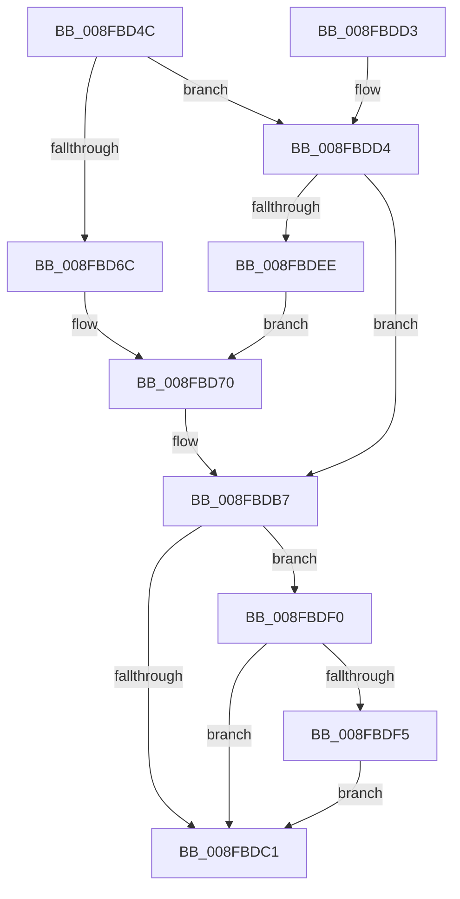

# PiUpdateDevicePanel

- RVA: `0x008FBD4C`–`0x008FBDFC` (길이 `176` bytes)
- VA: `0x00000001408FBD4C`
- 실행 섹션: `PAGE`
- PDB 이름 있음: `예`; PDB Function 태그: `아니요`
- unwind 정보 RVA: `0x00087ED8`
- 디코드: `47`개 명령, `176/176` bytes 표시
- 미해석 바이트: `0` (있으면 어셈블리에 `.byte`로 보존)

> 이 문서는 커널 이미지의 기계어와 PDB 기호를 분석해 생성했습니다. 4번과 5번은 함수 원형과 자료형을 바이너리 사용 방식에서 추정한 C 해석이며 원본 소스 복구 결과는 아닙니다.

## 1. Dependencies

- 직접 호출 지점: **6**; 고유 호출 대상: **6**
- 직접 호출자로 확인된 함수: **3**
- RIP 상대 이미지 참조: **2**

### Outgoing calls
- `0x008FBD8A` → [ExAcquireResourceSharedLite](../../text/21/ExAcquireResourceSharedLite_function_00211BC0.md) (function, `0x00211BC0`)
- `0x008FBD9F` → [_CmUpdateDevicePanel](../A0/_CmUpdateDevicePanel_function_00A0A16C.md) (function, `0x00A0A16C`)
- `0x008FBDAD` → [ExReleaseResourceLite](../../text/25/ExReleaseResourceLite_function_0025FA10.md) (function, `0x0025FA10`)
- `0x008FBDB2` → [KeLeaveCriticalRegion](../../text/25/KeLeaveCriticalRegion_function_0025D8B0.md) (function, `0x0025D8B0`)
- `0x008FBDE3` → [PnpDeviceObjectToDeviceInstance](PnpDeviceObjectToDeviceInstance_function_008FD630.md) (function, `0x008FD630`)
- `0x008FBDF5` → [ZwClose](../../text/6A/ZwClose_function_006AD2B0.md) (function, `0x006AD2B0`)

### Direct callers
- [PipProcessStartPhase3](PipProcessStartPhase3_function_008FBAF8.md) at `0x008FBB9B`
- [PiProcessNewDeviceNode](../A2/PiProcessNewDeviceNode_function_00A28F20.md) at `0x00A2A342`
- [sub_00B1F622](../B1/Unknown_function_00B1F622.md) at `0x00B1F963`

### Static image references
- `0x008FBD79` → RVA `0x00F8C600` (`.data`; read)
- `0x008FBD98` → RVA `0x00E66398` (`.data`; read)

## 2. Other-region calls and transfers

- 다른 실행 섹션으로 향하는 call: **4**
  - `0x008FBD8A` → [ExAcquireResourceSharedLite](../../text/21/ExAcquireResourceSharedLite_function_00211BC0.md) (`PAGE` → `.text`)
  - `0x008FBDAD` → [ExReleaseResourceLite](../../text/25/ExReleaseResourceLite_function_0025FA10.md) (`PAGE` → `.text`)
  - `0x008FBDB2` → [KeLeaveCriticalRegion](../../text/25/KeLeaveCriticalRegion_function_0025D8B0.md) (`PAGE` → `.text`)
  - `0x008FBDF5` → [ZwClose](../../text/6A/ZwClose_function_006AD2B0.md) (`PAGE` → `.text`)
- 별도 외부 분기/꼬리 이동을 확인하지 못했습니다.

## 3. Assembly (complete function range)

```asm
008FBD4C  48 8B C4                        mov rax, rsp
008FBD4F  48 89 58 08                     mov qword ptr [rax + 8], rbx
008FBD53  48 89 70 18                     mov qword ptr [rax + 0x18], rsi
008FBD57  57                              push rdi
008FBD58  48 83 EC 20                     sub rsp, 0x20
008FBD5C  48 83 60 10 00                  and qword ptr [rax + 0x10], 0
008FBD61  48 8B DA                        mov rbx, rdx
008FBD64  48 8B F1                        mov rsi, rcx
008FBD67  48 85 D2                        test rdx, rdx
008FBD6A  74 68                           je 0x1408fbdd4
008FBD6C  48 89 50 10                     mov qword ptr [rax + 0x10], rdx
008FBD70  65 48 8B 04 25 88 01 00 00      mov rax, qword ptr gs:[0x188]
008FBD79  48 8D 0D 80 08 69 00            lea rcx, [rip + 0x690880]
008FBD80  B2 01                           mov dl, 1
008FBD82  66 FF 88 E4 01 00 00            dec word ptr [rax + 0x1e4]
008FBD89  90                              nop
008FBD8A  E8 31 5E 91 FF                  call 0x140211bc0
008FBD8F  4C 8B 44 24 38                  mov r8, qword ptr [rsp + 0x38]
008FBD94  48 8B 56 30                     mov rdx, qword ptr [rsi + 0x30]
008FBD98  48 8B 0D F9 A5 56 00            mov rcx, qword ptr [rip + 0x56a5f9]
008FBD9F  E8 C8 E3 10 00                  call 0x140a0a16c
008FBDA4  48 8D 0D 55 08 69 00            lea rcx, [rip + 0x690855]
008FBDAB  8B F8                           mov edi, eax
008FBDAD  E8 5E 3C 96 FF                  call 0x14025fa10
008FBDB2  E8 F9 1A 96 FF                  call 0x14025d8b0
008FBDB7  48 8B 4C 24 38                  mov rcx, qword ptr [rsp + 0x38]
008FBDBC  48 85 C9                        test rcx, rcx
008FBDBF  75 2F                           jne 0x1408fbdf0
008FBDC1  48 8B 5C 24 30                  mov rbx, qword ptr [rsp + 0x30]
008FBDC6  8B C7                           mov eax, edi
008FBDC8  48 8B 74 24 40                  mov rsi, qword ptr [rsp + 0x40]
008FBDCD  48 83 C4 20                     add rsp, 0x20
008FBDD1  5F                              pop rdi
008FBDD2  C3                              ret
008FBDD3  CC                              int3
008FBDD4  48 8B 49 20                     mov rcx, qword ptr [rcx + 0x20]
008FBDD8  48 8D 54 24 38                  lea rdx, [rsp + 0x38]
008FBDDD  41 B8 19 00 02 00               mov r8d, 0x20019
008FBDE3  E8 48 18 00 00                  call 0x1408fd630
008FBDE8  8B F8                           mov edi, eax
008FBDEA  85 C0                           test eax, eax
008FBDEC  78 C9                           js 0x1408fbdb7
008FBDEE  EB 80                           jmp 0x1408fbd70
008FBDF0  48 3B CB                        cmp rcx, rbx
008FBDF3  74 CC                           je 0x1408fbdc1
008FBDF5  E8 B6 14 DB FF                  call 0x1406ad2b0
008FBDFA  EB C5                           jmp 0x1408fbdc1
```

## 4. C-style interpretation (structured pseudocode)

```c
__int64 __fastcall PiUpdateDevicePanel(__int64 a1, __int64 a2)
{
    __int64 result;
    __int64 v_rsp;
    unsigned __int64 v_stack_p10;
    unsigned __int64 v_stack_p18;
    unsigned __int64 v_stack_p38;
    unsigned __int64 v_stack_p8;

    *(unsigned __int64 *)(v_rsp + 8) = v_rbx;
    *(unsigned __int64 *)(v_rsp + 24) = v_rsi;
    v_rsp = (v_rsp) - (32);
    if (a2 == 0) goto loc_008FBDD4;
    *(unsigned __int64 *)(v_rsp + 16) = a2;
loc_008FBD70:
    result = ExAcquireResourceSharedLite(v_rip + 6883456, 1, a3, a4);
    result = _CmUpdateDevicePanel(*(unsigned __int64 *)(v_rip + 5678585), *(unsigned __int64 *)(a1 + 48), v_stack_p10, a4);
    result = ExReleaseResourceLite(v_rip + 6883413, *(unsigned __int64 *)(a1 + 48), v_stack_p10, a4);
    result = KeLeaveCriticalRegion(v_rip + 6883413, *(unsigned __int64 *)(a1 + 48), v_stack_p10, a4);
loc_008FBDB7:
    if (v_stack_p10 != 0) goto loc_008FBDF0;
loc_008FBDC1:
    v_rsp = (v_rsp) + (32);
    return (unsigned int)((unsigned int)((unsigned int)((unsigned int)(result))));
loc_008FBDD4:
    result = PnpDeviceObjectToDeviceInstance(*(unsigned __int64 *)(v_stack_p10 + 32), v_stack_p38, (unsigned int)(0x20019ULL), a4);
    if (sign_flag) goto loc_008FBDB7;
    goto loc_008FBD70;
loc_008FBDF0:
    if ((*(unsigned __int64 *)(v_stack_p10 + 32)) == v_stack_p8) goto loc_008FBDC1;
    result = ZwClose(*(unsigned __int64 *)(v_stack_p10 + 32), v_stack_p38, (unsigned int)(0x20019ULL), a4);
    goto loc_008FBDC1;
}
```

## 5. (Beta) C Style

```c
int64_t PiUpdateDevicePanel(void *Arg1, int64_t Arg2)
{
    uint8_t *arg1 = (uint8_t *)Arg1;

    int64_t result;
    int64_t local_rsp;
    uint64_t v_stack_p10;
    uint64_t v_stack_p18;
    uint64_t v_stack_p38;
    uint64_t v_stack_p8;

    *(uint64_t *)(local_rsp + 0x8) = local_rbx;
    *(uint64_t *)(local_rsp + 0x18) = local_rsi;
    local_rsp = (local_rsp) - (32);
    if (Arg2 == 0) goto loc_008FBDD4;
    *(uint64_t *)(local_rsp + 0x10) = Arg2;
loc_008FBD70:
    result = ExAcquireResourceSharedLite(v_rip + 6883456, 1, a3, a4);
    result = _CmUpdateDevicePanel(*(uint64_t *)(v_rip + 0x56A5F9), *(uint64_t *)(arg1 + 0x30), v_stack_p10, a4);
    result = ExReleaseResourceLite(v_rip + 6883413, *(uint64_t *)(arg1 + 0x30), v_stack_p10, a4);
    result = KeLeaveCriticalRegion(v_rip + 6883413, *(uint64_t *)(arg1 + 0x30), v_stack_p10, a4);
loc_008FBDB7:
    if (v_stack_p10 != 0) goto loc_008FBDF0;
loc_008FBDC1:
    local_rsp = (local_rsp) + (32);
    return (uint32_t)((uint32_t)((uint32_t)((uint32_t)(result))));
loc_008FBDD4:
    result = PnpDeviceObjectToDeviceInstance(*(uint64_t *)(v_stack_p10 + 0x20), v_stack_p38, (uint32_t)(0x20019ULL), a4);
    if (sign_flag) goto loc_008FBDB7;
    goto loc_008FBD70;
loc_008FBDF0:
    if ((*(uint64_t *)(v_stack_p10 + 0x20)) == v_stack_p8) goto loc_008FBDC1;
    result = ZwClose(*(uint64_t *)(v_stack_p10 + 0x20), v_stack_p38, (uint32_t)(0x20019ULL), a4);
    goto loc_008FBDC1;
}
```

### 관측된 메모리 오프셋

구조체 형식이 확인되지 않은 접근은 인자 기준의 오프셋으로만 기록했습니다.

| 기준 인자 | 오프셋 표현 | 폭 (bit) | 접근 |
|---|---:|---:|---|
| `Arg1` | `+ 0x20` | `64` | `R` |
| `Arg1` | `+ 0x30` | `64` | `R` |

## 6. Execution-region graph

[열기: 2D/3D 그래프와 함수 탐색 컨트롤 패널](../../../control-panel.html?section=page&rva=0x008FBD4C&view=graph)

- 2D 그래프는 위에서 아래로 흐르고, 3D 그래프는 빈 공간을 드래그해 회전합니다. Shift+드래그는 이동, 휠은 확대·축소, 함수 노드 선택은 대상 보고서 이동입니다.

### Static fallback


