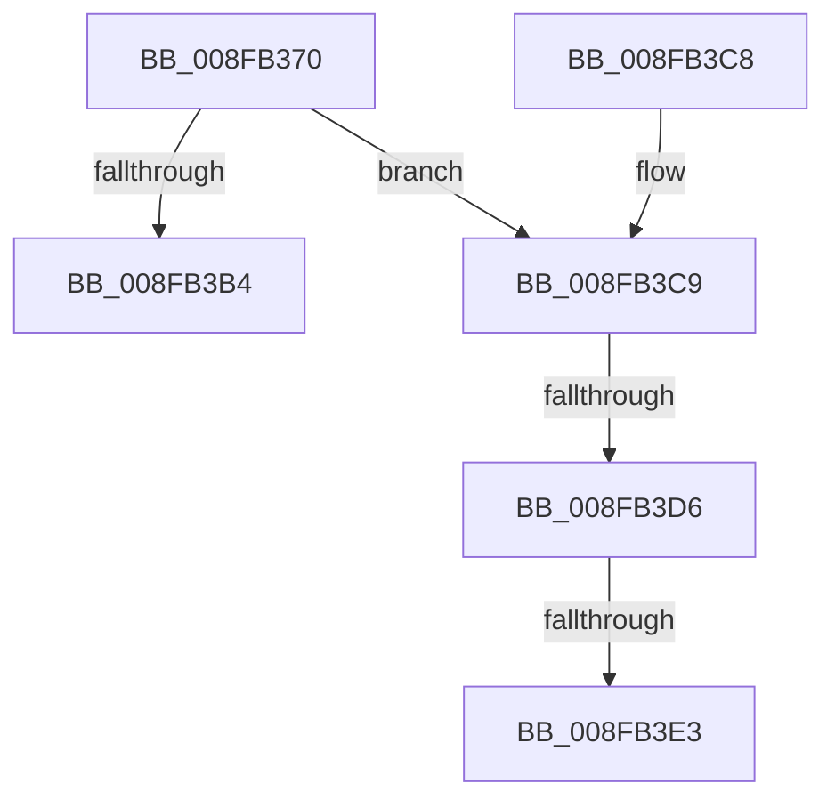

# PiUpdateGuestAssignedState

- RVA: `0x008FB370`–`0x008FB3EF` (길이 `127` bytes)
- VA: `0x00000001408FB370`
- 실행 섹션: `PAGE`
- PDB 이름 있음: `예`; PDB Function 태그: `예`
- unwind 정보 RVA: `0x0006D260`
- 디코드: `33`개 명령, `127/127` bytes 표시
- 미해석 바이트: `0` (있으면 어셈블리에 `.byte`로 보존)

> 이 문서는 커널 이미지의 기계어와 PDB 기호를 분석해 생성했습니다. 4번과 5번은 함수 원형과 자료형을 바이너리 사용 방식에서 추정한 C 해석이며 원본 소스 복구 결과는 아닙니다.

## 1. Dependencies

- 직접 호출 지점: **0**; 고유 호출 대상: **0**
- 직접 호출자로 확인된 함수: **1**
- RIP 상대 이미지 참조: **2**

### Outgoing calls
- 직접 디코드된 call 명령이 없습니다.

### Direct callers
- [PiProcessQueryDeviceState](PiProcessQueryDeviceState_function_008FA0F8.md) at `0x008FA1E0`

### Static image references
- `0x008FB3D6` → RVA `0x00EF012C` (`.data`; read)
- `0x008FB3E3` → RVA `0x00027250` (`.rdata`; read)

## 2. Other-region calls and transfers

- 다른 실행 섹션으로 향하는 call: **0**
- call이 아닌 외부 분기/꼬리 이동: **3**
  - `0x008FB3D0` → [sub_00B1F5B6](../B1/Unknown_function_00B1F5B6.md) (`tail-transfer`)
  - `0x008FB3DD` → [sub_00B1F5B6 + 0x15](../B1/Unknown_function_00B1F5B6.md) (`tail-transfer`)
  - `0x008FB3EA` → [sub_00B1F5B6 + 0x10](../B1/Unknown_function_00B1F5B6.md) (`tail-transfer`)

## 3. Assembly (complete function range)

```asm
008FB370  48 89 5C 24 08                  mov qword ptr [rsp + 8], rbx
008FB375  48 89 74 24 10                  mov qword ptr [rsp + 0x10], rsi
008FB37A  57                              push rdi
008FB37B  48 83 EC 20                     sub rsp, 0x20
008FB37F  44 8B 89 C0 02 00 00            mov r9d, dword ptr [rcx + 0x2c0]
008FB386  40 8A F2                        mov sil, dl
008FB389  45 8B C1                        mov r8d, r9d
008FB38C  41 8B C1                        mov eax, r9d
008FB38F  41 0F BA F0 0D                  btr r8d, 0xd
008FB394  0F BA E8 0D                     bts eax, 0xd
008FB398  84 D2                           test dl, dl
008FB39A  48 8B F9                        mov rdi, rcx
008FB39D  41 0F 44 C0                     cmove eax, r8d
008FB3A1  41 C1 E9 0D                     shr r9d, 0xd
008FB3A5  41 80 E1 01                     and r9b, 1
008FB3A9  89 81 C0 02 00 00               mov dword ptr [rcx + 0x2c0], eax
008FB3AF  44 3A CA                        cmp r9b, dl
008FB3B2  75 15                           jne 0x1408fb3c9
008FB3B4  33 DB                           xor ebx, ebx
008FB3B6  48 8B 74 24 38                  mov rsi, qword ptr [rsp + 0x38]
008FB3BB  8B C3                           mov eax, ebx
008FB3BD  48 8B 5C 24 30                  mov rbx, qword ptr [rsp + 0x30]
008FB3C2  48 83 C4 20                     add rsp, 0x20
008FB3C6  5F                              pop rdi
008FB3C7  C3                              ret
008FB3C8  CC                              int3
008FB3C9  4C 8B 49 30                     mov r9, qword ptr [rcx + 0x30]
008FB3CD  40 84 F6                        test sil, sil
008FB3D0  0F 84 E0 41 22 00               je 0x140b1f5b6
008FB3D6  F6 05 4F 4D 5F 00 08            test byte ptr [rip + 0x5f4d4f], 8
008FB3DD  0F 84 E8 41 22 00               je 0x140b1f5cb
008FB3E3  48 8D 15 66 BE 72 FF            lea rdx, [rip - 0x8d419a]
008FB3EA  E9 D7 41 22 00                  jmp 0x140b1f5c6
```

## 4. C-style interpretation (structured pseudocode)

```c
__int64 __fastcall PiUpdateGuestAssignedState(__int64 a1, unsigned __int8 a2)
{
    __int64 result;
    __int64 v_rbx;
    __int64 v_rsp;
    unsigned __int64 v_stack_p10;
    unsigned __int64 v_stack_p8;

    v_stack_p8 = v_rbx;
    v_stack_p10 = v_rsi;
    v_rsp = (v_rsp) - (32);
    result = (unsigned int)((unsigned int)((unsigned int)(*(unsigned int *)(a1 + 704))));
    if (a2 == 0) { result = (unsigned int)((unsigned int)((unsigned int)((unsigned int)(*(unsigned int *)(a1 + 704))))); }
    a4 = (unsigned int)(((unsigned int)(*(unsigned int *)(a1 + 704))) >> (13));
    a4 = (unsigned __int8)((a4) & (1));
    *(unsigned int *)(a1 + 704) = (unsigned int)(result);
    if (((unsigned __int8)(a4)) != a2) goto loc_008FB3C9;
    v_rbx = 0;
    v_rsp = (v_rsp) + (32);
    return 0;
loc_008FB3C9:
}
```

## 5. (Beta) C Style

```c
int64_t PiUpdateGuestAssignedState(void *Arg1, uint8_t Arg2)
{
    uint8_t *arg1 = (uint8_t *)Arg1;

    int64_t result;
    int64_t local_rbx;
    int64_t local_rsp;
    uint64_t v_stack_p10;
    uint64_t v_stack_p8;

    v_stack_p8 = local_rbx;
    v_stack_p10 = local_rsi;
    local_rsp = (local_rsp) - (32);
    result = (uint32_t)((uint32_t)((uint32_t)(*(uint32_t *)(arg1 + 0x2C0))));
    if (Arg2 == 0) { result = (uint32_t)((uint32_t)((uint32_t)((uint32_t)(*(uint32_t *)(arg1 + 0x2C0))))); }
    a4 = (uint32_t)(((uint32_t)(*(uint32_t *)(arg1 + 0x2C0))) >> (13));
    a4 = (uint8_t)((a4) & (1));
    *(uint32_t *)(arg1 + 0x2C0) = (uint32_t)(result);
    if (((uint8_t)(a4)) != Arg2) goto loc_008FB3C9;
    local_rbx = 0;
    local_rsp = (local_rsp) + (32);
    return 0;
loc_008FB3C9:
}
```

### 관측된 메모리 오프셋

구조체 형식이 확인되지 않은 접근은 인자 기준의 오프셋으로만 기록했습니다.

| 기준 인자 | 오프셋 표현 | 폭 (bit) | 접근 |
|---|---:|---:|---|
| `Arg1` | `+ 0x30` | `64` | `R` |
| `Arg1` | `+ 0x2C0` | `32` | `R` |
| `Arg1` | `+ 0x2C0` | `32` | `W` |

## 6. Execution-region graph

[열기: 2D/3D 그래프와 함수 탐색 컨트롤 패널](../../../control-panel.html?section=page&rva=0x008FB370&view=graph)

- 2D 그래프는 위에서 아래로 흐르고, 3D 그래프는 빈 공간을 드래그해 회전합니다. Shift+드래그는 이동, 휠은 확대·축소, 함수 노드 선택은 대상 보고서 이동입니다.

### Static fallback


