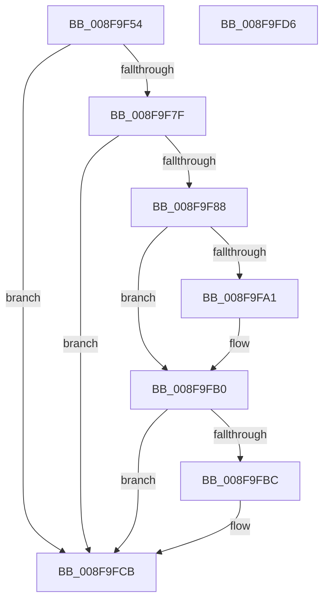

# PipClearDevNodeFlags

- RVA: `0x008F9F54`–`0x008F9FD7` (길이 `131` bytes)
- VA: `0x00000001408F9F54`
- 실행 섹션: `PAGE`
- PDB 이름 있음: `예`; PDB Function 태그: `아니요`
- unwind 정보 RVA: `0x0005CAAC`
- 디코드: `34`개 명령, `131/131` bytes 표시
- 미해석 바이트: `0` (있으면 어셈블리에 `.byte`로 보존)

> 이 문서는 커널 이미지의 기계어와 PDB 기호를 분석해 생성했습니다. 4번과 5번은 함수 원형과 자료형을 바이너리 사용 방식에서 추정한 C 해석이며 원본 소스 복구 결과는 아닙니다.

## 1. Dependencies

- 직접 호출 지점: **3**; 고유 호출 대상: **1**
- 직접 호출자로 확인된 함수: **21**
- RIP 상대 이미지 참조: **0**

### Outgoing calls
- `0x008F9F8E` → [PnpRaiseNtPlugPlayDevicePropertyChangeEvent](PnpRaiseNtPlugPlayDevicePropertyChangeEvent_function_008F7D80.md) (function, `0x008F7D80`)
- `0x008F9FAB` → [PnpRaiseNtPlugPlayDevicePropertyChangeEvent](PnpRaiseNtPlugPlayDevicePropertyChangeEvent_function_008F7D80.md) (function, `0x008F7D80`)
- `0x008F9FC6` → [PnpRaiseNtPlugPlayDevicePropertyChangeEvent](PnpRaiseNtPlugPlayDevicePropertyChangeEvent_function_008F7D80.md) (function, `0x008F7D80`)

### Direct callers
- [PnpRestartDeviceNode](../72/PnpRestartDeviceNode_function_0072CD60.md) at `0x0072CDA0`
- [PnpRestartDeviceNode](../72/PnpRestartDeviceNode_function_0072CD60.md) at `0x0072CDD5`
- [PnpRestartDeviceNode](../72/PnpRestartDeviceNode_function_0072CD60.md) at `0x0072CE20`
- [PiProcessResourceRequirementsChanged](../72/PiProcessResourceRequirementsChanged_function_0072D504.md) at `0x0072D573`
- [PiProcessResourceRequirementsChanged](../72/PiProcessResourceRequirementsChanged_function_0072D504.md) at `0x0072D5AE`
- [IopReleaseResources](../72/IopReleaseResources_function_0072D964.md) at `0x0072D9F9`
- [IopRemoveLegacyDeviceNode](../72/IopRemoveLegacyDeviceNode_function_0072E590.md) at `0x0072E63F`
- [IopReleaseFilteredBootResources](../72/IopReleaseFilteredBootResources_function_0072EBF8.md) at `0x0072EC92`
- [PnpBuildCmResourceLists](../73/PnpBuildCmResourceLists_function_0073E684.md) at `0x0073E7B8`
- [PnpReallocateResources](../73/PnpReallocateResources_function_0073E924.md) at `0x0073E9A9`
- [PnpReallocateResources](../73/PnpReallocateResources_function_0073E924.md) at `0x0073EA31`
- [PnpReallocateResources](../73/PnpReallocateResources_function_0073E924.md) at `0x0073EAC4`
- [PnpCancelStopDeviceNode](../73/PnpCancelStopDeviceNode_function_0073F048.md) at `0x0073F0C6`
- [PipProcessRestartPhase1](../74/PipProcessRestartPhase1_function_007407EC.md) at `0x0074086F`
- [PipEnumerateCompleted](PipEnumerateCompleted_function_008F7B1C.md) at `0x008F7C2E`
- [PipEnumerateCompleted](PipEnumerateCompleted_function_008F7B1C.md) at `0x008F7C91`
- [PipEnumerateDevice](PipEnumerateDevice_function_008F99E4.md) at `0x008F9A81`
- [PipEnumerateDevice](PipEnumerateDevice_function_008F99E4.md) at `0x008F9AF0`
- [IopRemoveDevice](IopRemoveDevice_function_008FC7FC.md) at `0x008FC9CB`
- [PnpInvalidateRelationsInList](../A0/PnpInvalidateRelationsInList_function_00A05DF8.md) at `0x00A05F70`
- [PnpSurpriseRemoveLockedDeviceNode](../A0/PnpSurpriseRemoveLockedDeviceNode_function_00A08370.md) at `0x00A084EF`
- [PnpSurpriseRemoveLockedDeviceNode](../A0/PnpSurpriseRemoveLockedDeviceNode_function_00A08370.md) at `0x00A08594`
- [PiProcessClearDeviceProblem](../A2/PiProcessClearDeviceProblem_function_00A271CC.md) at `0x00A27296`
- [PipClearDevNodeProblem](../A2/PipClearDevNodeProblem_function_00A27C8C.md) at `0x00A27CEA`
- [PiProcessNewDeviceNode](../A2/PiProcessNewDeviceNode_function_00A28F20.md) at `0x00A29035`
- [PnpGetResourceRequirementsForAssignTable](../A2/PnpGetResourceRequirementsForAssignTable_function_00A2ADBC.md) at `0x00A2AEE6`
- [PnpGetResourceRequirementsForAssignTable](../A2/PnpGetResourceRequirementsForAssignTable_function_00A2ADBC.md) at `0x00A2AF18`
- [PiProcessReenumeration](../A5/PiProcessReenumeration_function_00A51818.md) at `0x00A518D0`
- [sub_00B336B0](../B3/Unknown_function_00B336B0.md) at `0x00B33A07`
- [sub_00B38CDE](../B3/Unknown_function_00B38CDE.md) at `0x00B38F84`

### Static image references
- 디코드된 RIP-relative 메모리 참조가 없습니다.

## 2. Other-region calls and transfers

- 다른 실행 섹션으로 향하는 call: **0**
- 별도 외부 분기/꼬리 이동을 확인하지 못했습니다.

## 3. Assembly (complete function range)

```asm
008F9F54  48 89 5C 24 08                  mov qword ptr [rsp + 8], rbx
008F9F59  57                              push rdi
008F9F5A  48 83 EC 20                     sub rsp, 0x20
008F9F5E  8B B9 8C 01 00 00               mov edi, dword ptr [rcx + 0x18c]
008F9F64  48 8B D9                        mov rbx, rcx
008F9F67  F7 D2                           not edx
008F9F69  F0 21 91 8C 01 00 00            lock and dword ptr [rcx + 0x18c], edx
008F9F70  8B C7                           mov eax, edi
008F9F72  33 81 8C 01 00 00               xor eax, dword ptr [rcx + 0x18c]
008F9F78  A9 00 70 30 00                  test eax, 0x307000
008F9F7D  74 4C                           je 0x1408f9fcb
008F9F7F  48 8B 51 30                     mov rdx, qword ptr [rcx + 0x30]
008F9F83  48 85 D2                        test rdx, rdx
008F9F86  74 43                           je 0x1408f9fcb
008F9F88  41 B8 0B 00 00 00               mov r8d, 0xb
008F9F8E  E8 ED DD FF FF                  call 0x1408f7d80
008F9F93  8B C7                           mov eax, edi
008F9F95  33 83 8C 01 00 00               xor eax, dword ptr [rbx + 0x18c]
008F9F9B  0F BA E0 0E                     bt eax, 0xe
008F9F9F  73 0F                           jae 0x1408f9fb0
008F9FA1  48 8B 53 30                     mov rdx, qword ptr [rbx + 0x30]
008F9FA5  41 B8 1C 00 00 00               mov r8d, 0x1c
008F9FAB  E8 D0 DD FF FF                  call 0x1408f7d80
008F9FB0  33 BB 8C 01 00 00               xor edi, dword ptr [rbx + 0x18c]
008F9FB6  0F BA E7 0D                     bt edi, 0xd
008F9FBA  73 0F                           jae 0x1408f9fcb
008F9FBC  48 8B 53 30                     mov rdx, qword ptr [rbx + 0x30]
008F9FC0  41 B8 1B 00 00 00               mov r8d, 0x1b
008F9FC6  E8 B5 DD FF FF                  call 0x1408f7d80
008F9FCB  48 8B 5C 24 30                  mov rbx, qword ptr [rsp + 0x30]
008F9FD0  48 83 C4 20                     add rsp, 0x20
008F9FD4  5F                              pop rdi
008F9FD5  C3                              ret
008F9FD6  CC                              int3
```

## 4. C-style interpretation (structured pseudocode)

```c
__int64 __fastcall PipClearDevNodeFlags(__int64 a1, int a2)
{
    __int64 result;
    __int64 v_rdi;
    __int64 v_rsp;
    unsigned __int64 v_stack_p8;

    v_stack_p8 = v_rbx;
    v_rsp = (v_rsp) - (32);
    a2 = (unsigned int)(~(a2));
    result = (unsigned int)(((unsigned int)((unsigned int)((unsigned int)(*(unsigned int *)(a1 + 396))))) ^ (*(unsigned int *)(a1 + 396)));
    if ((((unsigned int)(result)) & (0x307000ULL)) == 0) goto loc_008F9FCB;
    if (*(unsigned __int64 *)(a1 + 48) == 0) goto loc_008F9FCB;
    result = PnpRaiseNtPlugPlayDevicePropertyChangeEvent(a1, *(unsigned __int64 *)(a1 + 48), 11, a4);
    result = (unsigned int)(((unsigned int)((unsigned int)((unsigned int)(*(unsigned int *)(a1 + 396))))) ^ (*(unsigned int *)(a1 + 396)));
    if (!(condition_is_above_or_equal)) {
        a2 = *(unsigned __int64 *)(a1 + 48);
        a3 = 28;
        result = PnpRaiseNtPlugPlayDevicePropertyChangeEvent(a1, a2, a3, a4);
    }
    v_rdi = (unsigned int)(((unsigned int)(*(unsigned int *)(a1 + 396))) ^ (*(unsigned int *)(a1 + 396)));
    if (!(condition_is_above_or_equal)) {
        a2 = *(unsigned __int64 *)(a1 + 48);
        a3 = 27;
        result = PnpRaiseNtPlugPlayDevicePropertyChangeEvent(a1, a2, a3, a4);
    }
    v_rsp = (v_rsp) + (32);
    return result;
}
```

## 5. (Beta) C Style

```c
int64_t PipClearDevNodeFlags(void *Arg1, int32_t Arg2)
{
    uint8_t *arg1 = (uint8_t *)Arg1;

    int64_t result;
    int64_t local_rdi;
    int64_t local_rsp;
    uint64_t v_stack_p8;

    v_stack_p8 = local_rbx;
    local_rsp = (local_rsp) - (32);
    Arg2 = (uint32_t)(~(Arg2));
    result = (uint32_t)(((uint32_t)((uint32_t)((uint32_t)(*(uint32_t *)(arg1 + 0x18C))))) ^ (*(uint32_t *)(arg1 + 0x18C)));
    if ((((uint32_t)(result)) & (0x307000ULL)) == 0) goto loc_008F9FCB;
    if (*(uint64_t *)(arg1 + 0x30) == 0) goto loc_008F9FCB;
    result = PnpRaiseNtPlugPlayDevicePropertyChangeEvent(Arg1, *(uint64_t *)(arg1 + 0x30), 11, a4);
    result = (uint32_t)(((uint32_t)((uint32_t)((uint32_t)(*(uint32_t *)(arg1 + 0x18C))))) ^ (*(uint32_t *)(arg1 + 0x18C)));
    if (!(condition_is_above_or_equal)) {
        Arg2 = *(uint64_t *)(arg1 + 0x30);
        a3 = 28;
        result = PnpRaiseNtPlugPlayDevicePropertyChangeEvent(Arg1, Arg2, a3, a4);
    }
    local_rdi = (uint32_t)(((uint32_t)(*(uint32_t *)(arg1 + 0x18C))) ^ (*(uint32_t *)(arg1 + 0x18C)));
    if (!(condition_is_above_or_equal)) {
        Arg2 = *(uint64_t *)(arg1 + 0x30);
        a3 = 27;
        result = PnpRaiseNtPlugPlayDevicePropertyChangeEvent(Arg1, Arg2, a3, a4);
    }
    local_rsp = (local_rsp) + (32);
    return result;
}
```

### 관측된 메모리 오프셋

구조체 형식이 확인되지 않은 접근은 인자 기준의 오프셋으로만 기록했습니다.

| 기준 인자 | 오프셋 표현 | 폭 (bit) | 접근 |
|---|---:|---:|---|
| `Arg1` | `+ 0x30` | `64` | `R` |
| `Arg1` | `+ 0x18C` | `32` | `R` |
| `Arg1` | `+ 0x18C` | `32` | `R/W` |

## 6. Execution-region graph

[열기: 2D/3D 그래프와 함수 탐색 컨트롤 패널](../../../control-panel.html?section=page&rva=0x008F9F54&view=graph)

- 2D 그래프는 위에서 아래로 흐르고, 3D 그래프는 빈 공간을 드래그해 회전합니다. Shift+드래그는 이동, 휠은 확대·축소, 함수 노드 선택은 대상 보고서 이동입니다.

### Static fallback


