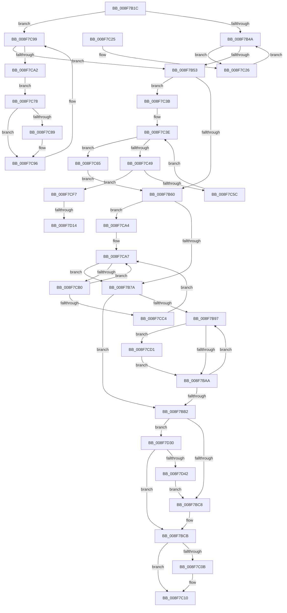

# PipEnumerateCompleted

- RVA: `0x008F7B1C`–`0x008F7D47` (길이 `555` bytes)
- VA: `0x00000001408F7B1C`
- 실행 섹션: `PAGE`
- PDB 이름 있음: `예`; PDB Function 태그: `예`
- unwind 정보 RVA: `0x00087AE0`
- 디코드: `137`개 명령, `555/555` bytes 표시
- 미해석 바이트: `0` (있으면 어셈블리에 `.byte`로 보존)

> 이 문서는 커널 이미지의 기계어와 PDB 기호를 분석해 생성했습니다. 4번과 5번은 함수 원형과 자료형을 바이너리 사용 방식에서 추정한 C 해석이며 원본 소스 복구 결과는 아닙니다.

## 1. Dependencies

- 직접 호출 지점: **20**; 고유 호출 대상: **15**
- 직접 호출자로 확인된 함수: **1**
- RIP 상대 이미지 참조: **3**

### Outgoing calls
- `0x008F7B60` → [PiSwLock](PiSwLock_function_008F7D50.md) (function, `0x008F7D50`)
- `0x008F7B69` → [PiSwFindChildren](PiSwFindChildren_function_008F8ED0.md) (function, `0x008F8ED0`)
- `0x008F7B81` → [ExReleaseResourceLite](../../text/25/ExReleaseResourceLite_function_0025FA10.md) (function, `0x0025FA10`)
- `0x008F7B86` → [KeLeaveCriticalRegion](../../text/25/KeLeaveCriticalRegion_function_0025D8B0.md) (function, `0x0025D8B0`)
- `0x008F7BBA` → [PipSetDevNodeState](../../text/47/PipSetDevNodeState_function_00470708.md) (function, `0x00470708`)
- `0x008F7BD0` → [PiPnpRtlBeginOperation](../8E/PiPnpRtlBeginOperation_function_008E033C.md) (function, `0x008E033C`)
- `0x008F7BE6` → [PnpRaiseNtPlugPlayDevicePropertyChangeEvent](PnpRaiseNtPlugPlayDevicePropertyChangeEvent_function_008F7D80.md) (function, `0x008F7D80`)
- `0x008F7BFC` → [PnpRaiseNtPlugPlayDevicePropertyChangeEvent](PnpRaiseNtPlugPlayDevicePropertyChangeEvent_function_008F7D80.md) (function, `0x008F7D80`)
- `0x008F7C0B` → [PiPnpRtlEndOperation](../8E/PiPnpRtlEndOperation_function_008E0518.md) (function, `0x008E0518`)
- `0x008F7C2E` → [PipClearDevNodeFlags](PipClearDevNodeFlags_function_008F9F54.md) (function, `0x008F9F54`)
- `0x008F7C5C` → [PipProcessEnumeratedChildDevice](PipProcessEnumeratedChildDevice_function_008FBF4C.md) (function, `0x008FBF4C`)
- `0x008F7C67` → [ExFreePoolWithTag](../../poolcode/B8/ExFreePoolWithTag_function_00B82870.md) (function, `0x00B82870`)
- `0x008F7C91` → [PipClearDevNodeFlags](PipClearDevNodeFlags_function_008F9F54.md) (function, `0x008F9F54`)
- `0x008F7CBA` → [PiSwGetChildPdo](../AC/PiSwGetChildPdo_function_00AC3544.md) (function, `0x00AC3544`)
- `0x008F7CCA` → [PipProcessEnumeratedChildDevice](PipProcessEnumeratedChildDevice_function_008FBF4C.md) (function, `0x008FBF4C`)
- `0x008F7CD9` → [PipSetDevNodeFlags](PipSetDevNodeFlags_function_008FC048.md) (function, `0x008FC048`)
- `0x008F7CEA` → [PnpRequestDeviceRemoval](PnpRequestDeviceRemoval_function_008FC294.md) (function, `0x008FC294`)
- `0x008F7D00` → [IoAddTriageDumpDataBlock](../../text/42/IoAddTriageDumpDataBlock_function_00428374.md) (function, `0x00428374`)
- `0x008F7D19` → [IoAddTriageDumpDataBlock](../../text/42/IoAddTriageDumpDataBlock_function_00428374.md) (function, `0x00428374`)
- `0x008F7D25` → [IoAddTriageDumpDataBlock](../../text/42/IoAddTriageDumpDataBlock_function_00428374.md) (function, `0x00428374`)

### Direct callers
- [PipProcessDevNodeTree](PipProcessDevNodeTree_function_008F9068.md) at `0x008F93C7`

### Static image references
- `0x008F7B7A` → RVA `0x00F8AB20` (`.data`; read)
- `0x008F7BD5` → RVA `0x00F8C438` (`.data`; read)
- `0x008F7C7C` → RVA `0x00F8AC08` (`.data`; read)

## 2. Other-region calls and transfers

- 다른 실행 섹션으로 향하는 call: **7**
  - `0x008F7B81` → [ExReleaseResourceLite](../../text/25/ExReleaseResourceLite_function_0025FA10.md) (`PAGE` → `.text`)
  - `0x008F7B86` → [KeLeaveCriticalRegion](../../text/25/KeLeaveCriticalRegion_function_0025D8B0.md) (`PAGE` → `.text`)
  - `0x008F7BBA` → [PipSetDevNodeState](../../text/47/PipSetDevNodeState_function_00470708.md) (`PAGE` → `.text`)
  - `0x008F7C67` → [ExFreePoolWithTag](../../poolcode/B8/ExFreePoolWithTag_function_00B82870.md) (`PAGE` → `POOLCODE`)
  - `0x008F7D00` → [IoAddTriageDumpDataBlock](../../text/42/IoAddTriageDumpDataBlock_function_00428374.md) (`PAGE` → `.text`)
  - `0x008F7D19` → [IoAddTriageDumpDataBlock](../../text/42/IoAddTriageDumpDataBlock_function_00428374.md) (`PAGE` → `.text`)
  - `0x008F7D25` → [IoAddTriageDumpDataBlock](../../text/42/IoAddTriageDumpDataBlock_function_00428374.md) (`PAGE` → `.text`)
- call이 아닌 외부 분기/꼬리 이동: **2**
  - `0x008F7D0E` → [sub_00B1F0DC](../B1/Unknown_function_00B1F0DC.md) (`tail-transfer`)
  - `0x008F7D2B` → [sub_00B1F0DC](../B1/Unknown_function_00B1F0DC.md) (`tail-transfer`)

## 3. Assembly (complete function range)

```asm
008F7B1C  48 89 5C 24 10                  mov qword ptr [rsp + 0x10], rbx
008F7B21  48 89 6C 24 18                  mov qword ptr [rsp + 0x18], rbp
008F7B26  56                              push rsi
008F7B27  57                              push rdi
008F7B28  41 56                           push r14
008F7B2A  48 83 EC 30                     sub rsp, 0x30
008F7B2E  48 8B 79 08                     mov rdi, qword ptr [rcx + 8]
008F7B32  45 33 F6                        xor r14d, r14d
008F7B35  48 8B D9                        mov rbx, rcx
008F7B38  4C 89 74 24 50                  mov qword ptr [rsp + 0x50], r14
008F7B3D  4C 39 B1 10 02 00 00            cmp qword ptr [rcx + 0x210], r14
008F7B44  0F 84 4F 01 00 00               je 0x1408f7c99
008F7B4A  48 85 FF                        test rdi, rdi
008F7B4D  0F 85 D3 00 00 00               jne 0x1408f7c26
008F7B53  4C 39 B3 10 02 00 00            cmp qword ptr [rbx + 0x210], r14
008F7B5A  0F 85 DB 00 00 00               jne 0x1408f7c3b
008F7B60  E8 EB 01 00 00                  call 0x1408f7d50
008F7B65  48 8D 4B 28                     lea rcx, [rbx + 0x28]
008F7B69  E8 62 13 00 00                  call 0x1408f8ed0
008F7B6E  48 8B F8                        mov rdi, rax
008F7B71  48 85 C0                        test rax, rax
008F7B74  0F 85 2A 01 00 00               jne 0x1408f7ca4
008F7B7A  48 8D 0D 9F 2F 69 00            lea rcx, [rip + 0x692f9f]
008F7B81  E8 8A 7E 96 FF                  call 0x14025fa10
008F7B86  E8 25 5D 96 FF                  call 0x14025d8b0
008F7B8B  48 8B 7B 08                     mov rdi, qword ptr [rbx + 8]
008F7B8F  41 8A EE                        mov bpl, r14b
008F7B92  48 85 FF                        test rdi, rdi
008F7B95  74 1B                           je 0x1408f7bb2
008F7B97  F7 87 8C 01 00 00 10 00 01 00   test dword ptr [rdi + 0x18c], 0x10010
008F7BA1  48 8B 37                        mov rsi, qword ptr [rdi]
008F7BA4  0F 84 27 01 00 00               je 0x1408f7cd1
008F7BAA  48 8B FE                        mov rdi, rsi
008F7BAD  48 85 F6                        test rsi, rsi
008F7BB0  75 E5                           jne 0x1408f7b97
008F7BB2  BA 0A 03 00 00                  mov edx, 0x30a
008F7BB7  48 8B CB                        mov rcx, rbx
008F7BBA  E8 49 8B B7 FF                  call 0x140470708
008F7BBF  40 84 ED                        test bpl, bpl
008F7BC2  0F 85 68 01 00 00               jne 0x1408f7d30
008F7BC8  41 8B DE                        mov ebx, r14d
008F7BCB  48 8D 4C 24 50                  lea rcx, [rsp + 0x50]
008F7BD0  E8 67 87 FE FF                  call 0x1408e033c
008F7BD5  48 8B 15 5C 48 69 00            mov rdx, qword ptr [rip + 0x69485c]
008F7BDC  41 B8 0F 00 00 00               mov r8d, 0xf
008F7BE2  48 8B 52 30                     mov rdx, qword ptr [rdx + 0x30]
008F7BE6  E8 95 01 00 00                  call 0x1408f7d80
008F7BEB  48 8B 15 46 48 69 00            mov rdx, qword ptr [rip + 0x694846]
008F7BF2  41 B8 14 00 00 00               mov r8d, 0x14
008F7BF8  48 8B 52 30                     mov rdx, qword ptr [rdx + 0x30]
008F7BFC  E8 7F 01 00 00                  call 0x1408f7d80
008F7C01  48 8B 4C 24 50                  mov rcx, qword ptr [rsp + 0x50]
008F7C06  48 85 C9                        test rcx, rcx
008F7C09  74 05                           je 0x1408f7c10
008F7C0B  E8 08 89 FE FF                  call 0x1408e0518
008F7C10  48 8B 6C 24 60                  mov rbp, qword ptr [rsp + 0x60]
008F7C15  8B C3                           mov eax, ebx
008F7C17  48 8B 5C 24 58                  mov rbx, qword ptr [rsp + 0x58]
008F7C1C  48 83 C4 30                     add rsp, 0x30
008F7C20  41 5E                           pop r14
008F7C22  5F                              pop rdi
008F7C23  5E                              pop rsi
008F7C24  C3                              ret
008F7C25  CC                              int3
008F7C26  BA 10 00 00 00                  mov edx, 0x10
008F7C2B  48 8B CF                        mov rcx, rdi
008F7C2E  E8 21 23 00 00                  call 0x1408f9f54
008F7C33  48 8B 3F                        mov rdi, qword ptr [rdi]
008F7C36  E9 0F FF FF FF                  jmp 0x1408f7b4a
008F7C3B  41 8B FE                        mov edi, r14d
008F7C3E  48 8B 8B 10 02 00 00            mov rcx, qword ptr [rbx + 0x210]
008F7C45  3B 39                           cmp edi, dword ptr [rcx]
008F7C47  73 1C                           jae 0x1408f7c65
008F7C49  8B F7                           mov esi, edi
008F7C4B  48 8B 54 F1 08                  mov rdx, qword ptr [rcx + rsi*8 + 8]
008F7C50  48 8B CB                        mov rcx, rbx
008F7C53  48 85 D2                        test rdx, rdx
008F7C56  0F 84 9B 00 00 00               je 0x1408f7cf7
008F7C5C  E8 EB 42 00 00                  call 0x1408fbf4c
008F7C61  FF C7                           inc edi
008F7C63  EB D9                           jmp 0x1408f7c3e
008F7C65  33 D2                           xor edx, edx
008F7C67  E8 04 AC 28 00                  call 0x140b82870
008F7C6C  4C 89 B3 10 02 00 00            mov qword ptr [rbx + 0x210], r14
008F7C73  E9 E8 FE FF FF                  jmp 0x1408f7b60
008F7C78  48 8B 4F 20                     mov rcx, qword ptr [rdi + 0x20]
008F7C7C  48 8B 05 85 2F 69 00            mov rax, qword ptr [rip + 0x692f85]
008F7C83  48 39 41 08                     cmp qword ptr [rcx + 8], rax
008F7C87  75 0D                           jne 0x1408f7c96
008F7C89  BA 10 00 00 00                  mov edx, 0x10
008F7C8E  48 8B CF                        mov rcx, rdi
008F7C91  E8 BE 22 00 00                  call 0x1408f9f54
008F7C96  48 8B 3F                        mov rdi, qword ptr [rdi]
008F7C99  48 85 FF                        test rdi, rdi
008F7C9C  0F 84 B1 FE FF FF               je 0x1408f7b53
008F7CA2  EB D4                           jmp 0x1408f7c78
008F7CA4  48 8B 30                        mov rsi, qword ptr [rax]
008F7CA7  48 3B F7                        cmp rsi, rdi
008F7CAA  0F 84 CA FE FF FF               je 0x1408f7b7a
008F7CB0  48 8B 4B 20                     mov rcx, qword ptr [rbx + 0x20]
008F7CB4  48 8B D6                        mov rdx, rsi
008F7CB7  48 8B 36                        mov rsi, qword ptr [rsi]
008F7CBA  E8 85 B8 1C 00                  call 0x140ac3544
008F7CBF  48 85 C0                        test rax, rax
008F7CC2  74 E3                           je 0x1408f7ca7
008F7CC4  48 8B D0                        mov rdx, rax
008F7CC7  48 8B CB                        mov rcx, rbx
008F7CCA  E8 7D 42 00 00                  call 0x1408fbf4c
008F7CCF  EB D6                           jmp 0x1408f7ca7
008F7CD1  BA 00 00 01 00                  mov edx, 0x10000
008F7CD6  48 8B CF                        mov rcx, rdi
008F7CD9  E8 6A 43 00 00                  call 0x1408fc048
008F7CDE  45 33 C9                        xor r9d, r9d
008F7CE1  B2 01                           mov dl, 1
008F7CE3  48 8B CF                        mov rcx, rdi
008F7CE6  45 8D 41 18                     lea r8d, [r9 + 0x18]
008F7CEA  E8 A5 45 00 00                  call 0x1408fc294
008F7CEF  40 B5 01                        mov bpl, 1
008F7CF2  E9 B3 FE FF FF                  jmp 0x1408f7baa
008F7CF7  BA 88 03 00 00                  mov edx, 0x388
008F7CFC  48 8D 7B 28                     lea rdi, [rbx + 0x28]
008F7D00  E8 6F 06 B3 FF                  call 0x140428374
008F7D05  BD 02 00 00 00                  mov ebp, 2
008F7D0A  66 44 39 37                     cmp word ptr [rdi], r14w
008F7D0E  0F 84 C8 73 22 00               je 0x140b1f0dc
008F7D14  8B D5                           mov edx, ebp
008F7D16  48 8B CF                        mov rcx, rdi
008F7D19  E8 56 06 B3 FF                  call 0x140428374
008F7D1E  0F B7 17                        movzx edx, word ptr [rdi]
008F7D21  48 8B 4F 08                     mov rcx, qword ptr [rdi + 8]
008F7D25  E8 4A 06 B3 FF                  call 0x140428374
008F7D2A  90                              nop
008F7D2B  E9 AC 73 22 00                  jmp 0x140b1f0dc
008F7D30  48 3B 1D 01 47 69 00            cmp rbx, qword ptr [rip + 0x694701]
008F7D37  BB CE 02 00 C0                  mov ebx, 0xc00002ce
008F7D3C  0F 85 89 FE FF FF               jne 0x1408f7bcb
008F7D42  E9 81 FE FF FF                  jmp 0x1408f7bc8
```

## 4. C-style interpretation (structured pseudocode)

```c
__int64 __fastcall PipEnumerateCompleted(__int64 a1, __int64 a2, __int64 a3, int a4)
{
    __int64 result;
    __int64 v_r14;
    __int64 v_rdi;
    __int64 v_rsp;
    unsigned __int64 v_stack_p10;
    unsigned __int64 v_stack_p18;
    unsigned __int64 v_stack_p8;

    v_stack_p10 = v_rbx;
    v_stack_p18 = v_rbp;
    v_rsp = (v_rsp) - (48);
    v_r14 = 0;
    v_stack_p8 = 0;
    if ((*(unsigned __int64 *)(a1 + 528)) == 0) goto loc_008F7C99;
loc_008F7B4A:
    if (*(unsigned __int64 *)(a1 + 8) != 0) goto loc_008F7C26;
loc_008F7B53:
    if ((*(unsigned __int64 *)(a1 + 528)) != 0) goto loc_008F7C3B;
loc_008F7B60:
    result = PiSwLock(a1, a2, a3, a4);
    result = PiSwFindChildren(a1 + 40, a2, a3, a4);
    if (result != 0) goto loc_008F7CA4;
loc_008F7B7A:
    result = ExReleaseResourceLite(v_rip + 6893471, a2, a3, a4);
    result = KeLeaveCriticalRegion(v_rip + 6893471, a2, a3, a4);
    if (*(unsigned __int64 *)(a1 + 8) == 0) goto loc_008F7BB2;
loc_008F7B97:
    if (((*(unsigned int *)(*(unsigned __int64 *)(a1 + 8) + 396)) & (0x10010ULL)) == 0) goto loc_008F7CD1;
loc_008F7BAA:
    if (*(unsigned __int64 *)(*(unsigned __int64 *)(a1 + 8)) != 0) goto loc_008F7B97;
loc_008F7BB2:
    result = PipSetDevNodeState(a1, 778, a3, a4);
    if (0 != 0) goto loc_008F7D30;
loc_008F7BC8:
loc_008F7BCB:
    result = PiPnpRtlBeginOperation(v_stack_p8, 778, a3, a4);
    result = PnpRaiseNtPlugPlayDevicePropertyChangeEvent(v_stack_p8, *(unsigned __int64 *)(*(unsigned __int64 *)(v_rip + 6899804) + 48), 15, a4);
    result = PnpRaiseNtPlugPlayDevicePropertyChangeEvent(v_stack_p8, *(unsigned __int64 *)(*(unsigned __int64 *)(v_rip + 6899782) + 48), 20, a4);
    if (v_stack_p8 != 0) {
        result = PiPnpRtlEndOperation(v_stack_p8, *(unsigned __int64 *)(*(unsigned __int64 *)(v_rip + 6899782) + 48), 20, a4);
    }
    v_rsp = (v_rsp) + (48);
    return 0;
loc_008F7C26:
    result = PipClearDevNodeFlags(*(unsigned __int64 *)(*(unsigned __int64 *)(a1 + 8)), 16, 20, a4);
    goto loc_008F7B4A;
loc_008F7C3B:
loc_008F7C3E:
    if (0 >= (*(unsigned int *)(*(unsigned __int64 *)(v_stack_p10 + 528)))) goto loc_008F7C65;
    if (*(unsigned __int64 *)(*(unsigned __int64 *)(v_stack_p10 + 528) + 0 * 8 + 8) == 0) goto loc_008F7CF7;
    result = PipProcessEnumeratedChildDevice(v_stack_p10, *(unsigned __int64 *)(*(unsigned __int64 *)(v_stack_p10 + 528) + 0 * 8 + 8), 20, a4);
    v_rdi = (unsigned int)((0) + 1);
    goto loc_008F7C3E;
loc_008F7C65:
    a2 = 0;
    result = ExFreePoolWithTag(v_stack_p10, a2, 20, a4);
    *(unsigned __int64 *)(v_stack_p10 + 528) = 0;
    goto loc_008F7B60;
loc_008F7C78:
    result = *(unsigned __int64 *)(v_rip + 6893445);
    if ((*(unsigned __int64 *)(*(unsigned __int64 *)(v_rdi + 32) + 8)) == (*(unsigned __int64 *)(v_rip + 6893445))) {
        a2 = 16;
        a1 = v_rdi;
        result = PipClearDevNodeFlags(a1, a2, 20, a4);
    }
loc_008F7C99:
    if (*(unsigned __int64 *)(v_rdi) == 0) goto loc_008F7B53;
    goto loc_008F7C78;
loc_008F7CA4:
loc_008F7CA7:
    if ((*(unsigned __int64 *)(result)) == (*(unsigned __int64 *)(v_rdi))) goto loc_008F7B7A;
    result = PiSwGetChildPdo(*(unsigned __int64 *)(v_stack_p10 + 32), *(unsigned __int64 *)(result), 20, a4);
    if (result == 0) goto loc_008F7CA7;
    result = PipProcessEnumeratedChildDevice(v_stack_p10, result, 20, a4);
    goto loc_008F7CA7;
loc_008F7CD1:
    result = PipSetDevNodeFlags(*(unsigned __int64 *)(v_rdi), (unsigned int)(0x10000ULL), 20, a4);
    a4 = 0;
    result = PnpRequestDeviceRemoval(*(unsigned __int64 *)(v_rdi), 1, a4 + 24, a4);
    goto loc_008F7BAA;
loc_008F7CF7:
    result = IoAddTriageDumpDataBlock(*(unsigned __int64 *)(v_rdi), 904, a4 + 24, a4);
    result = IoAddTriageDumpDataBlock(v_stack_p10 + 40, 2, a4 + 24, a4);
    result = IoAddTriageDumpDataBlock(*(unsigned __int64 *)(v_stack_p10 + 40 + 8), *(unsigned __int16 *)(v_stack_p10 + 40), a4 + 24, a4);
loc_008F7D30:
    if (v_stack_p10 != (*(unsigned __int64 *)(v_rip + 6899457))) goto loc_008F7BCB;
    goto loc_008F7BC8;
}
```

## 5. (Beta) C Style

```c
int64_t PipEnumerateCompleted(void *Arg1, int64_t Arg2, int64_t Arg3, int32_t Arg4)
{
    uint8_t *arg1 = (uint8_t *)Arg1;

    int64_t result;
    int64_t local_r14;
    int64_t local_rdi;
    int64_t local_rsp;
    uint64_t v_stack_p10;
    uint64_t v_stack_p18;
    uint64_t v_stack_p8;

    v_stack_p10 = local_rbx;
    v_stack_p18 = local_rbp;
    local_rsp = (local_rsp) - (48);
    local_r14 = 0;
    v_stack_p8 = 0;
    if ((*(uint64_t *)(arg1 + 0x210)) == 0) goto loc_008F7C99;
loc_008F7B4A:
    if (*(uint64_t *)(arg1 + 0x8) != 0) goto loc_008F7C26;
loc_008F7B53:
    if ((*(uint64_t *)(arg1 + 0x210)) != 0) goto loc_008F7C3B;
loc_008F7B60:
    result = PiSwLock(Arg1, Arg2, Arg3, Arg4);
    result = PiSwFindChildren(Arg1 + 40, Arg2, Arg3, Arg4);
    if (result != 0) goto loc_008F7CA4;
loc_008F7B7A:
    result = ExReleaseResourceLite(v_rip + 6893471, Arg2, Arg3, Arg4);
    result = KeLeaveCriticalRegion(v_rip + 6893471, Arg2, Arg3, Arg4);
    if (*(uint64_t *)(arg1 + 0x8) == 0) goto loc_008F7BB2;
loc_008F7B97:
    if (((*(uint32_t *)(*(uint64_t *)(arg1 + 0x8) + 0x18C)) & (0x10010ULL)) == 0) goto loc_008F7CD1;
loc_008F7BAA:
    if (*(uint64_t *)(*(uint64_t *)(arg1 + 0x8)) != 0) goto loc_008F7B97;
loc_008F7BB2:
    result = PipSetDevNodeState(Arg1, 778, Arg3, Arg4);
    if (0 != 0) goto loc_008F7D30;
loc_008F7BC8:
loc_008F7BCB:
    result = PiPnpRtlBeginOperation(v_stack_p8, 778, Arg3, Arg4);
    result = PnpRaiseNtPlugPlayDevicePropertyChangeEvent(v_stack_p8, *(uint64_t *)(*(uint64_t *)(v_rip + 0x69485C) + 0x30), 15, Arg4);
    result = PnpRaiseNtPlugPlayDevicePropertyChangeEvent(v_stack_p8, *(uint64_t *)(*(uint64_t *)(v_rip + 0x694846) + 0x30), 20, Arg4);
    if (v_stack_p8 != 0) {
        result = PiPnpRtlEndOperation(v_stack_p8, *(uint64_t *)(*(uint64_t *)(v_rip + 0x694846) + 0x30), 20, Arg4);
    }
    local_rsp = (local_rsp) + (48);
    return 0;
loc_008F7C26:
    result = PipClearDevNodeFlags(*(uint64_t *)(*(uint64_t *)(arg1 + 0x8)), 16, 20, Arg4);
    goto loc_008F7B4A;
loc_008F7C3B:
loc_008F7C3E:
    if (0 >= (*(uint32_t *)(*(uint64_t *)(v_stack_p10 + 0x210)))) goto loc_008F7C65;
    if (*(uint64_t *)(*(uint64_t *)(v_stack_p10 + 0x210) + 0x0 * 8 + 0x8) == 0) goto loc_008F7CF7;
    result = PipProcessEnumeratedChildDevice(v_stack_p10, *(uint64_t *)(*(uint64_t *)(v_stack_p10 + 0x210) + 0x0 * 8 + 0x8), 20, Arg4);
    local_rdi = (uint32_t)((0) + 1);
    goto loc_008F7C3E;
loc_008F7C65:
    Arg2 = 0;
    result = ExFreePoolWithTag(v_stack_p10, Arg2, 20, Arg4);
    *(uint64_t *)(v_stack_p10 + 0x210) = 0;
    goto loc_008F7B60;
loc_008F7C78:
    result = *(uint64_t *)(v_rip + 0x692F85);
    if ((*(uint64_t *)(*(uint64_t *)(local_rdi + 0x20) + 0x8)) == (*(uint64_t *)(v_rip + 0x692F85))) {
        Arg2 = 16;
        Arg1 = local_rdi;
        result = PipClearDevNodeFlags(Arg1, Arg2, 20, Arg4);
    }
loc_008F7C99:
    if (*(uint64_t *)(local_rdi) == 0) goto loc_008F7B53;
    goto loc_008F7C78;
loc_008F7CA4:
loc_008F7CA7:
    if ((*(uint64_t *)(result)) == (*(uint64_t *)(local_rdi))) goto loc_008F7B7A;
    result = PiSwGetChildPdo(*(uint64_t *)(v_stack_p10 + 0x20), *(uint64_t *)(result), 20, Arg4);
    if (result == 0) goto loc_008F7CA7;
    result = PipProcessEnumeratedChildDevice(v_stack_p10, result, 20, Arg4);
    goto loc_008F7CA7;
loc_008F7CD1:
    result = PipSetDevNodeFlags(*(uint64_t *)(local_rdi), (uint32_t)(0x10000ULL), 20, Arg4);
    Arg4 = 0;
    result = PnpRequestDeviceRemoval(*(uint64_t *)(local_rdi), 1, Arg4 + 24, Arg4);
    goto loc_008F7BAA;
loc_008F7CF7:
    result = IoAddTriageDumpDataBlock(*(uint64_t *)(local_rdi), 904, Arg4 + 24, Arg4);
    result = IoAddTriageDumpDataBlock(v_stack_p10 + 40, 2, Arg4 + 24, Arg4);
    result = IoAddTriageDumpDataBlock(*(uint64_t *)(v_stack_p10 + 0x28 + 0x8), *(uint16_t *)(v_stack_p10 + 0x28), Arg4 + 24, Arg4);
loc_008F7D30:
    if (v_stack_p10 != (*(uint64_t *)(v_rip + 0x694701))) goto loc_008F7BCB;
    goto loc_008F7BC8;
}
```

### 관측된 메모리 오프셋

구조체 형식이 확인되지 않은 접근은 인자 기준의 오프셋으로만 기록했습니다.

| 기준 인자 | 오프셋 표현 | 폭 (bit) | 접근 |
|---|---:|---:|---|
| `Arg1` | `+ 0x0` | `16` | `R` |
| `Arg1` | `+ 0x8` | `64` | `R` |
| `Arg1` | `+ 0x20` | `64` | `R` |
| `Arg1` | `+ 0x28` | `64` | `R` |
| `Arg1` | `+ 0x210` | `64` | `R` |
| `Arg1` | `+ 0x210` | `64` | `W` |

## 6. Execution-region graph

[열기: 2D/3D 그래프와 함수 탐색 컨트롤 패널](../../../control-panel.html?section=page&rva=0x008F7B1C&view=graph)

- 2D 그래프는 위에서 아래로 흐르고, 3D 그래프는 빈 공간을 드래그해 회전합니다. Shift+드래그는 이동, 휠은 확대·축소, 함수 노드 선택은 대상 보고서 이동입니다.

### Static fallback


