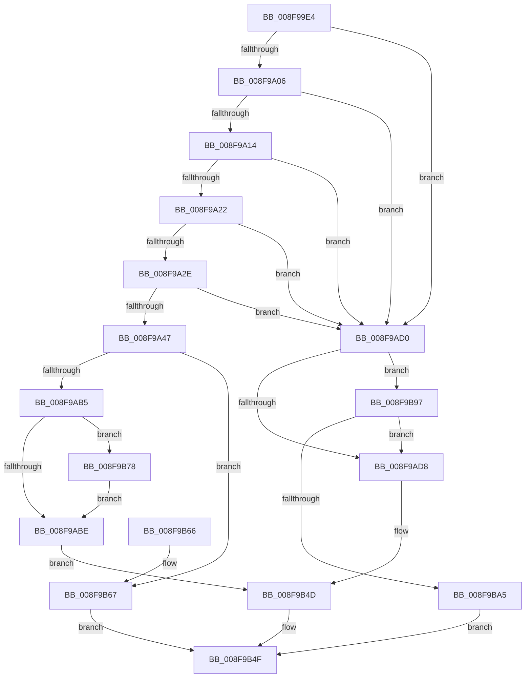

# PipEnumerateDevice

- RVA: `0x008F99E4`–`0x008F9BAC` (길이 `456` bytes)
- VA: `0x00000001408F99E4`
- 실행 섹션: `PAGE`
- PDB 이름 있음: `예`; PDB Function 태그: `아니요`
- unwind 정보 RVA: `0x00087C70`
- 디코드: `104`개 명령, `456/456` bytes 표시
- 미해석 바이트: `0` (있으면 어셈블리에 `.byte`로 보존)

> 이 문서는 커널 이미지의 기계어와 PDB 기호를 분석해 생성했습니다. 4번과 5번은 함수 원형과 자료형을 바이너리 사용 방식에서 추정한 C 해석이며 원본 소스 복구 결과는 아닙니다.

## 1. Dependencies

- 직접 호출 지점: **19**; 고유 호출 대상: **11**
- 직접 호출자로 확인된 함수: **1**
- RIP 상대 이미지 참조: **6**

### Outgoing calls
- `0x008F9A36` → [PnpDeviceCompletionRequestCreate](PnpDeviceCompletionRequestCreate_function_008F9BB4.md) (function, `0x008F9BB4`)
- `0x008F9A4F` → [PipSetDevNodeState](../../text/47/PipSetDevNodeState_function_00470708.md) (function, `0x00470708`)
- `0x008F9A61` → [PnpDeviceCompletionQueueAddDispatchedRequest](../../text/49/PnpDeviceCompletionQueueAddDispatchedRequest_function_0049619C.md) (function, `0x0049619C`)
- `0x008F9A74` → [PnpDiagnosticTraceObject](../../text/26/PnpDiagnosticTraceObject_function_0026E834.md) (function, `0x0026E834`)
- `0x008F9A81` → [PipClearDevNodeFlags](PipClearDevNodeFlags_function_008F9F54.md) (function, `0x008F9F54`)
- `0x008F9A8E` → [PnpPoFxActivateDevice](PnpPoFxActivateDevice_function_008FB29C.md) (function, `0x008FB29C`)
- `0x008F9AA3` → [PnpQueryDeviceRelations](PnpQueryDeviceRelations_function_008F9FE0.md) (function, `0x008F9FE0`)
- `0x008F9AC1` → [PnpDeviceCompletionQueueRemoveCompletedRequest](../../text/49/PnpDeviceCompletionQueueRemoveCompletedRequest_function_0049D73C.md) (function, `0x0049D73C`)
- `0x008F9AC9` → [PnpDeviceCompletionProcessCompletedRequest](PnpDeviceCompletionProcessCompletedRequest_function_008FB654.md) (function, `0x008FB654`)
- `0x008F9AE3` → [PnpDiagnosticTraceObject](../../text/26/PnpDiagnosticTraceObject_function_0026E834.md) (function, `0x0026E834`)
- `0x008F9AF0` → [PipClearDevNodeFlags](PipClearDevNodeFlags_function_008F9F54.md) (function, `0x008F9F54`)
- `0x008F9AFD` → [PnpPoFxActivateDevice](PnpPoFxActivateDevice_function_008FB29C.md) (function, `0x008FB29C`)
- `0x008F9B12` → [PnpQueryDeviceRelations](PnpQueryDeviceRelations_function_008F9FE0.md) (function, `0x008F9FE0`)
- `0x008F9B1D` → [PoFxIdleDevice](../../text/48/PoFxIdleDevice_function_00483EE8.md) (function, `0x00483EE8`)
- `0x008F9B38` → [PipSetDevNodeState](../../text/47/PipSetDevNodeState_function_00470708.md) (function, `0x00470708`)
- `0x008F9B48` → [PnpDiagnosticTraceObject](../../text/26/PnpDiagnosticTraceObject_function_0026E834.md) (function, `0x0026E834`)
- `0x008F9B71` → [PnpDiagnosticTraceObject](../../text/26/PnpDiagnosticTraceObject_function_0026E834.md) (function, `0x0026E834`)
- `0x008F9B85` → [PnpDiagnosticTraceObject](../../text/26/PnpDiagnosticTraceObject_function_0026E834.md) (function, `0x0026E834`)
- `0x008F9B8D` → [PnpDeviceCompletionQueueDispatchedEntryCompleted](../../text/26/PnpDeviceCompletionQueueDispatchedEntryCompleted_function_0026E778.md) (function, `0x0026E778`)

### Direct callers
- [PipProcessDevNodeTree](PipProcessDevNodeTree_function_008F9068.md) at `0x008F951C`

### Static image references
- `0x008F9A06` → RVA `0x00E0AA18` (`.data`; read)
- `0x008F9A22` → RVA `0x00FC41C4` (`.data`; read)
- `0x008F9A6D` → RVA `0x00011580` (`.rdata`; read)
- `0x008F9A97` → RVA `0x0026E6C0` (`PnpDeviceCompletionRoutine`; read)
- `0x008F9B41` → RVA `0x00010828` (`.rdata`; read)
- `0x008F9B6A` → RVA `0x00011620` (`.rdata`; read)

## 2. Other-region calls and transfers

- 다른 실행 섹션으로 향하는 call: **11**
  - `0x008F9A4F` → [PipSetDevNodeState](../../text/47/PipSetDevNodeState_function_00470708.md) (`PAGE` → `.text`)
  - `0x008F9A61` → [PnpDeviceCompletionQueueAddDispatchedRequest](../../text/49/PnpDeviceCompletionQueueAddDispatchedRequest_function_0049619C.md) (`PAGE` → `.text`)
  - `0x008F9A74` → [PnpDiagnosticTraceObject](../../text/26/PnpDiagnosticTraceObject_function_0026E834.md) (`PAGE` → `.text`)
  - `0x008F9AC1` → [PnpDeviceCompletionQueueRemoveCompletedRequest](../../text/49/PnpDeviceCompletionQueueRemoveCompletedRequest_function_0049D73C.md) (`PAGE` → `.text`)
  - `0x008F9AE3` → [PnpDiagnosticTraceObject](../../text/26/PnpDiagnosticTraceObject_function_0026E834.md) (`PAGE` → `.text`)
  - `0x008F9B1D` → [PoFxIdleDevice](../../text/48/PoFxIdleDevice_function_00483EE8.md) (`PAGE` → `.text`)
  - `0x008F9B38` → [PipSetDevNodeState](../../text/47/PipSetDevNodeState_function_00470708.md) (`PAGE` → `.text`)
  - `0x008F9B48` → [PnpDiagnosticTraceObject](../../text/26/PnpDiagnosticTraceObject_function_0026E834.md) (`PAGE` → `.text`)
  - `0x008F9B71` → [PnpDiagnosticTraceObject](../../text/26/PnpDiagnosticTraceObject_function_0026E834.md) (`PAGE` → `.text`)
  - `0x008F9B85` → [PnpDiagnosticTraceObject](../../text/26/PnpDiagnosticTraceObject_function_0026E834.md) (`PAGE` → `.text`)
  - `0x008F9B8D` → [PnpDeviceCompletionQueueDispatchedEntryCompleted](../../text/26/PnpDeviceCompletionQueueDispatchedEntryCompleted_function_0026E778.md) (`PAGE` → `.text`)
- 별도 외부 분기/꼬리 이동을 확인하지 못했습니다.

## 3. Assembly (complete function range)

```asm
008F99E4  48 89 5C 24 08                  mov qword ptr [rsp + 8], rbx
008F99E9  48 89 6C 24 10                  mov qword ptr [rsp + 0x10], rbp
008F99EE  48 89 74 24 18                  mov qword ptr [rsp + 0x18], rsi
008F99F3  57                              push rdi
008F99F4  48 83 EC 20                     sub rsp, 0x20
008F99F8  41 8B F8                        mov edi, r8d
008F99FB  48 8B F1                        mov rsi, rcx
008F99FE  85 D2                           test edx, edx
008F9A00  0F 85 CA 00 00 00               jne 0x1408f9ad0
008F9A06  8B 05 0C 10 51 00               mov eax, dword ptr [rip + 0x51100c]
008F9A0C  A8 02                           test al, 2
008F9A0E  0F 84 BC 00 00 00               je 0x1408f9ad0
008F9A14  0F BA A1 8C 01 00 00 17         bt dword ptr [rcx + 0x18c], 0x17
008F9A1C  0F 82 AE 00 00 00               jb 0x1408f9ad0
008F9A22  39 15 9C A7 6C 00               cmp dword ptr [rip + 0x6ca79c], edx
008F9A28  0F 85 A2 00 00 00               jne 0x1408f9ad0
008F9A2E  45 33 C0                        xor r8d, r8d
008F9A31  BA 0F 03 00 00                  mov edx, 0x30f
008F9A36  E8 79 01 00 00                  call 0x1408f9bb4
008F9A3B  48 8B D8                        mov rbx, rax
008F9A3E  48 85 C0                        test rax, rax
008F9A41  0F 84 89 00 00 00               je 0x1408f9ad0
008F9A47  BA 0E 03 00 00                  mov edx, 0x30e
008F9A4C  48 8B CE                        mov rcx, rsi
008F9A4F  E8 B4 6C B7 FF                  call 0x140470708
008F9A54  48 8B D3                        mov rdx, rbx
008F9A57  C7 86 88 01 00 00 03 01 00 00   mov dword ptr [rsi + 0x188], 0x103
008F9A61  E8 36 C7 B9 FF                  call 0x14049619c
008F9A66  48 8D 6E 28                     lea rbp, [rsi + 0x28]
008F9A6A  48 8B D5                        mov rdx, rbp
008F9A6D  48 8D 0D 0C 7B 71 FF            lea rcx, [rip - 0x8e84f4]
008F9A74  E8 BB 4D 97 FF                  call 0x14026e834
008F9A79  BA 08 00 00 00                  mov edx, 8
008F9A7E  48 8B CE                        mov rcx, rsi
008F9A81  E8 CE 04 00 00                  call 0x1408f9f54
008F9A86  BA 80 00 00 00                  mov edx, 0x80
008F9A8B  48 8B CE                        mov rcx, rsi
008F9A8E  E8 09 18 00 00                  call 0x1408fb29c
008F9A93  48 8B 4E 20                     mov rcx, qword ptr [rsi + 0x20]
008F9A97  4C 8D 05 22 4C 97 FF            lea r8, [rip - 0x68b3de]
008F9A9E  4C 8B CB                        mov r9, rbx
008F9AA1  33 D2                           xor edx, edx
008F9AA3  E8 38 05 00 00                  call 0x1408f9fe0
008F9AA8  8B F8                           mov edi, eax
008F9AAA  3D 03 01 00 00                  cmp eax, 0x103
008F9AAF  0F 84 B2 00 00 00               je 0x1408f9b67
008F9AB5  39 43 28                        cmp dword ptr [rbx + 0x28], eax
008F9AB8  0F 85 BA 00 00 00               jne 0x1408f9b78
008F9ABE  48 8B D3                        mov rdx, rbx
008F9AC1  E8 76 3C BA FF                  call 0x14049d73c
008F9AC6  48 8B CB                        mov rcx, rbx
008F9AC9  E8 86 1B 00 00                  call 0x1408fb654
008F9ACE  EB 7D                           jmp 0x1408f9b4d
008F9AD0  85 FF                           test edi, edi
008F9AD2  0F 85 BF 00 00 00               jne 0x1408f9b97
008F9AD8  48 8D 56 28                     lea rdx, [rsi + 0x28]
008F9ADC  48 8D 0D 9D 7A 71 FF            lea rcx, [rip - 0x8e8563]
008F9AE3  E8 4C 4D 97 FF                  call 0x14026e834
008F9AE8  BA 08 00 00 00                  mov edx, 8
008F9AED  48 8B CE                        mov rcx, rsi
008F9AF0  E8 5F 04 00 00                  call 0x1408f9f54
008F9AF5  BA 80 00 00 00                  mov edx, 0x80
008F9AFA  48 8B CE                        mov rcx, rsi
008F9AFD  E8 9A 17 00 00                  call 0x1408fb29c
008F9B02  48 8B 4E 20                     mov rcx, qword ptr [rsi + 0x20]
008F9B06  4C 8D 8E 10 02 00 00            lea r9, [rsi + 0x210]
008F9B0D  45 33 C0                        xor r8d, r8d
008F9B10  33 D2                           xor edx, edx
008F9B12  E8 C9 04 00 00                  call 0x1408f9fe0
008F9B17  48 8B 4E 20                     mov rcx, qword ptr [rsi + 0x20]
008F9B1B  8B D8                           mov ebx, eax
008F9B1D  E8 C6 A3 B8 FF                  call 0x140483ee8
008F9B22  0F BA B6 C0 02 00 00 07         btr dword ptr [rsi + 0x2c0], 7
008F9B2A  BA 0F 03 00 00                  mov edx, 0x30f
008F9B2F  48 8B CE                        mov rcx, rsi
008F9B32  89 9E 88 01 00 00               mov dword ptr [rsi + 0x188], ebx
008F9B38  E8 CB 6B B7 FF                  call 0x140470708
008F9B3D  48 8D 56 28                     lea rdx, [rsi + 0x28]
008F9B41  48 8D 0D E0 6C 71 FF            lea rcx, [rip - 0x8e9320]
008F9B48  E8 E7 4C 97 FF                  call 0x14026e834
008F9B4D  33 FF                           xor edi, edi
008F9B4F  48 8B 5C 24 30                  mov rbx, qword ptr [rsp + 0x30]
008F9B54  8B C7                           mov eax, edi
008F9B56  48 8B 6C 24 38                  mov rbp, qword ptr [rsp + 0x38]
008F9B5B  48 8B 74 24 40                  mov rsi, qword ptr [rsp + 0x40]
008F9B60  48 83 C4 20                     add rsp, 0x20
008F9B64  5F                              pop rdi
008F9B65  C3                              ret
008F9B66  CC                              int3
008F9B67  48 8B D5                        mov rdx, rbp
008F9B6A  48 8D 0D AF 7A 71 FF            lea rcx, [rip - 0x8e8551]
008F9B71  E8 BE 4C 97 FF                  call 0x14026e834
008F9B76  EB D7                           jmp 0x1408f9b4f
008F9B78  48 8B D5                        mov rdx, rbp
008F9B7B  89 43 28                        mov dword ptr [rbx + 0x28], eax
008F9B7E  48 8D 0D A3 6C 71 FF            lea rcx, [rip - 0x8e935d]
008F9B85  E8 AA 4C 97 FF                  call 0x14026e834
008F9B8A  48 8B D3                        mov rdx, rbx
008F9B8D  E8 E6 4B 97 FF                  call 0x14026e778
008F9B92  E9 27 FF FF FF                  jmp 0x1408f9abe
008F9B97  0F BA A6 8C 01 00 00 17         bt dword ptr [rsi + 0x18c], 0x17
008F9B9F  0F 83 33 FF FF FF               jae 0x1408f9ad8
008F9BA5  BF 2D 02 00 C0                  mov edi, 0xc000022d
008F9BAA  EB A3                           jmp 0x1408f9b4f
```

## 4. C-style interpretation (structured pseudocode)

```c
__int64 __fastcall PipEnumerateDevice(__int64 a1, int a2, int a3)
{
    __int64 result;
    __int64 v_rdi;
    __int64 v_rsp;
    unsigned __int64 v_stack_p10;
    unsigned __int64 v_stack_p18;
    unsigned __int64 v_stack_p8;

    v_stack_p8 = v_rbx;
    v_stack_p10 = v_rbp;
    v_stack_p18 = v_rsi;
    v_rsp = (v_rsp) - (32);
    if (a2 != 0) goto loc_008F9AD0;
    if ((((unsigned __int8)((unsigned int)(*(unsigned int *)(v_rip + 5312524)))) & (2)) == 0) goto loc_008F9AD0;
    if (condition_is_below) goto loc_008F9AD0;
    if ((*(unsigned int *)(v_rip + 7120796)) != a2) goto loc_008F9AD0;
    a3 = 0;
    result = PnpDeviceCompletionRequestCreate(a1, 783, a3, a4);
    if (result == 0) goto loc_008F9AD0;
    result = PipSetDevNodeState(a1, 782, a3, a4);
    *(unsigned int *)(a1 + 392) = 259;
    result = PnpDeviceCompletionQueueAddDispatchedRequest(a1, result, a3, a4);
    result = PnpDiagnosticTraceObject(v_rip - 9340148, a1 + 40, a3, a4);
    result = PipClearDevNodeFlags(a1, 8, a3, a4);
    result = PnpPoFxActivateDevice(a1, 128, a3, a4);
    a2 = 0;
    result = PnpQueryDeviceRelations(*(unsigned __int64 *)(a1 + 32), a2, v_rip - 6861790, result);
    if (((unsigned int)(result)) == 259) goto loc_008F9B67;
    if ((*(unsigned int *)(result + 40)) != ((unsigned int)(result))) goto loc_008F9B78;
loc_008F9ABE:
    result = PnpDeviceCompletionQueueRemoveCompletedRequest(*(unsigned __int64 *)(a1 + 32), result, v_rip - 6861790, result);
    result = PnpDeviceCompletionProcessCompletedRequest(result, result, v_rip - 6861790, result);
    goto loc_008F9B4D;
loc_008F9AD0:
    if ((unsigned int)((unsigned int)((unsigned int)(result))) != 0) goto loc_008F9B97;
loc_008F9AD8:
    result = PnpDiagnosticTraceObject(v_rip - 9340259, a1 + 40, v_rip - 6861790, result);
    result = PipClearDevNodeFlags(a1, 8, v_rip - 6861790, result);
    result = PnpPoFxActivateDevice(a1, 128, v_rip - 6861790, result);
    a3 = 0;
    a2 = 0;
    result = PnpQueryDeviceRelations(*(unsigned __int64 *)(a1 + 32), a2, a3, a1 + 528);
    result = PoFxIdleDevice(*(unsigned __int64 *)(a1 + 32), a2, a3, a1 + 528);
    *(unsigned int *)(a1 + 392) = (unsigned int)((unsigned int)((unsigned int)(result)));
    result = PipSetDevNodeState(a1, 783, a3, a1 + 528);
    result = PnpDiagnosticTraceObject(v_rip - 9343776, a1 + 40, a3, a1 + 528);
loc_008F9B4D:
    v_rdi = 0;
loc_008F9B4F:
    v_rsp = (v_rsp) + (32);
    return 0;
loc_008F9B67:
    result = PnpDiagnosticTraceObject(v_rip - 9340241, v_stack_p10, a3, a1 + 528);
    goto loc_008F9B4F;
loc_008F9B78:
    *(unsigned int *)(v_stack_p8 + 40) = (unsigned int)(result);
    result = PnpDiagnosticTraceObject(v_rip - 9343837, v_stack_p10, a3, a1 + 528);
    result = PnpDeviceCompletionQueueDispatchedEntryCompleted(v_rip - 9343837, v_stack_p8, a3, a1 + 528);
    goto loc_008F9ABE;
loc_008F9B97:
    if (condition_is_above_or_equal) goto loc_008F9AD8;
    goto loc_008F9B4F;
}
```

## 5. (Beta) C Style

```c
int64_t PipEnumerateDevice(void *Arg1, int32_t Arg2, int32_t Arg3)
{
    uint8_t *arg1 = (uint8_t *)Arg1;

    int64_t result;
    int64_t local_rdi;
    int64_t local_rsp;
    uint64_t v_stack_p10;
    uint64_t v_stack_p18;
    uint64_t v_stack_p8;

    v_stack_p8 = local_rbx;
    v_stack_p10 = local_rbp;
    v_stack_p18 = local_rsi;
    local_rsp = (local_rsp) - (32);
    if (Arg2 != 0) goto loc_008F9AD0;
    if ((((uint8_t)((uint32_t)(*(uint32_t *)(v_rip + 0x51100C)))) & (2)) == 0) goto loc_008F9AD0;
    if (condition_is_below) goto loc_008F9AD0;
    if ((*(uint32_t *)(v_rip + 0x6CA79C)) != Arg2) goto loc_008F9AD0;
    Arg3 = 0;
    result = PnpDeviceCompletionRequestCreate(Arg1, 783, Arg3, a4);
    if (result == 0) goto loc_008F9AD0;
    result = PipSetDevNodeState(Arg1, 782, Arg3, a4);
    *(uint32_t *)(arg1 + 0x188) = 259;
    result = PnpDeviceCompletionQueueAddDispatchedRequest(Arg1, result, Arg3, a4);
    result = PnpDiagnosticTraceObject(v_rip - 9340148, Arg1 + 40, Arg3, a4);
    result = PipClearDevNodeFlags(Arg1, 8, Arg3, a4);
    result = PnpPoFxActivateDevice(Arg1, 128, Arg3, a4);
    Arg2 = 0;
    result = PnpQueryDeviceRelations(*(uint64_t *)(arg1 + 0x20), Arg2, v_rip - 6861790, result);
    if (((uint32_t)(result)) == 259) goto loc_008F9B67;
    if ((*(uint32_t *)(result + 0x28)) != ((uint32_t)(result))) goto loc_008F9B78;
loc_008F9ABE:
    result = PnpDeviceCompletionQueueRemoveCompletedRequest(*(uint64_t *)(arg1 + 0x20), result, v_rip - 6861790, result);
    result = PnpDeviceCompletionProcessCompletedRequest(result, result, v_rip - 6861790, result);
    goto loc_008F9B4D;
loc_008F9AD0:
    if ((uint32_t)((uint32_t)((uint32_t)(result))) != 0) goto loc_008F9B97;
loc_008F9AD8:
    result = PnpDiagnosticTraceObject(v_rip - 9340259, Arg1 + 40, v_rip - 6861790, result);
    result = PipClearDevNodeFlags(Arg1, 8, v_rip - 6861790, result);
    result = PnpPoFxActivateDevice(Arg1, 128, v_rip - 6861790, result);
    Arg3 = 0;
    Arg2 = 0;
    result = PnpQueryDeviceRelations(*(uint64_t *)(arg1 + 0x20), Arg2, Arg3, Arg1 + 528);
    result = PoFxIdleDevice(*(uint64_t *)(arg1 + 0x20), Arg2, Arg3, Arg1 + 528);
    *(uint32_t *)(arg1 + 0x188) = (uint32_t)((uint32_t)((uint32_t)(result)));
    result = PipSetDevNodeState(Arg1, 783, Arg3, Arg1 + 528);
    result = PnpDiagnosticTraceObject(v_rip - 9343776, Arg1 + 40, Arg3, Arg1 + 528);
loc_008F9B4D:
    local_rdi = 0;
loc_008F9B4F:
    local_rsp = (local_rsp) + (32);
    return 0;
loc_008F9B67:
    result = PnpDiagnosticTraceObject(v_rip - 9340241, v_stack_p10, Arg3, Arg1 + 528);
    goto loc_008F9B4F;
loc_008F9B78:
    *(uint32_t *)(v_stack_p8 + 0x28) = (uint32_t)(result);
    result = PnpDiagnosticTraceObject(v_rip - 9343837, v_stack_p10, Arg3, Arg1 + 528);
    result = PnpDeviceCompletionQueueDispatchedEntryCompleted(v_rip - 9343837, v_stack_p8, Arg3, Arg1 + 528);
    goto loc_008F9ABE;
loc_008F9B97:
    if (condition_is_above_or_equal) goto loc_008F9AD8;
    goto loc_008F9B4F;
}
```

### 관측된 메모리 오프셋

구조체 형식이 확인되지 않은 접근은 인자 기준의 오프셋으로만 기록했습니다.

| 기준 인자 | 오프셋 표현 | 폭 (bit) | 접근 |
|---|---:|---:|---|
| `Arg1` | `+ 0x20` | `64` | `R` |
| `Arg1` | `+ 0x28` | `64` | `R` |
| `Arg1` | `+ 0x188` | `32` | `W` |
| `Arg1` | `+ 0x18C` | `32` | `R` |
| `Arg1` | `+ 0x210` | `64` | `R` |
| `Arg1` | `+ 0x2C0` | `32` | `R/W` |

## 6. Execution-region graph

[열기: 2D/3D 그래프와 함수 탐색 컨트롤 패널](../../../control-panel.html?section=page&rva=0x008F99E4&view=graph)

- 2D 그래프는 위에서 아래로 흐르고, 3D 그래프는 빈 공간을 드래그해 회전합니다. Shift+드래그는 이동, 휠은 확대·축소, 함수 노드 선택은 대상 보고서 이동입니다.

### Static fallback


