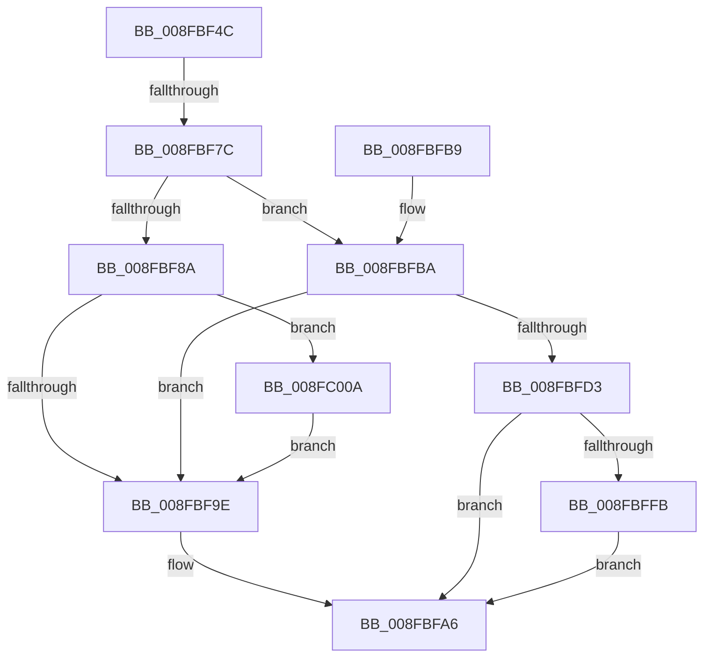

# PipProcessEnumeratedChildDevice

- RVA: `0x008FBF4C`–`0x008FC014` (길이 `200` bytes)
- VA: `0x00000001408FBF4C`
- 실행 섹션: `PAGE`
- PDB 이름 있음: `예`; PDB Function 태그: `예`
- unwind 정보 RVA: `0x00087F08`
- 디코드: `56`개 명령, `200/200` bytes 표시
- 미해석 바이트: `0` (있으면 어셈블리에 `.byte`로 보존)

> 이 문서는 커널 이미지의 기계어와 PDB 기호를 분석해 생성했습니다. 4번과 5번은 함수 원형과 자료형을 바이너리 사용 방식에서 추정한 C 해석이며 원본 소스 복구 결과는 아닙니다.

## 1. Dependencies

- 직접 호출 지점: **7**; 고유 호출 대상: **6**
- 직접 호출자로 확인된 함수: **1**
- RIP 상대 이미지 참조: **0**

### Outgoing calls
- `0x008FBF90` → [PipSetDevNodeFlags](PipSetDevNodeFlags_function_008FC048.md) (function, `0x008FC048`)
- `0x008FBFA1` → [ObfDereferenceObject](../../text/2F/ObfDereferenceObject_function_002F9350.md) (function, `0x002F9350`)
- `0x008FBFC2` → [PipAllocateDeviceNode](../A9/PipAllocateDeviceNode_function_00A9C8F8.md) (function, `0x00A9C8F8`)
- `0x008FBFDB` → [PipSetDevNodeFlags](PipSetDevNodeFlags_function_008FC048.md) (function, `0x008FC048`)
- `0x008FBFEB` → [PpDevNodeInsertIntoTree](../../text/4C/PpDevNodeInsertIntoTree_function_004CA274.md) (function, `0x004CA274`)
- `0x008FC003` → [PipSetDevNodeProblem](PipSetDevNodeProblem_function_008FDE0C.md) (function, `0x008FDE0C`)
- `0x008FC00D` → [PpProfileCancelTransitioningDock](../73/PpProfileCancelTransitioningDock_function_007379A0.md) (function, `0x007379A0`)

### Direct callers
- [PipEnumerateCompleted](PipEnumerateCompleted_function_008F7B1C.md) at `0x008F7C5C`
- [PipEnumerateCompleted](PipEnumerateCompleted_function_008F7B1C.md) at `0x008F7CCA`

### Static image references
- 디코드된 RIP-relative 메모리 참조가 없습니다.

## 2. Other-region calls and transfers

- 다른 실행 섹션으로 향하는 call: **2**
  - `0x008FBFA1` → [ObfDereferenceObject](../../text/2F/ObfDereferenceObject_function_002F9350.md) (`PAGE` → `.text`)
  - `0x008FBFEB` → [PpDevNodeInsertIntoTree](../../text/4C/PpDevNodeInsertIntoTree_function_004CA274.md) (`PAGE` → `.text`)
- call이 아닌 외부 분기/꼬리 이동: **1**
  - `0x008FBF76` → [sub_00B1F9A0](../B1/Unknown_function_00B1F9A0.md) (`tail-transfer`)

## 3. Assembly (complete function range)

```asm
008FBF4C  48 89 5C 24 08                  mov qword ptr [rsp + 8], rbx
008FBF51  48 89 6C 24 18                  mov qword ptr [rsp + 0x18], rbp
008FBF56  56                              push rsi
008FBF57  57                              push rdi
008FBF58  41 56                           push r14
008FBF5A  48 83 EC 30                     sub rsp, 0x30
008FBF5E  48 8B B2 38 01 00 00            mov rsi, qword ptr [rdx + 0x138]
008FBF65  BD 02 00 00 00                  mov ebp, 2
008FBF6A  48 8B DA                        mov rbx, rdx
008FBF6D  4C 8B F1                        mov r14, rcx
008FBF70  8B 46 20                        mov eax, dword ptr [rsi + 0x20]
008FBF73  40 84 C5                        test bpl, al
008FBF76  0F 85 24 3A 22 00               jne 0x140b1f9a0
008FBF7C  48 8B 76 28                     mov rsi, qword ptr [rsi + 0x28]
008FBF80  48 89 74 24 58                  mov qword ptr [rsp + 0x58], rsi
008FBF85  48 85 F6                        test rsi, rsi
008FBF88  74 30                           je 0x1408fbfba
008FBF8A  8D 55 0E                        lea edx, [rbp + 0xe]
008FBF8D  48 8B CE                        mov rcx, rsi
008FBF90  E8 B3 00 00 00                  call 0x1408fc048
008FBF95  83 BE 38 02 00 00 04            cmp dword ptr [rsi + 0x238], 4
008FBF9C  74 6C                           je 0x1408fc00a
008FBF9E  48 8B CB                        mov rcx, rbx
008FBFA1  E8 AA D3 9F FF                  call 0x1402f9350
008FBFA6  48 8B 5C 24 50                  mov rbx, qword ptr [rsp + 0x50]
008FBFAB  48 8B 6C 24 60                  mov rbp, qword ptr [rsp + 0x60]
008FBFB0  48 83 C4 30                     add rsp, 0x30
008FBFB4  41 5E                           pop r14
008FBFB6  5F                              pop rdi
008FBFB7  5E                              pop rsi
008FBFB8  C3                              ret
008FBFB9  CC                              int3
008FBFBA  48 8D 54 24 58                  lea rdx, [rsp + 0x58]
008FBFBF  48 8B CB                        mov rcx, rbx
008FBFC2  E8 31 09 1A 00                  call 0x140a9c8f8
008FBFC7  48 8B 74 24 58                  mov rsi, qword ptr [rsp + 0x58]
008FBFCC  8B E8                           mov ebp, eax
008FBFCE  48 85 F6                        test rsi, rsi
008FBFD1  74 CB                           je 0x1408fbf9e
008FBFD3  BA 10 00 00 00                  mov edx, 0x10
008FBFD8  48 8B CE                        mov rcx, rsi
008FBFDB  E8 68 00 00 00                  call 0x1408fc048
008FBFE0  0F BA 6B 30 0C                  bts dword ptr [rbx + 0x30], 0xc
008FBFE5  48 8B D6                        mov rdx, rsi
008FBFE8  49 8B CE                        mov rcx, r14
008FBFEB  E8 84 E2 BC FF                  call 0x1404ca274
008FBFF0  41 B8 6E 03 00 C0               mov r8d, 0xc000036e
008FBFF6  41 3B E8                        cmp ebp, r8d
008FBFF9  75 AB                           jne 0x1408fbfa6
008FBFFB  BA 31 00 00 00                  mov edx, 0x31
008FC000  48 8B CE                        mov rcx, rsi
008FC003  E8 04 1E 00 00                  call 0x1408fde0c
008FC008  EB 9C                           jmp 0x1408fbfa6
008FC00A  48 8B CE                        mov rcx, rsi
008FC00D  E8 8E B9 E3 FF                  call 0x1407379a0
008FC012  EB 8A                           jmp 0x1408fbf9e
```

## 4. C-style interpretation (structured pseudocode)

```c
__int64 __fastcall PipProcessEnumeratedChildDevice(__int64 a1, __int64 a2)
{
    __int64 result;
    __int64 v_rsp;
    unsigned __int64 v_stack_p10;
    unsigned __int64 v_stack_p18;
    unsigned __int64 v_stack_p58;
    unsigned __int64 v_stack_p8;

    v_stack_p8 = v_rbx;
    v_stack_p18 = v_rbp;
    v_rsp = (v_rsp) - (48);
    v_stack_p10 = *(unsigned __int64 *)(*(unsigned __int64 *)(a2 + 312) + 40);
    if (*(unsigned __int64 *)(*(unsigned __int64 *)(a2 + 312) + 40) == 0) goto loc_008FBFBA;
    result = PipSetDevNodeFlags(*(unsigned __int64 *)(*(unsigned __int64 *)(a2 + 312) + 40), 2 + 14, a3, a4);
    if ((*(unsigned int *)(*(unsigned __int64 *)(*(unsigned __int64 *)(a2 + 312) + 40) + 568)) == 4) goto loc_008FC00A;
loc_008FBF9E:
    result = ObfDereferenceObject(a2, 2 + 14, a3, a4);
loc_008FBFA6:
    v_rsp = (v_rsp) + (48);
    return result;
loc_008FBFBA:
    result = PipAllocateDeviceNode(v_stack_p8, v_stack_p58, a3, a4);
    if (v_stack_p58 == 0) goto loc_008FBF9E;
    result = PipSetDevNodeFlags(v_stack_p58, 16, a3, a4);
    result = PpDevNodeInsertIntoTree(a1, v_stack_p58, a3, a4);
    if (((unsigned int)((unsigned int)((unsigned int)(result)))) != ((unsigned int)((unsigned int)(0xC000036EULL)))) goto loc_008FBFA6;
    result = PipSetDevNodeProblem(v_stack_p58, 49, (unsigned int)(0xC000036EULL), a4);
    goto loc_008FBFA6;
loc_008FC00A:
    result = PpProfileCancelTransitioningDock(v_stack_p58, 49, (unsigned int)(0xC000036EULL), a4);
    goto loc_008FBF9E;
}
```

## 5. (Beta) C Style

```c
int64_t PipProcessEnumeratedChildDevice(int64_t Arg1, void *Arg2)
{
    uint8_t *arg2 = (uint8_t *)Arg2;

    int64_t result;
    int64_t local_rsp;
    uint64_t v_stack_p10;
    uint64_t v_stack_p18;
    uint64_t v_stack_p58;
    uint64_t v_stack_p8;

    v_stack_p8 = local_rbx;
    v_stack_p18 = local_rbp;
    local_rsp = (local_rsp) - (48);
    v_stack_p10 = *(uint64_t *)(*(uint64_t *)(arg2 + 0x138) + 0x28);
    if (*(uint64_t *)(*(uint64_t *)(arg2 + 0x138) + 0x28) == 0) goto loc_008FBFBA;
    result = PipSetDevNodeFlags(*(uint64_t *)(*(uint64_t *)(arg2 + 0x138) + 0x28), 2 + 14, a3, a4);
    if ((*(uint32_t *)(*(uint64_t *)(*(uint64_t *)(arg2 + 0x138) + 0x28) + 0x238)) == 4) goto loc_008FC00A;
loc_008FBF9E:
    result = ObfDereferenceObject(Arg2, 2 + 14, a3, a4);
loc_008FBFA6:
    local_rsp = (local_rsp) + (48);
    return result;
loc_008FBFBA:
    result = PipAllocateDeviceNode(v_stack_p8, v_stack_p58, a3, a4);
    if (v_stack_p58 == 0) goto loc_008FBF9E;
    result = PipSetDevNodeFlags(v_stack_p58, 16, a3, a4);
    result = PpDevNodeInsertIntoTree(Arg1, v_stack_p58, a3, a4);
    if (((uint32_t)((uint32_t)((uint32_t)(result)))) != ((uint32_t)((uint32_t)(0xC000036EULL)))) goto loc_008FBFA6;
    result = PipSetDevNodeProblem(v_stack_p58, 49, (uint32_t)(0xC000036EULL), a4);
    goto loc_008FBFA6;
loc_008FC00A:
    result = PpProfileCancelTransitioningDock(v_stack_p58, 49, (uint32_t)(0xC000036EULL), a4);
    goto loc_008FBF9E;
}
```

### 관측된 메모리 오프셋

구조체 형식이 확인되지 않은 접근은 인자 기준의 오프셋으로만 기록했습니다.

| 기준 인자 | 오프셋 표현 | 폭 (bit) | 접근 |
|---|---:|---:|---|
| `Arg2` | `+ 0x30` | `32` | `R/W` |
| `Arg2` | `+ 0x138` | `64` | `R` |

## 6. Execution-region graph

[열기: 2D/3D 그래프와 함수 탐색 컨트롤 패널](../../../control-panel.html?section=page&rva=0x008FBF4C&view=graph)

- 2D 그래프는 위에서 아래로 흐르고, 3D 그래프는 빈 공간을 드래그해 회전합니다. Shift+드래그는 이동, 휠은 확대·축소, 함수 노드 선택은 대상 보고서 이동입니다.

### Static fallback


