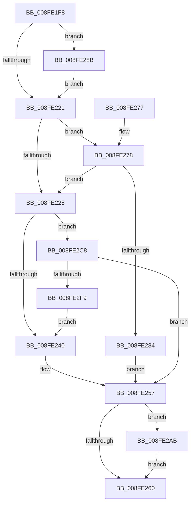

# PipProcessStartPhase1

- RVA: `0x008FE1F8`–`0x008FE2FE` (길이 `262` bytes)
- VA: `0x00000001408FE1F8`
- 실행 섹션: `PAGE`
- PDB 이름 있음: `예`; PDB Function 태그: `아니요`
- unwind 정보 RVA: `0x000881E8`
- 디코드: `67`개 명령, `262/262` bytes 표시
- 미해석 바이트: `0` (있으면 어셈블리에 `.byte`로 보존)

> 이 문서는 커널 이미지의 기계어와 PDB 기호를 분석해 생성했습니다. 4번과 5번은 함수 원형과 자료형을 바이너리 사용 방식에서 추정한 C 해석이며 원본 소스 복구 결과는 아닙니다.

## 1. Dependencies

- 직접 호출 지점: **8**; 고유 호출 대상: **7**
- 직접 호출자로 확인된 함수: **1**
- RIP 상대 이미지 참조: **3**

### Outgoing calls
- `0x008FE22E` → [IopUncacheInterfaceInformation](IopUncacheInterfaceInformation_function_008FCC28.md) (function, `0x008FCC28`)
- `0x008FE243` → [PiDmaGuardProcessPreStart](PiDmaGuardProcessPreStart_function_008FE304.md) (function, `0x008FE304`)
- `0x008FE250` → [PnpStartDeviceNode](PnpStartDeviceNode_function_008FE38C.md) (function, `0x008FE38C`)
- `0x008FE2A1` → [McTemplateK0dz_EtwWriteTransfer](../../text/42/McTemplateK0dz_EtwWriteTransfer_function_0042316C.md) (function, `0x0042316C`)
- `0x008FE2C1` → [McTemplateK0dz_EtwWriteTransfer](../../text/42/McTemplateK0dz_EtwWriteTransfer_function_0042316C.md) (function, `0x0042316C`)
- `0x008FE2CA` → [PpProfileBeginHardwareProfileTransition](../73/PpProfileBeginHardwareProfileTransition_function_007378E8.md) (function, `0x007378E8`)
- `0x008FE2D9` → [PpProfileIncludeInHardwareProfileTransition](../73/PpProfileIncludeInHardwareProfileTransition_function_00737B9C.md) (function, `0x00737B9C`)
- `0x008FE2EA` → [PpProfileQueryHardwareProfileChange](../73/PpProfileQueryHardwareProfileChange_function_00737C5C.md) (function, `0x00737C5C`)

### Direct callers
- [PipProcessDevNodeTree](PipProcessDevNodeTree_function_008F9068.md) at `0x008F96A8`

### Static image references
- `0x008FE213` → RVA `0x00EF012B` (`.data`; read)
- `0x008FE28F` → RVA `0x00011740` (`.rdata`; read)
- `0x008FE2AF` → RVA `0x00011768` (`.rdata`; read)

## 2. Other-region calls and transfers

- 다른 실행 섹션으로 향하는 call: **2**
  - `0x008FE2A1` → [McTemplateK0dz_EtwWriteTransfer](../../text/42/McTemplateK0dz_EtwWriteTransfer_function_0042316C.md) (`PAGE` → `.text`)
  - `0x008FE2C1` → [McTemplateK0dz_EtwWriteTransfer](../../text/42/McTemplateK0dz_EtwWriteTransfer_function_0042316C.md) (`PAGE` → `.text`)
- 별도 외부 분기/꼬리 이동을 확인하지 못했습니다.

## 3. Assembly (complete function range)

```asm
008FE1F8  48 8B C4                        mov rax, rsp
008FE1FB  48 89 58 08                     mov qword ptr [rax + 8], rbx
008FE1FF  48 89 68 10                     mov qword ptr [rax + 0x10], rbp
008FE203  48 89 70 20                     mov qword ptr [rax + 0x20], rsi
008FE207  57                              push rdi
008FE208  48 83 EC 30                     sub rsp, 0x30
008FE20C  83 60 18 00                     and dword ptr [rax + 0x18], 0
008FE210  41 8B F8                        mov edi, r8d
008FE213  F6 05 11 1F 5F 00 20            test byte ptr [rip + 0x5f1f11], 0x20
008FE21A  8B EA                           mov ebp, edx
008FE21C  48 8B D9                        mov rbx, rcx
008FE21F  75 6A                           jne 0x1408fe28b
008FE221  85 FF                           test edi, edi
008FE223  75 53                           jne 0x1408fe278
008FE225  48 8B 4B 20                     mov rcx, qword ptr [rbx + 0x20]
008FE229  BA 01 00 00 00                  mov edx, 1
008FE22E  E8 F5 E9 FF FF                  call 0x1408fcc28
008FE233  83 BB 38 02 00 00 00            cmp dword ptr [rbx + 0x238], 0
008FE23A  0F 85 88 00 00 00               jne 0x1408fe2c8
008FE240  48 8B CB                        mov rcx, rbx
008FE243  E8 BC 00 00 00                  call 0x1408fe304
008FE248  44 8B C5                        mov r8d, ebp
008FE24B  33 D2                           xor edx, edx
008FE24D  48 8B CB                        mov rcx, rbx
008FE250  E8 37 01 00 00                  call 0x1408fe38c
008FE255  8B F8                           mov edi, eax
008FE257  F6 05 CD 1E 5F 00 20            test byte ptr [rip + 0x5f1ecd], 0x20
008FE25E  75 4B                           jne 0x1408fe2ab
008FE260  48 8B 5C 24 40                  mov rbx, qword ptr [rsp + 0x40]
008FE265  8B C7                           mov eax, edi
008FE267  48 8B 6C 24 48                  mov rbp, qword ptr [rsp + 0x48]
008FE26C  48 8B 74 24 58                  mov rsi, qword ptr [rsp + 0x58]
008FE271  48 83 C4 30                     add rsp, 0x30
008FE275  5F                              pop rdi
008FE276  C3                              ret
008FE277  CC                              int3
008FE278  F7 83 8C 01 00 00 00 00 40 00   test dword ptr [rbx + 0x18c], 0x400000
008FE282  74 A1                           je 0x1408fe225
008FE284  BF 2D 02 00 C0                  mov edi, 0xc000022d
008FE289  EB CC                           jmp 0x1408fe257
008FE28B  48 8B 41 30                     mov rax, qword ptr [rcx + 0x30]
008FE28F  48 8D 15 AA 34 71 FF            lea rdx, [rip - 0x8ecb56]
008FE296  41 B9 01 00 00 00               mov r9d, 1
008FE29C  48 89 44 24 20                  mov qword ptr [rsp + 0x20], rax
008FE2A1  E8 C6 4E B2 FF                  call 0x14042316c
008FE2A6  E9 76 FF FF FF                  jmp 0x1408fe221
008FE2AB  48 8B 43 30                     mov rax, qword ptr [rbx + 0x30]
008FE2AF  48 8D 15 B2 34 71 FF            lea rdx, [rip - 0x8ecb4e]
008FE2B6  41 B9 01 00 00 00               mov r9d, 1
008FE2BC  48 89 44 24 20                  mov qword ptr [rsp + 0x20], rax
008FE2C1  E8 A6 4E B2 FF                  call 0x14042316c
008FE2C6  EB 98                           jmp 0x1408fe260
008FE2C8  33 C9                           xor ecx, ecx
008FE2CA  E8 19 96 E3 FF                  call 0x1407378e8
008FE2CF  BF 02 00 00 00                  mov edi, 2
008FE2D4  48 8B CB                        mov rcx, rbx
008FE2D7  8B D7                           mov edx, edi
008FE2D9  E8 BE 98 E3 FF                  call 0x140737b9c
008FE2DE  45 33 C9                        xor r9d, r9d
008FE2E1  4C 8D 44 24 50                  lea r8, [rsp + 0x50]
008FE2E6  8B D7                           mov edx, edi
008FE2E8  33 C9                           xor ecx, ecx
008FE2EA  E8 6D 99 E3 FF                  call 0x140737c5c
008FE2EF  8B F8                           mov edi, eax
008FE2F1  85 C0                           test eax, eax
008FE2F3  0F 88 5E FF FF FF               js 0x1408fe257
008FE2F9  E9 42 FF FF FF                  jmp 0x1408fe240
```

## 4. C-style interpretation (structured pseudocode)

```c
__int64 __fastcall PipProcessStartPhase1(__int64 a1, int a2, int a3)
{
    __int64 result;
    __int64 v_rsp;
    unsigned __int64 v_stack_p10;
    unsigned __int64 v_stack_p20;
    unsigned __int64 v_stack_p50;
    unsigned __int64 v_stack_p8;

    *(unsigned __int64 *)(v_rsp + 8) = v_rbx;
    *(unsigned __int64 *)(v_rsp + 16) = v_rbp;
    *(unsigned __int64 *)(v_rsp + 32) = v_rsi;
    v_rsp = (v_rsp) - (48);
    if (((*(unsigned __int8 *)(v_rip + 6233873)) & (32)) != 0) goto loc_008FE28B;
loc_008FE221:
    if ((unsigned int)((unsigned int)(a3)) != 0) goto loc_008FE278;
loc_008FE225:
    result = IopUncacheInterfaceInformation(*(unsigned __int64 *)(a1 + 32), 1, a3, a4);
    if ((*(unsigned int *)(a1 + 568)) != 0) goto loc_008FE2C8;
loc_008FE240:
    result = PiDmaGuardProcessPreStart(a1, 1, a3, a4);
    a2 = 0;
    result = PnpStartDeviceNode(a1, a2, (unsigned int)((unsigned int)((unsigned int)(a2))), a4);
loc_008FE257:
    if (((*(unsigned __int8 *)(v_rip + 6233805)) & (32)) != 0) goto loc_008FE2AB;
loc_008FE260:
    v_rsp = (v_rsp) + (48);
    return (unsigned int)((unsigned int)((unsigned int)((unsigned int)(result))));
loc_008FE278:
    if (((*(unsigned int *)(v_stack_p8 + 396)) & (0x400000ULL)) == 0) goto loc_008FE225;
    goto loc_008FE257;
loc_008FE28B:
    v_stack_p20 = *(unsigned __int64 *)(a1 + 48);
    result = McTemplateK0dz_EtwWriteTransfer(a1, v_rip - 9358166, (unsigned int)((unsigned int)((unsigned int)(a2))), 1);
    goto loc_008FE221;
loc_008FE2AB:
    v_stack_p20 = *(unsigned __int64 *)(v_stack_p8 + 48);
    result = McTemplateK0dz_EtwWriteTransfer(a1, v_rip - 9358158, (unsigned int)((unsigned int)((unsigned int)(a2))), 1);
    goto loc_008FE260;
loc_008FE2C8:
    a1 = 0;
    result = PpProfileBeginHardwareProfileTransition(a1, v_rip - 9358158, (unsigned int)((unsigned int)((unsigned int)(a2))), 1);
    result = PpProfileIncludeInHardwareProfileTransition(v_stack_p8, 2, (unsigned int)((unsigned int)((unsigned int)(a2))), 1);
    a4 = 0;
    a1 = 0;
    result = PpProfileQueryHardwareProfileChange(a1, 2, v_stack_p50, a4);
    if (sign_flag) goto loc_008FE257;
    goto loc_008FE240;
}
```

## 5. (Beta) C Style

```c
int64_t PipProcessStartPhase1(void *Arg1, int32_t Arg2, int32_t Arg3)
{
    uint8_t *arg1 = (uint8_t *)Arg1;

    int64_t result;
    int64_t local_rsp;
    uint64_t v_stack_p10;
    uint64_t v_stack_p20;
    uint64_t v_stack_p50;
    uint64_t v_stack_p8;

    *(uint64_t *)(local_rsp + 0x8) = local_rbx;
    *(uint64_t *)(local_rsp + 0x10) = local_rbp;
    *(uint64_t *)(local_rsp + 0x20) = local_rsi;
    local_rsp = (local_rsp) - (48);
    if (((*(uint8_t *)(v_rip + 0x5F1F11)) & (32)) != 0) goto loc_008FE28B;
loc_008FE221:
    if ((uint32_t)((uint32_t)(Arg3)) != 0) goto loc_008FE278;
loc_008FE225:
    result = IopUncacheInterfaceInformation(*(uint64_t *)(arg1 + 0x20), 1, Arg3, a4);
    if ((*(uint32_t *)(arg1 + 0x238)) != 0) goto loc_008FE2C8;
loc_008FE240:
    result = PiDmaGuardProcessPreStart(Arg1, 1, Arg3, a4);
    Arg2 = 0;
    result = PnpStartDeviceNode(Arg1, Arg2, (uint32_t)((uint32_t)((uint32_t)(Arg2))), a4);
loc_008FE257:
    if (((*(uint8_t *)(v_rip + 0x5F1ECD)) & (32)) != 0) goto loc_008FE2AB;
loc_008FE260:
    local_rsp = (local_rsp) + (48);
    return (uint32_t)((uint32_t)((uint32_t)((uint32_t)(result))));
loc_008FE278:
    if (((*(uint32_t *)(v_stack_p8 + 0x18C)) & (0x400000ULL)) == 0) goto loc_008FE225;
    goto loc_008FE257;
loc_008FE28B:
    v_stack_p20 = *(uint64_t *)(arg1 + 0x30);
    result = McTemplateK0dz_EtwWriteTransfer(Arg1, v_rip - 9358166, (uint32_t)((uint32_t)((uint32_t)(Arg2))), 1);
    goto loc_008FE221;
loc_008FE2AB:
    v_stack_p20 = *(uint64_t *)(v_stack_p8 + 0x30);
    result = McTemplateK0dz_EtwWriteTransfer(Arg1, v_rip - 9358158, (uint32_t)((uint32_t)((uint32_t)(Arg2))), 1);
    goto loc_008FE260;
loc_008FE2C8:
    Arg1 = 0;
    result = PpProfileBeginHardwareProfileTransition(Arg1, v_rip - 9358158, (uint32_t)((uint32_t)((uint32_t)(Arg2))), 1);
    result = PpProfileIncludeInHardwareProfileTransition(v_stack_p8, 2, (uint32_t)((uint32_t)((uint32_t)(Arg2))), 1);
    a4 = 0;
    Arg1 = 0;
    result = PpProfileQueryHardwareProfileChange(Arg1, 2, v_stack_p50, a4);
    if (sign_flag) goto loc_008FE257;
    goto loc_008FE240;
}
```

### 관측된 메모리 오프셋

구조체 형식이 확인되지 않은 접근은 인자 기준의 오프셋으로만 기록했습니다.

| 기준 인자 | 오프셋 표현 | 폭 (bit) | 접근 |
|---|---:|---:|---|
| `Arg1` | `+ 0x20` | `64` | `R` |
| `Arg1` | `+ 0x30` | `64` | `R` |
| `Arg1` | `+ 0x18C` | `32` | `R` |
| `Arg1` | `+ 0x238` | `32` | `R` |

## 6. Execution-region graph

[열기: 2D/3D 그래프와 함수 탐색 컨트롤 패널](../../../control-panel.html?section=page&rva=0x008FE1F8&view=graph)

- 2D 그래프는 위에서 아래로 흐르고, 3D 그래프는 빈 공간을 드래그해 회전합니다. Shift+드래그는 이동, 휠은 확대·축소, 함수 노드 선택은 대상 보고서 이동입니다.

### Static fallback


