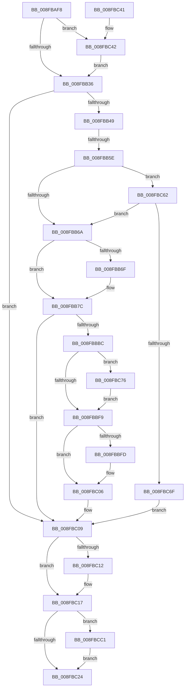

# PipProcessStartPhase3

- RVA: `0x008FBAF8`–`0x008FBCE1` (길이 `489` bytes)
- VA: `0x00000001408FBAF8`
- 실행 섹션: `PAGE`
- PDB 이름 있음: `예`; PDB Function 태그: `예`
- unwind 정보 RVA: `0x00087E94`
- 디코드: `124`개 명령, `489/489` bytes 표시
- 미해석 바이트: `0` (있으면 어셈블리에 `.byte`로 보존)

> 이 문서는 커널 이미지의 기계어와 PDB 기호를 분석해 생성했습니다. 4번과 5번은 함수 원형과 자료형을 바이너리 사용 방식에서 추정한 C 해석이며 원본 소스 복구 결과는 아닙니다.

## 1. Dependencies

- 직접 호출 지점: **19**; 고유 호출 대상: **18**
- 직접 호출자로 확인된 함수: **1**
- RIP 상대 이미지 참조: **5**

### Outgoing calls
- `0x008FBB3A` → [PiPnpRtlBeginOperation](../8E/PiPnpRtlBeginOperation_function_008E033C.md) (function, `0x008E033C`)
- `0x008FBB77` → [PipSetDevNodeFlags](PipSetDevNodeFlags_function_008FC048.md) (function, `0x008FC048`)
- `0x008FBB7F` → [PnpQueryAndSaveDeviceNodeCapabilities](PnpQueryAndSaveDeviceNodeCapabilities_function_008FBCE8.md) (function, `0x008FBCE8`)
- `0x008FBB87` → [PiProcessQueryDeviceState](PiProcessQueryDeviceState_function_008FA0F8.md) (function, `0x008FA0F8`)
- `0x008FBB9B` → [PiUpdateDevicePanel](PiUpdateDevicePanel_function_008FBD4C.md) (function, `0x008FBD4C`)
- `0x008FBBAB` → [PnpSetPlugPlayEvent](PnpSetPlugPlayEvent_function_008FBE04.md) (function, `0x008FBE04`)
- `0x008FBBB3` → [PnpSetDeviceInstanceStartedEvent](../../text/4A/PnpSetDeviceInstanceStartedEvent_function_004AED64.md) (function, `0x004AED64`)
- `0x008FBBBF` → [PpvUtilTestStartedPdoStack](../../text/4B/PpvUtilTestStartedPdoStack_function_004BE4D8.md) (function, `0x004BE4D8`)
- `0x008FBBCC` → [PipSetDevNodeState](../../text/47/PipSetDevNodeState_function_00470708.md) (function, `0x00470708`)
- `0x008FBBD4` → [PnpStartedDeviceNodeDependencyCheck](PnpStartedDeviceNodeDependencyCheck_function_008FCF58.md) (function, `0x008FCF58`)
- `0x008FBBDC` → [PiCreateDriverSwDevices](PiCreateDriverSwDevices_function_008FCFA8.md) (function, `0x008FCFA8`)
- `0x008FBBE8` → [SepAuditingForSubCategory](../../text/47/SepAuditingForSubCategory_function_00477E84.md) (function, `0x00477E84`)
- `0x008FBC01` → [PiAuditDeviceStart](PiAuditDeviceStart_function_008FCEB4.md) (function, `0x008FCEB4`)
- `0x008FBC12` → [PiPnpRtlEndOperation](../8E/PiPnpRtlEndOperation_function_008E0518.md) (function, `0x008E0518`)
- `0x008FBC58` → [McTemplateK0dz_EtwWriteTransfer](../../text/42/McTemplateK0dz_EtwWriteTransfer_function_0042316C.md) (function, `0x0042316C`)
- `0x008FBC85` → [SeCaptureSubjectContext](../86/SeCaptureSubjectContext_function_0086B820.md) (function, `0x0086B820`)
- `0x008FBCAB` → [SepAdtIncorporatePerUserPolicy](../79/SepAdtIncorporatePerUserPolicy_function_0079FC18.md) (function, `0x0079FC18`)
- `0x008FBCB4` → [SeReleaseSubjectContext](../86/SeReleaseSubjectContext_function_0086B710.md) (function, `0x0086B710`)
- `0x008FBCD7` → [McTemplateK0dz_EtwWriteTransfer](../../text/42/McTemplateK0dz_EtwWriteTransfer_function_0042316C.md) (function, `0x0042316C`)

### Direct callers
- [PipProcessDevNodeTree](PipProcessDevNodeTree_function_008F9068.md) at `0x008F9714`

### Static image references
- `0x008FBB1E` → RVA `0x00EF012B` (`.data`; read)
- `0x008FBBA4` → RVA `0x00014D58` (`.rdata`; read)
- `0x008FBBED` → RVA `0x00F04C78` (`.data`; read)
- `0x008FBC46` → RVA `0x00011740` (`.rdata`; read)
- `0x008FBCC5` → RVA `0x00011768` (`.rdata`; read)

## 2. Other-region calls and transfers

- 다른 실행 섹션으로 향하는 call: **6**
  - `0x008FBBB3` → [PnpSetDeviceInstanceStartedEvent](../../text/4A/PnpSetDeviceInstanceStartedEvent_function_004AED64.md) (`PAGE` → `.text`)
  - `0x008FBBBF` → [PpvUtilTestStartedPdoStack](../../text/4B/PpvUtilTestStartedPdoStack_function_004BE4D8.md) (`PAGE` → `.text`)
  - `0x008FBBCC` → [PipSetDevNodeState](../../text/47/PipSetDevNodeState_function_00470708.md) (`PAGE` → `.text`)
  - `0x008FBBE8` → [SepAuditingForSubCategory](../../text/47/SepAuditingForSubCategory_function_00477E84.md) (`PAGE` → `.text`)
  - `0x008FBC58` → [McTemplateK0dz_EtwWriteTransfer](../../text/42/McTemplateK0dz_EtwWriteTransfer_function_0042316C.md) (`PAGE` → `.text`)
  - `0x008FBCD7` → [McTemplateK0dz_EtwWriteTransfer](../../text/42/McTemplateK0dz_EtwWriteTransfer_function_0042316C.md) (`PAGE` → `.text`)
- call이 아닌 외부 분기/꼬리 이동: **1**
  - `0x008FBB58` → [sub_00B1F622](../B1/Unknown_function_00B1F622.md) (`tail-transfer`)

## 3. Assembly (complete function range)

```asm
008FBAF8  48 89 5C 24 08                  mov qword ptr [rsp + 8], rbx
008FBAFD  89 54 24 10                     mov dword ptr [rsp + 0x10], edx
008FBB01  55                              push rbp
008FBB02  56                              push rsi
008FBB03  57                              push rdi
008FBB04  41 54                           push r12
008FBB06  41 55                           push r13
008FBB08  41 56                           push r14
008FBB0A  41 57                           push r15
008FBB0C  48 8D 6C 24 D9                  lea rbp, [rsp - 0x27]
008FBB11  48 81 EC B0 00 00 00            sub rsp, 0xb0
008FBB18  45 33 E4                        xor r12d, r12d
008FBB1B  44 8B F2                        mov r14d, edx
008FBB1E  F6 05 06 46 5F 00 20            test byte ptr [rip + 0x5f4606], 0x20
008FBB25  48 8B F9                        mov rdi, rcx
008FBB28  4C 89 65 CF                     mov qword ptr [rbp - 0x31], r12
008FBB2C  4C 89 65 F7                     mov qword ptr [rbp - 9], r12
008FBB30  0F 85 0C 01 00 00               jne 0x1408fbc42
008FBB36  48 8D 4D F7                     lea rcx, [rbp - 9]
008FBB3A  E8 FD 47 FE FF                  call 0x1408e033c
008FBB3F  8B D8                           mov ebx, eax
008FBB41  85 C0                           test eax, eax
008FBB43  0F 88 C0 00 00 00               js 0x1408fbc09
008FBB49  4C 8B 7F 20                     mov r15, qword ptr [rdi + 0x20]
008FBB4D  48 8D 9F 8C 01 00 00            lea rbx, [rdi + 0x18c]
008FBB54  8B 03                           mov eax, dword ptr [rbx]
008FBB56  A8 20                           test al, 0x20
008FBB58  0F 84 C4 3A 22 00               je 0x140b1f622
008FBB5E  F7 03 00 20 00 00               test dword ptr [rbx], 0x2000
008FBB64  0F 85 F8 00 00 00               jne 0x1408fbc62
008FBB6A  45 85 F6                        test r14d, r14d
008FBB6D  74 0D                           je 0x1408fbb7c
008FBB6F  BA 08 00 00 00                  mov edx, 8
008FBB74  48 8B CF                        mov rcx, rdi
008FBB77  E8 CC 04 00 00                  call 0x1408fc048
008FBB7C  48 8B CF                        mov rcx, rdi
008FBB7F  E8 64 01 00 00                  call 0x1408fbce8
008FBB84  49 8B CF                        mov rcx, r15
008FBB87  E8 6C E5 FF FF                  call 0x1408fa0f8
008FBB8C  0F BA AF C0 02 00 00 11         bts dword ptr [rdi + 0x2c0], 0x11
008FBB94  33 D2                           xor edx, edx
008FBB96  48 8B CF                        mov rcx, rdi
008FBB99  8B D8                           mov ebx, eax
008FBB9B  E8 AC 01 00 00                  call 0x1408fbd4c
008FBBA0  48 8B 57 20                     mov rdx, qword ptr [rdi + 0x20]
008FBBA4  48 8D 0D AD 91 71 FF            lea rcx, [rip - 0x8e6e53]
008FBBAB  E8 54 02 00 00                  call 0x1408fbe04
008FBBB0  48 8B CF                        mov rcx, rdi
008FBBB3  E8 AC 31 BB FF                  call 0x1404aed64
008FBBB8  85 DB                           test ebx, ebx
008FBBBA  78 4D                           js 0x1408fbc09
008FBBBC  49 8B CF                        mov rcx, r15
008FBBBF  E8 14 29 BC FF                  call 0x1404be4d8
008FBBC4  BA 0A 03 00 00                  mov edx, 0x30a
008FBBC9  48 8B CF                        mov rcx, rdi
008FBBCC  E8 37 4B B7 FF                  call 0x140470708
008FBBD1  48 8B CF                        mov rcx, rdi
008FBBD4  E8 7F 13 00 00                  call 0x1408fcf58
008FBBD9  48 8B CF                        mov rcx, rdi
008FBBDC  E8 C7 13 00 00                  call 0x1408fcfa8
008FBBE1  B2 01                           mov dl, 1
008FBBE3  B9 8A 00 00 00                  mov ecx, 0x8a
008FBBE8  E8 97 C2 B7 FF                  call 0x140477e84
008FBBED  44 39 25 84 90 60 00            cmp dword ptr [rip + 0x609084], r12d
008FBBF4  88 45 77                        mov byte ptr [rbp + 0x77], al
008FBBF7  75 7D                           jne 0x1408fbc76
008FBBF9  84 C0                           test al, al
008FBBFB  74 09                           je 0x1408fbc06
008FBBFD  48 8D 4F 28                     lea rcx, [rdi + 0x28]
008FBC01  E8 AE 12 00 00                  call 0x1408fceb4
008FBC06  41 8B DC                        mov ebx, r12d
008FBC09  48 8B 4D F7                     mov rcx, qword ptr [rbp - 9]
008FBC0D  48 85 C9                        test rcx, rcx
008FBC10  74 05                           je 0x1408fbc17
008FBC12  E8 01 49 FE FF                  call 0x1408e0518
008FBC17  F6 05 0D 45 5F 00 20            test byte ptr [rip + 0x5f450d], 0x20
008FBC1E  0F 85 9D 00 00 00               jne 0x1408fbcc1
008FBC24  8B C3                           mov eax, ebx
008FBC26  48 8B 9C 24 F0 00 00 00         mov rbx, qword ptr [rsp + 0xf0]
008FBC2E  48 81 C4 B0 00 00 00            add rsp, 0xb0
008FBC35  41 5F                           pop r15
008FBC37  41 5E                           pop r14
008FBC39  41 5D                           pop r13
008FBC3B  41 5C                           pop r12
008FBC3D  5F                              pop rdi
008FBC3E  5E                              pop rsi
008FBC3F  5D                              pop rbp
008FBC40  C3                              ret
008FBC41  CC                              int3
008FBC42  48 8B 41 30                     mov rax, qword ptr [rcx + 0x30]
008FBC46  48 8D 15 F3 5A 71 FF            lea rdx, [rip - 0x8ea50d]
008FBC4D  41 B9 03 00 00 00               mov r9d, 3
008FBC53  48 89 44 24 20                  mov qword ptr [rsp + 0x20], rax
008FBC58  E8 0F 75 B2 FF                  call 0x14042316c
008FBC5D  E9 D4 FE FF FF                  jmp 0x1408fbb36
008FBC62  83 BF 94 01 00 00 09            cmp dword ptr [rdi + 0x194], 9
008FBC69  0F 85 FB FE FF FF               jne 0x1408fbb6a
008FBC6F  BB 01 00 00 C0                  mov ebx, 0xc0000001
008FBC74  EB 93                           jmp 0x1408fbc09
008FBC76  0F 57 C0                        xorps xmm0, xmm0
008FBC79  48 8D 4D FF                     lea rcx, [rbp - 1]
008FBC7D  0F 11 45 FF                     movups xmmword ptr [rbp - 1], xmm0
008FBC81  0F 11 45 0F                     movups xmmword ptr [rbp + 0xf], xmm0
008FBC85  E8 96 FB F6 FF                  call 0x14086b820
008FBC8A  48 8B 45 FF                     mov rax, qword ptr [rbp - 1]
008FBC8E  B2 01                           mov dl, 1
008FBC90  4C 8B 4D 0F                     mov r9, qword ptr [rbp + 0xf]
008FBC94  48 85 C0                        test rax, rax
008FBC97  4C 0F 45 C8                     cmovne r9, rax
008FBC9B  45 33 C0                        xor r8d, r8d
008FBC9E  48 8D 45 77                     lea rax, [rbp + 0x77]
008FBCA2  48 89 44 24 20                  mov qword ptr [rsp + 0x20], rax
008FBCA7  41 8D 48 26                     lea ecx, [r8 + 0x26]
008FBCAB  E8 68 3F EA FF                  call 0x14079fc18
008FBCB0  48 8D 4D FF                     lea rcx, [rbp - 1]
008FBCB4  E8 57 FA F6 FF                  call 0x14086b710
008FBCB9  8A 45 77                        mov al, byte ptr [rbp + 0x77]
008FBCBC  E9 38 FF FF FF                  jmp 0x1408fbbf9
008FBCC1  48 8B 47 30                     mov rax, qword ptr [rdi + 0x30]
008FBCC5  48 8D 15 9C 5A 71 FF            lea rdx, [rip - 0x8ea564]
008FBCCC  41 B9 03 00 00 00               mov r9d, 3
008FBCD2  48 89 44 24 20                  mov qword ptr [rsp + 0x20], rax
008FBCD7  E8 90 74 B2 FF                  call 0x14042316c
008FBCDC  E9 43 FF FF FF                  jmp 0x1408fbc24
```

## 4. C-style interpretation (structured pseudocode)

```c
__int64 __fastcall PipProcessStartPhase3(__int64 a1, int a2, int a3)
{
    __int64 result;
    __int64 v_r12;
    __int64 v_rsp;
    unsigned __int64 v_stack_m50;
    unsigned __int64 v_stack_m5F;
    unsigned __int64 v_stack_m60;
    unsigned __int64 v_stack_m68;
    unsigned __int64 v_stack_m90;
    unsigned int v_stack_p10;
    unsigned __int8 v_stack_p18;
    unsigned __int64 v_stack_p20;
    unsigned __int64 v_stack_p8;

    v_stack_p8 = v_rbx;
    v_stack_p10 = a2;
    v_rsp = (v_rsp) - (176);
    v_r12 = 0;
    v_stack_m90 = 0;
    v_stack_m68 = 0;
    if (((*(unsigned __int8 *)(v_rip + 6243846)) & (32)) != 0) goto loc_008FBC42;
loc_008FBB36:
    result = PiPnpRtlBeginOperation(v_stack_m68, a2, a3, a4);
    if (sign_flag) goto loc_008FBC09;
    if (((*(unsigned int *)(a1 + 396)) & (0x2000ULL)) != 0) goto loc_008FBC62;
loc_008FBB6A:
    result = (unsigned int)(*(unsigned int *)(a1 + 396));
    if ((unsigned int)((unsigned int)(a2)) != 0) {
        a2 = 8;
        a1 = a1;
        result = PipSetDevNodeFlags(a1, a2, a3, a4);
    }
    result = PnpQueryAndSaveDeviceNodeCapabilities(a1, a2, a3, a4);
    result = PiProcessQueryDeviceState(*(unsigned __int64 *)(a1 + 32), a2, a3, a4);
    a2 = 0;
    result = PiUpdateDevicePanel(a1, a2, a3, a4);
    result = PnpSetPlugPlayEvent(v_rip - 9334355, *(unsigned __int64 *)(a1 + 32), a3, a4);
    result = PnpSetDeviceInstanceStartedEvent(a1, *(unsigned __int64 *)(a1 + 32), a3, a4);
    if (sign_flag) goto loc_008FBC09;
    result = PpvUtilTestStartedPdoStack(*(unsigned __int64 *)(a1 + 32), *(unsigned __int64 *)(a1 + 32), a3, a4);
    result = PipSetDevNodeState(a1, 778, a3, a4);
    result = PnpStartedDeviceNodeDependencyCheck(a1, 778, a3, a4);
    result = PiCreateDriverSwDevices(a1, 778, a3, a4);
    result = SepAuditingForSubCategory(138, 1, a3, a4);
    v_stack_p18 = (unsigned __int8)(result);
    if ((*(unsigned int *)(v_rip + 6328452)) != 0) goto loc_008FBC76;
loc_008FBBF9:
    if ((unsigned __int8)(result) != 0) {
        a1 = a1 + 40;
        result = PiAuditDeviceStart(a1, 1, a3, a4);
    }
loc_008FBC09:
    if (v_stack_m68 != 0) {
        result = PiPnpRtlEndOperation(v_stack_m68, 1, a3, a4);
    }
    if (((*(unsigned __int8 *)(v_rip + 6243597)) & (32)) != 0) goto loc_008FBCC1;
loc_008FBC24:
    v_rsp = (v_rsp) + (176);
    return 0;
loc_008FBC42:
    v_stack_p20 = *(unsigned __int64 *)(v_stack_m68 + 48);
    result = McTemplateK0dz_EtwWriteTransfer(v_stack_m68, v_rip - 9348365, a3, 3);
    goto loc_008FBB36;
loc_008FBC62:
    if ((*(unsigned int *)(a1 + 404)) != 9) goto loc_008FBB6A;
    goto loc_008FBC09;
loc_008FBC76:
    v_stack_m60 = v_xmm0;
    v_stack_m50 = v_xmm0;
    result = SeCaptureSubjectContext(v_stack_m60, v_rip - 9348365, a3, 3);
    a4 = v_stack_m50;
    if (v_stack_m60 != 0) { a4 = v_stack_m60; }
    a3 = 0;
    v_stack_p20 = v_stack_p18;
    result = SepAdtIncorporatePerUserPolicy(a3 + 38, 1, a3, a4);
    result = SeReleaseSubjectContext(v_stack_m60, 1, a3, a4);
    goto loc_008FBBF9;
loc_008FBCC1:
    v_stack_p20 = *(unsigned __int64 *)(a1 + 48);
    result = McTemplateK0dz_EtwWriteTransfer(v_stack_m60, v_rip - 9348452, a3, 3);
    goto loc_008FBC24;
}
```

## 5. (Beta) C Style

```c
int64_t PipProcessStartPhase3(void *Arg1, int32_t Arg2, int32_t Arg3)
{
    uint8_t *arg1 = (uint8_t *)Arg1;

    int64_t result;
    int64_t local_r12;
    int64_t local_rsp;
    uint64_t v_stack_m50;
    uint64_t v_stack_m5F;
    uint64_t v_stack_m60;
    uint64_t v_stack_m68;
    uint64_t v_stack_m90;
    uint32_t v_stack_p10;
    uint8_t v_stack_p18;
    uint64_t v_stack_p20;
    uint64_t v_stack_p8;

    v_stack_p8 = local_rbx;
    v_stack_p10 = Arg2;
    local_rsp = (local_rsp) - (176);
    local_r12 = 0;
    v_stack_m90 = 0;
    v_stack_m68 = 0;
    if (((*(uint8_t *)(v_rip + 0x5F4606)) & (32)) != 0) goto loc_008FBC42;
loc_008FBB36:
    result = PiPnpRtlBeginOperation(v_stack_m68, Arg2, Arg3, a4);
    if (sign_flag) goto loc_008FBC09;
    if (((*(uint32_t *)(arg1 + 0x18C)) & (0x2000ULL)) != 0) goto loc_008FBC62;
loc_008FBB6A:
    result = (uint32_t)(*(uint32_t *)(arg1 + 0x18C));
    if ((uint32_t)((uint32_t)(Arg2)) != 0) {
        Arg2 = 8;
        Arg1 = Arg1;
        result = PipSetDevNodeFlags(Arg1, Arg2, Arg3, a4);
    }
    result = PnpQueryAndSaveDeviceNodeCapabilities(Arg1, Arg2, Arg3, a4);
    result = PiProcessQueryDeviceState(*(uint64_t *)(arg1 + 0x20), Arg2, Arg3, a4);
    Arg2 = 0;
    result = PiUpdateDevicePanel(Arg1, Arg2, Arg3, a4);
    result = PnpSetPlugPlayEvent(v_rip - 9334355, *(uint64_t *)(arg1 + 0x20), Arg3, a4);
    result = PnpSetDeviceInstanceStartedEvent(Arg1, *(uint64_t *)(arg1 + 0x20), Arg3, a4);
    if (sign_flag) goto loc_008FBC09;
    result = PpvUtilTestStartedPdoStack(*(uint64_t *)(arg1 + 0x20), *(uint64_t *)(arg1 + 0x20), Arg3, a4);
    result = PipSetDevNodeState(Arg1, 778, Arg3, a4);
    result = PnpStartedDeviceNodeDependencyCheck(Arg1, 778, Arg3, a4);
    result = PiCreateDriverSwDevices(Arg1, 778, Arg3, a4);
    result = SepAuditingForSubCategory(138, 1, Arg3, a4);
    v_stack_p18 = (uint8_t)(result);
    if ((*(uint32_t *)(v_rip + 0x609084)) != 0) goto loc_008FBC76;
loc_008FBBF9:
    if ((uint8_t)(result) != 0) {
        Arg1 = Arg1 + 40;
        result = PiAuditDeviceStart(Arg1, 1, Arg3, a4);
    }
loc_008FBC09:
    if (v_stack_m68 != 0) {
        result = PiPnpRtlEndOperation(v_stack_m68, 1, Arg3, a4);
    }
    if (((*(uint8_t *)(v_rip + 0x5F450D)) & (32)) != 0) goto loc_008FBCC1;
loc_008FBC24:
    local_rsp = (local_rsp) + (176);
    return 0;
loc_008FBC42:
    v_stack_p20 = *(uint64_t *)(v_stack_m68 + 0x30);
    result = McTemplateK0dz_EtwWriteTransfer(v_stack_m68, v_rip - 9348365, Arg3, 3);
    goto loc_008FBB36;
loc_008FBC62:
    if ((*(uint32_t *)(arg1 + 0x194)) != 9) goto loc_008FBB6A;
    goto loc_008FBC09;
loc_008FBC76:
    v_stack_m60 = v_xmm0;
    v_stack_m50 = v_xmm0;
    result = SeCaptureSubjectContext(v_stack_m60, v_rip - 9348365, Arg3, 3);
    a4 = v_stack_m50;
    if (v_stack_m60 != 0) { a4 = v_stack_m60; }
    Arg3 = 0;
    v_stack_p20 = v_stack_p18;
    result = SepAdtIncorporatePerUserPolicy(Arg3 + 38, 1, Arg3, a4);
    result = SeReleaseSubjectContext(v_stack_m60, 1, Arg3, a4);
    goto loc_008FBBF9;
loc_008FBCC1:
    v_stack_p20 = *(uint64_t *)(arg1 + 0x30);
    result = McTemplateK0dz_EtwWriteTransfer(v_stack_m60, v_rip - 9348452, Arg3, 3);
    goto loc_008FBC24;
}
```

### 관측된 메모리 오프셋

구조체 형식이 확인되지 않은 접근은 인자 기준의 오프셋으로만 기록했습니다.

| 기준 인자 | 오프셋 표현 | 폭 (bit) | 접근 |
|---|---:|---:|---|
| `Arg1` | `+ 0x0` | `32` | `R` |
| `Arg1` | `+ 0x20` | `64` | `R` |
| `Arg1` | `+ 0x28` | `64` | `R` |
| `Arg1` | `+ 0x30` | `64` | `R` |
| `Arg1` | `+ 0x18C` | `64` | `R` |
| `Arg1` | `+ 0x194` | `32` | `R` |
| `Arg1` | `+ 0x2C0` | `32` | `R/W` |

## 6. Execution-region graph

[열기: 2D/3D 그래프와 함수 탐색 컨트롤 패널](../../../control-panel.html?section=page&rva=0x008FBAF8&view=graph)

- 2D 그래프는 위에서 아래로 흐르고, 3D 그래프는 빈 공간을 드래그해 회전합니다. Shift+드래그는 이동, 휠은 확대·축소, 함수 노드 선택은 대상 보고서 이동입니다.

### Static fallback


