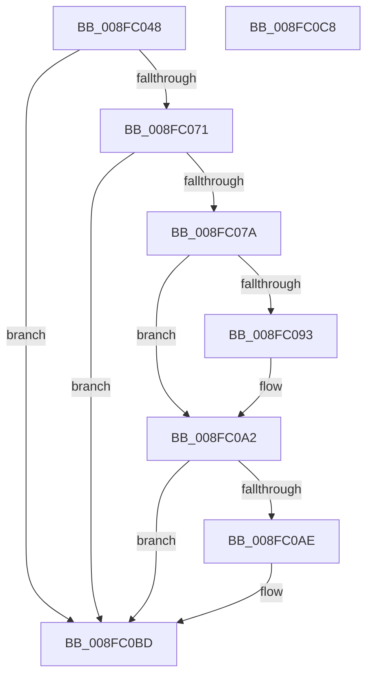

# PipSetDevNodeFlags

- RVA: `0x008FC048`–`0x008FC0C9` (길이 `129` bytes)
- VA: `0x00000001408FC048`
- 실행 섹션: `PAGE`
- PDB 이름 있음: `예`; PDB Function 태그: `아니요`
- unwind 정보 RVA: `0x0005CAAC`
- 디코드: `33`개 명령, `129/129` bytes 표시
- 미해석 바이트: `0` (있으면 어셈블리에 `.byte`로 보존)

> 이 문서는 커널 이미지의 기계어와 PDB 기호를 분석해 생성했습니다. 4번과 5번은 함수 원형과 자료형을 바이너리 사용 방식에서 추정한 C 해석이며 원본 소스 복구 결과는 아닙니다.

## 1. Dependencies

- 직접 호출 지점: **3**; 고유 호출 대상: **1**
- 직접 호출자로 확인된 함수: **33**
- RIP 상대 이미지 참조: **0**

### Outgoing calls
- `0x008FC080` → [PnpRaiseNtPlugPlayDevicePropertyChangeEvent](PnpRaiseNtPlugPlayDevicePropertyChangeEvent_function_008F7D80.md) (function, `0x008F7D80`)
- `0x008FC09D` → [PnpRaiseNtPlugPlayDevicePropertyChangeEvent](PnpRaiseNtPlugPlayDevicePropertyChangeEvent_function_008F7D80.md) (function, `0x008F7D80`)
- `0x008FC0B8` → [PnpRaiseNtPlugPlayDevicePropertyChangeEvent](PnpRaiseNtPlugPlayDevicePropertyChangeEvent_function_008F7D80.md) (function, `0x008F7D80`)

### Direct callers
- [IoReportDetectedDevice](../72/IoReportDetectedDevice_function_00725CD0.md) at `0x0072643C`
- [IoReportDetectedDevice](../72/IoReportDetectedDevice_function_00725CD0.md) at `0x00726612`
- [IoReportDetectedDevice](../72/IoReportDetectedDevice_function_00725CD0.md) at `0x00726717`
- [IoReportDetectedDevice](../72/IoReportDetectedDevice_function_00725CD0.md) at `0x00726758`
- [PiProcessResourceRequirementsChanged](../72/PiProcessResourceRequirementsChanged_function_0072D504.md) at `0x0072D580`
- [PiProcessResourceRequirementsChanged](../72/PiProcessResourceRequirementsChanged_function_0072D504.md) at `0x0072D5A7`
- [PiProcessSetDeviceProblem](../72/PiProcessSetDeviceProblem_function_0072D668.md) at `0x0072D767`
- [IopAllocateBootResourcesInternal](../72/IopAllocateBootResourcesInternal_function_0072E708.md) at `0x0072E7B2`
- [PnpBuildCmResourceLists](../73/PnpBuildCmResourceLists_function_0073E684.md) at `0x0073E7E1`
- [PnpReallocateResources](../73/PnpReallocateResources_function_0073E924.md) at `0x0073EACF`
- [PiInitializeDevice](../73/PiInitializeDevice_function_0073EC5C.md) at `0x0073EEBC`
- [PnpQueryRebalanceWorker](../73/PnpQueryRebalanceWorker_function_0073F2EC.md) at `0x0073F35F`
- [PnpQueryStopDeviceNode](../73/PnpQueryStopDeviceNode_function_0073F47C.md) at `0x0073F4C7`
- [PipEnumerateCompleted](PipEnumerateCompleted_function_008F7B1C.md) at `0x008F7CD9`
- [PnpQueryID](PnpQueryID_function_008FB984.md) at `0x008FBA93`
- [PipProcessStartPhase3](PipProcessStartPhase3_function_008FBAF8.md) at `0x008FBB77`
- [PipProcessEnumeratedChildDevice](PipProcessEnumeratedChildDevice_function_008FBF4C.md) at `0x008FBF90`
- [PipProcessEnumeratedChildDevice](PipProcessEnumeratedChildDevice_function_008FBF4C.md) at `0x008FBFDB`
- [PiMarkDeviceTreeForReenumerationWorker](PiMarkDeviceTreeForReenumerationWorker_function_008FC020.md) at `0x008FC035`
- [PipSetDevNodeProblem](PipSetDevNodeProblem_function_008FDE0C.md) at `0x008FDE66`
- [PipCallDriverAddDeviceQueryRoutine](../99/PipCallDriverAddDeviceQueryRoutine_function_00996604.md) at `0x00996AB3`
- [IopReleaseDeviceResources](../A0/IopReleaseDeviceResources_function_00A0867C.md) at `0x00A0881D`
- [PipCallDriverAddDevice](../A2/PipCallDriverAddDevice_function_00A272E0.md) at `0x00A27A8F`
- [PiProcessNewDeviceNode](../A2/PiProcessNewDeviceNode_function_00A28F20.md) at `0x00A2917B`
- [PiProcessNewDeviceNode](../A2/PiProcessNewDeviceNode_function_00A28F20.md) at `0x00A2921A`
- [PiProcessNewDeviceNode](../A2/PiProcessNewDeviceNode_function_00A28F20.md) at `0x00A29BD0`
- [PiProcessNewDeviceNode](../A2/PiProcessNewDeviceNode_function_00A28F20.md) at `0x00A29C7E`
- [PiProcessNewDeviceNode](../A2/PiProcessNewDeviceNode_function_00A28F20.md) at `0x00A29DEE`
- [PnpProcessAssignResources](../A2/PnpProcessAssignResources_function_00A2A950.md) at `0x00A2AA94`
- [PnpQueryDeviceID](../A2/PnpQueryDeviceID_function_00A2B21C.md) at `0x00A2B301`
- [IopFindLegacyDeviceNode](../AC/IopFindLegacyDeviceNode_function_00AC7338.md) at `0x00AC73C8`
- [IopFindLegacyDeviceNode](../AC/IopFindLegacyDeviceNode_function_00AC7338.md) at `0x00AC7479`
- [sub_00B1F622](../B1/Unknown_function_00B1F622.md) at `0x00B1F913`
- [sub_00B1FD92](../B1/Unknown_function_00B1FD92.md) at `0x00B1FE47`
- [sub_00B1FEC0](../B1/Unknown_function_00B1FEC0.md) at `0x00B1FF41`
- [sub_00B2C3E8](../B2/Unknown_function_00B2C3E8.md) at `0x00B2C532`
- [sub_00B2C3E8](../B2/Unknown_function_00B2C3E8.md) at `0x00B2C553`
- [sub_00B33FE8](../B3/Unknown_function_00B33FE8.md) at `0x00B341CF`
- [sub_00B33FE8](../B3/Unknown_function_00B33FE8.md) at `0x00B3436C`
- [sub_00B3807C](../B3/Unknown_function_00B3807C.md) at `0x00B38490`
- [sub_00B3807C](../B3/Unknown_function_00B3807C.md) at `0x00B38554`
- [sub_00B3807C](../B3/Unknown_function_00B3807C.md) at `0x00B385BE`
- [sub_00B3807C](../B3/Unknown_function_00B3807C.md) at `0x00B38644`
- [sub_00B38CDE](../B3/Unknown_function_00B38CDE.md) at `0x00B38F62`
- [sub_00B420B0](../B4/Unknown_function_00B420B0.md) at `0x00B420DA`
- [sub_00B420B0](../B4/Unknown_function_00B420B0.md) at `0x00B42184`
- [sub_00B420B0](../B4/Unknown_function_00B420B0.md) at `0x00B4229C`
- [IoInitSystemPreDrivers](../../init/C2/IoInitSystemPreDrivers_function_00C2AC3C.md) at `0x00C2B51A`
- [IopInitializePlugPlayServices](../../init/C2/IopInitializePlugPlayServices_function_00C2F298.md) at `0x00C2FCFF`
- [IopAllocateLegacyBootResources](../../init/C3/IopAllocateLegacyBootResources_function_00C34138.md) at `0x00C341BD`

### Static image references
- 디코드된 RIP-relative 메모리 참조가 없습니다.

## 2. Other-region calls and transfers

- 다른 실행 섹션으로 향하는 call: **0**
- 별도 외부 분기/꼬리 이동을 확인하지 못했습니다.

## 3. Assembly (complete function range)

```asm
008FC048  48 89 5C 24 08                  mov qword ptr [rsp + 8], rbx
008FC04D  57                              push rdi
008FC04E  48 83 EC 20                     sub rsp, 0x20
008FC052  8B B9 8C 01 00 00               mov edi, dword ptr [rcx + 0x18c]
008FC058  48 8B D9                        mov rbx, rcx
008FC05B  F0 09 91 8C 01 00 00            lock or dword ptr [rcx + 0x18c], edx
008FC062  8B C7                           mov eax, edi
008FC064  33 81 8C 01 00 00               xor eax, dword ptr [rcx + 0x18c]
008FC06A  A9 00 70 30 00                  test eax, 0x307000
008FC06F  74 4C                           je 0x1408fc0bd
008FC071  48 8B 51 30                     mov rdx, qword ptr [rcx + 0x30]
008FC075  48 85 D2                        test rdx, rdx
008FC078  74 43                           je 0x1408fc0bd
008FC07A  41 B8 0B 00 00 00               mov r8d, 0xb
008FC080  E8 FB BC FF FF                  call 0x1408f7d80
008FC085  8B C7                           mov eax, edi
008FC087  33 83 8C 01 00 00               xor eax, dword ptr [rbx + 0x18c]
008FC08D  0F BA E0 0E                     bt eax, 0xe
008FC091  73 0F                           jae 0x1408fc0a2
008FC093  48 8B 53 30                     mov rdx, qword ptr [rbx + 0x30]
008FC097  41 B8 1C 00 00 00               mov r8d, 0x1c
008FC09D  E8 DE BC FF FF                  call 0x1408f7d80
008FC0A2  33 BB 8C 01 00 00               xor edi, dword ptr [rbx + 0x18c]
008FC0A8  0F BA E7 0D                     bt edi, 0xd
008FC0AC  73 0F                           jae 0x1408fc0bd
008FC0AE  48 8B 53 30                     mov rdx, qword ptr [rbx + 0x30]
008FC0B2  41 B8 1B 00 00 00               mov r8d, 0x1b
008FC0B8  E8 C3 BC FF FF                  call 0x1408f7d80
008FC0BD  48 8B 5C 24 30                  mov rbx, qword ptr [rsp + 0x30]
008FC0C2  48 83 C4 20                     add rsp, 0x20
008FC0C6  5F                              pop rdi
008FC0C7  C3                              ret
008FC0C8  CC                              int3
```

## 4. C-style interpretation (structured pseudocode)

```c
__int64 __fastcall PipSetDevNodeFlags(__int64 a1, int a2)
{
    __int64 result;
    __int64 v_rdi;
    __int64 v_rsp;
    unsigned __int64 v_stack_p8;

    v_stack_p8 = v_rbx;
    v_rsp = (v_rsp) - (32);
    result = (unsigned int)(((unsigned int)((unsigned int)((unsigned int)(*(unsigned int *)(a1 + 396))))) ^ (*(unsigned int *)(a1 + 396)));
    if ((((unsigned int)(result)) & (0x307000ULL)) == 0) goto loc_008FC0BD;
    if (*(unsigned __int64 *)(a1 + 48) == 0) goto loc_008FC0BD;
    result = PnpRaiseNtPlugPlayDevicePropertyChangeEvent(a1, *(unsigned __int64 *)(a1 + 48), 11, a4);
    result = (unsigned int)(((unsigned int)((unsigned int)((unsigned int)(*(unsigned int *)(a1 + 396))))) ^ (*(unsigned int *)(a1 + 396)));
    if (!(condition_is_above_or_equal)) {
        a2 = *(unsigned __int64 *)(a1 + 48);
        a3 = 28;
        result = PnpRaiseNtPlugPlayDevicePropertyChangeEvent(a1, a2, a3, a4);
    }
    v_rdi = (unsigned int)(((unsigned int)(*(unsigned int *)(a1 + 396))) ^ (*(unsigned int *)(a1 + 396)));
    if (!(condition_is_above_or_equal)) {
        a2 = *(unsigned __int64 *)(a1 + 48);
        a3 = 27;
        result = PnpRaiseNtPlugPlayDevicePropertyChangeEvent(a1, a2, a3, a4);
    }
    v_rsp = (v_rsp) + (32);
    return result;
}
```

## 5. (Beta) C Style

```c
int64_t PipSetDevNodeFlags(void *Arg1, int32_t Arg2)
{
    uint8_t *arg1 = (uint8_t *)Arg1;

    int64_t result;
    int64_t local_rdi;
    int64_t local_rsp;
    uint64_t v_stack_p8;

    v_stack_p8 = local_rbx;
    local_rsp = (local_rsp) - (32);
    result = (uint32_t)(((uint32_t)((uint32_t)((uint32_t)(*(uint32_t *)(arg1 + 0x18C))))) ^ (*(uint32_t *)(arg1 + 0x18C)));
    if ((((uint32_t)(result)) & (0x307000ULL)) == 0) goto loc_008FC0BD;
    if (*(uint64_t *)(arg1 + 0x30) == 0) goto loc_008FC0BD;
    result = PnpRaiseNtPlugPlayDevicePropertyChangeEvent(Arg1, *(uint64_t *)(arg1 + 0x30), 11, a4);
    result = (uint32_t)(((uint32_t)((uint32_t)((uint32_t)(*(uint32_t *)(arg1 + 0x18C))))) ^ (*(uint32_t *)(arg1 + 0x18C)));
    if (!(condition_is_above_or_equal)) {
        Arg2 = *(uint64_t *)(arg1 + 0x30);
        a3 = 28;
        result = PnpRaiseNtPlugPlayDevicePropertyChangeEvent(Arg1, Arg2, a3, a4);
    }
    local_rdi = (uint32_t)(((uint32_t)(*(uint32_t *)(arg1 + 0x18C))) ^ (*(uint32_t *)(arg1 + 0x18C)));
    if (!(condition_is_above_or_equal)) {
        Arg2 = *(uint64_t *)(arg1 + 0x30);
        a3 = 27;
        result = PnpRaiseNtPlugPlayDevicePropertyChangeEvent(Arg1, Arg2, a3, a4);
    }
    local_rsp = (local_rsp) + (32);
    return result;
}
```

### 관측된 메모리 오프셋

구조체 형식이 확인되지 않은 접근은 인자 기준의 오프셋으로만 기록했습니다.

| 기준 인자 | 오프셋 표현 | 폭 (bit) | 접근 |
|---|---:|---:|---|
| `Arg1` | `+ 0x30` | `64` | `R` |
| `Arg1` | `+ 0x18C` | `32` | `R` |
| `Arg1` | `+ 0x18C` | `32` | `R/W` |

## 6. Execution-region graph

[열기: 2D/3D 그래프와 함수 탐색 컨트롤 패널](../../../control-panel.html?section=page&rva=0x008FC048&view=graph)

- 2D 그래프는 위에서 아래로 흐르고, 3D 그래프는 빈 공간을 드래그해 회전합니다. Shift+드래그는 이동, 휠은 확대·축소, 함수 노드 선택은 대상 보고서 이동입니다.

### Static fallback


