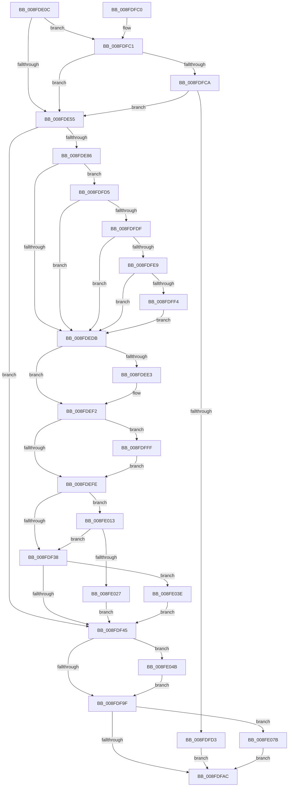

# PipSetDevNodeProblem

- RVA: `0x008FDE0C`–`0x008FE085` (길이 `633` bytes)
- VA: `0x00000001408FDE0C`
- 실행 섹션: `PAGE`
- PDB 이름 있음: `예`; PDB Function 태그: `아니요`
- unwind 정보 RVA: `0x000881B8`
- 디코드: `136`개 명령, `633/633` bytes 표시
- 미해석 바이트: `0` (있으면 어셈블리에 `.byte`로 보존)

> 이 문서는 커널 이미지의 기계어와 PDB 기호를 분석해 생성했습니다. 4번과 5번은 함수 원형과 자료형을 바이너리 사용 방식에서 추정한 C 해석이며 원본 소스 복구 결과는 아닙니다.

## 1. Dependencies

- 직접 호출 지점: **11**; 고유 호출 대상: **10**
- 직접 호출자로 확인된 함수: **22**
- RIP 상대 이미지 참조: **3**

### Outgoing calls
- `0x008FDE59` → [PiPnpRtlBeginOperation](../8E/PiPnpRtlBeginOperation_function_008E033C.md) (function, `0x008E033C`)
- `0x008FDE66` → [PipSetDevNodeFlags](PipSetDevNodeFlags_function_008FC048.md) (function, `0x008FC048`)
- `0x008FDECE` → [PnpGetObjectProperty](../8E/PnpGetObjectProperty_function_008E2180.md) (function, `0x008E2180`)
- `0x008FDEED` → [PnpRaiseNtPlugPlayDevicePropertyChangeEvent](PnpRaiseNtPlugPlayDevicePropertyChangeEvent_function_008F7D80.md) (function, `0x008F7D80`)
- `0x008FDF26` → [PnpTraceSetDevNodeProblem](PnpTraceSetDevNodeProblem_function_008FE08C.md) (function, `0x008FE08C`)
- `0x008FE009` → [PnpRaiseNtPlugPlayDevicePropertyChangeEvent](PnpRaiseNtPlugPlayDevicePropertyChangeEvent_function_008F7D80.md) (function, `0x008F7D80`)
- `0x008FE01A` → [SeAuditingWithTokenForSubcategory](../90/SeAuditingWithTokenForSubcategory_function_009047D0.md) (function, `0x009047D0`)
- `0x008FE034` → [PiAuditDeviceEnableDisableAction](../74/PiAuditDeviceEnableDisableAction_function_00740A84.md) (function, `0x00740A84`)
- `0x008FE041` → [PnpLogDeviceRequiresReboot](../72/PnpLogDeviceRequiresReboot_function_0072C818.md) (function, `0x0072C818`)
- `0x008FE071` → [McTemplateK0pzzqdqd_EtwWriteTransfer](../../text/5A/McTemplateK0pzzqdqd_EtwWriteTransfer_function_005A6FD8.md) (function, `0x005A6FD8`)
- `0x008FE07B` → [PiPnpRtlEndOperation](../8E/PiPnpRtlEndOperation_function_008E0518.md) (function, `0x008E0518`)

### Direct callers
- [PnpRemoveLockedDeviceNode](../../text/47/PnpRemoveLockedDeviceNode_function_004702AC.md) at `0x0047048E`
- [IoReportDetectedDevice](../72/IoReportDetectedDevice_function_00725CD0.md) at `0x00726182`
- [IoReportDetectedDevice](../72/IoReportDetectedDevice_function_00725CD0.md) at `0x007261E6`
- [IoReportDetectedDevice](../72/IoReportDetectedDevice_function_00725CD0.md) at `0x00726703`
- [IopQueueDeviceResetEvent](../72/IopQueueDeviceResetEvent_function_0072AB14.md) at `0x0072ABE2`
- [PnpDisableDevice](../72/PnpDisableDevice_function_0072C6FC.md) at `0x0072C793`
- [PiProcessSetDeviceProblem](../72/PiProcessSetDeviceProblem_function_0072D668.md) at `0x0072D75D`
- [PiProfileUpdateDeviceTreeCallback](../73/PiProfileUpdateDeviceTreeCallback_function_00737630.md) at `0x007376D0`
- [PiInitializeDevice](../73/PiInitializeDevice_function_0073EC5C.md) at `0x0073EF5E`
- [PnpRebalance](../73/PnpRebalance_function_0073F508.md) at `0x0073F7CD`
- [PiProcessQueryRemoveNoFdo](../74/PiProcessQueryRemoveNoFdo_function_007442B4.md) at `0x00744337`
- [PipProcessDevNodeTree](PipProcessDevNodeTree_function_008F9068.md) at `0x008F9835`
- [PipProcessDevNodeTree](PipProcessDevNodeTree_function_008F9068.md) at `0x008F9892`
- [PnpQueryID](PnpQueryID_function_008FB984.md) at `0x008FBA3C`
- [PipProcessEnumeratedChildDevice](PipProcessEnumeratedChildDevice_function_008FBF4C.md) at `0x008FC003`
- [PipCallDriverAddDeviceQueryRoutine](../99/PipCallDriverAddDeviceQueryRoutine_function_00996604.md) at `0x00996919`
- [PipCallDriverAddDeviceQueryRoutine](../99/PipCallDriverAddDeviceQueryRoutine_function_00996604.md) at `0x00996939`
- [PipCallDriverAddDeviceQueryRoutine](../99/PipCallDriverAddDeviceQueryRoutine_function_00996604.md) at `0x00996A3C`
- [PnpSurpriseRemoveLockedDeviceNode](../A0/PnpSurpriseRemoveLockedDeviceNode_function_00A08370.md) at `0x00A085E9`
- [PipCallDriverAddDevice](../A2/PipCallDriverAddDevice_function_00A272E0.md) at `0x00A27941`
- [PiProcessNewDeviceNode](../A2/PiProcessNewDeviceNode_function_00A28F20.md) at `0x00A29161`
- [PiProcessNewDeviceNode](../A2/PiProcessNewDeviceNode_function_00A28F20.md) at `0x00A2920C`
- [PiProcessNewDeviceNode](../A2/PiProcessNewDeviceNode_function_00A28F20.md) at `0x00A2926B`
- [PiProcessNewDeviceNode](../A2/PiProcessNewDeviceNode_function_00A28F20.md) at `0x00A292D2`
- [PiProcessNewDeviceNode](../A2/PiProcessNewDeviceNode_function_00A28F20.md) at `0x00A293CB`
- [PiProcessNewDeviceNode](../A2/PiProcessNewDeviceNode_function_00A28F20.md) at `0x00A29AFC`
- [PiProcessNewDeviceNode](../A2/PiProcessNewDeviceNode_function_00A28F20.md) at `0x00A29BBA`
- [PiProcessNewDeviceNode](../A2/PiProcessNewDeviceNode_function_00A28F20.md) at `0x00A29C68`
- [PiProcessNewDeviceNode](../A2/PiProcessNewDeviceNode_function_00A28F20.md) at `0x00A2A018`
- [PiProcessNewDeviceNode](../A2/PiProcessNewDeviceNode_function_00A28F20.md) at `0x00A2A2FD`
- [PnpQueryDeviceID](../A2/PnpQueryDeviceID_function_00A2B21C.md) at `0x00A2B2D2`
- [PnpDriverLoadingFailed](../AB/PnpDriverLoadingFailed_function_00AB8928.md) at `0x00AB8B58`
- [sub_00B29934](../B2/Unknown_function_00B29934.md) at `0x00B29B52`
- [sub_00B29934](../B2/Unknown_function_00B29934.md) at `0x00B29B7B`
- [sub_00B29934](../B2/Unknown_function_00B29934.md) at `0x00B29BC7`
- [sub_00B2C3E8](../B2/Unknown_function_00B2C3E8.md) at `0x00B2C4DE`
- [sub_00B2C3E8](../B2/Unknown_function_00B2C3E8.md) at `0x00B2C546`
- [sub_00B38BAE](../B3/Unknown_function_00B38BAE.md) at `0x00B38C1D`
- [sub_00B420B0](../B4/Unknown_function_00B420B0.md) at `0x00B42256`
- [sub_00B420B0](../B4/Unknown_function_00B420B0.md) at `0x00B422E6`
- [sub_00B420B0](../B4/Unknown_function_00B420B0.md) at `0x00B42391`

### Static image references
- `0x008FDE8F` → RVA `0x00E66398` (`.data`; read)
- `0x008FDEBC` → RVA `0x00011630` (`.rdata`; read)
- `0x008FDF92` → RVA `0x00EF012B` (`.data`; read)

## 2. Other-region calls and transfers

- 다른 실행 섹션으로 향하는 call: **1**
  - `0x008FE071` → [McTemplateK0pzzqdqd_EtwWriteTransfer](../../text/5A/McTemplateK0pzzqdqd_EtwWriteTransfer_function_005A6FD8.md) (`PAGE` → `.text`)
- 별도 외부 분기/꼬리 이동을 확인하지 못했습니다.

## 3. Assembly (complete function range)

```asm
008FDE0C  48 89 5C 24 10                  mov qword ptr [rsp + 0x10], rbx
008FDE11  55                              push rbp
008FDE12  56                              push rsi
008FDE13  57                              push rdi
008FDE14  41 56                           push r14
008FDE16  41 57                           push r15
008FDE18  48 8B EC                        mov rbp, rsp
008FDE1B  48 83 EC 70                     sub rsp, 0x70
008FDE1F  48 83 65 F8 00                  and qword ptr [rbp - 8], 0
008FDE24  45 8B F0                        mov r14d, r8d
008FDE27  83 65 F0 00                     and dword ptr [rbp - 0x10], 0
008FDE2B  44 8B FA                        mov r15d, edx
008FDE2E  83 65 48 00                     and dword ptr [rbp + 0x48], 0
008FDE32  48 8B D9                        mov rbx, rcx
008FDE35  83 65 30 00                     and dword ptr [rbp + 0x30], 0
008FDE39  F7 81 8C 01 00 00 00 20 00 00   test dword ptr [rcx + 0x18c], 0x2000
008FDE43  8B B9 94 01 00 00               mov edi, dword ptr [rcx + 0x194]
008FDE49  8B B1 98 01 00 00               mov esi, dword ptr [rcx + 0x198]
008FDE4F  0F 85 6C 01 00 00               jne 0x1408fdfc1
008FDE55  48 8D 4D F8                     lea rcx, [rbp - 8]
008FDE59  E8 DE 24 FE FF                  call 0x1408e033c
008FDE5E  BA 00 20 00 00                  mov edx, 0x2000
008FDE63  48 8B CB                        mov rcx, rbx
008FDE66  E8 DD E1 FF FF                  call 0x1408fc048
008FDE6B  48 8B 53 30                     mov rdx, qword ptr [rbx + 0x30]
008FDE6F  44 89 BB 94 01 00 00            mov dword ptr [rbx + 0x194], r15d
008FDE76  44 89 B3 98 01 00 00            mov dword ptr [rbx + 0x198], r14d
008FDE7D  48 85 D2                        test rdx, rdx
008FDE80  0F 84 BF 00 00 00               je 0x1408fdf45
008FDE86  83 64 24 50 00                  and dword ptr [rsp + 0x50], 0
008FDE8B  48 8D 45 48                     lea rax, [rbp + 0x48]
008FDE8F  48 8B 0D 02 85 56 00            mov rcx, qword ptr [rip + 0x568502]
008FDE96  45 33 C9                        xor r9d, r9d
008FDE99  48 89 44 24 48                  mov qword ptr [rsp + 0x48], rax
008FDE9E  48 8D 45 F0                     lea rax, [rbp - 0x10]
008FDEA2  C7 44 24 40 04 00 00 00         mov dword ptr [rsp + 0x40], 4
008FDEAA  48 89 44 24 38                  mov qword ptr [rsp + 0x38], rax
008FDEAF  48 8D 45 30                     lea rax, [rbp + 0x30]
008FDEB3  48 89 44 24 30                  mov qword ptr [rsp + 0x30], rax
008FDEB8  45 8D 41 01                     lea r8d, [r9 + 1]
008FDEBC  48 8D 05 6D 37 71 FF            lea rax, [rip - 0x8ec893]
008FDEC3  48 89 44 24 28                  mov qword ptr [rsp + 0x28], rax
008FDEC8  48 83 64 24 20 00               and qword ptr [rsp + 0x20], 0
008FDECE  E8 AD 42 FE FF                  call 0x1408e2180
008FDED3  85 C0                           test eax, eax
008FDED5  0F 89 FA 00 00 00               jns 0x1408fdfd5
008FDEDB  39 BB 94 01 00 00               cmp dword ptr [rbx + 0x194], edi
008FDEE1  74 0F                           je 0x1408fdef2
008FDEE3  48 8B 53 30                     mov rdx, qword ptr [rbx + 0x30]
008FDEE7  41 B8 0C 00 00 00               mov r8d, 0xc
008FDEED  E8 8E 9E FF FF                  call 0x1408f7d80
008FDEF2  39 B3 98 01 00 00               cmp dword ptr [rbx + 0x198], esi
008FDEF8  0F 85 01 01 00 00               jne 0x1408fdfff
008FDEFE  8B 83 98 01 00 00               mov eax, dword ptr [rbx + 0x198]
008FDF04  48 8D 53 38                     lea rdx, [rbx + 0x38]
008FDF08  44 8B 8B 94 01 00 00            mov r9d, dword ptr [rbx + 0x194]
008FDF0F  48 8D 4B 28                     lea rcx, [rbx + 0x28]
008FDF13  44 8B 83 2C 01 00 00            mov r8d, dword ptr [rbx + 0x12c]
008FDF1A  89 74 24 30                     mov dword ptr [rsp + 0x30], esi
008FDF1E  89 7C 24 28                     mov dword ptr [rsp + 0x28], edi
008FDF22  89 44 24 20                     mov dword ptr [rsp + 0x20], eax
008FDF26  E8 61 01 00 00                  call 0x1408fe08c
008FDF2B  83 BB 94 01 00 00 16            cmp dword ptr [rbx + 0x194], 0x16
008FDF32  0F 84 DB 00 00 00               je 0x1408fe013
008FDF38  83 BB 94 01 00 00 0E            cmp dword ptr [rbx + 0x194], 0xe
008FDF3F  0F 84 F9 00 00 00               je 0x1408fe03e
008FDF45  8B 83 70 03 00 00               mov eax, dword ptr [rbx + 0x370]
008FDF4B  8B 93 98 01 00 00               mov edx, dword ptr [rbx + 0x198]
008FDF51  48 8D 0C 40                     lea rcx, [rax + rax*2]
008FDF55  48 A1 14 00 00 00 80 F7 FF FF   movabs rax, qword ptr [0xfffff78000000014]
008FDF5F  48 89 84 CB 10 03 00 00         mov qword ptr [rbx + rcx*8 + 0x310], rax
008FDF67  C7 84 CB 18 03 00 00 01 00 00 00  mov dword ptr [rbx + rcx*8 + 0x318], 1
008FDF72  44 89 BC CB 1C 03 00 00         mov dword ptr [rbx + rcx*8 + 0x31c], r15d
008FDF7A  89 94 CB 20 03 00 00            mov dword ptr [rbx + rcx*8 + 0x320], edx
008FDF81  8B 83 70 03 00 00               mov eax, dword ptr [rbx + 0x370]
008FDF87  FF C0                           inc eax
008FDF89  83 E0 03                        and eax, 3
008FDF8C  89 83 70 03 00 00               mov dword ptr [rbx + 0x370], eax
008FDF92  F6 05 92 21 5F 00 20            test byte ptr [rip + 0x5f2192], 0x20
008FDF99  0F 85 AC 00 00 00               jne 0x1408fe04b
008FDF9F  48 8B 4D F8                     mov rcx, qword ptr [rbp - 8]
008FDFA3  48 85 C9                        test rcx, rcx
008FDFA6  0F 85 CF 00 00 00               jne 0x1408fe07b
008FDFAC  48 8B 9C 24 A8 00 00 00         mov rbx, qword ptr [rsp + 0xa8]
008FDFB4  48 83 C4 70                     add rsp, 0x70
008FDFB8  41 5F                           pop r15
008FDFBA  41 5E                           pop r14
008FDFBC  5F                              pop rdi
008FDFBD  5E                              pop rsi
008FDFBE  5D                              pop rbp
008FDFBF  C3                              ret
008FDFC0  CC                              int3
008FDFC1  41 3B F6                        cmp esi, r14d
008FDFC4  0F 85 8B FE FF FF               jne 0x1408fde55
008FDFCA  41 3B FF                        cmp edi, r15d
008FDFCD  0F 85 82 FE FF FF               jne 0x1408fde55
008FDFD3  EB D7                           jmp 0x1408fdfac
008FDFD5  83 7D 30 18                     cmp dword ptr [rbp + 0x30], 0x18
008FDFD9  0F 85 FC FE FF FF               jne 0x1408fdedb
008FDFDF  83 7D 48 04                     cmp dword ptr [rbp + 0x48], 4
008FDFE3  0F 85 F2 FE FF FF               jne 0x1408fdedb
008FDFE9  8B 45 F0                        mov eax, dword ptr [rbp - 0x10]
008FDFEC  85 C0                           test eax, eax
008FDFEE  0F 84 E7 FE FF FF               je 0x1408fdedb
008FDFF4  89 83 98 01 00 00               mov dword ptr [rbx + 0x198], eax
008FDFFA  E9 DC FE FF FF                  jmp 0x1408fdedb
008FDFFF  48 8B 53 30                     mov rdx, qword ptr [rbx + 0x30]
008FE003  41 B8 0D 00 00 00               mov r8d, 0xd
008FE009  E8 72 9D FF FF                  call 0x1408f7d80
008FE00E  E9 EB FE FF FF                  jmp 0x1408fdefe
008FE013  33 D2                           xor edx, edx
008FE015  B9 8A 00 00 00                  mov ecx, 0x8a
008FE01A  E8 B1 67 00 00                  call 0x1409047d0
008FE01F  84 C0                           test al, al
008FE021  0F 84 11 FF FF FF               je 0x1408fdf38
008FE027  44 8B 83 94 01 00 00            mov r8d, dword ptr [rbx + 0x194]
008FE02E  48 8D 4B 28                     lea rcx, [rbx + 0x28]
008FE032  8B D7                           mov edx, edi
008FE034  E8 4B 2A E4 FF                  call 0x140740a84
008FE039  E9 07 FF FF FF                  jmp 0x1408fdf45
008FE03E  48 8B CB                        mov rcx, rbx
008FE041  E8 D2 E7 E2 FF                  call 0x14072c818
008FE046  E9 FA FE FF FF                  jmp 0x1408fdf45
008FE04B  48 8B 43 40                     mov rax, qword ptr [rbx + 0x40]
008FE04F  4C 8B CB                        mov r9, rbx
008FE052  89 74 24 48                     mov dword ptr [rsp + 0x48], esi
008FE056  89 7C 24 40                     mov dword ptr [rsp + 0x40], edi
008FE05A  89 54 24 38                     mov dword ptr [rsp + 0x38], edx
008FE05E  44 89 7C 24 30                  mov dword ptr [rsp + 0x30], r15d
008FE063  48 89 44 24 28                  mov qword ptr [rsp + 0x28], rax
008FE068  48 8B 43 30                     mov rax, qword ptr [rbx + 0x30]
008FE06C  48 89 44 24 20                  mov qword ptr [rsp + 0x20], rax
008FE071  E8 62 8F CA FF                  call 0x1405a6fd8
008FE076  E9 24 FF FF FF                  jmp 0x1408fdf9f
008FE07B  E8 98 24 FE FF                  call 0x1408e0518
008FE080  E9 27 FF FF FF                  jmp 0x1408fdfac
```

## 4. C-style interpretation (structured pseudocode)

```c
__int64 __fastcall PipSetDevNodeProblem(__int64 a1, int a2, int a3, int a4)
{
    __int64 result;
    __int64 v_rsp;
    unsigned __int64 v_stack_m30;
    unsigned int v_stack_m38;
    unsigned int v_stack_m48;
    unsigned __int64 v_stack_m50;
    unsigned int v_stack_m58;
    unsigned __int64 v_stack_m60;
    unsigned __int64 v_stack_m68;
    unsigned __int64 v_stack_m70;
    unsigned __int64 v_stack_m78;
    unsigned __int64 v_stack_p10;
    unsigned int v_stack_p20;
    unsigned __int64 v_stack_p28;
    unsigned int v_stack_p30;
    unsigned int v_stack_p38;
    unsigned int v_stack_p40;
    unsigned int v_stack_p48;
    unsigned int v_stack_p8;

    v_stack_p10 = v_rbx;
    v_rsp = (v_rsp) - (112);
    if (((*(unsigned int *)(a1 + 396)) & (0x2000ULL)) != 0) goto loc_008FDFC1;
loc_008FDE55:
    result = PiPnpRtlBeginOperation(v_stack_m30, a2, a3, a4);
    result = PipSetDevNodeFlags(a1, (unsigned int)(0x2000ULL), a3, a4);
    *(unsigned int *)(a1 + 404) = (unsigned int)((unsigned int)(a2));
    *(unsigned int *)(a1 + 408) = (unsigned int)((unsigned int)(a3));
    if (*(unsigned __int64 *)(a1 + 48) == 0) goto loc_008FDF45;
    a4 = 0;
    v_stack_m50 = v_stack_p20;
    v_stack_m58 = 4;
    v_stack_m60 = v_stack_m38;
    v_stack_m68 = v_stack_p8;
    v_stack_m70 = v_rip - 9357459;
    result = PnpGetObjectProperty(*(unsigned __int64 *)(v_rip + 5670146), *(unsigned __int64 *)(a1 + 48), a4 + 1, a4);
    if (!sign_flag) goto loc_008FDFD5;
loc_008FDEDB:
    if ((*(unsigned int *)(a1 + 404)) != ((unsigned int)((unsigned int)(*(unsigned int *)(a1 + 404))))) {
        a2 = *(unsigned __int64 *)(a1 + 48);
        a3 = 12;
        result = PnpRaiseNtPlugPlayDevicePropertyChangeEvent(*(unsigned __int64 *)(v_rip + 5670146), a2, a3, a4);
    }
    if ((*(unsigned int *)(a1 + 408)) != ((unsigned int)((unsigned int)(*(unsigned int *)(a1 + 408))))) goto loc_008FDFFF;
loc_008FDEFE:
    v_stack_m68 = (unsigned int)((unsigned int)(*(unsigned int *)(a1 + 408)));
    v_stack_m70 = (unsigned int)((unsigned int)(*(unsigned int *)(a1 + 404)));
    v_stack_m78 = (unsigned int)((unsigned int)(*(unsigned int *)(a1 + 408)));
    result = PnpTraceSetDevNodeProblem(a1 + 40, a1 + 56, (unsigned int)(*(unsigned int *)(a1 + 300)), (unsigned int)(*(unsigned int *)(a1 + 404)));
    if ((*(unsigned int *)(a1 + 404)) == 22) goto loc_008FE013;
loc_008FDF38:
    if ((*(unsigned int *)(a1 + 404)) == 14) goto loc_008FE03E;
loc_008FDF45:
    *(unsigned __int64 *)(a1 + (unsigned int)(*(unsigned int *)(a1 + 880)) + (unsigned int)(*(unsigned int *)(a1 + 880)) * 2 * 8 + 784) = (unsigned int)(*(unsigned int *)(a1 + 880));
    *(unsigned int *)(a1 + (unsigned int)(*(unsigned int *)(a1 + 880)) + (unsigned int)(*(unsigned int *)(a1 + 880)) * 2 * 8 + 792) = 1;
    *(unsigned int *)(a1 + (unsigned int)(*(unsigned int *)(a1 + 880)) + (unsigned int)(*(unsigned int *)(a1 + 880)) * 2 * 8 + 796) = (unsigned int)((unsigned int)(a2));
    *(unsigned int *)(a1 + (unsigned int)(*(unsigned int *)(a1 + 880)) + (unsigned int)(*(unsigned int *)(a1 + 880)) * 2 * 8 + 800) = (unsigned int)((unsigned int)(*(unsigned int *)(a1 + 408)));
    result = (unsigned int)(((unsigned int)(*(unsigned int *)(a1 + 880))) + 1);
    result = (unsigned int)((result) & (3));
    *(unsigned int *)(a1 + 880) = (unsigned int)(result);
    if (((*(unsigned __int8 *)(v_rip + 6234514)) & (32)) != 0) goto loc_008FE04B;
loc_008FDF9F:
    if (v_stack_m30 != 0) goto loc_008FE07B;
loc_008FDFAC:
    v_rsp = (v_rsp) + (112);
    return result;
loc_008FDFC1:
    if (((unsigned int)((unsigned int)(*(unsigned int *)(a1 + 408)))) != ((unsigned int)((unsigned int)(a3)))) goto loc_008FDE55;
    if (((unsigned int)((unsigned int)(*(unsigned int *)(a1 + 404)))) != ((unsigned int)((unsigned int)(a2)))) goto loc_008FDE55;
    goto loc_008FDFAC;
loc_008FDFD5:
    if (v_stack_p8 != 24) goto loc_008FDEDB;
    if (v_stack_p20 != 4) goto loc_008FDEDB;
    if ((unsigned int)((unsigned int)(v_stack_m38)) == 0) goto loc_008FDEDB;
    *(unsigned int *)(v_stack_p10 + 408) = (unsigned int)((unsigned int)(v_stack_m38));
    goto loc_008FDEDB;
loc_008FDFFF:
    result = PnpRaiseNtPlugPlayDevicePropertyChangeEvent(v_stack_m30, *(unsigned __int64 *)(v_stack_p10 + 48), 13, (unsigned int)(*(unsigned int *)(a1 + 404)));
    goto loc_008FDEFE;
loc_008FE013:
    a2 = 0;
    result = SeAuditingWithTokenForSubcategory(138, a2, 13, (unsigned int)(*(unsigned int *)(a1 + 404)));
    if ((unsigned __int8)(result) == 0) goto loc_008FDF38;
    result = PiAuditDeviceEnableDisableAction(v_stack_p10 + 40, (unsigned int)((unsigned int)((unsigned int)(*(unsigned int *)(a1 + 404)))), (unsigned int)(*(unsigned int *)(v_stack_p10 + 404)), (unsigned int)(*(unsigned int *)(a1 + 404)));
    goto loc_008FDF45;
loc_008FE03E:
    result = PnpLogDeviceRequiresReboot(v_stack_p10, (unsigned int)((unsigned int)((unsigned int)(*(unsigned int *)(a1 + 404)))), (unsigned int)(*(unsigned int *)(v_stack_p10 + 404)), (unsigned int)(*(unsigned int *)(a1 + 404)));
    goto loc_008FDF45;
loc_008FE04B:
    v_stack_p48 = (unsigned int)((unsigned int)(*(unsigned int *)(a1 + 408)));
    v_stack_p40 = (unsigned int)((unsigned int)(*(unsigned int *)(a1 + 404)));
    v_stack_p38 = (unsigned int)((unsigned int)((unsigned int)((unsigned int)(*(unsigned int *)(a1 + 404)))));
    v_stack_p30 = (unsigned int)((unsigned int)(a2));
    v_stack_p28 = *(unsigned __int64 *)(v_stack_p10 + 64);
    v_stack_p20 = *(unsigned __int64 *)(v_stack_p10 + 48);
    result = McTemplateK0pzzqdqd_EtwWriteTransfer(v_stack_p10, (unsigned int)((unsigned int)((unsigned int)(*(unsigned int *)(a1 + 404)))), (unsigned int)(*(unsigned int *)(v_stack_p10 + 404)), v_stack_p10);
    goto loc_008FDF9F;
loc_008FE07B:
    result = PiPnpRtlEndOperation(v_stack_p10, (unsigned int)((unsigned int)((unsigned int)(*(unsigned int *)(a1 + 404)))), (unsigned int)(*(unsigned int *)(v_stack_p10 + 404)), v_stack_p10);
    goto loc_008FDFAC;
}
```

## 5. (Beta) C Style

```c
int64_t PipSetDevNodeProblem(void *Arg1, int32_t Arg2, int32_t Arg3, int32_t Arg4)
{
    uint8_t *arg1 = (uint8_t *)Arg1;

    int64_t result;
    int64_t local_rsp;
    uint64_t v_stack_m30;
    uint32_t v_stack_m38;
    uint32_t v_stack_m48;
    uint64_t v_stack_m50;
    uint32_t v_stack_m58;
    uint64_t v_stack_m60;
    uint64_t v_stack_m68;
    uint64_t v_stack_m70;
    uint64_t v_stack_m78;
    uint64_t v_stack_p10;
    uint32_t v_stack_p20;
    uint64_t v_stack_p28;
    uint32_t v_stack_p30;
    uint32_t v_stack_p38;
    uint32_t v_stack_p40;
    uint32_t v_stack_p48;
    uint32_t v_stack_p8;

    v_stack_p10 = local_rbx;
    local_rsp = (local_rsp) - (112);
    if (((*(uint32_t *)(arg1 + 0x18C)) & (0x2000ULL)) != 0) goto loc_008FDFC1;
loc_008FDE55:
    result = PiPnpRtlBeginOperation(v_stack_m30, Arg2, Arg3, Arg4);
    result = PipSetDevNodeFlags(Arg1, (uint32_t)(0x2000ULL), Arg3, Arg4);
    *(uint32_t *)(arg1 + 0x194) = (uint32_t)((uint32_t)(Arg2));
    *(uint32_t *)(arg1 + 0x198) = (uint32_t)((uint32_t)(Arg3));
    if (*(uint64_t *)(arg1 + 0x30) == 0) goto loc_008FDF45;
    Arg4 = 0;
    v_stack_m50 = v_stack_p20;
    v_stack_m58 = 4;
    v_stack_m60 = v_stack_m38;
    v_stack_m68 = v_stack_p8;
    v_stack_m70 = v_rip - 9357459;
    result = PnpGetObjectProperty(*(uint64_t *)(v_rip + 0x568502), *(uint64_t *)(arg1 + 0x30), Arg4 + 1, Arg4);
    if (!sign_flag) goto loc_008FDFD5;
loc_008FDEDB:
    if ((*(uint32_t *)(arg1 + 0x194)) != ((uint32_t)((uint32_t)(*(uint32_t *)(arg1 + 0x194))))) {
        Arg2 = *(uint64_t *)(arg1 + 0x30);
        Arg3 = 12;
        result = PnpRaiseNtPlugPlayDevicePropertyChangeEvent(*(uint64_t *)(v_rip + 0x568502), Arg2, Arg3, Arg4);
    }
    if ((*(uint32_t *)(arg1 + 0x198)) != ((uint32_t)((uint32_t)(*(uint32_t *)(arg1 + 0x198))))) goto loc_008FDFFF;
loc_008FDEFE:
    v_stack_m68 = (uint32_t)((uint32_t)(*(uint32_t *)(arg1 + 0x198)));
    v_stack_m70 = (uint32_t)((uint32_t)(*(uint32_t *)(arg1 + 0x194)));
    v_stack_m78 = (uint32_t)((uint32_t)(*(uint32_t *)(arg1 + 0x198)));
    result = PnpTraceSetDevNodeProblem(Arg1 + 40, Arg1 + 56, (uint32_t)(*(uint32_t *)(arg1 + 0x12C)), (uint32_t)(*(uint32_t *)(arg1 + 0x194)));
    if ((*(uint32_t *)(arg1 + 0x194)) == 22) goto loc_008FE013;
loc_008FDF38:
    if ((*(uint32_t *)(arg1 + 0x194)) == 14) goto loc_008FE03E;
loc_008FDF45:
    *(uint64_t *)(arg1 + (uint32_t)(*(uint32_t *)(arg1 + 0x370)) + (uint32_t)(*(uint32_t *)(arg1 + 0x370)) * 2 * 8 + 0x310) = (uint32_t)(*(uint32_t *)(arg1 + 0x370));
    *(uint32_t *)(arg1 + (uint32_t)(*(uint32_t *)(arg1 + 0x370)) + (uint32_t)(*(uint32_t *)(arg1 + 0x370)) * 2 * 8 + 0x318) = 1;
    *(uint32_t *)(arg1 + (uint32_t)(*(uint32_t *)(arg1 + 0x370)) + (uint32_t)(*(uint32_t *)(arg1 + 0x370)) * 2 * 8 + 0x31C) = (uint32_t)((uint32_t)(Arg2));
    *(uint32_t *)(arg1 + (uint32_t)(*(uint32_t *)(arg1 + 0x370)) + (uint32_t)(*(uint32_t *)(arg1 + 0x370)) * 2 * 8 + 0x320) = (uint32_t)((uint32_t)(*(uint32_t *)(arg1 + 0x198)));
    result = (uint32_t)(((uint32_t)(*(uint32_t *)(arg1 + 0x370))) + 1);
    result = (uint32_t)((result) & (3));
    *(uint32_t *)(arg1 + 0x370) = (uint32_t)(result);
    if (((*(uint8_t *)(v_rip + 0x5F2192)) & (32)) != 0) goto loc_008FE04B;
loc_008FDF9F:
    if (v_stack_m30 != 0) goto loc_008FE07B;
loc_008FDFAC:
    local_rsp = (local_rsp) + (112);
    return result;
loc_008FDFC1:
    if (((uint32_t)((uint32_t)(*(uint32_t *)(arg1 + 0x198)))) != ((uint32_t)((uint32_t)(Arg3)))) goto loc_008FDE55;
    if (((uint32_t)((uint32_t)(*(uint32_t *)(arg1 + 0x194)))) != ((uint32_t)((uint32_t)(Arg2)))) goto loc_008FDE55;
    goto loc_008FDFAC;
loc_008FDFD5:
    if (v_stack_p8 != 24) goto loc_008FDEDB;
    if (v_stack_p20 != 4) goto loc_008FDEDB;
    if ((uint32_t)((uint32_t)(v_stack_m38)) == 0) goto loc_008FDEDB;
    *(uint32_t *)(v_stack_p10 + 0x198) = (uint32_t)((uint32_t)(v_stack_m38));
    goto loc_008FDEDB;
loc_008FDFFF:
    result = PnpRaiseNtPlugPlayDevicePropertyChangeEvent(v_stack_m30, *(uint64_t *)(v_stack_p10 + 0x30), 13, (uint32_t)(*(uint32_t *)(arg1 + 0x194)));
    goto loc_008FDEFE;
loc_008FE013:
    Arg2 = 0;
    result = SeAuditingWithTokenForSubcategory(138, Arg2, 13, (uint32_t)(*(uint32_t *)(arg1 + 0x194)));
    if ((uint8_t)(result) == 0) goto loc_008FDF38;
    result = PiAuditDeviceEnableDisableAction(v_stack_p10 + 40, (uint32_t)((uint32_t)((uint32_t)(*(uint32_t *)(arg1 + 0x194)))), (uint32_t)(*(uint32_t *)(v_stack_p10 + 0x194)), (uint32_t)(*(uint32_t *)(arg1 + 0x194)));
    goto loc_008FDF45;
loc_008FE03E:
    result = PnpLogDeviceRequiresReboot(v_stack_p10, (uint32_t)((uint32_t)((uint32_t)(*(uint32_t *)(arg1 + 0x194)))), (uint32_t)(*(uint32_t *)(v_stack_p10 + 0x194)), (uint32_t)(*(uint32_t *)(arg1 + 0x194)));
    goto loc_008FDF45;
loc_008FE04B:
    v_stack_p48 = (uint32_t)((uint32_t)(*(uint32_t *)(arg1 + 0x198)));
    v_stack_p40 = (uint32_t)((uint32_t)(*(uint32_t *)(arg1 + 0x194)));
    v_stack_p38 = (uint32_t)((uint32_t)((uint32_t)((uint32_t)(*(uint32_t *)(arg1 + 0x194)))));
    v_stack_p30 = (uint32_t)((uint32_t)(Arg2));
    v_stack_p28 = *(uint64_t *)(v_stack_p10 + 0x40);
    v_stack_p20 = *(uint64_t *)(v_stack_p10 + 0x30);
    result = McTemplateK0pzzqdqd_EtwWriteTransfer(v_stack_p10, (uint32_t)((uint32_t)((uint32_t)(*(uint32_t *)(arg1 + 0x194)))), (uint32_t)(*(uint32_t *)(v_stack_p10 + 0x194)), v_stack_p10);
    goto loc_008FDF9F;
loc_008FE07B:
    result = PiPnpRtlEndOperation(v_stack_p10, (uint32_t)((uint32_t)((uint32_t)(*(uint32_t *)(arg1 + 0x194)))), (uint32_t)(*(uint32_t *)(v_stack_p10 + 0x194)), v_stack_p10);
    goto loc_008FDFAC;
}
```

### 관측된 메모리 오프셋

구조체 형식이 확인되지 않은 접근은 인자 기준의 오프셋으로만 기록했습니다.

| 기준 인자 | 오프셋 표현 | 폭 (bit) | 접근 |
|---|---:|---:|---|
| `Arg1` | `+ 0x28` | `64` | `R` |
| `Arg1` | `+ 0x30` | `64` | `R` |
| `Arg1` | `+ 0x38` | `64` | `R` |
| `Arg1` | `+ 0x40` | `64` | `R` |
| `Arg1` | `+ 0x12C` | `32` | `R` |
| `Arg1` | `+ 0x18C` | `32` | `R` |
| `Arg1` | `+ 0x194` | `32` | `R` |
| `Arg1` | `+ 0x194` | `32` | `W` |
| `Arg1` | `+ 0x198` | `32` | `R` |
| `Arg1` | `+ 0x198` | `32` | `W` |
| `Arg1` | `+ 0x310 + rcx*8` | `64` | `W` |
| `Arg1` | `+ 0x318 + rcx*8` | `32` | `W` |
| `Arg1` | `+ 0x31C + rcx*8` | `32` | `W` |
| `Arg1` | `+ 0x320 + rcx*8` | `32` | `W` |
| `Arg1` | `+ 0x370` | `32` | `R` |
| `Arg1` | `+ 0x370` | `32` | `W` |

## 6. Execution-region graph

[열기: 2D/3D 그래프와 함수 탐색 컨트롤 패널](../../../control-panel.html?section=page&rva=0x008FDE0C&view=graph)

- 2D 그래프는 위에서 아래로 흐르고, 3D 그래프는 빈 공간을 드래그해 회전합니다. Shift+드래그는 이동, 휠은 확대·축소, 함수 노드 선택은 대상 보고서 이동입니다.

### Static fallback


