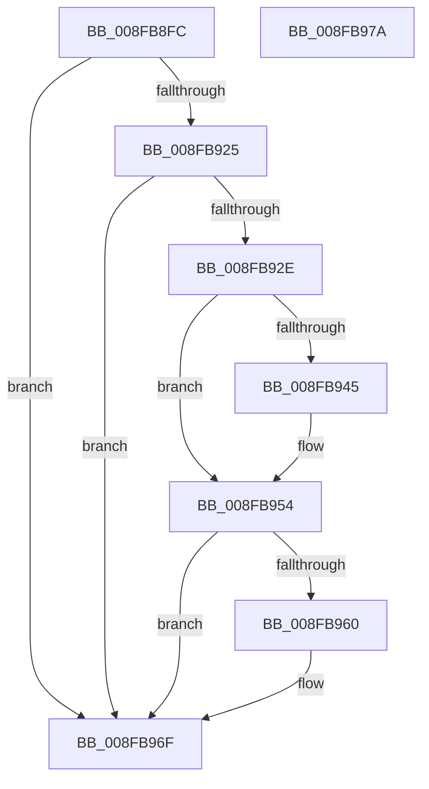

# PipSetDevNodeUserFlags

- RVA: `0x008FB8FC`–`0x008FB97B` (길이 `127` bytes)
- VA: `0x00000001408FB8FC`
- 실행 섹션: `PAGE`
- PDB 이름 있음: `예`; PDB Function 태그: `아니요`
- unwind 정보 RVA: `0x0005CAAC`
- 디코드: `33`개 명령, `127/127` bytes 표시
- 미해석 바이트: `0` (있으면 어셈블리에 `.byte`로 보존)

> 이 문서는 커널 이미지의 기계어와 PDB 기호를 분석해 생성했습니다. 4번과 5번은 함수 원형과 자료형을 바이너리 사용 방식에서 추정한 C 해석이며 원본 소스 복구 결과는 아닙니다.

## 1. Dependencies

- 직접 호출 지점: **3**; 고유 호출 대상: **1**
- 직접 호출자로 확인된 함수: **12**
- RIP 상대 이미지 참조: **0**

### Outgoing calls
- `0x008FB934` → [PnpRaiseNtPlugPlayDevicePropertyChangeEvent](PnpRaiseNtPlugPlayDevicePropertyChangeEvent_function_008F7D80.md) (function, `0x008F7D80`)
- `0x008FB94F` → [PnpRaiseNtPlugPlayDevicePropertyChangeEvent](PnpRaiseNtPlugPlayDevicePropertyChangeEvent_function_008F7D80.md) (function, `0x008F7D80`)
- `0x008FB96A` → [PnpRaiseNtPlugPlayDevicePropertyChangeEvent](PnpRaiseNtPlugPlayDevicePropertyChangeEvent_function_008F7D80.md) (function, `0x008F7D80`)

### Direct callers
- [PnpRemoveLockedDeviceNode](../../text/47/PnpRemoveLockedDeviceNode_function_004702AC.md) at `0x004704CE`
- [sub_006F3B38](../../text/6F/Unknown_function_006F3B38.md) at `0x006F3B53`
- [PnpShutdownDevices](../72/PnpShutdownDevices_function_00723F20.md) at `0x00723FF5`
- [PnpShutdownDevices](../72/PnpShutdownDevices_function_00723F20.md) at `0x0072404C`
- [PnpShutdownDevices](../72/PnpShutdownDevices_function_00723F20.md) at `0x0072406B`
- [PnpCancelRemoveLockedDeviceNode](../72/PnpCancelRemoveLockedDeviceNode_function_0072CFE0.md) at `0x0072CFFA`
- [PnpQueryRemoveLockedDeviceNode](../72/PnpQueryRemoveLockedDeviceNode_function_0072D210.md) at `0x0072D269`
- [PiProcessSetDeviceProblem](../72/PiProcessSetDeviceProblem_function_0072D668.md) at `0x0072D771`
- [PiProcessQueryDeviceState](PiProcessQueryDeviceState_function_008FA0F8.md) at `0x008FA19B`
- [PiProcessQueryDeviceState](PiProcessQueryDeviceState_function_008FA0F8.md) at `0x008FA1B1`
- [PiProcessQueryDeviceState](PiProcessQueryDeviceState_function_008FA0F8.md) at `0x008FA2AB`
- [PiProcessNewDeviceNode](../A2/PiProcessNewDeviceNode_function_00A28F20.md) at `0x00A2909D`
- [PnpTrackQueryRemoveDevices](../AC/PnpTrackQueryRemoveDevices_function_00ACCF54.md) at `0x00ACCFA4`
- [sub_00B29934](../B2/Unknown_function_00B29934.md) at `0x00B29B5F`
- [sub_00B33FE8](../B3/Unknown_function_00B33FE8.md) at `0x00B34195`
- [IopInitializePlugPlayServices](../../init/C2/IopInitializePlugPlayServices_function_00C2F298.md) at `0x00C2FD10`

### Static image references
- 디코드된 RIP-relative 메모리 참조가 없습니다.

## 2. Other-region calls and transfers

- 다른 실행 섹션으로 향하는 call: **0**
- 별도 외부 분기/꼬리 이동을 확인하지 못했습니다.

## 3. Assembly (complete function range)

```asm
008FB8FC  48 89 5C 24 08                  mov qword ptr [rsp + 8], rbx
008FB901  57                              push rdi
008FB902  48 83 EC 20                     sub rsp, 0x20
008FB906  8B B9 90 01 00 00               mov edi, dword ptr [rcx + 0x190]
008FB90C  48 8B D9                        mov rbx, rcx
008FB90F  F0 09 91 90 01 00 00            lock or dword ptr [rcx + 0x190], edx
008FB916  8B C7                           mov eax, edi
008FB918  33 81 90 01 00 00               xor eax, dword ptr [rcx + 0x190]
008FB91E  A9 47 03 00 00                  test eax, 0x347
008FB923  74 4A                           je 0x1408fb96f
008FB925  48 8B 51 30                     mov rdx, qword ptr [rcx + 0x30]
008FB929  48 85 D2                        test rdx, rdx
008FB92C  74 41                           je 0x1408fb96f
008FB92E  41 B8 0B 00 00 00               mov r8d, 0xb
008FB934  E8 47 C4 FF FF                  call 0x1408f7d80
008FB939  8B C7                           mov eax, edi
008FB93B  33 83 90 01 00 00               xor eax, dword ptr [rbx + 0x190]
008FB941  A8 40                           test al, 0x40
008FB943  74 0F                           je 0x1408fb954
008FB945  48 8B 53 30                     mov rdx, qword ptr [rbx + 0x30]
008FB949  41 B8 1D 00 00 00               mov r8d, 0x1d
008FB94F  E8 2C C4 FF FF                  call 0x1408f7d80
008FB954  33 BB 90 01 00 00               xor edi, dword ptr [rbx + 0x190]
008FB95A  40 F6 C7 04                     test dil, 4
008FB95E  74 0F                           je 0x1408fb96f
008FB960  48 8B 53 30                     mov rdx, qword ptr [rbx + 0x30]
008FB964  41 B8 1E 00 00 00               mov r8d, 0x1e
008FB96A  E8 11 C4 FF FF                  call 0x1408f7d80
008FB96F  48 8B 5C 24 30                  mov rbx, qword ptr [rsp + 0x30]
008FB974  48 83 C4 20                     add rsp, 0x20
008FB978  5F                              pop rdi
008FB979  C3                              ret
008FB97A  CC                              int3
```

## 4. C-style interpretation (structured pseudocode)

```c
__int64 __fastcall PipSetDevNodeUserFlags(__int64 a1, int a2)
{
    __int64 result;
    __int64 v_rdi;
    __int64 v_rsp;
    unsigned __int64 v_stack_p8;

    v_stack_p8 = v_rbx;
    v_rsp = (v_rsp) - (32);
    result = (unsigned int)(((unsigned int)((unsigned int)((unsigned int)(*(unsigned int *)(a1 + 400))))) ^ (*(unsigned int *)(a1 + 400)));
    if ((((unsigned int)(result)) & (839)) == 0) goto loc_008FB96F;
    if (*(unsigned __int64 *)(a1 + 48) == 0) goto loc_008FB96F;
    result = PnpRaiseNtPlugPlayDevicePropertyChangeEvent(a1, *(unsigned __int64 *)(a1 + 48), 11, a4);
    result = (unsigned int)(((unsigned int)((unsigned int)((unsigned int)(*(unsigned int *)(a1 + 400))))) ^ (*(unsigned int *)(a1 + 400)));
    if ((((unsigned __int8)(result)) & (64)) != 0) {
        a2 = *(unsigned __int64 *)(a1 + 48);
        a3 = 29;
        result = PnpRaiseNtPlugPlayDevicePropertyChangeEvent(a1, a2, a3, a4);
    }
    v_rdi = (unsigned int)(((unsigned int)(*(unsigned int *)(a1 + 400))) ^ (*(unsigned int *)(a1 + 400)));
    if ((((unsigned __int8)(v_rdi)) & (4)) != 0) {
        a2 = *(unsigned __int64 *)(a1 + 48);
        a3 = 30;
        result = PnpRaiseNtPlugPlayDevicePropertyChangeEvent(a1, a2, a3, a4);
    }
    v_rsp = (v_rsp) + (32);
    return result;
}
```

## 5. (Beta) C Style

```c
int64_t PipSetDevNodeUserFlags(void *Arg1, int32_t Arg2)
{
    uint8_t *arg1 = (uint8_t *)Arg1;

    int64_t result;
    int64_t local_rdi;
    int64_t local_rsp;
    uint64_t v_stack_p8;

    v_stack_p8 = local_rbx;
    local_rsp = (local_rsp) - (32);
    result = (uint32_t)(((uint32_t)((uint32_t)((uint32_t)(*(uint32_t *)(arg1 + 0x190))))) ^ (*(uint32_t *)(arg1 + 0x190)));
    if ((((uint32_t)(result)) & (839)) == 0) goto loc_008FB96F;
    if (*(uint64_t *)(arg1 + 0x30) == 0) goto loc_008FB96F;
    result = PnpRaiseNtPlugPlayDevicePropertyChangeEvent(Arg1, *(uint64_t *)(arg1 + 0x30), 11, a4);
    result = (uint32_t)(((uint32_t)((uint32_t)((uint32_t)(*(uint32_t *)(arg1 + 0x190))))) ^ (*(uint32_t *)(arg1 + 0x190)));
    if ((((uint8_t)(result)) & (64)) != 0) {
        Arg2 = *(uint64_t *)(arg1 + 0x30);
        a3 = 29;
        result = PnpRaiseNtPlugPlayDevicePropertyChangeEvent(Arg1, Arg2, a3, a4);
    }
    local_rdi = (uint32_t)(((uint32_t)(*(uint32_t *)(arg1 + 0x190))) ^ (*(uint32_t *)(arg1 + 0x190)));
    if ((((uint8_t)(local_rdi)) & (4)) != 0) {
        Arg2 = *(uint64_t *)(arg1 + 0x30);
        a3 = 30;
        result = PnpRaiseNtPlugPlayDevicePropertyChangeEvent(Arg1, Arg2, a3, a4);
    }
    local_rsp = (local_rsp) + (32);
    return result;
}
```

### 관측된 메모리 오프셋

구조체 형식이 확인되지 않은 접근은 인자 기준의 오프셋으로만 기록했습니다.

| 기준 인자 | 오프셋 표현 | 폭 (bit) | 접근 |
|---|---:|---:|---|
| `Arg1` | `+ 0x30` | `64` | `R` |
| `Arg1` | `+ 0x190` | `32` | `R` |
| `Arg1` | `+ 0x190` | `32` | `R/W` |

## 6. Execution-region graph

[열기: 2D/3D 그래프와 함수 탐색 컨트롤 패널](../../../control-panel.html?section=page&rva=0x008FB8FC&view=graph)

- 2D 그래프는 위에서 아래로 흐르고, 3D 그래프는 빈 공간을 드래그해 회전합니다. Shift+드래그는 이동, 휠은 확대·축소, 함수 노드 선택은 대상 보고서 이동입니다.

### Static fallback


