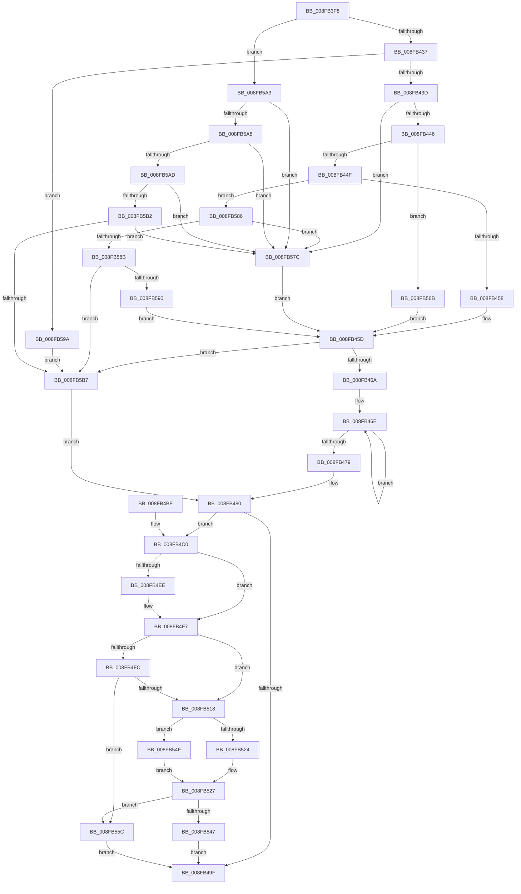

# PnpAllocateAndEnableEventWatchdog

- RVA: `0x008FB3F8`–`0x008FB5C0` (길이 `456` bytes)
- VA: `0x00000001408FB3F8`
- 실행 섹션: `PAGE`
- PDB 이름 있음: `예`; PDB Function 태그: `아니요`
- unwind 정보 RVA: `0x00087E04`
- 디코드: `125`개 명령, `456/456` bytes 표시
- 미해석 바이트: `0` (있으면 어셈블리에 `.byte`로 보존)

> 이 문서는 커널 이미지의 기계어와 PDB 기호를 분석해 생성했습니다. 4번과 5번은 함수 원형과 자료형을 바이너리 사용 방식에서 추정한 C 해석이며 원본 소스 복구 결과는 아닙니다.

## 1. Dependencies

- 직접 호출 지점: **4**; 고유 호출 대상: **4**
- 직접 호출자로 확인된 함수: **1**
- RIP 상대 이미지 참조: **0**

### Outgoing calls
- `0x008FB492` → [ExAllocatePool2](../../poolcode/B8/ExAllocatePool2_function_00B820F0.md) (function, `0x00B820F0`)
- `0x008FB50F` → [RtlUnicodeStringCopyString](../../text/47/RtlUnicodeStringCopyString_function_00471270.md) (function, `0x00471270`)
- `0x008FB53A` → [PnpEnableWatchdog](PnpEnableWatchdog_function_008FB5C8.md) (function, `0x008FB5C8`)
- `0x008FB561` → [ExFreePoolWithTag](../../poolcode/B8/ExFreePoolWithTag_function_00B82870.md) (function, `0x00B82870`)

### Direct callers
- [PnpDeviceEventWorker](../95/PnpDeviceEventWorker_function_009556B0.md) at `0x009558A2`

### Static image references
- 디코드된 RIP-relative 메모리 참조가 없습니다.

## 2. Other-region calls and transfers

- 다른 실행 섹션으로 향하는 call: **3**
  - `0x008FB492` → [ExAllocatePool2](../../poolcode/B8/ExAllocatePool2_function_00B820F0.md) (`PAGE` → `POOLCODE`)
  - `0x008FB50F` → [RtlUnicodeStringCopyString](../../text/47/RtlUnicodeStringCopyString_function_00471270.md) (`PAGE` → `.text`)
  - `0x008FB561` → [ExFreePoolWithTag](../../poolcode/B8/ExFreePoolWithTag_function_00B82870.md) (`PAGE` → `POOLCODE`)
- 별도 외부 분기/꼬리 이동을 확인하지 못했습니다.

## 3. Assembly (complete function range)

```asm
008FB3F8  48 89 5C 24 08                  mov qword ptr [rsp + 8], rbx
008FB3FD  48 89 6C 24 10                  mov qword ptr [rsp + 0x10], rbp
008FB402  48 89 74 24 18                  mov qword ptr [rsp + 0x18], rsi
008FB407  57                              push rdi
008FB408  41 54                           push r12
008FB40A  41 55                           push r13
008FB40C  41 56                           push r14
008FB40E  41 57                           push r15
008FB410  48 83 EC 20                     sub rsp, 0x20
008FB414  8B 91 88 00 00 00               mov edx, dword ptr [rcx + 0x88]
008FB41A  45 33 E4                        xor r12d, r12d
008FB41D  48 8B F1                        mov rsi, rcx
008FB420  45 8B F4                        mov r14d, r12d
008FB423  45 8B FC                        mov r15d, r12d
008FB426  41 8B EC                        mov ebp, r12d
008FB429  45 8D 6C 24 01                  lea r13d, [r12 + 1]
008FB42E  83 FA 07                        cmp edx, 7
008FB431  0F 8F 6C 01 00 00               jg 0x1408fb5a3
008FB437  0F 84 5D 01 00 00               je 0x1408fb59a
008FB43D  41 2B D5                        sub edx, r13d
008FB440  0F 84 36 01 00 00               je 0x1408fb57c
008FB446  41 2B D5                        sub edx, r13d
008FB449  0F 84 1C 01 00 00               je 0x1408fb56b
008FB44F  41 2B D5                        sub edx, r13d
008FB452  0F 85 2E 01 00 00               jne 0x1408fb586
008FB458  B8 B0 00 00 00                  mov eax, 0xb0
008FB45D  48 8D 2C 01                     lea rbp, [rcx + rax]
008FB461  48 85 ED                        test rbp, rbp
008FB464  0F 84 4D 01 00 00               je 0x1408fb5b7
008FB46A  48 83 CF FF                     or rdi, 0xffffffffffffffff
008FB46E  48 FF C7                        inc rdi
008FB471  66 44 39 64 7D 00               cmp word ptr [rbp + rdi*2], r12w
008FB477  75 F5                           jne 0x1408fb46e
008FB479  66 41 03 FD                     add di, r13w
008FB47D  66 03 FF                        add di, di
008FB480  0F B7 D7                        movzx edx, di
008FB483  B9 40 00 00 00                  mov ecx, 0x40
008FB488  48 83 C2 50                     add rdx, 0x50
008FB48C  41 B8 50 70 64 57               mov r8d, 0x57647050
008FB492  E8 59 6C 28 00                  call 0x140b820f0
008FB497  48 8B D8                        mov rbx, rax
008FB49A  48 85 C0                        test rax, rax
008FB49D  75 21                           jne 0x1408fb4c0
008FB49F  48 8B 5C 24 50                  mov rbx, qword ptr [rsp + 0x50]
008FB4A4  49 8B C6                        mov rax, r14
008FB4A7  48 8B 6C 24 58                  mov rbp, qword ptr [rsp + 0x58]
008FB4AC  48 8B 74 24 60                  mov rsi, qword ptr [rsp + 0x60]
008FB4B1  48 83 C4 20                     add rsp, 0x20
008FB4B5  41 5F                           pop r15
008FB4B7  41 5E                           pop r14
008FB4B9  41 5D                           pop r13
008FB4BB  41 5C                           pop r12
008FB4BD  5F                              pop rdi
008FB4BE  C3                              ret
008FB4BF  CC                              int3
008FB4C0  48 8B 86 A0 00 00 00            mov rax, qword ptr [rsi + 0xa0]
008FB4C7  48 89 43 08                     mov qword ptr [rbx + 8], rax
008FB4CB  8B 46 10                        mov eax, dword ptr [rsi + 0x10]
008FB4CE  89 43 10                        mov dword ptr [rbx + 0x10], eax
008FB4D1  8B 86 88 00 00 00               mov eax, dword ptr [rsi + 0x88]
008FB4D7  89 43 14                        mov dword ptr [rbx + 0x14], eax
008FB4DA  8B 46 14                        mov eax, dword ptr [rsi + 0x14]
008FB4DD  89 43 18                        mov dword ptr [rbx + 0x18], eax
008FB4E0  0F 10 46 78                     movups xmm0, xmmword ptr [rsi + 0x78]
008FB4E4  F3 0F 7F 43 1C                  movdqu xmmword ptr [rbx + 0x1c], xmm0
008FB4E9  4D 85 FF                        test r15, r15
008FB4EC  74 09                           je 0x1408fb4f7
008FB4EE  41 0F 10 07                     movups xmm0, xmmword ptr [r15]
008FB4F2  F3 0F 7F 43 2C                  movdqu xmmword ptr [rbx + 0x2c], xmm0
008FB4F7  48 85 ED                        test rbp, rbp
008FB4FA  74 1C                           je 0x1408fb518
008FB4FC  48 8D 43 50                     lea rax, [rbx + 0x50]
008FB500  66 89 7B 42                     mov word ptr [rbx + 0x42], di
008FB504  48 8D 4B 40                     lea rcx, [rbx + 0x40]
008FB508  48 89 43 48                     mov qword ptr [rbx + 0x48], rax
008FB50C  48 8B D5                        mov rdx, rbp
008FB50F  E8 5C 5D B7 FF                  call 0x140471270
008FB514  85 C0                           test eax, eax
008FB516  78 44                           js 0x1408fb55c
008FB518  48 8B 86 A0 00 00 00            mov rax, qword ptr [rsi + 0xa0]
008FB51F  48 85 C0                        test rax, rax
008FB522  75 2B                           jne 0x1408fb54f
008FB524  49 8B CC                        mov rcx, r12
008FB527  48 8D 41 38                     lea rax, [rcx + 0x38]
008FB52B  48 8B D3                        mov rdx, rbx
008FB52E  48 F7 D9                        neg rcx
008FB531  41 8B CD                        mov ecx, r13d
008FB534  4D 1B C0                        sbb r8, r8
008FB537  4C 23 C0                        and r8, rax
008FB53A  E8 89 00 00 00                  call 0x1408fb5c8
008FB53F  4C 8B F0                        mov r14, rax
008FB542  48 85 C0                        test rax, rax
008FB545  74 15                           je 0x1408fb55c
008FB547  48 89 03                        mov qword ptr [rbx], rax
008FB54A  E9 50 FF FF FF                  jmp 0x1408fb49f
008FB54F  48 8B 80 38 01 00 00            mov rax, qword ptr [rax + 0x138]
008FB556  48 8B 48 28                     mov rcx, qword ptr [rax + 0x28]
008FB55A  EB CB                           jmp 0x1408fb527
008FB55C  33 D2                           xor edx, edx
008FB55E  48 8B CB                        mov rcx, rbx
008FB561  E8 0A 73 28 00                  call 0x140b82870
008FB566  E9 34 FF FF FF                  jmp 0x1408fb49f
008FB56B  4C 8D B9 A8 00 00 00            lea r15, [rcx + 0xa8]
008FB572  B8 B8 00 00 00                  mov eax, 0xb8
008FB577  E9 E1 FE FF FF                  jmp 0x1408fb45d
008FB57C  B8 A8 00 00 00                  mov eax, 0xa8
008FB581  E9 D7 FE FF FF                  jmp 0x1408fb45d
008FB586  41 2B D5                        sub edx, r13d
008FB589  74 F1                           je 0x1408fb57c
008FB58B  83 FA 02                        cmp edx, 2
008FB58E  75 27                           jne 0x1408fb5b7
008FB590  B8 AC 00 00 00                  mov eax, 0xac
008FB595  E9 C3 FE FF FF                  jmp 0x1408fb45d
008FB59A  4C 8D B9 A8 00 00 00            lea r15, [rcx + 0xa8]
008FB5A1  EB 14                           jmp 0x1408fb5b7
008FB5A3  83 EA 08                        sub edx, 8
008FB5A6  74 D4                           je 0x1408fb57c
008FB5A8  41 2B D5                        sub edx, r13d
008FB5AB  74 CF                           je 0x1408fb57c
008FB5AD  41 2B D5                        sub edx, r13d
008FB5B0  74 CA                           je 0x1408fb57c
008FB5B2  41 3B D5                        cmp edx, r13d
008FB5B5  74 C5                           je 0x1408fb57c
008FB5B7  41 0F B7 FC                     movzx edi, r12w
008FB5BB  E9 C0 FE FF FF                  jmp 0x1408fb480
```

## 4. C-style interpretation (structured pseudocode)

```c
__int64 __fastcall PnpAllocateAndEnableEventWatchdog(__int64 a1)
{
    __int64 result;
    __int64 v_r12;
    __int64 v_rdi;
    __int64 v_rsp;
    unsigned __int64 v_stack_p10;
    unsigned __int64 v_stack_p18;
    unsigned __int64 v_stack_p8;

    v_stack_p8 = v_rbx;
    v_stack_p10 = v_rbp;
    v_stack_p18 = v_rsi;
    v_rsp = (v_rsp) - (32);
    v_r12 = 0;
    if (((unsigned int)((unsigned int)(*(unsigned int *)(a1 + 136)))) > 7) goto loc_008FB5A3;
    if (((unsigned int)((unsigned int)(*(unsigned int *)(a1 + 136)))) == 7) goto loc_008FB59A;
    a2 = (unsigned int)(((unsigned int)(*(unsigned int *)(a1 + 136))) - ((unsigned int)(v_r12 + 1)));
    if (condition_is_equal) goto loc_008FB57C;
    a2 = (unsigned int)((a2) - ((unsigned int)(v_r12 + 1)));
    if (condition_is_equal) goto loc_008FB56B;
    a2 = (unsigned int)((a2) - ((unsigned int)(v_r12 + 1)));
    if (condition_is_not_equal) goto loc_008FB586;
loc_008FB45D:
    if (a1 + 176 * 1 == 0) goto loc_008FB5B7;
    v_rdi = (v_rdi) | (-1);
loc_008FB46E:
    v_rdi = (v_rdi) + 1;
    if ((*(unsigned __int16 *)(a1 + 176 * 1 + v_rdi * 2)) != 0) goto loc_008FB46E;
    v_rdi = (unsigned __int16)((v_rdi) + ((unsigned __int16)(v_r12 + 1)));
    v_rdi = (unsigned __int16)((v_rdi) + ((unsigned __int16)(v_rdi)));
loc_008FB480:
    a2 = ((unsigned __int16)(v_rdi)) + (80);
    result = ExAllocatePool2(64, a2, (unsigned int)(0x57647050ULL), a4);
    if (result != 0) goto loc_008FB4C0;
loc_008FB49F:
    v_rsp = (v_rsp) + (32);
    return 0;
loc_008FB4C0:
    *(unsigned __int64 *)(v_stack_p8 + 8) = *(unsigned __int64 *)(v_stack_p18 + 160);
    *(unsigned int *)(v_stack_p8 + 16) = (unsigned int)((unsigned int)(*(unsigned int *)(v_stack_p18 + 16)));
    *(unsigned int *)(v_stack_p8 + 20) = (unsigned int)((unsigned int)(*(unsigned int *)(v_stack_p18 + 136)));
    *(unsigned int *)(v_stack_p8 + 24) = (unsigned int)((unsigned int)(*(unsigned int *)(v_stack_p18 + 20)));
    *(unsigned __int64 *)(v_stack_p8 + 28) = v_xmm0;
    if (0 != 0) {
        *(unsigned __int64 *)(v_stack_p8 + 44) = v_xmm0;
    }
    if (v_stack_p10 == 0) goto loc_008FB518;
    *(unsigned __int16 *)(v_stack_p8 + 66) = (unsigned __int16)(v_rdi);
    *(unsigned __int64 *)(v_stack_p8 + 72) = v_stack_p8 + 80;
    result = RtlUnicodeStringCopyString(v_stack_p8 + 64, v_stack_p10, (unsigned int)(0x57647050ULL), a4);
    if (sign_flag) goto loc_008FB55C;
loc_008FB518:
    if (*(unsigned __int64 *)(v_stack_p18 + 160) != 0) goto loc_008FB54F;
loc_008FB527:
    a1 = -(0);
    a3 = ((unsigned int)(0x57647050ULL)) & (0 + 56);
    result = PnpEnableWatchdog((unsigned int)((unsigned int)(v_r12 + 1)), v_stack_p8, a3, a4);
    if (result == 0) goto loc_008FB55C;
    *(unsigned __int64 *)(v_stack_p8) = result;
    goto loc_008FB49F;
loc_008FB54F:
    goto loc_008FB527;
loc_008FB55C:
    a2 = 0;
    result = ExFreePoolWithTag(v_stack_p8, a2, a3, a4);
    goto loc_008FB49F;
loc_008FB56B:
    goto loc_008FB45D;
loc_008FB57C:
    goto loc_008FB45D;
loc_008FB586:
    a2 = (unsigned int)((a2) - ((unsigned int)(v_r12 + 1)));
    if (condition_is_equal) goto loc_008FB57C;
    if (((unsigned int)(a2)) != 2) goto loc_008FB5B7;
    goto loc_008FB45D;
loc_008FB59A:
    goto loc_008FB5B7;
loc_008FB5A3:
    a2 = (unsigned int)((a2) - (8));
    if (condition_is_equal) goto loc_008FB57C;
    a2 = (unsigned int)((a2) - ((unsigned int)(v_r12 + 1)));
    if (condition_is_equal) goto loc_008FB57C;
    a2 = (unsigned int)((a2) - ((unsigned int)(v_r12 + 1)));
    if (condition_is_equal) goto loc_008FB57C;
    if (((unsigned int)(a2)) == ((unsigned int)(v_r12 + 1))) goto loc_008FB57C;
loc_008FB5B7:
    goto loc_008FB480;
}
```

## 5. (Beta) C Style

```c
int64_t PnpAllocateAndEnableEventWatchdog(void *Arg1)
{
    uint8_t *arg1 = (uint8_t *)Arg1;

    int64_t result;
    int64_t local_r12;
    int64_t local_rdi;
    int64_t local_rsp;
    uint64_t v_stack_p10;
    uint64_t v_stack_p18;
    uint64_t v_stack_p8;

    v_stack_p8 = local_rbx;
    v_stack_p10 = local_rbp;
    v_stack_p18 = local_rsi;
    local_rsp = (local_rsp) - (32);
    local_r12 = 0;
    if (((uint32_t)((uint32_t)(*(uint32_t *)(arg1 + 0x88)))) > 7) goto loc_008FB5A3;
    if (((uint32_t)((uint32_t)(*(uint32_t *)(arg1 + 0x88)))) == 7) goto loc_008FB59A;
    a2 = (uint32_t)(((uint32_t)(*(uint32_t *)(arg1 + 0x88))) - ((uint32_t)(local_r12 + 1)));
    if (condition_is_equal) goto loc_008FB57C;
    a2 = (uint32_t)((a2) - ((uint32_t)(local_r12 + 1)));
    if (condition_is_equal) goto loc_008FB56B;
    a2 = (uint32_t)((a2) - ((uint32_t)(local_r12 + 1)));
    if (condition_is_not_equal) goto loc_008FB586;
loc_008FB45D:
    if (Arg1 + 176 * 1 == 0) goto loc_008FB5B7;
    local_rdi = (local_rdi) | (-1);
loc_008FB46E:
    local_rdi = (local_rdi) + 1;
    if ((*(uint16_t *)(arg1 + 0xB0 * 1 + local_rdi * 2)) != 0) goto loc_008FB46E;
    local_rdi = (uint16_t)((local_rdi) + ((uint16_t)(local_r12 + 1)));
    local_rdi = (uint16_t)((local_rdi) + ((uint16_t)(local_rdi)));
loc_008FB480:
    a2 = ((uint16_t)(local_rdi)) + (80);
    result = ExAllocatePool2(64, a2, (uint32_t)(0x57647050ULL), a4);
    if (result != 0) goto loc_008FB4C0;
loc_008FB49F:
    local_rsp = (local_rsp) + (32);
    return 0;
loc_008FB4C0:
    *(uint64_t *)(v_stack_p8 + 0x8) = *(uint64_t *)(v_stack_p18 + 0xA0);
    *(uint32_t *)(v_stack_p8 + 0x10) = (uint32_t)((uint32_t)(*(uint32_t *)(v_stack_p18 + 0x10)));
    *(uint32_t *)(v_stack_p8 + 0x14) = (uint32_t)((uint32_t)(*(uint32_t *)(v_stack_p18 + 0x88)));
    *(uint32_t *)(v_stack_p8 + 0x18) = (uint32_t)((uint32_t)(*(uint32_t *)(v_stack_p18 + 0x14)));
    *(uint64_t *)(v_stack_p8 + 0x1C) = v_xmm0;
    if (0 != 0) {
        *(uint64_t *)(v_stack_p8 + 0x2C) = v_xmm0;
    }
    if (v_stack_p10 == 0) goto loc_008FB518;
    *(uint16_t *)(v_stack_p8 + 0x42) = (uint16_t)(local_rdi);
    *(uint64_t *)(v_stack_p8 + 0x48) = v_stack_p8 + 80;
    result = RtlUnicodeStringCopyString(v_stack_p8 + 64, v_stack_p10, (uint32_t)(0x57647050ULL), a4);
    if (sign_flag) goto loc_008FB55C;
loc_008FB518:
    if (*(uint64_t *)(v_stack_p18 + 0xA0) != 0) goto loc_008FB54F;
loc_008FB527:
    Arg1 = -(0);
    a3 = ((uint32_t)(0x57647050ULL)) & (0 + 56);
    result = PnpEnableWatchdog((uint32_t)((uint32_t)(local_r12 + 1)), v_stack_p8, a3, a4);
    if (result == 0) goto loc_008FB55C;
    *(uint64_t *)(v_stack_p8) = result;
    goto loc_008FB49F;
loc_008FB54F:
    goto loc_008FB527;
loc_008FB55C:
    a2 = 0;
    result = ExFreePoolWithTag(v_stack_p8, a2, a3, a4);
    goto loc_008FB49F;
loc_008FB56B:
    goto loc_008FB45D;
loc_008FB57C:
    goto loc_008FB45D;
loc_008FB586:
    a2 = (uint32_t)((a2) - ((uint32_t)(local_r12 + 1)));
    if (condition_is_equal) goto loc_008FB57C;
    if (((uint32_t)(a2)) != 2) goto loc_008FB5B7;
    goto loc_008FB45D;
loc_008FB59A:
    goto loc_008FB5B7;
loc_008FB5A3:
    a2 = (uint32_t)((a2) - (8));
    if (condition_is_equal) goto loc_008FB57C;
    a2 = (uint32_t)((a2) - ((uint32_t)(local_r12 + 1)));
    if (condition_is_equal) goto loc_008FB57C;
    a2 = (uint32_t)((a2) - ((uint32_t)(local_r12 + 1)));
    if (condition_is_equal) goto loc_008FB57C;
    if (((uint32_t)(a2)) == ((uint32_t)(local_r12 + 1))) goto loc_008FB57C;
loc_008FB5B7:
    goto loc_008FB480;
}
```

### 관측된 메모리 오프셋

구조체 형식이 확인되지 않은 접근은 인자 기준의 오프셋으로만 기록했습니다.

| 기준 인자 | 오프셋 표현 | 폭 (bit) | 접근 |
|---|---:|---:|---|
| `Arg1` | `+ 0x0 + rax*1` | `64` | `R` |
| `Arg1` | `+ 0x10` | `32` | `R` |
| `Arg1` | `+ 0x14` | `32` | `R` |
| `Arg1` | `+ 0x78` | `128` | `R` |
| `Arg1` | `+ 0x88` | `32` | `R` |
| `Arg1` | `+ 0xA0` | `64` | `R` |
| `Arg1` | `+ 0xA8` | `64` | `R` |

## 6. Execution-region graph

[열기: 2D/3D 그래프와 함수 탐색 컨트롤 패널](../../../control-panel.html?section=page&rva=0x008FB3F8&view=graph)

- 2D 그래프는 위에서 아래로 흐르고, 3D 그래프는 빈 공간을 드래그해 회전합니다. Shift+드래그는 이동, 휠은 확대·축소, 함수 노드 선택은 대상 보고서 이동입니다.

### Static fallback


